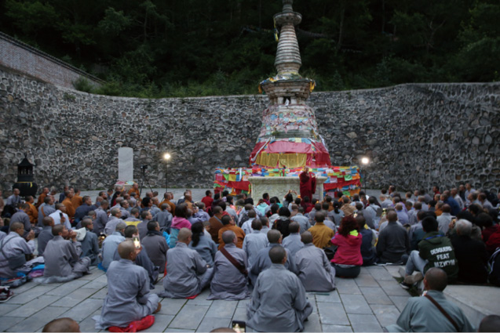
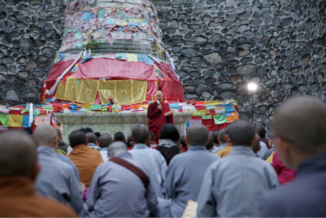
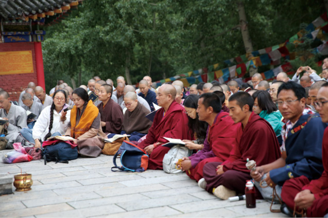

# 金刚窟开示

2017年7月27日

我先简单介绍一下。这座佛塔是佛护论师的遗塔，叫做布达巴拉塔，藏文是“桑结将”。学过中观的人都知道，如理如实解释龙猛菩萨观点的，是月称论师和佛护论师。关于佛护论师，历史上有不同的说法。其中一种说法是，他从印度来到这里，然后在这里虹身成就。以此因缘，人们称此塔为布达巴拉塔。是这样的一个地方。

另外，这里还有个布玛莫扎祖师的山洞，但一直没有开放。西日桑哈、嘉纳思扎、布玛莫扎都是我们大圆满的祖师，其中布玛莫扎祖师在这里虹身成就。莲花生大士是永久的虹身成就，而布玛莫扎是暂时的虹身成就。他一直在这里，每过一百年在藏地化现一个化身，弘扬大圆满法。贤劫千佛全部成佛之后，布玛莫扎的虹身会重新到印度金刚座，示现成佛。这在许多历史资料中，都有明确的记载。

这个地方非常殊胜，平时很少有人知道。今天，我们依靠种种努力，这么多人集聚在一起，很不容易。今天正好是释迦牟尼佛转法轮日，时间也很殊胜。等会儿，我们在这里念一下《普贤行愿品》。

还有一件事情，原本这边结束以后，大家就去塔院寺吃个早饭，然后在塔院寺发愿。但现在情况有点变化，待会儿可能直接坐车到那边发愿，早饭不一定吃得上。今天吃饭不是很重要，发愿比较重要。在释迦牟尼佛的转法轮日，大家饿一天，记忆更深刻一点。

其实，我们昨天就订好了餐厅，各方面都准备好了。但是，如果我们不提早一点，很多发愿就完不成。大家也知道，平时十几、二十个人集聚在这里，都有一定的困难。具体的我不多说。

我在这里给大家结上一个法缘，念一下布玛莫扎的《杰珍心滴》前行的传承。这个前行传承，我早在1987年就放到了念诵集里，《系解脱》好像也是1987年7月放到念诵集的。以前成都的都江堰旁边，有个国际大都会。上师如意宝在那里住院的时候，我请人抄了下来。虽然自己修得不多，但这方面的法门得的确实比较多。

我们面前这座布达巴拉塔，是佛护论师的遗塔，也少有人知道。布玛莫扎的山洞，今天人太多了，没办法都去。我们的时间比较紧，要赶快到塔院寺去念《普贤行愿品》。因为还有很多事情，我就不多说了。下面，我给大家念传承。今天的缘起是，我站着给大家传法。

（堪布念传承）

大家跟着我念一遍：嗡啊吽 格热布玛拉莫扎 吽吽

以上念了布玛莫扎的祈祷文。原来我们来五台山的时候，大家从学院一直念到这里。这是法王如意宝在清净显现中来过的地方——法王在学院时，梦里来过。当时这里没有路，所以没办法上来。

接下来我们念《普贤行愿品》，之后一部分人到机场去。一部分人今天回不去，就零零散散地，直接到塔院寺念《普贤行愿品》。我原来计划，在今天12点之前，最好念三遍。前往机场的人也要念三遍。

昨天在善财洞，我也说到了这座白塔，大多数人当时没有看到。今天零零散散地，还要去那边。今天是特殊的日子，大家要多念《普贤行愿品》。如果没有其他事情，大家下午回来之后也要念。中午那边不知道能不能念。我们昨天场面比较大，有关部门比较重视，这是正常的。我原来也给你们讲过，心里要做好各方面的准备。这么多人集聚在一起，现在是很难的。

大家念完《普贤行愿品》后，就直接去那边发愿。今天是转法轮日，又跟上师如意宝的很多发愿有直接的关联。这里的山洞，一个一个去有些困难，大家就在这里发愿。

布玛莫扎祖师就在这里，他看得见我们，我们看不到他——他已经变成了虹光身。《杰珍大圆满》和《布玛心滴》主要的传承者就是布玛莫扎。我们以前也说过，《布玛心滴》以后会跟大家结上善缘。这部法非常殊胜。下面我们念《普贤行愿品》来回向。
