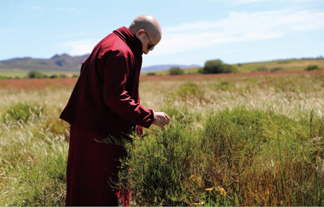

## 金刚萨埵的修法

2018年5月21日

今天讲金刚萨埵的修法。首先给大家念三个传承，一个是明天开始的法会要念诵的《金刚萨埵修法仪轨》，另外是法王如意宝以前造的《金刚萨埵修法·如意宝珠》，然后是《开显解脱道》。

（堪布念传承）

今天所讲的金刚萨埵忏悔法门，其实以前也讲过。喇荣举行了二十多年的金刚萨埵法会，对于今年的法会，很多道友甚至没有信仰的人都比较关心。虽然不同地方有不同的算法，但按照藏地普遍公认的历算，每年藏历四月萨嘎月，是三个特别的节日集聚、具有特殊加持力的月份，因为本师释迦牟尼佛在这个月降生、成道以及示现涅槃。

上师如意宝建立学院后不久，喇荣每年都举行四个法会：藏历一月神变月的持明法会、藏历四月萨嘎月的金刚萨埵法会、藏历六月明净月的普贤云供法会（又称地藏法会，其间有初转法轮日）、藏历九月天降月的极乐法会。

学院已有近四十年历史，这些年来，四大法会都没有间断地举行。最近，因为一些特殊情况，为了佛学院、喇荣寺的管理，我们现在举行的法会算是小型的。以前的法会规模比较大，人比较多；最近几年的法会并不太大，只在我们内部举行。当然，即便是内部的法会，也可能有很多人参与。

其实这些节日不仅跟我们喇荣有关，而且跟全球的佛教徒都有关。虽然不同地方的历算有些不同，但各地很多佛教徒都非常重视这些节日。比如，新加坡和东南亚的很多国家在卫塞节[^1]（南传佛教纪念本师释迦牟尼佛诞生、成道、涅槃的节日）有大型的庆典，汉地的寺院在佛成道日、涅槃日等日子都有不同的法会。

全世界不同的宗教徒对自己的宗教节日都非常重视，就像佛教徒对佛陀的这些节日很重视一样。大家可能清楚，相对其他地方和宗教，参与我们佛教节日的人数其实很少，像泰国的佛教节日，可能有几十万人同时集聚在同一个场合。

以前在印度、缅甸等地，虽然有佛教徒参与一些佛教节日，但参与人数跟其他宗教的节日相比还是很少。比如中东地区的一些宗教节日，从照片、电视可见，他们的宗教场所人山人海；另外，参与基督教节日的人也非常多。相对之下，我们集聚的人数不足挂齿，非常少。

这次我们没有举行大型的法会，只不过是内部念诵而已。不管是哪个地方的佛教徒，如果你有意乐，都可以在自己的家里，或者所在的道场、寺院、中心等地方，一起纪念本师释迦牟尼佛。佛教徒为了这个目的，应该各自以信心、虔诚心来做一些仪式，这是非常有必要的。当然，不管你在哪个国家、哪个地方，都应该以合法、如理如法的方式来做这些仪式，这就非常好。

## 把握忏悔的机会

值此佛教节日，按照上师如意宝二十多年的传统，现在我给大家简单地讲解忏悔的方法。忏悔真的非常重要，作为一名佛教徒，如果没有忏悔而带着很多罪业前往来世，那确实非常遗憾。所以，我觉得金刚萨埵法会非常重要！

很多人可能表面上非常有才华、有能力、有智慧，但如果自己去思考或者说反省，会发现，无论是即生还是无始以来，无论别人知不知道，我们都造过很多罪业。如果你明知自己有那么多罪业，却不管它并把它带到后世，那的确不合理。不要说佛教徒，就连一些世间人也觉得，如果没有发露忏悔今生所犯的罪业，是非常不合理的。

有一部小说——名字我就不说了，因为说出来不知道会不会变成正面还是负面的广告。当然，小说的故事也许是虚假，也许是真实的。故事的主人翁在孩提时代，用40秒杀了一个人，那时候没有人知道这件事情。40年过去了，主人翁有非常成功的事业、和睦的家庭、显赫的名声，成功人士该有的一切他都具足了。不过，他心里还是放不下杀人的事情。虽然他没有受到法律制裁，别人也不知道他的过去，但是他觉得在离开人世之前，应该把自己的罪过发露于世间。他的家人都不同意他这样做，他们不想让别人知道自己家里有一个杀人犯，但最后主人翁还是非常勇敢地告诉世人自己曾经杀过人。这是世间的一个案例。

在佛教层面，即生中把握忏悔罪业的机会很重要，因为人什么时候结束短暂的一生而前往来世，真的很难说。就像龙猛菩萨在《中观宝鬘论》中说：“死魔无声瞬间至，生命如同风中灯。”意思是：谁都难以确定死亡之魔会在何时到来，它可能瞬间就现前；我们的生命十分无常，就像风中的灯火一样，很快就会被风吹灭。大家今天在此世间很好地、健康地活着，但过一段时间或者明年的现在，还能不能活在这个世间呢？非常难说！所以大家很有必要把握忏悔的机会。

## 忏悔不只是佛教的说法

有些人错误地认为，忏悔只是佛教的说法，或者只是小部分人的说法。其实从科学、心理学的角度，忏悔是“表露”，即表达出自己所犯的罪业，也就是发露忏悔。他们认为，如果一个人没有忏悔，而在心里隐藏着自己所犯的很多罪业，这对他自身的健康会有负面影响，比如睡眠状况不好、免疫力下降等。因为这个人为了保守自己罪业的秘密，让身心承受很大压力，以致身体上有很大消耗。

一旦他忏悔或者说表露罪业，这会让他的健康、心态等很多方面有所获益，比如免疫力会提升。所以，人们非常有必要去坦然面对自己违犯道德的行为，最好在不同场合发露忏悔。以上是现代心理学的说法。

很多宗教都有不同形式的忏悔方法。世界上比较大的宗教如伊斯兰教，他们的《古兰经》把忏悔的行为称为“讨白”，就是把自己的罪业在真主面前发露忏悔，从而获得真主的宽恕。讨白分为一般讨白、特殊讨白和临终讨白。特殊讨白的罪业有些相当于我们佛教的破四根本戒，就是杀人、偷盗等非常严重的罪业；临终讨白是忏悔生前偶然的疏失或者尚未忏悔的罪业。

他们觉得最好不要带着罪业离开人世，所以临终之前要忏悔。可能大家也知道，他们清净罪业的条件有些相当于我们的四对治力：对以前所犯的罪业有后悔心、发誓以后不再做、在圣尊面前忏悔，至于忏悔、酬补的方式和行动，他们也有各种各样的。

如果有人想研究一些宗教，最好亲身到耶路撒冷，那是三大宗教——伊斯兰教、犹太教和基督教的圣地。犹太教的教徒会在那里的哭墙前真诚地忏悔，有些人会从早到晚在哭墙前念忏悔文和祈祷，有时候看起来比一些佛教徒还虔诚。犹太教专门有个十天的赎罪节，是在犹太历新年（一般是西历九十月）的前十天。赎罪节的第十天是赎罪日，当天他们要守25个小时（第九天黄昏到第十天天黑）的斋戒，有些相当于我们的八关斋戒——他们在那天不吃不喝，放下一切工作，只做忏悔和祈祷。

至于基督教，可能大家也知道，他们忏悔的罪业主要分几个方面：违犯法律、违背真理以及违背圣者或者上帝的教诲。

天主教跟基督教有些不同，听说有些天主教徒每天都忏悔。有时候电影中也有天主教忏悔的场景，像《非诚勿扰》中有一个人从3点一直忏悔到6点，最后神父也受不了了。天主教的很多教堂里有告解室，就是用来忏悔的小房间，神父坐在隔板的一面，然后忏悔者在隔板的另一面跟他发露自己的罪业。天主教徒在平时的祷告中也有一些忏悔的内容，也会让他们的孩子做洗礼。有些宗教认为，人类本来就是带着罪业来到这个世界的，为此也需要忏悔。

另外，道教也有忏悔。《太上感应篇》说：一个人如果一天做三件善事，坚持三年一定会感受好的果报；如果他一天做三件恶事，这样持续三年而没有好好地忏悔，那一定会感受不幸的果报。道教信仰三官——天官、地官、水官以及很多其他的官，官应该是指神灵。按照道教的一些说法，信徒要在天神、地神和水神面前一一地发露忏悔自己违背良心、违背大自然的所作所为。他们有很多跟佛教不一样的忏悔方式。

儒家虽然没有特别的忏悔仪轨，但相关的教诲也说：一个人于同样的错误最好不要犯第二次——“不贰过”；每个人都应该反省自己——“吾日三省吾身”；每个人都会犯错——“人非圣贤，孰能无过”。儒家认为，犯了错误的人若能改过自新，仍然可以变成一个好人。关于忏悔，儒家着重于理论，他们没有特别的、宗教性的忏悔仪轨。

## 忏悔之必要

不管怎样，在此世间我们都需要什么呢？需要忏悔。大家可以想一想，尤其是今天自我反省的时候，自己从小到现在，有没有造过一些别人不知道但自己知道的罪业？你不难发现，自己确实做过一些违背良心、违反道德的行为。作为佛教徒，在受了别解脱戒、菩萨戒、密乘戒之后，可能由于自己烦恼深重、愚痴，在有意无意间轻毁了学处、对戒律不恭敬等等。即便是没有宗教信仰的人，以前也肯定因为年少无知、没有人生经验和社会阅历等种种原因，而造了很多罪业。

以前有位六十多岁的人，觉得自己在特殊的年代做了很多违背良心的事情，他不想把这些罪业带到死后，所以写了一篇文章，叙述了他在那个年代做了哪些不好的事情。文章发表后，跟作者同年代、同龄的很多人，也开始讲述他们在那个年代所造下的很多罪业。同样，无论你记不记得，我们肯定都造了很多罪业，为此我们要在诸佛菩萨面前一一忏悔，这确实非常重要。

在修行层面，如果你相续中的罪业没有清净，你会因为业力深重，以致修本尊或者其他法的验相不能呈现，就像一面完全被灰尘盖染的镜子，不可能显现任何影像。上师在《忠言心之明点》中提到，如果我们用四对治力的布来擦拭自相续的镜子，那所有生起次第和圆满次第的境界会自然现前[^2]。所以，从自身修行来说，忏悔也非常重要。

历代高僧大德，包括大圆满的一些祖师，也力求忏悔清净曾经所犯的罪业，这从他们的传记中可以看出来。有位祖师在年轻的时候犯了很多谤法罪，入道后为了忏悔，他准备把自己的舌头割断。但他的上师告诉他，把舌头割断也没有用，你若想把罪业忏悔清净，那么就造相关的论典[^3]。

大家可以反省自己的人生，好好地扪心自问：“以前没有信仰的时候，是不是造过很多谤佛、谤法、谤僧——诽谤三宝的口业？内心对三宝，特别对僧众，是不是产生过邪见、害心等许许多多恶心？身体行为方面，是不是造过很多杀盗淫妄等各种罪业？”我们不可能没有造过罪业，如果它们一直与我们的相续并存，那对自己的今生来世都有害。

世间很多人不一定承认来世，但是他们也会在临终时忏悔，因为临死的时候他们有种负罪感。他们觉得作为一个堂堂正正的人，应该坦坦荡荡地面对发生过的事情，所以一定要把所造的罪业告诉世人，他们忏悔的目的仅此而已。

作为佛教徒，大家都知道人不仅只有这一世，不是这一世过完了就一了百了，众生的相续会延续下去，未来还要经历生生世世。如果你的相续造了很多恶业，那将来就要不断地感受痛苦。《大宝积经》云：“假使经百劫，所作业不亡，因缘会遇时，果报还自受。”即使过了一百个劫，自己所造的业也不会在期间耗尽、消亡。

确实，有些人得了一些特别奇怪的病，就算到各大医院找专家检查，有时候也诊断不出任何结果。这是什么原因呢？可能是很早以前造下的业，如果今生没有亲身感受果报，便无法清净。佛陀说业力不可思议，这是千真万确的。大家要明白，现在自己的相续有怎样的业，也许你自己并不清楚，但在因果的明镜中，业显得清清楚楚，果报总会成熟。所以，大家要好好地忏悔、清净罪业，这非常有必要！

## 依四对治力来忏悔

忏悔的时候，我们的心一定要非常诚恳。最近很多人开始念修金刚萨埵心咒，大家修的时候一定要具足四种对治力。我们每年都讲四种对治力——所依对治力、厌患对治力、返回对治力和现行对治力。很多人理论上都知道、文字上都明白，但实际上你能不能真的依靠四种对治力来把罪业忏悔清净呢？很难说，因为你可能观想得不到位，不够虔诚，念不完所要求的金刚萨埵心咒数量，或者没有质量，可能只是口头上的念诵而已。

但不管怎样，相对于不忏悔，忏悔还是有功德的。至少像世间人一样，忏悔后心里比较舒服，感到某种程度的解脱，所以人们觉得忏悔非常有用。至于佛教的忏悔，你们可以选择在自己的一些上师、道友面前，发露自己以前所造的罪业。当然，如果你不太愿意跟他们发露，比如担心道友听了后，会说“哇，这个人是坏人，以前他干过什么什么”，那不如发自内心地在金刚萨埵佛面前忏悔。

所依对治力，就是忏悔时候的依靠处。我们发菩提心的时候也有这样的，如佛陀或者善知识，都可以作为我们依止的对境。其他宗教也有他们的依靠处，像神父、阿訇，他们的教徒就在这些对境面前认罪。忏悔的时候，佛教徒最好的依靠处就是金刚萨埵佛。

很多续部都提到，金刚萨埵发过誓愿：“如果将来破誓言、破戒律、有罪障的人念诵我的名号、咒语，而我没有出现在他们面前，不能清净他们的罪业，那我誓不成佛；但愿我能成佛，清净他们的罪业。”现在金刚萨埵已经成佛了，他的誓愿肯定不虚，以此原因，十方诸佛中消除罪业最殊胜的就是金刚萨埵佛。每尊佛都有不同的特点，就像世间有不同的专业一样，我们在金刚萨埵面前忏悔，就是所依对治力。

大家在修的时候，可以在面前放金刚萨埵的小唐卡或者佛像。如果是灌过顶的密乘弟子，以及有一些生圆次第基础的，可以观金刚萨埵的双身像，很多修法都是这样观的，我们的仪轨也有双身像的观法；如果是密宗基础不太稳固的道友，可以观金刚萨埵的单身像，就像法王如意宝造的《金刚萨埵修法·如意宝珠》里所描述的一样。大家可以根据自己的意乐和根基，在双身或者单身的佛像面前忏悔。

明天法会开始，大家修的时候一定要尽量观想金刚萨埵。如果你实在观想不清楚也不要紧，可以在心里想：“金刚萨埵佛就在我的前面，我在这尊佛面前忏悔无始以来所造的一切罪业。”

今天用了通俗易懂的方式来给大家讲解所依对治力，再简单地讲一下厌患对治力——对于自己以前所犯的罪业，不管是杀人、偷盗、邪淫还是其他不如法的行为，都特别有后悔心，像一个后悔服了毒药的人一样。乔美仁波切也说“昔所造罪如服毒[^4]”，即对于自己以前所造的恶业，如同服了毒药的人一样，为此特别伤心、后悔，这就是厌患对治力。

然后是现行对治力。现行对治力的方法比较多，比如念咒语、念《三十五佛忏悔文》、礼佛等等。现在，我们最主要的现行对治力就是念咒语。《手金刚三威猛调伏续》中说：“如若持诵此（金刚萨埵）心咒十万遍，则破根本誓言亦得清净。”麦彭仁波切在《金刚萨埵修法仪轨》中也引用了这个教证。上师如意宝在解释这个教证时说，以前圆满劫的时候是念十万遍，但在末法时代要翻四倍，所以现代的众生最好念四十万遍金刚萨埵心咒。因此，我们现在每年都念四十万遍。

希望大家从明天开始的七八天内（法会期间），尽量念完四十万遍金刚萨埵心咒。法会期间我们会用麦彭仁波切的仪轨，每天修四座，第一座是早上7-9点，第二座是早上10-12点，第三座是下午2-4点，第四座是下午5-7点。

希望大家，不管是常住还是临时来参加的道友，都在经堂和各自的地方好好地念诵金刚萨埵心咒。如果你们能参与每一座，以及在座间不间断地念诵，那是很好的。因为每一座的后面我们都会念《普贤行愿品》发愿回向，而念诵一遍《普贤行愿品》的功德是非常不可思议的。虽然，我们没有像其他宗教那样大范围地集聚好几万人，但是我们也有相当多的信众，如果大家共同发愿，其功德也确实不可思议，所以大家尽量不要散乱。

我也希望发心人员可以在法会期间轮流上座修法，最好每个人能够至少参加两天。管理人员应该让发心人员有宽裕的时间来参与法会，如果他们在这七八天都只是发心，没有上座，那对他们来说是很可惜的。我们都不知道自己什么时候死，也许明年萨嘎月的时候你已经投身为一只小虫或者其他众生，这真的很难说。所以，希望大家尽快完成四十万遍的念修，对于自己犯过的罪业，在金刚萨埵佛像、僧众、十方诸佛菩萨面前忏悔，这的确是非常难得的机会！

你们最好在法会期间念完四十万遍金刚萨埵心咒，这属于上等人。虽然现在很多年轻人觉得什么都是平等的，不喜欢上等、中等、下等的说法，但我还是要说：如果你是最精进的，能够在这七八天或者十天左右念完四十万遍心咒，就是上等人。如果你每天早晚念仪轨，中间非常认真地以止语的方式念心咒，不说任何乱七八糟的话，就像闭关一样，那在七八天念完四十万遍是没有问题的。

大家对吃饭的要求不要太高，这边有些人问：“吃饭怎么办？”我说：“入乡随俗吧，僧众吃什么，其他人就吃什么。”如果有些人实在是为了吃饭而来，那也没办法。各地佛教道场的佛教徒，不要花太多心思和时间在饮食上。以前法会的时候，有些人一直不讨论修法的事情，只是谈论什么好吃，什么不好吃，对饮食特别重视。当然，你可以吃好一点，但我觉得这不是很重要，反正我们这辈子好吃、不好吃的都吃了很多，没有什么好贪执的。

话说回来，最精进的人，如果每天念五六万遍金刚萨埵心咒，很快就能念完四十万遍；中等的人，看看能不能在一至六个月之内念完；如果这也不行，你们最晚要在一年内念完。我在微博上也是这样说的。

大家不要懒惰，我担心很多人离开圣地后，甚至一句心咒也不念，又沉迷在红尘中。如果短时间之内你实在念不完，那在一年内念完四十万遍心咒，也能清净罪业。有些处于城市的人忙于工作、发心，也有些道友忙于修加行、闻思修——确实有些人很精进，没有时间，如此你也应该最晚在一年内念完四十万遍心咒。

我对自身也有要求，很想在法会期间念完四十万遍心咒，但确实每天都忙不过来，许多事情纷至沓来，这几天根本没有时间念修。我心底里真的很想好好地忏悔，因为从入佛门到现在，自己有意无意地造了很多罪；至于无始以来所造的罪业，就更不用说了，肯定有很多罪障。因此，我很想把握有生之年非常难得的忏悔机会，在僧众、诸佛菩萨作证下真诚地忏悔。

这次法会，我很高兴那么多人有共同忏悔的机会。假如你们用经论、人间的道德规范来衡量自己学佛前的各种行为，可能会发现自己在这世间犯了很多罪业。这不用问别人，有些罪业是你的兄弟姐妹、父母、伴侣、道友等等都不知道的，但你自己应该清楚。

有些人则整天处于一种强烈的负面情绪中，经常哭着：“啊，我是个罪人！”大家不要偏堕两边。一方面有忏悔心是很好的，忏悔确实很重要；但另一方面，不能总认为“我实在是个罪人”，这样无济于事，也不可取。佛教的确有许多方便，只要我们好好地忏悔，罪业肯定会清净的。

《中观四百论》云：“由于诸人类，多持不善品，以是诸异生，多堕于恶趣。”因为凡夫人会造很多恶业，死后大多数都堕入到三恶趣（地狱、饿鬼、旁生），所以大家要忏悔。圣天论师说得对，大家有目共睹：世间中许多有信仰的人经常不守规矩，犯了很多罪；没有信仰的人就更不用说了，他们不信因果、不承认前后世——“不见后世，无恶不造”，肯定造了许许多多罪业。

大家若要清净罪业，这次要好好地忏悔；否则，将来有没有这种机会也很难说。而且，大家忏悔的时候心要诚恳。以前，这里有些居士在七天中一直非常认真地念诵忏悔文，他们对生活方面没有什么要求，吃的、穿的、住的都非常简单。希望各地的佛教徒都有如此诚恳的忏悔心，如此一来，当你们跟僧众一起念《普贤行愿品》回向的时候，大家都能得到不可思议的功德。

之前，我再三地跟大家说不一定非要来喇荣参加法会。因为无论你在何处，大家共同发愿的话，所得的功德都没有差别。有些人可能没有亲自来到法会念诵的现场，但实际上只要你念修的时候有忏悔心，罪业就完全可以清净。

我们讲《前行》的时候提到：“罪业虽无功德，但依忏悔令其清净，就是罪业的功德[^5]。”《大乘本生心地观经》中也说：“若起殷重心，一念求忏悔，如火焚山泽，众罪皆销灭。”这个教证很重要，我以前也引用过[^6]。有些人以前在世间无恶不作，比如杀人或者做了其他非常严重的罪业，但若现在非常真诚地以四种对治力，一心一意地念金刚萨埵心咒来忏悔，那通过金刚萨埵佛咒语（嗡班匝儿萨埵吽）忏悔和菩提心的力量，所有的罪业都能得以清净，就像火能焚烧山野、山泽一样。

有些孩子做了错事，会祈求父母：“我以后再也不做了，爸爸、妈妈你可不可以原谅我？我特别伤心，很后悔，我再也不这样了。”如此会得到父母的宽恕、原谅。同样，大家这次念四十万遍金刚萨埵心咒的同时，如果能在诸佛菩萨面前发誓今后再不造恶，这是最上等的；如果有些人实在做不到，但暂时有殷重心、忏悔心，那么罪业也可以在一定程度上清净。这非常重要。

希望道友们这次好好地忏悔，如此罪业会得以清净。以前某个地方有位比较出名的人诽谤佛法，自己建立了一些所谓的禅修中心、基金会，做了很多事情。他觉得自己有一定的开悟，获得了阿罗汉果位。后来他得了癌症，临死的时候才明白原来自己是增上慢，没有境界。于是他特别后悔，向全世界公开忏悔。当然，大家没有必要等到临死之前才忏悔，应该在这次法会就好好地念修金刚萨埵。

## 念咒时应持之见解

大家都知道汉地有很多很好的忏悔方式，这次我们依靠金刚萨埵法门来忏悔，也是非常好的。这次法会所念诵的仪轨和咒语，也非常简便易行。另外，上师如意宝也讲过，大家念金刚萨埵心咒的时候要发音清楚，不要念得过快。不然“班匝、班匝”的，你也不知道自己在念什么，大家最好把咒语中六个字的发音清晰地念出来。

另外，大家念诵期间要观想金刚萨埵，在圣尊前好好地忏悔自己无始以来所造的罪业。当然，我们是凡夫人，有些人内心的禅定力量比较差，不一定能完全观得出来。根据《大幻化网光明藏论》所说，金刚萨埵就是咒语，咒语就是金刚萨埵——本尊跟咒语无二无别，这是密法中很重要的见解。

所以，一方面我们可以观想一面二臂的金刚萨埵，这是佛尊的一种形象；另一方面，实际上我们的心就是金刚萨埵，我们念诵的咒语“嗡班匝儿萨埵吽”（ཨོཾ་བཛྲ་ས་ཏྭ་ཧཱུྃ།）及其声音、文字，也是金刚萨埵，这是密宗很重要的见解。

当然，没有这种见解的道友可以观想：非常庄严的本尊金刚萨埵在自己前方的虚空中，自己作为一位罪人在圣尊面前忏悔，之后圣尊发光并降下甘露，让自己的罪业得以清净。至于持有很好见解的道友，可以观金刚萨埵就是自己的心和咒语，这就是圣尊跟咒语无二无别。《大幻化网·光明藏论》中的《咒语品》专门阐释了这个见解，一些密法班和学过此论的道友，应该在这次共修时用上这种见解。如果你已经不太记得了，那应该翻书看看。

以前上师如意宝在有关法会的开示中说“心净则国土净”，我们应该安住于等净无二的见解中念修金刚萨埵。大家可以在如如不动的境界中，依自心就是金刚萨埵的见解来忏悔，这是最高境界的忏悔，是忏悔之王；如果你暂时做不到，也可以像外续部中的观想方法一样，观想本尊金刚萨埵赐予自己悉地；如果这也不行，什么也观不起来，那只是念完四十万遍金刚萨埵心咒也是很好的，因为咒语的力量不可思议。

## 金刚萨埵心咒之功德

《金刚萨埵修法仪轨》后面的小字介绍了心咒的功德，其中有许多很好的教证：

《集密意续》中说：“三时诸佛之本体具德金刚萨埵六字心咒，何者耳闻此咒语名，证明曾于众多佛尊前行事，将来必定生于金刚萨埵佛刹，蒙诸佛的加持。[^7]”

希望你们用心地看看这个仪轨后面的小字。一些佛教徒在信仰方面特别迷茫，有时候随便看到一位上师就“哇”地叫出来，可是当听到介绍真正的佛和咒语功德的时候就不专注了；一些人只想多求加持品——虽然加持品也重要，但最重要的是我们内心的智慧教育。

那天我在飞机上看到一个人，明显是个佛教徒，因为他身上有转经轮，这是有信仰的标志，是很好的。但这样的佛教徒即使有虔诚的信心，智慧也还要更加增上。

我们必须知道现在所修之法的功德。如果你不断地念“嗡班匝儿萨埵吽、嗡班匝儿萨埵吽”，却不知道它的功德，那是不够的。你们看着我的脸不会受益，应该看法本、仪轨，看看《集密意续》如何介绍这个咒语的功德，这是《金刚萨埵修法仪轨》后面小字所讲的第一个功德。

第二个功德出自刚才引用过的教证：

《手金刚三威猛调伏续》中说：“如若持诵此心咒十万遍，则破根本誓言亦得清净。”

此处说念诵十万遍心咒能清净破根本誓言、戒律的罪业，但法王补充说，末法时代要念四十万遍。各位要反思自己有没有这方面的罪业，也要看仪轨后面的这些小字。

第三个功德：

《摄真如续》中云：“金刚萨埵之名号，纵然持诵一次数，此即恒常大护持，刹那获得成就也。”

罪业清净的相有很多，这在《释迦牟尼佛广传》中也提到过，比如梦到自己穿白色的衣服、天降甘露等等。

第四个功德：

胜乐金刚、喜金刚、密集金刚、时轮金刚、黑日嘎、普巴金刚童子此一切本尊实际均是金刚萨埵。

有些人说：“我要修时轮金刚”“我要修密集金刚”“我要修普巴金刚”……其实这些本尊在本体上是一样的。所以，我们念金刚萨埵心咒，就等于把诸佛菩萨浩瀚如海的咒语，全部汇集在一起念了。

确实，我以前就很喜欢念修金刚萨埵，因为一来觉得自己无始以来肯定有很多罪业，二来看了麦彭仁波切介绍金刚萨埵的功德——所有本尊如普巴金刚、时轮金刚等等，都跟金刚萨埵无二无别。

第五个功德：

金刚萨埵往昔曾经如是发愿：“愿我住于所有失毁誓言者面前，而清净彼等一切障碍。”

第六个功德：

仅仅忆念这一本尊咒便能清净失坏罪障。

你们想一想，仅仅是忆念、念诵金刚萨埵心咒便能清净失毁誓言的罪业，可见此心咒的功德确实很大。

1994年，上师如意宝从青海的年宝湖中开取了金刚萨埵的伏藏，之后降魔胜利洲专门修了很多金刚萨埵的咒语，法王说以后金刚萨埵法门会在汉地广泛地弘扬。正如上师如意宝的授记，包括后来的金刚萨埵法会，从共修的报名人数和念修数量可以知道，很多人对此法门有很大信心。

金刚萨埵修法不仅是一种息业，也是自宗主修的法门之一，因此我们自己一定要依此实修出一些境界来。大家参加法会不应只关心吃什么——“稀饭还是馒头？”这方面不是什么很重要的悉地，最重要的是我们要念修金刚萨埵。

最后是总结：

总而言之，十方三世诸佛归集为金刚萨埵。

十方三世——过去、现在、未来、上下等诸方的佛陀都归集于金刚萨埵。麦彭仁波切是真实语者，不管是学院的上师如意宝或者宁玛巴的传承弟子，还是全世界很多真正的佛教徒，都知道麦彭仁波切的金刚语是无欺和有分量的。他在前面也引用教证说了，我们遇到金刚萨埵心咒，证明我们承侍过诸佛。有些人认为：“我刚刚皈依佛门，以前都没有皈依过。”其实，按照这里的说法，我们以前应该在不同的地方相遇过，只是大家不记得而已。

所有密咒明咒归摄为六字真言，因而此本尊心咒的功德利益不可思议。

你们要看看麦彭仁波切写的这段小字，包括一些“老油条”。现在有些人修法没有感觉，可能是因为累了、疲厌了，一些学得久的人甚至觉得这是因为自己已经成就了……但是，即使你已经成就，也应该没有法王的境界——以前上师如意宝在每次法会期间，都非常认真地共修这些咒语，所以大家也要重视！

[^1]: 卫塞节是一个已获得联合国承认的节日，现定于新历5月的第一个月圆之日（一般为农历4月15日）。经中国佛教协会前会长赵朴初居士倡议，汉传佛教界将农历4月15日定为“佛吉祥日”；北传佛教把佛诞（浴佛节）定于农历4月8日。
[^2]: 《忠言心之明点》：“自心觉界水晶镜，客尘障碍遮覆时，难现深明等持影，四力白布应勤拭。”
[^3]: 《大圆满前行讲解》第136课：“文殊友躬身顶礼而泣不成声，心里暗想：‘我已经侮辱了这位化身，信口开河说了许多辩论之词，所以必须斩断自己的舌头来作忏悔。’想到这里便寻找刀刃。化身极喜金刚知道他心中所想，于是说：‘罪业不会因为你斩断舌头而得清净，撰著一部超越因果的殊胜论典吧，这样一来可以净除罪业。’”
[^4]: 《极乐愿文》：“若无悔心忏不净，昔所造罪如服毒，以大惭畏悔忏罪。”
[^5]: 《大圆满前行讲解》第114课：“每个道友都应把握好这次机会，清净罪业。前辈大德常讲：‘罪业虽无功德，但依忏悔令其清净，就是罪业的功德。’可见，罪业是可以清净的，但要清净它，一定要依靠四种对治力。”
[^6]: 《大圆满前行讲解》第115课：“《大乘本生心地观经》亦云：‘若起殷重心，一念求忏悔，如火焚山泽，众罪皆销灭。’意思是，如果真正知道惭愧，并以殷重心一心忏悔，那么即使造的业再大，也会像火焚山泽一样，将所有罪障在短短时间内全部忏净。”
[^7]: 此教证的后面还说：“于大乘获得定解，具备神通，拥有胜观慧眼，必定成为佛子。”
