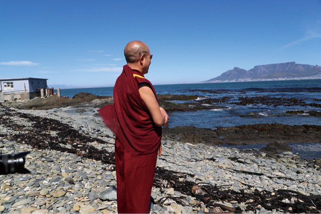

## 预科系2018届新班开学典礼

2018年7月28日

今天是我们网络佛教大学的开学典礼。这个典礼比较特殊，没有主持人和其他仪式，只有我来跟大家做介绍。跟以往的开学典礼有点不同，这次我们尽量把程序简化。

今天是个非常吉祥的日子，也可能是大家人生中一个特别的新开始，或者是重新发愿、重新塑造自己人生的特殊日子。在此良辰吉日，我简单地跟大家讲一下今年我们学佛方面的一些事情。

大家都知道，发起这颗想学佛的心非常不容易。在茫茫无边的轮回中，人们何曾想着要闻思修行？何曾生起发菩提心的念头？现在，大家因为前世和今生的各种善缘集聚，暂时生起了这样的心，真的非常难得。

今天，在现场参加我们开学典礼的，除了一些居士、法师外，更重要的是管理学会的法师们都在。首先我趁此机会，特别感谢发心法师们多年以来非常用心、了不起的付出。确实，我们的法师们为了管理好学会让大家好好地学习，他们舍弃了自私自利心，不顾自己的闻思修行，只是无条件、任劳任怨地付出，完全是以利他心和包容心来发心。

当今世界上的大部分事情，都离不开感情、金钱、地位的交易。如果没有很明显的利益，人们很少自愿无条件地付出。不过，这里有一群法师默默无闻地帮我做了很多有意义的事情，所以我先在此感谢我们管理团队所有发心的法师，以及各地学会的发心人员！

这也包括今年新班的许多发心人员。其实，他们以前是自己班里的管理或辅导人员，是最近几年才培养出来的。今天的现场有很多引导者，他们都是通过次第性的学习，然后有这样为三宝、上师、众生发心的机会。

为什么我刚才提到，今天对很多人来说也许是个特别的开始呢？你们一部分人以前已经有信仰，但有些人从来都没有信仰，甚至一度把佛学视为迷信、陈旧的思想。现在因为种种因缘，这些人都加入了学会。

我们这个群体，一方面来说非常简单，你不用交钱，想参加的话就可以加入，没有人会阻止你离开或者对你罚款；另一方面也不简单，有些人纵使学了十多二十年，但仍在不断地学习，也一直服从我们各层的管理，而自己也发愿不断地闻思显密教法。

离合是世间的正常现象，有些人留在我们群体的时间特别长，有些则特别短。就像两个人结婚以后，有些夫妻会白头到老，老年的时候还会互相照顾；有些夫妻会在非常短的时间内——两三天甚至一夜就分道扬镳。在我们这个学佛团体，有些人一直持之以恒、非常坚定地发心；有些人会在发心的过程中半途而废，甚至可能产生各种邪见，最后误入歧途、堕入恶趣，这种情况还是有的。

今天，大家自由自主地加入学佛的行列，也为此发愿，但你的学习能不能善始善终呢？这是个问号。同样，我自己能不能永远维持、组织这样的群体或者活动呢？很难说。因为我的生命和心态是无常的，世间中的一切都是无常的。但不管怎样，作为大乘佛教的修行人，我们不能因为无常就对任何事情都产生“出离心”——放弃，这不是智者的行为。

除了一些留级的学员外，大多数新班的学员都在六月开始学习《离幸福很近》。在学习这本书的时候，你们新学员可以看看自己能否适应这种学习方式，摸索一下。到了八九月，我们会开始分班，你们可以报净土、加行等班级，以后也可以报五论班。

鉴于有些人对藏传佛教不太感兴趣，我们现在还开了学经班，专门学习汉传佛教的经典。如果你对《妙法莲华经》《药师经》《普贤行愿品》《六祖坛经》等经典有兴趣和信心，那你可以报学经班。而我们估计大多数的新学员会选什么班呢？应该还是“前行班”或者“入行论班”。

## 要长期、系统地学佛

大家可以认真地思考：一方面学习真的不简单，如果你没有一定的勇气和坚强的发心，那要完成一个课程是非常困难的；但另一方面，如果你自己很诚心、发心很大，要完成一个课程也不是什么难事。

今天，趁此开学典礼的机会，我想提醒大家：你们有自由去选择学或不学；不过，一旦你决定去学习，那不管遇到任何情况，最好坚持下去，如此对你的生活、修行和工作都会有好处。

学习任何一门知识都不是那么简单，过程中可能会有不同的困难。在我们提供的课程中，除了中观、因明某些部分可能比较难，其他的知识对很多人来说并不难。我们学员的水平一届比一届高，对你们而言，学习《大圆满前行》《入菩萨行论》应该比较容易。

虽然我们的课程难度不高，但大家也需要付出一些时间。比如，我们安排大家用三年半时间修完五十万加行，有些人认为我们把课时拖得太长，他们觉得自己用短暂的一年多时间就能完成。其实，一些老道友可能也记得，我原来很想安排大家在一年内修完加行，但之后发现这对大部分城市人来说并不现实。他们要工作，还要处理生活中的各种事情，最终我们才确定了三年半的课程安排。

有些人认为：“哇，用三年半修加行，时间拖得太久了，我们应该能在短时间内修完。”事实上，根据我们的统计，能在一年内修完加行的人不到1%。有极个别道友的生活条件非常好，他们不用做什么事情，包括孩子也可以交给保姆照料，自己可以专注于修加行，所以能在半年、一年内修完。这种情况是有的，但我们的规划要考虑到大部分人的现实情况。

如果你们大部分——比如60%以上的人，认为要花三年半来修加行，时间太长，那通过大家反馈，我们也可以把修读年期缩短。其他预科系和正科系的课程也可以这样安排，如此你们便能在一两年这么短的时间内毕业，很快地拿到毕业证——现在一些佛学院的学制也是两年而已。

当然，我们给你们办毕业证是没有问题的，反正毕业证只是一张纸，但这是否代表你们的佛学水平就达到了可以毕业的程度呢？很难说，尤其是高深的知识，不是一两年便能掌握的。

在世间角度，现在孩童在一些幼儿园学习两年也不能毕业，需要三年，这方面不同地方有不同要求；在小学要学习六年，一名小学毕业生共计已经学习了八九年；在初中要学习三年，一名初中毕业生共计学习了九年（不算幼儿园）或者十二年。虽然学习了这么久，但初中毕业生在当今社会还是很难找到工作。

如果我们课程的修读年期定得太短，那可能同一届的幼儿园孩童仍未毕业，我们的“佛学大师”已经毕业了。我们可以帮你们制作毕业证，再盖章、签字，说明你已经从某某佛学院大学毕业，但你的个人素质和智慧是不是真正可以毕业——学修真正圆满了呢？

有些人认为学会的课时太长，前期的基础课程要半年，之后预科系和正科系的学习时间也很长。但我认为我们的课时并不长，如果没有这样串习，你的佛学水平应该连最基本的标准也达不到。你们都知道，小学生除了星期天以外，每天的上下午都在学习；而学会的课程，每周才一两堂课，如此你们在四年内上了多少堂课，大家心中有数。

另外，你们有些人不是很精进，甚至出勤率也不到50%。比如，在半年的学期中，我们安排了每个月有4节课，但有些人还要缺课，甚至一个月只听一节课。如此算来，虽然你觉得已经学习了很多年，但你实际的学习时长还不如一名小学生，他们的学习时间是早上8-12点，下午2-5点，有时候还有晚自习，试问我们佛学课的安排有这么紧密吗？总之，大家应该把佛教作为一门科学学问、专业知识来看待。

如果一些人觉得我们课程的学制或者修加行的时间太长，今天我很明确地跟大家表示，若60%以上的人能在两年内修完加行，那我们可以考虑把学制缩短。但是，根据长时间反复的调研和观察，我们发现很多人根本没有实修加行，或者修得不圆满，在三四年内修完加行的人不到50%。由此可见，一些佛教徒还不如世间的小学生精进。

其实，佛教徒要不要认真、系统地学习呢？如果你想做个非常自由的佛教徒，那可以什么都不学，除了念皈依偈“喇嘛拉嘉森切哦（皈依佛），桑吉拉嘉森切哦（皈依法）……”外，可以不懂其他的佛教道理。然后有人问你：“什么是十善、五戒、八正道、四摄、六度？”你就连这些带有数字的基本佛教名词，包括《大圆满前行》中的八无暇、十八大地狱是什么，也不了解。

以前有个人说十八大地狱是八个寒地狱、八个热地狱，以及噶玛巴黑帽和红帽。他并不是对噶玛巴不恭敬，只是因为他忘记了孤独地狱和近边地狱的名称，而当时噶玛巴家喻户晓，大家经常挂在嘴边，他就下意识地把两位大德混为地狱的名称。

事实上，带有数字的名相是基本的佛教知识，还没有涉及高深的佛教理论，如果有人问你：“说一说什么是六度？什么是四摄、八正道、七觉支？”作为佛教徒，若连这些简单的问题也答不上，那可能有点名不副实。当然，不同佛教徒的智慧还是有差别。因此，今天我首先要强调的是，大家要长期、系统地学习佛法。

其实，相对于藏传佛教的教育体系，你们的学习时长绝对不算多。你们可能清楚，喇嘛和觉姆在喇荣的基础学制是15年，其间是学基本课程。然后他们可能要考堪布、堪姆，之后还要学习更深奥的知识。在以前藏传佛教的佛学院，中观、因明等课程每个都至少要学两三年，总计要10到20年才能圆满五部大论的学习。

所以，对于学会的课程安排，大家不要觉得时间太长，其实一点都不长。我来了喇荣三十多年，但我觉得这样的学习时间一点都不长，还是学得太少、学得不够。如果时光可以倒流，我很想回到年轻时的日子重新学习，这是真心话。每次我讲解一部论典的时候，都会想：“如果有机会把这部论典再学一遍就好了！”

前阵子我们圆满了《大乘经庄严论》的讲闻，总计111堂课。在最后一节课那天，我想这也许是我生命中讲授《大乘经庄严论》的最后一堂课，以后再也没有机会讲这部法了。我发自内心地想：“如果时光可以倒流，我真的想把它再学习、讲解一遍，以及把相关的讲义再次翻译。”所以，大家不要认为我们的学习时间太长。

这是第一件事情。

## 不忘学佛的初心

今天，成都那边有些居士给了我一些1998年喇荣的明信片，是当时的一位记者拍摄的。那时候这几位居士还没有信仰，在得到这些明信片后，他们觉得这个地方很好，很感兴趣。这些明信片中有不同的照片，包括佛学院的标志性建筑——坛城，也有经堂、法王如意宝、我自己、慈诚罗珠堪布、丹增活佛，以及喇嘛和觉姆在供水的情景、汉人在听课的情景、为佛塔开光的情景、老山羊、尸陀林的秃鹫。另外，还有居士们在做大锅饭——准备给僧团供斋的照片。

为什么我选了这些照片呢？不是为了宣传。因为今天凌晨的时候，他们其中一位居士在电话中跟我说缘起很好，由1998年到今年2018年刚好是20年，还有他们第一次来喇荣的时候刚好是月食，而今天也是月食。

他们说如果当年没有来学院，便没有今天的自己。他们还觉得虽然自己学习得不好，但20年来对三宝的信心始终如一。从他们给我的留言，可以知道他们很感动，看来他们是一边流着泪一边留言的。他们做了20年佛教徒，到现在也非常虔诚，也是学会的负责人。

希望你们每一位都可以从学会成功毕业，不要总是参加开学典礼，却没有毕业的时候。无论如何，初心很重要，就像这几位居士，依靠一张照片来到我们这个红色的小世界，20年来信心一直不变。那颗红色的心从来没有变色，真的非常不容易，我也十分赞叹。

有些人来喇荣只是为了拍一些照片。那天我在回来的路上，遇见两个人举着一个纸牌，上面写着他们是刚毕业的大学生，求搭车。平时我们都不敢让陌生人搭车，但想到他们是大学生，可能没有路费，就让他们搭了。

他们上车后，我问他们：“你们要去哪里？”他们说：“不知道，凡是有红色房子的地方，我们就去。”我开玩笑说：“你们是不是到有红色房子的地方去唱红歌？”他们说：“我们以前就知道有这个红色的地方，想去拍照。”这是他们的目的。当时我跟他们说：“拍照很重要，但红色房子里住着穿红色衣服的人，穿红色衣服的人有着红色的心，红色的心有着非常红的智慧和悲心，如果你真的能拍出后者的照片，那才是最重要的。因为这就是红房子的精华。”他们应该没有听懂我的意思。

## 依靠团队学习来完成学业

不管怎样，在学佛的过程中，你们可能会遇到很多挑战和冲击。一般来说，很多新学员刚来我们初级班学习的时候，他们的热情很高，然后过些日子，有些人因为其他团体的宣传、自身的一些因缘、不适应这里的学习模式等等，最后就离开了。学会完全允许你们中途退学，来去几百人对学会的运作根本没有任何影响。但是，如果你真的想学习佛法，那以团队的方式来学习是很好的。

有些人认为：“我在家里自学也一样。”确实，现在全世界的通讯和信息传播都很发达，人们在家中就可以轻易地学到全世界的任何知识，包括哈佛大学、牛津大学、剑桥大学和耶鲁大学的线上课程，只要付费就可以了。

不过，这样能不能解决你学习过程中遇到的问题呢？其实不行。虽然现在网络很发达，但各地的大学、中学，或者任何的教育体系，若没有集体的管理、团队的学习，是不能做到真正的知识传递的。学生方面，依靠自学而完成所有课程的人，是非常罕见的。

同样，如果你在学佛的过程中掉队，或者离开了学佛团体，那你的学习很难圆满，除非你有一些特殊的功德，或者依止特殊的上师，像马尔巴尊者和米拉日巴尊者师徒那样。现在很多人特别喜欢这种一对一的教学模式，学会里也有这样的人。

有些人本来在加行班好好地学习，但后来中途退学，去跟自己特别有缘的人一对一学习。我想他们应该为自己选择了更光明的道路，应该会学得更好。可是，几年后当我再接触他们的时候，他们连基本的佛教知识也不懂。我想如果他们之前没有退出，一直跟道友们一起学习，现在可能会学得不错。所以，各位在学习方面需要有一种心态，什么心态呢？就是要发心把课程学完，这是最基本的。

## 学佛要有四种心

在学习佛法的过程中，大家要有四种心。

首先要有难得心。对任何人来说，能够即生学习大乘佛法真的很不容易，这是非常难得的机会，所以大家要有难得心。

第二，要有稳重心。如果你今天想学这个，明天想学那个，这种朝三暮四的人，不要说大乘佛教，就连世间的一门知识也可能学不会。所以大家要有稳重心，要持之以恒地学习。

第三，要有包容心。在学习的过程中，一般道友之间，特别是金刚道友之间，要学会宽容和沟通。有些人以前没有参与过群体生活，一旦加入新团体，就显得格格不入，跟谁都合不来，也没有集体管理的概念，这是不太好的。

所以，如果你们想在这里学习，可以先看看自己能不能合群。如果你只能独处，不能合群，或者你平时一见到其他人就生嗔心、贪心，那你可以不加入学习团体。但是，如果你选择加入我们这个团体，就要有一颗包容的心，因为这里有各种宗派、身份、年龄的人，包括身份很高的人、身份很低的人、八十多岁的老菩萨、二十岁出头的小菩萨等等，这些你都要接受。

在学习小组中，有些组员要中途退出的时候，大家会非常伤心；但有些组员要中途退出的时候，大家会非常开心。大家会说：“哇，这个人终于走了！他的脾气不好，说话声音也很大，他跟很多人的关系都不好，短时间内就破坏了我们的学习气氛。”确实，我们也不欢迎这种人。大家都在同一个团体中学习，因此不要对其他道友生嫉妒、嗔恨等恶心，应该要有包容心。

第四，要有感恩心。表面看来，大家在学会上一堂课好像是很简单的事情，但实际上背后有很多人在付出，包括我们的法师，以及给大家提供法本、制作光盘的团队。现在的管理工作也不容易，为了新生能够顺利学习，我们在各地都招了一些辅导员、管理员等等。他们有怎样的发心呢？就是为了让所有人学修圆满，不让任何一个人掉队。

另外，一些道友用各种方法来方便大家学习，比如提供道场、人力和财力。从各方面来看，大家能够学习一堂课确实不容易。有些人觉得“啊，这没有什么特别”，但事实并非如此。现在一些学生参加补课，你们看老师收费多少？一节课的最低收费是50元、100元，高则300元——1小时收费300元！他们到底在教什么呢？有时候我开玩笑说：“按照这样的价格，我一个小时应该可以……”

世间上的许多知识都要你的某种付出才能得到，但我们并不需要各位回馈任何金钱，也不要求你们在未来帮我们做事。三宝可以作证，我们是发自内心地希望：全世界的人都可以依靠佛法来遣除暂时的痛苦，最终获得究竟的快乐。我们这个学佛团体存在的目的，就是这么简单，因此我们不参与任何政治和商业活动。

为什么不参与政治呢？因为政治是一种非常敏感的自我主义。不管在国家、民族还是地缘层面，虽然政治在全世界是那么普遍，但它的本质还是一样。所以，佛教团体不能参与任何政治活动。

另外，我们的平台也不能涉及任何经济利益。有些佛教徒在做微店、微商，他们经常给自己的朋友发广告、做推销。如果你们把一些推销信息发到我们的平台上，那不太好。一方面我是不太忍心，因为在这个科技、信息发达的特殊时代，有些人的经济比较紧张，所以想要通过网络来销售产品，但我们毕竟是一个用来闻思修行的纯学习平台，所以大家不要把它用于商业方面。

同样，凡是带有一些商业目的的招徕，我自己一直都非常注意，从来不签名，也不拍照片。前段时间，五台山有一个人声称是我的侍者。一些道友把这个人的照片发给我，我可从来没有见过他，更别说是我的侍者了。之后，道友们安排我跟他通电话，他就非常紧张。

现在有些人明目张胆地骗钱，到处说“我是某大德的什么人”“我跟某大德有什么关系”，所以大家要注意，尤其是刚学佛、刚皈依的人，不要那么容易受骗。刚信佛的人一般有种冲动心，而信心和见解不太稳固。因此从今天开始，你应该好好地学习、充实自己，不要轻信别人，特别是那些招摇撞骗的人。否则，可能你的次第性修学还没圆满，便离开了这个团体，那就非常可惜。

以上讲了四种心——难得心、稳重心、包容心和感恩心。

## 学习要做笔记

今天参加典礼的新学员们，各位这次能够发心学佛，真的很不容易，因此一定要稳重地学下去。在学习的过程中，难免会遇到一些困难，但是，这些困难并不是特别难以克服，大家应该有信心去面对。

刚学佛的佛教徒不要太冲动，有些人会想：“啊，我开始学佛了！学佛太殊胜了，我要马上出家！”先不用考虑出家的问题，应该先好好地学习十年八年，如果到时候真有出家的心，那再实行也为时不晚。现在，红尘中的人们经常承受生活、工作上的压力，以及感情上的痛苦；很多人为了逃避痛苦，都想去一些寂静的地方——其实，这也并不是一般人所想象的那么容易。

当前各位应该对工作、家庭负责，更重要的是对自己的修行负责。要把修行作为自己生命中最重要的一件事情来对待，要发愿：“我在有生之年一定要好好地学习佛法。”我可以保证，如果坚持学习，你们在五六年后的境界一定会跟现在截然不同。前提是你要非常认真地学习，不能三心二意，否则，再过十年也不一定有进步。

现在，我们要求学会的每一位学员，从第一节课开始就要自己做笔记，你要把每堂课一些好的教证和重要的内容记下来。那天我看了一位道友的笔记本，他的笔记特别多，有十多本，都是从他开始学佛到现在所做的笔记。我粗略地看了一下，他每堂课都有做笔记，确实特别精进！

去年我要求教务处的法师们在今年做工作笔记，年底的时候让我查阅。不知道你们做了没有？到时候我可以先让你们看我的工作笔记，好吗？我会在笔记本上记录遇到的事情和自己的心态。每天我都是先把工作笔记写在小本子上，然后抄到大本子上。

总之，做笔记反映了一个人的学习态度。今天是你们开学的特别日子，我希望在这个新开始，你们可以用一种新的方式来学习。

## 五个相应

另外，大家不管学习什么，一定要跟这个时代相应。前段时间，我提到了几个相应：

第一，相应修行。我们以前可能有很多不太合理的习气，现在要通过学修来改变自己，从而对以前的生活方式作出一些改变，这就是相应学修。

第二，相应经论。大家的所学和所修，一定要相应于释迦牟尼佛的经典和前辈大德们的论典。若你的学修离开了经论，你的学修是不伦不类的，如此你花再多时间学修也没有用。

第三，相应生活。大家不要把自己的生活完全抛弃，只想：“啊，我现在开始学佛了，我就不上班，也不管孩子、丈夫了。”因为我们这里百分之七八十的佛教徒都是女性，所以我才从女士的角度说“不管丈夫了”。如果从男士的角度，就是“我不管妻子了”。如果你不管生活上的事情，会给你的家庭带来很大的困难，所以大家学佛的同时，不要影响生活和工作。

其实，在不影响生活与工作的情况下，是可以腾出时间来学习的，就像鲁迅先生说的：“时间就像海绵里的水，只要你愿意挤，总还是有的。”我在你们当中也许是最忙的，比如要经常参加学院的各种会议、讲课等等，但我每天的念诵、翻译从来没有中断。事实上，如果你的心力强大起来，应该可以合理地安排时间。

很多人以没有时间为借口：“啊，我太忙了，学不了啦。我要上班，所以没有时间。”其实，你上班的时候也可以挤出时间念咒、看书，你身处的环境不可能24小时都像锅炉一样高温、高压。就算是非常忙的人，包括一些我在飞机上遇到的，他们都在用各种方法来安排时间看书和完成自己的课程。

有些人说：“啊，这个课程压力太大了，听这么多课……”希望你们不要这样想。像一些西方学者，你看他们学了多少课程和多少门科学？精通了多少种语言？有些人以似是而非的理由来给自己找个好听的借口，这没有必要。

以上介绍了相应生活。

第四，相应科学。现在，全球大多数人都认同当今是一个科学时代。如果我们所学的知识没法以科学来论证，也许我们认为自己是正信，但别人会认为是迷信。所以，大家不管是说话还是做事，都要与科学相应。当然到目前为止，现在的科学仍然没办法印证佛法修行中个别的最深境界，但这不是重点。

佛教徒的行为和修行最好不要违背科学，因为现在的科学，可以与释迦牟尼佛的教理相应，只不过有时候人们的侧重点不同，或者还没有找到共同点而已。实际上，我们可以用科学来论证佛法，反之亦然。有些学者不认同这一点，“啊，不能用科学来论证佛法”或者“不能用佛法来论证科学”，但这只是学术界一部分人的说法而已。现在，大部分世间人都认同科学，所以佛教徒的行为跟科学相应是很重要的；而且佛教本来就跟科学知识不相矛盾，两者完全可以兼容。

第五，相应时代。现在是21世纪，佛教徒要适应时代发展，而且我们所学的知识，比如四法印、六波罗蜜多等，完全能跟得上这个时代。但是，现在很多佛教徒都没办法适应这个时代。如果我们的行为完全跟古人一样，那可能现代的人们会把我们抛弃，毕竟如今人们在穿着、语言、所用资具等方面，都跟往昔大不相同。

如果佛教徒不会使用现代的工具，比如电脑、网络，也不了解现代人们的心态、用语、喜好，只是一直闭关自守，也许佛教始终得不到走在时代前沿之世间人的认可。所以，佛教徒要不断地学习和适应这个时代，其实这并不是一件很难做到的事情。

当然，并不是说我们要把袈裟换成现在的西装，出家人肯定不能戴领带。很多人要求我去学校讲课的时候穿在家衣服，我说：“那我不去了。”另外，修行用的法器，比如曼扎盘，如果改成一些电影中的小轮盘，肯定是不行的。佛教徒在这些方面都没有必要去改变。从大方面来看，佛教中的一些行为、语言和想法完全可以适应时代。

大家要用相应时代的语言来弘扬佛法。很多新学员可能会想：“啊？为什么我们要这样做呢？”首先，你要从广的层面去思考，为什么释迦牟尼佛的语言，在2500多年后的今天还能让全世界这么多人受到影响、得到利益？我跟这里很多道友学佛的日子已经有二三十年，虽然我们不敢说有什么成就，更不能在空中飞翔、显示神通，但在遇到生老病死，或者世间人觉得是非常困难的逆境时，我们可以轻松地面对，轻而易举地度过。这就是佛教教理、甘露妙法的力量，我们应该把它分享给有缘众生。

刚才给大家介绍了“四种心”和“五个相应”。现在跟大家说一些管理方面的事情。

## 学会的宗旨纯粹是闻思修

管理方面，如果我用牦牛来比喻新学员，可能不太好……以前我在合作社放牦牛，每年都有大概100头新牦牛进来让我管理。我会用大概一个月去观察最坏和最好的牦牛分别是哪些。对于那些最坏的牦牛，我会用一种特殊的鞭子来惩罚它们，慢慢地它们就听话了。每年我都会先计划好，下一年新牦牛进来的时候要怎样管理它们。这是我的管理方法。

现在，学会在一些地区的管理做得很好，无论是辅导员还是道场等方面，我们的发心人员都做得特别特别好，为此我也非常感谢你们，因为如果管理做得好，新学员是很受益的。

通常来说，新学员比较活泼，也有各种各样的思想。一般佛教徒除了放生、学习以外，有时候没有其他集体活动，单调一点也不要紧。但有时候，如果新学员的学习进度不太理想，你们可以在小组提议：“我们今天要不要去吃火锅啊？”“要不要一起去散步啊？”或者去一些大众爱去的地方。如此可以凝聚大家，之后再一起慢慢地学习，这种善巧方便是很好的。

根据我们的数据，这几年平均100位新学员中大概有80位会在第二年留下来学习，余下的20位可能是来看看而已，很快就退出。在学会刚成立（2006年）的前几年，学员的流失率特别高。相对于十多年前，现在学员的流失率比较低，因为现在很多人都知道学佛可以改变自己，而且报名者的文化水平和综合素质也跟以往有所不同。

我们一生中能够把几件事情做好也不是那么容易。可以让大家有一个闻思修行的平台，我感到非常荣幸。我并不认为这个平台是我提供给大家的，它的出现是由于因缘和合，我只是有机会在这个平台跟大家相遇。我们都是依靠无常的五蕴暂时住留在这个世间，能活多久也无法确定；但不管怎样，哪怕只能活一年，我也会非常尽心尽力地跟大家一起学习。在我的价值观里，认真地闻思修行是很重要的。

学会的宗旨和中心思想，就是大家都要学习。你们不要在这里做传销和宣传，特别是其他上师和我的个人宣传。学会不是接待站，不是用来接待不同嘉宾的；它纯粹是一个学习平台，让大家能够认认真真地学习。除了学习外，我们不太重视其他事情，包括放生。

关于放生，我要感谢在前段时间，包括我生日那天参与放生以及做其他善事的道友，大家所放的生命和所做的善事都特别多。在一天中有那么多生命被释放，让我发自内心地觉得，活在人间是有意义的。

虽然大家都非常重视放生，但学会是一个闻思修行的平台，它的宗旨是闻思修。除此之外的其他事情，包括朝山等，都是你们的个人喜好。我要叮嘱的是，你们不要在学会的平台组织集体活动、宣传个人或团体，以及做招摇撞骗的事情。如果我们发现这些情况，会暂时取消当事人的学员资格。

每年新班的情况都比较复杂，有些人是专门来做各种宣传的，并不是真的来学习。日久见人心，路遥知马力，半年之后我们就知道：“哦，原来这一群人来这里是有其他目的、别有用心的，不是一心一意来闻思修行的。”有时候甚至不用半年，一些人的行为就暴露无遗了。所以，如果你来学会是为了宣传、敛财或者闻思修以外的其他目的，我们确实不会听任，学会是让大家安安静静学习的地方。

在学习的过程中，有些学员可能会担心一些相关部门或者你自己的上师会查询你学佛的事情，也会担心来自家庭、工作甚至其他方面的压力。其实，虽然学会线上线下有很多学员，但我们从来不做任何非法的事情，所以大家不用担心。如果你只是在这个纯学习平台好好地学习，那你肯定不会——我们也绝不会要求你去做违背良心、违背国家法律和违背家庭伦理的事情，所以你也不用担心。一些人可能会想：“这是不是一个会搞其他事情的组织啊？”若真如此，我自己也不会有兴趣。

因此，大家不用担心，也不用高调——在学习的过程中我们要很低调，这很重要，亦是我再三强调的。如果你想好好地闻思学习，以及在此基础上修行，那在因缘具足的情况下，我们欢迎你在学会一直待下去。否则，若是有其他目的，那希望你早点退出，如此我们可以在法本等资源方面减少浪费。

事实上，学会的管理需要很多方面的大量付出。如果一些不想闻思修的人聚在这里，那不仅我们管理上有难度，其他学员的学习也会受到影响。我们平时都给大家提供很多方便，这在其他有些地方是难以想象的，这种机缘依靠众多因缘而成熟，比如怀业的成就、法王如意宝等传承上师们的加持、你们自己前世的殊胜发愿、这个时代众生的善根等等，所以各位要倍加珍惜。

大家应该知道，有时候让十个人的心相续产生善心也不是那么容易。当今末法时代，众生的心刚强难化，学佛的因缘少之又少，我们自身等各方面也是违缘重重……即便如此，这里还有如此多人自愿发愿修行，真的非常不容易。因此，大家应该珍惜当下的机会。希望你们带着感恩和虔诚的心来好好地、稳重地学习！

## 把学佛视为人生中最重要的事情

接下来，按照无垢光尊者《大圆满心性休息·大车疏》中的仪轨，我给大家做简单的皈依。皈依的发心有三种：世间的皈依，是为了让自己获得世间的快乐；声闻乘的皈依，是为了自己从轮回中解脱；大乘佛教的皈依，是为了利益天下无边的一切众生。

以前皈依过的道友，现在是否再次皈依都可以。如果你们想从今天开始皈依三宝，那最好是为了一切众生；你们在心里这样发心，然后跟着我念四皈依的偈颂。我们会念三遍，念完最后一遍的时候我会弹指，你自己就观想已经获得了皈依三宝的戒体。以后你们还可以逐步受五戒、菩萨戒、密乘戒，但这些都不急，皈依是一切的基础。

如果一些学员不是特别方便，那你们在内心皈依就可以，外在方面不一定要拿着念珠，或者做一些表面上的行为。毕竟全世界每个人的身份都不相同，我们会尊重大家平时的习惯。

（堪布给学员授四皈依）

藏地不一定有这种习惯，但很多汉地的信众皈依之后都想取一个皈依的法名。在法王如意宝的传承中，法名的第一个字是“圆满”的“圆”字；第二个字你们可以选自己名字中的一个字，或者你们自己喜欢的其他字。总之是“圆”字辈的法名，你们自己取第二个字就好了。

如果你们有一些要开光的念珠、佛像等等，现在可以拿出来。

（堪布念开光仪轨）

接着给大家念《开显解脱道》——麦彭仁波切造的前行仪轨传承。我今天向大家推荐两本书，第一本是《大圆满前行引导文》。如果你们没有这本书，那应该想办法去请，包括电子版或者自己复印，网上应该也可以请到。以前有很多学员把它抄下来，这个法本很重要。

如果你们一些人有自学能力，那就先学习《大圆满前行引导文》，因为你刚皈依的话，先调整好修行的心态是很重要的。你们现在有一颗鲜活的初心，而一些老道友已经变成“老油条”，一些老法师也可能对前行没有感觉了。其实，如果你在学佛初期把前行学得很好，那么以后会变成一位特别好的修行人。除了《大圆满前行引导文》，我还推荐《入菩萨行论》，你们一定要把这两本书学习好。

之后，你们还要学习更多的书，像《亲友书》《二规教言论》等等。不过新学员也不用着急，不要总想着：“我要学很多很多，我要学这个那个。”大家不要要求太高，我们的管理人员没办法满足所有要求。你们不要总是要求“我要接什么灌顶”“我要听什么传承”“我要找哪位上师”等等，学会不是百货公司，我们只是负责给大家提供大乘佛教某一系列的课程，这才是我们的管理范畴。即使我们每年都承受各方面的很多压力，但我们会尽力、按时地给大家提供相关的佛学课程。

有些人刚开始学佛便特别着急：“哇，我到了这个年纪终于遇到佛法了，现在我要得到密法，我要得到……所有与佛法有关的我都要马上得到！”学会没办法满足你们的某些要求，我们从来没有向大家承诺要实现你们的所有愿望。

加入学会之后，希望你们：第一，要有稳重心，不要随意退转；第二，不要要求太高；第三，不要太着急。你有的是时间，如果没有死，你一定可以在十年内变成一位大班智达（众笑）——知道什么是班智达吗？

（堪布念《开显解脱道》传承）

今天是大家开学的日子，新学员在今后修行的过程中，可能会遇到一些障碍，为了让修行善始善终，你们自己要多念莲师心咒、多祈祷莲花生大士。我刚来喇荣的时候，因为希望能够在此待得久一点，所以念了很多莲师心咒。确实，这些年来我感受到很多莲师的加持和莲师心咒的威力，这是我人生中的一个秘诀。

有些学员可能很想圆满自己的课程，但我们的人生之路不一定都是直路，有时候可能很曲折，甚至让你不得不放弃学修，因此大家要经常祈祷莲师。其实，学佛最重要的是不断地学习、不要放弃。下面我念七句祈祷文和其他一些传承。

（堪布念传承）

下周有《胜道宝鬘论》的课，如果你们不能全听，那只听一两天也可以。另外也有《孝经》的课。过些时候我会传讲《维摩诘经》，如果你们有时间也最好听一下。课前课后我们有《喇荣课诵集》中的一些念诵，新学员刚开始念的话可能有点费劲，但凡事刚开始总会有点困难，以后你们会慢慢地熟悉。

除了特殊情况，你们一定要听课。听课最好不要迟到早退，我相信很多人都有时间观念。不管你是单独听课或者集体一起学习，都要尽量守时，不要迟到。比如我们的课在8点钟开始，你要在8点前进入网络现场或者到达跟道友一起听课的道场。在日本，衡量某人人格的其中一个标准就是看他有没有时间观念，我觉得这样非常好。希望大家今后上课要有时间观念，同时要把学佛视为人生中最重要的事情，如此你不会忘记、忽略、放弃学习。

今天我们的毕业典礼（众笑）——不是毕业典礼，这个缘起很好，这里大多数的人应该能毕业。为了节约大家的时间，这次开学典礼简化了很多程序，只有我在此侃侃而谈。希望你们每个人都能坚定地学佛，这很重要。不管是佛教徒还是世间的成功人士，一个人的成功并不是靠暂时的精进，而是靠长期的恒心和坚定之心；只要你在一件事情上不断地下功夫，最后肯定会开花结果。

今天是个很吉祥、开心的日子，非常感谢现场的四众道友，也再次感谢我们的法师们！大家在学习和发心方面还要不断地努力，我知道教务处和教研组的法师们非常辛苦，另外一些辅导员和提供各方面方便的道友也很不容易。如果某些地方因为一些特殊情况，引起大家学习上的不方便，希望学员们不要特别在意，应该依靠善巧方便来随时学习，这是很重要的。
