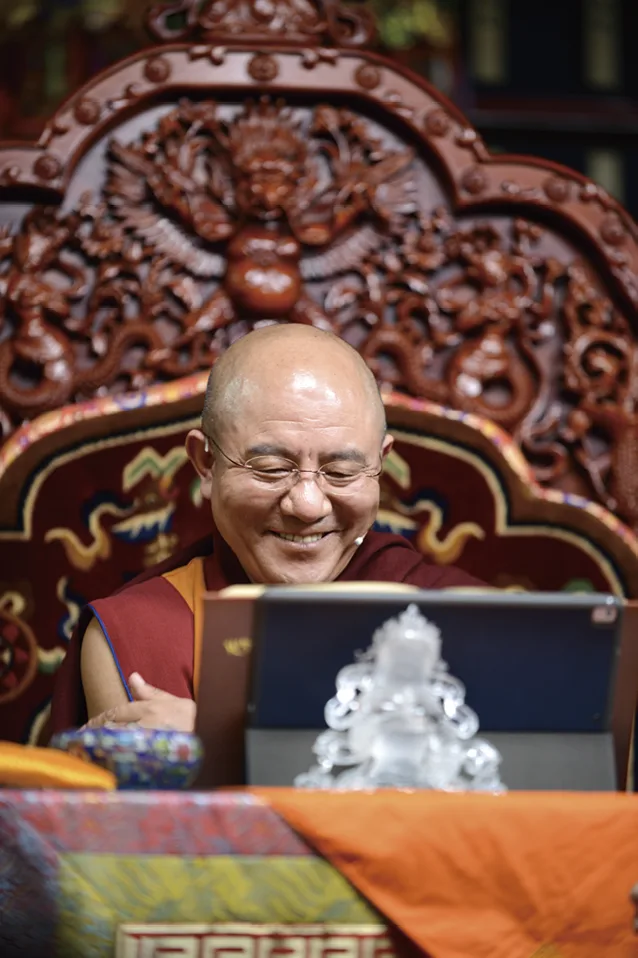
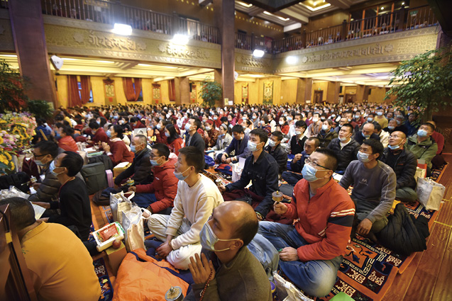
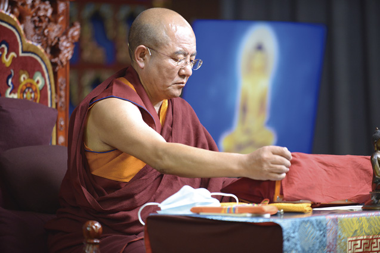
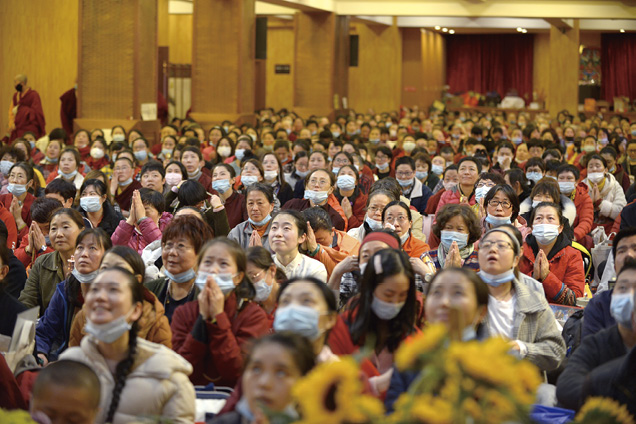

## 2021年《佛子行》讲解

2021年5月26日

今天是全世界公认的“卫塞节”，各个佛教团体都以释迦牟尼佛非常殊胜庄严的佛像作为供养恭敬的对境，开展多种多样的佛事活动。今天也算是我们庆祝佛教节日的一种活动方式。此外，今天有非常难得的月全食，大概从七点多开始直到九点左右结束。按照历算的说法，此时天空出现血月。有些人比较担心，出现血月会不会带来一些灾祸？不管怎样，我们佛教徒在这个时候一方面要共修，一方面要发菩提心。因为按时轮金刚的说法，月食的时候做任何善法，功德都会千万倍地增上，所以在此时行持善法非常有意义。

总之，今天既是金刚萨埵法会圆满之际，正值十五号月食，又正好是纪念佛陀的卫塞节，这么多殊胜的节日汇聚之日，我们在庄严的经堂中一起学习大乘佛子的行持，确实有不可思议的功德。我想了很久，能给大家最大的利益是什么？就是讲传《佛子行三十七颂》。

法王如意宝至少得过《佛子行》的传承百次以上，而且上师一生中在不同的地方传讲了无数次。我在法王面前也得过很多次传承，遗憾的是没有记录具体数目。常住的道友们以前也听过很多次《佛子行》。在整个藏传佛教中，不论哪个教派都特别重视《佛子行》。无论是谁，若能经常行持《佛子行》，他的相续中一定会生起殊胜无伪的菩提心。

有时间的情况下，我们最好每年读几遍。很多道友把它作为自己的功课，每天都在念诵。我经常在阳光比较好、吃得比较好、心情比较舒畅的时候，把《佛子行》的法本拿出来念一遍。凡夫的心态像春天的天气，心情好的时候万里无云，像碧蓝的晴空；心情不好的时候乌云密布，好像马上就要打雷闪电。我们心情不好、特别繁忙的时候可能想不起来，但心情好的时候，最好念一遍《佛子行》。

藏传佛教有不同的传承方式，有的是直接念传承，有的是一边念传承一边解释个别的颂词——这就是讲传。今天因为时间的关系，不能全部详详细细地讲解，因此我在这里为大家传《佛子行》的讲传传承，也就是一边念传承，一边在有必要的时候讲解一下。

（堪布念传承）

## 佛子行三十七颂

无著菩萨·造论

> 那莫罗给夏Ra雅！

> 虽见诸法无来去，然唯精勤利众者，

> 胜师怙主观音前，三门恒时敬顶礼。

> 利乐之源诸佛陀，修持正法而成就，

> 亦依了知其行故，于此宣说佛子行。

> 已获暇满大舟时，为自他渡轮回海，

> 日日夜夜不懈怠，闻思修持佛子行。

这里说获得暇满人身的时候，为了度脱轮回中自他一切众生，应该日日夜夜不懈怠地闻思修行，这就是佛子行。

在获得这样特别难得的人身时，大家一定要发菩提心，令自他超越轮回。虽然日日夜夜不敢说——因为晚上不睡觉、白天不休息不一定能做到——但是大家一定要非常精进地坚持修学。对闻思修行的坚持非常重要，为了使人身真正具有意义，佛子一定要日日夜夜闻思修行。

很多居士都知道闻思修行的重要性。佛教徒不能太盲目，否则刚开始时对佛法有信心，到后面就没办法坚持下去。如果刚开始不盲目，依止一位很好的善知识，并且很好地闻思修行，这就是理性的佛教徒。我们不能变成愚昧的佛教徒，否则刚开始时虔诚得不得了，到后来也许所作所为完全与佛法背道而驰，甚至产生各种邪见而诽谤三宝。因此，作为佛教徒不要盲目。

今天我进经堂时，大家表现得比较理性，这样比较好。佛教徒团体应该具有理性，刚开始时你们有虔诚的信心，表现得特别激动，这也很好，但我们更看重的是什么？是自己有一种取舍的能力。有时激动一下，迸发出自己内在的潜力、智慧和情感，这也很好，但在公共场合中，每个人都应该守护自己的正知正念，理性对待所有的事，这确实很重要。

现在整个出家、在家群体的佛教素养与以前相比有所进步，在很多方面，大家都有能力自己取舍。取舍什么呢？我们在得到这个人身的时候，一定要日日夜夜精进地闻思修行。闻思修行要做什么？就是要广闻博学，多听一些课。现在我们想一直跟在某位上师身边，可能不太现实，但网络时代中只要有能力和信心，就算是成百上千堂课，我们也可以下载在手机上听闻。这是非常好的时代，如果我们没有利用这个时代的优势，那就有点可惜。

如果有人非要跟着某位上师，“上师到哪里我就跟到哪里，上师坐哪里我就随侍他的左右，像舍利子和目犍连尊者一样”，这是不现实的，因为每个人都有自己的事业。而且，跟着上师的身体，不一定能与上师的心相应。上师真正的心是佛的智慧，如果他是一位具德上师，就会用说法的方式表现出内在的智慧和佛性，以此利益众生。并不是你看到上师、跟着他或者他向你做个表示，就一定能让你开悟——这样的情况是很少的。

藏传佛教历代的高僧大德，除了悟性特别高的极个别人是通过简单的直指当下大彻大悟的，其余绝大多数都是经过有次第的闻思修行才获得证悟。我们要观察自己的根基：我是不是当下开悟的料？如果不是的话，就要系统地闻思修行。闻思修行有很多方法，不管你对哪一位上师有信心，在网上应该都可以搜到他的课程或资料。这个时代拥有过去闻所未闻的便捷和方便，如果我们没有善加利用，真的有点可惜。有些佛教徒相当不错，基本上把自己上师所有的课都听完了。现在在家人的生活工作压力都很大，如果想在上师面前现场听完所有的课程，这在任何道场都很困难，但如果通过网络等方法，任何人都有机会日日夜夜精勤地闻思修行。

（堪布念传承）

> 贪恋亲方如沸水，嗔恨敌方如烈火，

> 遗忘取舍愚暗者，抛弃故乡佛子行。

> 离恶境故惑渐轻，无散乱故善自增，

> 净心于法生定解，居于静处佛子行。

> 长伴亲友各分离，勤积之财留后世，

> 识客终离身客店，舍弃今世佛子行。

长久相伴的亲友会各自分离，辛辛苦苦积累的财富一定会留在世间，我们的心识相当于客人，最终离开人间的时候，就像一位客人离开了客店一样，以这个原因，舍弃今世是佛子行。

这里说的是无常。长期相伴的家人到最后会纷纷离开，我们辛辛苦苦积累的财产在离世的时候一分钱也没办法带走。很多人的银行卡密码除了自己以外谁都不知道，当人离开的时候财产就留在银行。不知道这些遗产有没有什么法律规定，银行多少年以后可以动用？如果没有银行卡，自己的车子、房子、衣服、辛辛苦苦积累的金银财宝，在人离开的时候，也全部都要留在身后。除此之外，我们的意识也会离开身体。在世时特别执著的身体、财产、感情、家人等等，这些最终都要分开。作为佛教徒，我们一定要观修无常。

有些道友修菩提心还可以，但在无常方面好像有所欠缺。我有时想：“我们学院的一些喇嘛觉姆们，为什么没有经常说起无常？”比如“哎哟！一切都是无常的”这样的话，似乎他们很少说。以后我们要多修无常，真正从内心生起无常观。我以前没出家时，就有一定的无常观，对什么事情都能自然而然生起一种无常的感觉。我在读书的时候经常跟同学们讲一些无常的道理，他们就对我有些排斥：“你经常给我们泼冷水。生活是美好的，不会出现这些意外，你想得太多了！”

作为佛教徒，具有无常的观念是很重要的。无常不是悲观。悲观是对什么都不感兴趣，但我们观无常之后对生活仍然充满信心，眼前这些事该做的还是要做。通过观修无常，我们会知道万事万物的真相：人是会离开的，意识也是会离开的，财富不可能与我们终生相伴——这些道理我们要明白。汉地常说“看破”，藏传佛教中说“舍弃今世”。看破或舍弃今世并不是不工作，凡夫人只要活一天，就仍然肩负一定的责任，该做的事情还是要做。但通过观无常，可以看破放下今生中很多无有意义的事情。

（堪布念传承）

> 交往恶人增三毒，失坏闻思修事业，

> 令成无有慈悲者，远离恶友佛子行。

> 依止正士灭罪业，功德增如上弦月，

> 殊胜上师较自身，更为珍爱佛子行。

> 己尚缚于轮回狱，世间天神能救谁？

> 故知殊胜无欺处，皈依三宝佛子行。

这里每一个偈颂都非常好，但今天时间不够，没办法一一讲解。为了今天能全部传完，我只能选择性地宣说部分内容。

这里讲皈依。如果我们皈依世间的天神，而他们自己尚且束缚在轮回的监狱中无法离开，又怎么能救护世间的众生？他们根本没有能力。我们经常说“天啊，上帝啊”这样的话，但世间天神自己相续中的无明、业与烦恼都没有断除，想要真正救护众生是很难的。就像世间具权势者，虽然他们暂时能为别人提供一些方便、财富、名声或地位等，但究竟而言，他们无法给众生提供真正的救护，因为他们自己都在轮回的监狱中被业和烦恼的镣铐锁得紧紧的。他们自己都没有自由，又怎么能救护苦难的众生呢？

那么，我们应该皈依谁才能得到救度？就像《宝性论》里所说，究竟的皈依处是“佛陀、佛法、僧众”三宝。目前我们正在讲《宝性论》，很多人因此对三宝有非常坚定的信心。佛教徒一定要通过闻思来了知三宝的功德：“我所皈依的对境是三宝，三宝跟其他宗教和学说中所讲的世间天神、名人、偶像不能相提并论。”如果佛教徒没有这种理性的认知，别人说皈依佛你就皈依佛，别人说皈依师你就皈依师，自己没有任何主见，人云亦云、随波逐流，在见解上可能是有问题的。

我们要认识到，始终没有欺惑性的皈依处只有三宝，这一点我从小到大都坚信不疑。虽然在“文革”时期，不要说弘扬佛法，仅仅是显现出家人、佛像或经书的形象都面临很多危险，但不知道是家庭还是周围善知识的原因，我从小对三宝都有特别坚定的信心。有些人对三宝的信心非常好，这非常难得。不用说一般的佛教徒，就算是某些出家人，也不一定很了解皈依戒。

佛教徒一定要好好守持皈依戒，无论遇到任何事都不要舍弃三宝。有些居士工作很忙、生活压力很大，可能没办法天天念佛、学佛，但无论如何，心里一定要守住一个底线——不诽谤三宝，这是最重要的。如果我们没有理性的智慧，暂时生起的信心很容易退转。比如今天我到了一个佛教兴盛的地方，在一种自然的氛围下觉得三宝很殊胜，因此感动得泪流满面，信心大得不得了，但过一段时间就没感觉了，最后连自相续中的信心都无法保持，乃至于诋毁佛法——这是非常可悲的事情，如果这样的话，不如一开始不皈依的好。

作为人应该有稳重的品质，如果已经决定要皈依，包括参加灌顶也好、受戒也好，该受的已经受了、该得的已经得到了，那就应该坚持自己的信仰，不要在短短的一生中变来变去。我非常佩服一些基督教徒，他们从小在某某大德面前发过愿、受过洗礼后，一生都不再改变信仰。虽然不是佛教徒，但他们这种坚定的信心是很令人敬佩的。

作为佛教徒，我们要对自己的信仰有一种坚持。比如自己内心发了誓愿，当天晚上就在日记本上写：“某年某月某日，我发过什么样的愿。我不敢说自己学得特别成功，也不敢说今生一定要虹身成就，但无论如何我要坚持自己的誓愿。”其实作为大乘佛教徒，即使获得神通在虚空中飞来飞去，身体出现各种各样的瑞相、示现种种神变，对于这些我们都不是很羡慕，最重要的是内心中有一个誓言：“我永远不放弃三宝！”大家一定要发这样的誓愿，对三宝有坚定的信心！

前面讲的是皈依。

> 佛说难忍恶趣苦，皆为恶业之果报，

> 是故纵遇生命难，永不造罪佛子行。

> 三有乐如草尖露，乃是瞬间坏灭法，

> 了知恒时无变法，希求解脱佛子行。

> 无始时来慈我者，诸母若苦自何乐？

> 是故为度无边众，发菩提心佛子行。

下面讲发菩提心。无始以来对自己非常慈爱的老母有情如果还在苦海中，我自己获得快乐有什么用？所以，为了救度无边的众生，我们一定要发菩提心，这是大乘最基本的要求。

我今天刚翻译完《称赞大乘功德经》，这部经非常好，每个比喻都真实宣说了大乘佛法的本体、作用、功德和不共功能等，并说明佛子一定先要发大乘菩提心。《称赞大乘功德经》里说[^1]：大乘太广大了，所以有些愚痴的人不但不能接受，反而会讥笑；大乘特别殊胜，因此愚者没办法揣测，只有具智慧的人才能接受。

大家虽然都已得过灌顶、发了菩提心，嘴里说得再好，但如果内心中不懂大乘的功德，想要有所成就是很困难的。如果你真的想成为大乘佛教徒，那么《入菩萨行论》《学集论》《称赞大乘功德经》等这些大乘的法一定要去学习。我们讲《大乘经庄严论》用了四年的时间，虽然不是全年都在讲本论，但断断续续还是历经了四年，整本讲记做下来有一百多万字。我花了很多时间精力整理、翻译和讲解的法，结束之后有没有人在看？有没有人在学习？当场讲过了不知道起不起作用？我希望大家一定要反复地修学这些大乘法门。

发菩提心并不是仅仅跟着上师念一遍就结束了，如果我们不懂得其中的含义，跟真正的菩提心还是有很大差别。殊胜的菩提心跟一般的信仰完全不同，大乘佛教的精神无论从智慧还是从大悲方面来看，都非常殊胜。从大悲方面而言，就像《入行论》所说[^2]，父母或世间天人，谁具有这样无偏利益众生的菩提心？他们为了自利，连梦中都没想到还有这样的心，何况是为了利益他众而发起如此殊胜的菩提心呢？从智慧方面而言，哪一位世间的学者能宣说中观的空性法门？有智慧的人一定要学般若空性，虽然这些法义浩如烟海，不一定能学得完，但是能学多少就要学多少。

我最近在考虑把《大智度论》翻成藏语。从全世界范围来看，梵文的《大智度论》早已佚失，现存的只有鸠摩罗什大师翻译的版本，共有100卷，确实是卷帙浩繁，但我想：“能不能尽量翻译一点？如果从现在开始，可能十年都不一定能翻译完，但如果今世翻译不完，下一世接着翻译，这样的话哪怕能翻译一卷出来，也能利益一部分众生。”现在你们有汉文的《大智度论》，应该发愿自己在有生之年中看一看，这是龙猛菩萨解释般若佛母经藏的究竟要义。

如果我们不在这些地方下功夫，只做一个形象上的佛教徒，确实比较容易。比如有人到一位上师面前说：“上师我供养您一百块钱，您可不可以给我做个皈依？”上师说：“可以可以！我的弟子一定要办皈依证，没有问题！我给你盖章，以后你就成了我的弟子，我就成了你的上师！”这样确实很简单，办一个皈依证比办结婚证还快，对吧？但是不像结婚后还可以离婚，一旦皈依终生都要依止。如果不明白这一点，什么时候不想依止上师了，可能不知道怎么样办。（众笑）

不管是弟子还是上师，想要成为真正理性的佛教徒，都是不容易的。作为上师，想把佛陀浩如烟海的智慧真正灌入弟子的心海，不是容易的事；作为弟子，想要真正得到上师的密意，经过上师获得佛陀的意传加持，具有智悲双运的境界，也是很难的。所以，师徒之间的关系究竟是在维系一个形象，还是很深地结上法缘，需要我们自己用理性的智慧去观察。

大家应该下一些功夫学习大乘法，在有能力的情况下进一步修学更殊胜的大乘密宗法要。这些年，不管去到哪里，我对南传、北传、藏传等各大教派的法义都以学习的心态认真地加以研修，可以说在这三四十年当中基本上没有懈怠。在此过程中，我认识到大乘佛法真正是这个世界上无与伦比的精神瑰宝。我们已经遇到这么好的大乘佛法，如果将其抛之脑后，希望在别的地方寻找更高的境界，这样做是不是有点可惜？这一点你们可以用自己的智慧去观察。

我在给大家讲课时一般会备课，但今天没有备课，所以好像有一点不同的感觉。考虑到居士们以后不一定有很多的机会，所以我这次主要是念传承，给大家提供一些顺缘。

（堪布念传承）

> 诸苦由求自乐生，圆满正觉利他成，

> 是故己乐与他苦，真实相换佛子行。

> 何人以大贪欲心，夺或令夺我诸财，

> 自身受用三世善，回向于他佛子行。

> 我虽无有些微错，何人若断吾头颅，

> 然以悲心将彼罪，自身代受佛子行。

这里说，自己一点过失都没有，但别人把我的头砍断，或者以各种方式侮辱我，即便这样，我对他不但不会以牙还牙，反而以悲心来代受他的罪业，这就是佛子行。

有的佛教徒稍微被别人碰一下，或者为了争一个座位等一点点事情，心里就不舒服。而这里讲，别人把我的头砍了，我还要用悲心来回向他，还要代受他的罪过——这种精神在世间是很难想象的。不要说别人把你的头砍了，只是拿走你的衣服、坐垫，或者对你有一点点不恭敬，你们是什么样的心态？有时候观察自己的相续，确实比较惭愧。

（堪布念传承）

> 有者百般中伤吾，恶名纵遍三千界，

> 然我深怀慈爱心，赞其功德佛子行。

> 何人大庭广众中，揭露吾过出恶语，

> 于彼亦作上师想，恭敬顶礼佛子行。

> 吾如自子爱护者，彼纵视我如怨敌，

> 犹如慈母于病儿，尤为怜爱佛子行。

大乘佛教中这样讲，我就像对自己最爱的儿子一样来对待、维护和爱护的人，不但不对我报恩，反而把我看成仇敌，在这种情况下我们怎样对待？就像一位慈母对待生病的子女一样，孩子再怎么不好，母亲不但不生气，反而付出自己的一切，这就是佛子行。

大家也可以想一想，在日常生活当中，大多数的人不一定对你知恩图报，有些人甚至恩将仇报。在这种情况下，我们也应该按照佛子行的精神，尽量不为烦恼所转，以大悲心来对待一切众生。

（堪布念传承）

> 与我等同或下士，虽以傲慢而凌辱，

> 然吾敬其如上师，恒时顶戴佛子行。

> 贫穷恒常受人欺，且为重疾恶魔逼，

> 众生罪苦自代受，无有怯懦佛子行。

这里说，当我们生活贫穷、受人欺辱，再加上被病魔折磨，这个时候自己要代受众生的痛苦，无有怯懦之心，这就是佛子行。

作为佛教徒应该坚强。人生当中确实会遇到各种挫折，比如没有钱、受人欺负等等。就像人们常说的一样，祸不单行，很多痛苦加在一起就是苦苦，比如身体不好、人际关系也很坏，工作不顺利、家庭也不和睦，感情不好、财运也越来越差……这时很多人连活下去的勇气都没有。那么多人自杀、得抑郁症的原因是什么？就是没有勇气，没有坚强的心。

坚强的心是怎样炼就的？我们要知道：一切法都是无常的，这是万事万物的真相；在此基础上，我们还要知道所有的痛苦都是由自己前生的业力和今生的烦恼而来。知道了这些真相，我们面对挫折时就能比较淡定。比如家庭不和睦，有一部分可能是别人的原因，但肯定有一部分原因是自己的问题，比如自己的性格偏执、自私心强等等。再比如，自己的处境不好，一部分是源于自己前世的业力，一部分也跟众生的共业有关。

其实，遇到违缘的时候，佛教徒的心态真的很好。去年全世界受到疫情的影响，大家都困在房子里不能出去，好多佛教徒开心得不得了：“我终于有闭关的时间了！”很多世间人都憋闷痛苦，怨声载道，而有些虔诚的佛教徒觉得修行的机会终于来了，一方面觉得恰好能把时间用上，一方面还能把病苦转为道用。我就是在疫情期间把《地藏经》翻译成藏文的，本来按进度需要两年的时间，但疫情期间几个月就完成了。

佛教徒在遇到违缘的时候，不要觉得“没什么希望了，我只有选择自杀”，这是法没有融入心的一种表现。如果佛法能融入自心，遇到这些情况的时候总是有办法的。

大家一定要强大起来，心不怯懦是佛子行！

（堪布念传承）

> 美名远扬众人敬，亦获财如多闻子，

> 然见世福无实义，毫无傲慢佛子行。

> 自嗔心敌若未降，降伏外敌反增强，

> 故以慈悲之军队，调伏自心佛子行。

> 一切妙欲如盐水，愈享受之愈增贪，

> 令生贪恋诸事物，即刻放弃佛子行。

> 一切境现唯心造，心性本来离戏边，

> 了达此理于二取，皆不作意佛子行。

> 逢遇悦意对境时，视如夏季之彩虹，

> 虽显美妙然无实，断除贪执佛子行。

> 诸苦如同梦子死，迷现执实诚疲惫，

> 是故遭遇违缘时，视为幻相佛子行。

各种痛苦就像是做梦一样，梦中自己的子女离开人间，其实只是迷乱的现象，如果特别执著的话，除了让自己疲惫不堪，没什么意义。所以，当我们遇到各种各样的违缘、痛苦和不顺时，一定要把它看作幻化。

一切有为法都如梦如幻，犹如阳焰。以这样的方法观想真的很重要，我们有时候可能各方面比较顺利，这没有什么可执著的，开心快乐也如梦如幻；当遇到各种痛苦的时候，也没有什么好执著的，伤心痛苦也如梦如幻。

想要观修如梦如幻，我们要多学习《虚幻休息》，其中有最殊胜的修法。学院里每年都有很多人学习《虚幻休息》，学得特别成功。

（堪布念传承）

> 获得菩提身尚舍，何况一切身外物，

> 故不图报异熟果，慷慨布施佛子行。

> 无戒自利尚不成，欲成他利诚可笑，

> 故于三有无希求，守护净戒佛子行。

> 于求妙果之佛子，一切损害如宝藏，

> 故于诸众无怨恨，修持安忍佛子行。

> 唯成自利小乘士，勤如扑灭燃头火，

> 饶益众生功德源，具足精进佛子行。

> 当知止观双运理，以此摧毁诸烦恼，

> 真实超越四无色，修习禅定佛子行。

> 若无智慧以五度，不得圆满菩提果，

> 故以方便三轮空，修持智慧佛子行。

> 若未观察自错误，以法形象行非法，

> 是故恒时审自己，断除过患佛子行。

> 以惑谈他菩萨过，则将毁坏自功德，

> 故于大乘诸士夫，不说过失佛子行。

我们若因烦恼而说其他菩萨的过失，这样会毁坏自己的功德，所以入于大乘者不说别人的过失极为重要，这就是佛子行。

佛教徒一定要注意，不要说别人的过失。人是爱说过失的一种动物，我的院子里有好多麻雀，我有时候边看书边看它们，心想：“它们叽叽喳喳到底在说什么？但至少不像有的人，似乎总是要说别人的过失才开心。”

人的聪明才智有时有好处，但也有不太好的地方，就是经常爱说别人的过失。有人说别人的过失以后，觉得自己说的话有人听、有意义——其实不应该这样想。尤其是入了大乘菩萨道以后，修行人应该对一切人事观清净心。

我这次出去的时候遇到一个佛教徒，我从语言上观察他好几个小时，他说话的时候一点都不说别人的过失，这说明他的心很清净。我有时候比较坏，故意从不同的角度来问他，看看他会不会说过失，但我发现不管从哪个层面来问他，确实是一到说过失的时候他就自然而然地沉默，这确实非常难得，每个修行人都应以此来要求自己。

我们的烦恼好像有一个辐射范围，心里的烦恼会浮现在外境中，就像观托嘎一样。大家以后尽量不说别人的过失，好不好？不管你去到哪里，那里肯定有功德的一面，也有过失的一面，我们尽量宣扬功德的这一面，淡化过失的这一面，这样对自己不会有任何害处。如果我们习惯性地说别人的过失，那么别人也是如此观察你：“这个人爱说过失，肯定是心不清净的一个人。”

佛经里有一个很好的比喻，说别人的过失对别人倒不一定有害，但对自己是肯定有害的。这里说，不说他人的过失也是佛子行。《佛子行》里的每一个教言都特别好，今天以这样的方式为大家讲完也很好。

（堪布念传承）

> 为求利养相互争，失坏闻思修事业，

> 故于亲友施主众，根除贪执佛子行。

> 恶言刺伤他人心，亦失菩萨品行故，

> 莫说他人不悦词，杜绝粗语佛子行。

> 烦恼串习难对治，执持正知正念剑，

> 贪等烦恼初生时，立即铲除佛子行。

> 总之一切威仪中，观心处于何状态，

> 相续具足正知念，成办他利佛子行。

总而言之，不管是在行住坐卧的任何威仪中，应该经常观察自己的心。“我的心处于什么样的状态？是善的状态、恶的状态、还是无记的状态？”令自己的相续中时时具足正知正念，成办利他的事业，这就是佛子行。

作为佛教徒，这真的很重要。有些佛教徒在行住坐卧中都能保持威仪，他们常常对自己说：“我是一个佛教徒，我是一个出家人，我是一个居士，不能这样做，不能那样做。”人最重要的是自律，有正知正念的人并不需要管家、堪布堪姆或负责人在旁边提醒你这个不行、那个不行。外在监督的作用很有限，有时甚至有反作用。

如果自己能调伏自己的心，经常用正知正念观察自己的心相续到底处于什么样的状态，这就是很好的修行人。如果发现自己有菩提心、出离心的话，就修随喜心；如果发现自己处于嫉妒嗔恨或痛苦的状态，就不断地对治，多祈祷传承上师、多看一些有加持的法本，这样我们的相续会慢慢变好的。

无著菩萨说，总而言之，我们在一切威仪中要观察自己心的状态，在相续中具足正知正念，以此来利益他众，这就是佛子行。如今我们跟世间人多少有些交往，不管是有信仰也好、没有信仰也好，大家要知道，如果一个人自私自利的心特别重，终究不会有好的结果。佛教徒也好、出家人也好，如果特别自私，在任何群体当中都不会有什么好下场，今生是这样，来世也是这样。如果我们经常尽量地利益众生，今生来世中对自他都有好处。大乘佛法的根本，就是“利他”两个字，大家要牢牢地记在心里。

作为凡夫人，有时候确实会犯错误，但是我们用正知正念及时发现：“我刚才不对，发脾气了。”发现自己的过失后就尽量地以“嗡班匝儿萨埵吽”忏悔。每晚睡觉之前也观察：“我学佛那么多年，已经皈依十年八年了，怎么性格还那么不调柔？”然后开始忏悔。这样的话，也算是好的修行人。

就像《前行备忘录》里讲的一样[^3]，最好是从未被垢染所玷污，但是如果发现自己有过失，及时发露忏悔的话，也可以说是树立佛幢者。所以，我们始终要观察自己的相续，这很重要。

（堪布念传承）

> 如是勤修诸善根，为除无边众生苦，

> 皆以三轮清净慧，回向菩提佛子行。

> 为利欲修菩萨道，依照经续论典义，

> 诸圣者言而撰著，三十七颂佛子行。

> 因吾慧浅无修行，虽无智者所喜词，

> 然依诸多经论故，此佛子行定无谬。

> 而诸佛子广大行，如我愚者难测故，

> 相违不符等诸过，诸圣者前祈宽恕。

> 以此善愿众有情，以胜世俗菩提心，

> 等同不住有寂边，大悲怙主观自在。

此《佛子行》，是为利益自他，教理法师无著于水银宝洞撰写。

今天《佛子行》的课圆满了，下面我们回向。

[^1]: 27 《称赞大乘功德经》：“此乘广大下愚不测而为轻笑。故曰大乘。此乘尊高上智能达常所宝翫。故曰大乘。”
[^2]: 《入行论》：“是父抑或母，谁具此心耶？是仙或欲天，梵天有此耶？彼等为自利，尚且未梦及，况为他有情，生此饶益心？”
[^3]: 《前行备忘录》：“自从一开始受戒就没有失坏过的人，是树立佛陀法幢者，又是摧毁魔幢者。即使失毁了戒律但能如理忏悔的人，也是树立法幢者、摧毁魔幢者。”
