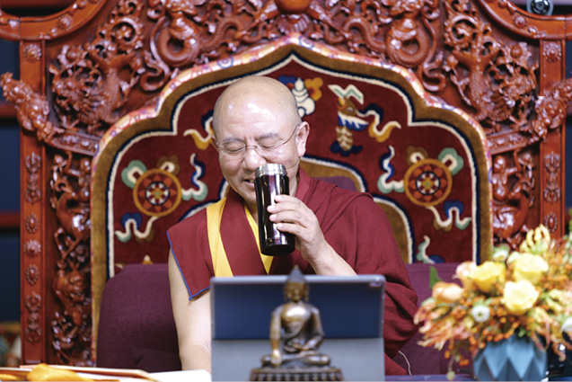
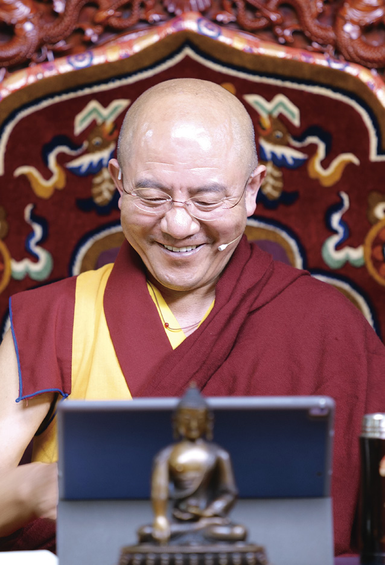
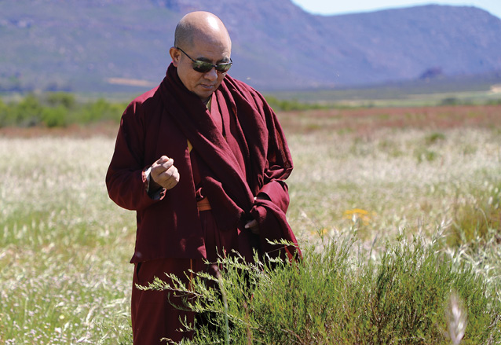

# 《佛子行》略讲

2019年6月12日

藏传佛教的很多堪布在讲经之始，一般会先顶礼所有传承上师，然后顶礼本师释迦牟尼佛、莲花生大士，再顶礼全知无垢光尊者、全知麦彭仁波切以及自己的根本上师，然后祈请世间中愿意闻法的天龙、夜叉等所有众生来到说法现场。讲课前先念诵这些顶礼和祈祷的偈颂，是藏传佛教的说法方式。

大概三十年前，我在学院给藏族人上课之前经常念诵这些偈颂，自从跟汉人讲课后就没有再念，但刚才把这些都全部念了。我给汉人讲课时，念诵最多的是“无上甚深微妙法，百千万劫难遭遇，我今见闻得受持，愿解如来真实义”。（众：“为度化一切众生，请大家发无上殊胜的菩提心！”）（堪布笑，众笑）好嘛……刚才我念诵的那些偈颂，很久之前我经常念，之后就没有怎么念了。

## 弘法要有善巧方便

今天传讲的是《找回最初的你》这本书内的《佛子行三十七颂》，很多人都学习过，是吧？学会的预科课程已经安排了大家学习这本书，书中有《佛子行讲解》，那是在2007年传讲的，共八堂课。今天可能没有很多时间对此详细解释，只是给大家念诵一遍传承，同时讲解一下个别偈颂。我相信很多道友不缺听受《佛子行》的机会，但大家不能只满足于听听而已。

有些道友把《佛子行》学习得很好，有些则不太好。虽然它只有简单的三十七个颂词，但要真正把它修出来恐怕不是那么容易。上师如意宝的传记中提到，他老人家这辈子听闻过一百多次《佛子行》，我们在上师面前也听闻过很多次。现在我有能力在字面上讲解《佛子行》，但如果让我行持它的意义，确实每一个偈颂的内容都不简单。

不管怎样，大家学习了大乘佛法，就要尽量去行持，能做多少就做多少。大家不能因为修行不简单而感到很失望，也不能只着眼于自己的修行而变得很封闭。总体上，近年来我们很多修行人不错，但作为佛教徒，大家要规范自己的一些行为。规范什么呢？

大家有内在的信心和悲心很重要，但有时候把自己的信心特别明显地表露于外在行为上，这并不是很好。不管是在佛寺、佛堂还是上师面前，总之在任何场合，大家有信心是非常好的，但这种信心有时候可以外露，有时候不一定方便外露。尤其在佛教团体以外的各种人群中，佛教徒应该有自我控制的能力和灵活性，如果经常把内在的信心表露无遗，在此时代恐怕不太合适。

所以在行为上，我们佛教徒有很多需要进一步改革、完善的地方。特别在度化众生的时候，一定要有善巧方便，当今社会有时候不一定适合用直来直去、太直白的方式。大家在不同场合要用不同的弘法方式，这是非常有必要的。

## 佛教徒应有两种精进

从我身边的人来看，最近大家都在很精进地忏悔[^1]。今天早上我遇到一些居士，他们一天能念诵九万遍金刚萨埵心咒，说一上座就能在十二个小时中一直坐着不动——有个别的道友是这样的。确实每位道友的情况都不相同，有些不能连续坐两个小时，有些可以坐好几个小时，其间非常认真、积极地念诵。对后者来说，念诵四十万遍心咒是很简单的事情，对吧？对散乱的人来说，这就比较费劲，对吧？

昨天我问了几位藏民，他们说每天能念两万遍心咒。上课期间他们有点坐不住，这方面我也理解，因为我在说汉语，他们听不明白。（堪布用藏语跟藏民交谈）今天他也念诵了两万遍。（堪布问另一位藏民）“你念诵了多少遍？三万七，一天吗，还是整个法会期间？今天念诵了三万七。”

虽然四十万遍仅仅是个数量，但完成这种数量也有其必要。昨前天我提到“一万小时定律”——人们至少需要一万多个小时在某件事情上持续地努力，才能成为那方面名副其实的专家，以现在人们每天工作八个小时来算，在五六年后就能累积一万小时的相关经验。

一些佛教徒说：“执著什么呀，不需要什么数量，不需要修五十万加行，十万、二十万这些数量都没有必要。轻轻松松就对了，坐着就可以。”当然，你对修行没有要求，不给自己压力，如此行持也可以。但是，如果你真的希望通过佛法来让内心有所转变，忏悔自己的罪障，那还是要多下功夫。

对于学佛，有些人想：“学习什么呀？自己看一看就可以了。”对个别人来说，这可能是适合的。但如果你想真正改变自己的一些习气，从佛法的奥义中获得智慧和悲心，那确实要下一些功夫。

很多道友在听法、闻思等很多方面持续不断地努力，所以他们在修行的路上无论如何都不会倒下去。其实这种精进是非常重要的，我们称之为“恒常精进[^2]”，它是非常有力度的。另外还有“恭敬精进[^3]”，如果你对法和上师没有恭敬心，便没法恒常精进。

最近我接触到很多道友，有些人在修行方面确实有很大进步；有些人好像不但没有进步，甚至有一些退步；有些人一直都很平稳。可能每个人的根基、习气、烦恼都不相同。不管怎样，大家要经常帮助那些行持佛法的人，这是很重要的。

## 佛教徒要团结并有远见

这次我特别感谢喇荣的很多发心人员，包括我们的义工，你们一直护持大家的修行，确实是很辛苦的。但不管是做饭、打扫经堂，还是治理、维护道场等很多方面，大家都需要做得如理如法。最近我在这里听到有人喊：“卖酸辣粉！卖酸辣粉！”有时候甚至用小喇叭来喊。在大经堂门口，有些藏民用藏语喊：“卖牛奶！卖牛奶！”在汉经堂附近，有一些汉族居士拿着小喇叭在喊。他们的发心可能是好的，但是声音不太好听。

所以大家做事的时候，一方面发心要纯正，另一方面要遵守所在地方的一些规矩，尤其不能打扰别人。就像《入行论》中说：“遭遇任何事，莫扰欢喜心。”就是说，发心也好，修行也好，任何时候不管遇到什么事情，其一是不能失坏自己的欢喜心，其二是自己的行为不要让别人失去欢喜心，在此前提下发心是很重要的。

今天我特别感谢我们里里外外，包括各个道场中的很多发心义工。他们默默无闻地付出，我们看不见、听不到。这些义工就像一台机器中的小螺丝钉一样，每一枚螺丝钉都起到一定作用，缺少了任何一枚都是不行的。总之，大家要有团结性或者说积极性、凝聚力，如此我们在弘法利生和各自的发心方面都能成功。

在二三十年前，喇荣刚开始举办金刚萨埵法会的时候，我们的房屋没有地板、没有电力供应，那时候也没有行车道路让汽车来到喇荣沟里。现在这里的物质条件好了一点，但同时这里的有些道友多了一些负面情绪、要求也比较高。不过，最近我看到很多居士为了求法，在某种意义上确实能够苦行，我也特别随喜大家的善行。

我要强调的是，这几天在很多地方有一些义工们、道友们自愿参与发心工作，他们在各自不同的岗位上都非常积极，给这里的许多求法者提供了很多方便。我们的各个道场中都有这样的道友，他们一直无怨无悔地为大家做事情——大家以后也需要这样，我们佛教团体本应如此。

什么是僧众？三宝中的僧众就是具有一定修行的团体，也即僧团。佛陀在2500多年前已经说得很清楚，不管是居士还是出家人的团队，在弘法利生的过程中都非常需要有团队精神！而且在个人的修行方面，如果你加入了佛教团队，你的修行就不容易滑下去，因此团队也是很重要的。

一个人的修行能力确实很有限，在当今恶劣的环境中，每个人随时都有堕落的可能。但如果大家有所属的团队，让彼此的修行捆在一起，那在整个团队没有失坏之前，自己也不容易堕落，这是很重要的。

佛陀的团队称为“僧伽”，即僧团的意思。它有很重要的意义，体现了我们佛教的团队精神。现在，对全球最有影响力的就是有严密组织架构的团队，他们做任何事情都有很高的效率。尤其在此科技时代，佛教团队有严密的架构是很有必要的。我们团队的内部要团结，同时团队中的每个人都要有担当精神，如此佛法可以在未来百年、千年中永驻。

有些人跟我说：“你讲的层次太高了，我们都不知道你在说什么？你是不是站得太高了？”其实我是坐着说的，不是站着说的。但我的确担心佛教的未来，这并不是在课堂上跟大家说客套话，而是经常发自内心地想：“关于佛教的未来，我们看看要怎么做比较好……”有时候，当我看到这个世界或其他宗教有各种不同的变革，心里确实为佛教着急。

所以，每位佛教徒不仅要考虑自身的修行和自己的团队管理，更重要的是对佛教的未来有所思考。无论是高僧大德，还是刚皈依佛门的居士，都有一定的责任。如果每位佛教徒都有责任感，那佛教的未来确实是有希望的，因为心的力量不可思议、非常非常强大！

以上是讲课前要说的一些事情。

## 《佛子行》能让我们生起菩提心

接下来是念诵《佛子行三十七颂》的传承，我会一边念传承一边讲解个别颂词。当然，它的每一颂都很重要，方便的时候你们可以看一些讲义。在国外，仅《佛子行》的英文讲记就有十多种，由很多不同教派的高僧大德所传讲。另外，据统计《佛子行》现在已经被翻译成十多种不同的语言，包括西班牙语、日语、法语、德语……可以说，《佛子行》在全球是非常受重视的一个法门，虽然它只有三十七个颂词。

以前，一位四川的和尚说：“《佛子行》很短很短，我想造一个比《佛子行》长一点、更有影响力的论典。”我跟他开玩笑：“你多造几百个颂词也不一定有影响力。”因为这不是颂词多少的问题，而是《佛子行》中汇聚了很多非常有加持力的窍诀。

《佛子行》不管在任何地方，都会对那里的佛法兴盛和众生安乐有很大利益。多年以来，我不管到哪里都会尽量传一遍《佛子行》。根据我的日记，我在2017年共计传了16次《佛子行》，当中包括念传承和讲授，那时候不管是出访哪个国家，我都会在所在的地方、城市传讲《佛子行》。至于2018年，日记中记录我共传了8次《佛子行》，那年出访的地方比较少，但是可能不止传了8次。有时候如果在一些学校不太方便传讲《佛子行》，我晚上也会在宾馆默默地念一遍，目的是希望这个城市的众生能够生起菩提心。

我也希望所有道友，以后不管到哪里旅游，包括佛教不是很兴盛的一些地方，像非洲的各个国家如马拉维、纳米比亚，或者阿富汗、叙利亚等地，你们都应该在相关的地方念一遍《佛子行》。这种利他心是非常有加持力的，以前上师如意宝说：“依靠《佛子行》和《入菩萨行论》的加持力，连动物相续中也容易生起大悲菩提心。”

《佛子行》看起来非常简单，但实际上如果大家经常念诵和思维它的法义，那相续中一定会生起菩提心。我们昨天讲了《三主要道论》中提到的出离心、菩提心和无二慧，若想解脱，此三者是不可缺少的。尤其是学习大乘佛教的人，菩提心更是不可或缺。

菩提心不是无缘无故就能产生的，要生起的话需要一些因缘。一些人的菩提心是先天的，因为前世学习过大乘佛教，所以今生来到这个世界的时候，对菩提心特别熟悉，就像前辈高僧大德一样；一些人则通过后天的教育和自己的思维，然后改变了自私的心。

其实，当今时代人们真的很需要菩提心。我自己深深地体会到，在此非常复杂、纷乱的世界中，如果人们没有菩提心，那人人都会很自私，而自私所带来的是无穷无尽的痛苦。我们这里的佛教徒也是同样，如果没有菩提心，那不管你有钱没钱、年轻还是不年轻，你都可能会很痛苦，因为世间上的所有痛苦都源于自私自利。另外，如果你没有空性智慧，整天都用一些坚固的执著来对待生活、对待世界，那也是很痛苦的。

所以，就像好多道友所说：“如果没有遇到佛法，我的今生来世都完了”，确实我们的下场可能就是如此。如果你一点都没有摧毁自己自私的心、执著的心，你这一生应该是比较失败的。

## 学懂转为道用，大有益处

（堪布念《佛子行》传承）

> 纳摩罗给效Ra雅！

> 虽见诸法无来去，然唯精勤利众者，

> 胜师怙主观音前，三门恒时敬顶礼。

> 利乐之源诸佛陀，修持正法而成就，

> 亦依了知其行故，于此宣说佛子行。

先介绍《佛子行》的整个框架。它前面是造论的立宗，有顶礼和立誓句。所有内容分为前行、正行和后行三个方面。

前行总共有七个颂词，内容包括了依止善知识、依止寂静的地方等等。

正行分三：小士道、中士道、上士道。小士道讲了因果不虚的道理；中士道讲的是从轮回中获得出离——就是我们昨天谈及的出离心；上士道主要是讲菩提心。

菩提心分胜义菩提心和世俗菩提心。胜义菩提心主要是讲离四边八戏的中观空性，有两三个颂词；世俗菩提心讲的是修自他交换和一切万法转为道用。关于后者的颂词有好几个，其中说到把别人对我的赞叹或诋毁、自己的得益或损失转为道用——总之把痛苦、快乐等处境都转为道用。

其实，《佛子行》与其他法最根本的区别，就是我们要把违缘转为道用。人们感到痛苦是因为不能把很多事情转为道用，比如不能把别人的诽谤转为道用，只是想着“我特别恨他！”就算自己感到非常痛苦，人们也不会把痛苦转为道用，只会把痛苦当作痛苦。但实际上我们可以换一个角度，不去那么执著所遇到的痛苦，要想：“这是来激励我成长的。”

正如今天早上，学院弘法方面的发心人员在开会，一位法师说：“别人投诉我们的话，对我们是一个很好的机会。大家不要认为：‘啊，别人投诉我，所以我完蛋了！’”因为一些法师说：“我被很多人投诉，所以现在心灰意冷，完全失去信心，再继续发心的意乐也没有，我要退出。”这种做法不太合理。别人投诉你，那你有没有别人所说的那些过失？若有过失，你应该乐意去接受；若没有过失，那你可以观察自己的心态，看看能否接受别人的无因诽谤。这完全是观察自己修行境界的时候。

所以说大乘佛教的教义，跟世间的一些观念是完全不同的。世间的规律是：当你有钱、有名声的时候，人们都赞叹你，你也为此而很欢喜；一旦你沦落，当你没有名声、没有财富的时候，人们便对你不屑一顾。可是大乘佛教的理念并不是如此：在享有荣华富贵的时候，你不会洋洋自得，因为此时你看到一切万法都是如梦如幻的；在特别衰落的时候，你也能坚强地从艰难的境遇中重新站起来。

做人方面，当今社会的确很需要大乘佛教。你学习了这些教义后，只要微调一下把它们应用到生活上，那不管遇到什么事情，你都会感受到佛法对自己大有裨益。

以上介绍了《佛子行》的整个框架。

## 要懂得因果不虚、万法无常的道理

> 已获暇满大舟时，为自他渡轮回海，

> 日日夜夜不懈怠，闻思修持佛子行。

> 贪恋亲方如沸水，嗔恨敌方如烈火，

> 遗忘取舍愚暗者，抛弃故乡佛子行。

> 离恶境故惑渐轻，无散乱故善自增，

> 净心于法生定解，居于静处佛子行。

> 长伴亲友各分离，勤积之财留后世，

> 识客终离身客店，舍弃今世佛子行。

这里说，死亡降临时，我们长期相伴的亲友会纷纷离去，通过勤作积累的财产最终会留在人间，我们的心识也会离开身体这个客房，身体、财富、亲友等终究会留在人间，因此要舍弃对今世的贪恋。

当然，我们暂时可能做不到，但要做好准备，这很重要。一方面，你跟亲友应该有亲友之间的感情，这是很重要的。现在有些人很坏——占亲友的财富、跟亲友打官司、对亲友做各种非法事，这是非常不好的。但你也没有必要对亲友太贪执，终有一天你们定会分开。不要说亲友，就连善知识也会离开你，许多如佛陀般的上师都已经纷纷离开了，所以大家要有无常感。

此外，我们的身体和金钱也是无常的。尤其在当今时代，一些有财富、有福报的人可能随时都要有所准备——现在所拥有的东西如金钱等，很有可能在短短的时间中便会全部蒸发掉，变得一无所有。所以，当大家拥有财富的时候，应该把一部分储存起来，另一部分用来做一些善事，否则可能最后既失去了财富，也没有积累功德。

总之我们不能对今生太贪执，到一定的时候我们都会离开这个世间，而我们舍不得的所有事物，如亲友、财产和身体，都只能全部留在人间，那一刻必定会到来。这是一种无常观。

> 交往恶人增三毒，失坏闻思修事业，

> 令成无有慈悲者，远离恶友佛子行。

> 依止正士灭罪业，功德增如上弦月，

> 殊胜上师较自身，更为珍爱佛子行。

> 己尚缚于轮回狱，世间天神能救谁？

> 故知殊胜无欺处，皈依三宝佛子行。

> 佛说难忍恶趣苦，皆为恶业之果报，

> 是故纵遇生命难，永不造罪佛子行。

轮回的痛苦非常难忍。佛陀告诉我们，所有这些难忍的痛苦是由我们自己所造的恶业而生的。《大宝积经》云：“假使经百劫，所做业不亡，因缘会遇时，果报还自受。”《百业经》中也有类似的教证，我们在讲解《前行》的时候也引用过[^4]。大家应该明白因果不虚的道理，这是小士道的修法。

> 三有乐如草尖露，乃是瞬间坏灭法，

> 了知恒时无变法，希求解脱佛子行。

三界的安乐犹如草尖上的露水，一瞬间就会坏灭。始终都不会被摧毁的是什么呢？就是解脱的境界。

不知道你们以前听过没有，《法句经》记载了普安国王的故事。他与另外四位国王在某个地方举办宴会，一起吃喝玩乐了一个多月，毕竟他们五位都是国王，应有尽有，其间享受了很多快乐。当宴会快要结束的时候，普安国王问其他国王：“你们觉得我们人世间最快乐的是什么？”一位国王可能爱玩游戏，他说：“最快乐的事就是玩游戏。”一位国王可能特别喜欢音乐，他说：“世界上最快乐的是听音乐。”一位国王说：“世界上最快乐的是拥有财富。”还有一个国王说：“世界上最快乐的是享受爱情。”

此时普安国王说：“你们四位所说的其实都不对。虽然你们刚才提到的会暂时让人快乐，但实际上都是痛苦的因、恐怖的源泉。它们所带来的快乐是暂时性的，瞬间就会变化。所以我们应该希求无欲无求的淡泊圣道。”这位普安国王很了不起，因此佛陀在经中讲了他的故事。

从世间的价值观来看，一些人可能觉得游戏、财富、音乐、艺术甚至爱情等等能给自己带来快乐，但这是表面上的，实际上这些法的根本都是让人痛苦的。世间的安乐，就像我早上出门时看到的蓝天白云、一些花朵上的露珠一样，看来特别美，不过都是无常的。所以，大家应该要懂得万法无常的道理。

## 随学佛陀，一心利他

> 无始时来慈我者，诸母若苦自何乐？

> 是故为度无边众，发菩提心佛子行。

《华严经》在讲菩提心的时候说：“必行功德藏，所知不可尽。”《华严经》宣说了130种菩提心的功德。大家要发菩提心。

> 诸苦由求自乐生，圆满正觉利他成，

> 是故己乐与他苦，真实相换佛子行。

> 何人以大贪欲心，夺或令夺我诸财，

> 自身受用三世善，回向于他佛子行。

> 我虽无有些微错，何人若断吾头颅，

> 然以悲心将彼罪，自身代受佛子行。

> 有者百般中伤吾，恶名纵遍三千界，

> 然我深怀慈爱心，赞其功德佛子行。

> 何人大庭广众中，揭露吾过出恶语，

> 于彼亦作上师想，恭敬顶礼佛子行。

> 吾如自子爱护者，彼纵视我如怨敌，

> 犹如慈母于病儿，尤为怜爱佛子行。

这个颂词所讲的，我们真的很难做到。我对某人特别疼爱，就像对待自己的孩子一样，可是他却把我看成是怨恨的敌人。此时我要像母亲对待生了病的孩子一样，对他更加疼爱，这就是佛子行。

真正的大乘佛教就是爱众生。《中观四百论》也说，对于怨恨自己的人，我们更加要疼爱他[^5]。不过，有些佛教徒可能会耿耿于怀：“某个时候你对我不好，所以我也一直对你不好。”大乘佛教的教义非常伟大，可是我们修行人的境界不一定有那么高——要把这个颂词的内容落实到行为上是很难的。

不知道大家记不记得《毗奈耶经》中的这个故事。佛陀因地时曾经是一位非常好、特别善良的国王，一辈子都没有对任何人发过脾气，没有生过嗔恨心。对于他国家里的所有病人和穷人，他都会去帮助。

有一次另外一个国家有一位特别可怜的病人，这位国王把他接到自己的皇宫，让医生帮他看病。医生说他的病非常难以医治——要找一位从来没有生过嗔恨心的人，再把他的血输进病人的身体，如此病人才有康复的机会。国王在全国上下做了很多事情，想尽一切办法，都没有找到一位从来没有生过嗔恨心的人。

后来国王想到自己可能具足这个条件。他问身边的人：“你们记得吗，我有没有生过嗔恨心？有没有发过脾气？”他身边的人都说：“应该没有，你从来没有生过嗔恨心。”他又问他以前的乳母：“我小时候有没有发过脾气？”她说：“没有。不要说你小时候不发脾气，我因为抱着你，连自己都不发脾气了。”国王又问他的母亲：“我年纪更小的时候，有没有发过脾气？或者生过嗔恨心？”母亲告诉他：“没有。从来没有见过你生嗔恨心，甚至我怀着你的时候，我的相续中也没有生过嗔恨心。”

因此，他认为自己是最适合不过的人选，于是便将自己的血不断地输给那位病人——每天都要输满满一大钵盂的血。6个月后，国王已经变得非常憔悴、非常瘦。此时天人有点不忍，因为众生失去这位国王是非常可惜的。受到感动的天人将甘露融入国王所布施的血中，一并输进病人的身体，之后病人便慢慢地康复了。

国王不但让这位病人康复，还给了他一些田产。但是这个人却到处说国王的坏话：“我的身体是我自己养好的，国王只不过给我输了一些他自己不需要的恶血。”最后，因为说恶语的因果报应，这个恶人当场暴毙。恶人终有恶报，这种下场也是现世报。

大乘佛教的精神就像佛陀因地时一样，真的是很难做到。有没有道友从来没有发过脾气？有些人哪怕跟别人一起住两三天，都会发好多次脾气，甚至还要打人，这样很可怕。当然，有些人特别善良，内心恒时只想利他，除此之外没有别的想法。

> 与我等同或下士，虽以傲慢而凌辱，

> 然吾敬其如上师，恒时顶戴佛子行。

> 贫穷恒常受人欺，且为重疾恶魔逼，

> 众生罪苦自代受，无有怯懦佛子行。

> 美名远扬众人敬，亦获财如多闻子，

> 然见世福无实义，毫无傲慢佛子行。

即使名声显赫，财富也非常多，仿佛拥有了整个世界的一切，但也不生傲慢心。这很重要。

不管是身为名人、明星还是领导、富人，一些佛教徒只是有了一点人天福报，就容易产生傲慢心。颂词的另一层意思是，就算拥有像多闻天子那样多的财富，我们不但不要生傲慢心，还要非常虔诚地修行。因此，有些人福报现前时，如果没有生傲慢心，而是很谦虚地闻思修行，最终会对自己非常有利。

## 胜义菩提心——入定与后得之修法

> 自嗔心敌若未降，降伏外敌反增强，

> 故以慈悲之军队，调伏自心佛子行。

> 一切妙欲如盐水，愈享受之愈增贪，

> 令生贪恋诸事物，即刻放弃佛子行。

> 一切境现唯心造，心性本来离戏边，

> 了达此理于二取，皆不作意佛子行。

一切显现是自己的心所造，心本来就远离一切戏论。如果懂得这个道理，远离了一切能取所取，对一切都不作意，这就是佛子行。

我刚来到喇荣的时候，是个23岁的小和尚。当时我和另一位道友在一位老堪布面前听课。有一次学院正在举行持明法会，白天我们在念诵共修的九本尊心咒“嗡玛呢巴美吽舍 德玛嘎耶……”，晚上或者早晨上座之前，就在堪布面前听课。当时我们住在摩尼宝区。

那时候堪布讲到这个胜义菩提心的偈颂，我心里感到很爽快，但又不懂其义，于是便问堪布，他很慈悲地一一解答了我们的问题。现在回想起来，那些问题比较天真。经过堪布的讲解后，我才明白：“原来《佛子行》的内容是这样。”

> 逢遇悦意对境时，视如夏季之彩虹，

> 虽显美妙然无实，断除贪执佛子行。

悦意的对境就像夏季的彩虹一样，虽然它非常美妙，但是我们不要去贪执，这就是佛子行。

最近喇荣出现了很多彩虹，各种各样的都有，我在网络上也看到了相关的照片，但是大家不应该贪执这些。世间的所有荣华富贵犹如彩虹，一开始你觉得它特别好，但若你观察它的实义、本体，其实就像观察彩虹一样，你会发现它没有真正实在的意义。

佛陀说：“诸法如梦，诸法如幻。”荣索班智达在《入大乘论》中有一句非常著名也很重要的话：“若通达诸法是梦是幻、与梦幻等同之理，则称为证悟大圆满之见。”他不是说“如梦如幻”，而是说“是梦是幻”。这是荣索班智达三句教言中的第一句，方便的时候我会发到藏微博上。《入大乘论》是非常重要的，如果大家真正懂得、通达一切法是梦是幻——完全就是梦幻的道理，那就证悟了大圆满。

现在有些人自认为证悟了大圆满。昨天我看到一个人自称是“某某如来”，但接待的时候管家不让他进来，他就哭得很厉害。所以我看到这位“如来”在哭，可能“如来”也有嗔恨心。有些人不知道佛和菩萨有什么境界，却把自己当作是佛或菩萨。

现在，很多人用电脑来制作自己坐在莲花座上的照片，这真的不太好！以前大陆、香港、台湾等地都有这些现象，如今藏地也开始出现了。一些人根本不知道什么是佛、什么是菩萨，却自称为佛菩萨，这对佛教和他自身都不利。这种个人行为是不如法的，并且非常危险。

## 修行人要经常观察自己的过失

> 诸苦如同梦子死，迷现执实诚疲惫，

> 是故遭遇违缘时，视为幻相佛子行。

> 获得菩提身尚舍，何况一切身外物，

> 故不图报异熟果，慷慨布施佛子行。

> 无戒自利尚不成，欲成他利诚可笑，

> 故于三有无希求，守护净戒佛子行。

> 于求妙果之佛子，一切损害如宝藏，

> 故于诸众无怨恨，修持安忍佛子行。

> 唯成自利小乘士，勤如扑灭燃头火，

> 饶益众生功德源，具足精进佛子行。

> 当知止观双运理，以此摧毁诸烦恼，

> 真实超越四无色，修习禅定佛子行。

> 若无智慧以五度，不得圆满菩提果，

> 故以方便三轮空，修持智慧佛子行。

> 若未观察自错误，以法形相行非法，

> 是故恒时审自已，断除过患佛子行。

如果我们没有经常观察自己的过失，虽然看起来是位修行人，但是很有可能会做一些非法的事情，所以大家应该经常观察自己的过失，这就是佛子行。这个颂词也很重要。

有一本书名叫《脆弱的力量》，知道吗？作者是一位美国教授，她对人们心理上的脆弱做了多年研究。研究结果是：每个人都有不完美的地方，在待人处事方面总会有一些过失，一个人如果不愿意把这些发泄出来，或者在别人面前讲述，而把自己的不完美和过失一直隐藏在自己的心里，实际上对自己有很多负面作用，最终让身心都不健康；如果愿意观察、释放自己的过失，他的心会因此而变得健康，最终身体也会越来越健康。这是世间方面的研究。

在佛教中，观察自己的过失是智者的行为。在世间上，大家应该勇敢地面对生活，如果你把所有过失全部藏在心里，那就会有愧疚感，让自己不能勇敢地面对生活——这跟大乘佛教的一些教义是相近的。

## 修行人不说粗语

> 以惑谈他菩萨过，则将毁坏自功德，

> 故于大乘诸士夫，不说过失佛子行。

> 为求利养相互争，失坏闻思修事业，

> 故于亲友施主众，根除贪执佛子行。

> 恶言刺伤他人心，亦失菩萨品行故，

> 莫说他人不悦词，杜绝粗语佛子行。

如果我们说粗语，不仅会伤害别人的心，自己也失坏了菩萨的行为。所以，大家应尽量地舍弃别人不愿意听的、粗暴的语言，这就是佛子行。

世间人也经常说“语言美”，就是文明地沟通。但有些人可能由于前世的习气，所以今世所说的语言特别暴力。暴力的语言是非常可怕的，在佛教层面这没有争议。大家都知道，说粗语的过失在《极乐愿文大疏》《大圆满心性休息·大车疏》中都有提及。

我们的学修课程中有《大圆满心性休息》是吧？我不是特意把这个法本拿过来，是他们刚做好后带过来的，《大圆满心性休息》也是我们学修课程的一部分。这些法本很重要，以前我刚来学院的时候，缺很多法本。白天堪布们拿着法本讲课，晚上我把法本亲手抄下来。现在则方便多了，包括网上下载、打印、复印，这些都很方便。以前我真的特别需要法本！无论如何，《大圆满心性休息》广讲了十种不善业，讲得比较清楚，也特别提到了恶语的过患。

密歇根大学和哈佛大学的一些专家专门对语言暴力做了一个研究。他们的研究结果是什么呢？就是语言暴力对别人的伤害是非常严重的。它是怎样对别人造成伤害呢？他们的说法跟佛教不同，按照他们的研究，如果你对别人实施语言暴力，那会伤害别人大脑相应区域中的一些功能：第一，认知区域会受到很严重的破坏；第二，脑区域中专门管理情绪的一些神经会全部被破坏；第三，一些与分析、思考、辨别有关的脑区域也会被毁坏。

因此，许多遭受语言攻击的人，很久也无法从伤害中恢复过来。比如你把钉子钉在木头上，一段时间后把钉子取出来，但木头上的孔仍会一直存在，很长时间都不能恢复。

尤其现在很多人有“玻璃心”，语言对他们造成的伤害更为严重，一些人永远都记得别人曾经在什么场合对他说过什么。有些人本来记忆力特别不好，但在别人对他的批评方面，记性就非常好，一字都不落——可能别人语言的“钉子”伤了他的心，所造成的“洞”一直都不能愈合。这样的人确实是有。

我记得有位道友，记性特别不好，从来没有参与背诵，连《佛子行》也没有背过。可是对于我在20年前给他说过的一些小过失，他给我复述得特别清楚。如果他把这样的记忆力用在佛法上，应该会非常了不起。

其实，用语言伤害人真的很容易。尤其现在很多人有“玻璃心”，又被媒体、电影中的各种情绪所熏染，别人说一句自己不爱听的话，从此之后就不再理他了。

## 具足正知正念，少看手机

> 烦恼串习难对治，执持正知正念剑，

> 贪等烦恼初生时，立即铲除佛子行。

> 总之一切威仪中，观心处于何状态，

> 相续具足正知念，成办他利佛子行。

总而言之，对于自己行住坐卧的一切行为，我们要观察：“我的心到底是什么样的状态？”同时依靠正知正念来利益众生，这个偈颂很重要！

现在网络时代，人们都被手机吸引，接收各种信息，要具足正知正念是很困难的。最近一些统计表明，光在中国，经常看短视频的人已经有四五亿，很多人每天沉迷其中，一些成年人每天看手机花的时间就达四个小时以上，老年人也有这种情况——有些老人因为老花眼，根本不能近距离看清手机，因此把手机拿得远远的。（堪布模仿拿着手机，把手伸直）孩童就更不用说了。一些父母有时候不想理孩子，就把iPad、手机放在孩子手里，让他整日整夜地玩，吸收大量有害信息，根本不好好地教育他。

日本有一本书名叫《窗边的小豆豆》，在八九十年代很出名。它说到在自然的环境下，老师是怎样对学生起作用的。它讲述了一种不用特意灌输的教育方法，让学生自然就懂得对世界感恩，欣赏世界的美。那时候很多人对书中的教育方式都很羡慕。作为教育工作者，老师应该用一些方法，来让孩子本有的心性慢慢地显现出来。

可是现在的情况不是这样，各种文化甚至冲击到中年人、老年人的生活。有些企业一直想要求员工：“你不要看手机！”暂时来说，这可能做得到。但手机已经让人们的生活产生了翻天覆地的变化，手机的使用与生活息息相关，人们在此情况下也很难自拔。

包括我自己，有时候不使用手机也不行，很多事情要用它来处理；但使用手机的话，又会浪费很多时间。最近，大多数道友都很认真地念诵咒语，但一些道友却一直被各种信息控制着自己的分别念。的确，大家将来若想依靠正知正念来守护自相续，可能会变得越来越困难。不知道这个时代以后会变成什么样，现在谁也说不准。

如果我们没有眼根，干脆什么都不看，那可能是有好处的。昨天，我接待了一位失明的小女孩，一见到她，我感到很伤心。不过她看来很开朗、很坚强，对生活也充满信心。从另一方面看，她的遭遇也许对修行比较正面，因为她在念诵咒语等很多方面都很好。如果我们没有眼睛，依靠内在的信心，也许会“见”到更漂亮、更有意义的世界。

有时候我们看得太多、听得太多，甚至不知道用正知正念来摄持——它的力量真的很微弱。有时候“正知正念”提醒我们：“不能看手机了。”于是我们把手机放下，但过了一会又拿起来。“正知正念”再次提醒，如此反反复复，让“正知正念”很辛苦。就像人特别多的时候，门卫的力量就变得很微弱。所以，在信息爆炸的这个时代，大家的“正知正念”都很辛苦，对吧？

> 如是勤修诸善根，为除无边众生苦，

> 皆以三轮清净慧，回向菩提佛子行。

> 为利欲修菩萨道，依照经续论典义，

> 诸圣者言而撰著，三十七颂佛子行。

> 因吾慧浅无修行，虽无智者所喜词，

> 然依诸多经论故，此佛子行定无谬。

> 而诸佛子广大行，如我愚者难测故，

> 相违不符等诸过，诸圣者前祈宽恕。

> 以此善愿众有情，以胜世俗菩提心，

> 等同不住有寂边，大悲怙主观自在。

以前上师如意宝要求学院的所有道友背诵《佛子行》、《修心八颂》以及《三主要道论》，明天可以给大家念《修心八颂》和《胜利道歌》的传承。

[^1]: 开示的时候喇荣正在举行金刚萨埵法会。
[^2]: 《般若摄颂讲解》第50课：“至于恒常精进加行，则指以恒常心精进。也就是说，无论做什么善法都要持之以恒、始终不间断，不要三天打鱼、两天晒网。”
[^3]: 《般若摄颂讲解》第50课：“那什么叫恭敬精进加行呢？也就是说，以恭敬心精进。比如说，无论我们求什么样的佛法，对法都要有欢喜心和恭敬心；如果要帮助众生，对众生也要有恭敬心和欢喜心。有了这样的心，做任何事都很方便、很容易。”
[^4]: 《大圆满前行讲解》第65课：“《百业经》中常会提到：‘纵经百千劫，所作业不亡，因缘会遇时，果报还自受。’”
[^5]: 《中观四百论》：“如母于病儿，特别觉痛爱，如是诸菩萨，特意愍恶者。”
