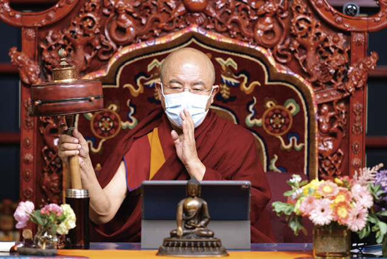

## 《普贤行愿品》讲解

2019年12月30日

今天我们讲《普贤行愿品》。在此之前，有一些人想要皈依，我在这里就按全知无垢光尊者的传承，给大家念一个皈依偈颂。其中有《圣大解脱经》以及《大圆满心性休息·三处三善引导文》的教义。下面我就先把这个偈颂给大家念一下，做一个简单的皈依。

（堪布念皈依）

传授了皈依，接下来有几件事情。

第一件事，是给大家念一遍《普贤行愿品》的藏文传承。藏传佛教中有教传、密传、岩传等很多种传授方法，这是通过所念的声音进行的教传传承，给予弟子加持和力量。

第二件事，简单地讲一下《普贤行愿品》中所归纳的意义，共有十个大愿，这在佛教中有重要的意义。今天我们着重介绍一下这十大愿。

最后，有一些重要的事情要宣布一下。

今天的课就分为这几部分内容。

首先我用藏文给大家念《普贤行愿品》的传承，可能需要十分钟左右，不懂藏语也没关系，只要听到声音就算得到了传承。然后我会就其中的内容做简单的解说。

（堪布念传承）

## 《普贤行愿品》讲解

刚才给大家念了《普贤行愿品》的传承，下面简单地作个介绍。

不论是在汉传佛教还是在藏传佛教当中，《普贤行愿品》都是非常重要的。凡是佛教徒，应该都会经常念诵《普贤行愿品》。在汉传佛教的历史上，《普贤行愿品》深受历代大德和修行人的重视。

我们现在念诵的《普贤行愿品》是般若三藏大师翻译的，他是《四十华严》的译者。般若大师是印度人，他来到中国时刚开始在广州，后来到了长安，受到了唐德宗的重视，之后建立了译经场。我们现在的《普贤行愿品》所属的《四十华严》，便由此翻译了出来。

《华严经》还有《六十华严》和《八十华严》的译本。《八十华严》也译于唐朝，《六十华严》是在晋朝时翻译的。在现在一些学者看来，我们如果要研读《华严经》，应该先读《四十华严》，然后读《六十华严》，再读《八十华严》，这样比较有次第。为什么呢？因为《八十华严》包括了佛不可思议的玄妙境界，如果刚开始就直接读，可能很多人无法进入佛的甚深密义。所以，先从普贤行愿的大愿开始，再进入佛的甚深境界，是一个比较好的次第。

藏传佛教念诵的《普贤行愿品》，和汉传的版本差别并不大。其实《华严经》本身就有包括敦煌本在内的很多种梵文版本。藏文的《普贤行愿品》与汉文的版本对比，后面的部分在次第上有些许差别。我们念诵藏文《普贤行愿品》时，虽然内容很完整，但如果要与汉传《普贤行愿品》的内容一一对应，到后面有一些颂词的顺序不太对得上。比如“文殊师利勇猛智，普贤慧行亦复然”这部分内容，与汉文就不能完全对应；而且藏文版最后的两个偈颂，在目前通行的汉文版中是没有的，但在敦煌本中有。

般若大师的翻译其实是非常严谨的。据说，当时唐德宗每天亲自来译经场监督翻译。如果有重要的事情不能出场，德宗还会和译师们请假。所以从历史上看，不论是《普贤行愿品》还是《华严经》，在翻译的准确度上确实非常出色，也深受历代君王的重视。现在佛教徒们普遍把《普贤行愿品》作为一个最重要的课诵来修行，法王如意宝晋美彭措一生中最重要的修行就是《普贤行愿品》。

《普贤行愿品》的最终旨趣就是为了让众生导归极乐，究竟成佛，这就是愿文最主要的内容。今天因为时间关系，很难为大家详细宣说每一个偈颂，因此，仅就普贤十大愿做一个简单的介绍。

菩萨如海的广大愿，可以归纳为十万大愿；而十万大愿又可以归纳于《普贤行愿品》的十大愿中；这十大愿又可以包括于《愿海精髓》的两大愿——佛法兴盛和利乐有情。如果不是大乘佛教徒，那就另当别论；如果身为大乘佛子，一定要把《普贤行愿品》当作自己修行的标准、修行的目的、修行中最重要的课诵，这是非常有意义的。

什么是普贤十大愿？在《华严经》中，善财童子依止了五十三位善知识，最后依止普贤菩萨，普贤菩萨为他宣讲了如海的佛陀坛城，而佛陀历经了千辛万苦，三大阿僧祇劫中积累资粮、净除罪障，全部可以归纳为十个大愿。下面简单讲一下《普贤行愿品》的十大愿。

佛教中经常说的七支供——顶礼、供养、忏悔、随喜、请佛转法轮、请佛不入涅槃、回向，再加上三条，就成了普贤十大愿。哪三条呢？首先，在顶礼之后加一个“赞叹如来”，第一顶礼佛陀，第二赞叹如来，然后依次是广行供养、忏悔业障、随喜功德、请转法轮和请佛不涅槃，到了第八个，加上“恒随佛学”——恒时、常随佛陀的菩提心来修学，第九是“恒顺众生”——要度众生就一定要恒顺众生，最后一个是回向。

今天我想以简单的语言来给大家讲一下普贤十大愿。其实，作为世间人，生活中行为和做人的基本的准则，在普贤十大愿中也同时具足。《普贤行愿品》的长行文中有这十大愿，我希望大家之后能看一下。

## 第一大愿：敬礼诸佛

什么是礼敬诸佛？十方世界中有无数无量的刹土，无量刹土中有无数的如来，这些如来身边又有很多菩萨围绕。这不光是理论上的说法，诸佛菩萨的神变确实如此，不可思议。

首先，通过学习《华严经》和《妙法莲华经》，在认识到诸佛的功德后，我们就能生起甚深的信心。了知一切诸佛具有无量无边的功德，我们就理应在这些佛陀面前，以自己的身语意来顶礼；或者观想自己变成普贤云供那样的无数身相，向无量刹土的诸佛菩萨以三门顶礼。我们以非常虔诚的恭敬心，观想自己有无数身体一一礼佛，口中念诵“南无本师释迦牟尼佛”或者“南无三世诸佛”，并思维：众生未尽之前，众生的烦恼未尽；众生的烦恼未尽之前，我们的誓愿不尽，永不疲厌、永不退转——应该以这样的信心来顶礼诸佛。

去除傲慢，非常虔诚地在诸佛面前顶礼，这就是礼佛。大家如果不是特别清楚礼佛的讲究，可以直接在佛像前恭敬礼拜；也可以以一种锻炼身体的方式来磕长头，这在藏传佛教中也是一种非常有意义的行为。

## 第二大愿：赞叹如来

在无量的刹土中有无量的佛陀，这些佛陀有如海的身语意功德，我们要对此加以赞叹。

有些人也许不太了解佛陀的功德。在《大藏经》中，不论针对微观世界还是宏观世界，佛陀都宣讲了很多极为深妙的道理。如果大家看到佛陀早在二千五百年前就把这些道理诠释得如此清楚，就会知道佛陀的境界并非我们想象的那么简单。佛陀具有不可思议、无量无边的功德，对此我们要以非常清净的信心来赞叹。赞叹时要观想自己的舌根发出无量的微妙之音，对诸佛赞叹供养。

## 第三大愿：广修供养

在十方诸佛面前，我们幻化为无数的供养者，供奉花鬘、幢幡等美妙之物，供品如普贤云供中的云海一样遍满虚空，以此做种种广大的意幻供养。

在所有的供养中，财供养也很重要，但最重要的是法供养。对上师是这样，对诸佛菩萨也是这样。什么是法供养呢？法供养包括利益众生的供养、摄受众生的供养、代受众生痛苦的供养，以及发菩提心的供养。这些供养的功德是非常大的。

在平时的生活中，我们对别人提供帮助，表面上看不算什么供养，但在大乘佛教中，我们帮助任何一个众生，哪怕让他的身心稍微得到一点点安宁、一点点快乐，这对佛陀来讲，就是最大的供养。

对上师的供养也同样，最上等的是法供养，最下等的是财物供养。有的人以为上师和诸佛最喜欢的应该是金银财宝，其实不然。诸佛菩萨真正欢喜的是我们能发起利益众生的菩提心，不害任何众生，这就是所有供养中最胜、最妙、最好的一种供养。

## 第四大愿：忏悔业障

我们要忏悔自己的业障。对于自己无始以来由贪嗔痴三毒或贪嗔痴慢疑五毒所引发的身语意的无量罪业，我们应该在诸佛菩萨面前一一忏悔。

对于这些罪业，如果能观想起来就一一发露，如果实在不能观想也没关系，因为诸佛菩萨有无碍了知三世的智慧。在他们面前进行忏悔之后，要从内心深处下定决心，以后一定要让自己的相续清净如法。这也是一种最好的供养。

忏悔业障时最重要的是在诸佛菩萨面前发露罪业，之后我们一般是念百字明和金刚萨埵心咒来忏悔。

## 第五大愿：随喜功德

对所有佛陀从因地到佛地间所造的一切善根，我们都要随喜；对所有声闻、缘觉、菩萨从因地到果地的善根，我们也要随喜；还有六道三界中不论资粮道、加行道，乃至未入道凡夫的有漏无漏的一切善根，我们都要一一地随喜。

这种随喜并不是一次两次就够了，“今天你做了件善事，我来随喜随喜。”不是这么简单一说就可以，我们应该发自内心、由衷地为他人所做的善事感到欢喜。随喜他人的功德是普贤十大愿之一，只要对他人的善根生起随喜心，我们自己也能获得同样的功德。

## 第六大愿：请转法轮

在十方世界中有很多如来，但因为各种各样的因缘，比如众生的根基等不同情况，有的佛陀没有开始真正转法轮，有的虽然已转法轮，但即将结束。在这种情况下，我们应该观想在诸佛菩萨和善知识面前以身语意祈请供养，请他们对众生不断地转妙法轮。

释迦牟尼佛刚刚成佛时并没有讲法，当时有天人祈请转法轮；佛陀即将涅槃时，也有优婆塞在佛陀面前祈请不断广转法轮。在历史上，也有一些善知识由于种种因缘不转法轮，经过弟子请求之后，才开始讲经说法。

## 第七大愿：请佛住世

十方世界中，有的佛陀事业已经圆满，即将示现涅槃。我们应该以虔诚的信心祈祷诸佛菩萨不要涅槃。当有的善知识要示现涅槃时，我们也要祈祷，请这些善知识长久住世。哪怕他们住世一月、一天，也会直接或间接地给众生带来无量的利益。

这些不是仅仅在口头上说，我们在念诵和观修时，应该发自内心地观想：世间如果有佛陀和善知识要示现涅槃，我一定要祈请他们好好地长久住世。

佛教徒常常爱说“愿您长久住世，常转法轮”，实际上这不是靠口头讲，而是要发自内心地这么想，祈请诸佛菩萨常转法轮，长久住世，让整个世间得到安乐利益。在祈请的同时，我们也需要用自己最大的智慧观察因缘，这很重要。

## 第八大愿：常随佛学

《华严经》的长行文中讲到：毗卢遮那佛在因地时为了众生，布施头目脑髓；为了书写佛经，对于自己的血肉皮肤也毫不吝惜；为了求得佛法和令众生安乐，他可以牺牲自己，舍弃一切。

我们应该如毗卢遮那佛一样，为了利益众生而随学如来，包括释迦牟尼佛、弥勒佛等等，他们在因地时怎样为了众生而求索真理，我们也应该有这种精神。所以，大家不要有疲倦心，一定要发起常随如来的大心。

## 第九大愿：恒顺众生

整个十方世界的众生，用现在的话来说是地球上包括七十多亿人类在内的一切生命，用佛教术语来说是“胎、卵、湿、化”四生。众生各种各样、不尽相同：有些有形、有些无形，有些生活在陆地上、有些生活在水中，众生之间性格不同、爱好不同、肤色不同、兴趣不同……作为发了大乘菩提心的人，为了利益这些众生，不管他们是什么样的，我们都要尽量不害他们，尽量随顺他们——这就是佛教中最重要的恒顺众生。

人都有自私的一面，不管是在家庭、工作还是生活中，当自己的心与别人不合时，经常翻脸吵架甚至反目成仇，但依照大乘佛教的理念，人的价值其实在于奉献自己让众生得到利益。人类中有不同的社会阶层、不同的文化背景，在东方人中，各个民族、各个层次的人也有不同的习气和习惯，而菩萨对这些形形色色的众生始终都能平等随顺。

世间不论人与人、人与家庭、人与社会之间，很多的痛苦烦恼和抵触都是源于自私，源于不能随顺对方。普贤菩萨的十大愿中最重要的就是恒顺众生。为什么呢？因为成佛之因就是悲悯众生。经中有这样的比喻：一棵枝繁叶茂的大树上，所有树花、树果都来自树根，如果树根没有水的滋润，那整棵树都会干枯凋萎。滋润的水相当于什么呢？大悲心。成佛的根本是对众生的大悲心，如果大悲心的水干涸了，诸佛菩萨的功德都不可能产生。

有的人越学佛性格越不好，越来越不能对众生随顺。比如结伴出行，一起坐车住宾馆，自私的人处处想的都是如何对自己有利，根本不会设身处地考虑别人的感受。儒家也说“己所不欲，勿施于人”，我们不愿意的事不要推给别人，因为别人也同样不愿意。作为修行人，随顺众生十分关键。

法王如意宝在《胜利道歌》中也提到，随顺众生是他一生中最深刻、最重要的一个教言。所以，恒顺众生作为普贤十大愿中的第九大愿，是尤为重要的。作为佛教徒，在任何时候，不论接触任何人，我们都要尽量随顺他们。当然，理论与现实生活难免会有一些冲突，但真正以大乘理念来看，一切众生，不分肤色、地位、文化程度，只要是众生我们就要尽量帮助他们，尽量随顺他们，这就是大乘佛教的伟大之处。世界上很多伟大的人物都认为利他才是最伟大的事，同样，大乘佛子对所有的众生都有这种恒时随顺的大愿。

## 第十大愿：普皆回向

不论做任何善事，最后都要回向给众生。也就是说，前面的礼敬诸佛、称赞如来等每个大愿的功德，我们都要回向给普天之下的一切众生。

我们做任何善事，最后都应该有一个总结，就像工作一年要有一个年终总结。为了令无边众生获得真实的利益，我们要把依照普贤诸大愿所做的一切善根赠与他们，这就是真正的回向。当然，《普贤行愿品》还有很多非常不可思议的功德。你们如果有兴趣，可以对普贤十大愿后面的长行文直接进行学习和探讨。这是非常好的。

现在已经把《普贤行愿品》的传承念完了，开示也讲完了。希望大家依照《华严经》长行文所解释的普贤十大愿的内容来发愿，并且经常念诵《普贤行愿品》来回向功德，这非常重要。作为佛教徒，最好每天都念一遍《普贤行愿品》；如果有时间，最好能先念长行文中的十大愿。因为经中先以长行文对普贤十大愿进行了讲解，然后才是《普贤行愿品》“所有十方世界中……”的偈颂。相对而言，长行文的内容比较丰富。

## 圆满的句号

还有一件事要特别宣布。

今天是2019年即将结束的日子。对我而言，这是一个比较特殊的日子。为什么这么讲呢？因为从2018年1月1日开始，我每天都在微博平台上为大家发一条佛教的教言。所以，2018和2019这两年的两个365天，我每天都会提供一个佛经、续部、前辈高僧大德以及我的上师的教言。有些原文是藏语，我就翻译成汉语，这样一直不间断地每天发，加起来有730条。这两年中我一天也没有中断，坚持下来了。

前面发的很多教言是我以前背诵过的，回忆起来给大家分享。到了今年年底时，该分享的都已经发完了，于是我又在看书的过程中对一些好的语句进行整理和分享。虽然这些语句很简单，但我认为其中包含了很深的佛教教义。虽然对于非佛教徒来说，这些教言也许没有什么价值，但对于佛教徒而言，这些内容对大家的修行、行为和利他菩提心等各方面是很有意义的。

这两年已经圆满，再过一天就是明年了，所以我今天在这里做一个总结。即使想要继续分享下去，我可能也找不到特别适合的教证和教言了。所以，这是一个圆满的句号。

第二个圆满的句号。从今年1月1日开始，我每天都会选出法王如意宝晋美彭措的一段教言进行分享，而且每个教言都配上一张照片。有些是我之前保存的，也有些是别人提供给我的。一共有法王的365张照片和365条教言，以后想再找也未必找得到。所以，给大家分享法王教言这件事也圆满了，一会儿我们做个回向。

第三件事比较重要，希望现场所有的佛教徒，还有以前菩提学会的成员，大家都好好听受。对于今天不在场的人，你们也要转告他们，把我今天所讲的话原原本本、不折不扣地告知大家。

我下面要讲的这些内容，一方面为表郑重，一方面也是怕忘，不像平时那样直接讲，而是提前写下来了，我边念边给大家宣布：

菩提学会是我2004年创立的，2006年以后，为了便于大家闻思修行，我依靠这个平台开始通过网络进行佛法的传讲。

前前后后，我讲了显宗的“五部大论”——戒律、因明、中观、俱舍、现观，每一部论按常规都需要讲几年的时间。还讲了《入菩萨行论》201课、《大圆满前行》144课，《法华经》也讲了63堂课，还有《阿弥陀经》《无量寿经》等“净土五经”以及《维摩诘经》等。同时，还讲了传统文化中的《孝经》《弟子规》等等。藏传佛教中的密法也讲了很多，比如法王如意宝的《文殊大圆满》，还有《法界宝藏论》《大圆胜慧》《大鹏展翅》《六中阴》《文殊大圆满愿文》《大圆满三自解脱》等等。

到2018年我已经讲了2800多堂课，现在加起来应该超过3000堂课了。我想，对于愿意学习的人而言，这些已经足够了。我前年、去年在课堂上也说过，现在该讲的都已经讲完了，也足够你们学修一辈子了。

所以，对于菩提学会，我其实在2015年就已经提出解散。但很多地方仍然以学会的名义在线上线下开展一些活动。因此，我今天真实地就菩提学会的事宜，再次向大家说明以下几点：

1．菩提学会的所有课程，如刚才所讲，已经全部传讲圆满。各地不论小组也好、共修也好，从今天开始全部解散。既然所有的课程已经圆满，所以一切活动就此结束。包括弘法教务处，以后也不会再有这个部门。

菩提学会最初是我一手建立起来的，这次解散也由我本人决定。这是我跟大家说的第一点。

2．这次解散菩提学会的过程中，不管是国内还是国外的成员，我希望任何人不要有抱怨或者议论，更不能在网络平台，包括微信群、朋友圈中，私下散布不如法的言论。

你们如果真正把我看作上师或者是有过法恩的人，希望把我的这番话听进去，牢牢地听到心里，不折不扣地按要求去做。不要自以为是地过多解读，认为我的意思可能不是这样。如果这样议论，私下乱发各种消息的话，对你们也不好，对大家也不好，包括对我个人也不是好事。大家应该谨记在心。

从2004年到2015年，或者到今天2019年，我给你们讲法已经这么长时间了。在这么长的时间中有学习的机会，对于愿意好好学的人已经足够了。法王如意宝求学的时间也不是很长，很多高僧大德求学的时间也没有这么长。如果自己没有学好，不要说15年，可能50年对你来讲也没什么收获。

现在一切应该算是善始善终，大家要有一种感恩心、满足心。这是我要表达的第二点。

3．菩提学会解散以后，任何地方如果有人以菩提学会的名义做一些事情，与我本人没有任何关系。如果有不如法的现象，大家要对自己的行为负责。

对此，我也会有一份书面的声明，很快会发布。这是我想表达的第三点。

4．我个人而言，虽然身体不是很好，在喇荣的事情也比较多，但这几年中，完全算是为大家发心吧，已经传讲了这么多显宗和密宗的法，希望有缘者好好珍惜。

佛陀也说过：“我为汝说解脱道，解脱依赖于自己。”佛陀只是为大家宣讲解脱之法，到底能不能修行，最终要靠自己。我们学佛是为了调伏自己的心。希望每个人依靠学过的法，好好地不断修行。修行对我们来说极为重要，如果没有修行，光靠理论，精通千经万论也没有多大作用。遇到烦恼、遇到生老死病的时候，可能根本用不上。所以，我觉得最重要的是：大家要好好修行；如果有能力的话，更要好好地利益众生。

最后，作为一个大乘修行人，应该遵照上师如意宝的教言“莫舍己道，勿扰他心”来行持，要牢牢地记在心里面。

今天是个比较特殊的日子，前面提到的很多功德和善法，已经善始善终，正如佛教中说的“初善、中善、末善”，希望大家随喜功德。

2019年很快就要结束了，新一年的元旦即将到来。我祝大家身体健康、吉祥如意。扎西德勒！
