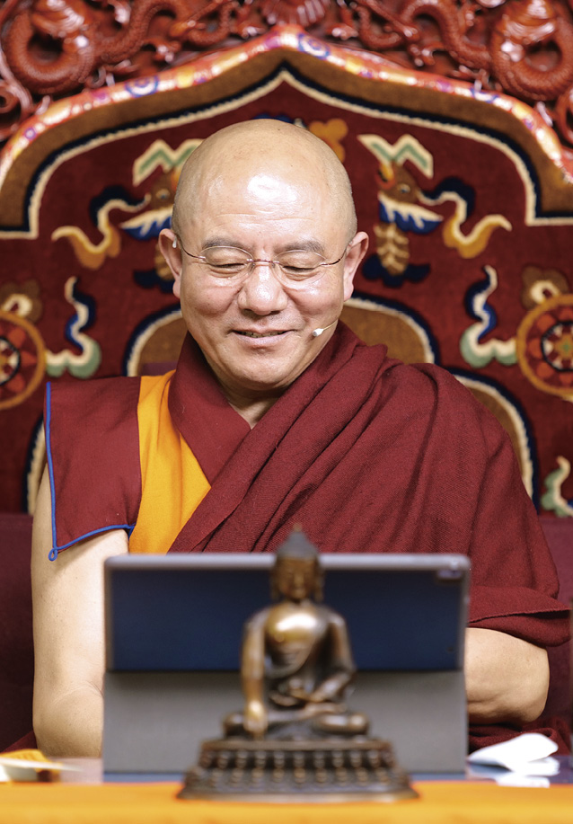
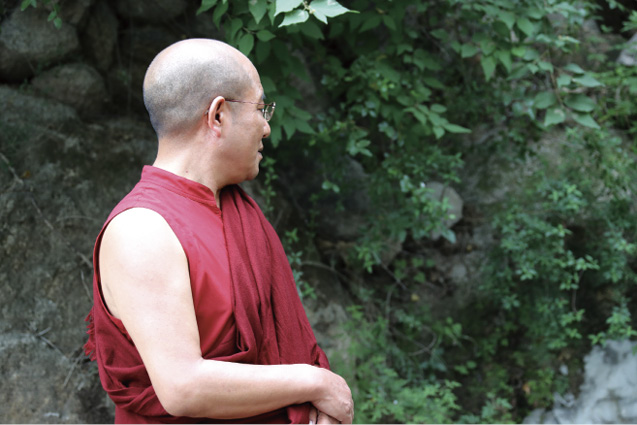
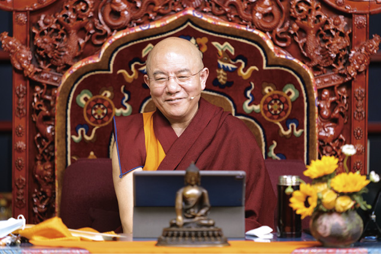

## 《胜利道歌》讲解

2022年6月13日

今天我们利用这堂课给大家做一个简单的开示，然后再念一些传承。

虽然这次我们没有正式举办金刚萨埵法会，但是按照历年的传统，我们院寺内部会念一些忏悔的经文，在这期间难免会有一些临时来访的人参与念经。不管怎样，大家来到这里、待在这里都很不容易，所以这次我想给大家简单地以佛法结上一个缘。

大家都知道，现在正值一段比较特殊的时期。因为新冠疫情以及其他方面的一些原因，我们佛学院没有正式对外开放。这时候你们到这里来，不知要遇到多少困难、承受多少压力，这也是一种求法的苦行。求法的路上难免经历艰辛，古代大德和前辈修行人，可能会遇到老虎、狮子、豺狼、毒蛇之类的种种危险，也可能在寒冬腊月中无吃无穿，这些都是过去求法过程中要面对的诸般苦行。而现在求法同样要经历苦行，只是形式和以往不同。

这个时代的修行人，缺衣少食的情况比较少，但我们要忍受另一种方式的苦行，比如种种复杂形势带来的心灵上的痛苦、行动上的不便，还有其他各种各样的阻碍。

正因如此，我想在座的绝大部分人，都是纯粹为了调化自己的相续、清净自己的内心、追求真正的解脱而来到这里的。那些别有用心、来这里搞世间八法、破坏寺院戒律的人，我想这里应该没有。不过有时也很难说，因为人心是形形色色的。但我相信，这里大多数人的目的确实是为了离苦得乐、获得解脱。

前面几天中，大家都在念修金刚萨埵心咒。大部分人念得非常认真，很多人已经念了好几十万遍了，只有极个别的人可能还没有念完。今天是萨嘎月十四日，按照藏历来算还有半个月的时间，我希望大家在这段时间内念完四十万遍金刚萨埵心咒。

那天我也讲过，不管你在学院里的发心工作再忙，也没有任何讨价还价的余地，哪怕是晚上不睡、白天不休息，也一定要在这个月内完成。我自己也同样，不管是外出还是做事，一直都在非常努力地念咒。虽然念得不算很多，但也不少。你们这次在喇荣跟那么多僧众共修，是很难得的机会。大家今天应该已经把这个月要念修的数量报上去了，如果能在月底前念完，那就算是完成了计划。不管你报了多少，都应该珍惜这个机会，好好念修金刚萨埵心咒。现在还有半个月的时间，每个人一定要把这四十万遍心咒念完。

在这个过程中，如果能以具足四对治力的方式来念修金刚萨埵心咒，是最好不过的。要是实在不会观想四对治力，只把金刚萨埵观想在自己前面好好持诵心咒，这样也是可以的。这次我们特意为大家制作了一幅特别的金刚萨埵唐卡，应该每个人都得到了。这样即便以后你们不能来喇荣，但每年的萨嘎月都能对着它念诵四十万遍金刚萨埵心咒。

这幅唐卡是由众多僧众共同开光加持过的。藏地老一辈修行人对于哪怕仅由一位僧人开光过的三宝所依，都特别地重视。这次有这么多僧众共同为这幅唐卡开光，确实是十分难得的，大家应该珍惜。虽然这看起来只是一幅小小的唐卡，可能哪里都能请得到，但实际上，经过僧众开光的纪念品是有特殊加持力的。依靠我们的信心以及金刚萨埵佛身的威力，我们自相续中的罪障一定能够得到清净。

在这里我想跟大家说明一点，这次金刚萨埵的念修并不是开法会，只是内部的共修。因为疫情期间法会的审批手续无法通过，所以这次我们没有对外举办法会。那么为什么还有一些人来到这里呢？他们不是参加法会。因为如果按往年我们开法会的情形，这里应该早就人山人海了。大家都知道，以前每逢金刚萨埵法会，从洛若乡一直到喇荣沟，所有公路上都会挤满往来的车辆和人群。而现在我们这里除了常住的几千名僧人和极少数的外来信众，并没有其他人聚集过来。所以，这次来到这里的信众并不是来开法会的，只是平常的朝拜、探亲，或是拜访一些出家人，送一些物资口粮，顺道去转转坛城，仅此而已。

最近在坛城等处都有管委会和工作组的领导在值班，你们也清楚，疫情期间各地都在严加防控，像我们这样的地方管控得尤为特殊。在这个时候，大家应该安住下来修心念诵，这种机会确实也是非常难得、来之不易的。

我也了解到，最近很多道友都在认真念诵，一天四座毫无间断。当然，也有个别人念得马马虎虎，要求交手机也不肯交，偷偷摸摸地看。另外，虽然这里大多数都是老修行人，但也有一部分人可能是新近皈依佛门的，不太懂得如何对待三宝所依。有些人把转经轮、经书随意扔在地上，或者在上面跨来跨去，这样有很大的过失。三宝所依一定要放在清净的地方，千万不能放在地上或不干净的地方，更不能在上面踩跨，这是绝对不允许的。从这些方面看得出来，有一部分人在恭敬三宝的意识上还有待提升。

不管怎样，大家都要好好珍惜这次共同念诵的机会。在整个念修过程中，我们这边的团队，包括发心人员、志愿者、管家等等，其实都非常辛苦。虽然我们没能满足你们每个人的需求，包括吃的、喝的、睡的，因为现在很多方面都不太方便，无法像以前一样提前做好各种准备，但总体而言，我们一直在为大家尽力服务。比如有人身体不适，这里的医生也会发心提供需要的药品和治疗；我们也准备了每天的餐饮，以防有些人没有吃的、没有喝的。我们这里并不是一个多么高端的服务站，肯定满足不了所有人的要求，但总的来讲，包括出家人和在家人在内的所有发心人员，也为大家尽心尽力地付出了。你们没有挨饿受冻，也全靠他们的勤奋努力。

本来在藏地，如果要去一个地方念经，所有物资都要自行准备，被褥要自己带，三餐也要自己烧火做饭。但我们依靠三宝的加持，通过各种方便方法，这次给大家提供了各方面的便利，也算是尽心尽力了。除此之外，我们的能力也有限，因为学院里每个人都忙着闻思修行，并不是在这里专门搞旅游接待的。

从某些角度上看，疫情期间限制外部人员进入喇荣，对我们而言也算是一种保护。如果外面的人来得太多，其中虽然有一部分是真正想要闻思修行，但同时也会有相当一部分人抱着其他目的而来，这对我们是很大的麻烦。这几年来，我们对喇荣的常住人员也制定了一些年龄等方面的限制条件。所以，这次临时来的佛教徒在这几天念完经以后，最好不要在山沟里逗留。如果你们不参与正式的闻思修行，整天在这里东游西逛，难免会影响到整个佛学院正常的修学秩序。

到今天为止，我们这次金刚萨埵念诵已经圆满了。明天僧众会用汉语念《药师经》，你们参不参加都可以。接下来大家就可以陆陆续续离开，你们可以去拜访别的高僧大德、别的道场、别的圣地，因为我们能给大家提供的服务实在很有限。本来我今天在外面还有事处理，但听说有些道友可能想见我一面，所以特意赶了回来，给大家简单地念个传承、做个开示。今天念修圆满以后，大家应该心满意足了。

此外我想强调几件事情：大家都知道，2019年年底菩提学会就解散了。但在那之后，还有一些人以学会的名义招生、化缘，或是打着修塔、修寺庙、修佛像等旗号进行各种形式的募捐。有的人给自己安个负责人的名头就开始招募学员，给他们安排所谓的课程。对这种种现象，今天我在这里要跟大家明确重申：我从2019年12月起，就将菩提学会彻底解散了，在那之后，我们没有再建立过任何组织。

我建议大家，今后如果自己要学佛的话，最多一两个人结伴就可以，再多的话暂时恐怕不方便。有个别人自称受到学院法师的委托，甚至以我的名义，在山下组织招生、考试等——这根本不是我的授意。因为我觉得，从2006年到2019年这十多年来，该传的法都已经传了。既然菩提学会已经解散了，我们完全没必要再搞任何组织。这一点要跟大家说清楚。

菩提学会以前除了纯粹的学习，没有其他任何目的，任何募捐之类的行为都根本没有过。当时相关部门进行过调查，也证明了我们确实除了学佛之外没有任何非法行为。后来我也答应解散了这个平台。现在很多地方还有人以菩提学会的名义组织活动，包括这次来到喇荣的人，听说还有人在这样自我宣传。有些人以前当过学会的负责人，学会解散以后，觉得自己下台了，还想找一个位置装模作样地继续做主。还有些人以学会的名义召集学员，想从中搞自己的生意。世间人并不都是纯粹为了佛法而聚集的，有的是为了打广告，有的是为了其他目的。所以我今天在这里必须给大家讲得清楚一点。

现在外面有不少消息传来传去。大家应该懂得相关政策，在某些情况下，十人以上的聚集是被禁止的。如果其中还有敛财等不正当行为，有可能会被立案处罚，后果非常严重。我们现在要学佛，也应该通过更合适的方式来学习。在信息时代，只要你想学，不论哪一位上师的课，在虚空中都能找到很多。既然如此，你也不一定非得要召集很多人共同学习。

特别是现在这段特殊时期，包括集体放生、共修、闭关、闻思等活动，最好都不要再组织。我并非不想弘扬佛法——尽心尽力地弘扬佛法对我而言是一种使命——只是在现在的环境下，真正想弘扬佛法的人，如果听明白我当时所说的意思，就该把过去放下。但是总有一部分人怀着其他目的，以某些上师的名义搞些密法班、显宗班、五部大论班、前行班、修心班、气功班……各种各样的乱象此起彼伏。从2019年以后，我原来弘法的发心团队就已全部解散。其中有个别人可能坐不住，在山下还装作是发心人员搞一些事情。今天既然我已经把话说明白了，你们也如实转达给别人。我说的意思很清楚，这没有什么了义、不了义的。

大家要注意，第一，过去的那种集中式学习，现在我这边没有再开展了。如果你们遇到的话，应该自己去观察，到底是不是我的意思，如果是的话，我又何必在这里澄清。为什么我今天要说这些？这是有原因的。我最近听说，有的人是专门来这里找弟子的，而不是来念金刚萨埵忏悔的。对于这些人，我想说，我们的学会早已解散两年多了，没有这个必要。这是第一点。

第二点，是关于现在的网络传法。以前有些出家人和居士习惯通过网络来传法听法，但你们应该知道，从今年3月开始，这方面有一系列新的规定出台。我个人从去年起就没有再进行网络传法了。我们佛学院有个别法师在网上传法，人数虽然不多，但后来确实也遇到了一些麻烦。我们这里现在所有网络传播都已经停止了，你们如果有人在网络上进行共修之类的活动，也要注意。

另外，现在很多人经常在网上发一些关于学院和上师的图片。过去大家出于弘扬佛法的目的，发一点这类图片也可以，但以后这些就不太适合发在网上了，大家在这方面也应该谨慎。

最近有一些变化值得注意，我们应该看明白这个时代的整体状况，现在已经完全不同于过去。以前可以做的，现在未必可以。在这个时候，我们要避免制造不必要的麻烦。在这些问题上，我自己并没什么害怕的，我知道自己该做什么、不该做什么，这些我都清楚。但大家要知道什么是最重要的，一是保护佛法，二是保护你们自身，还有，就是保护你们的信心。一旦真正遇到了麻烦，除了少数信心稳固的人，很多人确实容易退失信心。所以，在没有发生什么事情的时候，大家应该保持谨慎，以正知正念来防护自己的三门。这是很重要的，在这里必须跟大家说明一下。

还有一件事，我们前两天给大家结缘了学院僧众开光过的释迦牟尼佛小佛像和甘露丸。有没有人没领到？（部分人表示没领到）这个事可不能说妄语，如果在修金刚萨埵期间说妄语的话，罪过更大。确实没有得到的人，等会儿下课的时候，可以在门口补领。我们会给大家每人提供一尊佛像和一份甘露丸。仅限在场的人，不能为没来的人代领。另外，我们这里还有一些《不凡》和《苦才是人生》的法本，到时候也可以给大家结缘。

这尊释迦牟尼佛像，对于我们每个佛教徒而言，是十分重要的。它经由学院众多僧人装藏、开光，具备各方面的加持，是属于每个人自己的三宝所依。希望你们以后不管走到哪里，都应该把它放在嘎乌盒里，或者装在小袋子里随身携带，千万不要丢失。如果你是具有信心的三宝弟子，那么终生都可以从中得到加持。

## 授皈依

下面，我给在场没有皈依过的人做个皈依，然后再给大家念个传承。

所谓皈依，一般有两种——为自己的解脱而皈依，还有为众生的解脱而皈依。我们应该尽量在心里这样想，为了让天下无边的一切众生离苦得乐、获得解脱，我现在要皈依。接下来我带领大家念诵皈依偈，意思是：皈依上师、皈依佛、皈依法、皈依僧众，也就是皈依三宝或者四宝。我先念一遍，你们跟着我念诵一遍。

（堪布念前两遍皈依偈，众人跟念）

我念完第三遍的时候会弹手指，当你们听到这个声音的一刹那，就获得了皈依三宝的戒体。现场很多人可能以前也皈依过，我们再次皈依三宝，心中再次发愿和祈祷，三宝的加持也会越来越猛烈、迅速、直接地入于我们心间，让我们生生世世不离三宝的光明。那么，我再念最后一遍。

（堪布念第三遍皈依偈颂，众人跟念。堪布弹指：“塔比哦[此乃方便]。”众答：“拉索[善哉]。”）

这样我们就完成了皈依。

## 《胜利道歌》讲解

接下来，我给大家讲一下法王如意宝的《胜利道歌》，这也是法王一生当中最深的一个窍诀。在座很多常住都能对这部法熟练背诵并精通含义，我们今天为了表示一种缘起，为了每个人能够战胜违缘、获得胜利，大家一起再次学习一遍。

我们每个人其实都在一个充满烦恼、违缘和魔众的战场上搏斗，究竟谁胜谁败还未可知，也许我们能够得胜归来，也难说最后一败涂地。在如今这样一个复杂异常的战场上，很多人得到胜利，很多人以失败告终。如果我们希望打赢这场仗，在有生之年中闻思修行善始善终、弘法利生圆满无缺，好的因缘是必不可少的。但顺缘并不是光靠想想就能创造的，有些时候我们虽然希望自己能生生世世不离三宝的光明，能利益天下无边的有缘众生，可在前世的业力、暂时的境况等等外、内、密的魔障违缘驱使下，最后往往无法顺利凯旋。这样的修行人比比皆是。

法王显现上也在1996年遇到了种种障碍，正如跋文中所写，当时学院僧众也遇到了种种不利的违缘，所以法王造了这篇《胜利道歌》。虽然这看起来只是一个简单的窍诀，但实际上有甚深的因缘。

确实，在末法时代，人人都要与自己外部、内部和秘密的各种障碍对战交锋。如果我们经常念诵法王的《胜利道歌》，就能更容易地战胜修行中的违缘、生活中的违缘、工作中的违缘、人生中的违缘——非但今生，乃至生生世世的违缘障碍都能顺利遣除，这对于我们每个人而言都是至关重要的。如果没有战胜违缘的力量，在魔众的强大威胁下，我们可能就此一蹶不振、灰心丧气，最后一生的努力以失败告终，这样的现象也不少见。

我们每个人都应该有一个护身符，所谓护身符，很多人觉得是戴在脖子上的，那样当然也很好，三宝的所依有不可思议的加持力，但最重要的是我们要在自己内心当中戴上一个战胜违缘的强大护身符，这就是《胜利道歌》。

从1996年开始，每年法师们传法之前都要先讲一遍《胜利道歌》，哪怕只念个传承。这么多年下来我们都感觉到，确实只要年初念了《胜利道歌》，这一年中不论遇到什么违缘都能顺利化解。有一些大的违缘或许实在难以阻挡，比如死亡大限或者人生中的一些重大转折，但是《胜利道歌》确实对每个人都是十分重要的缘起。

《胜利道歌》的藏文传承，法王以前也传过很多次，现在我给大家再传一遍。得到这个传承之后，大家应该经常念诵汉译版或者带在身上，这样一定会有不可思议的缘起力、加持力和特殊的威力。下面我给大家念一下《胜利道歌》的藏文传承。

（堪布念《胜利道歌》藏文传承）

下面我为大家从字面上简单解释一下。

《胜利道歌》是法王1996年所造的一篇非常简短的窍诀。类似的还有我们以前学过的《佛子行》、《修心八颂》以及宗喀巴大师的《三主要道论》，这些都是简要而精练的窍诀。虽然文句看起来简单，但里面讲了特别殊胜的修行要点。

《胜利道歌》开头是对文殊菩萨的赞颂文，最后是回向文，中间的正文分别赞叹了大圆满、菩萨戒、别解脱戒以及贤善的人格。这四部分内容——大圆满、菩提心、出离心、贤善人格，大家要牢记。每一部分都以两个偈颂来解释，所以主要内容包括四个要点、八个偈颂。

这些内容说起来简单，但其实已经超出了宗喀巴大师《三主要道论》的内容纲要。因为《三主要道论》讲了出离心、菩提心和无二慧，没有讲到贤善人格。其中关于无二慧的内容，也只讲到显宗的部分，没有讲密法中最深的教言。法王的《胜利道歌》在这些内容的基础上，还加入了更为特殊的窍诀。

> 怙主诸佛智慧身，文殊室利童子尊，

> 恒住八瓣莲蕊心，所言愿利诸有情。

最开始的偈颂是对文殊菩萨的顶礼句。意思是：一切佛陀的智慧之身实际上就是文殊师利菩萨，我们要祈祷文殊师利菩萨恒常住在我们八瓣莲花一般的心中；文殊菩萨如若住在心间，我们造论著疏也好、讲经说法也好，所说的任何语言都能对众生带来利益。

不论讲法还是造论，我们想要做好任何事情，都要在刚开始的时候祈祷自己的本尊，而智慧的本尊就是文殊菩萨。我希望大家在做任何事时都要重视本尊的加持。就像这次大家来到喇荣，不是为了其他目的，就是想清净自己的相续、净除自己的罪障，这个时候我们就要祈祷金刚萨埵佛尊。如果我们希望自相续中生起大悲心，就要祈祷观世音菩萨。如果我们想要遣除违缘，就要祈祷大势至菩萨或者莲花生大士。这就是祈祷本尊的理由。

> 甚深光明大圆满，仅闻词句断有根，

> 六月修要得解脱，唯此铭刻于心中。

宗喀巴大师的《三主要道论》中首先讲出离心，然后讲菩提心，最后讲无二慧，如此逐层而上。而在《胜利道歌》中，则是由从上往下，首先赞叹大圆满。大圆满从哪里来？从菩提心而来。菩提心从哪里来？出离心。出离心又从哪里来？依靠贤善的人格。所以，二者的层次顺序不同。

《胜利道歌》赞叹大圆满的部分有两个偈颂。第一个偈颂的内容是：甚深的光明大圆满其实就是诸佛菩萨的心髓，也是十万持明的智慧精华。仅仅听到里面的个别字句、个别道理，也一定能断除三有轮回的根本，从此之后再也不用流转轮回。若是一些具缘者遇到了特别殊胜的善知识，仅仅修行六个月，也一定会获得解脱。所以，有缘遇到大圆满的人们啊，为何不把这么殊胜的法铭刻于自己的心中？一定要铭记于心啊！

这么快捷、殊胜的法，确实无比难得。我希望各位，如果得到过大圆满的灌顶和教言，一定要继续修持，不要放弃。最好是先修完五十万加行。修五十万加行很不容易，但还是要努力完成，哪怕只是数量上完成也可以。

我经常这样想，自己这辈子来到这个世上，可以说很有善缘，没有空耗。为什么呢？因为遇到了好的上师，遇到了无上密法大圆满。我发自内心地觉得，已经遇到了这么殊胜的法，哪怕明天就离开人间，我也没有丝毫遗憾。虽然现在算不上修得了什么解脱和成就，但是在自己的阿赖耶中已经种下了解脱的种子，一定会开花结果的——对于这一点我充满信心。我希望大家通过闻思修行各种经论，对密法建立起信心，并且不断增上，这很重要。这就是《胜利道歌》赞叹大圆满的第一个偈颂的内容。

> 遇此胜法善缘众，前世累劫积资果，

> 与普贤王同缘分，诸道友当生欢喜。

第二个偈颂说：遇上如此殊胜的大圆满法的有善根善缘的众生们，其实你们并非平白无故来到这里。能遇到大圆满，一定是多生累劫积累资粮、净除罪障的结果。为什么这么说？能遇到大圆满这样的普贤王如来心髓法要的人，就如“系解脱”和《法界宝藏论》所说，实际上跟普贤王如来有同等缘分。我们大家虽然身处末法浊世，但遇上了如此殊胜的密法，确实特别有缘。因此，大家应该生起无与伦比的欢喜心。

我们要这样想：虽然我修得不好、烦恼深重、造业众多，但是我遇到了大圆满，遇到了闻解脱、系解脱、触解脱，确实已经得到了最重要的法。但要注意的是，千万不能对大圆满加以诽谤或是生起邪见。我们学了《六祖坛经》和《七宝藏》就会知道，大圆满不是那么简单的，它确实是三世诸佛的智慧心髓。这一点大家理应明白。

法王在这里没有讲大圆满的具体修法，只是简要地强调了功德。若是没有缘分的人，可能连大圆满的一个偈颂都听不到。我们有因缘遇到这个法，接受了灌顶和教授，那无论如何都不能舍弃。如意宝拿在自己手里的时候，千万不能随便扔掉。要是把如意宝扔掉了，别人会讥笑你愚蠢，自己也会后悔莫及。

这些就是第一部分赞叹大圆满的内容。下面讲关于菩提心的赞颂。

> 为沉恐怖轮回众，获得永乐之佛果，

> 当负利他之重任，舍弃爱自如毒食。

赞颂菩提心的偈颂是说：为了使沉溺于轮回的一切众生获得永久安乐的佛果，我们应该担负起利益他众的重任——发菩提心。如果我们发了这样的菩提心，就一定能舍弃如毒食般的自私自利之心。大家知道，生起菩提心的一刹那，就会远离自利心。

> 以此可阻恶趣门，亦可获得善趣乐，

> 趋至究竟解脱地，切莫散乱修此要。

这样的菩提心能起到什么样的作用？它能让我们永远不再落入恶趣，能阻断地狱、饿鬼、旁生之门；也一定会让我们暂时获得人天善趣的快乐，究竟获得本师正等觉佛陀的果位。因此，法王再三劝请我们：千万千万不要散乱，一定要认认真真、谨慎小心地修持珍贵的菩提心。菩提心就像如意宝一般，如果我们随意舍弃，就会堕落到三恶趣中。若是没有菩提心，可能连人天善趣的福报都难以得到。

有些人学过《入菩萨行论》，这是一部非常重要的论典。如果没有学过，我强烈建议大家学一学，因为我们只凭今晚一节课，不可能解决很大的问题。学习佛法是一条非常长远的路，很多道理不可能在一个多小时中就讲清楚。如果你是一个真正想要修学佛法的人，我建议好好学习《入菩萨行论》。自己看书也行、听课也行，一定要把这部论学好。很多人学了《入菩萨行论》之后，虽不敢说生起了真正的菩提心，但至少也令原来自私自利的心减弱了很多，利他心增上了很多。

总之，一定要发无上的菩提心，否则我们就称不上大乘修行人，只能算是小乘或者人天乘的修行人。发菩提心非常重要！以上是第二部分菩提心内容。

> 于诸轮回之盛事，不起羡慕之心念，

> 当持人天供养处，殊胜严饰之净戒。

第三部分是讲守持清净戒律，或者说发出离心。真正有出离心的标志就是对轮回中所有名声、财富、地位等兴盛之事不生起丝毫羡慕的心念。正如宗喀巴大师在《三主要道论》中所说：“修后于诸轮回福，刹那不生羡慕心，日夜欲求得解脱，尔时已生出离心。”法王以前也讲过，虽然一刹那的羡慕心也不生很难做到，可世间的种种盛事在根本上确实也没什么可羡慕的，因为一切都在无常变化之中，当事物变迁时也就没那么可爱了，所以我们应该守持堪为人天应供之处的殊胜庄严的清净戒律。

作为在家人，至少也应该受持皈依三宝的戒律，或是每月受一次八关斋戒，或是受持居士五戒，如果五戒不能全受的话，只受其中部分的戒条也可以。佛教徒如果受持不了比丘戒、比丘尼戒和沙弥戒、沙弥尼戒这些出家戒律，也不要紧。现在很多人想要出家，但出家不一定意味着就此斩断烦恼。

以后一段时间中，也许出家不一定很方便。我并不是要阻止你们出家，但事实上，现在接受出家人的寺院确实越来越少，各种规矩越来越多。就像我们这里，不论出家在家，只要超过了规定年龄就不接收了。特别是这几年，即便年龄没超，我们也限制招生，因为现在在控制人员规模，现有的人员都要缩减。政府方面也在严格管理，学院方面承受能力也有限。而在别的地方，想要出家也比较困难。

如果不能出家的话，自己好好受持皈依戒，以在家修行的方式一边工作生活，一边好好行持佛法，这也是很好的。依照月官论师的说法，皈依三宝的人就可以称为居士。居士就是佛陀四众弟子之中的优婆夷和优婆塞。只要属于佛陀的四众弟子，至少也能在弥勒佛出世时脱离轮回、获得解脱。所以，大家要受持清净的戒律，这是非常重要的。

> 一切增上定胜乐，悉皆依此而生故，

> 倘若破戒堕恶趣，切莫迷惑当取舍。

这样的清净戒律就是人天增上生和究竟决定胜安乐的来源，就像大地是万物的所依，一切功德都依靠戒律而来。如果破了别解脱戒，即生当中没有好好忏悔，那一定会堕入地狱、饿鬼、旁生三恶道中。法王说“切莫迷惑”，就是告诫我们千万不要在如此关键的问题上迷茫无知、糊里糊涂，一定要清净守持戒律。哪怕只守一分居士戒，或者只守最基础的皈依戒。

如果你受了出家戒或居士戒，有些戒条可能没那么容易守，比如居士戒中的盗戒、淫戒和妄语戒，但守好皈依戒对于在家人来说并不难。大家根据自己的情况好好守持戒律，皈依了三宝就守好皈依戒，受了居士戒就守好自己所受的戒条，比如不喝酒或不杀人。只要有了戒律的基础，将来就一定会获得人身。得到了这样的宝贵人身，想要达到什么目标都没问题。

这是第三部分内容——出离心。我们刚才已经讲了大圆满的无二慧、菩提心，以及出离心，下面要讲的是贤善人格。

> 言行恒时随顺友，秉性正直心善良，

> 若欲长久利己者，暂时利他乃窍诀。

贤善的人格是什么样的呢？第一，在为人处世中，不论语言还是行为，都应该经常“随顺友”，也就是随顺你的朋友、家人和亲属。“随顺友”的意思是说，我们在人世间处理各种关系时要尽量随顺别人。

有些人在人际关系中总是格格不入。一些佛教徒连与道友和睦相处都做不到，经常互相排斥：“我是这个上师的弟子，你是那个上师的弟子；我是宁玛派，你是噶举派；我是禅宗，你是净土宗……”应当知道，我们佛教和其他宗教相比，人数已经算是偏少的，其中又分成那么多的宗派、师门，如果我们内部还互相争执不息，那佛教什么时候才有兴盛的机会？世间人都说“家和万事兴”，如果连这个“家”都不和睦，那谈何兴盛？谈何发展？恐怕很难有机会。

同为释迦牟尼佛的教徒，大家不要存有那么多的派别之争、门户之见，这样也许更好一点。南传佛教只奉一尊释迦牟尼佛，所有人都是佛陀的弟子，这样就可以了。我们现在各种宗派和上师的分别太多，弟子们的烦恼也多，嫉妒心也很强。有些情况下，非佛教徒尚且能和睦相处，而我们佛教徒之间反倒容易产生矛盾，就像藏地的一句俗话：把许多牦牛角装在一个口袋里，就会互相抵触，难以共处。这是非常不好的。

我们要做到人格贤善，首先要学会从自己的语言和行为上随顺别人。比如，道友们一起坐车、一起吃饭、一起旅行，性格不好的人就不肯随顺别人，经常与人争吵搞是非，这就是没有贤善人格的表现。

贤善人格的第二个表现是“秉性正直”。“秉性正直”是指什么？就是做人要正直，不能口是心非，满腹狡诈，恶意欺骗别人。

第三是“心地善良”，就是不管对任何人，都不会当面或暗地里伤害他。法王以前讲过，心地善良是很重要的品质。有的人表面上看似善良，实则内心恶毒，口头上总说“很好很好，没问题”，但实际上心里一直想要刺伤别人、损害别人。这样的人根本不是大乘佛教徒。

下面这句话比较出名：如果想要长久地利益自己，就应该先利益他人。这就是法王的窍诀。人们总想着自己如何得到利益，其实，只要你对别人特别好，其实这就是最根本的利己的窍诀。

> 此乃清净人规法，三世诸佛方便道，

> 亦为四摄之精华，诸位弟子切莫忘！

以上这些就是我们人世间清净的人规法，也是三世诸佛的方便之道，同时也是大乘佛法中的布施、爱语、利行、同事这四摄法的精华。法王对弟子们殷殷告诫，千万不要忘了这些做人的原则。我们要想修行成功，首先要做一个好人，如果连人都做不好，那出离心根本无法生起，因为出离心是在良好的人格基础上得来的。如果连出离心都没有，那菩提心、无二慧及大圆满法，就更无从说起了。

这些内容并不是随便说说，而是法王的心髓之言。法王终其一生不断摄受弟子，在晚年之际给我们留下了这番珍贵的教言。有的人当初有因缘见到法王的庄严身相，从而生起信心；有的人因为法王的无缘大悲，得到了十分殊胜的加持。你们很多人虽然没能亲见法王，但即使他老人家现在亲自坐在这里，在语言方面除了这些法义以外也没有更多的开示了。我们此刻如果真的在法王面前，肯定可以得到很多来自他老人家心灵和庄严色身上的加持，但在语言上，当时的这些教言一直保留至今，从未改变。我这么多年来依止法王，也知道这些教言中哪些最重要，所以今天讲的这些道理，大家无论如何也应铭记于心。

依靠法王的殊胜窍诀，有智慧的人应该会得到很大的启发：“这次来到喇荣真好！我明白了修学佛法的四个要点——大圆满无比殊胜，菩提心非常重要，出离心是修行的根本，而这一切的一切，如果没有贤善的人格作为基础，就会成为冰上建筑，全部化为乌有，不可能有成长和成熟的机会。所以，我从现在开始，首先要做一个好人，心地善良，秉性正直，经常随顺他人，绝不能像人群中的一个定时炸弹。在良好品格的基础上，我要守持清净的戒律。如果不好好守护戒律，连人天善果都无法得到，更不可能得到最终的解脱。在守戒的基础上，我要利他，发无上菩提心。在这一切基础上，我又有幸遇到了如此殊胜的大圆满法。在这个末法时代，以后很难获得这么珍贵的大圆满法了，我应该如此一步一步地好好修行。”如果你们能这么想，那我们今天这堂课就是很有意义的。

如果这节课的要点一个都没能记在心里，那我即便是讲上一百天，效果可能也差不多。现在有一种茶膏，是经过特别浓缩的茶叶，《胜利道歌》就是如此，这样一个殊胜的窍诀，将千经万论的精华意义全部浓缩在几个颂词之中。大家如果有信心的话，这个窍诀足够用上一辈子，乃至生生世世，但如果没有信心，即使把无上大圆满的《法界宝藏论》听上很多遍，也不一定有用，也许相续还会变得越来越不调柔。

大家这次来到这里确实很不容易。有些人可能是第一次来，有些人可能是最后一次来。你们也没有很多时间，我的时间也很少，我们每个人的生命都是有限的。不管怎样，你们这次得到了这个窍诀，以后可以终身依此修行，这是非常重要的！

以上这些，就是整个《胜利道歌》的论体部分。

> 以此善根愿诸众，超越轮回之深渊，

> 令诸心子皆欢喜，往生西方极乐刹。

最后，法王以此善根回向，愿众生超越轮回的深渊，同时令所有的心子和传承弟子都生起欢喜心，大家一同往生到西方极乐世界。

第十七胜生周丙子年（公元1996年9月21日），我等师徒遣除内外密诸违缘，阿旺罗珠宗美于庆祝胜利之吉日，近五千僧人中，即性而唱，善哉！

这是法王在1996年9月21日作的，我翻译于1997年。当时法王示现生病，出现了很多内外的违缘，后来依靠各种缘起顺利遣除了障碍，当时我们在大经堂举行了一个非常隆重的庆祝胜利吉日的仪式。就在那个时候，在大概五千僧众当中，法王即兴唱了这首《胜利道歌》。所以，这对我们每个佛教徒而言，也是一个特别好的修行的缘起。

我认为，每个人都需要创造一种好的缘起，所以今天特意增加了这一堂课。前段时间我身体不太好，缺了两堂课。一堂今天补上了，还有一堂，本来我们明天念完《药师经》之后一般要休息一天，但是这次为了补上这节课，后天还是照样上课，继续讲《如意宝藏论》。

临时来学院的道友们，该回去的就回去吧。我们学院平时有自己的课程，当然，你们多留几天听一下也可以，但一般来说也听不了什么，没有太大意义。大家最好还是回去好好念金刚萨埵心咒，一定要念完四十万遍。

今晚的课可能时间会长一点，考虑到大家来这里不容易，以后如果要修加行的话，我就给大家念一个《开显解脱道》的传承。我们现在虽然已经解散了学会，但以前我也讲过很多加行的课程，文字资料也不少，包括《大圆满前行引导文》的讲解等。我希望你们最好修完加行，这样自己的相续跟以往会完全不同。否则，现在很多人觉得大圆满很殊胜，六个月就能成就，可是如果不修加行，六个月能不能成就呢？所以，一定要重视加行。下面，我就给大家念《开显解脱道》的传承。

（堪布念传承）

现在年龄越来越大，眼睛越来越不好，他们给我弄的法本字越来越小，看来是故意的。开玩笑，他们不是故意的。（继续念传承）

这是《前行念诵仪轨·开显解脱道》的传承。下面再给大家念一下《佛子行》和《金刚萨埵修法·如意宝珠》的传承。

（堪布念传承）

法王在《金刚萨埵修法》中说，如果具足四对治力念了四十万遍金刚萨埵心咒，即使是破根本誓言也能得以清净。（继续念传承）

现在我们该念的传承都念完了。接下来也没有什么摸顶、加持之类的安排，因为我的身体不太好，而且也没有这个必要。有些人带来了供养——法会期间我不收供养。如果有些是别人托你带来的，那就放在金刚萨埵商店，或者放在学院专门供斋的地方，这样就可以了。你们回去以后可以说：“见不到堪布，只是远远地望见了一下，你托我带的东西就供养僧众了。”其实供养我个人的话，没有什么功德和加持，不如供养僧众。如果你觉得不放心，那就带回去好了。

这次我们念修金刚萨埵也算比较圆满，大家要好好回向。来到喇荣圣地要好好发愿：让我生生世世守持清净戒律，以佛法来利益众生。应该这么发愿。当然，有利益众生的愿望之外，也要注意方法。有些人过于狂热，到处化缘募捐，这样不是很好。其实弘扬佛法并不一定非得化缘。现在很多人都有各种各样的想法，如果没有智慧，纵然你的心很清净，但最后结果也很容易变得不清净，在这方面大家一定要注意。大家要把这几天的功德好好回向，尤其是要经常按照《普贤行愿品》所讲的那样好好发愿。

每一个佛教徒都应该有自己每天的功课。你在清净的地方，可能每天都会念一念，但回去以后就不一定了。现在大家的工作压力越来越大，特别是新冠疫情以来，整个人类社会的很多工作模式都发生了结构性的变化。这样一来，大家的修行也多多少少受到了影响。但不管怎样，我们每一个人都应该心地善良，好好发愿，好好祈祷，生生世世不离三宝，生生世世利益众生！

明天念经比较早，我就不耽误大家的时间了。希望大家要开心生活，要好好发愿。另外，平时不要太激动了。我理解大家的心情，但我们作为佛教徒，应该淡定一点。同时，不论做什么事情，都应该保持自己的正知正念，这样就很好。

其他就没什么要说的了，下面我们大家一起把善根回向给众生。
