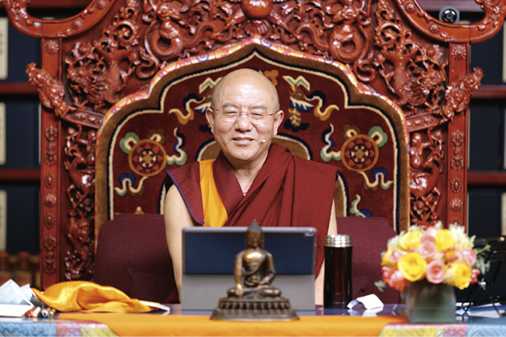
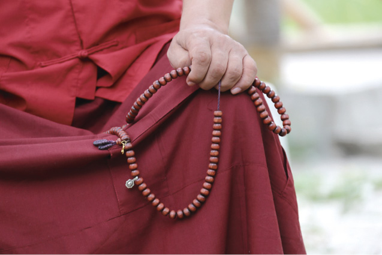

# 如何成为一名佛教徒

2019年8月3日

今天给大家做一个简单的开示，内容是如何成为佛教徒。

在这之前有些事要讲一下。按照藏历来算，明天是释迦牟尼佛转法轮日。因为是星期天，大家应该没有太多的事情。如果具足因缘，各个地方的佛教徒们最好集聚在各处的道场和寺庙之中，一起念《普贤行愿品》好好发愿；如果没有这方面的条件，也可以在各自家里念修。

明天是一个非常重要的节日，根据《时轮金刚》和其他密宗续部，这类殊胜的日子有非常大的加持力。以前每年的转法轮日，法王如意宝都会给大家传菩萨戒，我们也会非常真诚地发愿。现在也同样，我们每天的四座共修非常重要，无论在现场还是在自己的住处听直播，大家都要好好地发愿。

我们的这个人身十分难得，遇到佛法更加难得。值遇这么殊胜的节日、这么殊胜的因缘，大家要好好地念诵，不要东奔西跑、散乱放逸，也不要懒惰懈怠、整天睡懒觉。因为在这些特殊的日子里，如果我们好好发愿，加持力会更为殊胜。

星期一和星期二这两天，我会为大家念《修心七要》的传承，并做一个简单开示。星期三会讲一个简单的莲花生大士的修法。今天比较热，大家可以坐得稍微放松一些。我先给大家念《开显解脱道》的传承，因为很多佛友都在修五十万加行。有些人以前得到过这个传承，但再得一次也很好。

我最近正在翻译的法王教言里说：“麦彭仁波切的金刚语非常有加持力。”关于加持力，非教徒不一定承认，但高僧大德的金刚语确实有不可思议的加持，所以，我们依靠《开显解脱道》来修加行是非常殊胜的。很多人都修五十万加行，有些发愿将来修，有些现在正在修，有些已经修完了。我觉得这非常好，大多数人都修得很不错。

然后我再念《佛子行》的传承，我们以前也念过，这次趁法会的机会再给大家念一遍。念这两个藏语的传承可能需要10分钟左右，这个过程中你们听着就行，如果觉得时间太长，看看书也可以，但不要打瞌睡，因为听传承时声音不能间断。心无法专注也没事，偶尔胡思乱想也是允许的，只要耳边的声音没断就行。听传承的要求并不是很高，大家只要听着就可以。

（堪布念《开显解脱道》传承）

接下来念《佛子行》，希望大家得到这个传承以后，在日常生活中要多读、多修。我们作为大乘佛教徒，应该经常按照《佛子行》来修行。这里面有三十七个颂词，如果不能全部修的话，我们能不能按其中的五六个颂词来行持？现在的佛教徒信心都很不错，尤其是我们亚洲人普遍比较感性，带有一种艺术气质，相对而言有点缺少理性的智慧。作为佛教徒，既要有理性的智慧，也要有感性的智慧；既要有信心，也要有悲心。这很重要。

《佛子行》虽然文字很少，但经常阅读、念诵的话，对自己的修行会有很大的帮助，我们可以一辈子修这个法。一些刚开始学佛的人，可能对其中有些内容不是特别理解，但慢慢会接受的。

接下来我给大家念传承。传承得到的次数越多越好，这样很容易生起菩提心，而且你们学了《佛子行》以后会觉得很上瘾。

（堪布念《佛子行》传承）

## 皈依三宝是唯一的救护

我今天本来计划给大家做40分钟左右的开示，没想到时间超了一些。大家念了一天的经，可能有点累，我也不想耽误太长时间，但这次机会不易，我们的人身是很难得的，佛法也是很难遇的，有修行的机会更为难得，所以还是利用这段时间给大家做一个简单的开示：怎样成为一名佛教徒。

在座大多数人早已成了佛教徒，有的人认为：“我是真正的佛教徒，没有必要听这个开示，真是多此一举。”但也有些人觉得：“虽然我已经成了佛教徒，但我还要不断学习。”很多人确实有皈依佛法的好因缘，这种因缘千载难逢，大家应该好好珍惜。有生之年，你会有许许多多的收获，但所有收获之中，皈依佛法是最有意义、最有价值的。等到将来离开人间的时候，真正能跟随我们的只有自己的心，身体带不走，财富也带不走，名声之类就更不必说了。我们每个人都是赤裸裸地来到这个世界，离开之时连一个人、一件衣服、一毛钱都没办法带走，所有身外物都是如此，最后也只能赤裸裸地离开这个人间。

我们佛学院附近有一个天葬台，也就是平时说的尸陀林，那里每天都要进行天葬。天葬的时候，有些游客出于好奇会拍些照片。而作为修行人，则会按照寂天菩萨《入菩萨行论》第八品所讲的内容[^1]而观，看到身体最终布施给秃鹫时，会领悟到人生其实仅此而已。高贵的人也好，贫穷的人也好，到死亡来临之时都非常平等。

我们这里做一场天葬，以前大概是20块钱的费用，后来50块，现在好像是80块钱——不管有钱的人、没钱的人，做天葬只要80块钱就可以了。我们时常能看到一些有身份的人，死后有长长的车队送葬，但也只能送到尸陀林就返回了，没办法跟到后世。不管你再有钱、再有名声，送到那里之后也只用花80块钱。汉地和国外也一样，不论生前再怎么显赫，哪怕有几亿身家，最后送到火葬场也只是简单地烧成灰烬而已。

我们的身体因此而消失，心是不是也同样消失了呢？绝对不是的。我们的心会随着业力不断在六道轮回中漂泊，那个时候唯一能救护我们的，就是我们所皈依的三宝！我内心确实这样认为，在人的一生中，名声也好、财产也好、感情也好，人们总觉得这些很有意义，但到头来只有善法跟随着我们，这才是真正有意义的事。

我们要知道人生最终需要的是什么。现在很多世间人对佛教有一些曲解和误会，他们认为好像入了佛门、出了家以后就无所作为，没有追求、没有上进心，一直很“佛系”。现在所谓的“佛系”是指没有追求和竞争心，整天处于一种浑浑噩噩的状态当中——很多人误以为这就是佛教的状态或观念。懂得佛法的人都知道，其实佛教的精神恰恰与“佛系”相反。

不论是声闻乘还是大乘，不论是为了自我还是众生的解脱，佛教徒都是非常精进努力的。世间人有时候可能喜欢散乱、懈怠、放逸，而真正的佛教徒是什么样的呢？他们为了自他的安乐而不懈追求更高的精神价值。如果我们整天都处于一种“佛系”的状态中，那在佛教里只能被称作惭愧者、放逸者、懈怠者、愚痴者等。世人有时对佛教的精神和行为不太了解，更不了解佛教的终极目标和真正的价值观。

佛教的价值观是什么？就是让众生有真正的依靠——皈依。皈依至关重要。现在很多人的内心都非常恐慌：有的人感到绝望、无助；有的人感到孤独、无聊；有的人不知该怎么办，特别迷茫；有的人缺乏安全感，觉得没有依靠，而且所依靠的一切到最后都不可信。不论是父母、朋友或是亲人，人们刚开始对之寄托的希望越大，最后直接间接造成的失望就越大，到那个时候，就会觉得活在世上没什么意义，甚至做出自杀等特别不明智的行为。

有些人内心缺乏承受能力，在一般人看来非常普通的事，他们觉得无法忍受，这就是所谓的玻璃心。尤其是一些年轻人，受到物质主义和自我主义价值观的影响，为了满足物质需求或个人价值，好像在这个世界上可以不顾一切。这样下去，当目标出现偏差、理想无法实现的时候，人们往往容易陷入绝望。

前段时间一位大学生自杀了，原因是他发表的论文里有一个小错误被教授发现了，要求放在网上更正，这位学生不能接受，但教授执意公布在网上。在一般人看来，这么简单的事应该不至于此，即便心里难过，即便有一些怨言，但值不值得因此放弃自己的生命？这实在是不应该。现在很多人的价值观越来越偏激，认为凡事对就是对、错就是错，尤其是受到西方一些思想的影响，总是斩钉截铁地认为：“就应该这样！”他们大多数的对错理念都只针对对方——自己绝对正确、十全十美，没有任何错误；对方则完全错了，所有问题都在别人身上。当对方无法达到自己的要求时就极度绝望，做出极端的行为，这也是一种特别可怕的现象。

在这种情况下，很多人越来越没有安全感。所谓的安全感，在这个世界上要依靠什么才能得到呢？从某些方面说，也许是依靠财富或亲友，这是世人一直认定的所谓依靠处。有些人认为“只要有了钱，我的一切问题都可以解决”，有些人认为“一定要遇上一个可靠的人，他对我永远不会欺惑，永远可以依靠”——但这些人始终找不到真正的依靠。

不管有没有依靠，皈依三宝的的确确会对你有特别大的加持和利益。我们芸芸众生，应该从根本上了解皈依三宝的作用。如果真正了解三宝的加持和力量，真正了解三宝的意义，许多人的内心就不会那么空虚、迷茫和寂寞。这一点不是因为我穿着红色的僧衣才这么鼓吹。发自内心来讲，现在很多众生确实没有依靠处、没有幸福感、没有安全感、没有获得感。在这个时候，我们除了世间的依处，每个人在自己内心之中还应把佛法僧三宝作为依处。刚开始你也许不知道它的价值，但慢慢会明白的。很多人没有皈依三宝时，总感到活在人世间非常焦虑和痛苦，后来因为三宝的加持活得十分幸福安乐。确实，有不少人在皈依三宝之后，原本在生活、身体或情绪上的问题，都有了不同程度的改善。

## 皈依三宝的真实意义

何谓皈依三宝？一种理解是：历史上的证悟者释迦牟尼佛，叫做佛宝；佛陀三转法轮的三藏十二部佛法，叫做法宝；跟随佛陀的大乘小乘僧众，叫做僧宝。皈依这三者，就叫做皈依三宝。

如果从内在意义上理解，佛宝是什么？就是最高的觉悟者，对整个世间万事万物的真相全部通达，我们称这样的觉悟者为佛陀，这就是佛宝。

法宝是什么？就是佛陀所宣讲的、留传下来的真理——“法”的引申义就是真理。美国作家梭罗说过，与其给我爱、金钱，或者名誉，不如给我真理。真理确实是最有意义的。当然，真理只掌握在少数人的手里。伽利略也曾说过，真理具备一种力量，越是想要攻击它，真理就越发被展现、被证明。

真正的佛法其实就是一种真理，这种真理跟所谓的宗教教义并不相同。所以我们经常强调，作为佛教徒一定要闻思修行，如果没有闻思修行，只在表面上办个皈依证，那不算真正的佛教徒。就像刚才很多人要我帮他们取个法名，取法名倒是没问题，我这边有好多好多法名，想叫圆什么都可以。取法名既重要也不重要，关键是要懂得佛教的教义！如果连教义都不懂，皈依证、身份证、银行卡放一大堆，那也没什么用。

佛教的教义是一种真理，这种真理不是平白无故就能得到的，想要得到必须通过闻思修行。首先应该多听闻。专家也好、老师也好，出家人也好、在家人也好，有些能把真正的佛教教义讲解得非常好，有些则是乱讲一通。我经常要求大家学习《入菩萨行论》《亲友书》《大圆满前行》等显宗密宗的法，你们对于这些法一定要认真听闻，否则光是办个皈依证，或者口头上说“我是佛教徒”，这样并没有什么意义。这是第一点，强调听闻的重要性。

第二点是要多思维。对于所听闻的这些法义，不是老师、上师说了就一定对，每个人都要通过自己的思考去研究、分析、辩论、探讨。我们这里有很多年轻人白天晚上都在学习佛法，他们辩论得相当激烈，我偶尔偷听一下，有些人确实特别棒。在年轻的时候把自己所有的智慧全部用来探讨佛法，这是非常幸福的事。有些人将来会去往各地弘法利生，那时候他们也许会感到年轻时的闻思是非常有意义的。

佛教中的思维跟其他宗教不同，有些宗教只要求你相信教义就可以了，说什么就是什么，但佛教不是这样的。释迦牟尼佛说过，如果他讲得有道理，你可以信，没有道理的话就不用信。藏传佛教每一个教派都要求大家通过辩论来抉择法义，抉择以后再去信，这就是佛法中的思维。

最后，对于佛法的意义一定要实际修持。修持的方法门类众多、包罗万象，但最主要的修行就是调伏自己的心。释迦牟尼佛的教法根本上就是“诸恶莫作，诸善奉行，自净其意，是诸佛教”，也就是断除十种不善法、行持十种善法，最根本的是要“自净其意”，将自相续中的诸多烦恼逐渐对治、消化、清净。我们每个人都有很多贪嗔痴慢疑等烦恼，然而通过佛教的方法来慢慢调整，自相续渐渐就会像乌云散开以后的晴空一样。

修行和不修行确实有非常大的差别。面对同样的问题，修行好的人不会觉得特别困难，比如家人去世、自己生重病、背负大额债务等等。现在很多企业经营得不太乐观，欠了很多钱，不知道该怎么办，好像在世上实在是走投无路了。我遇到过很多这样的人，有些情况的确让人感到无能为力，我也感受得到他们的煎熬和痛苦，但是一些有境界的修行人，面对同样的问题和烦恼，总有能力解决，至少心中没有太大的痛苦。很多时候，本来事情已经很棘手，如果人的心理再出现问题的话，真的有可能会引发更大的危机，甚至导致家破人亡。

在这个时候，且不说能为后世带来什么利益，仅仅是在今生中对治烦恼，修持佛法就有不可思议的威力。关于这一点，应该是“如人饮水，冷暖自知”，并不是我个人在这里说说而已，每个人多少都能体会这个道理。这就是真理的力量，真正的真理有消除烦恼痛苦的作用。因此，我们皈依法，就代表接受真理。

皈依僧实际上是什么意思呢？就是亲近接受真理者。他们对真理有不同程度的领悟，这就叫做僧宝。

皈依三宝还有另一种解释方式，就如《六祖坛经》所讲[^2]：自性觉悟就是皈依佛，自性正是皈依法，自性净是皈依僧。从究竟意义上说，皈依三宝也可以这样理解。

## 皈依三宝的功德

大家知道，皈依三宝对自己的今生来世确实有十分重大的意义。正因如此，莲花生大士在《空行法教》中讲了皈依的八个功德。

第一个功德，皈依之后就成了真正的佛教徒。也就是说，皈依佛、皈依法、皈依僧以后，才算是一个佛教徒。阿底峡尊者也说过，是不是佛教徒，要用是否皈依来区分；是不是大乘，要用是否有菩提心来区分。皈依的第一个功德就是真正成为佛教徒，大家一定要记住这一点。

第二个功德，皈依以后就可以受戒。不管是别解脱戒、菩萨戒还是密乘戒，包括别解脱戒中的居士戒、出家戒等等，这些戒律在皈依后都可以受持。皈依是一切戒的根本，这是第二个功德。

第三个功德，皈依后能减轻罪障。我们以前造过很多罪，皈依以后能减轻这些罪障；甚至如果以极大的信心来皈依，自相续的罪业都能得以清净，所以皈依是一种很好的忏悔方法。

第四个功德是能积累福德。有些人本来体弱多病，但通过皈依，最后能获得长寿；有些人原本相貌不是很好，皈依三宝后逐渐积累了很多福报，今生来世的相貌越来越端严；还有人通过皈依得到了财富、名声、家庭和睦、身体健康等即生中的安乐。

不知道你们有没有这种感受，我自己经常祈祷三宝，通过自己念经或是请僧众念经，自己好好地祈祷、安住，如此一来，身体或精神、生活或修行中的很多障碍都会自然而然遣除，很多福报也明显开始增长。有些病人一心一意皈依三宝后，身体就逐渐恢复健康了。有些人欠债、打官司，遭遇很多不顺，通过皈依，很快运势就顺遂了。还有些夫妻感情不好、天天吵吵闹闹，但两人皈依三宝后，从此家庭战争全部平息了。我们很多人遭遇的挫折，依靠三宝的威力都能得到解决。这是第四个功德——福德增上。

第五个功德，皈依之后能消除人和非人的干扰。我们在生活中，有时候会受到非人、鬼神的影响。现在有些人不承认这些存在，说这些是迷信。其实这并不是迷信，我们有时候做恶梦、身体不好，也许就有这方面的原因。很多讥之为迷信的人，自己生病时也忙着去找人念经。不少人嘴上说不信，可一旦自己遇到危险，就连忙求神拜佛。其实通过皈依，很多我们看不见的非人的干扰以及世间的危害都会消失。

《前行引导文》里有个公案，一个人因为念着皈依三宝，想害他的鬼神都逃跑了[^3]。有时候我们晚上一个人害怕走夜路，在黑暗中可以一直念着“喇嘛啦嘉森切哦，桑吉拉嘉森切哦，秋拉嘉森切哦，给登拉嘉森切哦（皈依师，皈依佛，皈依法，皈依僧）”，一边念一边走。前几天我回了一趟家乡，当时有一段路路况不太好，司机的技术也不是很好。后座坐了一位喇嘛，每到一处危险的路段，他就大声念皈依“喇嘛啦嘉森切哦……”，结果我更紧张了，那个司机也更紧张了。到了比较平坦的地方，大家才松了一口气。

总之，我们依靠皈依可以遣除人和非人的危害。

第六个功德，如莲花生大士所说，我们皈依以后能够心想事成，每个人的发愿会实现。在这世间，我们所爱所求的经常远离自己，不愿遇到的反而常常降临头上。如果你皈依了三宝、经常祈祷的话，自己的种种所愿就能自然实现，不论物质方面还是人际方面，一切你想得到的世间和出世间的功德自然而然都会得到。

第七个功德是不堕恶趣。皈依三宝的人不会堕入地狱、饿鬼、旁生之中。特别是临死的时候，如果对三宝没有任何邪见，有特别坚定的信心，那受了皈依戒的人根本不会堕入恶趣。

这对我们来说是一种很重要的保障。有些人业力深重，活着的时候造过很多恶业，但如果临死之前能够虔心皈依的话，佛陀的金刚语是不会欺惑我们的。虔诚地皈依可以让我们不堕恶趣，这是非常重要的。

最后，第八个功德是，皈依之后通过修行能逐渐获得五道十地的功德，最终得到无上佛果。皈依具有如此无量无边的功德，我想任何懂得取舍的人都应该皈依三宝。

《法王如意宝的心髓秘诀》中有一个皈依的场景，等会儿大家都看一下这个视频。为什么叫“心髓秘诀”呢？作为佛教徒，刚开始不应该好高骛远地把重点放在追求大法上，应该先修共同前行、不共前行。在不共前行中要先认真修皈依，成为一个很好的佛教徒，然后发菩提心，再积资净障，之后再去接受灌顶，修生起次第、圆满次第。西方国家有些学校的人整天研究大圆满，然而却不承认佛陀。我遇到过好几个做这方面研究的教授，讲到佛陀时他们存在很多误区。其实他们并非不懂这些道理，但可能未理解其中真正的意义，所以次第完全乱了。

我们要皈依，就应该先懂得佛法僧三宝的意义。如今这个时代，很多人似乎一谈起佛就想到迷信，尤其是一些年轻人，他们不太愿意崇拜宗教偶像，但就像我刚才讲的那样，佛教中真正崇拜的其实是真理，如果了解这一点，就没什么可非议的。很多人可能更容易接受皈依法。

说到皈依僧，大多数僧众确实是如理如法的修行者和成就者，就如《宝性论》所讲，文殊菩萨、弥勒菩萨那样的大成就者当然值得我们皈依，然而有些人一看到僧人中极个别的不如法现象，就对皈依僧失去了兴趣，这是许多人都有的问题。本来事物总有正反两方，但有些人容易接受负面的部分，因此就把真理放弃了，这其实是不合理的。

我们应该明白，自性的最高觉悟者、觉悟的真理、觉悟者的追随者，这三者存在于这个世界上，那就值得我们皈依。如果我们去皈依这样的三宝，那不仅不是迷信，反而可以说我们是最明智的人，因为对真理皈依、对觉悟真理者皈依，在东西方的文化中都会被承认是智者的行为。所以，从学术界或者从世间大众的普遍价值观出发，应该这样来理解皈依三宝。

当然，作为虔诚的佛教徒，更多是以信心对佛陀、法宝、僧众皈依。我见过很多居士一直对三宝非常虔诚，这一点特别好。这几天有些人拿着很多佛像、法本来请求加持，这在没有信仰的人看来好像太形式，但前者内心中真正拥有虔诚的信心，知道佛像和法本的功德极大，特别是经过了开光、加持。将自己极为珍爱的佛像、法本带回去经常礼拜、皈依，这样间接也能使我们的精神充实许多。有些人看到这种行为会觉得“这个人信得很迷”，其实不是这样的。

从根本意义上而言，人除了物质之外还有精神，如果精神层面完全是空洞的，那拥有再多的物质也只会感到空虚而已。我们经常可以看到，有的人虽然特别有钱、有福报，但他们在精神上其实特别无聊、痛苦和无奈，甚至每天夜里都要吃安眠药才能入睡。表面上看他们过得那么富足，内心为何会这样痛苦呢？所以说，人活在这个世间确实需要追求真理，学习这些与三宝相关的真理是非常有意义的。

以上讲的是皈依的功德。

## 传授皈依

下面我们来看法王的一个视频片段。

（播放法王对西方弟子授皈依的视频）

今天现场也有些人要皈依，我给大家传一遍。如果我们想获得人天福报而皈依，就叫做人天乘的皈依；如果是想获得成就，远离轮回的痛苦，获得寂灭的圣果，这叫做中士道的皈依；如果发愿要度化遍天下的众生，为了这样的目标而皈依，那就叫做大乘的皈依。大家最好都发愿——为了天下众生而皈依三宝，这样是非常好的！

（堪布授皈依）

刚才的视频里法王说：“这样你们就得到了皈依的戒体，从今以后就真正成为佛教徒。”我也希望今天线上线下的道友都成为真正的佛教徒。如果你们以前没有取过法名，按照法王的传承，前面用一个圆满的“圆”字，后面可以用自己名字里最喜欢的一个字。

## 法会相关事宜

我们最近正在一起念地藏菩萨的名号，就是“香确森华森华钦波萨耶酿波拉香擦洛秋多嘉森切哦”，意思是“顶礼、供养、皈依地藏菩萨摩诃萨”，你们每天都可以从外面的喇叭里听到。地藏王菩萨能满众生的愿，对缺少财富的人给予财富，对心里痛苦的人给予安乐。以前法王在佛陀的四大节日期间选择了四个不同的法门在学院举办法会，这段时间的普贤云供法会主要就是祈祷地藏王菩萨，所以最近大家要多念。

我找到了一个1997年的视频，当时法王好像是在桂林，有一个人给法王供养了一颗宝珠，据说是出自龙宫。我当时并不怎么相信，我想，龙宫的宝珠哪有那么容易来到人间？但法王也许是为了各方面的缘起，显得特别高兴，马上拿起这颗宝珠，让大家一起念《怀业祈祷文》和地藏菩萨的名号。这是当时的视频，有三分钟左右，大家也看一下。

（播放法王在桂林的视频）

## 上师的三点希望

《前行引导文》里提到过，阿底峡尊者初到藏地时，整天都在讲皈依的法，有些弟子劝他：“您是印度来的那么著名的班智达，但现在人人都说您变成了‘皈依班智达’，把您各方面都看低了，这样恐怕不是很好。”阿底峡尊者听后非常欢喜，说：“这是人们对我最好的赞美。在所有佛法中，皈依是最重要的，如果没有皈依，佛教所有的功德就无从谈起。”今天我们讲了皈依的重要性，下面我要提出几个想法。

首先，我们既然皈依了三宝，就要永远做一名佛教徒——各位一定要发这个愿。人生很短暂，来不及变来变去，自己今生至少要好好做一个佛教徒，这个要求不是很高。做一个好佛教徒不是很难，我们要善始善终，在有生之年不要改变。今天现场有上师三宝作为对境，在这样殊胜的对境前，大家一定要发下坚定的誓愿。人的心念很重要，如果心足够坚定，做什么事情都会很容易。大家在城市里学佛，有时候信心容易摇摆，但如果自己的心真正坚定的话，就一定能坚持下去。

我想，只要今天有一个人的信心永远不变，我讲的这一堂课就非常成功。希望大家每个人都有一种决心，有一个坚定的誓言。皈依其实就是一个承诺、一个誓言：我皈依三宝的信心，无论如何永远不退！不仅不退，通过闻思修行还能使信心更加坚固。信为道源功德母，有坚定的信心非常重要。这是第一个方面。

第二个方面，我们虽然没有阿底峡尊者那样在各地广传皈依的威力，但希望大家在有生之年，尽量在不同的地方向人们传播三宝的正能量。如果能让别人皈依真正的三宝，对他们的今生来世确实会有很大的意义。轮回之中的众生是很痛苦的，即生当中如果没有皈依就离开人间，实在是太可惜了！我们每个人都应该有这种责任感，哪怕自己一辈子当中能劝一个人皈依三宝，这个功德也是不可思议的。这是我的第二个希望。

第三点，希望大家多看一些关于三宝的教言，比如《宝性论》那样具有深度的道理，或者莲花生大士《空行法教》里皈依三宝的详细窍诀。希望大家通过这种方式了解皈依三宝的真实功德，这样自他都能获得真正的快乐。

## 2019年《佛子行》讲解

[^1]: 《入菩萨行论》第八品静虑：“何时赴寒林，触景生此情：他骨及吾体，悉皆坏灭法。吾身速腐朽，彼臭令狐狼，不敢趋前尝，其变终至此。孑然此一身，生时骨肉连，死后各分散，何况是他亲？生既孤独生，殁复独自亡，苦痛无人摊，亲眷有何益？如诸行路客，不执暂留舍，如是行有道，岂应恋生家？迨及众亲友，伤痛及哀泣，四人掮吾体，届时赴林间。无亲亦无怨，只身隐山林，先若视同死，殁已无人忧。四周既无人，哀伤或为害，故修随念佛，无人扰令散。”
[^2]: 《六祖大师法宝坛经》：“善知识！归依觉，两足尊。归依正，离欲尊。归依净，众中尊。从今日去，称觉为师，更不归依邪魔外道，以自性三宝常自证明，劝善知识归依自性三宝。佛者，觉也。法者，正也。僧者，净也。自心归依觉，邪迷不生，少欲知足，能离财色，名两足尊。自心归依正，念念无邪见，以无邪见故，即无人我贡高，贪爱执著，名离欲尊。自心归依净，一切尘劳爱欲境界，自性皆不染着，名众中尊。若修此行，是自归依。”
[^3]: 《前行引导文》：“从前一个盗贼被主人逮住，主人一边念皈依偈一边用棍棒打他，比如，念一句皈依佛，打他一下，（这样四句皈依全部念完后）就将他放了。（盗贼想：释迦牟尼佛恩德实在很大，幸好皈依偈只有四句，如果皈依偈有五句的话，我可能已被打死了。）在他心中好像皈依偈的声音与疼痛成了无二无别，脑海里一直回响着朗朗的皈依偈声。他到一个桥下躺了下来。这时，桥上来了许多鬼魔，它们说‘这里有一个皈依三宝的人’而不敢过桥害他，便吵吵嚷嚷地逃走了。”
