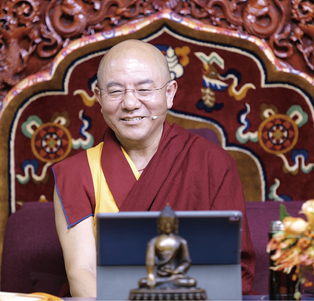
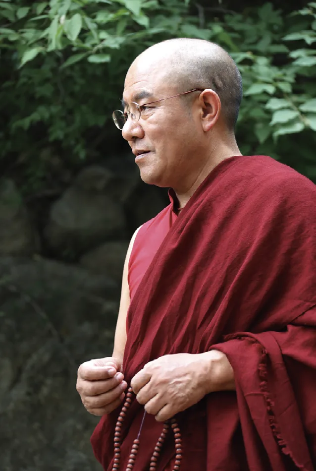

# 新开端 新面貌

2022年4月7日

今天我想用这节课给大家简单地做一些开示。主要分几部分内容：第一是讲讲我们最近的一些事情；第二，因为今天是世界卫生日，我想就卫生方面稍微聊一聊；第三，今天要传《随念三宝经》，讲一些随念三宝方面的道理；最后，给大家念一下《随念三宝经》的传承，还有马头明王修法的传承。今天的内容大概就是这四个方面。

## 近期安排

关于第一个方面，首先要说的是，今天和以后的课，有一部分人有因缘可以听受，而有一部分人虽然今天可以听课，但以后想要长期性地听课，确实有一定的困难。现在不允许使用网络传法，大家只能在现场听，这样的话，我们周边的一些学校老师、图书馆工作人员，还有建筑工程的发心人员，他们都没办法听课了。

这些道友来到我们雪域藏地，目的也跟其他道友完全一样，他们其实也想看破红尘、远离红尘，来到这个清净的静处求学正法。但是因为对我也好、对众生也好，发了心的缘故，无法中途离开岗位，所以只能听今天这一节课，有些人甚至连暂时来听一节课都根本没办法。虽然如此，我希望你们把自己的发心当作一件真正利益众生的事业来做，并且做到善始善终。我会想尽一切办法把所讲的这些内容和传承提供给你们，这是我的一个承诺。你们一方面发心工作确实辛苦，比我们学院常住道友的闻思修行还要累；另一方面，如果得不到法，可能心里会执著，这也是可以理解的。所以，我刚才也做了承诺，到时候相关的道友和负责人可以提醒我，我们应该按这个承诺来履行。这是第一件事。

第二，我们现在讲的课，希望大家不要在网络上传播，也不要私自录音发给别人。当然，以后有必要的时候，我们会想办法给相关的发心人员、工作人员提供这些课程。大家也知道，当前很多形势确实比较特殊，在这种情况下，如果很多课程资料和音频满天飞，恐怕会给我们的学修引来一定的障碍。

第三，我们今天讲《随念三宝经》，下节课准备讲一篇短短的《治病甘露流》，这是麦彭仁波切作的一个关于生病时如何转为道用的简单的修法窍诀。通过学习《治病甘露流》，今后不管生什么样的病，都可以依靠这些简单的方法将病痛转为道用。

关于上课期间的一些安排，本来我想明后天商量后再说。但今天既然我们喇荣沟的道友都在听着，我就先说了。我们今年在经堂听课的座次会跟以往不同，大家可能要离开原来的舒适区，以比较特殊的方式来听受佛法。这么多年以来，总有一些有意愿、有信心、想亲近我的道友喜欢坐在经堂前面，我们的堪布堪姆们也经常坐在前面，但原则上不该这样。法王如意宝以前给学院提出过三种平等原则，今天刚来的一个新学徒和学院里特别了不起的高僧大德，在座次上应该没有差别，任何人在哪里都是就地而坐——以前大家一直是这样的。然而我们不知道什么时候开始形成了现在这种习惯，好像默认给堪布堪姆们留了最前面的位置，我心里一直觉得这不是很好。

在某些寺院这也许是非常正常的现象，尤其是像南卓佛学院、噶举派、格鲁派的一些佛学院，高僧大德、格西、堪布、堪姆都坐在首列，这是很正常的。但我们学院的传统是谁先到就先坐。以前法王面前就经常坐着一些新来的人。所以今年我想改变一下这个方式。平时总坐前面的人，你们也稍微体验一下，坐在最后是什么感觉。

我也从很多方面考虑过怎样才能平等地安排。如果以年龄来划分座次，这应该没有什么疑义。当然，这要按照管家和法师们的安排来决定。如果违反的话，我们可能会有一些惩罚。从下一堂课开始，60岁以上的人就坐到我的面前或两边来。居士也好、出家人也好，除了摄像和念经的人员以外，没有任何人可以搞特殊。就像一个光圈一样，60岁以上的人在圆圈的最里面。

当然，我可能也要面对一些问题。有些年纪大的人闻思方面不一定很有精力，所以，也许讲课时有些人会打瞌睡、大声说话，或者忍不住把脚伸出来，各种各样的情况都会有，但我还是想试试看。记得法王刚圆寂的时候，我在大经堂上面的一间小房子里给大家音频授课。当时我身边有两个录音人员，我记得一位是智在师，一位是圆平师，我讲着讲着他们就一个往右边躺下、一个往左边躺下去睡着了。我讲不下去时就拍桌子，但他们两个一直醒不过来。所以到时候老年人都坐在我前面的话，可能也会有各种各样的状况。（众笑）

但是我想，我自己现在也到这样一个年龄了。人们常说“老弱病残”，我们平时可能没太把老年人放在眼里，而习惯把那些年轻的、有智慧的、有学问的、有钱财的、相貌庄严的当作贵宾。所以，现在60岁以上的人就是我们的VIP。最里面的一圈是60岁以上，然后外面一圈是60岁到45岁，因为现在45岁是我们学院常住的年龄界限，再外面就不分年龄了，你们怎么坐都可以。具体的事宜管家和堪布堪姆们再商量一下。

这样的话，大家感觉如何？你们应该走出舒适区试一试。我也观察一段时间，如果大家觉得这种安排不好，我也许会有调整的。我们今年内就这样试试吧。这不仅仅是一种尝试，实际上就我个人而言也有一些缘起。我们虽然不想像伏藏大师那样处处看缘起，但人到了一定的年纪可能会观察一些相兆。

从下堂课开始，希望各位法师、堪布堪姆以及管家们就这样安排。其实也没有太大差别，大家应该好好遵守规则。如果实在不听安排，那可能就没办法继续享受听闻佛法的权利了，我想这样的求法者应该是不会有的。主要是我身边这些坐习惯了的人应该好好配合，谁也没有什么特殊。听法的时候，我们可以试一试感觉如何，这对大家是一种锻炼，也是一种修行。长期以来我们都没有在这方面安排过，下节课就开始试行。

一些年纪大的老菩萨们，每天来听课，晚上再回去，可能有点不方便，所以，年龄太大的不到现场来也可以。但很多老年人在家里坐久了对身体也不好，如果行动没有困难的话，为了求法稍微活动活动也是很好的。现在西方国家有些人七八十岁了还在为了地位而争斗，整天四处奔走，有的人乘飞机时都跌倒了。既然那么多老年人都还在奔忙着，所以我想，如果你们愿意来上课是很好的，当然，这并没有强迫。这段时间也给你们开设一条自由、自愿的学习道路。

一些眼睛比较好的年轻人，坐远一些应该也可以看到我。但人到了60岁以后，好像互相之间都没什么可看的了。我经常看到以前的同学或同事，已经看不清样子了；即使看得清，也没什么好看的。所以我们年轻道友就坐在远处看吧，老年人坐得近一点，我们在模糊中互相看，这也是一种修行。这个安排就在这里简单地跟大家说一下，这是第三件事。

最后是关于疫情的事。今天相关领导也特别强调了，虽然从这两天来看，成都的疫情稍微好了一些，但在其他一些地方，大家还是可以看到有新增病例，所以现在防疫工作仍然很重要。在这个过程中一定要把握好尺度，我们相关的负责人管得太松了不行，太紧了也不行，需要有智慧来把握其中的尺度。如果遇到一些大的问题，你们可以问我，我虽然没有很高的智慧，但毕竟管理院寺这么多年，多少有一些经验。同时，我们也要多跟相关的人商量，这样比较好一点。

今天我跟管委会的相关领导说，我们山沟里的管理工作应该遵循平等原则。一是男众女众平等，否则在同一个山沟里，这边很轻，那边很重，这样大家也受不了。工作人员有时候跑到女众区域敲门检查，甚至晚上也这样，导致有些女众比较害怕，这是很不好的。他们也答应了，管理工作不能影响大家的闻思修行。二是僧俗平等，在家人和出家人应该有同样的权利。如果有不合规的行为，那应该都处理，但如果行为合规，一会儿盯出家人盯得很厉害，一会儿盯在家人盯得很厉害，这也不是一种合理的管理模式。关于这些方面，我最近也跟大大小小的相关领导和管理人员沟通过了。沟通过程中，他们也非常尊重我们，各方面沟通的结果都很好。

我们对防疫必须重视，毕竟这是关乎生命的事。但有一些小事，如果没有特别的必要，我们内部的人不应该直接去向派出所、管委会越级汇报——这说明你们没有把这里的管理人员放在眼里。这样的人，一旦发现以后，就不会让他继续住在喇荣山沟了。我要提醒个别人，不管你在管委会还是县里、州里、省里有什么亲戚朋友，在我们这里也要同样接受管理。你们或许在上面有一些熟人，但我们同样也有，而且关系更深。所以，在学院内部，不管是藏族人、汉族人，如果有谁不懂装懂，没有职责装作有职责，去越级上报，我们一定会严肃处理。这一点我在这里要给大家讲清楚。

我们这里的管理其实是完善合理、次第分明的。从管委会到区管家，包括片区的管理、财务的管理等等，方方面面都具备。僧人这边也有配套的管理人员，所以不需要其他人来插手。如果有个别人非要掺和这些事情的话，说明这个人并不是来求学的，而是别有用心。对于这种人，在这个大数据时代，我们有办法查出来。在这里有必要跟大家讲一下。

在喇荣，任何事情你们都有反映的权力。比如一个片区里有什么特殊情况，你可以跟小管家说；楼里有什么事情，你可以跟楼长说；班里有什么事情，你可以跟堪布堪姆说。但有的人来到这里不好好闻思，专门打小报告。当然，如果你是被专门派来干这个的，外面披着我们的衣服，内在却是另一种身份的话，那这是你的职责，我们也拿你没办法。但我们也希望这类人合理合法地做事，如果为了地位、财富，讲一些妄语或者编造虚假信息报上去，你自己也要承担一定的责任。去年、前年发生了很多事情，就是因为有些人造谣生事，故意作些文章报到上面去。结果经过调查，所报的全是不实信息，最后这些人自己也付出了代价。这些事你们也许清楚，也许不清楚。但不管怎样，事实就是如此。所以这次我在这里跟大家直接讲明。

我们学院的管理工作确实不容易。你们很难想象，这么多年以来种种工作是怎样做到的。包括堪布堪姆们，除了讲经说法和做一些简单的管理之外，这么多人的吃喝拉撒、生活所需，其实一直以来都有人在替大家承担和奋斗。如果没有极大的威德、福报和能力，在这样一个时代中真正去维护一个道场，是很难做到的事。事实也是如此，真正有序地开展闻思修行的道场，在当今可以说是寥若晨星。关于这一点，大家应该有一种共识。

以上是我刚才列出的四大科判中的第一个方面。这个科判不是我提前准备的，而是刚才念《普贤行愿品》的时候才有的思路。我还是很厉害的，对吧？昨天我好像有点晕，头脑不清楚，思路有点拉不回来，看来今天已经拉回来了，没问题了。不知道你们听不听得出来？开玩笑的。

刚才基本把近期的事都给大家传达了。从明天开始，8号到11号这四天大家念经，念经的时间也跟平时一样，每天四座，这个没有太多要说的。

## 世界卫生日的健康叮嘱

下面是第二方面。今天是一个比较特殊的日子，大家可能也知道，今天是4月7日世界卫生日。觉姆和喇嘛，也就是佛学院和喇荣寺这边的管理者分别请我过去讲一讲。但一方面我比较累，另一方面现在也不太想抛头露面，所以就拒绝了。可能他们的相关负责人员会有一些意见，那也没办法。

但在我们这边，我想顺便讲一讲这个话题。世界卫生日是1948年联合国世界卫生组织成立时设立的，原本在7月，从1950年开始时间改为4月7日，每年举办主题活动，一直持续到现在。健康和卫生，在英文中基本上是一个意思。世界卫生组织是一个倡导重视健康问题、提升全人类健康和寿命水平的组织。世界卫生组织每年都为世界卫生日设定一个主题，今年的主题是“我们的地球，我们的健康”。

健康是非常重要的。如果对养生保健足够重视，很多人的寿命都可以延长；如果不懂这方面的知识，可能就会缩短寿命。研究表明，如果全人类都对养生保健知识加强重视，每年全球死亡人数会减少大约1300万。当然，众生的寿命有些是无法转变的，但有些因缘是可以转的。我们也是这样，道友们如果平时对养生比较重视，应该会有更多健康长寿的机会。而这要靠我们平时的行为习惯、饮食作息，这些都是非常重要的。

这方面的道理，我想降魔胜利洲的道友们大多数都懂。但有些法师看起来好像不太懂，经常熬夜、不按时吃饭，长时间用电脑。工作也要劳逸结合，不能一直陷在里面。有些人从早到晚都对着电脑，其他什么都不管，这样时间久了可能会出问题。以前我们有的发心人员就是这样天天对着电脑，后来人都变得不太正常了。一个人如果成天只顾修行，万一修出差错也很危险；如果成天只顾玩手机，那也不行。

大家可以看到，现在不少年轻人沉迷于短视频，从晚上看到第二天早晨，还在不断地划手机，最后甚至有人出现了精神问题。这些都是因为忽视了健康理念。我希望所有出家和在家的修行人，最好按时睡觉，按时吃饭，规律生活。

至于吃饭该怎么吃？饮食方面的养生知识大家应该都明白。有些人特别重视保养身体，天天吃人参、虫草进补——其实也不用这么刻意，只要保持健康的饮食和生活方式，就会有延年益寿的机会。同时，应该尽量放松心态，不要紧张焦虑、乱发脾气，这也很重要。如果对任何事情都看得太重，会对健康产生不好的影响。

我希望大家平时一方面要注重个人卫生，每天认真刷牙洗脸，经常洗澡，养成健康的生活习惯；另一方面，要注重饮食健康，多吃绿色蔬菜等有营养的食物。同时，我们也可以持诵一些对健康有益的经咒，比如《长寿经》和长寿佛心咒“嗡格热阿耶色德吽舍阿玛Ra呢则万德耶索哈”。明天我们学院大众正好也要念修《长寿经》。另外，平常坚持禅修，对健康也很重要。

最关键的一点，晚上最好在11点之前入睡。这样的话，哪怕早上起得早一些也没什么问题。以我个人为例，因为一直以来身体都不太好，后来不得不听医生的话，开始注意日常保健。去年年底我去检查身体时，医生夸我了，说我饮食规律方面很有进步，指标比以前正常了一些。确实，我以前对健康知识懂得不多，尤其是在年轻的时候，天天熬夜看书、背书，一直到凌晨两三点，然后四五点时稍稍睡一会儿，又要去上课。当时每天都困得晕晕乎乎，就这样一直努力坚持下来了，但其实这是很不善巧、很不健康的一种习惯。

在今天这样一个特殊的日子里，我想提醒大家重视自己的健康。不仅应该在这一天重视，平时也要重视。现在教务科也在强调健康理念，藏僧那边专门开展了这方面的学习，最后要在各个班级的期末考试中占2%的分数。我们汉僧这边大多数人在健康知识方面应该没有太大的问题，但需要长期坚持养成习惯，并不是今天世界卫生日提一下，明天就忘了。这对我们所有的道友都很重要。比如这次新冠疫情中，平时注重养生的人感染的就比较少，即便是得了新冠，也更容易恢复。这些情况，大家也可以去观察。

喇嘛和觉姆那边，每个人都发了一些关于卫生保健的小册子。在我们藏地，以前卫生理念比较欠缺，对很多健康问题，包括女众的妇科病，重视程度不够。所以他们现在大力倡导卫生保健知识，是非常有必要的。我们汉僧这边也同样需要在这方面加强重视，希望各位堪布堪姆对弟子们的健康要多加关注。我们的戒律中也要求关心病人，《毗奈耶经》里也非常重视对病人给予帮助、提供护理等等。

正因如此，法王当初在学院条件还很差的时候，就特意安排了医生给大家看病。我刚来的时候，男众这边有一个医务室，就在现在老经堂的旁边。当时那里有两位医生，记得其中一位叫策力。这个医务室对我们十分重要，遇到点头疼脑热，我们就到那里去打针开药。到了1996年，降魔胜利洲成立了“国际学经会”，我当时得到法王的同意，就分别建立了男众医务室和女众医务室，对当时的汉族人起到了很大的作用。尤其对一些新来求法、有高原反应的人，医务室提供了很多帮助。后来我又在那里加建了两层楼的崩壳房子，就在现在的教学楼旁边。随着学院的条件越来越好，原来的医务室扩建成了三层的楼房，就是现在男众女众的两个扶贫医院。

这些年我们降魔胜利洲一步步把医疗卫生条件完善起来，中间的过程是很艰难的。但就我个人而言，我想，我必须对这里每个人的健康负责。这并不是在课堂上讲讲道理就可以的，而是要建立起必要的设施和服务。这对所有来到喇荣学法的人，不论藏族还是汉族，都是非常重要的。我曾经有一个想法，想在附近建一所更大的医院，但后来限于自己的能力和空间的限制，要实现有一点困难，所以暂时打消了这个念头。

当然，我们现在的男众、女众医院也为大家提供了很多服务。我希望各位医生、护士和工作人员，一定要认真地守护僧众的健康。在今天这个特别的日子，我要对你们表达特别的感谢！藏族那边正在颁发学习方面的奖项，其实我们的医护团队也值得嘉奖，因为他们确实非常辛苦。大家都看得到，这次疫情过程中，各地的医护人员都承担了极大的压力。我们喇荣的医院，在防疫工作中也发挥了很大的作用。

当然，其中有些人表现得特别棒，有些人可能还不是很成熟，但是大家都在努力当中。按理来讲，医生应该有比较高的工资，但在这里行医并没有什么报酬。他们运用自己的专业特长，不管是中医方面，或是牙科方面，经常定期或不定期地给大家看病，为道友们付出了很多。包括我们的法师和辅导员中，也有一些出色的医生，一直在努力地关怀病人，为大家提供了重要的帮助。

我们在无病无痛的时候，往往不知道医院的重要性和医生的伟大，一旦生了病，那时候可能想不起佛法，也想不起上师，只想得起医生。晚上睡觉的时候，在恍恍惚惚的境界中出现一个身穿白衣的人，“这是不是上师呢？好像不是。原来是我要寻找的医生啊！”每个病人可能都会这样。

在这个世界卫生日，本来应该给这些常年发心的医护人员发个奖，可是今天我这里没有准备什么礼物，只好口头上给大家点赞。得到赞扬也是很好的，麦彭仁波切在《赞颂集》里对诸佛菩萨专门进行了赞颂，这实际上是一种最高的精神上的礼物。我如果给你们发一尊大大的佛像，也许有人连放的地方都没有，不如直接赞颂，这样你们可能更开心。

我希望我们医院的发心人员，不管中医也好、西医也好，今后尽量不断地积极发心。很多其他的职业，都会有找不到工作的时候，而你们的工作永远都是被需要的。因为，众生的生老病死四大痛苦，都离不开你们的帮助。生的时候需要医生，老的时候需要医生，病的时候需要医生，断气之前也需要找医生。对于众生的整个生老死病，医生都是非常重要的。

行医是一种很好的发心，而且，对于以前学过的知识，最好不要中途放下。有机会的时候，发挥自己的专长来治病救人，这是很令人赞叹的。我以前读中学的时候很想当医生，但运气不好，后来上了师范学校，没有这个机会。我下一辈子也很想当医生，不知道是藏医、中医、西医还是梵医，我想，有这样的发愿也是很好的。这就是我关于世界卫生日方面想讲的内容。

## 《随念三宝经》传承及简释

第三个方面，我想讲讲《随念三宝经》。这部经我们以前在网络开示中念过好几次传承，今天在这里给大家简单介绍一下。

《随念三宝经》收录于藏传佛教的《大藏经》中，在汉传佛教中没有广泛流传。《大藏经》中《随念三宝经》的版本，跟我们现在各教派习惯念诵的版本，在词句上有些微差别。现在流通的汉译版《随念三宝经》是法尊法师翻译的，他翻译这部经的时间就是我来人间的那一年——1962年。他译出此经后给少数人传讲过，后来也作过一些诠释。能海上师也翻译过，但可能因为版本以及当时的译风不同，所以在内容上有一些出入。现在汉地比较流行的《随念三宝经》就是法尊法师从藏文译出的版本。

在其他国家，《随念三宝经》译文和相关文献比较多，英文翻译至少都有六七个不同的版本。这部经在西方的弘扬开始于上世纪八九十年代，由创巴仁波切向大众传讲，后来又出版了注释。其他包括噶举等派的大德们也陆续弘扬过。相关的注释中，较为出名的就是麦彭仁波切的注释。如果我没记错，觉囊派多罗那他尊者的注释应该也有英译版。

《随念三宝经》虽然以前在汉传佛教中没有广泛流传，但在藏传佛教中却是相当重要的一部经典。我们喇荣五明佛学院基本每次供斋的时候都会念《随念三宝经》，藏地很多寺院都有这个习惯。因此，以前我们只要在喇叭里听到《随念三宝经》，就知道今天肯定有好吃的东西了。我们对《随念三宝经》非常重视，一般来讲，修行人每天都要念这部经，有些念三遍，有些念一遍，通常是在吃午饭之前念一遍，相当于汉传佛教中的供养偈一样。

在藏传佛教中，宁玛派、格鲁派、觉囊派、萨迦派、噶举派等所有教派，大家都念诵《随念三宝经》，不会有你这一派念，我这一派不念的情况。在藏地，这部经的重要性就相当于我们的《三十五佛忏悔文》《心经》《二十一度母赞》等，是藏传佛教公认的最受重视的经典之一。在汉传佛教中，我记得以前也有一位大德将《随念三宝经》列为必读的十部佛教经典之一。

这部经的确很重要。我希望大家每天都能念一遍，如果懂藏文的可以念藏文仪轨，不懂的话念汉译版也很好。法尊法师翻译的就是经文本身，十分简短。以前我翻译《大乘经庄严论》的时候，也参考过法尊法师的翻译。当时我发现，法尊法师翻译《随念三宝经》的一些用词，比如“初善、中善、后善。义妙、文巧。纯一、圆满、清净、鲜白”，与《瑜伽师地论》中的用词相同[^1]，这样也便于参考对照。这些词汇乍一看可能不是特别好懂，但实际上其中有深层的意义。

今天我给大家念了《随念三宝经》的传承，希望每位三宝弟子今后至少每天念一遍。我以前讲过这部经，后来我们这里很多道友就把它放在了自己的日常课诵当中，这其实非常重要。我们不论是修行还是做其他任何事，长期坚持是很重要的，偶然做一做并不能起到什么作用。今天我讲了这部经，如果你们念个两三天就消于法界，这样对自己的相续也不能带来很大的转变。

我刚出家的时候，每天都会念《随念三宝经》。刚出家的人通常信心都特别大，我有时候一天要念好几遍，后来连我的念诵课本都翻烂了。现在我虽然有时候也会念，但可能修行到了一定的阶段就变成了老油条，没有做到每天都念。以前至少在二十多年间，我一直每天念诵，没有间断。在这方面，我不仅没有进步，反而有退失的情况，着实感到惭愧。但我内心深知这部经有很大的加持，而且内容简短，确实应该时常念诵。

身为佛教徒，应该随念三宝，也就是随时随地忆念佛、忆念法、忆念僧。那么佛、法和僧众到底是什么样的呢？以我们大概的印象，佛，就是大雄宝殿里妙相庄严、闪闪发光的佛像；法，就是我们看到的或横或纵的经书文字；僧众，按照小乘的说法，就是出家的僧团，按照大乘的说法，就是一地菩萨以上的圣者。根据我们之前学过的《宝性论》，虽然这些可以作为三宝的代表，但真正的三宝其实是我们的自性。

当我们了悟了自性，才能真正做到随时随地忆念三宝。因此，要从更深的层次去忆念佛、法、僧，就要认识本性。初学者暂时还达不到这样的境界，所以，为了提醒自己尽快了悟本性，我们应该以虔诚心、恭敬心、欢喜心经常念诵《随念三宝经》。

在我们这些世俗中的凡夫人面前，所谓的三宝主要还是落在形象上。说到佛宝，要么是指历史上的释迦牟尼，要么就是我们看到的佛陀的唐卡或是塑像。法宝就是大小乘的经典和论典。僧宝就是指那些不同于世间人、脱离俗世而显现清净出家相的僧众，或是了达了二取无我空性的圣者。这些确实都是我们皈依、恭敬、供养、顶礼的对境。

作为佛教徒，大家应该知道皈依三宝的重要性。所有的修行始于皈依，然后发菩提心，再积资净障，进而修上师瑜伽、生起次第、圆满次第、大圆满。所以，一切修行的根本就是皈依。大家都学过《大圆满前行引导文》，不共五加行中第一项就是皈依，皈依前还讲到了三种信心。这些次第是非常清晰的。

今天讲的这部《随念三宝经》，文字很少，只有中间的经文部分，没有加上一般念诵时的前后仪轨。我记得法尊法师在翻译中，将经文分为了《随念佛经》《随念法经》《随念僧经》三部分，这在《大藏经》中也是有的。《大藏经》里的版本跟我们使用的仪轨稍有不同。

皈依三宝的确非常重要的。我们只有经常随念三宝，才算得上是一个真正的佛教徒。如果心里从不忆念三宝，虽然形象上皈依了、出家了、当法师了，但实际上与三宝的本体并未真正地相应。跟世俗的本体都没有相应，胜义的本体就更不用说了。所以，不管你是什么身份，都应该经常念《随念三宝经》，每天念一遍，或是一周、一个月念一遍都行，不然确实愧为三宝弟子。今年我在翻译《入中论自释》的时候，就再三参考过法尊法师的译本。他的译作水平和风格在当代而言确实非常了不起。我们念诵他的译本，可以说是很有加持的。

关于藏译经文的译者是谁，翻译时间是前弘时期还是后弘时期，这些问题在《大藏经》中没有说明。但据我的估计，本经应该是在前弘时期翻译的。因为许多重要的经文，包括密续，大多数都是前弘时期翻译的，译于后弘时期的并不多。前弘时期的翻译水平非常高，当时正直吐蕃王朝兴盛之时，历代国王特别重视佛经翻译。尤其是赤松德赞，派遣当时最有智慧的人代表国家去印度求法，最后得到了整部《大藏经》的梵文版本，并组织人将其翻译成藏文。我们讲到前译派的不共五大殊胜时，也会强调译师的特殊性。所以，我推断藏文的《随念三宝经》是前弘时期翻译的经典。

这部短短的《随念三宝经》，被历代高僧大德和众多佛教徒日日夜夜持诵。我希望，听到这堂课的道友每个人都能发愿，把它放在自己的必修功课当中，就像我们日常念诵《心经》一样。我们作为皈依三宝的佛教徒，如果其他修行做不到，至少也要经常忆念三宝。

《随念三宝经》中前面讲了佛陀十个名号的功德，然后讲了法的功德，包括初善、中善、末善等，最后讲了僧众的功德。这些功德在麦彭仁波切的注释当中有详细的解释，以前益西彭措堪布翻译过。我们对于这些功德，不应该光在文字上看一看，而应发自内心地理解并恭敬。就像我们之前学习《宝性论》的时候，很多人都说：“现在终于明白了什么是佛宝、法宝、僧宝。原来法宝和僧宝究竟都在佛宝当中！”经过学习，大家真正明白了佛宝是一切究竟的皈依处。我们今天的这堂课虽然时间很短，但如果道友们能从此经常念修这部法，我想功德是相当大的。

就如刚才所讲，我对《随念三宝经》确实很有信心，曾经天天念诵，对于相关的注释也想翻译、弘扬。但是人生很短暂，心中的梦想和计划，到最后真正能实现的并不多。不仅是我，我们每一个人其实都是如此。所以，希望大家提前做好各方面的修行准备。

我在这里要提醒大家，一定要修好无常。《俱舍论》中讲过，有为法都是无常的。《俱舍论》属于小乘论典，但是里面讲到的无常法非常重要。我们生活中的任何事情，包括自己的健康情况、生活方式、学习状态、闻思方式等等，都会刹那刹那发生变化，并不像我们想象的那样恒常不变。无常肯定是有损的，有损的时候就有痛苦，这个道理不是光在文字上说说而已。

我们通过这几年的疫情、国外的战争、将来有可能发生的一系列社会问题，还有我们自己的身体和精神状态中，都能看到万事皆无常，各种各样的变化都会随时发生。众生整体的共业会在这个世界上引发很多变化，每个众生各自特有的业力，也会显现在各自的人生之中。

当我们遇到无常的时候，要能够面对和接受，这很重要。你有可能突然失去身体的健康；有可能突然要离开原来的住处；有可能突然要改变学习的模式；有可能从富人一下子变成穷光蛋；或者内心在痛苦折磨中一下子被打开，变得善良快乐。总之，我们的生活中处处充满了无常。世间人不明白这些道理，总是觉得“为什么会这样？”而我们学过佛法的人，确实更容易接受，一切事情本来就是无常的。

当无常出现的时候，一方面我们要继续努力，不能抱着“既然一切都是无常的，我就什么也不管了”的想法得过且过；另一方面，我们要随顺世间的规律，既要有一切随缘的心态，也要有努力争取的行动。我自己也是这样的，不论是我的传法、身体还是修行情况，都是一边努力，一边随缘。

在我这一生当中，有很多梦想，但投入心血最多的只有两件事情：一是翻译，一是讲经说法。我来到这个世界上，其实什么样的经历都遇到过，什么样的事情也都尝试过，一会儿建所学校，一会儿建座寺院，一会儿做点慈善，一会儿讲点课，各种各样的事情都做过。但让我付出最多时间和精力的，还是讲经说法和翻译经论，除此之外也没有什么。然而，对于这些事情，我也随时做好准备，一旦无常出现就欣然接受。

我们每一位道友也应该做好无常的准备。有些人说：“我是法师，我可以一直在这里讲经说法。”有些人说：“我要紧紧跟随上师，永不分开。”但实际上，也许你们很快就要分离了。尤其是在现在这样一个时代，不管从个人的角度还是从众生集体共业的角度来看，未来的变化都会非常大。所以，我们每个人心里应该真正有一种面对无常的准备，这是非常重要的。

我今天就讲这么多。接下来，我念一个马头明王修法的传承，这个法以前法王在世的时候传过，我们也共修过一次，具体是哪一年，我记不太清楚了。

（堪布念马头明王修法及《随念三宝经》传承）

[^1]: 《瑜伽师地论》：“复次初善者。谓听闻时生欢喜故。中善者。谓修行时无有艰苦。远离二边依中道行故。后善者。谓极究竟离诸垢故。及一切究竟离欲为后边故。义妙者。谓能引发利益安乐故。文巧者。谓善缉缀名身等故。及语具圆满故。纯一者。谓不与一切外道共故。圆满者。谓无限量故。最尊胜故。清净者。谓自性解脱故。鲜白者。谓相续解脱故。”
