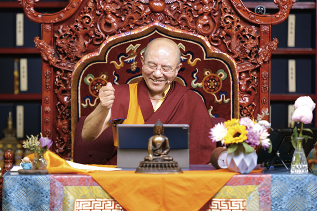
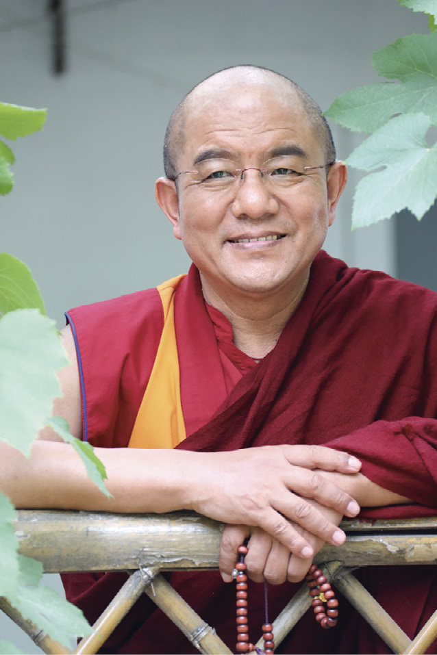

# 第1课

2019年12月10日

今天我们讲《佛子行三十七颂》。这次讲本论有几方面的原因，首先因为《佛子行》每年都会传讲两三遍。我出去弘法时，基本上每到一个地方，就会给当地的道友们讲这部法。有时间就讲解一下内容，没时间就念一下传承。第二，这次讲《佛子行》没有对外直播，只在内部传讲。因为外面的很多道友以前都听过本论，即使这次没听到，也不会太过遗憾。第三，我认为听闻《佛子行》对大家有很大的利益。

道友们可能已经听过很多次了，但是要把这些内容和词句记得清清楚楚，可能还有点困难，要按照其中的法义如理修行，可能更加困难。所以大家偶尔再学一遍，也是应该的。如果你们觉得对这部法已经非常精通，那可以把这37个颂词一一与自己对照，看看自相续有没有真正与之相应。

很多人虽然听过《佛子行》的讲解，但反复地串习也很重要。《大乘经庄严论》中讲，要让法融入自己的心，需要通过听闻、串习以及前世善根的力量，才能逐渐获得稳固的修行境界，所以大家听闻佛法需要依靠串习力。如果能多次听闻一部法，自己的相续就能很容易与之相应。如果只听一两次，也许只能留下一点印象、种一个善根，不一定能真正得到法义精华。

我今天给大家再传授一遍《佛子行》，下面就一边念藏文传承，一边简单讲解。《佛子行》的内容并不难，大家在字面理解上应该不会有什么问题。

（堪布念传承）

> 那莫罗给夏Ra雅！

《佛子行》由藏地无著菩萨所造，共有37个颂词。首先是对观世音菩萨的顶礼，即“那莫罗给夏Ra雅”，这是总顶礼句。

> 虽见诸法无来去，然唯精勤利众者，

> 胜师怙主观音前，三门恒时敬顶礼。

这是分别的顶礼句。观世音菩萨虽然见到一切诸法无来无去，但仍然精进地利益众生，所以无著菩萨在他的殊胜怙主上师和观音菩萨面前，以身语意三门来恭敬顶礼。

我们平时应该经常顶礼自己的本尊、观想自己的上师，并且尽量修上师瑜伽。按藏传佛教的传统，作者通常在造论、讲法或辩论之前，先顶礼自己的本尊或根本上师。只有上师、本尊的加持融入自心，才能真正地修行和弘法利生，所以顶礼是十分重要的。

> 利乐之源诸佛陀，修持正法而成就，

> 亦依了知其行故，于此宣说佛子行。

一切利乐的源泉就是佛陀，佛陀是怎么来的呢？是通过修持正法而成就的，而正法依赖于佛子行，所以作者无著菩萨首先在这里宣说佛子之行。

这是立誓句，意思是说，佛陀能给一切众生带来无量利乐，那佛陀是依靠什么成就的呢？依靠正法。正法虽有八万四千法门，但归纳而言就是大乘佛法；而将大乘佛法归纳摄要，也就是这37个颂词中所述之理。因此，作者以慈悲心向众生宣说了这部《佛子行》。

《佛子行》看起来只有简单的37个颂词，但实际上包含了修行成就的根本，所以《佛子行》是非常重要的。

> 已获暇满大舟时，为自他渡轮回海，

> 日日夜夜不懈怠，闻思修持佛子行。

这里讲闻思修行的必要性，也就是说，闻思修行就是佛子行。为什么要闻思修行？因为具足十八种暇满的人身极为难得，其中包括五种自圆满、五种他圆满和八种闲暇。如同依靠大船可以顺利渡过大海一样，当我们获得暇满人身时，就能顺利地令自己和他人渡越轮回的大海，所以应该日日夜夜精进地闻思修行。

无论是春夏秋冬，我们的修行最好不要有差别。天气难免有时寒冷、有时炎热，有时干燥、有时潮湿，但对珍惜暇满人身的行者来说，不会因为时间、气候或环境等变化而退缩、懈怠或不精进，也不会只在寂静的地方精进却在喧哗的人群中懈怠。外缘对修行比较好的人不会产生太大的影响：时间对他没有影响，环境对他没有影响，遇到各种各样的事情对他来说也没有影响。不管是在红尘中还是在寂静处，他都会精进地修行。

有时候人生可能特别顺利，对此修行人不会傲慢，也不会一直散乱；有时候可能遇到各种各样的坎坷、痛苦和违缘，修行人也不会退缩和怯懦。真正对人身难得有深刻认识的修行人，无论在任何时候都不会放弃闻思修行，这一点大家都应尽量做到。

为什么要闻思修行？因为人身很难得。有了这样的人身时，为了度化众生和自己，我们要日日夜夜地精进。很多人刚开始时特别精进，但时间长了就慢慢变成法油子；顺缘具足时还可以，但违缘较重时就一直想睡觉，比如说停电时就不愿意起来背书；独处或在寂静处还可以，但在人群中或城市里就比较懈怠……这些对于凡夫来说虽然是正常现象，但修行人还是要精进地闻思修行，这就是佛子的行为。

> 贪恋亲方如沸水，嗔恨敌方如烈火，

> 遗忘取舍愚暗者，抛弃故乡佛子行。

这里宣说的是抛弃故乡。对于真正的修行人而言，抛弃故乡很重要，但对于居住在城市里的人来说，抛弃故乡还是不太现实，所以到底怎么行持，要根据具体的情况。为什么要抛弃故乡？因为在自己的家乡比较容易对亲方产生猛厉的贪心，就像沸腾的水一样；也容易对怨恨的敌人生起可怕的嗔恨心，就像熊熊烈火一样；还容易被各种各样遮蔽取舍的愚痴黑暗所笼罩，不容易抛开这些无明的乌云。

在自己的家乡很容易产生贪嗔痴之毒，所以一般而言，以前的高僧大德等修行人会远离自己的故乡，到非常寂静的地方去精进修行。作为真正的修行人，这一点是很重要的。

如果自己有出家和抛弃故乡的因缘，当然是很好。尤其是对于一些出家人来说，这样的教言是非常适用的。然而有些人即生当中还有父母、子女等家庭的责任，尤其是每个人的家庭结构和现实状况都不相同，想要完全像以前的高僧大德们那样行持，考虑到整个生活状况和未来前途等各方面的情况，可能不是很容易。

很多出家人离开了自己的故土，贪嗔痴等很多因缘就此割断；而有些出家人虽然离开了故乡，却在另一个地方建立新的故乡，也同样有贪嗔痴的对境。因此，如果不好好修行的话，他方和自方没有什么差别。在自己的地方容易产生三毒，在别的地方也一样，这样还不如留在自己的故乡为家人亲朋做一点事情，因为人到后来生病无依的时候，还是要靠自己的亲人。有些人年轻的时候完全跟家里断绝关系，最后自己穷困潦倒、沦落到特别可怜的状况，那时还是要靠亲友的帮助。

总之，修行刚开始的时候，某种强烈的出离心不一定是真实的，对此需要留意。修行初期的出离心需要观察，如果刚开始似乎有出离心，但到后来又不愿意修行，这样就不是很好。修行的时候应该保持中道。

> 离恶境故惑渐轻，无散乱故善自增，

> 净心于法生定解，居于静处佛子行。

这里说的是居于寂静的地方就是佛子行。为什么我们要常常处于寂静的地方？因为远离了恶劣的环境，贪嗔痴等烦恼就会逐渐减少；在寂静的地方没有散乱的缘故，身语意的善法会越来越增长；心清净的缘故，对三藏法门自然而然会生起定解。

寂静的地方确实有很多功德，比如减少三毒、增上闻思修三慧或戒定慧三学。如果有条件和相应的因缘，修行人还是应该去比较寂静的地方闭关修行。当然，如果有些人对红尘一直看不破，也许身体处于寂静的地方，内心却还在世俗中打转，这样也不是特别理想。

今年冬天的时候，如果没有特别重要的事，我们喇荣的道友最好还是安住在自己的小屋里闭关禅修。关于所修的内容：第一，我们讲了那么多密法，如果之前得过大圆满等法的传承，就应该尽量修一修。第二，如果没有修完加行，最好在冬天放假这段比较空闲的时间里圆满修完50万加行。一个人的人身极为难得，如果能完成50万加行，这也是非常有意义的事情。第三，我们可以念阿弥陀佛名号。之前闭关的时候念了一部分，听说有些人念得特别少、有些人念得还不错。不管怎样，自己应该把握时间尽快念完，因为什么时候死谁也不知道。

其实我很想把该念的功课都念了，但是总有一股力量在阻拦，有时候要翻译、有时候要写作，因此我的念诵和修行其实是比较差的。我以前的课诵特别多，但这几年因为翻译或做这样那样的事情，课诵也少了，也许以后会好一点。我很想在晚年有一个自己的空间，修一些以前得过的法。我在上师如意宝面前确实得过很多法，但是自己在修行、念诵等方面都不是特别的理想，所以我很想去往寂静的地方修行。

总之，居于静处就是佛子的行为。

> 长伴亲友各分离，勤积之财留后世，

> 识客终离身客店，舍弃今世佛子行。

这里说舍弃今世是佛子行。我们要看破今世、舍弃今世，因为就算不想舍弃，最终还是会舍弃的。为什么这么说？首先，长期相伴的亲朋好友们到了踏上黄泉路的时候，最终还是要各自分离。最好的朋友、最好的家人乃至最舍不得的人，最后也不得不离开。虽然现在对周围的人很贪著，但你还是要懂得，到了一定的时候，你会离开所有的亲人，这是没有办法的事。

第二个原因，我们辛辛苦苦精勤积累的财物，最后将全部留在人间，不可能带走。所谓“财产留后世”，是指人死之后将财产留给后人。有时后世是指来世，但这里说的不是这个意思。人离开的时候，有什么喜欢的东西都要被迫舍弃。有人喜欢耳环、喜欢项链，有人喜欢苹果手机、喜欢电脑、喜欢茶杯……不管喜欢什么，离世之时全都要留在身后。

人死之后，身上的装饰品最先被取下，这样的场景很令人感慨：人活着的时候对这些东西那么执著，可是死了以后什么都带不走。有些人把钱存在银行里，密码只有自己知道，当人离开人世时，密码也离开了，只能将财产留给银行。是这样的吗？这是财富方面的观察。

第三个原因，人死的时候，我们的意识就像客人一样，身体就像客房一样。一位客人在旅店里住一个晚上然后离开，离开时不可能带着整个旅店走。同样的道理，人死的时候，身体会留在人间。就算我们现在对亲人、财物和身体很执著，但到了一定的时候也不得不全部放弃。因此，与其贪著，不如现在就好好地修行，这样离开人世时也不会后悔。

真正的修行人在亲友离开时能想得开，在失去财物时能想得开，乃至于身体遇到各种各样的状况时也能想得开。看破今世对于修行人来说是非常重要的，很多禅宗大德常说“看破、放下、自在”，可见禅宗也有这样的教言。

> 交往恶人增三毒，失坏闻思修事业，

> 令成无有慈悲者，远离恶友佛子行。

远离恶友也是很重要的。在修行过程中，对于贪嗔痴非常严重、没有戒定慧功德的人，修行人最好远离。本来众生都有如来藏，每一位众生都是未来佛，但在显现上人确实有好坏之分。有些人的人格好，修行也好，做事也有利他心，各方面都特别好；而有些人似乎恶的习气特别重，好的习气很薄弱。

如果我们依止恶人、与之交往的话，会增长自相续中的贪嗔痴三毒、失坏自己闻思修行等所有事业。与恶友接触一段时间后，自相续的贪嗔痴越来越增长，闻思修行也越来越不好，最后自己会变成什么样呢？没有悲心、没有慈心，变成一个特别恶劣的人。因此我们要远离恶友。

《功德藏》《如意宝藏论》《大圆满心性休息》《大圆满前行》等很多论典中都说，观察弟子的时候要观察弟子的好坏，观察上师的时候也要分清上师的好坏。好的上师要依止，好的弟子要摄受；不好的弟子要抛弃，不好的上师也一样可以放弃。《功德藏》里用很多比喻宣说，要离开像青蛙、不净粪以及木磨一样的上师。我们若想维护道心，对自己所接触的上师也好、道友也好，都需要观察：上师到底是不是真正的上师，所接触的道友是不是真正有道心？常言道“近朱者赤，近墨者黑”，凡夫必定会受环境的影响，所以一定要观察上师和道友。

在需要远离恶友时，不要想：“我一定要用慈悲心全部摄受这些恶友。”有时虽然想利益他人，但如果自己的境界不够，最后难免自他都受害。国外有一个人想好好照顾小老虎，结果被这些老虎吃了。因此，在自己的悲心境界没有成熟之前，要保护好自己。

当然，就像《大乘经庄严论》中所说的那样，若修行人的悲心特别强烈、真正具备善知识摄受弟子的能力，那么摄受一些特别可怜的人也十分有必要。《中观四百论》中说[^1]，这是菩萨的行为，就像母亲对自己遭受病苦的孩子特别疼爱一样，菩萨也特别疼爱恶劣的众生。然而，在没有得到菩萨的境界前，修行人跟恶友交往还是比较危险：本来修行等各方面很好，后来跟恶友同吃、同住、同行一段时间，就判若两人了。

总之，前辈大德们说的话确实很有道理。我刚来学院的时候，自己觉得《佛子行》修得还可以，对于显现上稍微有点不精进、不太喜欢闻思修行、习气特别重的一些道友，我尽量不跟他们交往，担心慢慢被他们带偏；对于信心、精进、闻思修行等各方面功德具足的道友，我就拼命地靠近他们。作为初学者，这样的行持还是很有用的。如此修行到了一定的时候，就能产生不被他人所转的定解。这就是“远离恶友佛子行”。

> 依止正士灭罪业，功德增如上弦月，

> 殊胜上师较自身，更为珍爱佛子行。

这里是依止殊胜的善知识。如果我们依止了一位非常好的善知识，自相续当中的贪嗔痴等很多不好的习气和罪业会自然而然地消失，闻思修、戒定慧等所有功德会像上弦月一样越来越圆满。如果依止了一位具有慈悲心的上师，你的相续一定会熏染上慈悲心；如果依止一位戒律清净的善知识，或是一位特别善良、喜爱行善的善知识，你的相续也一定会有相应的转变。一般来说，修行人对于这些殊胜的上师，要比自身更为珍爱。

凡夫对自己的身体非常爱护，而修行人爱敬殊胜的上师，要超过爱护自己的身体。世人有种说法，我爱你超过爱自己。每个人肯定都爱自己，而面对真正具有功德的上师，修行人应该比自身更为珍爱，以这样的信心来依止上师，我们相续中的贪嗔痴等烦恼很容易遣除，很多功德也会自然增上。

事实上也是这样，特别成功的修行人对自己的根本上师确实非常有恭敬心、清净心和爱敬心。朵芒寺有一位堪布，一提起上师们的名字时就像小孩一样一直哭。有时一起开会，我就观察：按照他平时的性格，大概父母死了都不会这样哭；可一提起上师的时候，他的眼泪好像不是在眼睛里，而是在眼眶外等着那样，一下子就哗啦哗啦地流出来。

我在很多课堂上都提过，上师如意宝、顶果钦哲仁波切等大德都是很有智慧的人，一般来说都非常坚强、不会轻易流泪，但是一提起上师们的时候，他们就热泪盈眶，显得特别激动。一方面，是因为上师的加持融入内心；另一方面，修行人对自己的上师有一种不同于世间的特别的感情，如果很有信心，自然而然就会对上师的语言、上师的教言十分重视。

我自己也是这样，今天早上看了上师如意宝和德巴上师的一些教言，心里十分触动。其实德巴堪布是一位很普通的堪布，但对我个人而言，他确实很有恩德。德巴堪布在一个藏文的教言集里说，上师离开以后，在这世上怎么找都找不到，就像孤儿沦落在荒野当中一样，十分伤心。德巴堪布对他的上师们也是这样地怀念。

修行人跟世间人有点不同。对于一些世间人而言，若某人曾经是自己的老师，有时会觉得互相之间是一种交易：“我以前在你面前学过知识，从世间方面而言你对我有恩德，但是我对你也有恩德，因为我交过学费。”而真正的上师不是这样的，上师在看得见或看不见的地方为我们付出了那么多，因为有了上师，我们才明白世界的真相和心的真相。如果我们用超过爱自己的心来依止上师，上师的加持就会以满瓶倾泻的方式融入自己的相续。

就像米拉日巴问他的上师玛尔巴罗扎：“我什么时候可以摄受弟子？”玛尔巴罗扎说：“你一旦把老父我视为真正的佛，那个时候你就可以摄受弟子。”这是米拉日巴离开的时候，玛尔巴所赐的教言。我们也可以自己观察，很多比较成功的修行人，对自己的根本上师确实有很大的信心。总之，爱上师要超过爱自己，这就是佛子的行为。

> 己尚缚于轮回狱，世间天神能救谁？

> 故知殊胜无欺处，皈依三宝佛子行。

皈依三宝是佛子行。为什么要皈依三宝？世间的鬼神自己也被束缚在轮回的监狱当中，一直无法解脱，所以不堪为皈依处。如果我们皈依世间的天尊、天神或所谓的伟人、君主，而他们尚且被束缚在轮回中，又怎么去救别人呢？——他们自己都在轮回中动弹不得，更谈不上去救别人。

佛子应该通过多方面的教言来了知：真正殊胜的无欺皈依处就是三宝，三宝永远也不会欺惑我们。如果我们一心一意地依止三宝，就有办法超离这个牢狱般的轮回。只有离开了轮回，才是真正的解脱。因此，皈依三宝就是佛子的行为。

> 佛说难忍恶趣苦，皆为恶业之果报，

> 是故纵遇生命难，永不造罪佛子行。

这里说，不造罪业就是佛子行。为什么这么说呢？因为佛陀在《百业经》等很多经典中说，轮回中非常难忍的痛苦，实际上是以前造恶业的果报。

我们不管是感受头痛、贫穷还是恐惧，或是各种各样难以忍受的痛苦，包括家庭不和、身体生病、相貌丑陋等，这些都是业力。有些人来到世间时长得不是那么好看，每次照镜子的时候都想哭一场，想多攒点钱去韩国住三个月——是不是这样？总之三界所有的痛苦都来自恶业的果报，这是佛陀所说的。

在大科判中，这里是讲小士道的业因果。我们应该思维：即生中每个人的痛苦都难以忍受，如果我们还不断地杀盗淫妄，犯很多戒，造各种自性罪和佛制罪，将来生生世世都会感受各种各样的痛苦。有智慧的人仅仅为今生、为自己，也不会造恶业；如果为了来世、为了度化众生，就会更加谨慎地取舍因果。因此，智者纵遇命难也不造恶业。

当然，要求凡夫一点恶业都不造，确实不太现实，因为每个人都有烦恼习气、有环境的影响，还有人生中不得不做的一些事。虽然如此，但如果造了恶业，尤其是杀生、偷盗等非常严重的业，我们一定要马上忏悔。出家人以受戒的缘故，所有的罪业都不能造。不仅是十种严重的自性罪，乃至别解脱戒、菩萨戒中的微细戒条，都要小心地护持。有些出家人刚开始可能非常地注意，但到后来也许会犯一些戒条。不管怎样，造了恶业就要好好地忏悔，因为忏悔和不忏悔有很大的差别。总之，不造恶业就是佛子的行为。

> 三有乐如草尖露，乃是瞬间坏灭法，

> 了知恒时无变法，希求解脱佛子行。

希求解脱就是佛子行。为什么？因为三界中所有的安乐像草尖的露珠一样，在很短的时间中就不见了。小草上的一颗露水在阳光照射后马上消失无迹，因为它本来就是瞬间坏灭的法；如同草尖露一样，世间的快乐也都是无常的，比如夏天在一个非常美丽的地方享受美景，这种快乐很快会消失无踪。

我们要知道，人生中所拥有的飞黄腾达、荣华富贵和幸福美满，这一切的一切最后肯定会毁灭，而且正在享受时也刹那刹那变化。有些人遇到不愉快的事情时就觉得自己很倒霉，其实如果懂得万物的自性就是无常，那么一旦无常出现的时候，就不会有恐惧心，因为已经提前做好了准备。

一切都在变化当中，在个人身上会出现无常，在集体的事情上也会出现无常。就算人们希望符合自己心意的工作、和睦的家庭和健康的身体保持原状，但这是不可能的——哪怕维持的时间稍微长一点，就应该有满足感了。比如说我讲经说法很多年了，无常什么时候到来，我会坦然接受；身体也是这样，我觉得自己住于这个世间已经很长时间了，什么时候无常到来，我也愿意面对。同样，每个人也要经常想：不管是我的修行、工作还是生活等任何方面，一定会无常。表面上看无常是一种简单的修法，但实际上这个修法中有最深奥的意义。

到底有没有永远不变的法？我们需要了知，恒常不变的法就是解脱道。若想追求永恒的快乐，就要希求解脱，离开轮回的三苦。不用说菩萨道和佛道，即使是声闻缘觉的寂灭果位，都远远超过世间的安乐。因为世间的安乐都是有为法，有为法是无常的，无常就是坏苦。一旦快乐坏灭的时候，谁愿意接受？谁都会感到痛苦！有些人觉得：“佛教中认为一切都是无常，一切都是衰败，是不是太悲观了？”其实佛教并不悲观，我们对现世的快乐完全可以接受；只是从更深的层次来看，就算我们追求快乐，快乐也不是永恒的。知道这一点后，当各种事情发生在自己身上的时候，我们会接受无常，这就是一种很好的修行境界。

对于希求解脱道的人来说，要把世间的快乐、成功、名声、财富看作是如梦、如幻、如泡影。这些东西如果有的话，当然可以接受，因为我们现在正在享受这样虚幻的生活；如果没有，也不必特别伤心。就像《入行论》里讲的那样[^2]，有些小孩在海边用沙子堆房屋，一旦沙屋倒塌时，孩子们就哭得很伤心。世间所谓的名闻利养，就像孩子们堆的沙屋一样，拥有的时候我们不要骄傲自满，没有的时候也不要垂头丧气，因为无常本就是世间万法的真实自性，很多修行人对此颇有心得。

的确，每个人都会面对很多无常，不管是身体、亲人，还是工作、修行，乃至所处的环境等，有些是能想到的无常，有些是想不到的无常。每当无常发生时我们要明白，万法的自性就是这样。这个世界上哪有恒常不变的东西？如果能这样修持，在很多方面对自己和他人都有利益。

> 无始时来慈我者，诸母若苦自何乐？

> 是故为度无边众，发菩提心佛子行。

这里讲的是菩提心。无始以来慈悲爱护我的老母有情们如果在轮回中一直受苦，我自己一个人享乐有什么用？没有任何用处！当这些对我这么慈悲的老母有情们还沉溺在轮回中时，如果我像声闻缘觉一样只希求自己获得解脱，仅从世间的角度来讲，也是一种没有良心的做法。众生对我这么好，那我应该怎么做？为度化天下无边的所有众生，我一定要发起殊胜的菩提心。

发菩提心最主要的目标是什么？就是要度众生。在这样一个时代，尤其是最近十多年以来，我们通过各种方式弘扬大乘佛法，很多道友也有机会参与到这样的发心事业中，这是非常难能可贵的事。即生当中遇到这样的大乘佛法非常难得，所有佛法中最珍贵的就是大乘佛法，大乘佛法的精华就是发菩提心利益众生。哪怕自己做一点点善事都先发起菩提心，中间用无缘的智慧来摄持，最后将善根回向给一切众生，这样的行为确实很有意义。

很多道友这样发愿：“我要以后度众生”“愿我的相续中生起无伪的菩提心”。这样的发愿真是很不错。大概上世纪80年代的时候，我们刚刚接触汉地的一些佛教徒，他们经常说：“请给我加持一下，让我发财，让我开神通。”现在就不一样了，学佛时间稍微长一点的人即使心里希求发财升官，但去寺院烧香拜佛时，大多数的发愿还是“希望我能利益众生”。这样的心态真的很好。

即使文化程度不高，只要有一颗这样的大悲菩提心，我们所获得的功德是无量无边的。就像《大圆满前行》所说的那样，母女两人掉入恒河的时候，女儿想：“希望母亲好好的，我死了也没关系。”母亲想：“希望女儿得解脱，我死了也没关系。”因为母女互怀一种利他的善心，所以她们死后都转生到了善趣。

在修行过程中，希望大家能时时不舍众生、不舍智慧和不舍道心。如果具有这样的心态，我们不管在哪里都可以。本来所修的没有什么差别，如果你有修行境界的话，在哪里都可以。如果没有修行境界，哪怕是在上师身边天天做饭、炒菜、开车，或者天天扶着上师、给他穿鞋——即使做了很多最亲近的承侍，但是如果对众生没有菩提心、对上师没有敬信心的话，表面上看来你是上师最亲近的人，但也许与上师的意趣离得最远。有些人可能连见都没见过上师，只是听说过上师的名字或是看过上师的法本，但依靠上师的教言，相续中真正生起对众生的菩提心，那他就是真正在依止大乘善知识。

大乘善知识最宝贵的东西是什么？就是菩提心。如果我们没有得到菩提心，就算依止一位大乘上师很多年，最后可能还是徒劳无益、空手而返。反过来说，就算在上师身边只待了很短的时间，但如果得到了上师相续中真正的利他菩提心，那就已经获得了上师的智慧与自心无二无别的一种境界。如果不是这样的话，上师的相续中有大乘菩萨的利他菩提心，而你的相续中却充满了自私自利的心和贪嗔痴等烦恼，那就算显现上跟上师形影不离又有什么用？只不过积累了一点善根而已。

总之，依止大乘上师最重要的就是得到上师的利他菩提心。

> 诸苦由求自乐生，圆满正觉利他成，

> 是故己乐与他苦，真实相换佛子行。

所有的痛苦来自希望自己获得安乐，圆满正等觉佛陀是因为利益众生而成就，所以应该用自己的安乐与众生的痛苦真实相换，如此修学自他交换。

为什么要自他交换？因为世间所有的快乐都来源于利他，世间所有的痛苦都来源于自私自利，所以我们应尽可能地代受众生的痛苦，并将自己的快乐供养给众生。

刚开始学佛的人可能觉得这样行持有些困难，但不管怎么样，我们要经常修学自他交换，尽量设身处地为众生着想，这就是大乘菩萨的行为中最主要的自他交换的修法。当然，在大乘的修行法门中，自他交换的修法还有很多，我们以后可以慢慢地学习和修行。

[^1]: 《中观四百论》：“如母于病儿，特别觉痛爱，如是诸菩萨，特意愍恶者。”
[^2]: 《入菩萨行论》：“沙屋倾颓时，愚童哀极泣，若我伤失誉，岂非似愚童？”
