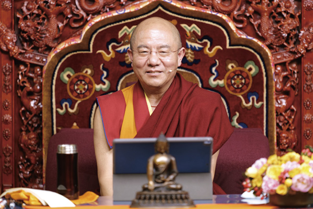

# 第2课

2019年12月11日

下面继续讲藏地无著菩萨所造的《佛子行三十七颂》。无著菩萨是一位非常了不起的大乘菩萨，我曾经翻译过他的传记，其中提到了菩萨在一生中利益众生的伟大事业，希望大家能看一遍。上师如意宝在世时常说，不管在任何地方，只要经常修无著菩萨的《佛子行》，我们的相续中会自然而然地生起慈悲菩提心。

大家不要认为：“我以前背过、看过这部论，所以不用再看了。”虽然你们确实背过、看过，但是这里面的内容非常难以行持，可能多生累世都不一定能精通。法王如意宝的传记中说，上师一生中都在弘扬《佛子行》，也得到过无数次的传承。大家将来如果有机缘弘扬佛法，一定要将《佛子行》作为你们人生中最重要的一部法，不管是念传承，还是为别人作字面上的解释，或者阐述其中甚深的意义，都要尽量让众生与这部法结上缘。

就算没有正式的传法场所，但在跟别人吃饭、喝茶、聊天等时，我们都可以向别人宣说其中某句偈颂的含义，这也是弘扬佛法的一种方式。虽然大乘佛法的思想境界很高，一般人很难做到，但通过这种方式跟别人聊一聊，有信仰的人就不用说了，即使是没有信仰的人，也能在他们的相续中种下大乘佛法非常胜妙的种子。

很多人认为，弘扬佛法一定要建一个金碧辉煌的道场，有一群如法修行的弟子，自己也是一位特别庄严的法师，如理如法地为弟子们正式传讲——其实不一定必须这样。所谓“弘扬佛法”，就是在众生的相续中转动法轮，只要能改变众生的相续，什么方式都可以。有很多大菩萨以各种各样的方式利益众生，甚至在不同的人群中示现为妓女、屠夫等。即使他们的行为看上去不是非常如法，但只要能调伏众生的相续并使之逐渐堪能，这就是在弘扬佛法。

以后如果有机会，我们最好能详细地为别人讲解《佛子行》的这三十七个偈颂；如果没有机会，也可以念一念传承，摘取几个重要的偈颂简单解释；如果连这样的机会都没有，那就看什么对世人比较有用，简单地归纳出其中的意义与大家交流。每个人的根基不同，有些人特别喜欢观心性，那就可以分享一些心性方面的内容；有些人可能喜欢看破今世或是依止善知识、舍弃故乡等，那我们就根据不同众生的意乐和根器，用各种方式令他们获得相应的利益。

> 何人以大贪欲心，夺或令夺我诸财，

> 自身受用三世善，回向于他佛子行。

不管是什么样的人，若他们生起极大的贪欲心，亲自或令他人夺走我所有最珍爱的财物，这时发了大乘菩提心的人该怎么做？他抢走我的一千块钱，我也要抢走他的一千块钱吗？大乘佛子应该将自己的身体、最珍爱的受用和财富，以及三世所积累的一切善根回向给他。这就是佛子的行为。

这样的大乘行为是很难做到的，如果别人真的抢走了自己的财产，有些人可能气得要命，根本没办法回向，但是真正的大乘佛子在被别人抢了财物之后会想：“我还有什么剩下的东西能给他？如果他需要我的身体，那身体也可以给他，此外诸如闻思修学大乘佛法等所积累的一切善根，我也要回向给他。”

现在有些人专门骑着摩托车在街上抢别人的东西，假设今天有一个人把你的钱包抢走了，你该怎么做？——不但不生气，还要念一遍《普贤行愿品》回向给他。有些山上的修行人，在自己的房子被别人抢了之后，不但不生气，还要回向这个人平安、健康、快乐。这样能不能做到？很多人听到后别说做到，可能还会为之气结：“啊，太过分了！”

这些转为道用的方法，对于没发心的人就不用说了，即使是对发了菩提心的人来说，也是很难做到的。但无论如何，我们要在心里想，大乘佛教中确实有这样特别珍贵的利他菩提心。部分西方学者认为：“这不合常理，应该是别人对我怎么样，我就对别人怎么样。”从世间的理论来说，这样想也无可厚非，但这里的修法不仅超越了世间，还超越了一般的佛教理念。就声闻乘佛教而言，只要不害别人就可以了。如果在别人害我的基础上，还要把自己的身体、受用和善根全部回向给加害者，这对一般佛教徒来说是很难做到的。

大乘行者的心态完全不同，在这种修行境界下做出的事情，一般人做不到。由此可以看出，大乘佛法的伟大不仅在于有微妙的禅修境界，更重要的是大乘佛教有一种非常难得的利他思想。从某种意义上说，这个世界上的大多数人都难以企及这一境界。

> 我虽无有些微错，何人若断吾头颅，

> 然以悲心将彼罪，自身代受佛子行。

我虽然没有犯任何微小的过错，但有些人无缘无故地拿着利刃、兵器砍断我的头，我该怎样对待？——不要说被砍断头颅，仅仅是听到一句稍带讽刺的话语，或是被加害身体、侮辱人格、呵斥责骂，或是别人用任何方式对自己表示不恭敬，一般人可能都会非常生气，一有机会就会报复对方，这是世间常见的心态。

而作为大乘佛教徒，即使有人无缘无故地加害，他会怎么做呢？如果自己真的有错，那别人杀我也是理所应当的，但是现在我没有任何错误，别人无缘无故地砍我的头颅，即使这样，大乘佛子也会用慈悲心来面对，并以自身代受此人身语意所有的罪业。佛子会思维：“这个人真的很可怜！他今天砍我的头，以此罪业将多生累劫在地狱中无法解脱，太可怜了！”进而对他生起强烈的慈悲心并回向功德，“愿我来代受他所有的罪业”，这就是佛子的行为。

当然，这些道理在理论上不难理解，但落到修行上就没那么容易了。前面说的是财物上的抢夺，这里进一步说到身体上的加害。如果连头都被砍了，那必定是死路一条，什么希望都没有了，这个时候还要以悲心来代受对方的痛苦，菩萨的这种精神对于凡夫来说确实难以想象。

> 有者百般中伤吾，恶名纵遍三千界，

> 然我深怀慈爱心，赞其功德佛子行。

这里讲将诽谤转为道用。有些人用各种方式对我讽刺、中伤或无因诽谤，我本来是清白的，但因为他的谩骂、侮辱和谣言，令我的恶名遍于整个三千大千世界，这时作为大乘佛子应该怎么做？我要怀着深深的慈悲和爱心，不但不诽谤他，反而赞叹他的功德，这就是佛子的行为。

如果有人在网上或当面对我进行谩骂，导致我恶名远扬、尽人皆知，面对这样的事，真正的修行人不但不会以牙还牙，反而还会赞叹对方的功德。我们很多人都做不到吧？一般人可能没有类似的经历，但明星、名人经常会因很小的事情或无缘无故受到别人的攻击，导致其形象在很多人心中一落千丈。面对类似的情形，大乘佛子不但不会怀恨在心，反而赞叹对方的功德。

在以前特殊年代期间，藏地真的发生过这样的事。那时人们的心好像都疯了，很多人对佛教徒批判侮辱、践踏殴打，但修行好的人把这些辱骂的言辞当作真正的赞叹，绝不怀恨在心。我们的修行可能比较差，有人对身体的伤害比较执著，有人对语言的伤害比较执著。有时别人并没有对你进行语言攻击，但是自己非常敏感，很容易为此伤心难过——这是因为我们世间的习气比较重，佛法的甘露没有融入自己的心。

当然，有些事不一定能完全做到，但我们要知道，即使别人令自己恶名远扬，真正的大乘佛教徒不但不会报复，反而会慈悲赞叹对方，这就是大乘佛教的利他思想。

> 何人大庭广众中，揭露吾过出恶语，

> 于彼亦作上师想，恭敬顶礼佛子行。

前面一颂说的是我没有什么错误，但别人对我妄加诽谤；而这里说的是有人不是在一两个人当中，而是在成千上万人面前揭露我的过错。对于这样的人，大乘佛子会想：“别人对我的批判是很好的，因为这些话对我来说是一种很殊胜的击中要害的修行窍诀。”因此对对方既恭敬又欢喜，对他就像对自己的根本上师那样顶礼，这是佛子的行为。

这一点也是很难做到的。有时别人根本没说自己坏话，但有些人就是认为别人在造自己的谣，更不用说这种直接揭自己短的情况了。一般而言，如果要揭露过失的话，当面互相说可能稍微好接受一点；如果是在很多人面前指责别人，对方可能很难接受。如果有人在成千上万人中说我的过失，那时让我把他当作善知识，恐怕很难做到。

有些人的记性特别好，别人十年前批评他的话，十年以后他还是耿耿于怀，连见都不想见这个人。如果对于上师的教言和别人的恩德在很短的时间中就忘了，而对别人某一句不中听的话十年二十年后都记忆犹新，这是修行不好的一种表现。当然，今天讲的这些修行都比较难做到，但是不管能否做到，我们至少要知道大乘佛子修持的是一种什么样的行为。

> 吾如自子爱护者，彼纵视我如怨敌，

> 犹如慈母于病儿，尤为怜爱佛子行。

我像对自己的独子一样特别爱护的人，对我不但不感恩，反而把我当作有仇的怨敌一样来看待。有些人时常遇到这样的事：“我从他小时候就对他特别好，不管是在生活、工作还是感情上，都对他特别关照，可是他不但没有报恩之心，反而恩将仇报。”

类似的事在世间很常见，自己付出一切对一个人好，但不知道是因为前世还是今生的因缘，对方非但不感激，还把自己看作是怨恨的敌人，这时我们该怎么办？也把他看作怨敌，还是换一种方式对待他？按照大乘佛教的观点，我们应对他更加地疼爱，就像慈悲的母亲对生病的孩子尤为怜爱一般，这就是佛子的行为。

就像《中观四百论》中所说[^1]：生病的孩子就算性格暴躁，慈母也不会嗔怒，反而会对孩子更加疼爱；同样，菩萨对于恶劣的众生会更加悲悯。如果我们对某人特别好，就像对自己的孩子一样，但他对我特别不好，最后反目成仇，那我们该怎么办？按世间通常的做法，如果别人对我不好，我也对他不好，这是合情合理的，但真正的大乘佛教徒会这样想：“这个人很可怜，没有修行的境界，烦恼深重，加上他不懂大乘的教义，不知道要知恩图报，将来会落到悲惨的境地，所以我应该对他更加慈悲。”很多修行人就是这样做的。

> 与我等同或下士，虽以傲慢而凌辱，

> 然吾敬其如上师，恒时顶戴佛子行。

跟我同等或是比我低下的人，以傲慢之心对我进行侮辱，我该如何处之？如果是相貌、地位、财产或其他任何方面超越我的人来欺辱我，可能还好接受一些，但是跟我同等甚至比我还低劣的人很傲慢地对我侮辱和践踏，确实是难以忍受。“你跟我同等，甚至根本比不上我，你凭什么这样对我？”世间人往往会有这样的反应。然而大乘佛教徒会想：“我应该像对待根本上师一样尊敬他、承侍他、供养他，不管是比我高也好、比我低也好，或是跟我平等也好，欺辱蔑视我的人就是最好的修行对境。他即生中这么傲慢，下一世肯定会变成奴仆等下等人，所以我应该对他怀着慈悲心。”

现在很多人比较现实，对自己的领导等上级在表面上都恭敬有加，因为对他有所求，所以比较尊敬；一旦这个人不是领导了，就立刻翻脸不认人。一般人很难做到爱护下等人，但这就是菩萨的行为。即使跟我同等或比我下等的人来侮辱我，大乘佛子也完全把对方当作自己的根本上师一样恭敬。

一般人可能觉得无所谓，连上师是什么意思都不懂，但在佛教徒的心目中，上师的分量非常重。对于真正的修行者而言，根本上师是他们一生中最重要的皈依处。把下劣者当作自己的根本上师那样去恭敬，确实很难做到，但无论如何，真正的大乘修行人需要这样做。这里讲的是将别人的侮辱转为道用，把对方当作根本上师一样恒时顶戴就是佛子行。

> 贫穷恒常受人欺，且为重疾恶魔逼，

> 众生罪苦自代受，无有怯懦佛子行。

有些人生活贫穷，经常受到别人的欺辱，而且疾病缠身、恶魔逼恼。常言道，祸不单行。如果自己没有钱又罹患疾病，厄运临头还名声受损，身边的人纷纷远离，面临这样的处境时，我们该怎么办？其实人真的是很现实、很聪明、很会衡量利弊的动物，藏地有种说法：“荣华富贵的时候，天上的鸟儿也围绕着你；沦落贫穷的时候，自己的亲子也远远离开。”当飞黄腾达时，围绕在你身边的人很多，似乎什么都唾手可得；而贫穷患病时，别人对你的脸色和态度都与以往大不相同。即使沦落到这样的处境时，大乘佛子仍然想要帮一切众生代受罪苦，无有丝毫怯懦，这就是佛子的行为。

人生无常，有荣华富贵的时候，也有凄惨可怜的时候。兴衰在每个人身上碾过，不会放过任何一个人。那天我听说一位老人因为借高利贷而落到一无所有的境地，他说：“我家里什么都没了，现在肯定没人理我。我一生中富裕过四次，贫穷过五次，但也没事，一切都会过去的。”他说贫穷时没人理他，看来世人也知道现实生活的状况是什么样的。

我们作为修行人，应该这样无有怯懦地去面对一切。有些人面临困境就接受不了：“以前我那样辉煌，现在沦落至此，身边的人不理我，我信任的人也背叛我。”由此感到绝望，最后选择自杀。一般人在遇到最大的痛苦时，不用说代受别人的痛苦，可能连祈祷三宝的勇气都没有。有人甚至因为受到过大的刺激而变得痴呆。与之不同的是，大乘修行人在这种时候会更加坚定、更有信心，并且希望世间所有的灾难和痛苦都让自己来代受。这是很难做到的，但这就是佛子的行为。

> 美名远扬众人敬，亦获财如多闻子，

> 然见世福无实义，毫无傲慢佛子行。

刚才讲的是违缘转为道用，这里说世间的名声富贵也要转为道用。有些人美名远扬、众人恭敬，像多闻天子一样获得了无数财富，那时应该如何自处？大乘佛子知道世间所有的财富没有意义，就像彩虹、阳焰或夏天的露水一样，因此毫无傲慢，这就是佛子的行为。

人都是很现实的，当你有名声财富、相貌庄严时，就会有很多人追捧赞叹。大家也许不认识多闻天子，但可能都知道李嘉诚、马云、比尔·盖茨、巴菲特等，多闻天子的财富远远超过这些世间的大富豪。不用说获得像多闻天子那样多的财富，哪怕稍微有点名声利养和他人的恭敬时，一般人立刻就趾高气扬起来，连说话的语气和走路的姿势都变得跟以前不一样了。但你应该懂得，世间所有的荣华富贵很快就会消失，因此也不要太傲慢。

历史上再伟大的人物，到最后也是两手空空地离开世间。人生是一场梦，虽然有美梦也有噩梦，但梦的本质没有什么区别，只不过是享受的方式不同而已。

> 自嗔心敌若未降，降伏外敌反增强，

> 故以慈悲之军队，调伏自心佛子行。

内在的嗔心是我们最大的敌人，如果没有很好地降伏嗔心，即使用各种武器降伏外在的敌军也无济于事，敌人反而会越来越多、没完没了；最了不起的英雄是用慈悲的军队来降伏自己的内心，这是佛子最重要的修行。

如果没有降伏自己的嗔恨心，我们想要一一降伏外在的敌人是很困难的。比如现在国家、家庭或个人之间常常用对抗、争吵的方式来解决问题，最后不但解决不了问题，反而导致冲突升级。其实，温和的方式是解决问题的妙药，不管面对国家的冲突还是个人的争端，慈悲心都是最好的解决方法。

> 一切妙欲如盐水，愈享受之愈增贪，

> 令生贪恋诸事物，即刻放弃佛子行。

前面讲嗔恨转为道用，这里是贪心转为道用。对于世间的色声香味触等妙欲，人们越是享受，相续中的贪心就越多，如同喝盐水一样。因此，令人生起贪欲的任何事物，不管是美色、妙音，还是香味触等任何对境，都应立即放弃。比如看到美食特别馋的时候，你要当下认识到觉受是空，就像《杂阿含经》所说的那样[^2]。如果觉受都是空性的，那么我们就无法得到色声香味触的真实五境，也就不会被它欺惑。

人们通常认为看到美色、听到妙音、品尝到美食是很快乐的，实际上恰恰相反，贪心会引生痛苦。贪心越大，相续中的痛苦就越多。如同国家之间的战争、群体之间的矛盾一样，人类历史上大多数的冲突都跟嗔恨心有关。嗔恨心的来源是什么？就是贪心。在我执的基础上，为了想得到所贪的对境，自然而然就会产生嗔恨心。若能了知色声香味触等外境如梦如幻，我们就能在贪欲初生时立即斩断它。没有贪心，依靠它所生的嗔恨、傲慢、嫉妒等很多烦恼也不会产生。无明和贪心是一切烦恼的根源，因此声闻乘特别重视断除贪心；对于菩萨乘而言，伤害众生是最可怕的事，所以特别重视断除嗔心。

有些人可能贪心比较重，再加上受到一些消费观念的影响，这也想要、那也想要，有些东西明明负担不了，却仍然超前消费。现在大家都不带钱包了，用手机刷二维码非常便捷，“滴”一下钱就没了，欠下的债又还不起……这些都是因为无法满足自己的贪心而产生的痛苦。当然，购买食物、衣服等生活必需品不算贪心，但有些东西有也可以、没有也可以，买来纯粹是出于贪欲和炫耀的心理，对于这些多余的欲望，我们能不能尽量减少一点？

在当今时代，要求人们将所有的贪嗔痴一次性斩断，即使是对出家人也不现实。西方有些人认为，生活中需要贪欲，欲求心是人类追求自己梦想的一种动力，如果没有这种欲求心，社会就无法发展。从某种角度来看，这种说法也有一定的道理，对于凡夫而言，如果一点欲望都没有，可能对生活就没有期待了，但按照佛教的观点来看，欲望的本质是痛苦，因此在适当的时候，我们应该认识它。

佛法中提倡知足少欲，根据适当的所需过一种简单的生活，这应该是最好的生活方式。对于有福报的人来说，即使有一点贪心，需要的东西也会自然具足；如果没有福报、贪心又重，仅仅是对外在财物的贪心都很难满足，对内有情的贪执就更不用说了——这样就会源源不断地产生痛苦。所以，当对任何事物产生贪爱之心时，要立即断除，这就是大乘佛子的修行。

> 一切境现唯心造，心性本来离戏边，

> 了达此理于二取，皆不作意佛子行。

一切境现全都是自己的内心所造。万法唯心造，那么心又是什么？心的本体远离有无是非等一切戏论。如果我们通达了这个道理，对二取法无有作意，这就是抉择唯识宗观点、认识自心的一个很好的妙诀。

我们要知道，一切都是自心所造，心远离了一切戏论和二取执著，因此不作意二取的禅修是认识心的最好的方法。我最近在藏微博（@索达吉藏文化）上发了一则麦彭仁波切的教言：“在分别念动摇的同时，认识无动摇的光明，这是直指大圆满的特法。”这句教言对认识自己的心性有很大的帮助，我对这句话很有感触，或许得过密法的道友也有同样的感受。

有些人修禅的时候一定要绝断分别念，把念头抛开，这在禅宗和密宗中是一种寂止的修法；还有一种修法，正在起心动念的时候，用心观自己的心。心一直在动摇，观察心在动摇中有一种不可动摇的光明，这种光明从凡夫地直至如来地之间一直延续不断。比如你正以猛厉的嗔恨心跟别人吵架，双方的声音越来越大，似乎整个三千大千世界的众生都能听到；虽然此时我们的心一直在动摇，但动摇的当下有一种不动的光明，这就是所认识的觉性、大圆满的特法——麦彭仁波切这样说。我是在一位老上师的教言中看到这句话的，觉得很好，因此跟大家分享。这种不作意二取的修法，就是佛子的行为。

> 逢遇悦意对境时，视如夏季之彩虹，

> 虽显美妙然无实，断除贪执佛子行。

每当我们遇到特别悦意的对境时，如好看的衣服、喜欢的朋友等在眼耳鼻舌身前显现时，不要追随分别念：“这真好看！我该怎么得到……”而要认识到它的本体就像夏季的彩虹一样现而无自性，虽然显得特别美妙，但是没有任何实质，因此断除贪执就是佛子的行为。

这一修法对欲界众生来说确实难以行持，不管是异性之间产生的贪心，或是对财物产生的贪心，想要当下搁置有一定的困难。但如果我们学过中观或大圆满，就能认识到外境跟夏天的彩虹没有差别：虽然显现时非常美妙，但在本体上却没有自性。就像《入菩萨行论》或《中观宝鬘论》里对人体内的不净法进行分析[^3]，从而断除贪执，或者用中观胜义理来观察时，抉择万法在名言中也没有真实的生。无论用哪种方法都可以知道，虽然人们认为世间所有美好的事物真实存在，但真正去观察时，它们的本体也是了不可得。

> 诸苦如同梦子死，迷现执实诚疲惫，

> 是故遭遇违缘时，视为幻相佛子行。

世间所有的痛苦就像梦中亲生儿子死去一样，如果我们去迷乱执著就会疲惫不堪，没有任何意义。所以，当我们遭遇违缘时，要将其看作幻相，这就是佛子的行为。

每个人一生中都有一些障碍和违缘，有些是因众生的共业而显现，有些是因个人的别业而显现。第二世敦珠法王在他的传记中说：“我13岁时已经苏醒了前世的习气，也即第一世敦珠法王的伏藏因缘，因此开取了一些本尊和护法的猛修法。”敦珠法王长大之后，值遇了如狂风般恐怖的乱世，他说：“如果我当时没有这些修法，可能现在连命都没了。”

大家也许知道，在二十世纪五六十年代特殊运动时期，整个佛教遭遇了重大的变故，当时世间连出家人的名称都没有，经书如果出现于世马上就会被销毁。作为一个修行人，可能很难度过那个时代。就像敦珠仁波切所说的那样，如果没有本尊和护法的伏藏法，可能连命都没了。在那样特殊的时期，如果有一种坚定的信念，依靠本尊和护法神的加持，修行人就能顺利度过。

当然，我们没有值遇那样的乱世和那么大的违缘，但有时修行中还是会出现一些违缘，比如家庭、身体或精神情绪上出了问题，那时就要祈祷上师三宝，祈祷护法、空行。要遣除违缘，有时仅靠无形的祈祷不够，还是需要面对现实去真正解决问题；仅靠世间的行为也不够，有时无形的力量更管用。这里说，当你遇到人生的违缘时，应了知违缘本就如梦中亡子一般没有实质，只是你把本来没有的东西执著为有。因此，要把违缘当作一种幻相来看待。就像《般若经》中所说，对于证悟如梦如幻的修行人，所有的外魔无机可乘；反之，如果实执越来越重，违缘就越来越强。

每当遇到违缘的时候，修行人不要怨天尤人：“我怎么这么倒霉？我该怎么办？”因为越执著就越痛苦，这种心魔对你的干扰也会越来越强。我们一旦察觉到违缘出现时，应想：“这没什么，人生本来就如梦如幻，再过一段时间这个梦也会消失，该怎样就怎样吧。”这样想的话，违缘很快会烟消云散。

人生当中总会遇到各种各样的违缘，尤其当今时代心理疾病层出不穷，好多人患上了抑郁症。我前两天听到一位特别熟悉的朋友离开人世的噩耗。他是一位领导，后来遇到了各种违缘。他今年上半年还来过喇荣，我跟他一起吃饭时似乎一切都很顺利，他看起来也很开心。但就在前几天，他跳楼自杀了，听说是得了抑郁症。他在住院期间的一个晚上回到家，第二天早上起来后对家人说：“我先刷牙，然后你们刷。”他去刷了个牙，接着转身从窗口一跃而下。我想，他可能没那么想死，只是心没有获得自在。如果真的想死，不一定会刷牙洗脸。

我们的心很难控制，如果没有修行的境界、没有得到空行和护法的加持，也许人到了某些时候真的很难自主。我们要经常祈祷上师三宝，这真的非常重要！虽然祈祷后仍然会遇到违缘，但不至于发展到最糟糕的境地。总之，我们要常常祈祷莲花生大士，念一些遣除道障的咒语或偈颂。祈祷三宝非常重要！

[^1]: 《中观四百论》：“如母于病儿，特别觉痛爱，如是诸菩萨，特意愍恶者。”
[^2]: 《杂阿含经》：“观色如聚沫，受如水上泡，想如春时焰，诸行如芭蕉，诸识法如幻，日种姓尊说。”
[^3]: 《入行论》：“齿发甲非我，我非骨及血，非涎非鼻涕，非脓非黄水，非脂亦非汗，非肺亦非肝，我非余内脏，亦非屎与尿，肉与皮非我，脉气热非我，百窍亦复然，六识皆非我。” 《中观宝鬘论》：“汝见屎尿等，各自不净已，于集彼之身，如何生悦意？精血混合中，不净种子生，本知不净体，欲者何贪此？”
