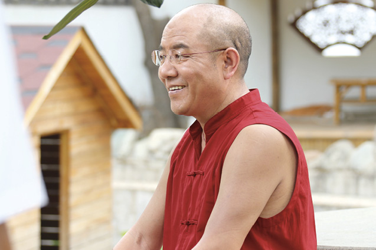
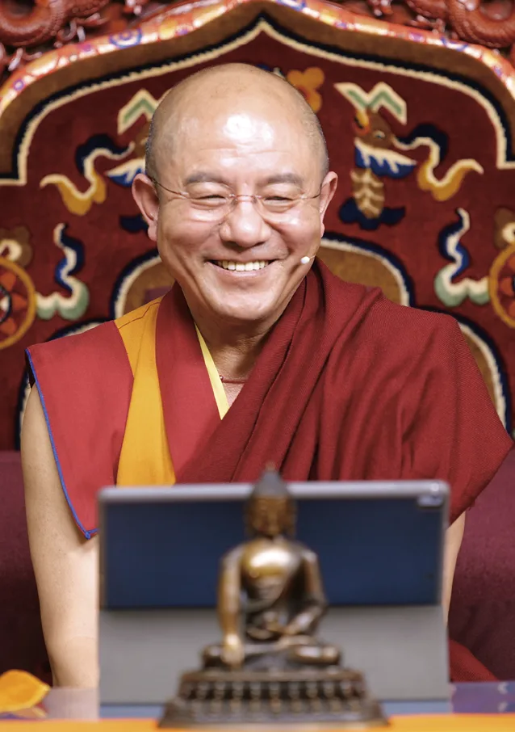

## 第3课

2019年12月13日

今天继续讲《佛子行》，下面讲六波罗蜜多。

> 获得菩提身尚舍，何况一切身外物，

> 故不图报异熟果，慷慨布施佛子行。

这里的意思是，要想获得菩提，自己的身体尚且需要布施，何况是财物等身外之物？在布施的过程中不应贪图异熟果报，比如为了长寿、健康或发财等——这是不清净的世间布施。按照大乘的标准，只要是为了利益众生，什么都愿意舍弃，如此慷慨地布施是佛子的行为。

我们若想获得佛果，就必须布施。《释迦牟尼佛广传》中有很多本师世尊在因地时舍弃自己身体的公案，佛子应该随学。当然，布施也要分场合。有些佛教徒在刚开始学习大乘佛法时布施的心特别切，什么都愿意舍弃：“《入行论》里不是说了吗？连身体都要布施，那我的房子、银行卡，什么都布施了吧。”之后生活变得贫穷，又非常后悔。毕竟，人在世间一点财富都没有的话，连维持基本的生活都成问题。所以我建议，在没有达到比较高的境界之前，最好留下一部分生活费用，这个建议尤其针对刚开始学佛的人。

有的人似乎学佛的时间越长就越吝啬：刚学佛时很大方，连身体都愿意布施；学了十年八年以后，什么都要算得清清楚楚。因为刚开始时比较幼稚，那时的慷慨并不是真正意义上的佛子行。现在整个国际局势紧张，各行业经济不景气，我们从新闻中都能看到很多经济下行时社会上的各种乱象。一些佛教徒刚开始连车子、房子都要供养上师，一段时间后自己走投无路了，又想从上师那里把财物要回来；而上师又不还，他们之间就发生了很多的矛盾、官司，这就是没有好好闻思、不懂得如何修行的过失。

虽然布施很好，但是应该像《阿含经》里所讲的那样，自己要留出一部分生活所需。出家人也一样，虽然按照以前佛陀制定的传统，出家人到寺院去应该能得到一点供养，但现在不知道怎么样。很多寺院可能不接收出家人，有些地方甚至连寺院都找不到。在这种情况下，有些出家人就去种地、做生意……虽然相较于在家人而言，出家人的家庭压力少一点，但有些出家人还有父母要赡养，如果一点经济来源都没有，生活就会有困难。人在贫困时别人不一定能关注你，如果再把所有的财物都布施了，自己的生活也会成问题。

当然，越布施越富裕，这是一定的，但是有些人因为福报不够，似乎即生中越布施越贫穷，而布施的果报可能来世才能成熟，在此之前还是有点痛苦。总之，布施是很好的，但是要掌握分寸。

> 无戒自利尚不成，欲成他利诚可笑，

> 故于三有无希求，守护净戒佛子行。

如果没有戒律，连自己的解脱等自利都无法成办；如果连一分戒都没受持，不用说在轮回中获得解脱，即使是人天善趣的果位都难以得到。在这种情况下想要利益众生，实在是荒谬可笑。因此，我们应对整个三有轮回无所希求而守护清净的戒律，这是佛子的行为。

戒律是一切功德的根本。一个人相续中如果连一分戒律都没有，却还想成办众生的利益，是非常困难的。有些人觉得戒律很麻烦，但戒律其实是人的一种基本底线。如果超越了这个底线，打破了为人应该遵循的规则，那么下一世想要再做人就很难了。

根据所受的戒律，佛教徒有不同的身份。有些是受了居士戒、菩萨戒或密乘戒的佛教徒，有些还受了别解脱戒中的比丘、比丘尼戒等。如果没有受以上戒律，佛教徒至少应该有皈依戒。所皈依的对境是三宝，皈依三宝的戒条是：皈依佛以后，不皈依其他邪魔外道；皈依法以后，不伤害众生；皈依僧以后，不与外道徒众志同道合。如果连这样最基本的戒律都没有，那很多功德都难以获得。除了基础的戒律之外，这里所说的戒律的层次比较高，是对整个三有轮回都没有希求的清净戒律。只有达到三轮体空的境界，我们才能对整个三界没有一点希求。这是超越轮回的戒律，是大乘最高的菩萨戒。

对佛教徒而言，戒律非常重要。如果没办法受其他戒律，哪怕只受一日一夜的八关斋戒或最基础的皈依戒都可以——这些戒律将对你们生生世世的慧命产生深远的影响。

将来出家人的数量可能会越来越少，在这样的时代，出家人应该有自己的底线，在不打破根本戒的前提下随顺社会。我前段时间想在一个百货商场里买毛衣，但适合我的衣服基本买不到。我后来想，其实我在这么多人中是很另类的，虽然在家人的衣服琳琅满目，但是适合出家人的衣服却几乎没有。出家人在世间不管是维持自己的穿着也好，还是保持修学和生活方式也好，都比较困难。在这种情况下，不舍弃根本戒律、不舍弃众生，就显得尤为重要。

汉地的情况不同于藏地。在藏地，作为一个穿着僧衣的出家人是很光荣的事。我们学院有条纪律：如果出家人故意穿在家人的衣服，那么这个人在两三年中都禁止返院。汉地有些地方确实不同，比如有些出家人的父母没有信仰，出家人的社会地位也比较边缘化。这时出家人需要因地制宜，只要不诽谤佛教，就可以在不同的地方用不同的方便方法来弘法利生。诸如此类的很多问题，本来阿难想问佛陀，但因为受到魔王波旬的干扰，加上阿难因佛陀接近圆寂而特别悲伤，所以很多问题没有来得及问。当然，即使当时问了，阿难多半也会因魔王作梗而没有听到。

无论如何，出家群体将来以什么样的方式面对社会，是我们必须考虑的问题。首先戒律不能改，我们一定要遵循佛制，此外佛教的正见也不能舍弃。在此基础上，弘法的方式和手段也许可以有所变通。

我以前去学校演讲时，举办方经常要求我着便装。出家后我从未穿过在家人的衣服，就想：“如果这样的话，那干脆不去了。”虽然到现在为止，我去学校演讲都是如理如法地着僧衣，但你们未来会面临什么形势，确实很难说。西方有些地方对出家人比较欢迎，但有些地方有时也比较排斥。比如“文革”时期，很多堪布在内的出家人最后都不得不离开自己的三衣，选择了还俗——当然从现在的情况来看不会出现这样的灾难，但总的来说，有时出家人的路也不是那么好走，不像在家人走烦恼的路，想要去哪里似乎都四通八达。

我刚才说的话，你们要深思。

> 于求妙果之佛子，一切损害如宝藏，

> 故于诸众无怨恨，修持安忍佛子行。

对于希求菩提果、发了菩提心的佛子，应将在世间遇到的一切损害都看作自己的顺缘，就像如意宝藏一样。遇到作损害的人时，大乘佛子特别高兴：“我今天得到了一个如意宝！有人害我、打我、骂我，对我不是很好！”即便所有的众生加害于我，大乘佛子也没有任何怨恨，这就是修持安忍的佛子行。

一般来说，菩萨从不害人。按照因果规律，如果你没有害别人，别人就不会来害你，所以菩萨几乎找不到敌人。一旦偶尔出现了敌人，菩萨会因为有修忍辱的对境而特别高兴。每当被人指责或别人给我们制造违缘时，大乘佛子不要觉得“我身边又来了一个提婆达多”——如果身边有脾气不太好的人，这是值得高兴的事！阿底峡尊者经常带一个木曼茶盘，时时修忏悔；也经常带着一个脾气不好的弟子，时时修安忍。可见，如果你是跟上师特别亲近的弟子，不一定是因为你修行很好。有些人常有意见：“我对上师信心百倍、如理如法，但上师对我好像置若罔闻。”可能是因为你脾气太好了，对上师而言，一点修安忍的价值都没有（众笑）。所以遇到问题时我们不妨换个角度想：别人排斥你，这说明你脾气很好；别人不喜欢你，也许别人正在修安忍，他需要的是脾气不好、人格不好的人。这算不算是一个新的思路？

> 唯成自利小乘士，勤如扑灭燃头火，

> 饶益众生功德源，具足精进佛子行。

为了自身利益的小乘士夫非常精进，就像头发燃火时一定会用最短的时间马上扑灭一样。小乘行人为了自己的解脱，对修法尚且如此精进，而我们大乘行人作为饶益一切众生的功德源泉，更要具足精进心，这就是佛子的行为。

修学大乘佛法的行者不能只是发一个菩提心，然后天天睡懒觉，这样不是很好。小乘行人也好、世间人也好，他们都非常辛苦、特别努力，大家早上四五点钟去看看，很多早餐店已经在营业了。既然世人为了养活自己尚且非常辛苦地谋生，那作为利益天下无边一切众生的大乘菩萨，既然发了这么广大的菩提心，有时候累点、辛苦点，也是值得的。

精进很重要！有些人的智慧不算特别超胜，但他以精进心不间断地努力，最后能远远超过那些智慧敏锐的人。精进有两种：恒常精进和恭敬精进。恒常精进很重要，如果两三天特别精进，之后又特别懈怠，那也起不到什么作用。有些道友是“不定期精进”：在一段时间内特别精进，不吃不喝就算熬夜也要修学；可是过了这段时间，又变得比平时更加懈怠。我建议大家最好不要熬夜，晚上该睡觉的时候要睡觉，否则可能会带来反作用。我们以前读书时，有人习惯在考试前一天熬夜复习，到了正式考试时困得迷迷糊糊，连正常的水平都发挥不出来。

总之，精进需要有恒常性，并且以恭敬心恒时精进。

> 当知止观双运理，以此摧毁诸烦恼，

> 真实超越四无色，修习禅定佛子行。

这里讲禅定。我们修行禅定时，寂止和胜观要双运。既有寂止也有胜观的禅定能摧毁相续中所有的烦恼，实际上已经超越了四禅和四无色定，因此以止观双运的方式修习禅定就是佛子行。

现在禅修的人比较多，但是大多数人都是安住在阿赖耶上面，这是不行的。修持禅定应该一方面认识心的本性，另一方面安住在这个本性当中。按照密法的修行窍诀，分别念正在显现时，于显现中去认识它；如果修安住，就在安住中放松，认识它的本性。通过这两种方式认识之后继续护持，这就是很好的禅修。与之不同的是，很多人禅修的方法是分别念一产生就遮止。当然，这种禅修方法在汉地藏地都有，但是并不特别适合大圆满的修行者。

《佛子行》的后文中也提到，无著菩萨是依靠众多经典续部来撰著此论的，其中止观双运的道理就间接引自续部。修禅定的时候，一方面心要安住下来，另一方面要认识心的本性，所谓止观双运就是这个意思。第一世敦珠法王在世时，藏地很多人着重静修，但有相当部分是安住在阿赖耶上，修法不得其要——这一问题在萨迦派的果仁巴大师与宁玛派个别大德的辩论书中也有提及。如果我们光是安住，除此之外什么都不想，也许会处于一种阿赖耶的寂静状态中，跟无色界的禅定类似。这样的禅定不能摧毁烦恼，因为没有胜观的智慧。大家应该知道，胜观智慧是一种空性见，只有空性见才能摧毁烦恼和轮回的敌军，从而获得解脱。

总之，禅修很重要。有些道友说：“不管在网上也好，线下也好，如果没有课，我们该怎么办呢？”我说：“不一定非要有课，讲的课已经够多了！我讲课至今已经32年了，人生也是有限的，不知还能再讲几年？实修很重要！要把听到的教言实实在在地修出来！”我在一些老法师中算是讲课讲得比较多的一个，如果我讲了那么多，但是你没有修，那即使讲了百八十年，也许你还是人法分离。就像噶当派的大德们所说的那样，法和心中间有一匹马的距离；按现在的说法，法和心之间有一辆车可以跑。

总之，闻思的法需要在心相续中串习，因此大家应该好好地实修。

关于以前讲的一些密法，对于听过的道友，在他们承诺保密的前提下，我们将来在因缘具足时可以为大家提供音频等资料。这个问题我也在计划中，相关的发心人员也可以考虑一下。比如修完加行，或是以前听过，或者承诺将来具足条件的人，我们以什么样的方式为他们提供一些方便？我在密法方面讲得非常多，就像显宗的资料那样，文字、音频、视频应该都会有。如果一个人在修行上有自己的坚持，那么外在的因缘是很容易具足的。当然，这些因缘也需要很多人一起来创造。

> 若无智慧以五度，不得圆满菩提果，

> 故以方便三轮空，修持智慧佛子行。

这里是智慧波罗蜜多。如果没有智慧，仅仅以布施、持戒等五度得不到圆满菩提果，所以我们一定要具足智慧波罗蜜多，也就是方便的三轮体空。以布施为例，布施者、所布施的财物和布施的对境众生，这三者在胜义中远离四边八戏，在世俗中如梦如幻。如果没有这样三轮体空的智慧，所行持的善法就变成了世间的善根。每一个修法都要用与方便无二无别的智慧来摄持，如此修持智慧就是佛子行。

关于智慧波罗蜜多，我们在很多中观论典中都讲过，因此这里不广说。

> 若未观察自错误，以法形相行非法，

> 是故恒时审自已，断除过患佛子行。

一个人如果没有观察自己的错误，很有可能表面上看起来如法，实际上却以如法的形象行非法之事。有些出家人也好、在家人也好，看起来好像特别如法，但实际上是在用佛法欺骗别人。现在很多人的目的不是求法，而是通过佛法做各种非法事。比如有人求加持，不一定仅仅为了这个目的，而是想通过这种方式来欺骗信众。所以，我们应该恒时审察自己，断除自己相续中的过失，这就是佛子的行为。

自己很难发现自己的过失。很多人不愿意接受批评，如果别人批评他，他会反唇相讥，变成互相指责。人最好能反观，以观察三门的方式很容易了知自己的过失。总之，经常观察自己的过失很重要。

> 以惑谈他菩萨过，则将毁坏自功德，

> 故于大乘诸士夫，不说过失佛子行。

如果以深重的烦恼来谈论其他菩萨的过失，一定会毁坏自己的功德。说大乘士夫的过失是极其不合理的事，因此对发了大乘菩提心为主的所有众生尽量不说过失，这是很重要的佛子之行。

有时候我们认为别人有过失，但也许别人只是示现而已。自己的烦恼很深重，自相续中有各种各样的毛病，才会经常谈论别人的过失。说人过失不一定能毁坏别人，但一定会毁坏自己。凡是说别人过失的人，他自己一定也有过失。藏地有些人在说人过失之前就念“嗡班匝儿萨埵吽”，所以当他念金刚萨埵心咒时，就意味着下面他要说别人的过失了。既然不能说，他就念“嗡班匝儿萨埵吽”，然后非常不客气地说别人的过失。这样不是很好。大乘佛教徒最好不说别人的过失。

> 为求利养相互争，失坏闻思修事业，

> 故于亲友施主众，根除贪执佛子行。

有人为了求一些利养而互相争执，因此失坏闻思修行。故而根除对亲友、施主等人的贪执，就是佛子之行。

我1985年刚来学院的时候，在一位老堪布面前听受《佛子行》。那位堪布说：“如果争夺利养，施主们肯定会觉得这个修行人人品下劣，因此对施主和亲人不要过多贪执，否则我们会为了我的施主、我的亲友、我的上师等而互相争夺。其目的只是为了自己获得名闻利养，因此还是出于自私自利的心。”

不管是施主也好、亲人也好，所有争执的根源就是我所执：他是我的人，我的施主、我的朋友、我的亲人……以此原因会不断地争执，不断发生冲突和矛盾。戒律里说，如果出家人在某位施主那里接受供养，就应用回向来报答恩德，而不是用贪执来报答。对自己的施主越执著，相续中的过失就越多。因此，真正的大乘佛教徒不会将他人执为己有。

> 恶言刺伤他人心，亦失菩萨品行故，

> 莫说他人不悦词，杜绝粗语佛子行。

说恶言恶语会刺伤他人的心，也会失毁自己所行持的菩提道中的高尚品行，所以我们不要对别人说不悦意的言辞，杜绝粗语就是佛子的行为。

是否经常骂人跟一个人的品格有关系。有些人说话文雅悦耳，而有些人不管在人际交往还是管理工作中，想说好话时张口结舌，但骂人的时候却能滔滔不绝、出口成章——他可能是“谩骂专业班”培训出来的，很爱说别人的过失。

这种情况在网上尤为严重。以前说恶语只能毁坏一个人的善根，而现在如果在网上骂人，很多人都会受到影响。这一恶业成熟时，将多生累劫都无法从复活地狱和黑绳地狱中解脱。我有时看到这些人不懂因果而肆意妄为，感到他们真是可怜。

总之，大乘佛子应尽量地守护自己的身语意。作为修行人，如果不能制止别人，至少自己在语言上要改过迁善。

> 烦恼串习难对治，执持正知正念剑，

> 贪等烦恼初生时，立即铲除佛子行。

越是串习烦恼就越难以对治，所以在烦恼刚产生时，我们应该执持正知正念的宝剑，像铲除新芽一般斩断烦恼，这是佛子的行为。

烦恼在刚刚生起时最微小，这时对治最容易。在嗔恨心快要生起之前，我们要用正知正念来对治，心想：“我是一个大乘修行人，跟别人不一样。”在烦恼生起时马上控制住，这就是修行人和一般人的区别。有的居士原来烦恼非常深重，虽然现在有时难免还有负面的情绪，但他能一直对治，每当烦恼一产生就以正知正念的宝剑立即斩断。这样修持一段时间后，他的心相续就有很大的改观。

为什么很多人对大乘佛教感兴趣？因为学佛对个人、家庭和社会都有利益。有的人以前的生活像一团乱麻，人际关系也特别差，自从学了大乘佛法之后，自己的心情变得平和了，负面的情绪越来越少，为他人做的善事也越来越多。从社会、国家乃至世界的层面来说，这种利他的价值观非常重要。持此价值观的人越多，社会越和谐。当然，也不一定人人都能明白这个道理。

总之，作为修行人，烦恼一旦产生就要立即斩断，这是佛子的行为。

> 总之一切威仪中，观心处于何状态，

> 相续具足正知念，成办他利佛子行。

总而言之，佛子在行住坐卧的一切威仪中，要随时观察自己心的状态。不管是睡觉也好、走路也好、跟别人交流也好，要自己观察自己。如果自相续中真正具足正知正念，并且以之利益他众，这就是真正的佛子行。

修行好不好，在于能不能依止正知正念。《入菩萨行论·正知正念品》中讲了很多非常殊胜的教言[^1]。人们为什么干坏事？因为没有控制自己。没有正知正念的人就像没有被缰绳控制的野马，或者没有方向盘的汽车一样。人心本来是善的，但在被烦恼控制时，加上没有用正知正念对治，有的人就什么事情都做得出来。如果你是一个很好的修行人，就要时时用正知正念观察自己心的状态：“我今天的状态还很不错，昨天吃得也好、睡得也好、修行也很不错。”“今天我的状况很糟糕，待会儿可能要发脾气了，最好不要接触人群，不然我可能会爆炸的。”

经常观察自己的心，才会知道自己到底是什么样的人。在这个过程中尽量地利益众生，这就是佛子行。

> 如是勤修诸善根，为除无边众生苦，

> 皆以三轮清净慧，回向菩提佛子行。

前面所讲到的行持菩萨行的所有善根，我们要将其回向给一切老母有情，为了铲除无边众生的苦因和苦果，以三轮清净的智慧回向菩提，这就是佛子行。

无著菩萨把此颂作为回向偈。我们这次没有按科判讲，只在行为方面略微提及。这次的讲法是简单地在字面上过一下，一是为大家种下善根，一是给大家提个醒：《佛子行》里面的内容你们忘了没有？如果忘了，请在心里串习一遍。我们心的相续中有很多种子，其中善法的种子若要成熟，需要有串习力。如果串习力多一点，久而久之，在自己相续中的智慧就能成熟。有些人听一遍马上就能记住，但如果像我一样记性不太好、听一遍不一定能记住的人，就需要反反复复地听。

我们这次用三节课的时间为大家讲解了这三十七个颂词，最后也要将善根回向给所有的老母有情。大乘佛教徒做任何善事之后一定要念诵《普贤行愿品》《极乐愿文》等佛菩萨所作的金刚语来回向，这是我们人生中最有意义的事。

总之，大家每天修一些功课、做一些善行，一定要记得回向！

> 为利欲修菩萨道，依照经续论典义，

> 诸圣者言而撰著，三十七颂佛子行。

无著菩萨说，为了利益想修学菩萨道的人，无著我依照经典续部以及前辈高僧大德们所著论典的意义，随顺圣者的教言在此撰写了《佛子行三十七颂》。其中的意义大多数出自显宗经典，续部的内容以间接的方式述及。不算顶礼句和立誓句，到这里共有三十七个偈颂。每个偈颂最后以“佛子行”结尾，总共有三十七个佛子行，所以本论名为《佛子行三十七颂》。

无著菩萨说，想修学菩萨道的众生，若想学习所有的千经万论有一定的困难。为了利益这些大乘佛子，我把经典、论典和续部中的内容全部归纳起来为大家宣讲了这一《佛子行三十七颂》。

以前上师如意宝要求喇荣五明佛学院的人都要背诵《三主要道论》、《修心八颂》、《胜利道歌》和《佛子行》这几部论典，我们后学一定要对法王如意宝的教言依教奉行！

> 因吾慧浅无修行，虽无智者所喜词，

> 然依诸多经论故，此佛子行定无谬。

这是无著菩萨的谦虚词。他说，我的智慧很浅薄，也没有什么很好的修行境界，虽然这部《佛子行三十七颂》中没有诗学韵律的雕饰，不具智者所欢喜的优美言词，但是这一《佛子行三十七颂》依靠很多经论而撰著，定然没有什么错误。佛子们可以依此放心地修行，沿着这条大道走下去，一定不会误入歧途。

> 而诸佛子广大行，如我愚者难测故，

> 相违不符等诸过，诸圣者前祈宽恕。

这里有个转折，无著菩萨很谦虚地说：然而对于诸佛子的广大行为，像我这样的愚者难以揣度和通达，如果本论中存在与经论相违或不符等过失，我无著恭敬地在圣者们面前祈祷和忏悔，希望诸位圣者和护法、空行予以宽恕。

从无著菩萨的造论风格来看，他是一位非常谦虚的人。有些大德的风格不同，像无垢光尊者，在论著结束前可能会批评很多人，说自己是“邬金莲花生大士日夜摄受的通达显密教典的大瑜伽士龙钦巴尊者”，他会在后面写一大串自己的功德。这里无著菩萨说“如我愚者”，但我们不能因为无著菩萨说自己是愚者，就如此认为。他在这里是示现谦虚。

> 以此善愿众有情，以胜世俗菩提心，

> 等同不住有寂边，大悲怙主观自在。

最后以此善根回向给所有的众生，以胜义菩提心和世俗菩提心的功德，愿所有众生都平等地不住轮回和寂灭的边，愿他们都能获得如大悲怙主观世音菩萨一样的果位。

无著菩萨的本尊是观世音菩萨。其实，从尊者们所造的论典、经常祈祷的佛菩萨中也能看出他们各自的本尊，比如：无著菩萨在任何时候都祈祷观世音菩萨，他的大悲心也与众不同；麦彭仁波切经常祈祷文殊菩萨；还有一些大德说自己从某位本尊那里得到了特别的加持；等等。

此处无著菩萨最后的回向，是愿所有众生依靠胜义和世俗菩提心，平等地不住于轮回和涅槃的边，都能获得等同观世音菩萨的果位。

此《佛子行》，是为了利益自他，教理法师无著于水银宝洞撰写。

教理通达的无著在一个名叫水银珍宝洞的地方造了《佛子行》。这个地方大概在拉萨附近，大家有时间可以去朝拜。

《佛子行》的课程已经讲完了，大家一起念《普贤行愿品》回向。

[^1]: 《入行论》：“若纵狂象心，受难无间狱，未驯大狂象，为患不及此。若以正念索，紧拴心狂象，怖畏尽消除，福善悉获至。”
