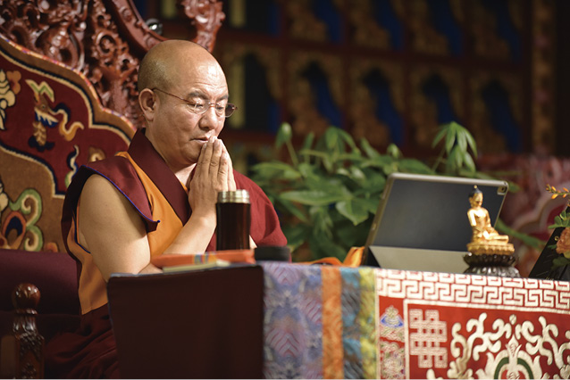
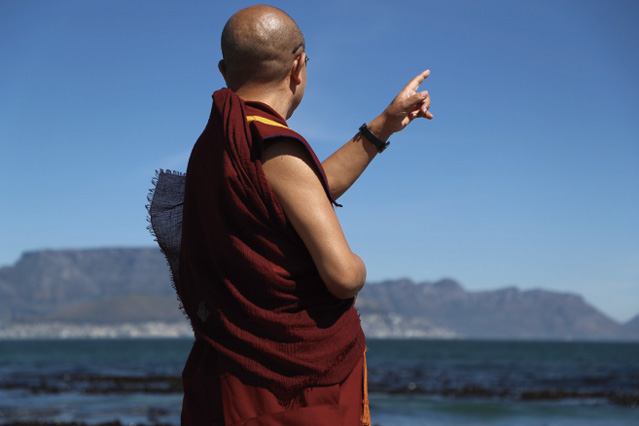

## 纪念佛陀

2019年5月19日

本来我们周日没有课，但今天是一个特殊的节日，我想让大家跟本师释迦牟尼佛结上殊胜的善缘，所以特意安排了这堂开示来纪念佛陀。

我先给大家念一遍《释迦佛修法仪轨》。我以前也念过它的传承，这次算是一种祈福，也让没有传承的人得到传承。关于此仪轨的意义、功德和它最后部分的修法，在不久之后的6月初，我会详细地讲解。因此，除非待会有时间，今天就不解释其中的内容了。

（堪布念《释迦佛修法仪轨》传承）

“见闻忆触此仪轨之一切众生相续中真正获得本师佛之无等加持”——麦彭仁波切在仪轨的末段有此教言。凡是跟本师释迦牟尼佛的身语意、功德、事业结上善缘的所有众生，比如今天大家听到释尊仪轨相关的声音，或者看到相关的文字、接触相关的法本、心中忆念本师等等，都能暂时得到人天福报，究竟获得无余涅槃的果位。这是佛法不可思议之处。

今晚我们要共同怀念本师释迦牟尼佛。对于本师释迦牟尼佛……哇，你们听，雷声阵阵，很好！（众鼓掌）本师释迦牟尼佛到底是谁呢？大多数的佛教徒应该清楚，而一些非佛教徒或者刚趋入佛门的人，也许对佛陀的整个生平不是很了解。

不管怎样，我们非常有必要纪念伟大的释迦牟尼佛，其中有许许多多的原因。比如：对知识界、学术界的人来说，若以智慧观察，释迦牟尼佛的三转法轮有甚深、广大的意义；对有信心的佛教徒来说，若以自己的虔诚心来恭敬、顶礼、祈祷或者观想本师，会因他的威德力而得到各种超乎想象的加持和悉地。当然，人们还可以通过其他方式、角度来了解佛陀。我认为只要是有智慧、追求客观真理的人，都会对佛陀的生平事迹生起不退转和坚定、稳固的信心。

## 佛教精神对现代人尤为重要

为什么今天我们要纪念释迦牟尼佛呢？因为今天是个非常特殊的日子——卫塞节。“卫塞”源于巴利文，意思是“圆月日”，就是月轮圆满的日子。南传佛教、藏传佛教和北传佛教因为历算方式不同，所以对一些节日有不同的说法，但彼此大同小异，因为佛陀不管是降生、成道，还是最后示现涅槃的时候，实际上都有圆满的月轮。

就是说，佛陀生平中的这三件大事都跟圆月有不可分割的缘起。根据相关的生平介绍，佛陀降生的时候有圆满的月轮；成道那天是十五日，佛陀在启明星出现之时大彻大悟；佛陀在晚年宣说了《时轮金刚》和《涅槃经》，之后到了拘尸那罗城并在那里示现涅槃，那天也是圆月日。所以，现在公认的卫塞节，应该是根据这些特殊的因缘而定的。

汉传佛教按照其传承习惯和汉地的历史，把佛陀降生日定于农历四月初八。到了近代，有关资料也提到，时任中国佛教协会会长的赵朴初老居士提倡，把农历四月初八定为浴佛节，同时汉地应该跟国际接轨，定农历4月15日为卫塞节或称佛吉祥日。

在藏传佛教中，卫塞节相当于萨嘎月（藏历4月）的初七或十五；至于确切的日子，藏地略有不同的说法。不久之后就是萨嘎月，根据藏传的历算，这是具足佛陀三个殊胜节日的月份。一般来说，萨嘎月大概是农历4月，但今年藏历有闰月，所以萨嘎月来得比农历4月晚一些。

大家对卫塞节可能也有所认识。在上座部佛教特别兴盛的很多东南亚国家，不管是斯里兰卡、缅甸、泰国，还是老挝、越南，包括马来西亚、新加坡等地，他们都会庆祝卫塞节。卫塞节的日期是在新历5月的首个月圆之日，大概是农历4月15日，不同地方像新加坡和马来西亚，有稍许不同的说法。不管怎样，实际上在卫塞节当天，每个东南亚国家都会举行非常隆重的相关活动。更重要的是，如今很多西方国家，和东南亚以外的其他亚洲国家，都有不同的纪念活动。

卫塞节确实值得佛教徒重视。大家都知道，世界上有很多不同的宗教，各宗教徒都以自己的方式来过自己的宗教节日，西方的宗教如是，中东的宗教也如是。他们有一些与自己祖师、教主相关的重要节日，每年他们所有的教徒都以各种表达方式来庆祝、纪念这些节日，那是他们一年四季中最热烈、最隆重的日子。

佛教节日方面，众多佛教团体的代表在1950年于斯里兰卡的首都（科伦坡）召开了首届世界佛教徒联谊会。大会根据不同的历史资料制定了佛历，也把佛教中一些重要节日的日期确定下来，包括释迦牟尼佛降生、成道和最后示现圆寂的日子。大会最后定出：本师释迦牟尼佛于公元前623年降生，公元前588年成道，公元前543年示现圆寂。

今年是公元2019年，佛陀在公元前543年示寂，2019加上543（1972年的时候，有些意见认为要在佛历上多加一年），今年按佛历来算是2562年。总之，刚才提到的佛教徒联谊会，是69年前于斯里兰卡召开的首届会议，对佛教界非常重要。其间大会定下了佛教的教旗，也确定了佛教节日的具体日期。

另外，卫塞节于1999年获得联合国的承认，从此制定了“联合国卫塞节”。首届“联合国卫塞节”在1999年召开，除了中间的几年，基本上每年都会举办。今年2019年是第16届，刚在上周即5月12至14日于越南召开。这个会议非常隆重，你们也许看过不同媒体的报道。今年的参会者来自112个国家、五百多个不同的团体，共有两万多名不同国家的佛教徒参与。

会议的主题每年都不相同，今年的主题是和平、家庭和谐、可持续发展，同时也讨论了社会道德，还有佛教与第四次工业革命等话题。基本上和“世青会”的一些主题相同。

今年的会议非常隆重，当时越南官方的媒体说：“无论是东南亚还是欧美的各个国家，这个会议应该是现在国际上传媒最关注、最热门的话题。”联合国秘书长古特雷斯也说：“佛教的精神和价值观让我们走向和平。”他希望透过佛教的教理，能让我们整个世界得到和平。因为现在世间上最可怕的，其一是战争，其二是饥荒、贫穷，而依靠佛教的思想、理念，人们可以共享人类应有的和平，并获得内在的平和、慈悲与智慧。

所以说，如今全世界都非常关注佛教。的确，佛教的爱和智慧可以给现在的人们带来幸福与内心的和谐。因此，佛陀的精神和足迹，值得大家去探索。确实，佛教徒应该对佛陀有所认识。按照佛历，在2562年之前，梵语中称为悉达多的太子，即大家经常说的义成王子，他在印度是怎样成佛的呢？这些故事佛教徒应该说得出来。

## 关于佛陀生平的三乘说法

大家也知道，现在很多历史学家和一些考古学家，都把释迦牟尼佛看作是一位历史人物——认为他是一位凡夫人，最后成为所谓的佛陀。从某方面来说这是对的，佛陀在共同所化众生面前，确实示现为一位历史人物。那所谓的佛陀是怎样的呢？学过《俱舍论》的道友也知道，在共同所化众生面前，他应该是一位凡夫，而且是地地道道的凡夫；之后，他积累了很多资粮，趋入了大资粮道；然后他到了印度金刚座，在一座上全部圆满了资粮道、加行道、见道、修道和无学道，最后就成了佛陀。他本来是一位凡夫人，最后成了佛，这是一般声闻乘的观点。

现在很多历史学家的观点与此相同。但是，也有一些学者通过一些历史资料，对佛陀的生平作出了有趣的推测。有一位日本学者，他怎样描写释迦牟尼佛的一生呢？他说：“释迦牟尼佛经过六年苦行，非常辛苦，最后成办了一切事情并且开悟。”对于我们昨前天提到的“甘露妙法”“深寂离戏光明无为法[^1]”，他怎样理解呢？他说：“佛陀开悟后感觉特别无聊。”（众笑）也许一些世间人觉得真正的无为法是无聊的、虚妄的。他还说佛陀开悟后觉得人生非常苍白、没有意义，所以就不想说法，后来经过大家的劝请，佛陀才开始说法。

这位日本学者也说：“佛陀晚年的日子非常寂寞，比较孤独。原因是当时释迦族已经灭亡，而且未生怨王、提婆达多在与佛陀内战。”他还说：“佛陀接近圆寂的时候，一位居士供养了一些食物，结果弄得佛陀拉肚子、出血。”——有时候真的不敢读这些人所写的文字。最后他说：“佛陀病得非常厉害，特别痛苦，所以不得不离开人间，示现圆寂。”他还是一位有些名气的学者。这些学者是怎样推测的呢？他们从凡夫人的角度，来理解当时在印度发生的故事，觉得佛陀的晚年就跟世间人一样。

从某方面来说，这些人把佛陀的生平，看成跟凡夫人完全一样是情有可原的，因为他们不是佛教徒。即使是佛教徒，一些人也可能不太清楚佛陀真正证得的境界，比如色身和法身之间的差别，所以有些佛教徒不明白佛陀生平的意义，这也可以理解。但我担心的是，佛教徒会不会也觉得这些学者说的正确。不知道我们的佛教徒会不会有这种见解？

不管是以信心还是智慧趋入佛门的，希望各位都看看《俱舍论》和《阿毗达磨》中怎样描写佛陀的生平，是不是跟这些学者说的一样？这一点大家应该清楚。尤其是对佛陀生平有所了解的人，应该知道什么才是对佛陀的真切描述。按照共同乘的基本观点，那些学者的说法有些歪曲，根本没有揭示真相，甚至连声闻乘的观点都比不上。

按照大乘显宗的说法，释迦牟尼佛最初发了菩提心，在第一个阿僧祇劫中积累资粮和修行，然后获得一地菩萨的果位；在第二个阿僧祇劫中，从一地到七地期间，他再三积累二资粮，行持六度万行，比如不断地供养诸佛、布施等，然后获得八地菩萨的果位；在最后一个阿僧祇劫，他仍然积累无量的资粮，最后成为名叫白幢天子的十地菩萨。

那白幢天子通过什么方式来到南赡部洲？他观察到时机成熟，以十地菩萨的身份，通过五种观照的方式来到印度，示现降生。之后在人世间示现成佛，度化众生。大家以前学过的十二相成道[^2]，就是佛陀从降生、入胎到后来转法轮、示现涅槃的整个过程。根据共同大乘的说法，佛陀来到人间时实际上已经是十地菩萨，并不是一位凡夫，这是佛教中的第二种说法。

但是，现在很多考古学家、知识分子，包括很多西方人，他们的看法是怎样呢？如果把佛陀视为世间的一位历史人物，他们能接受；如果稍为涉及甚深的意义，他们便经常加上：“传说中说……”当然，我们有时候也可以理解，因为佛教在西方很多国家兴盛不到一百年，时间就这么短，没有历史的积累。就像亚洲人研究基督教的时候，可能也会忽略其中的历史底蕴和文化背景。

当人们做研究的时候，如果遇到跟自己思维模式不同的事物，很有可能要么把它妖魔化，要么把它神圣化——以“传说”“神话”的方式来描述，这是人类的通病，也是当前一些学者的态度。但是，真正的学者需要以甚深智慧来理解其研究对象的相关意义，尤其是宗教的教义，不能仅仅以科学、哲学或者一般的推断方法来衡量。因为宗教的甚深意义涉及超自然的力量，如天尊、圣尊，另外还涉及前世今生的许多甚深奥秘。

现在的一些所谓学者、“专”家，有时候只会以自己分别念的“砖”不断地堆砌，最后他们很容易被自己的砖墙压倒，甚至因此往生到不同的“国度”。所以说，对于很多共同乘的说法，他们到目前为止也没法企及。

我们佛教徒应该明白大乘佛教的基本观念。否则，虽然你自称为大乘的佛教徒、出家人，但对佛教本师释迦牟尼佛生平的基本理解，要么跟一些非宗教人士一样，要么就只懂一些声闻乘的观点，除此以外一窍不通，这是一种可笑、可耻的现象。

大家至少要通过大乘的一些典籍来认识佛陀的生平，比如隋朝时翻译的《佛本行集经》，它提及佛陀在大乘不共所化面前显现的很多奥妙之处，非常非常好。另外，大家以前也学习过《妙法莲华经》等相关大乘典籍，其中有些了义的说法，比如实际上佛陀没有圆寂、佛法也不会隐没等等。所以，对于佛陀的生平，佛教徒不能光从历史的角度来看，应该通过自己的智慧了达其甚深意义，这是非常重要的。

如果佛教徒人云亦云“别人是这么说的，那本历史书是这样讲的”，实际上对佛陀的降生、转法轮或者略深的佛法都不了解，那不合理。比如，本师释迦牟尼佛以六种能仁、六种本师的方式来度化众生。在我们人间，他示现为释迦牟尼佛；同时在地狱、饿鬼、旁生、非天和天人五道，他也各有示现。如果佛教徒只像一些学者一样，把这些现象视为一种神话传说，那是非常不合理的。以上是共同乘显宗的说法。

至于不共乘，即密乘的说法，之前我们在学习《七宝藏》的时候也有所涉及。实际上，佛陀早已在其他清净刹土现前圆满正等觉。之后，他在所化众生面前，就是人寿百岁的时候示现了什么呢？佛陀在尼连禅河边苦行六年后，把自己的色身放在河边，然后前往清净的密严刹土示现成佛，当时获得了十方如来的灌顶和加持。他在那里转了义法轮，饶益了无边众生；之后重回人间，入于自己原来的色身，然后前往金刚座示现成佛，再广转大小乘的法轮。这是密乘的说法。

总之，声闻乘、共同乘和不共密乘各有说法，不共密乘中也有几种不同的说法。作为佛教徒，大家都有必要去了解佛陀到底是怎样降生、成道、在众生面前三转法轮，以及最后在有执著的众生面前示现涅槃。其实，无论你是不是佛教徒，也不管你是学显宗共同乘，还是密宗不共乘，佛陀生平有这四相（降生、成道、转法轮、涅槃）是人们共同的认知，大家应该对此有所了解。

## 对本师的信心

我在好几年前写了一首叫《佛赞》的歌，其中的歌词是：“您的大悲、您的智慧，世间智者何人能及？若以信心稍作随念，绵绵加持流入心间。”我当时把自己观想成一朵白云，飘到我以前在印度朝拜过的神山、圣地。虽然暂时没有机会，但我真想再次朝拜佛陀的四大圣地。

今天为大家准备了这首歌，刚才我也听了。不管怎样，即使与佛陀结上少许的缘，也会给我们带来无穷的加持和功德。下面大家听听看有什么感觉。另外，卫塞节期间不但有讲经说法，还需要一些吃喝的东西。但今天我们没来得及准备，刚才只给大家发了一点巧克力。大家可以一边吃东西，一边听《佛赞》，同时思维其中的意义。

（播放《佛赞》MV）

刚才有一两句歌词的意思是：天上天下无如佛，十方世界亦无比。确实，在这个世界，具有无量悲心和彻见万法智慧的，就是我等本师释迦牟尼佛。虽然佛陀在共同所化众生面前示现圆寂至今已经有2562年，但实际上他的加持和智慧，时时刻刻都在伴随着所有有信心的众生。《释迦佛修法仪轨》也引用了相关的教证：“何者作意佛，佛安住彼前，恒时赐加持，解脱一切罪。”

所以，大家应该对佛陀有虔诚的信心，信心确实很重要。我本人对本师释迦牟尼佛，从小就非常有信心。实际上，在我成长的那个年代，佛教极其衰微，人们甚至把它当作一种迷信。我小时候很难有机会看到佛像，但只要一看到，像春节时有个别的喇嘛悬挂唐卡，我就有无比的欢喜心。当时那些应该是清净心而已，并不是坚定的信心。

出家之后，我在1990年跟法王如意宝一起去印度朝圣。我们先去了不丹和印度南方，在法王传法圆满后，就是接近秋天的时候，我们从米积塔经伽耶神山到了菩提伽耶。抵达菩提伽耶当天，法王老人家非常激动——你们也知道，看到佛陀的遗迹就会这样。而我们这些法王的眷属、随行者，到了菩提伽耶的时候也异常激动。当天下午，法王如意宝直接从他的觉海中流露出《愿海精髓》。课诵集《愿海精髓》后面的小字说那天是11月29日，后来我对照了日历，那天应该是10月29日[^3]。

我们在印度菩提伽耶一共待了5天。白天我们去朝拜那里的圣地，像尼连禅河等，也经常在菩提伽耶的菩提树下祈祷。当时我们住在菩提伽耶附近，因为我不知道以后还有没有机会再去，所以每晚在法王就寝后，我都会在晚上11点之前进去拼命地祈祷、转绕。

当时菩提伽耶在晚上11点关门，现在的情况就不清楚了。里面守塔的是一位印度人，虽然我们语言不通，但他对我特别好。有时候夜深人静，我转绕时只听到自己的脚步声。那里蚊子特别多，咬得我全身都是包。当时有一个来自泰国的佛教团队，他们穿着白色的衣服，每个人都带着一个小帐篷，晚上便在帐篷里祈祷。而我在露天的菩提树下，全身都是包。那里早上开门的时间也早，我转绕一晚后还来得及回去侍候上师。偶尔法王会问：“你昨天晚上被蚊子咬得怎样？”有时候我眼皮被叮得特别肿。事实上，我觉得那时候还是很幸福，对佛陀产生了非常非常坚定的信心。

到了1998年，法王如意宝传讲了《释尊广传》，我对佛陀的信心就更加坚定。之后我生了病，觉得生命快要结束了，很想在离开人间前译完《释尊广传》，所以我那时拼命地翻译。因为这些因缘，我对本师释迦牟尼佛有非常坚定的信心。

## 本师是祈祷的对境、加持的来源

当然，我不敢说大家要跟我有同样的信心，但确实我们每一位都应该对佛陀有一种特殊、不虚伪、非表面而是发自内心的信心。若你知道无量劫以来，佛陀怎样为我们娑婆世界的众生付出，便会生起虔诚的信心。之后，你以这种信心缘佛陀做一件哪怕是非常微小的善行，其功德也不可思议。正如《妙法莲华经》中说：“若人散乱心，入于塔庙中，一称南无佛，皆已成佛道。”一个人哪怕是以散乱心来供养或者称念“南无阿弥陀佛”“南无本师释迦牟尼佛”，其功德也是不可思议的。

所以，我们在有能力、有信心、有机缘的时候，应该经常供奉佛陀，这确实是非常好的。《亲友书》说：“佛像纵然以木雕，无论如何智者供。”一尊佛像即使是由木头雕刻而成，或者是由铜、铁，甚至是较低劣的原料所做，毕竟也是一尊佛像。另外，不管它的身相如何，南传佛教的佛像也好，北传佛教的佛像也好，藏传佛教的佛像也好，有智慧的人都明白，这只不过是佛陀在不同众生面前所示现的不同身相而已，实际上都是值得人们供养、顶礼、观想的。

印度的佛教文物曾经受到其他宗教的毁坏，所以一些文物馆只能展示一些遗留下来的残缺佛像。可能以此原因，或者是艺术方面的其他原因，现在有些富贵人家和西方人，经常把佛陀的头部作为一件艺术品来摆设。老实说，我建议大家最好还是请一尊身相完整的佛像。如果你的佛堂只是供着佛像的头部，当然也有功德，但在某种意义上，可能不是很完美。所以，如果大家要请佛像，不管是木头雕制还是其他材质所做，都应该是一尊完整、庄严的佛像。

此外，大家最好不要把佛像、佛经等三宝所依，刻在容易弄脏、被跨越的工艺品上面。一些人把佛像印在裤子上、鞋子上，甚至刺在身体上，这样不太如法。大家应该把佛陀的庄严身相作为供养、赞叹、祈祷的对境，如此你即生的福报、来世的功德也会圆满。

哪怕是与佛像结上微小的善缘，功德也不可思议；另一方面，因为这是严厉的对境，如果你缘佛像做了些不如法的事情，也会有一些过失。总之，佛陀就是我们需要经常忆念、观想的对境。特别是在死亡的时候，如果以清净心来忆念佛陀，绝对不会堕入三恶趣，这非常非常重要！

其实，佛教徒应该经常弘扬自己的本师释迦牟尼佛，但现在念阿弥陀佛和观音菩萨名号的人比较多，藏传佛教中念文殊心咒的人也比较多。在无量佛陀当中，与我们这个娑婆世界最有缘的是谁呢？就是本师释迦牟尼佛。他对娑婆世界的众生布施了头、目、脑髓等等，在众多劫中付出了一切的一切。如果大家虔诚地祈祷本师释迦牟尼佛，就能获得不共的加持。所以，当大家祈祷其他佛陀的时候，要观想他们与释迦牟尼佛的本体无二无别，这种观想方法非常重要！

作为佛教徒，不管你去什么地方出差或者游玩，最好随身带着一个祈祷的对境，小佛像也好、小唐卡也好，最好是带一尊轻便的佛像，这是加持的来源，很重要。

## 佛陀最后教诲我们的四个依处

最后一点，佛陀将要示现涅槃的时候，把佛法交付于他的弟子。实际上，我们佛教徒的最终依靠是什么呢？——善知识，这是最关键的。佛陀的遗教是什么？就是要依靠善知识，还要依靠法、依靠戒律、依靠自己。

佛陀将要示寂时，告诫弟子要依止善知识。《大鼓经》中说：“阿难莫哭泣，阿难莫哀伤，我于未来时，化身善知识，利益汝等众。”当时阿难非常伤心，佛陀对他说：“你不要伤心，不要哭了，以后我会以善知识的方式来度化你们。”《涅槃经》中也有相关的教证[^4]。如今末法时代，很多善知识就是佛的化现，或者说他们跟佛的身语意有关。这是一个方面。

另一方面，佛陀示现涅槃时也说：“佛在世时，以佛为师。佛涅槃后，以戒为师。”

巴利文的《涅槃经》是怎样说的呢？佛陀马上要圆寂的时候，阿难特别伤心，此时佛陀对阿难说：“你不要伤心，这于事无补，我要示现涅槃了。”然后说：“阿难，我涅槃后，你当以己为岛，以己为皈，除己而外，他无所依。”“以己为岛”就是以自己作为岛；“以己为皈”就是自己作为自己的皈依处；“除己而外”就是除了自己以外；“他无所依”就是没有其他的依靠处。

换句话说，在示现涅槃之前，佛陀让阿难不要伤心：“你现在要靠自己，伤心也没有用。”佛陀紧接着说：“以法为岛，以法为皈，除法而外，他无所依。”意思是，你要把法作为自己的岛和自己的皈依处，除法以外，没有其他所依。

《诸法集要经》中也有相似的教证，我原来翻译为“自己是自己的怙主”，而天息灾翻译为“自心是自己的老师”。作为佛教徒，一旦你的上师离开，你便要靠自己和以前得过的法，除此之外别无其他。很多佛教徒总觉得依靠上师便能解决问题：“啊，我要依赖上师，我要在上师身边待着啊！”那不行的，到一定的时候，你们就要靠自己、靠佛法。

有些人在上师身边两三年就已经证悟，有些人要五六年或十几年，每个众生得法的情况可能都不相同。但在你临终之时，你可以依靠的，就是你自己和你所得的法，因为每个人都有生老病死，上师和道场也是无常的。

佛陀最后示现涅槃的时候，由于阿难还没有获得阿罗汉果，所以特别伤心，痛苦得一直哭；很多阿罗汉已经于佛陀在世时得果，所以他们当时很淡定，只示现了一些伤心，但不会有痛苦。在讲述佛陀生平的印度电视剧中，这部分跟佛经的记载大致相同。

总之，上师不管圆寂还是与你分开，每一个人都要对自己的生老病死有所把握，这也是佛陀的遗教。

今天是卫塞节，一方面纪念佛陀很重要；另一方面，在娑婆人世的我们不要只在今天才怀念佛陀。实际上，对佛教徒来说，应该每天都是卫塞节，每天都是观想佛陀的日子——早上也好，晚上也好，昼夜六时都要观想。若你如此经常忆念、祈祷，就会时时刻刻得到佛陀真正的智慧甘露，让你的自相续不断地完善；同时这种加持的妙香会遍及你周围的所有众生，让他们得到不同程度的智慧和大悲。这就是真正的弘扬佛法，也是真正的怀念佛陀。希望大家切记！

补充一下，今天是卫塞节，我建议佛教徒、非佛教徒都要了解佛陀的生平。现在网络上有很多佛陀的故事、动画片和一些跟佛陀有关的各种知识，大家应尽量把这些内容介绍给身边的孩子和其他人。

另外，我希望一些知识分子能够正面地了解佛教，这方面你们可以参考马鸣菩萨对佛陀的赞叹、全知麦彭仁波切对佛陀因地时整个过程的描述——大约三十多万字[^5]，还有各种文献对佛陀的正面诠释——尤其是印度和藏地论师的著作，其中一些解说可能有点难懂，但他们确实对佛陀的实际状况很了解。希望一些智慧不错的人，可以正面地了解佛陀的思想和他的生平。

今天卫塞节，大家至少要念诵108遍以上的“南无本师释迦牟尼佛”。当然，你也可以用藏文、英文或其他的语言来念诵，总之要好好地祈祷——希望释迦牟尼佛的无我智慧和广大悲心流入我们的心间，让我们在轮回中暂时享受人天福报，有快乐的生活；究竟愿我们也能像佛陀一样，度化天边无际的老母有情。这就是我们大乘佛教的终极目标。

事实上，今天我们一起过卫塞节是很有意义的。像新加坡和马来西亚等好多地方，都把卫塞节定为法定的节日。他们会举办盛大的活动，比如花车巡游、供灯、传戒等等，非常隆重。不知道其他地方有没有活动，我们这里今年因为种种原因比较低调，但确实这个节日很重要，希望佛教徒以后多加关注。

不久之后就是藏传佛教的萨嘎月，即使你平时不能吃素，我们也提倡大家在萨嘎月尽量吃素，这对你的健康是非常有帮助的。现在很多高血压、肥胖等病症的成因，都跟动物的肉有一定关系，这不只是佛教徒的说法，也是很多医学专家的看法。如果大家信任医学专家的意见，即便是为了减肥或者健康，也应该选择一种更好的饮食习惯。这不仅对你的人生有意义，间接也会对其它众生的生命有意义。

下面我们一起回向善根，以欢喜心来念诵《普贤行愿品》。谢谢大家！

[^1]: 《大圆满前行讲解》第20课：“佛陀成道后说：‘深寂离戏光明无为法，吾已获得甘露之妙法，纵于谁说他亦不了知，故当默然安住于林间。’（此教证在《方广大庄严经》，亦即《广大游舞经》中也有。）佛陀证悟的境界具有五种特点：1．甚深：本体无相；2．寂灭：自性无思；3．离戏：远离一切常边；4．光明：远离一切断边；5．无为法：远离一切是非等诸边。佛已获得犹如甘露般的这五种境界，能治疗八万四千烦恼疾病，可由于它太过甚深，对任何众生揭示都难以了知，所以，佛陀安住在鹿野苑林中，七七四十九天没有讲法。”
[^2]: 《宝性论》：“示现真投生，从兜率天降，入胎及诞生，精通工巧明。游戏享妃眷，出家与苦行，至菩提迦耶，降魔圆正觉，转大妙法轮，趣入涅槃相。”
[^3]: 新版《喇荣课诵集》已把此日期更新为10月29日。
[^4]: 《涅槃经》：“我又示现阎浮提中而作博士，为教童蒙令住正法。”
[^5]: 指《释迦牟尼佛广传·白莲花论》。
