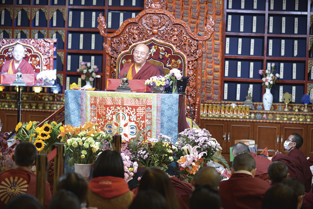
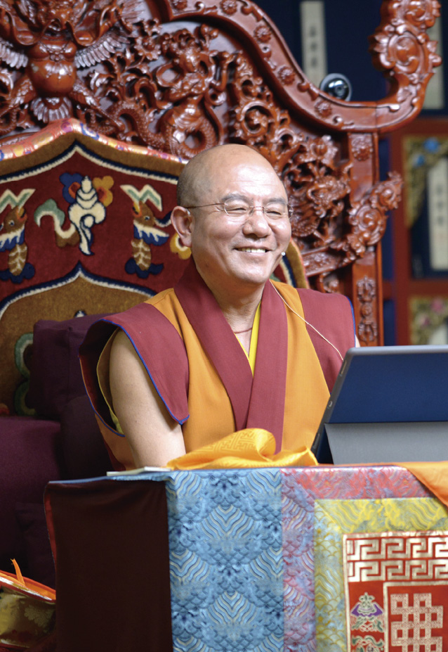

## 跨越障碍 奔赴未来

——2022年新学期开示

2022年4月6日

今天在这里做一个简单的开示，有一些事情要跟大家讲讲，另外还要念一个《胜利道歌》的传承。

我前段时间离开喇荣，到其他地方待了几个月，回来之后，因为最近事务比较多，还没有来得及传法，正好想利用这几天跟大家简单地沟通一下。这个假期大家都外出了很长时间，心可能不容易收回来。不少堪布、堪姆和法师都有这样的感觉，心好像进入不了状态，不像之前讲经说法时那样顺畅。如果讲者都这样，听者估计也基本相同，不如之前闻思时那样专注了，容易出现外散或者昏沉等情况。当然，大家度过了一个假期，心难免不在状态。然而，从现在开始，我们应该尽量调整心态，把时间用在闻思修行和发心上面。

## 理性应对疫情

首先，我要跟大家说明一下：我们今晚的课比较特殊，没让大家到现场来，原因是最近的疫情形势比较严峻。我们每次开学第一堂课来的人总是很多，在这样的情况下，太多人聚集不太合理，所以今天只给大家提供了一个音频。我这边先留一些录音，等过段时间提供给大家。

我们现在的传法方式，相比于以往会有很大变化。现在不管是我也好，堪布、堪姆们也好，大家都不能在网络上讲经说法，这方面刚出台了一些规定。以前我个人经常有一些网络开示和传法，但后来按照一些要求，没有继续下去。现在在网络上传法需要办理一些相关手续，流程比较复杂。所以，我个人今后一段时间的开示和传法，不再进行网络传播。这一点在这里必须说明一下。这里的课，仅限于对我们学院内部的技术、从业、管理、服务人员为主的极少数藏族和汉族佛教徒讲的开示，只有这么一个目的。今后我们讲法，就以这样的方式慢慢传授。不同时代有不同的求法方式，大家应该理解。

最近疫情防控的情况，大家应该都很清楚。我们本地也好，周围的州、县也好，包括省级的很多地方，管控都比较严。返回学院的道友，包括技术人员和工作人员，已经回来了的话就回来了；还没有回来的，最好暂时在外面隔离一段时间。虽然这样大家会遇到一些困难，但目前也没有其他办法。我们这次给大家留了很长的返校时间，从上月二十几号到现在，如果在这段时间内没有回来，可能再想回来的话暂时会有一定困难。路上有重重的核酸检测和健康码、行程码的检查，回程确实不太容易。有些道友如果因此耽误了一些课程，希望各位法师给他们提供一些方便。等疫情好转的时候，我们再把闻思修行的一些规则恢复原状。

这就是我们这里最近的情况。大家都知道，现在好像上上下下的精力都投入到了疫情防控方面，但效果怎么样也不是很清楚。这两天我一直在跟相关的领导、管理人员和道友进行沟通。我认为不论做任何事情都应该有一个分寸，把握一个度是很重要的。要是什么都不管的话，万一有病毒携带者进来，会给我们整个喇荣五明佛学院带来致命的危害，这种风险是众所周知的，但要是管得太严，这边的公安和管委会都没有那么严格的要求，我们自己却过度紧张地去管控，那也没有必要。

我今天想跟大家讲的是，一方面我们的防疫工作确实很重要，大家对学院、对个人、对道场，都应该负起责任，认真对待。但是如果在这个过程中缺乏智慧，操作过激的话，也可能会出现一些问题。我们的道友在这里求学都很不容易，大家本来都是合理合规地在这里闻思修行，但如果因为个别人过于胆小、管理不当，导致有人不得已离开的话，那可以说是一个很大的错误。我希望大家不必特别害怕，否则，可能因为紧张过度而导致很多事情做得不合适。

现在大家都很担心疫情扩散，因为吉林、上海，还有前段时间的陕西，以及最近的成都，都出现了一些疫情传播的迹象。一方面，这确实值得关注，但另一方面，不要自己吓自己。前阵子多地疫情比较严重的时候我就住在成都，其间，来自各地的旅客基本上都可以正常地出入酒店、参观景点，这些都没有限制。有时候越是我们这样的小地方管控得越严，而大城市里的管理方式反而不会这样。

我这次回学院，感觉越往山上走管理就越严。回到这里以后，一方面我特别感谢管理的道友们日日夜夜非常负责地辛勤工作，但另一方面，我们也应该了解现在全球的状况、全国的状况到底是怎么样的，毕竟我们也是其中的一员。我前段时间跟管委会沟通过，学院周边整个甘孜州的乡也好、村也好、道场也好，他们怎么做，我们就怎么做，没有必要把我们这个山沟搞得特别紧张。新冠疫情到现在已经持续两年多了，我们喇荣寺和五明佛学院好像一直被当作中高风险区来对待，不管门口也好、周边也好，都被严防死守。这样的话，以后如果病毒要跟人类共存下去，那我们岂不是永远都要处于高风险管控中？这不是很合理。

高风险区被怎样对待，大家都清楚。所以我认为，不管是相关领导还是学院僧众，大家都应该以一种更加平和的心态来对待防疫工作，不能在管理中出现一些过激的行为。关于疫情防控，我希望这里的饭店、餐厅和商店对每一个佛教徒都一视同仁。只要好好防护，其实病毒也没有那么可怕。这一点大家一定要认真对待。

我前段时间回学院之前主动做了一个核酸检测，虽然那时候还没有这个要求，一路上也没有核酸检测，但我想这也是一种负责的态度。我一回来就对大家说：“你们不用怕，我已经做了核酸检测了。”当然，做过核酸也不代表绝对保险，有人做了九次都是阴性，最后还是阳了。但不管怎样，这也是一种必要的形式，我当时就是这样做的。我不论去其他什么地方，参加什么活动，也都是这种态度。但在我们这个喇荣山沟里，有一部分是外在施加的形式，以疫情的名义来对这里严加管理，还有以防火、防疾病等名义的，各种情况都有，这个我暂且不说。

总之对于疫情，一方面确实要意识到严重性，大家一定要注意防护，戴好口罩，遵守日常的防疫要求，比如扫健康码，这些都应该做到。另一方面，大家也应该冷静地对待。如果疫情一直持续下去，我们该怎么办呢？从这方面考虑，所有的管理人员和堪布、堪姆，包括学院的每个人，都应该以平常心来对待当下的疫情。当然，管理上还是要认真负责。

现在很多人无法正常进入学院。我前阵子也向一些相关领导反映过，如果一直严格禁止佛学院山门的通行，可能每个想进来的人都会各显神通，用其他方式进到山沟里来。这样的话，可能会带来更大的危险、更多的麻烦和隐患。

现在疫情越来越严重，这里的状况也比较特殊，不管怎样，我希望各位道友向大家传达一下：如果有人还在路上，或是还在家里没有动身，在疫情缓解之前，最好还是在周围或者在家里暂时不动。否则，行程中会遇到很多困难，因为一路上管得都很严，可能来也来不了。万一把病毒带到这里，也非常不好。所以这方面我今天必须提一下。

## 求法无惧障碍

还有一个方面，大家知道，去年我们这里发生了一些事情，有些堪布、堪姆和法师也遇到了一些状况。事实是这样的，当时管理部门以为菩提学会在山下又复苏了，而且学院这边有一些人在网上对外传法，因为这个原因，当时上面对我们比较关注。后来他们通过各种调查了解，证实了菩提学会确实早已解散。我本人的确对这个团体做了彻底的解散处理，也从未以任何名义来重新组织。这样一来，整件事情就搞明白了。

因为这件事，我们这边有些人的闻思修行，包括我自己在学院外的翻译，各方面都受到了一定的影响。在那段时间，学院里流传着各种各样的说法，有些是恐惧担忧，有些是胡言乱语，有些可能欣喜若狂。不管怎样，在这么多人的一个群体当中，有各种事情发生也是理所当然的。但我在这里想提醒大家，我们遇到这类事情的时候要冷静地应对。不要责怪某位法师、某位发心人员，或是编造一些根本不存在的事到处宣扬，这些都是不合理的。

我们现在各方面还算比较顺利，当然，所谓的顺利，也是暂时性的——这并不是说我们喇荣会不顺利，而是从整个世界、整个人类的角度来讲，这几年注定是个非常不安定的时期。瘟疫、战争、地水火风的自然灾害，各种各样人为、非人为的灾难频频发生。这种情况下，也许我们还能活着就算是很幸运了，不用谈什么发展、解脱、证悟，这些方面确实更为不易。大家都觉得这几年做事情很难，可能因为众生的福报正在慢慢消减，而种种歪理邪说、非法势力正在日益增强。这样一来，众生的快乐就会随之逐渐消失。

在这种形势之下，我们这里还有相当一部分人在不断地求学、读书、闻思，这确实很不容易。就这一点，从我个人而言，也觉得十分难能可贵。我不是容易感动的人，但那天我回到学院以后，看到很多道友整个冬天一直在认真闻思修行，近期回来的道友也在通过各种方式准备开始发心和闻思。这的确很难得，每个人都很不容易，但这些都是非常有意义的。

以前高僧大德们求法时要越过九九八十一难，渡急流、爬雪山，面对毒蛇猛兽、严寒酷暑等种种痛苦。我们当初求学的苦行可能是没吃没穿，而现在大家求学时面临的困难与过去大有不同。尤其在这个大数据的时代，每个人都要面临另一种形式的违缘和障碍。当初玄奘面临的困难和挑战，如今换了一种方式呈现在我们面前。现在我们求学虽然未必会缺衣少食，但却总要面对各种各样的恐惧和灾难，以及种种现象上的障碍。

在这种情况下，我们哪怕能求到一句法、一个传承，确确实实也相当不易。我今天也跟堪布堪姆们嘱咐过，希望这里每一个人都要互相帮助——是发自内心地、真诚地去互相帮助。来到这里的求学者，不论生活上、精神上、身体上，各个方面如果遇到了一些困难，大家都要给予帮助，这是很重要的。我们每个人在人生中都会遇到特别困难、处于低谷的时期，这时如果有人给我们雪中送炭，那会是非常难忘的记忆。

大家也明白，一个人遇到的困难不可能是永远的。有些人精神上遇到困难，一两年就振作起来了；有些人身体上遇到困难，只要没死，不久就复原了；有些人生活上遇到困难，也许短时间内就渡过了难关。没有谁会永远处在痛苦之中。所以，当有人遇到困难时，大家一定要特别重视。

有些人也许在这里有点地位，比如是管家、负责人或者堪布堪姆，这时候千万不能用自己的权力来为难别人。不管是出于有意还是无意，或者是无知，绝对不能以各种理由设一些套路，给别人制造困难和伤害。当然，这里大多数发过无上菩提心的人不会有这种行为，但也并不是完全没有。有些人世间习气比较重，也许是因为太看重地位，也许是因为无知，稍微有一点权力的时候，就不管自己的行为和决策会给别人带来怎样的艰难、痛苦。这方面一定要注意。

从我自己来讲，不管你们是什么样的人，我不敢说是用自己的鲜血来帮助你们获得幸福，但这些年来，我一直尽心尽力地为大家的生活、修行、求法等各个方面提供一系列的方便。正是因为这样，我这个假期下山以后时常担心这里的情况，回来以后的第一件事就是考虑外部形势怎么应对，内部各方面的困难如何解决，同时想把自己懂得的法义尽心尽力、无有吝啬地提供给大家，这就是我自己的原则。

我希望你们每个人来到这里以后，一定要成为善良的人。如果能真正救度众生自然最好，毕竟这是我们的责任所在；即便不能度众生，也一定要把我们的思想和行为，尽量地调整到对众生有利的方向，这是我们的底线、我们的原则，这一点非常重要。

## 调整闻思状态

我今年基本上把《如意宝藏论大疏·白莲花论》的翻译完成了。《如意宝藏论》是无垢光尊者的《七宝藏》之一，这部论在很多著作中经常被引用。我经过多年翻译，把它全部译成了汉文。以后各方面如果方便的话，会提供给大家，算是给大家的一个礼物。至于外面的道友，请他们先不要着急，我们今年能不能传讲这部论现在还不确定，但我想应该是可以的。

这几天我的课程安排是：明天晚上会给大家念《随念三宝经》的传承，然后大家共同念诵《普贤行愿品》发愿。再过几天，可能大家会一起念修《长寿经》。原本我们有个长寿法会，但后来政府要求法会不能太多，所以除了四大法会以外都不再公开举办，大家只是内部念念经。这期间不上课，明天晚上给大家传《随念三宝经》，也跟今晚的方式一样，通过音频给大家做一个简单的开示。

今年我们的上课方式可能会跟以往有些不同。按照公历的算法，我今年已经60岁了，不知道今后还有多长时间住留在这个世间。所以，我想从今年开始，那些60岁以上的老菩萨们，有些是净修班的，有些是当初学院整顿时留下来的，这些老年的男女众修行人们，今后上课就坐到我的周围来，因为我们都是一起的。要离开人间的话，我们会先一步走，而年轻人排在后面，就像排队一样。这也是死亡无常的一种表现吧！

三十多年来，我们上课一直是随意坐，现在可以用这种排序的方式来表现死亡无常。另一方面，我们对一些年纪稍大的人，很容易把他们边缘化：“你们老年人坐到那个角落去，我们年轻人要坐在上师身边。”所以现在让他们坐到前面，年轻人以后有机会再慢慢向前。这是我的一种想法，现在还没有完全确定。

我们今年的课程目前还没有安排，因为我的身体时好时坏，如果不好的话，可能会出去看看病或者闭闭关。我想年初的时候尽量跟大家多讲讲课。一般来讲，人到了60岁以后，应该自己专注念诵和修行，而这方面我已经搁置很多年了，所以现在不得不思考，趁此机会就跟大家简单讲一下。

我希望每一位道友，从今天开始一定要把心收回来。这段时间我们的心可能因为种种原因一直在外散。没有闻思修行，好像人都变笨了，对吧？就像我今晚讲课，好像心里一直有种恍恍惚惚的感觉，前言后语都不是很顺畅，大家应该也能听出来。我想，不仅是我自己，你们很多人经过了一个假期的散乱，可能都不太适应原来闻思的那种状态。所以从现在开始，我们应该把心转到正道上来，一定要好好地闻思。该发心的道友们也要尽量认真地发心，维护好我们这里所有修行人的生活需求。尤其是对那些有困难的出家人和居士，还有病人，以及刚回来的人，大家应该尽心尽力地为他们提供帮助。

今天下午我跟几个部门的负责人也说过，我这次回来时发现，我们这里技术人员、从业人员的证很难重新办理，原来的证要继续沿用也有一些困难。我跟相关的领导反映了这个情况，所以今年我们就跟去年一样，原有的这些证还可以继续使用，这些人员还可以继续待在这里。其他没有证和暂时来的人，我们也通过各种方式对接，让他们暂时留下，因为夏天的时候我们这里有些法要传，他们接完了法以后就可以马上回去。

现在我们这里喇嘛有1500人，觉姆有3500人，还有一些包括我刚才提到的技术、从业人员以及在喇荣打工的人，比如木匠、泥匠，另外还有经营饭店、餐厅、旅馆的各类人员，整体上人数是比较多的。要让这么多人合理地留居在这里，确实有一定的压力，所以我们的发心人员和工作人员一定要搞好人际关系，这是很重要的。

我越来越觉得，我们发菩提心，归根结底就如《二规教言论》所讲的一样，还是得注重人品。要有好的人品，就必须妥善处理人与人之间的关系。这方面如果没有处理好，可能连发心、修行、闻思的机会都会失去，更不用说利益众生了。处理人际关系其实是一件很难的事。有些人可能心很好，但人际关系不好；有些人身体很健康，但人际关系不健康；有些人发了无上菩提心，很想利益众生，但不会处理人际关系。

不管在出家、在家的群体中，要处理好人际关系，确实需要一种特殊的力量或者窍诀。不论对上、对中、对下，不可能所有人百分之百都认可你，但你至少要做到问心无愧。同时，做事时要有善巧方便，要注重方式方法，这也很重要。

另外，我们作为修行人，心要清净、平静。如果每天心里的烦恼、痛苦、嫉妒、傲慢、邪知邪念多之又多，而善良心、慈悲心、菩提心日益减少，那是很可怜的。一个好的修行人会非常豁达、非常宽容，有非常好的清净心，就连话语，也不会说别人的过失。从一个人的语言、眼神和行为，就可以看出来他内在的修行如何。如果内在全是垃圾，那他说出的语言、做出的行为，也会给别人带来染污。

为什么我直到现在还在依靠这样的身体坚持着发心？因为我觉得很多道友来到这里求学确实非常不容易。你们来到这里以后该做什么呢？一定要闻思修行！如果你来到这里只会吃喝玩乐，那没有任何意义。你们也知道，这里的生活是比较特殊的，不管吃也好、住也好、水也好、电也好，很多都要消耗僧众的财产。如果自己各方面不精进、不认真的话，即使在这里待一天，可能也会积累很多罪业，那是没有必要的。

我希望那些不好好闻思修、整天搞些世间八法的人，最好一天也不要待在这里。包括我自己，如果我的邪分别念很重，我的烦恼痛苦很重的话，我也会自行离开的。如果待在这里只会造业，那没有什么意义。在这个喇荣圣地有这么多的善知识，这么多的殊胜对境，这么多的金刚道友，在这些对境面前，如果我们想认认真真地求学，哪怕只学一个月，也有机会真正转变自己和他人。

我经常提到，法王如意宝在石渠求了六年的法，回来的时候可以说是满载而归。虽然我们不可能与法王相提并论，但我们毕竟是他的传承弟子，如果在这里待六年、十年或者六个月，我们能得到什么呢？每个人都应该有一种求法的心和责任感。如果你没有这种心，待在这里一直吃喝玩乐、得过且过，那恐怕你的所作所为离造罪不远了。好不容易来到圣地，自己却不知不觉积累了很多罪业，那没有必要！

我们以后如果要传一些法，可以慢慢地给大家讲。很多道友今天听到这堂课，可以说是一种特殊的因缘。虽然我是个非常普通的人，但我一会儿要念的法王的《胜利道歌》，是一部具有特殊缘起的论典。

很多人都在努力争取听法，可是因为种种因缘，有些人困在家里出不来，有些人因为身份等原因无法继续闻思。我认识的很多道友，包括我们的一些技术人员和从业人员，都很想回到学院来一如既往地闻思修行，但目前种种因缘还不具足。不过这也不要紧，我们每个人都感受一些无常，以后求法的心也许会越来越切。无常对自己的修行有一种鞭策力，意义很大。我们无论遇到什么情况，都应该顺势而为。有因缘的话，就争取去做；如果遇到一些障碍，就按照违缘转为道用的方式来接受，这也是很好的。

我把秋札仁波切所造的《佛子行释》重新校对了。今年我想要求各位堪布堪姆给大家做一下辅导，我自己如果方便的话也想讲一遍。现在我们想讲的、想学的法有很多，但外在各方面的因缘具足也确实不那么简单。

你们也不要因为我回来了，就以为没什么事了，完全放松下来到处游荡，这样也不对。今年我们可能还有一些违缘要面对，我这边也听到了一些消息。我们降魔胜利洲在降魔的过程当中，有时候自己也会遇到魔障，就像唐僧一路上也要遇到各种妖魔一样。到时候我们看具体情况，大家用智慧来对待。毕竟这么些年来，道友们都很明白该怎样修行、怎样将违缘转为道用。

总的来讲，现在我个人还算比较开心。在城市里面总觉得心不在真正的修行状态上，回到喇荣以后，很多方面感觉是不同的。我也希望各位道友们一定要有一种善巧方便的智慧，包括我们今年负责的堪布堪姆，他们的责任很重，也非常辛苦。去年、前年负责的堪布堪姆们也很辛苦，但最后也将工作善始善终地交接了，特别感谢他们。今年和明年的负责人们，压力应该都比较大。为僧众做事很不容易，不做不行；如果做的话，方式方法要掌握分寸。这一点，不仅对于他们来说不容易，对我来说也同样。有时候只能依靠自己的分别念来抉择，这也是没办法中的一种办法吧。在这里我就不多说了，以后我会慢慢讲。

我们今年的很多模式跟以往都会有所不同。比如，在疫情期间，我的一切接待暂时都不会有。另外，这半年来，我的电话基本上都是关机状态，这样好一点，不然找我的人特别多。这方面新道友也许还比较容易理解，但有些老道友会有一些埋怨，包括我的亲戚朋友们都在说：“哎呀，为什么现在打不通你的电话？”我想这方面你们慢慢会习惯的。我今年可能做翻译也好、做一些对大家稍有利益的事情也好，一直会保持这种方式。我也在努力当中，希望大家理解。

## 以《胜利道歌》战胜违缘

其他的我就不多说了，接下来念《胜利道歌》的传承。法王从1996年以来，每年开始传法时都要先讲一遍《胜利道歌》，或者给大家念一个传承，以此战胜一切外、内、密的违缘，这是一个非常殊胜的缘起。我们每位法师也都是这样。因为这样的缘起，这么多年来我们才能顺利地走到今天，这是非常不易的。

说实在的，在这样一个外部情况复杂、邪魔外道猖狂，五浊恶世重重违缘此起彼伏的时候，大家还是学到了五部大论，得到了很多显密佛法，我们应该心满意足。今年也希望大家的修行不出任何违缘，即便出现一些违缘，也能变成善缘、转为道用。希望在菩提道中的每个人都能得到真实的利益。

我想再重复一点，我们这里的每一个人的确都特别不容易，包括我自己。你们也许觉得“堪布做事是很容易的”，但我这边其实并不是没有外内密的各种违缘，而且在某种意义上超过了你们。无论如何，我也在一直努力着，没有放弃。我们今天听课的每一个人，在这里哪怕待一天、待一个月，确实都很不容易。我们所求的这些法，是真正有意义的。如果是为了世间法，我不会这么努力，也没有什么必要，但正是为了对自他暂时和究竟都有极大利益的甘露妙法，我们大家还是要多一分努力。每一个人都要发愿，希望我们的闻思修行在一生之中能够善始善终，一定要发这样的愿。

今天因为时间关系，我只给大家念一遍传承，因为《胜利道歌》除了极个别的人以外，大家应该都非常精通，所以我就不多作讲解了。

（堪布念传承）

今天我们就讲到这里。因为疫情，大家不方便集中听课。现在整个甘孜州所有的政府会议也都改为了视频会议，所以，我暂时就通过音频的方式来给大家念个传承，做点开示。今年的闻思修行，大家要努力。其他基本上就没有什么要讲的了，现在大家一起回向吧。
