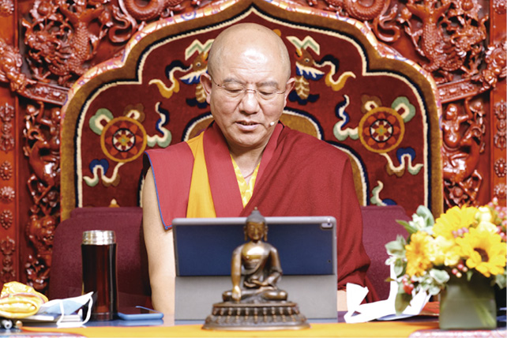
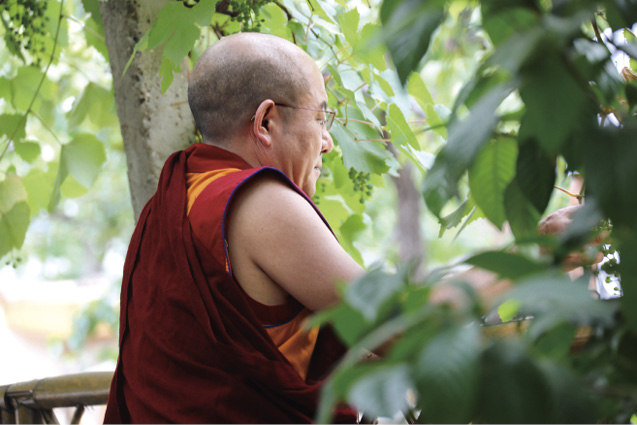
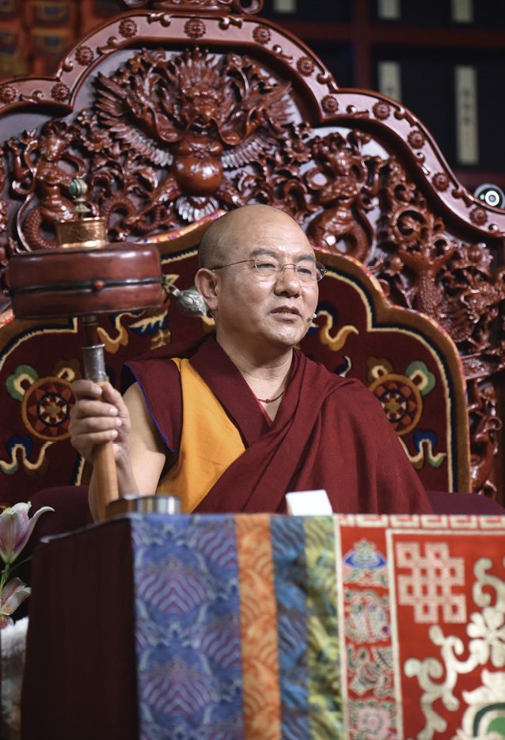

## 这个时代的使命

2019年6月11日

今天给大家讲解“这个时代的使命”，也会传讲宗喀巴大师的《三主要道论》。为什么要讲“这个时代的使命”呢？作为生活在21世纪的佛教徒，大家应该要有目标和使命感，这是第一件事情。第二件事情，为什么要传讲宗喀巴大师的《三主要道论》——藏传佛教格鲁派的一个教法呢？因为各教派互不相违。今天，看看能不能在这堂课完成这两个目标。

## 学佛不简单，不要轻易放弃

关于第一件事情，我们知道这是一个什么样的时代吗？生活在当今时代的我们，具体要做些什么？我们的目标是什么？我们现在面临的一些危机又是什么？……大家要对方方面面有所了解。

首先使命方面，我们有什么使命呢？很多佛教徒都很虔诚，可能不太考虑很多事情，只想自己好好地学佛。一些出家人会想：“我这辈子要好好地当一个清净的出家人。”一些受了三皈五戒的居士会想：“我要好好地修行，临死的时候不要后悔，离开人间后尽量不要堕落，要往生到清净刹土。”

很多佛教徒都不关心这是个什么样的时代，总认为跟自己没有关系，因为有些事情不在自己的控制范围之内。就像我们前两天讲环保的时候，一些人会想：“这个时代我们不得不用塑料袋，虽然道理上我明白它对环境的害处，但我又有什么办法呢？”可能有些人真的会这样想，但实际上这并不合理。

当今时代的佛教徒任重道远，你们每一位都要有使命感。怎样的使命感呢？一方面，作为在人道中的修行人，毕竟你已经选择了佛教，就该尽量根据自己的能力和境界来不断地修行，要尽心尽力地修一些法，修行上至少让自己不会后悔。

当然，修行也不是简单的事情。现在有些人觉得修行很简单，以为只是用两三年修一修便有效果，最后修不成功就觉得很失望。不管是学显宗还是学密法，如果他们修了几年没有感应，就觉得要么法不对，要么上师不对，要么自己根基比一般人差，最后就完全放弃。其实这样没有必要，可能一些人把修行看得太简单了。

即便是一门世间知识，你要花多少年才能把它从头到尾全部学习完毕？所以，大家不要把学佛看得过于简单。为什么现在很多人在学佛的过程中感到失望或者失去信心呢？因为一开始就对学佛有错误的定位，觉得佛教的修行很简单，然后浅尝辄止，修不成功就认为自己特别失败，其实修行并不是这样的。

## 佛教徒要有危机感

今天我想表达什么呢？作为佛教徒，大家不能仅仅在“我”的范围内简单思维，尤其我们是学习大乘佛教的，应该有远见、有责任感。从某种意义上，我们首先要有危机感。

为什么这样说呢？最近皮尤研究中心做了些研究，关于什么呢？从2010年开始，伊斯兰教徒的数量增长得特别快，近年来伊斯兰教仍在蓬勃地发展，基于这个趋势，研究中心做了以下预测：到2050年，全球1/3的人口都是伊斯兰教的信徒；到2075年，它的信徒数量将超越基督教，成为全世界信徒数量最多的宗教。

以往不管在人数上还是势力上，基督教都是全球最强盛的。这些年来，基督教的退教人数比较多，另外西方很多国家都有老龄化趋势，新一代的信徒生育率不高。因种种原因，基督教现在没有很大的发展。

至于佛教，按照研究中心的预测，在未来的10到20年，佛教徒的数量可能没有特别的变化，不增多也不减少，人数维持在5亿左右。

如果我们按此推算，很有可能四五十年后佛教徒的人数会越来越少。因为生育率方面，一部分佛教徒是出家人，自然而然节制生育，不会在这方面有所发展；一部分佛教徒保持单身；还有一部分佛教徒就算生了孩子，也可能不像基督教和伊斯兰教那样，培养孩子成为自宗的教徒，因此佛教徒所生的孩子不一定是佛教徒。

一些宗教像伊斯兰教，如果父母是伊斯兰教徒，孩子也必须是伊斯兰教徒，这方面佛教或许可以参考参考（众笑）。佛教徒的父母也应该从小就对孩子定位：“你应该是佛教徒，因为父母都是佛教徒。哪有因果不匹配的亲子关系，对吧？”事实上，近年伊斯兰教的势力越来越大，尤其在欧美国家，会有非常明显的体会。可能以后全世界的一些政策会跟他们有关，这些现象值得我们佛教徒反思。

此外，一直以来，犹太教徒善于利用高科技来传播他们的教义。现在是全球科技化的时代，谁掌握了科技，就掌握了文化和宗教。大家都知道，犹太人是从全局看事情，并发明了许多科技产品，以此研究推广他们宗教的方法。

所以我今天要说什么呢？就是佛教徒不能光念金刚萨埵心咒[^1]、拿个转经轮，然后一直待着，什么也不管。如果我们离开了这个世间，我们的下一代也只是光念金刚萨埵心咒，每天忏悔：“嗡班匝儿萨埵吽、嗡班匝儿萨埵吽……”（众笑）有时候佛教徒真的很可爱，看到整个世界都在变化，却不去关心，只想着：“我业力很深重，今生一定要清净！”当然作为佛教徒，这种信心确实很好、很珍贵。

但是同时，当今时代瞬息万变，二三十年前的一些设备，现在基本都用不上了。尤其现在到了5G时代，很多问题也会出现，有些甚至影响到全世界的安全，这让人们非常恐慌，很多媒体也常常报道这些。在5G时代，一些人通过电脑、高科技来做各种各样的违法行为，他们只要拥有了某些技术，比如人脸识别中的一种特殊技术，就可以在网络上盗用一个人的面孔，以此来做各种事情。总之，原先人们难以想象的很多事情，现在也可以出现在这个世界上。

在此特别、特殊的时代中，有些佛教徒还是特别安心地做自己的事情——打坐的打坐、念经的念经、忏悔的忏悔、闭关的闭关，还有一部分整天在讲是非：那个人的上师不对，那个人的弟子不对，如何如何……除此之外，对全世界的未来没有远见，几乎漠不关心——平时生活中不谈论、不关注，只关心自己的修行。如果这样，当我们这代人离开人世间的时候，不知道培养出新一代的佛教徒没有？

## 佛教徒要培养两方面的人才

现在世间上，对一家企业来说最重要的是什么呢？就是有一位灵魂人物，而且他还可以不断地培养下一代的人才，让企业持续地发展。否则，毕竟人是无常的，一旦灵魂人物过世，这家企业的传承就断了。

所以，我们佛教徒现在也要培养人才。其一是培养掌握佛教知识的人才，因为佛教徒必须掌握佛教的甚深法义。如果没有这方面的人才，佛教哪怕在形象上一直存在，但实际也会出现断层。

现在很多宗教已经变得低俗化，大家知道什么是低俗化吗？因为现在科学技术变化得特别快，很多人根本不知道宗教的甚深意义。比如说文殊菩萨，很多人都不知道其甚深意义，只理解为：“这个标志是智慧的意思，这种智慧相当于我们的……”现在，人们为了方便吸取大量信息，便把宗教的甚深意义简化为自己理解的认知，这让宗教变得越来越低俗。最后，人们除了非常简单的分别念外，根本不明白甚深的教法，更不会对此有希求——“即使你开悟，也没有什么意义”，已经变得如此肤浅了。所以，如果真正的佛法不能传承下去，很可能佛教会变得低俗化。

另外，我们佛教徒要培养高科技的人才。现在是日新月异的时代，每天都有翻天覆地的变化，如果佛教徒没有掌握一些高科技设备的使用方法，可能全世界都在应用最高端科技的时候，我们佛教徒仍旧活在2G时代——用的全部是诺基亚手机，除了黑色的念珠外什么设备都不会用，那的确跟不上这个时代。

我经常跟喇荣这边的道友强调，现在也跟大家强调，以前学习不同专业的佛教徒，能不能在佛教领域发挥一些特长，包括开发或者使用一些良好的硬件软件、程序设备等等。佛教徒也要学习这些技术，否则到了一定的时候，佛教徒就像某些牧民、农民一样——很虔诚、有信心，但在这个时代中连生存都有困难。

在此日新月异的特殊时代中，首先我们佛教在培养人才方面必不可少。各地的法师也好，辅导员也好，应该尽快把你的佛法智慧传授给下一代。如此佛教就后继有人，仍有传承下去的希望。这是第一个方面。

## 佛教团体要有组织架构

第二个方面，佛教团体应该有组织架构，没有组织、互相分散的话，会很容易消失。犹如一滴水汇入一条河流，它会源源不断地流入大海；若是单独的水滴，很快就会干涸。所以，如果佛教要在当今时代生存下去，一定要有组织架构。什么样的组织呢？内部有良好、严密的管理，同时也有一套非常人性化、相应于时代和社会的管理模式，跟现在一些非常成功的全球企业一样。

其实从历史来看，佛教的一些团体像寺院，它确实是一个文化和智慧的中心。很多关于甚深智慧的研究，都是寺院和一些佛教中心发起的。另外，佛教也有内部管理方面的智慧，像《毗奈耶经》中提到的僧团管理，它是这个世界上最古老、最好的管理方式，非常值得现代人借鉴。

佛教团体的内部组织要严密，团体成员应该有共同的理念。在此变化多端的时代中，佛教团体可能会面对很多意想不到的冲击、外来的各种挑战。为了应对各种危机，佛教团体需要有非常坚定的信念，世间上很多宗教和组织也是如此，这样团体的内部才会有凝聚力。

当我们的思想受到一些冲击、挑战时，大家会用什么方法来应对？现在，佛教的组织架构不算特别强，长此以往，学佛只会是一种个人行为，而每个人在这样的时代中都很容易迷失，最终可能会与真正的佛教脱离。所以，现在的学佛团体应该有凝聚力，这是非常重要的！

## 佛教徒要有远见

第三个方面，大家应该有关于未来发展的远见，不能过一天算一天、浑浑噩噩地过日子。作为大乘佛教徒，大家如何让佛教的智慧，让佛法在未来十年二十年，或者百年千年中传承下去？你们每一位都应该对此思考。哪怕你只有一个小小的道场，也要思考在你离开人间之后，怎样把它传承下去？——即使你写一些遗嘱也会有帮助。

用现在的话来说，佛教徒要有可持续发展的理念，而不能想：“反正我今年学完就可以了，圆满了。”这样的目光比较短浅。每一位佛教徒都应该好好思考佛教的未来，如何让它长期发展、生存，而不应该想：“学佛只是我的个人行为。”世间人也说，雪崩的时候，每一片雪花都不是无辜的。同样，佛教的未来，也与每一位佛教徒息息相关，大家应该有利他心和长远的眼光。

你们可以看看其他宗教徒：他们有些已经掌握了高科技；有些有人数优势，如伊斯兰教很快就有27亿信徒，未来会成为全球信众最多的宗教；有些宗教徒喜欢做慈善，像基督教徒，他们的做法特别接地气和吸引人心，通过建医院、建学校等，来满足社会和人们的需要。

事实上，现在一部分佛教徒也在做慈善和很多有意义的事情，这特别重要。但更重要的是什么呢？要有长期的规划和机制，佛教徒不能短暂地做一两天善事，然后想“我自己修行就可以了”，那不行的。

关于在这个时代的使命，以上是我提出的几点建议，这是第一件事情。

## 学会的唯一宗旨就是闻思修行

由2017年开始，喇荣这边的人数和房屋数量基本上已经固定下来，不会有更多改变。但我希望各地的佛教徒人数可以有所增长——不管是各地的寺院还是道场、中心，希望都有新的学员加入。近年全世界人口的增长速度非常快，其他宗教的信徒人数也多有增长，其实佛教也应该有同样的趋势。那现在的佛教徒需要做什么呢？有以下几点：

第一，新来的佛教徒需要系统地闻思、系统地学习，也需要尊重我们的管理。我们建议今年加入的新生、新学员，或者刚加入我们群体的人，要弄清楚自己的目标，明白自己来到这里是为了什么。我以前也说过，我们的学习平台不是用来接待其他上师、销售网络产品的，平台存在的唯一目的只有几个字——闻思修行。如果你真的愿意闻思修行，想学习佛教殊胜的教义，那我们欢迎你加入我们管理下的群体；如果你没有这样的意乐，而是有其他目的，我们建议你最好不要浪费时间。

最近，我看到有各种目的的人加入了我们的学佛团体，他们有什么目的呢？有些人是为了敛财，因为我们这里的人脉较广，他们接触一些人后开始建群，以为上师、为学院、为法会做事为招牌，经常募款，这非常不如法！我们从来没有指派任何人建立这些群，也不建议大家加入这些平台。做这些事情的人，没有好好行持佛法，不是很好的佛教徒。

也有些人的目的是宣传，宣传他的老师、上师或者各种商品。还有一些人带有政治、经济的目的，从事一些违法活动。对于以上这些人，统统都不建议加入我们的学佛群体。

有些人说：“怎么这样？没有言论自由啊？我要宣传我的……”你可以用你自己的平台宣传，但不要借用我们的平台，它并不是为了你的宣传而搭建的。我们很不容易才把它建立起来，世界上任何一个成功的组织也好，架构也好，都有自己的维护规则，这是全世界公认的。

所以，真正的资源共享是从某些方面而言。该共享的，我们可以共享，像闻思修行的智慧，我们免费提供，不收任何人一分钱。至于任何宣传，包括上师的宣传、我个人的宣传，都是不允许的。

另外，用建寺院等名义来募款也是不允许的。尤其现在这个时代，任何人都不允许在我们的平台做这些事情。前两天法会的时候，我们的管家已经抓了几个学院的喇嘛，把他们开除了，因为他们利用我的名义，还有学院和学会的名义来做一些非法之事。说得严重一点，这已经属于非法诈骗，以佛教的名义来诈骗是非常危险的！

因此我今天特别强调，希望你们很好地闻思。不管是新的还是老的佛教徒，如果你真的想闻思修行，可以在学会的平台上好好地学习。如果你没有这样的意乐，只想利用我们的平台，达成自己的各种目的，那是不允许的。学会每年都会用半年时间观察新来的“佛教徒”，其间我们会发现一些不是真正来学佛的人，他们加入学会是为了种种目的，这样很不好！

虽然有些话可能不是很好听，但是我必须说。因为现在网络时代，很多人自己没有人脉，就想利用佛教群体或者佛教徒之间的关系，然后吸引一些人来达到自己的目的。一些佛教徒可能受到他们影响而没有很好地学习，最后甚至失去真正的学佛机会——毕竟有些人头脑比较简单，容易被别人利用，但有些因果还是不得不承担，因为自己也有一定的责任。

一些新学员还不太明确自己参加学会的目的。就像我刚才再三所说，希望你们加入学会的唯一目的，就是好好地闻思修行，应该学个八年、十年、二十年，不管是学习预科还是正科像密法、五论等等。

事实上，虽然我们在很多方面都有很大压力，但我们仍然会为大家努力。今天上午，我跟很多道友一直在商量事情，商量什么呢？对于一些确确实实提前修完加行的道友，我们以后要不要多给他们一些学习机会，但同时又不能因此而使管理混乱。

其实，学会的每一条规定都要我们花很长时间讨论，有时候一些需要调整的事情遇上内部意见不一致，我们还要做很多后续工作。但是为了大家的利益，我们还是愿意辛辛苦苦地付出，此时若有一些别有用心的人来践踏，我们确实要认真处理，这方面大家应该明白。

“如人饮水，冷暖自知”，你自己的目的，自己最明白。尤其现在是开学的时候，我要特别提醒一下新学员。

每一个道场的整体维护都不容易，就像喇荣这里，无论人们赞叹与否，实际上都是法王如意宝的发愿力，以及很多大德精勤努力的成果。每一个道场也是同样，不管是现代风格的道场，还是古典风格的道场，背后都有一定的付出和奉献，这一点大家要清楚。

## 资深的佛教徒要弘法利生

第二个方面，我希望学佛时间较长的道友，不要因为学了一段日子，没有感受到佛法的甚深美味就半途而废，这不太好。

总体来说，在学会年资较长的道友非常不错，你们住在大城市，以前基本上没有接触过系统的闻思修、佛教团体的管理，现在至少能够长期正规地学习。其实，以我个人的原则，你们应该已经毕业了，而你们一直在学会待着，留级又留级，给我们管理带来一定的困难。就像你从小学、中学、大学毕业后，还待在学校不愿意离开，这样不一定很合适，各位应该出去好好地弘法利生。

如果在学会待的时间太长，不知道对你的学习会有什么影响。当然，我们对一些老学员也有很好的印象，他们现在整个学习情况都特别不错。比如，我们最近留意到很多道友对课前课后的念诵都非常熟悉，这让我很欢喜。以前很多道友不熟悉喇荣的课诵和念诵方式，现在大家都熟悉了。喇荣课前课后的念诵，包括音调这些都很好，是法王如意宝传承下来的，大家要继续认真地念。

另外是转经轮方面，我看好多道友也在用，希望不管是在哪里，大家以后应该尽量使用。当然你在一些公共场合不太方便的话，也不必特意使用。坐飞机也好，乘火车也好，方便的话大家都可以用转经轮；若你看到别人的表情，认为不太方便，就不要勉强。总的来说，现在大家都很认真地念诵，包括平时共修的时候，边念诵边用转经轮，这是很重要的。

我以前讲解过转经轮的功德，最近也找到很多关于这方面的资料，之后可能会把更多转经轮的功德文翻译出来。对一些人来说，可能这是一种新的文化，不过佛教徒还是很有必要了解转经轮的意义。

最近，喇荣的道友们正在共修，这是很重要的。但是上午和下午上座的时候，大家最好不要散乱。每座之间有一个小时的空闲，你们可以趁此去外面散散心。而在该念诵的时候，即上、下午各两座的时间中，如果没有特殊情况，大家应该认真地念诵。这方面管家可能要关注一下，对吧？因为大家正在念诵的时候，外面太乱也不是很好。该休息的时候，才能休息。特别是在这段殊胜时间，大家有共修的机会非常难得。

我看了一下，这次共修不管是线上还是线下，里里外外的很多道友都在共同发愿，有很好的信心，忏悔的力量也非常强大。希望大家在这段时间配合我们的管理。这是共修方面的事情，顺便提一下。

话说回来，像我前两天所讲，老修行人不要把管理上的事情全部交给一些新来的道友，然后自己出去旅游。现在，我们佛教团体的一些老修行人，或者不愿意发心的人，经常说一些很漂亮的“口号”：“要培养人才，我要把事情交给新来的道友。”“为了培养新人，我去找几个道友，让他们来发心。”

他们说得很动听，然后从发心岗位上退了下来。但实际上，人才还没有培养出来，新的道友还没有准备好，这样过早、匆忙地交接有一定的危害性。像我们这些发心多年的人，仍在坚持的一个原因就是，某些地方还能用得上我们的一些经验。

学会各个地方的佛教徒，即使你没有正式的发心岗位，也不要有嫉妒心。曾国藩说：“天下古今之才人，皆以一傲字致败。天下古今之庸人，皆以一惰字致败。”有才华的人经常被傲慢的“傲”字毁坏，平庸的人则被懒惰的“惰”字毁坏。所以，学会中有才华的佛教徒不要傲慢，也不要嫉妒，不然我们这个佛教团体没法发展下去。

老实说，现在很不容易哦！学会的一些佛教徒有今天的信仰和见解，真的是百千万劫中来之不易的。你们有现在的正见和正信，是经历了多少世才能获得的。所以，我希望学会的老学员继续参与管理，不要从岗位上退下来，不要认为这样无所谓，应该把它看作是一个非常难得的机会，要抓住机遇。这是第二个方面。

## 佛教徒要发心

第三个方面，我们在各地的发心人员确实很重要。如果佛教徒除了自己行持善法外，都不出来发心，那佛教群体就难以维持下去。所以，各个地方的年轻人真的很需要出来发心。

当然，一些年轻人可能口头上说得特别漂亮，却没有真正去做事，这样没有意义。有些事情并不需要“讲得很好”，大多数情况下应该是要“做得很好”。有些人默默无闻，但实际上把事情做得非常漂亮、非常脚踏实地，每一步都做得非常完美；有些人说得天花乱坠：“我的远见呐、目标啊……”就像我一样，在这里挺会讲的，但实际上如果事情做得特别差劲，那任何理想也没法推进。光在口头上说是没有用的，我们应该身体力行。

一方面我们需要培养人才；另一方面，我希望在管理上有些经验的发心人员不要退下来。你看喇荣的堪布堪姆，除了病得特别严重的以外，一直不开许他们从发心岗位上退下来，我们会给他们安排助理法师、辅导员、管理人员等等。这种做法已经维持多年，一些道友已经发心十年甚至二十多年了。

一些重要的领导班子，有时候可以有些轮换。但是，即使你已经没有岗位，也应该继续留在这个群体里。一些道友的情况是怎样呢？从发心岗位上退下来后，自己有种不好的情绪，然后就离开了我们的团体，永远消失。这很可惜，也没有必要。我在学院担任了二十多年的理事会成员，之后换了下来。我现在没有岗位，但是我不会因此而跑掉，还是尽心尽力地做一些小事情。

希望我们的发心人员能够自觉地、主动地做事，不要被动和不自觉，这样很不好。有时候大乘佛教徒真的要自己主动出来做一点事情，我们很不容易才建立了这样的佛教群体，若要长期发展下去，确实需要大家共同努力。

有些道友根据自己的能力给我们提供一些道场、人力、财力，这是真正的弘扬佛法。尤其对你们在家居士来说，真正的弘扬佛法是什么呢？就是要护持道场，要想办法把我们的精神传递下去。到一定的时候，可能你不用去做什么——因为力量已经够强大，很多人都会参与并做各样的事情。

总之，我今天提出三点：第一，新来的人要系统地闻思；第二，有资历的佛教徒还要继续弘法利生；第三，更重要的就是各地学员要发心。虽然我经常想给所有发心人员发一些奖，但是现在人数有点多，也没办法，我会在心里特别给大家做一些加持。

凡是你们不断发心的人员，我都特别感恩。如果没有大家的发心，很多事情我确实心有余而力不足。如果没有大家的自觉性和主动性，我们很难在城市里推广佛教。尤其是一些没有信仰、没有任何宗教背景的群体，我们若要把佛教的智慧和慈悲给他们宣讲，甚至培养他们把佛法继续弘扬下去，如果没有你们的发心，那会有一定的困难。

如我刚才所说，现在整个人类社会面临着很多危机，包括文明的冲突、科技的冲突——有时候一说到这些，我感觉自己很容易得忧郁症和恐惧症（众笑）。这是老实话，你看东方文化受到西方文明冲击，基本已经被西方文明所吞噬，现在很多文化、宗教也逐渐被人工智能所毁，西方思想正以半殖民的方式来吞没东方文明，在冲突这么多的时代，佛教还能继续生存多少年？

大乘佛教思想的未来有两种可能。第一种可能：佛教徒依靠科技知识、大家的齐心协力，把佛法传播到世界的很多角落。但是这个可能性很低。

另一种可能：我们这一代佛教徒之后，全世界很多人的心里基本上没有大乘佛教的思想了。印度前总理尼赫鲁说：“伟大的佛教利他思想，其价值远远超过对人类有破坏性的很多现代科技力量。”虽然对全人类来说，佛教的思想如利他主义是非常珍贵的，可是有时候我们人类是非不分，加上各种文化和科技的冲突，以致我们身不由己，可能没法把佛教传承下去。

全世界的人都在恐慌中，各种政治、经济问题特别复杂、混乱、严重。但我们许多佛教徒就像《当日教言》中所说，一群猴子在森林中玩耍，却不知道周围燃起了大火[^2]，一直无动于衷，只顾自己的安逸。这样是不行的。我们应该运用佛教最大的优势、最强的力量——利他主义，来帮助所有人类。不过，现在世间如此黑暗，利他主义也不一定能现出它的明亮。不管怎样，每一位佛教徒都要有危机感，看这个世界的时候，要站得高一点、看得远一点。

有些企业家提倡“三观”——未来观、全球观、全局观，这也是佛教徒非常需要的，否则一直鼠目寸光，只盯着眼前看，那不太好。当然，对个别专修的修行人来说，念经、禅修等是很重要的。但如果全部佛教徒都只是自己专修，而整个世界的形势已经转变，到时候还有没有我们佛教徒的生存之地？大家可想而知。

## 传承上师的秘诀

下面讲《三主要道论》。

刚才也提到，这次讲解《三主要道论》是为了表示一个缘起——各教派互不相违。此论由藏传佛教格鲁派的宗喀巴大师所作。明天我们将会讲的《佛子行》由萨迦派的无著菩萨，也即无著贤尊者所作。他出生在萨迦，而他的很多上师都是萨迦派的，《佛子行》可以说是萨迦派的教法。前两天《宝性论》的课程，我们是以觉囊派朵洛瓦尊者的教言来讲解。如果明后两天有时间，我们可以讲解噶当派的一些教言像《修心八颂》。

我们最近也讲解了根登群佩的教言，他没有宗派，是无宗派主义即利美[^3]运动的参与者。根登群佩学习过宁玛派的教法，也曾经在一些格鲁派的寺院学习，之后去了各地云游，在四十多岁时圆寂。他是藏传佛教中一位很神秘和特别有代表性的人物。他还精通英语，有些历史学家说，他和一些俄国学者翻译了《入行论》，但现在已经找不到这个译本。无论如何，他在那个特殊的年代，是一位特别的人物。

最近我们在传讲藏地各个教派大德们的一些教言，我们的学佛群体也一直欢迎各个教派的人，这都跟上师如意宝的发愿一脉相承。佛学院的坛城不仅有藏传佛教各教各派的殿堂，也有南传佛教、北传佛教等各种教派的殿堂，这也是互不相违的表现。

一些藏传佛教的上师只讲自己教派的教法，而不讲其他的，甚至连别派的教证都不用，那不一定很好。其实，从整个地球来看，藏传佛教的各派是很小很小的，我们的宗教也是很小很小的，在宗派方面，我们的思想不应该过于狭隘。

此外，佛教徒对自己的上师有信心是很好的，但是也不能为了维护自己的上师，而排斥、诽谤其他所有上师，这样很不好。你可以跟随你的上师修行，对他供养、承侍、赞叹等等。每个人的缘分都不相同，尤其你能进入佛门，是依靠个别上师的威德力、慈悲力予以摄受，这是很好的。但以此来自赞毁他，这是很不好的。

法王如意宝在晚年时，显现上再三强调不要造舍法罪、不要诽谤其他上师。也许因为上师的这种教导，我自己不敢说经常能观清净心，但至少不会诽谤其他善知识。当然，大家也要有分寸，如果因为不能诽谤，上师叫你做任何事，你都不能拒绝，这也不一定合理。

现在学会有些人认为：“因为他是一位上师啊，他是善知识啊，他是佛学院的人，他吩咐的事，为什么我不能做？这是做善事。”其实这是完全不相同的，我们应该对所有人非常欢喜，但是做事的时候，我们应该有界限。佛教徒为人处世、待人接物方面应该要掌握分寸，不能走极端，不能没有任何管理。人类的最大智慧就是掌握分寸，任何事情都不能走极端、堕两边，否则，最后不可能成功。

所以，佛教徒做任何取舍都不要太过分，不能诽谤其他宗派，也不能走入另一个极端，失去自己宗派的见解。如果你把所有宗派混为一谈，最后只会让自己寸步难行。喇荣为什么有今天的发展，因为我们有传承上师的一些秘诀。实际上，做人、做事方面要有一些秘诀。希望大家不要以一句“善心”，就把所有取舍全部舍弃，这种简单粗暴的方式不是很好。

本来我想详细地解释《三主要道论》，但是可能不够时间。

## 三主要道：出离心、菩提心、无二慧

（堪布念《三主要道论》传承）

> 顶礼诸至尊上师！

> 我随己力而宣说，欲解脱者之津梁，

> 诸佛经典精华义，一切菩萨所赞道。

首先是顶礼上师。然后，宗喀巴大师说，他依靠自己的力量，尽力宣说如来教法的精华，这是前辈大德、诸佛菩萨对有缘者所宣讲的、让我们趣入解脱的妙法。

下面三个主要的道非常重要。第一个是出离心：

> 不贪三有之安乐，为使暇满身具义，

> 勤依佛悦之正道，具缘者当喜谛听！

> 无有清净出离心，求有海乐无寂法，

> 贪执世间束缚众，故当首先寻出离。

首先要有出离心。如果没有出离心，我们永远没有机会从轮回中解脱。所以，真正的修行人，先要生起出离心。这一点大多数人都应该明白，明白了以后，就要想一想：自己到底有没有出离心？

对于没有听过出离心的道友，今天算是学到了新的知识；对于已经听过的道友，你虽然听过很多次出离心的教言，但到底有没有一点点出离心？这方面你们要审视自己。

> 人身难得寿无常，修此可断今生执，

> 无欺业果轮回苦，修此可断后世执。

产生出离心的方法就是修“人身难得”和“寿命无常”，如此可以断除对今生的执著；之后还要修“因果不虚”和“轮回痛苦”，如此可以断除对后世的贪执。这是昨天《开显解脱道》中所讲的四加行，今天我只在字面上做简单的解释。

> 修后于诸轮回福，刹那不生羡慕心，

> 日夜欲求得解脱，尔时已生出离心。

那什么是出离心呢？就是对世间所有荣华富贵连刹那的羡慕心都不生起，日日夜夜只是欲求解脱，这就是真正的出离心。

> 倘若于此出离心，未以菩提心摄持，

> 不成菩提乐因故，智者当发菩提心。

如果出离心没有被菩提心摄持，就没法成为菩提之因。所以，有智慧的人应该发起菩提心。

那发菩提心的对境是什么呢？

> 思为猛烈四瀑冲，难挡业索紧束缚，

> 困于我执铁网内，无明黑暗所笼罩，

> 辗转投生三有中，不断感受三大苦，

> 成此惨状诸慈母，是故当发殊胜心。

发菩提心的对境就是三界轮回的众生。实际上他们是很可怜的，被卷在生老死病的大瀑流里，还一直被业力和我执所束缚、覆盖，三大痛苦[^4]也在不断地折磨他们。我们身边有那么多可怜、需要被救度的众生，所以我们一定要发起菩提心。

现在很多人的菩提心很不错，不敢说那是真实无伪的，但是只要看到自己身边的人因为邪见、无明、业力而有那么多痛苦，他们会很迫切地想：“我一定要度他们！”这是第二个道——菩提心。

> 不具证悟实相慧，纵修出离菩提心，

> 亦不能断三有根，故当勤证缘起法。

如果我们没有无二智慧，虽然有出离心和菩提心，但也不能断除三有的根本。所以，我们应该精勤地修持缘起法，意思就是要去求智慧。

光有出离心是不行的，光有菩提心也是不行的，更重要的是我们要有通达空性的无二智慧。例如，我们要依靠中观的思想去求智慧，这是很重要的。这个颂词说了需要无二智慧的原因，那什么是无二智慧呢？

> 谁见轮涅一切法，永无欺惑之因果，

> 灭除一切所缘境，此人踏上佛喜道。

无二智慧就是对轮回涅槃所摄的一切法，了知在世俗中永远都有无欺的因果。其次，了知在胜义中都是空性，从而灭除了所有一切执著，这就是如来所欢喜的道。如果我们懂得这个道理，就踏上了如来欢喜之道。

因此大家要学中观、学空性，否则光靠人天福报不能解决根本问题，光靠出离心也不够，即使有菩提心也还不足够，最根本的是什么呢？要有无二智慧，就是能够断除相续中我执的缘起空性智慧，那才是真正让如来欢喜之道。

> 何时分别各执著，无欺缘起之显现，

> 远离所许之空性，尔时未证佛密意。

缘起空性是什么样的呢？它有究竟和不究竟两种。不究竟就是我们把显现和空性分开去执著，空的时候不显、显的时候不空，就像把两根黑色和白色的绳子搓在一起一样，这说明我们还没有真正证悟到如来的密意。

“空的时候不显、显的时候不空”——可能现在很多人对显空无别的中观思想就是这样理解的，那说明还没有通达真正的如来密意。

> 一旦无有轮番时，现见无欺之缘起，

> 断除一切执著相，尔时见解即圆满。

宗喀巴大师说怎样才是真正通达空性呢？一旦对轮回涅槃的显现和空性不再有轮番交替的执著，而现见了无欺的缘起法，断除了所有执著的相，那时候你的所有见解就已经圆满了。

谁已经通达、证悟了空性——现即是空、空即是现，他的见解便不再是“空的时候不显、显的时候不空”这样轮番的交替。若你了达显的时候就是空、空的时候就是显，此时你的所有见解都已经圆满。现空能够同时了达，就是最究竟的智慧。

最后，宗喀巴大师在见解上有一个特殊的教言。

> 了知以现除有边，以空遣除无有边，

> 缘起性空显现理，不为边执见所夺。

用显现来断除“有”的边，以空性来断除“无”的边；了达这样的缘起性空，不会被所有的边执见所夺。

这是什么意思呢？一般来说，修行者用空来断除显，以显来断除空，但此处按照格鲁派的一些解释方法，因为显现是缘起，缘起就是“无自性有”，所以断除了实执。按照我们宁玛巴的解释方式，因为显即是空的原因，所以显现断除了“有”的边；因为空即是显的缘故，所以空性断除了“无有”的边。显、空就是缘起性空，两者是无二无别的。一旦我们通达了这种空性，就达到了最高的境界。

今天讲解此论的目的，是让大家得到前辈大德们真正的传承加持，因为我从法王如意宝那里得到了《三主要道论》的近传传承。

> 如是三主要道论，自己如实通达时，

> 当依静处而精进，速修永久之佛果。

我们应该通达以上三主要道的要点，然后到寂静的地方精进地修行，如此能够很快修成佛果。

此乃多闻比丘罗桑札巴（宗喀巴）对侄儿阿旺札巴之教言。

当时有一个叫阿旺札巴的人祈请，所以宗喀巴大师宣说了这个教言。

今天给大家讲解了宗喀巴大师的《三主要道论》，还谈及了“这个时代的使命”，希望每一位佛教徒都要有强大的利他心、强大的责任感和危机感。这就是今天的讲课内容，这也是现在很多人非常关心的话题。

[^1]: 开示的时候喇荣正在举行金刚萨埵法会。
[^2]: 如云：“林中猴群贪快乐，林边火困当日瓦！”
[^3]: 藏文“利美”意为不分派别、不分教派。
[^4]: 即苦苦、变苦、行苦。
