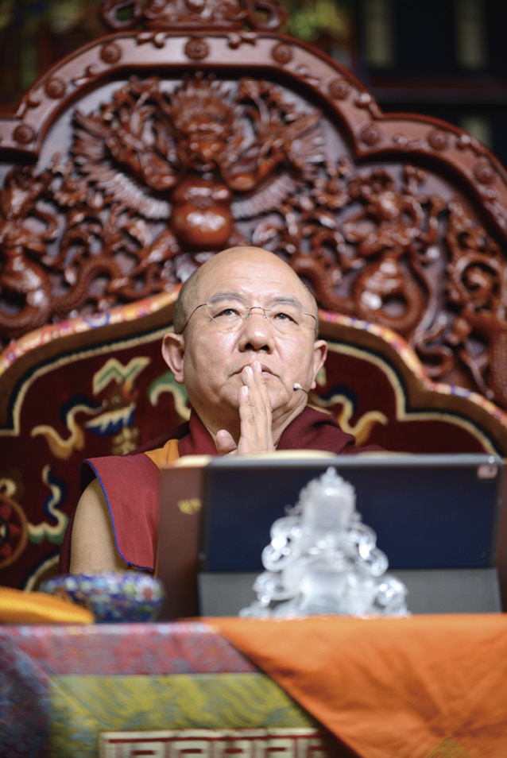
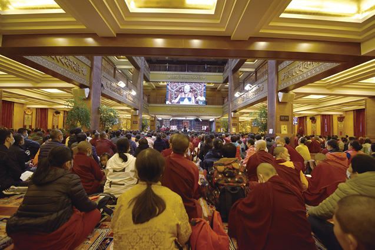

## 金刚萨埵法会开示

2021年5月19日

我们学院在萨嘎月中有金刚萨埵忏悔法会，这是法王在世的时候大家一起商定安排的，至今已经举行二十多年了。今天我在萨嘎月的法会中为大家讲一讲如何忏悔。

## 关于萨嘎月

什么是萨嘎月？二十八宿中有一宿叫氐宿，氐宿月中有一颗萨迦星显现于世，故而此月称为萨嘎月。萨嘎月对佛教来说是非常重要的一个月，因为纪念本师释迦牟尼佛的三大或五大节日都集中在这段时间。其中农历四月初八是浴佛节，也就是纪念佛陀降生的日子。虽然在马来西亚、新加坡、泰国、缅甸等国家中有人对此有不同的说法，但按照《大乘阿毗达摩》《时轮金刚》等经续的观点，公认藏历四月初七、农历四月初八就是佛陀降生的日子，佛教徒们纷纷在这一天为佛沐浴。

现在网上也有一些浴佛的小程序或平台，这样也很好。万法唯心造，通过这些幻变的方法浴佛，也可以积资净障。接着在萨嘎月的十五日，释迦牟尼佛于印度金刚座大彻大悟，因此是佛陀成道的日子。此外，这一天还是佛陀在娑罗双树下示现涅槃的日子。四月的这三天是全世界公认的佛教三大节日。还有些历法中说，这个月中还包括佛陀在清净塔前示现出家的日子，以及佛陀在彻悟前夕降伏一切外内密魔众的日子。

如果加上纪念佛陀出家和降魔这两大节日，那么萨嘎月中就有纪念佛陀的五大节日，所以佛教界非常重视这个月。在这一月中，修行者不论修什么法都能与自心相应，因为在这些特殊的时间中修法，能相应于人的气脉明点，有助于修行者认识自己的心性和界性。无垢光尊者在《大圆满心性休息大车疏》中提过几个特殊的节日，如空行集聚的日子非常适合忏悔和酬补。在这样的节日中，我们一定要抓住时机断恶行善。

## 学院四大法会

释迦牟尼佛的四大节日在印度非常受重视，我后来在藏文《大乘阿毗达摩集》中也看到过相关记载。上师如意宝在世时，学院按照这四大节日安排了四大法会，其中：第一是在神变月举行的持明法会，纪念佛陀降伏并战胜外道的节日；第二是萨嘎月的金刚萨埵法会，纪念佛陀的五大节日；第三是明净月的普贤云供法会，纪念释迦牟尼佛初转法轮；第四是天降月的极乐法会，是纪念佛陀为报母恩而到三十三天为母说法后重返人间的日子。

虽然根据《长阿含经》《涅槃经》《大唐西域记》等不同的典籍，对佛教的几大节日有不同的说法，但这是因为众生的根基或世间界不同而已，实际上没有差别。就像佛陀转法轮时，据《赞扬菩提功德经》中所说，佛陀宣说同一法门，而声闻、缘觉、世间共同乘和无上乘根器者听到的却各不相同。所以，佛陀的身语意行都是为了适应众生的根基而宣说或示现的，佛陀的每一行为对众生都有重大的意义。

## 忏悔的必要及修法

今天这个特殊的日子中，虽然没有受邀，但大家也因各自的缘分来到这个地方，我们也尽可能地给大家提供最好的因缘。什么样的因缘呢？就我们喇荣的法脉而言，这个月是专门忏悔的时候，大家在殊胜的时间中一起共修，真诚地忏悔无始以来所造的罪业，这非常重要。

关于忏悔，我以前也讲过，基督教、伊斯兰教、印度教和犹太教等各个宗教对忏悔都特别重视。“忏悔”一词在佛陀出世之前就有，最早出现在距今3000年前印度的吠陀书中，这是现存最早的关于忏悔的文字记载。其后各个宗教都发展出不同的忏悔方式，比如世界上的三大忏悔录——古罗马奥古斯丁的《忏悔录》、法国卢梭的《忏悔录》和俄国托尔斯泰的《忏悔录》。在各个宗教中，忏悔的意义各不相同，如在基督教中忏悔是很重要的教义，他们认为人来到这个世界时带有原罪，所以要忏悔。在当今时代，忏悔不仅是宗教仪式，也是现实生活中比较普遍的一种净化人心的传统或方式。

每个人在有意无意中都犯过错，或者是在隐秘中做了不可告人之事，或者是做了一些自认为有罪的事。如果有机会在特殊的时间，依靠特殊的仪轨、特殊的对境，让心里的阴暗、罪恶或恐惧完全释放出来，由此开启自己的智慧，对我们来说真是千劫难遇。刚才我们正在商量男众浴室改造的事，其实忏悔就像沐浴，如果很长时间都没洗澡，身上就会有很多垢染，若有机会可以沐浴，人们一定会非常开心。同样，忏悔的机会、平台或因缘，对每个人来说都是非常有必要的。

有时我们内心中隐藏着一些对家人也无法启齿的罪业，自己回想起来确实不应该做、不应该说甚至不应该想的一些事情，这些罪恶如果一直隐藏在心里，就相当于一种疾病。现在有了忏悔的机会，就相当于做了沐浴一般，身心都能得到净化。所以，忏悔不仅是佛教或其他宗教的特殊仪式，即使对于没有任何宗教信仰的人而言，忏悔也非常重要。

具体怎么忏悔呢？我们这里很多人学过藏传佛教的忏悔方法，这些方法并不是难辨真伪的民间说法，也不是凡夫随随便便造的论，而是由华智仁波切、无垢光尊者、法王如意宝等非常了不起的大成就者们所传。这些大德虽然示现为人，但实际上是真正的佛菩萨。他们用金刚语为后人宣说了这些修法，并留下了明确的文字。从明天开始，我们要认真地观修忏悔法门。希望大家抽时间把《大圆满前行》中关于忏悔的部分好好看一遍，这样你会明白有关的道理。

为什么要忏悔？如今我们得到这样的人身、如此的修学机会，实在是非常难得。现在就是最好的时候，我们遇到了佛陀这样的善知识，遇到了佛法和好道友，如果在这样自由自在的时候还没有好好地修行或忏悔，真是特别可惜。《大方等大集经》中说：“难见导师今已见，难得人身今已得。难遇善友今逢值，难闻正法今得闻。”世间有四种难得，也就是导师难得、人身难得、好的金刚道友难得，更重要的是大乘佛法难得。大乘佛法中有这么多积资净障、依止善知识的方法，如果我们没有珍惜现在的机遇，将来世间会越来越浊恶、越来越低劣，那时想再次遇到这样殊胜的法门就难了。

这个月很重要，大家一定要好好忏悔，并在这个月中念满40万遍金刚萨埵心咒，这样我们相续中的罪业一定会得到清净。罪业清净后，无论我们修什么法、做什么事，与没有忏悔时相比是完全不同的。对于修行人来说，不管你是修人天乘、小乘、大乘或密乘，忏悔都特别重要。如果没有忏悔，相续被各种烦恼障、所知障、习气障所遮障，那无论我们修什么法都无法成就。

正因如此，《心地观经》中说：“忏悔能烧烦恼薪，忏悔能往生天路……忏悔能出三界狱，忏悔能开菩提花。”这里是从不同乘的角度阐述忏悔的功德：第一，忏悔能焚尽相续当中的烦恼柴薪，因为通过忏悔，自己有什么烦恼都可以遣除；第二，通过忏悔能得到人天善趣之道，从恶趣中解脱；第三，通过忏悔可以从三界中解脱，生起出离心；最后通过忏悔，我们能令菩提之花盛开，也就是生起菩提心。

有些人想修出离心，但是如果没有忏悔，业障太深重也没办法修得起来；有些人想修菩提心，但就像法王的《忠言心之明点》所说的一样[^1]，如果我们相续的明镜被障碍的垢染所遮蔽，那是没办法修行的。所以，我们一定要依靠四对治力这一清净之布来擦拭，才能在自心的明镜中生起生圆次第的影像。

大家一定要明白忏悔的重要性，如果不懂这个道理，有的人就会想：“我为什么要忏悔？我是很清净、很善良的人，我是很了不起、很伟大的人，我不需要忏悔。”这种人没有任何负罪感，根本不想忏悔，这样不是很好。还有些人想：“我没救了！我从无始以来造的业那么重，实在太惭愧了！我活在人间真的没意思，你不要再讲了，我现在真的完蛋了！”这种人对自己没有任何信心，挫败感过重，可能连念修金刚萨埵的心力都没有，这样也不是很好。所以，我们既要懂得忏悔的重要性，又要认真地修学忏悔法门，这样不堕两边地忏悔很重要。

忏悔的修法很多，比如通过修菩提心的方式来忏悔，就像《入菩萨行论》菩提心利益品中所说的那样[^2]，如同末劫火一般焚烧所有的罪恶；还有如《金光明经》和《未生怨王除罪经》中所说，以观空性的方式也能消除罪障；还有通过修无常或忆念阿弥陀佛的名号来忏悔等，有很多忏悔的方法。《大圆满前行》中说：“佛陀宣说了不可胜数净除罪障的方便法门，而在这所有法当中最为殊胜的就是念修上师金刚萨埵。”我们通过念百字明、观修金刚萨埵、念金刚萨埵心咒来忏悔，这是最好的也是最重要的忏悔修法。

## 关于金刚萨埵像

今天我在这里为大家展示几尊金刚萨埵的像。唐密中有些观点认为，金刚萨埵是普贤菩萨的异名，这种说法有一定的依据；有说金刚萨埵是金刚手菩萨；还有说金刚萨埵是其他的菩萨。无论如何，按照藏传佛教续部的观点，金刚萨埵是一位佛，他在因地时发愿：将来任何众生若听到我的名号、忆念我，必能清净他所造的诽谤正法、五无间罪、破戒等所有罪业；若不能净罪，我誓不成佛。如此发愿后金刚萨埵地道圆满，获得了如来的果位，这是在很多续部中有明确记载的。

其实，诸佛菩萨同名的现象在经论中并不少见。如《圣大解脱经》中就有很多同名的佛菩萨，所以菩萨中也可以有金刚萨埵菩萨。然而在我们念修的金刚萨埵法门中，主尊就是金刚萨埵佛尊，并且是报身佛的形象。在汉地、日本、美国等各地都有金刚萨埵佛的唐卡，这里为大家展示的是一幅14世纪前后出自日本的唐卡，现存美国洛杉矶博物馆。可能照片不是很清楚，但金刚萨埵的手印、坐式等跟藏传佛教的金刚萨埵佛像很相似。

第二幅是日本高野山一个寺院中收藏的特别珍贵的唐卡，大概也是在14世纪前后绘制的。这些早期的佛像，尤其是唐密中的佛菩萨像，在日本保存得很好。这尊金刚萨埵像跟我们现在的金刚萨埵像相近。第三幅是敦煌石窟里的金刚萨埵像，应该是出自敦煌的第156窟，这一尊佛像的时间也很早。还有一幅18世纪的藏传金刚萨埵的双身像，我们明天开始修的麦彭仁波切所造的金刚萨埵仪轨，就是双身像的修法。

还有一幅是我们前几年开金刚萨埵法会时，发给在场四众弟子们的金刚萨埵单身像。对无上密法不是很了解、对佛父佛母双运等道理生不起清净信心的人，一般观修单身像。法王如意宝的伏藏法中有一个单身金刚萨埵的修法，这幅唐卡里金刚萨埵的手印、坐式等与此修法中的形象很贴合。

法王如意宝在1994年开取了一个金刚萨埵的伏藏法，当时法王特别重视，要求我们做了一尊加持力非常大的金刚萨埵水晶像。这尊佛像如今在藏地、汉地都非常出名，目前供养在学院觉姆经堂的金刚萨埵殿中。今天我们经堂里也迎请到两尊天然白水晶的金刚萨埵像，缘起非常好！我们这次的修法，主要是在金刚萨埵佛尊面前进行忏悔，所以以上为大家介绍了金刚萨埵的佛像。

## 以金刚萨埵心咒忏悔的功德

依靠金刚萨埵来忏悔非常重要，不管是藏传佛教的哪一个教派，净除罪障的法门几乎都是修金刚萨埵。金刚萨埵心咒“嗡班匝儿萨埵吽”中：“嗡”是祈请；“班匝儿”是金刚；“萨埵”是梵语“菩提萨埵”的简称，意为勇识；“吽”是祈求赐予悉地。在印度梵语中不管是念百字明、还是金刚萨埵心咒，都念作“瓦及拉萨埵”，我们这里是念“班匝儿萨埵”。这两种念法在功德方面没有差别，你们想念哪种都可以。

有些咒语宣说本性，而有些咒语是诸佛菩萨的梵语名，比如阿弥陀佛心咒“嗡阿么得瓦舍”，以及这里的金刚萨埵心咒。念诵金刚萨埵心咒的功德确实非常大。《大幻化网》中说，所谓的咒语实际上就是本尊。为什么本尊的名称有这么大的功德？唐密《佛说一切如来真实摄大乘现证三昧大教王经》云：“若闻金刚萨埵名，尚得一切胜成就。若以净心作法时，即得诸佛胜妙乐。”意思是，只要听到金刚萨埵的名号，就能得到一切殊胜的成就；如果我们用清净的心来念修作法，一定会得到诸佛殊胜的大乐智慧。

大家要知道，听到金刚萨埵的名号特别不容易。有些人可能想：“听到金刚萨埵的名字没什么，跟我的名字差不多。我也有名字，金刚萨埵也有名字，有什么差别？”实际上是不同的。学过大乘佛法的人知道，佛名的由来或者说得到如来的授记有多不容易。我们昨天学的《圣大解脱经》里说[^3]，释迦牟尼佛修学了很长时间都没有得到如来的授记，后来好不容易听到《圣大解脱经》，定光佛才为他授记——你将来成佛时名为释迦牟尼。可见，在多生累劫中积资净障圆满后才能得到佛的名称。我们要相信佛的金刚语，如今已经听闻了金刚萨埵的名号，对此应十分开心。

如果仅仅听闻佛号都不容易，那么念修持诵名号的功德就更不用说了。我以前翻译的《摄真如续》中说：“金刚萨埵名，纵然诵一遍，恒常大护持，刹那得成就。”我们只要念一遍金刚萨埵的名号或持诵金刚萨埵的咒语，将恒常受到所有白法护法神的护持；只要念一遍就能得到十方诸佛的垂念和加持，自己的一切所愿刹那间就能实现。麦彭仁波切所造的修法仪轨的结文中引用《金刚萨埵威猛三调伏续》云：“如若持诵此心咒十万遍，则破根本誓言亦得清净。”后来法王说，如果以前念十万遍，那么现在要念四十万遍。所以法王的伏藏法《金刚萨埵修法·如意宝珠》的结文中云：“若念诵四十万遍，则破根本誓言罪亦能清净。”念金刚萨埵心咒有如是功德，所以我们持诵时一定要认真，要完整清晰地念诵咒语“嗡班匝儿萨埵吽”或“嗡瓦及拉萨埵吽”。

## 四力忏悔

要忏悔清净自己无始以来所造的一切罪业，念诵心咒时需要具足四种对治力：第一所依对治力，也就是观想金刚萨埵；第二厌患对治力，即对自己以前所造的罪业有种羞耻感，回想起自己以前造的罪业，如摧毁三宝所依、谤法、杀生、堕胎、说恶语等，如果在别人面前不好意思说，就在金刚萨埵面前发露忏悔；第三恢复对治力，发誓今后纵遇命难也绝不造此罪业，有这样一种决心；最后是现行对治力，也就是一心一意地修金刚萨埵。只要具足这四种对治力而忏悔，再深重的罪业也一定能得以清净。

这次你们经历了各种事情，来到这里非常不容易；我们经历了这么多磨练，活到现在也很不容易。你们中有的人可能要在这里待七天，有的人可能待两三天，有的人今天得到一个简单的灌顶后明天就要回去上班了，有的家人不同意，是说了很多方便妄语偷偷来的——大家为了求法确实是“八仙过海、各显神通”。无论如何，如今我们有殊胜的因缘，值遇了忏悔的机会，不管以前经历了什么，都是值得的。

如果还没来得及忏悔就离开人间，那我们什么时候才能再次遇到这么殊胜的法？既然这么不容易，大家在修持时一定要有感觉，开始时对自己有一种呵斥：“我从无始以来所造的罪业肯定很严重！”接着有一种决心：“我这次遇到这么殊胜的法门，以后再也不造这些恶业了！”最后有一种欢喜心：“我通过修持令无始以来的罪业得以清净，真是太开心了！”

很多续部中说，金刚萨埵佛是百部坛城主尊，也就是一切诸佛的主尊。密法中有如来部、金刚部、宝生部、莲花部和事业部等五部，其中每一部都有不同的佛陀作为主尊。胜乐金刚、密集金刚、时轮金刚、黑热嘎、普巴金刚等法门的主尊，其实都与金刚萨埵无二无别。只要我们口中念诵金刚萨埵心咒，就相当于以慧眼见到了一切佛，这也是金刚萨埵佛的本来面目。

《大方广十轮经》（有说为《地藏十轮经》的另译本）云：“若念一佛，则见一佛；若念无量佛，则见无量佛。”这里说：如果口念一佛，心里就见到了一佛；如果口念无量佛的名号，我们的智慧中就见到了无量佛的尊颜。大家这次以如此殊胜的伏藏法来忏悔自己无始以来所造的一切罪障，是极其难得的因缘。因此，在观修的过程中，大家一定要有一种难得、欢喜之心，以及对金刚萨埵等所有智慧尊者虔诚的信心。以这样的方式修持，我们相续中的所有罪业一定能得以清净，以后也要尽量少造罪业，这样修持是非常好的。

## 法会相关事宜

这次我们共修，每天有四座：第一座从早上7点到9点，第二座从10点到12点，第三座从下午2点到4点，第四座从5点到7点。希望大家认真地参加四座念修，期间不要闲聊闲逛。学院的规定是，每次座中除了在经堂共修外，连转坛城等善法都是遮止的。大家在下座后也尽量多休息，不要到处乱跑。这次安排居士们可以到喇嘛经堂、觉姆经堂以及各处教室中念修。在不同的地方念差别不大，任何一个经堂里面都有佛像、《大藏经》等殊胜的对境，在这方面大家不用太介意。

大家来一趟不容易，而且和这么多僧众一起共修的机会，以后也许越来越难值遇了。很多事没那么简单，五六年前、十几年前可能还比较方便，现在一方面有疫情的影响，一方面有很多的外缘，因此哪怕是一天的共修都极为难得。很多人想来这里共同发愿，但由于外内密的很多压力，以后我们也许越来越承受不了了。

这段时间常住已经尽力提供了最大的方便，请大家对于吃的、睡的这些修行之外的琐事尽量不要执著，只要没有饿死冻死就可以了。当然也没这么夸张，常住的供斋每天有三四顿，基本上可以解决大家生活上的需求。既然大家是来修法的，在此期间就一定要安排好时间，最好是每一座都参加；如果实在做不到，至少要保证每天早晚各一座的念修——开始有发愿、最后有回向，因此这两座非常关键。大家最好在这七天内念完40万遍金刚萨埵心咒，如果做不到，至少在一个月内念完。这次的机会非常难得，希望我们的发心人员也不要错过。

下面我们念《普贤行愿品》回向。

[^1]: 《忠言心之明点》：“自心觉界水晶镜，客尘障碍遮覆时，难现深明等持影，四力白布应勤拭。”
[^2]: 《入行论》：“菩提心如末劫火，刹那能毁诸重罪。”
[^3]: 26 《圣大解脱经》：“善男子。我于往昔若干劫中。供养若干诸佛如来。尊重赞叹……亦不见授记……善男子。我过是后。得见定光佛。为无量大众。说是大乘大通方广。我于尔时。得闻得见彼佛所说。受持读诵。思惟其义。即得无生法忍。定光如来。即授我记。汝于来世。当得作佛。号释迦牟尼如来应供正遍知。”
