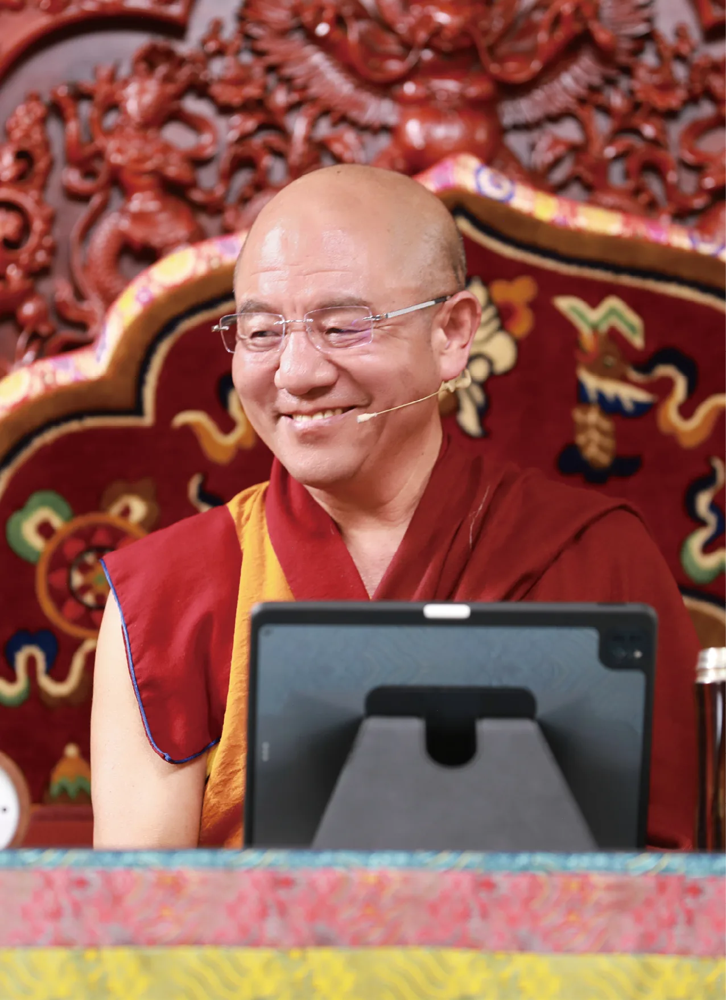
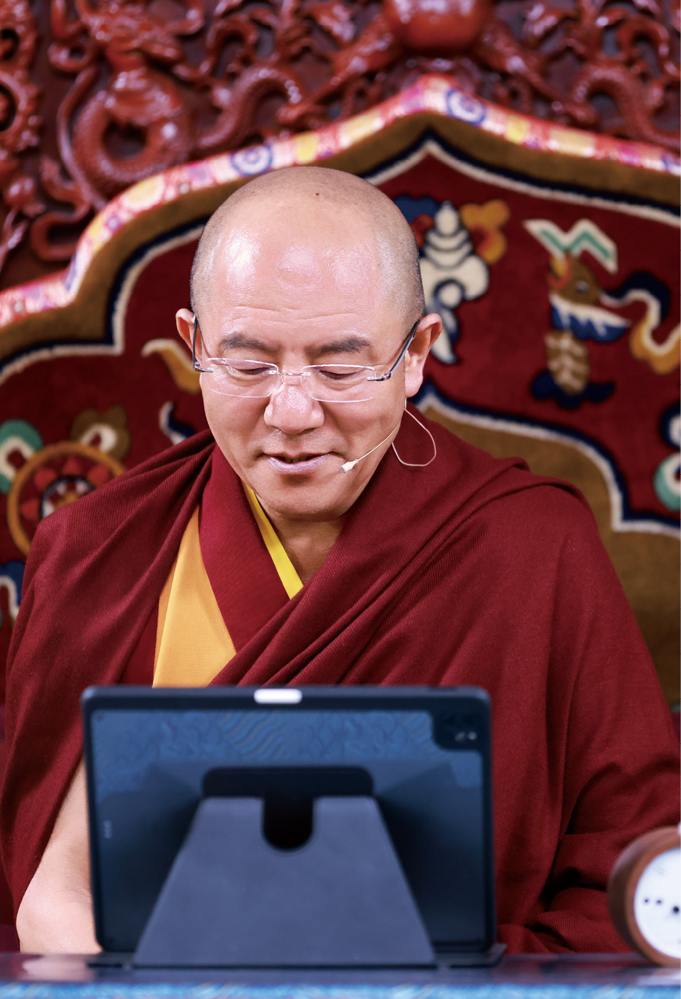

## 2025年新年开示

2025年2月22日

今天因为一个特殊的缘起，在这里给大家简单讲一堂课，不会耽误很长时间。按公历来说，今天是2025年的第一次传法，而按藏历，还要再过一段时间才是新年。在开始之前，我有一个要求：虽然这堂课上没任何不可告人的内容，但今天听课的所有人，都要至少保密三年。也许我过一阵子会把音频公开，但在座的每个人，必须对今天的事保密。我很快就要下山，如果你们向任何人说出去，有可能会让我面对很多麻烦。虽然我们没任何不可告人之事，但大家都知道，目前这里许多方面确实不太方便。

今天我讲这堂课，主要为了感谢很多人：有一些专程而来的重要客人，还有这段时间以来辛苦付出的工作人员。经过各方面考虑，我决定利用这个机会，跟大家讲一些事。一切都是无常的，不知将来会怎样，但不论如何，要感谢每一个人。所以，借今天这个特别的缘起，我给大家讲一堂课。

## 一、法王心髓：《忠言心之明点》简介

我先念一遍《忠言心之明点》的藏文传承。很多人不一定听得懂藏文，我念的过程中，你们可以自己默默读一遍，最好是结合内容来读。

（堪布念传承）

得到了传承，希望大家以后自己尽量学习。这部《忠言心之明点》是法王如意宝于1987年藏历五月，在五台山黛螺顶旁的文殊说法台上，短短二十三分钟内即兴写出的，共有二十三个偈颂。内容虽简短，只有一页纸，比《佛子行三十七颂》还少，但实际上这就是所谓的“窍诀”，也称为“教言”，其中包含了显宗密宗的所有精华要义。法王曾经说过：即使依止他一百年，他也没有除此法之外的更多教言可传授。将来所有值遇此心髓教言的人，都是他的心子，只要按偈颂中的内容如理实修，一定会得到成就。

法王如意宝1993年去西方弘法时，曾在很多场合说过：他一生中最重要的法是《文殊大圆满》，《文殊大圆满》是以窍诀的方式宣讲，其主要框架就是《忠言心之明点》。《忠言心之明点》所摄的内容，相当于一部完整的藏传佛教道次第论。说起道次第的论著，格鲁派有《菩提道次第广论》，我们宁玛派有全知无垢光尊者的《大圆满心性休息大车疏》。大家知道，《大圆满心性休息大车疏》有厚厚两大本，而这部《忠言心之明点》，就是其中浓缩出的精华。

这部论我早年曾以藏文传讲过几次，后来在英国一个道场也讲过。2022年我又重新翻译了一版，次年在学院讲了两堂课。这次趁此特殊因缘，我再给大家简单讲讲。只做大致介绍，就不逐字逐句讲解了。

概略而言，在这部《忠言心之明点》中，法王先顶礼了文殊菩萨，并作立誓句，之后开示了修行的基础：要走上修行之路，首先必须看破今世，然后依止善知识，再受持清净戒律。持戒极为重要，若无戒律，连世间的人天福报都无法得到。不论出家人还是在家人，都离不开戒律的基础。佛陀在世时，以佛为本师，佛陀涅槃后，以戒为本师。所以，每个修行人都应有约束自我的戒律。

在守持净戒的基础上，要怎样修行呢？总的来说，需要以闻思修生起智慧：首先是听闻。众生由于愚昧无知、不明取舍，无始以来一直沉溺于轮回之中，所以先要听闻佛法。仅仅听闻还不够，需要继续以研讨、辩论等方式深入思考，否则难以对佛陀和佛法生起不退转的信心和定解。充分思维后，必须实际修行。许多大学者虽通晓无数经论，但由于缺乏实修，法义并未融入相续，讲得再好也仅是鹦鹉学舌而已。

接下来，法王开始详细宣讲道次第：先略说如法修行、调伏自心的重要性。然后广讲如何修行。

修行的次第包括前行、正行和后行三个部分：

前行分为共同前行和不共前行。共同前行包括人身难得、寿命无常、因果不虚和轮回痛苦四个要点，这些内容想必大家都很熟悉。不共前行包括皈依三宝、发菩提心和忏悔罪障。关于积累资粮的内容，偈颂中虽没有直接提及，但实际上可以间接包含在积资净障这一整体要义中。

正行部分包括有相的生起次第、圆满次第和无相的大圆满。生起次第强调诸法皆为清净，需要了知一切现象、一切声音、一切心识，本来就是本尊、密咒和法性。圆满次第则是通过修持风脉明点来呈现俱生大乐智慧。讲解圆满次第，法王依照的是《时轮金刚》的内容。

关于大圆满，法王先是劝修此法，然后宣讲如何真实修行。劝修时讲到，在末法时代，仅仅依靠其余八乘，难以驱除五浊黑暗，唯有如光明万丈的太阳般的大圆满法，才能迅速遣除众生的黑暗痛苦。然后，法王宣说了大圆满真实修法中本来清净和任运自成的窍诀。

结尾介绍道：这些偈颂是法王在禅修时从智慧中流露，未加任何分别思索，自然显现而出。这部《忠言心之明点》的整体框架就是如此。

### 日光待显：尘封三十余年的注疏

法王造此论后，我写过一部注释，但三十多年来再没看过。最近有一位藏族老师帮我校对，所以我才有机会重温。这部注释写于1988年，当时法王从五台山归来后，因为观察到特别的缘起，要求大家为《忠言心之明点》做释。记得当时有八位堪布报名，其中六位是从意义方面以偈颂的形式解释，而慈诚罗珠堪布和我则着重从词句上注解。他写的注释名为《月光疏》，我写的叫《日光疏》。这部注释完成以后，我自己私下印过一版，后来德巴堪布在朵芒寺讲解过一次，但是在学院里，我从未给大家讲过，别人就更不可能讲了。

1988年后，我开始负责降魔洲来，从此不再用藏语教学，所以我的藏文一直“睡”了三十多年。在最近的校对中，我感觉当年自己藏文写作水平还行。那时我刚出家两三年，第一次为论典作注，其实也觉得有一定困难。朝拜五台山那年我25岁，写注释时26岁，现在我已经63岁，按照藏历的算法，可以说是64岁了。时隔三十多年再看，当初的著作还算有一些可取之处。只是目前没有汉文版，如果以后有机会，我也想翻译，不知能否有这个时间。

这部注释里引用了大量教证，可能有上千个。比如在解释关于闻思修的三个偈颂时，每个偈颂都分了很多层，其中每一句都引用了许许多多教证。那时候查资料不像现在AI时代这样便捷，全要靠自己动手查阅，而且手头能找到的书籍也很有限，所以，能写成这样，我觉得还不错。以后如果有机缘，再给大家分享。

### 五台圣缘：文殊智慧的殊胜加持

说到五台山，那确实是一个极有加持的圣地。文殊菩萨对于我们每个人而言，也有特殊的加持和缘分。我前几天发放了一批文殊像，其原型是法王1995年从新加坡弘法归来时有人专门供养的一尊文殊菩萨像。法王当时说过，那尊像特别有加持力。所以我这次分享给大家，希望你们好好保存，作为信心所依，时常祈祷，开启智慧，这会是一种很好的因缘。

在校对《忠言心之明点》的藏文注释时，我想起1987年朝圣时还写过一部《五台山圣地记》。那时候我喜欢看书，就收集了一些高僧大德在五台山朝拜及住锡的事迹，用藏文写成了一本朝圣介绍。时至今日，五台山的很多圣迹或许已不再是当年的样子，尤其是旅游开发带来了不少新变化。不论如何，当时写下的内容，在大家将来朝拜时，应该多少还有些参考价值。我计划今年把汉文版翻译出来，个人觉得里面有些故事非常精彩，别处未必能见到，很值得一看。

### 劝修心要：二十三颂走通修行道次第

今天以特殊的因缘，将文殊菩萨的智慧交付给大家。法王如意宝与文殊菩萨无二无别，这部《忠言心之明点》正是他老人家一生中最甚深的心要精华。我们宁玛派的道次第论《大圆满心性休息大车疏》，虽然以前讲解过，也有法本可阅读，然而课程体量太过庞大。放在过去还可以系统学习，但在这个信息爆炸、生活忙碌、追求短平快的时代，要把这么多内容学下来恐怕有点困难。所以，如果你们有足够的信心，也可以从这部《忠言心之明点》入手，去思维核心要义。

只要对这二十三个偈颂的内容认真学习，认识到其中各个次第的意义，经过反复思考，就会明白一个人真正要通过修行而成就，需要经过怎样的路径：如何依止善知识、受持戒律、开启闻思修行，从人身难得一直学修到无上大圆满。这样的次第修行，要说复杂是很复杂的。佛法深广无边，浩如烟海，以一个人短暂的一生，即使从少年学到白头，穷尽所有智慧，也未必能全部学修究竟。但是，对于真正有信心的人而言，要说简单也很简单，依靠这样一个短短的精华教义，也可以走通修行之路。所以，尽管以前讲解过，今天我还是将这部《忠言心之明点》再次概括性地介绍给大家。这是我们这堂课的第一部分内容。

## 二、变局下的应变与坚守

第二个内容，有关大家目前的变化，包括我自己。

### 1．迎接变化：在成长中守住自己

以前我每年都要讲很多法，但将来一段时间会存在一定困难。不过，只要各方面因缘具足，我也可以把一些个人心得和修行指导分享给大家。其实从另一个角度看，我们曾经有过长期闻思修行的机会，这段经历确实弥足珍贵。从我1985年来到喇荣至今，数十年来我从未间断过讲经说法，每年都讲一百堂以上的课。即便有时出国交流，有时事务繁忙，但至少也能保证讲法不少于百堂。以后我们都要面对新的变化，然而这种变化在我看来，也是一个很好的机遇。就像孩子迟早要断奶，不可能永远待在母亲怀中；我们每个人早晚都要成长、独立，不可能永远停留于这里。

很多道友突然间离开原来的舒适区，心里难免会不舒服。以前大家共住于这个温暖的集体中，而现在必须自己闯荡新的天地、开创新的事业、探索新的闻思修行方式，刚开始确实会不太适应。长期以来，很多人习惯把自己视为一个被保护的角色，但我早就提醒过：世间的孩子，迟早有长大离开父母的一天，更何况现实中无常随时会出现，因此，趁父母健在时，自己最好独立起来，至少还能彼此保持一些关照。所以，我很希望各位道友在修行、生活，尤其是闻思的方式发生剧变之时，应该坚强面对、欣然接受，这是一种重要的修行。

但是，在这个时候，大家一定要注意，不要让自己的修行被外缘所吞噬。外面的环境非常复杂，你们依靠几年或十几年的闻思，未必有足够的力量去应对。有的老修行即使已修了几十年，进入俗世之后，也难以自持，心逐渐被外境所缚，最后不得不在世间浊恶中随波逐流。一旦把自己搭进去，就只得在滚滚红尘、茫茫生死中不断流转，再也无力自拔，这种情况也是有的。因此，大家千万要警惕。

当对境现前时，一定要尽力运用闻思所得的智慧，扛住外部环境的种种干扰。修行较好的人，在任何境遇下，都不会改变本心。当年法王如意宝在接近涅槃时，特意在电话中告诫我们：“莫舍己道，勿扰他心。”意在叮嘱弟子，无论遇到什么境况，永远都不能舍弃自己的道心，同时，在此过程中绝不能扰乱别人的心。这是法王留给我们的遗教，我们每个人都应深思其中的意义。

现在大家到了面对全新外境的时候，我担心有些修行较浅、心力较弱的人，也许起初还会防御外部影响，但时间一长，就会无力抵抗，彻底沦陷在这个花花世界之中。最后有人甚至连自己的信仰都会抛弃，这是最可怕的。如果以前闻思时间较短，学修不够扎实，是很容易被环境诱惑的。大家都知道，如今的世界诱惑力本就极强，而我们自身修行的力量却不一定足够强大，在这种环境下，是否能把握住自己，是我们每个人都要面对的考验。

尤其是出家人，越靠近红尘，就越要守护好自己的戒律，这至关重要。当然，在某些特殊情况下，稍微淡化外在形象以随顺世间，也不是不可以。但除非必要，决不能故意换下出家人的着装。只要环境允许，我们应当宁死也不脱僧衣。若实在没有条件，外在装束可以稍做变通，但内在的道心和戒律，永远都不能舍弃。这一点大家一定要自我监督，时刻以正知正念对治自己的烦恼，这非常重要。

一般而言，当人身处寂静之地，或与道友共住时，修行和心念尚能保持稳定。然而，一旦独自一人，许多原有的习气和烦恼便会纷纷涌现。在这种关头，守护并坚持自己的道心往往显得尤为艰难。每个人到了一定阶段，都必须学会独立生存，融入尘世，直面各种强大的干扰与诱惑。在这个时候，务必坚守自己的修行、戒律和道心，尤其是自己的见解。见解是非常复杂的。修行人进入世俗之后，有些人会一直坚持自己的见解，但也有些人原先见解就不稳，很容易被他人动摇。如果你的见解足够稳固，不管去到哪里，都不会再有改变。作为出家人，你们去其他道场受个戒，这是有必要的，但也要小心，万一去到某些对我们传承存有邪见的人群中，你原有的见解和行为很可能被潜移默化地改变。所以，在这方面大家一定要特别注意。

### 2．珍惜时光：以智慧心灯照亮自他

第二点，希望大家无论到哪里，都不要放弃利益众生。我始终认为，利益众生是最好的事。前段时间我翻译了天法派创始者门吉多杰讲述自己转世经历的《二百世的回忆》。里面的每个故事都非常简单，但也特别发人深省。虽然门吉多杰大师是阿难尊者和贝若扎那的化身，但他前世也多次转生为旁生或普通人，遭遇种种无常的命运，令人看后对轮回深感厌离。我翻译时也在思考，如此了不起的大圆满修行者，为何会反反复复在轮回中转为旁生？我想应该是他特意发愿投生到某类旁生之中，借此方式利益它们。比如在成为鸟的一世中，就用鸟的语言给其他鸟类讲法；成为哪一种动物，就用相应的方式去利益同类众生。但也有一生仓促结束，未能达成所愿的情况，门吉多杰大师自己也如是评价：“这是不清净的一世。没能利益众生。”

在生生世世中，门吉多杰大师与他的上师乔美仁波切有很多因缘交集，其中大多数是善缘，但有时候也会互相伤害。所以，轮回确实是一种很可怕的迷乱。同样，我们自己与身边各种人的因缘也极其复杂。正如嘎达亚那尊者洞察一家人前世今生后的感慨：“口食父肉打其母，怀抱杀己之怨仇，妻子啃食丈夫骨，轮回之法诚稀有。”人世间的亲怨恩仇等关系，在一世世的轮回中着实是盘根错节、纠葛不断。从门吉多杰的回忆中我们可以看到，他反复提及名字带有“匝”“嘉”等的几个人，在很多世中，他们都是杀害他的众生。而乔美仁波切与他的每一次转世，基本上都在互相利益，可仍然有几世中伤害过对方。

从这些故事中，我们会明白一些人生道理。这一世行走于人间，不一定所有因缘都会顺利。这样的大德尚且如此显现，更何况我们这些业力深重的众生。所以，在轮回中经历一些漂泊起伏，也没什么大不了的。关键在于，我们从中应该学到一个方法——即使变成一只小鸟，也要尽力给身边的小鸟们带来利益。这一点非常重要。

因此，不论你去到何方、身处何境，都要尽力去利益众生。有些人为了生计可能需要出去打工，只要你相续中有菩提心，在任何地方工作，都可以给身边的人带来饶益。你可以给他们讲讲善恶取舍的故事，或是以具体的行动帮助他们。我想，这就是我们人生的一种价值体现——只要有这颗心，活在这世上一天，就能帮助一些众生。

这些年来，我给大家传了很多经论，包括《维摩诘经》《法华经》《金刚经》等很多汉传经典。实在不行，你们向老年人念一遍传承、念一句佛号，也是很好的。在利益众生这个使命上，大家一定要多加努力，现在不努力，再过几年也许就没机会了。昨天我看了一个二十年前拍的视频，里面有些连鼻涕都不会擦的藏族小孩，现在都已经长大成人，无法辨认。他们自己也感叹二十年晃眼即过，简直不可思议。光阴就是这样转瞬即逝，在短暂的人生中，只要眼前有一点机会，就一定要好好珍惜。我们不说什么兴盛佛法的大话，但至少要用自己学到的佛法来帮助众生。虽然不一定每个人都有弘法利生的时间和能力，但只要出现一点机缘，人人都可以为他人做一些善事、引导一些善法，这样的行为应该不难做到。

每个人都应把握住生命中有用的时光。拿我个人来说，我现在已经六十多岁了，自己时常计算，如果以一年翻译两本书的速度，还要几年才能完成目标。随着年纪越来越大，身体病痛也越来越多，视力、记忆力都在减退，这些都是必然的挑战。所以，人生中真正做事的机会，可能只有十到二十年。如果你们现在正值各方面恰好成熟的年纪，一定要利用好这宝贵的时光。等到七老八十以后，除了极个别情况外，人的身心都会逐渐退化，再说我们也不一定能活到那个时候。我也在想，如果疾病没有让我提前离开，身体能正常配合我想做的利他之事，现在我还需要至少四到五年的时间去达成计划。按藏历算法，我再过六年就七十岁了。七十岁以后，很多人的身体和心智都大不如前，甚至有人连生活都不能自理。所以，人生只是一场很短的游戏，如果认为自己的游戏时长可达一百年，那其实是缺乏智慧的表现。

既然人生短暂，我们就更要用最有意义的佛法来充实自己。尤其是在这个科技飞速发展的剧变时代，人们内心的痛苦越来越严重。过去我们曾憧憬科技会把生活变得更加幸福，然而现实并非如此，如今科技发展给人类带来了多么可怕的异化，这是有目共睹的。过去虽然科技不那么发达，人们却拥有更多关爱、快乐、宁静和悠闲；反观现在，技术创新不断突破想象，这个世界每天都在发生翻天覆地的变化，仿佛做梦一样，但与之俱来的焦虑和烦恼将人变成了什么样子，大家都很清楚。在这样的时代，佛法这一心灵妙药尤为重要，所以，大家一定要将自己的修行掌握好。科技变化的同时，全球经济不断下行，社会问题持续积压，国家之间战乱频发，人心也在逐渐崩坏，整个世界眼看已走到失序边缘。在这个时候，我们必须在自己心中攒下一些精神上的“积蓄”，只有这样，才能在恶劣的环境中保住自己的立足点。否则，未来前景不知会怎样。

所以，大家也没必要回避科技的发展和环境的动荡，因为一切都在变化之中。我们应该做的，一是把利益众生作为首要任务，二是让自己内在有一些真实的修行功德。我经常感觉到，念诵咒语、修持本尊、祈祷上师，在这个末法时代确实能凸显出强大的力量。依靠修行，所有痛苦、焦虑、烦恼都有办法解决。我自己每天也要靠修行支撑自己，比如做治疗的时候，我会不间断地念诵咒语和祈祷文，这可以令我补充很大的能量。在这个时代，我必须不断给自己“充电”，否则一旦耗尽“电量”，就没法坚持下去了。所以，希望大家把自己所学所思的佛法知识，以窍诀的方式“打包”起来，务必实际用上，这极为重要。

### 3．把握机遇：借时代契机化蛹成蝶

其实，现在也是最好的时机。以前很多人因为闻思发心等任务重，很多感兴趣的法一直没机会听，而现在自己可以尽情地遨游法海。我原来说过很多次，你们应该把喜欢的佛法资料提前保存下来，不论音频、视频还是电子书。想当初我们求学的时候，不论去哪里都要背着一大堆法本，可现在只要一部手机或一台电脑，就能轻松储存所有资料，整部《大藏经》都可以放在掌中阅览，谁也干涉不了，这也是时代给予的最好的方便方法。我们目前虽然在很多方面受到一些约束，但只要有信心，完全可以获得自己希求的一切智慧，包括你有信心的任何上师的教言。除非肉身受到限制，否则只要我们拥有基本的自由，个人的学修就不会受到影响。自己努力，就能找到办法。谁也抢不走你的闻思修行，这一点大家要明白。所以，现在的变化也是一种机遇，让你有机会圆满想学的法。希望大家认真把握这种机遇。

刚才提到，现在人类已经进入AI时代，我们每个人都要在这个领域有所准备，因为这种技术很快就会融入生活的每个方面。大家千万不能墨守成规，一直停留在原有传统模式上，否则会被时代所抛弃。我们佛教徒一定要与时俱进，否则很难立足。我自己虽然对高科技领域没怎么研究过，但我始终认为，世界在飞速变化，必须跟上时代。早在二十年之前，我就在不断追赶世间的主流技术，从最初的录音磁带，到后来的VCD、DVD光盘，通过这些方式，当初很多人结上了善缘。这些年来，我们也一直在紧跟时代和技术的变化。所以，现在我们佛教徒也应该赶上AI这趟车。我没有借口自己年纪大就不去更新知识，如果只想独自修行，不学这些也可以，有稳固的境界、寂静的居所、基本的饮食，也就足够了，但想要利益众生，就必须了解社会的变化，这样才能理解众生的痛苦。所以，在这个时代，我们佛教徒有必要思考该如何面对未来世界的种种变化。

大家小时候都学过《小马过河》这篇课文。小马想要到河对岸去，就问老牛：“河水深不深？能过去吗？”老牛说：“河水很浅，只到小腿，过河没问题。”小马又遇到松鼠，松鼠劝它：“千万不要下河，水很深，我的朋友就是被这条河淹死的。”小马不知道如何是好，只能回去问母亲。母亲告诉它：“河水是深是浅，你不要光听别人说，应该用自己的头脑去辨别。”于是小马尝试下到水中，发现河水既不像老牛说的那么浅，也不像松鼠说的那么深，最后顺利到达了对岸。

最近有些人即将离开熟悉的环境，自己却没有能力观察，一直向我追问：“我现在该怎么做？”“我以后该怎么办？”其实我早就提醒过，这种无常是每个人迟早要面对。眼前的变故只是一次模拟考，未来我们还将迎接死亡的大考。所以，大家光会学知识是不够的，还要有随机应变的能力。一直等老师给答案，靠他人指路，自己永远都不可能真正成熟。

所以，有时候看到突如其来的变化，我心里反倒高兴，因为在不得不面对变化的过程中，大家都会得到很大的成长。这种变化，看似是一次挑战，实则是一次机遇。当然，对个别人来说，这也许是一次很大的打击，就此灰心丧气、一蹶不振，也不无可能。但我相信，大多数人会积极地迎接这个变化。只要你们尝试去了解外面的世界，就会发现很多利益众生的机会，比如利用AI技术实现你的创意。我们作为修行人，肩负着弘法利生的使命，应该尽己所能去思考和把握眼前的机遇。

在这个信息时代，一个简单的方法，就能给很多众生带来利益；同样，一个简单的方法，也可能伤害到很多众生的信心和悲心——这取决于不同的发心和行为。我们正站在一个颠覆千百年来人类生活方式的历史节点上。回顾几十年来的人生，我时常惊叹，我们这短短一生竟然经历了前人几千年来都未有过的巨大变革。从个人处境到国际局势，今天一个样子，明天又一个样子。面对这个不确定的世界，众生确实非常可怜。所以，当不得不面对变化时，修行人应当将其转为机遇。人迟早要蜕变。毛毛虫如果不化蛹，永远也成不了美丽的蝴蝶；小鹰如果不离巢，永远也不可能在天空中展翅飞翔。为此，我们每个人都要做好内在与外在的所有准备，踏上未来的修行旅程。事实上，只有在面对不同环境、不同人群的时候，一个人才能知道自己的修行有多大力量。

有些人虽然求学时间并不长，但相续中已有了很大的转变。1995年法王去东南亚弘法，在马来西亚吉隆坡的一个道场住了大约一周。那段时间，有一个19岁的女孩和她母亲每天给我们送饭。离开的那天，女孩和我们同乘一部电梯。电梯中法王问她在修什么法，她回答：“以前念过120万遍莲师心咒，后来就没再念了。”法王对她说：你以后要每天不断念修莲师心咒，要对三宝有信心。电梯里这一句简单教言，女孩在三十年中一直谨记于心、依教奉行。每当人生中遭遇大事，法王的话都是她最坚实的依靠。当时她只是个刚从高中毕业的学生，但却依靠一句教言踏踏实实修持至今。而这里有些人闻思了很多年，却未能把上师的教言真正融入自心，生活中遇到该用上修行功夫的时候，往往无力可用，这也许是因缘不同所致。最近我为了写书采访到她，得知她还妥善保存着当年法王传讲《文殊大圆满》的光盘资料，以及法王临别前赠予她们一家的金刚结和甘露丸。她的信心确属真实，并非我刻意夸大。很多细节我在电话中反复确认过，以后会在书里详细讲述。

讲这个女孩的故事，是想说明一点：依止上师不是靠时间长短，关键在于是否能与上师相契，以此改变自己的相续。我以前经常讲法王如意宝依止托嘎如意宝的例子，法王在石渠仅仅学习了六年，就真正获得了托嘎如意宝的全部意趣，自心与上师的智慧成了无二无别。虽然我们未必有法王那样的因缘和善根，但只要有足够的信心，一定能获得上师的加持。相反，若是没有信心，那就像善星比丘和提婆达多一样，纵使依止释迦牟尼佛多年，最后也落得坠入恶趣的下场。这一点大家应该清楚。

所以，大家若有机会在这个道场依止上师、闻思修行，这当然很好，但如果没有机会，也不必痛苦怨愤或悲伤沮丧。不要把这次变化视为一种失去，应该勇于在曲折中寻找光明的道路。毛主席也说过：道路是曲折的，前途是光明的。很多事情的发展规律就是如此，过程不可能一马平川。不仅修行人要面对这样的路，世间任何人一辈子走过的路，都是曲折多过平顺。很多成功者回首往事，都经过了一番痛苦煎熬的磨砺。虽然道路蜿蜒曲折，但只要不在困难前倒下去，每个人都将迎来光明的前程。

我希望道友们今后尽量把自己所学的智慧、所修的法门，运用在实际生活中，如果不亲身实践，光阴易逝，人生转眼就至暮年。为什么我要提前规好未来几年的任务？正如噶当派的大德所说：“如果没有随时做好当下离开的准备，就不是好的修行人。”所以，我们每个人都应该以信心去直面前方的现实。

同时，身处末法时代，大家最好多念一些咒语，比如莲花生大士心咒或观音心咒。兴许是每个人爱好不同，有些人似乎不太喜欢念咒，而我从小就对咒语特别有信心，总爱时刻念诵。这些咒语的力量，给我的人生带来了很大帮助，也给利益众生的事业带来了很大的加持。所以，多念咒是很好的。

### 4．不负此心：在无常中创造无限可能

今天我没做什么准备，只是趁这个缘起开端给大家分享一些个人想法。我自己面对当前的诸多变化，有时候心里也五味杂陈。以前习惯的模式，现在一下子全变样了，在这个转变的当下，内心难免也有些遗憾。但与此同时，我也有另一个角度的感想。我们都学过马克思的辩证唯物主义，应该明白一切事物都是运动、变化、发展的，不可能静止不变。这其实就是无常的道理。我们的人生不会静止，所行的事业也不会静止。不仅我们，世界上所有人事物，一切的一切，都在变化当中。既然一切终将变化无常，早一点面对也有必要。这样我们才会知道，其实在任何地方都有修行的机会，都有利益众生的因缘。只要去做，一切条件都可以自然而然创造出来。

在这个过程中，大家一定要保有一颗正直的心、利他的心，哪怕我们转生成动物，也不能舍弃这颗心，每个人都应该如此发愿。伤害众生是最恶劣的事，我们无论遇到什么情况都不能伤害众生。有了这样一颗心，在这世上就可以坦然面对一切。否则，生存于浊恶的末法时代，人心只会越来越焦虑痛苦。物质和科技越是高速发展，我们内心的悲心和智慧就越显弥足珍贵。

在如今信息过剩的大环境下，我们每个人都要学会去粗取精，从外部种种纷繁复杂的知识中，筛选有价值的，剔除没营养的。否则，海量的网络资讯和短视频等娱乐刺激，会快速把你淹没，让你迷失在其中。这个时候一定要以智慧分辨，哪些知识是真正对自他有利的，这样才能一方面保障自己在这个恶劣时代的生存，一方面更好地利益众生。大家长期以来已经听了很多佛法，现在到了真正要去运用的时候了。通过实践运用，你们才能检验出自己真实的修行境界。所以，这确实是一次非常有意义的测试。

我今天就讲这些内容，可算作一堂课，也可以算是一次聊天。大家要经常祈祷全知麦彭仁波切、全知龙钦巴尊者和全知法王如意宝。我门通过祈祷，令自己的心与传承上师们的智慧融为一体，身心一定会有很大的转变。这样一来，面对一切世事变化就会更加坦然自在。如果一个人的心始终刚强难化，那他不管依止多少上师、听多少课、修多少法，都无济于事。所以，希望大家把握这个关键——及早认识自己这颗心的真相。禅宗、唯识宗和大圆满最重要的也是这点。一切佛法都强调降伏其心。佛陀宣讲的八万四千法门，其实都是调心的方法。这也是《忠言心之明点》中最重要的窍诀。所以，希望大家一定要对此重视起来，如果不调伏自心，学佛就没有太大意义。

在座的各位都拥有着难得的暇满人身，在这个身体尚未被疾病缠绕的时候，自己应尽量多学多修。要珍惜每天的时间，珍惜自己的信仰，更要感谢所有与自己结缘的众生，不论善缘还是恶缘。正是依靠这些有缘众生，我们的修行才能不断进步。所以，大家应该以感恩的心态看待一切，这样世界才会变得更好；如果总是怀着负面的心态，整个世界就会变得越来越糟。希望道友们尽量适应不同的环境，学会调整自己的心态，不要凡事斤斤计较。如果你总是为一些小事而痛苦纠结，那说明自私自利心太重。所以，大家应该把关注点放在利他的大愿上。

大家应该多学一些重要的论典，包括我以前讲过《定解宝灯论》《入菩萨行论》《大圆满前行》等。以前我可以给大家传讲经论，现在虽然暂时没这个机会，但我也会努力以其他方式把佛法智慧分享给大家，比如翻译或推荐一些好的书籍。我会继续努力下去，不会浪费任何时间。今年冬天我翻译了好几部论典，其中一部名为《八十口诀》，过段时间会分享给大家。这部论中有八十条重要的口诀，有些内容非常深奥难懂，我原本想给大家详细讲解，但目前可能没有机会，你们如果有时间，也可以自学一下。

总之，我们现在至少不会饿死，只要心怀志趣，走到哪里都会有自己的一片天地。这个时代赠予我们最好的礼物，就是多样的选择。任何人都可以拥有完全不同于以往的资源、空间和可能性，这是时代赋予的机遇和考验。所以，相信我们每个人都会有很好的因缘，大家要好好珍惜和把握。
