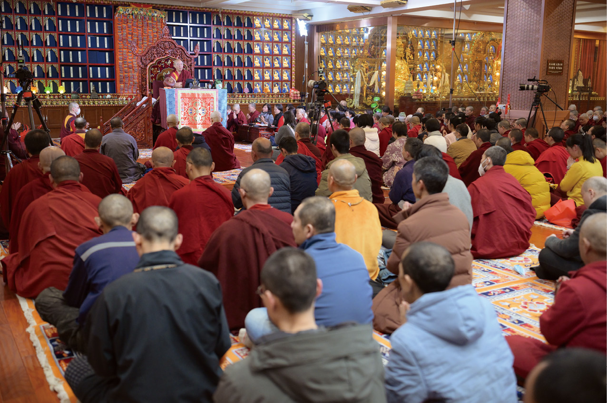
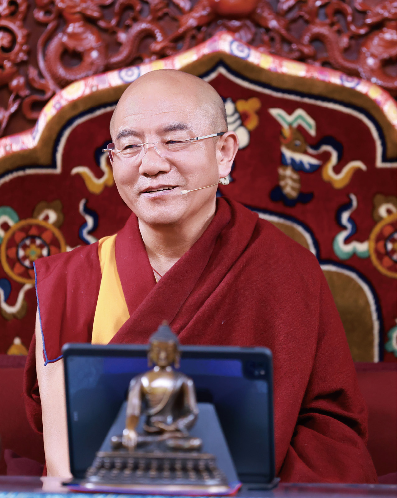

## 一次别离

——于逆境中见心迹

2025年4月17日

今天主要是给即将离开的技术人员和从业人员做一些开示。在此之前，我先给大家念《佛子行》和《缘起除障法》的传承。

（堪布念传承）

今天利用这个时间，向大家传达几件事。

首先对目前情况做个简单说明，然后再跟大家聊聊如何面对逆境，最后还想提几点希望。后面还有一个简短的接待环节，稍后相关人员会进行安排，大家不要着急，如果有事找我，这几天我会尽量满足你们的需要。

## 一、因缘变迁，直面聚散

现在正值一个特殊的时期，无需多言，大家都很清楚。我在喇荣五明佛学院讲法，已经有四十年了。1985年我刚来到这里，就以藏语辅导过《入菩萨行论》、关于文法的《三十颂》以及关于诗学的一些内容，到2025年，算起来正好是四十年。人生有四十年的讲经说法生涯，也算一种圆满——当然，这不代表结束，只是一个中间停顿的节点，我还想再讲很多年。以汉语传法，是从1987年开示，到现在一共三十八年。这也是得益于当时的政策环境，倡导各民族团结和合、交流互通，我们才有这样一段以汉语闻思的时期。时至今日，从国际、国内，到社会、个人，方方面面的事情都在变化，一些相关的规范和管理方式，也会相应革新。所以，现在我们的因缘也在发生变化，大家应该都明白。

大概六个月前，学院包括达尔玛巴拉、喇荣饭店、医院在内等很多部门都已彻底停业，一直到现在，未来的情况还不明确。现在结尾工作正在紧张进行中，大家最近在忙着办理各种手续、邮寄个人物品，为最后的离开做准备。作为世间人，谁都要感受悲欢离合，在这种时候，大多数人肯定开心不起来，除非你修行特别好。因为我知道你们很多人原本准备长期在这里修行、为僧众服务、为学院提供技术和管理上的支持。然而，这几年间环境突然变化，大家也不得不改变规划，重新寻找各自的方向。

最近以技术人员和从业人员为主的很多人，都在陆续离开学院。相关人员的房屋，包括女众187间，男众94间，这两天全部会上锁，等过段时间拆迁时再具体安排。大家都清楚，这些房屋的相关权利现在不得不交出去，这个事实当然是不太容易接受的。虽然在个别领导和我们一些人的极力争取下，相关部门给每间房屋拨了五万块的补助，但相比大家以前的购房成本，差距还很大。有的人当初买房花了几十万，现在被五万块钱就打发了，肯定心中意难平。但要知道，还有些人连一分钱都得不到，相较之下你们还算好的。不管你想还是不想，愿意还是不愿意，规则就是如此，虽然不可理喻，但我们必须去理解。

拿我自己来说，在整个过程中，我自始至终都非常配合。尽管身体不太好，但我一直认为，在任何情况下，逃避都不是办法，尤其是在这种事情面前，积极地面对可能对各方都好一些。站在这样的角度，我才能同时考虑执行方和我方的立场和需求，尽量协调，争取让这件事得到更圆满的处理。

## 二、于违缘中观照自心

眼下有些情况，确实让很多人一时难以接受，我最近在处理相关事务时，也听到了大家各种各样的心声，我心里也很不是滋味。昨天一个男众道友跟我说，他一边收拾行李，一边忍不住哭泣，就这么哭一阵，收拾一阵，然后再哭一阵。这种复杂的心情我能理解，人们都说男儿有泪不轻弹，但真正伤心流泪的情况也是有的。女众就更不用说了，有些人特意来跟我告别：“我要到某某地方去了。”她们有的是出家人，有的是在家人，原本从未想过离开，但现在“天气”突变，只能各自散落于茫茫人海。个别人准备在这里住一辈子，当初甚至投入了三五十万精心买房装修，现在要将一切立刻抛弃于身后，就此永别，确实会感到心如刀割，然而这也是无可奈何的事。目睹这些情形，我心里也会生起同情和悲悯。

这几天有个别执行人员的言行也让人不太舒服，比如前天，我们正在搬运办公楼的物品，他们突然过来把车牌都抢走了。本来按照跟上级领导沟通好的计划，至少还应该再给我们两三天的时间，但是下面个别执行者却要强制我们马上离开。

其实，有时候人性是不能完全用规则来处置的。我以前在德国参观过柏林墙。这是上世纪冷战时期东德为了防止国民逃往西德而建立的一套边防系统，沿线遍布士兵和岗哨，一旦有人试图翻越，守墙卫兵就要开枪射击。多年来，很多人为了与墙那边的亲人团聚，惨死在了自己同胞的枪口之下。东欧剧变后，随着两德分裂的结束，柏林墙最终被推倒。然而，就在这堵墙倒下的前夕，一个士兵开枪杀死了一个翻墙的青年。德国统一之后，这个士兵接受法庭审判，他的律师为他辩护，认为开枪杀人只是在恪尽职守完成上级命令。然而，主审法官却说了这样一番话：“作为士兵，你有责任开枪，但是作为一个有良知的人，你有责任把枪口抬高一厘米。当规则和良知冲突时，良知才是第一准则。”最终，这个士兵被判决有罪。要是当初他在开枪的那一刻，稍微把枪口抬高一点，不仅能救下一条生命，也是救了自己。

任何一个国家、社会或个人，都有可能面对规则和良知的冲突，这种时候，不同的人会做出不同的选择，也有些人在中间掺杂了私人的分别念和特殊的目的。讲这些并不是要抱怨任何人，我们今天会遇到这样艰难的局面，以佛教的角度来讲，背后有复杂的因缘，并不是某个人在蓄意针对，非把我们推向窘境不可，不是这样。佛教中常讲：“诸法因缘生，诸法因缘灭。”这是佛陀所揭示的最重要的真理——缘起法。今天表面上好像是某个命令冲着我们而来，但也不必为此心生抵触，因为这一切实际上是我们自己业力和其他诸多复杂外缘共同作用的结果。

大家知道，《俱舍论》中讲过黑业、白业和花业，花业是善恶夹杂的业，会令我们感受苦乐交织的复杂体验。所以，对于今天的结果，我们不必对任何对象心存怨怼，更不能像有些世间人那样以牙还牙或面从腹诽。作为大乘佛教徒，我们应该理解和接受这是特殊的因缘所致，而不是简单归咎于外境的强迫，把自己当成受害者。

大家都知道，佛陀在世时，也曾目睹整个释迦族被琉璃王所灭。其中的复杂因缘，佛经中有详细记载。我们现在这种局面，既是由于现实中的诸多因素，也是由于很多看不见的隐蔽因缘，我想大家应该能理解。

现在短短时间内，就必须把280间房交出去，原房主们心中肯定难以割舍。有些人对房子执著，有些人对家具执著，有些人对佛堂供奉的三宝所依执著，身为凡夫人，有这种心态是可以理解的。不仅是我们，世上任何一个人在这种处境下，都会有同样的心境。但是，我们既然身为修行人，心中应当有能接受一切的力量，这种接受并非因为恐惧或盲目，而是理解了因缘法之后的释然。我们遇到的每件事，其实都有重重的复杂因缘。这很像心理学中的“踢猫效应”，我以前给监狱犯人演讲时也提过：一个人在单位被老板骂后心情不好，回家跟妻子大发脾气，妻子满心郁闷，就把孩子打了一顿，孩子很不高兴，就朝家里的猫狠狠踢了一脚，猫无故被踢，就开始乱咬乱抓，把家里搞得一片狼藉。只看结果，好像该怪猫捣乱，但实际上，这是负面情绪在层层往下传递所导致，追溯到源头，到底又该怪谁呢？

我也知道很多道友面对这种安排，心里非常难受，一时间很难将违缘转为道用，但我还是希望，大家作为佛教徒，遇到任何事都应学会从正反两个角度去看待。也许现在看起来难以接受的事情，过几年回头一看，其实是自己人生中极有意义的一次经历。当然，这事情不一定对每个人都能起到正面的作用，但对大部分人来讲，应该会成为一段很有价值的回忆。如果能以积极的心态面对，会非常有意义。

我们藏地有很多商队，一般的商人遇到下雪天会非常忧愁，担心牲口受冻、道路难走，但个别商人反倒会十分高兴，因为雪天不会遇上盗贼，而且雪水可以让马蹄保持湿润。所以，在智者看来，雪天其实有许多优点。大家在遭遇逆境的时候，心里有些情绪也是人之常情。这样的事发生在任何人身上，都免不了伤心、怨愤，除非是登地菩萨。世间很多有钱、有权、有名气的人，突然遭遇重大打击时，都会难以承受，甚至失去理智，以极端的言行发泄情绪。但我们大乘佛教徒不会这样，这并不是因为软弱或愚昧少智而没有反抗能力，而是我们深深地懂得，世间很多冲突、争斗甚至暴乱，都是因人心未能及时调整而起。所以，我们知道，自己身上发生的任何事情，都是随缘而来——如果因缘具足，就必定会发生；如果因缘已灭，也许又有另一番局面。

世间的冲浪高手，仅靠一片冲浪板，就能自如驾驭汹涌的波涛。海浪涌起，他也随之而起，海浪落下，他也随之而下。面对巨浪当头，他不会惊慌失措或坐以待毙，他能看到波浪起伏之势，随着浪潮顺势而动。只要顺其自然，自己会找到方向，海浪也会与之共舞。

所以，大家应该明白，在因缘具足的时候，你固然可以在这里学习佛法、服务僧众、做自己想做的事，但既然因缘已经不再具足，就没必要怀有抗拒心理。鸡蛋再硬，跟石头碰，最后碎的也只是自己，不会有其他结果。

在学院的第三次整顿中，我们对很多事情该解释的尽量解释，无可解释的也只能随顺因缘。在这个过程中，希望大家时时刻刻都要内观自己的心态。有时候遭遇一些意料之外的痛苦、违缘或障碍，反而是我们修行道路上很有意义的助力。其实，面对违缘和障碍，是每个人心灵成长的必经阶段。我前段时间见到一位高僧，他说自己从小到大，修行中总是不断出现违缘。我和他相识已接近四十年，平时看来，这位大德一直很风光，似乎并没有什么违缘。在我印象中，算得上违缘的顶多只有两三件事。从他的话中我也有所感悟，其实很多人外表上虽不显露，但暗自已然承受了很多。总之，人生中出现一些违缘，也许是最好的修行机会。越是身处逆境，修行越有力量，做事越能圆满。

唐代鉴真大师发愿赴日本弘法，先后五次冒险东渡，然而都未成功，其间双目还失明了。经历千难万险，第六次终于成功渡海，将佛陀的戒律弘传到了日本。为什么鉴真大师能如此坚强勇毅？有一段他少年时期的故事：刚出家当小沙弥的时候，师父让他每天出去化缘。有一天刚下过大雨，道路特别泥泞，他不愿意出门。师父便问他：“你昨天走过的路上有没有留下脚印？”鉴真回答：“昨天路是干的，自然不会留下脚印。”师父又问：“那今天呢？”“今天满地泥泞，肯定会留下我的脚印。”师父说：“人生就是如此，行走于顺境时，很难留下痕迹；但在逆境之中，每一步都会留下有意义的足迹。”正是因为这种在逆境中跋涉的勇气，鉴真大师一生中为弘扬大乘佛法不惜躯命，一往无前，任何挫折磨难都无法阻挠。

所以，我觉得道友们大可把这次变故当作一次修行良机，以此验证自己到底修得如何。有些人平时总说要弘扬正法、利益众生，但是当亲身面对离别的这天时，又忍不住陷入伤感和痛苦之中。其实，这正是凤凰涅槃、浴火重生的时机，会成为你们将来弘法利生和自我修行生涯中极为精彩的一章。同时，这也是人生中难得的自我观照和反思的时机。只有变化突然降临时，我们才能真正体悟到，原来无常确实不会放过任何人，舒适区确实不会永远存在。也只有不得不改变的时候，我们才能深刻地觉察到自己内心有哪些弱点、修行有几分功夫。

## 三、借小无常修大无畏

我经常阅读噶当派大德们的教言，体会如何将违缘转为道用；有时也会看一些世间人的哲思——有些虽未如大乘佛法见地那么有深度，但也很值得我们参考。比如“晚清第一名臣”曾国藩，他在立身处世上就很有独到之见。他给自己的书房提名“求阙斋”——不求圆满，反求缺憾。据说，道光皇帝问他为何取此名。曾国藩回答：“如果处处都极致圆满，则物极必反，不如欠缺一些，才能留有余地。”所以，人生最好还是不要追求圆满至极。在传统文化中，两极之间会不断循环转化，比如阳和阴、福和祸、圆和缺，这是世间万物运转的规律。我们藏族也有句俗话：“一天的天气有三次变化，一生的苦乐也有三次变化。”确实，藏地天气多变，有时上午是阴雨天，中午放晴，傍晚又阴云密布。人的一生也是如此，会经历许多次苦乐的转变。所以，我们在生命中遇到一些不圆满、不如意之事，也是在所难免的。真正的大乘佛子，受人诽谤也罢，身体病痛也罢，不论面对任何缺憾，都应视为一种修行。

在我们今天看来，确实每个人都有很多遗憾。尤其是那些早期来到学院的技术人员，多年来一直住在这里，突然间必须离开，难免不甘心：为什么我不能继续留下？为什么我的心愿不能圆满？但是这种心态也是可以调整的，人不一定要固守在一处，其实换到不同的地方，能看到不同的世界。从这个角度来看，大家应该试着去欢迎人生中的不圆满，而不必遗憾于已经失去的。

这次走的不仅是你们，很多藏族的喇嘛和觉姆也不得不离开；面临这种情况的也不仅是我们学院，其他很多地方也同样如此。这一点大家应该了解。遇到这种事，我们不要目光短浅，在悲伤中自困，应该站得高一点，看得远一点。以整个人生的尺度来衡量，这其实只是很小的一件事。

当然，有人会说：“这不是小事。我就是舍不得我的学院、我的房子。”然而，再舍不得，最后也还是要舍得。想想无垠的宇宙，想想历史的长河，再想想一生的历程，就不觉得这是什么大事了。看看巴以冲突和俄乌战争中，那么多人死于战火，那么多建筑夷为废墟，相较之下，我们学院为了增建消防通道，拆迁几百间木屋，也不算多大损失。

只要换个视角，很多事情其实并无高低之别。有这样一个故事：孩子站在山上眺望，看到远方天空和地平线交汇在一起，就问父亲：“天那么高，地那么低，为什么会连在一起呢？”父亲告诉他：“当你站得够高，看得够远，世上原本高高低低的事物就都变得平等了。”这个父亲的回答很有智慧，有几分大乘佛法中平等性智的味道。在平等性智的境界中，轮涅、黑白、自他等一切都是完全平等的——这可不是对等制裁[^1]的那种平等。（众笑）

我看大家太严肃了（笑）。世间各种谈判或会议，从参与者的表情就能判断内容走向。看来我今天说什么笑话也很难让你们开心起来。我理解大家的心情，但是我们不能放任焦虑、伤感等负面情绪蔓延，否则一件小事也会变成世界末日。日本有位梦窗禅师说过：“眼里有尘三界窄，心头无事一床宽。”如果对一件事执著很大，内心的烦乱动荡就会把事情的影响和伤害不断放大。

据说，撒哈拉沙漠里有一种叫沙鼠的小动物，它们就像天生有“焦虑症”一样，总要在洞穴中囤积大量草根，这是为应对旱季食物短缺的提前准备。然而，即便草根已充足，它们还是会继续囤积，无休无止，一直担心吃不饱。科学家观察发现，人工饲养的环境中，沙鼠死得很快。因为尽管笼子里食物非常充足，但沙鼠还是本能地急于囤积草根，如果获取不到更多，它们就会极端焦虑，最后导致死亡。

所以，很多道友也没有必要过度焦虑，总往负面想：“我以后就再也见不到上师了！”“我以后再也修不了大圆满法了！”“离开喇荣圣地，我会不会被红尘俗世染污见解和行为？”“没了生活来源，我是不是要饿死？”……无谓的焦虑，只会让你越来越痛苦，最后心理都可能失常。其实，专家早就研究过，人们担忧的事，90%都不会发生。很多人忧虑坏事发生，这就叫杞人忧天——整天担心天塌下来，但实际上根本不会。所以，不必害怕离开这里会走投无路，出路总会有的。

还有些人可能会想，技术人员走光了，那该怎么办？其实，这次上面给我们留了一些技术人员的名额，但有很多限制：不能是出家身份、以后也不得出家、不允许参加宗教活动、只能住在洛若等等。名额有限，且只能由人事局为主的几个部门招募选拔，其他的人没办法介入。原有的几百名技术人员和从业人员，尽管以前都有合法手续，但现在只能全部离开。现实虽然如此，但你们也不用担心出了这道门，自己原有的技术没了用处，今后在社会上无法生存，这些忧虑都是多余的。当然，谋生要靠个人努力，天上不会掉馅饼，但只要有信心，走到哪里都有你的用武之地。

因此，大家内心不必耽于情绪，要明白《心经》中“心无挂碍，无挂碍故，无有恐怖，远离颠倒梦想”的甚深之理。只要心中没有挂碍，就不再有恐怖，轮回中的一切颠倒梦想也会自然消泯。

前面那批技术人员和从业人员离开的时候，我也给他们反复讲过：既然离开已成定局，哭着离开不如笑着离开，哭着走，没人给你擦眼泪，但是笑着走，自己的心态会很快好起来。这次看着你们即将离开，我也是同样的感想。

各位对大乘佛法和世间知识都有一定的掌握，今后的人生道路中，既应做自己认为有意义的事，也要做符合当今世间规律的事。一个人如果对世界和周遭的规则看得比较准、比较透，那不论发生什么，都能从容应对。即使有人短时间内会有一些委屈不解、抱怨不满，或伤心失落，但回顾在这里的整个生涯，也该感到欣慰。多年以来大家废寝忘食、奋不顾身地做了许多努力，创造了非常了不起的成果。我个人虽无法给大家什么物质或地位上的回报，但是在佛法上，我一直在精勤努力地给大家不断分享。从世间人规乃至无上密法，你们多多少少都得到过，所以在遇到事情时也应该有不一样的心态。

你们的自私自利心都不重，很多人还非常有利他心，只要有利他心，在这个世间活得就不会太艰难。但要是过于自私自利，不管是什么人，都摆脱不了痛苦。我见过不少人，为了自己的利益整天忧心忡忡、焦虑惶恐，一生在名利场中沉浮，今天还高高在上，明天就可能身陷囹圄；今天落入低谷，明天又可能东山再起。人生中很多事本就是不确定的，今天痛苦，明天不一定痛苦，今年痛苦，明年不一定痛苦，大家要让心态乐观一点。当然，乐观也不是想做到就马上能做到的。我问一位道友，离开时难不难过。他说，他自己还好，但另一位道友特别痛苦，窗户也不关，朋友道别也不理，沉重地“嗯”了一声，就走了。大家下山的时候也可以观一观自己是否有同样心情。

以世间规律而言，这件事确实令人难过，但从修行的角度来看，这件事也许会让你来有不一样的收获。在真正重大的无常来临之前，这个小无常可以帮助我们提前演练。总有一天，我们每个人都要面对生死的大无常，那时候远比现在恐怖得多。今天你离开这里，尚且有很多伙伴可以联络，不至于特别孤独无助。但是到了我们真正离开人世的时候，不可能再给任何人打电话。有一部国外电影，里面有个人死后，还可以通过手机跟生前的亲人联系，但我们死后不一定有这个条件，因为不管是哪个品牌的手机，要跟中阴身收发信号都比较困难。（众笑）

不管怎样，我们应该把这次无常视为应对未来的一场模拟考试——虽然在课程上，大家年末的考试无法完成，但是在现实中，修行的考试正在进行。将来我们都要面对生死无常的大考，提前做一做舍离的训练也是有必要的。房子也好、资具也好，过去习惯的所有人事物，该放下的时候就要放下。拿我个人来说，前阵子看到新建消防通道的规划图，我本来心想，最好把我的房子拆掉，结果一看比较可惜，那个位置好像不在拆迁范围中。我有时候确实觉得，能在这间房里住这么多年，已经知足了，现在离开它，也没什么舍不得的。现世中所有令人艳羡的美好对境，到了一定的时候都要舍离。终有一天，连这具身体也要抛弃。所以，这次变故对于我们每个人而言，其实是一个教授死亡预演的现实版善知识。如果你能这样去看待，在死亡真正来临前，利用这个无常好好练习，内心应该会有全新的认知。这一点希望各位认真思考。

## 四、铭记法源，迈步向前

接下来我想向大家提几点希望。

有些人在喇荣住了很长时间，可能离开后还打算回来，这肯定是不行的，现在的管理非常严格，到时你们的房子锁的锁，拆的拆，即使你偷偷回来，也没有安身之地。所以，谁有这种想法，最好赶快打消念头。我希望大家找地方安住下来，自己好好地学习。

有些人可能会想，离开上师们的教导，我还怎么学习？其实，你们每个人多多少少都有一些以往课程的音视频，只要真正想学，这些足够你学。2017年我们做过一次统计，仅我一人所讲的内容，从1987年到2017年之间，就有一万多节课。可惜早期课程没有记录下来，从大概1995年起才开始保存音频视频，所以，现在有资料记录的课程约有4400余课。如果有人愿意听，从现在开始每天一课，要十多年才能听完。很多道友一直跟随自己的法师学习，没时间学我以前讲的内容，这次下山之后，可以把没听过的课补一补。在现今这个网络时代，只要你想学，任何课程资料都能轻而易举得到。在虚空中有海量的音频、视频和文字内容不断流传，谁也阻拦不了。即便将来这些方式也可能被遮止，但只要你有信心，总会有学习的办法。

所以，我的第一个希望，就是请大家下山后不必再做返回的计划，应该把重心放在学习上。

有些人心想：“我一定要回喇荣，我一定要见上师。”这么多年你应该早就见够了。学习必须长期坚持，如果三天打鱼两天晒网，过不了多久就感受不到法味了。

古希腊哲学家苏格拉底有一次召集所有学生，让他们做一个甩动手臂的动作，每天重复一百次。这听起来很像老年人的健身动作，比较单调。过了十天之后，苏格拉底观察发现，还在每天坚持的大约有八成人。一个月后，这个人数又减少了一半。一年之后，苏格拉底问大家：“我去年教的甩手动作，谁还在坚持做？”结果只有一人举手，这个人就是柏拉图。

所以，长期坚持学习并不是件容易的事。很多人刚开始热情满满、非常精进，但不知十年、二十年、三十年之后，还能否保持初心。我时常反观自己，法王如意宝圆寂已经二十多年，他老人家当初留下的法，我这些年来一直没有中断学修，从这一点看，在法王的众弟子中，我应该不算太差劲。所以，希望大家不论走到哪里，都要长期坚持学习。

我对大家的第二个希望是：不要忘记法王如意宝等传承上师；不要忘记他老人家清净的显密法脉，还有给了你暂时究竟安乐的喇荣道场；更不要忘记在任何时候都要利益众生。

只要大家不忘长期闻思修行，不忘我们道场的法脉传承，将来很多事都会有圆满的因缘。我们大家不论去往何处，都要时刻铭记自己大乘佛子的身份，不应整天把心思用在吃穿上，应当尽心尽力饶益天下众生。有了这种信念，心态自然会调得很好。《大乘本生心地观经》有云：“三界之中以心为主，能观心者究竟解脱，不能观者究竟沉沦。”我们如果在人生中时时刻刻都能内观自心，这样肯定会得到解脱。

大家以前在喇荣得了许多法，这在人生中是非常珍贵的。如今整个世界越来越动荡，某些国家领导肆意妄为，许多原有的规则和秩序都被扰乱，无数众生身处水深火热之中。要是没有遇到佛法，面对如今这个混乱复杂的世界，我们不知会活得多么痛苦。而现在我们有自己的传承上师和终生学修的佛法，不论身处何地，其实都已幸福得像在天堂一样。拿我个人来说，我虽没有多高的修行境界，但是依靠法王为主的传承上师们的恩赐，心中有着对佛法的热爱，今后不怕无事可做。我可以翻译，可以写作，可以念咒，可以修行，可以做许许多多事，不会因为现状改变就让自己陷入空虚。

各位道友如果将来想弘法利生，一定要在合理合法的前提下行事，切勿违规，否则在现今的环境下难有容身之地。弘法利生的过程中不可掺杂自私自利之心。有些人将来可能会获得一定的名声和受用，那个时候一定要控制自己的骄慢心，不然表面上也许一时兴盛，但势必无法长久维系。

总之，作为长期闻思的大乘行人，我们应当把这次经历作为一个很好的修行契机。未来大家会有自己的道路，只要认认真真把闻思修行坚持下去，同时保有一颗利他之心，不论在任何地方，内心都会绽放光芒。

今天应上级要求，就跟大家讲这几点。下面我们一起回向。

[^1]: 对等制裁：一国在遭受另一国制裁时，采取相应、对称的反制措施以维护自身权益。此处暗示2025年4月间美国宣布对中国等贸易伙伴征收“对等关税”及中国回击的反制措施。
