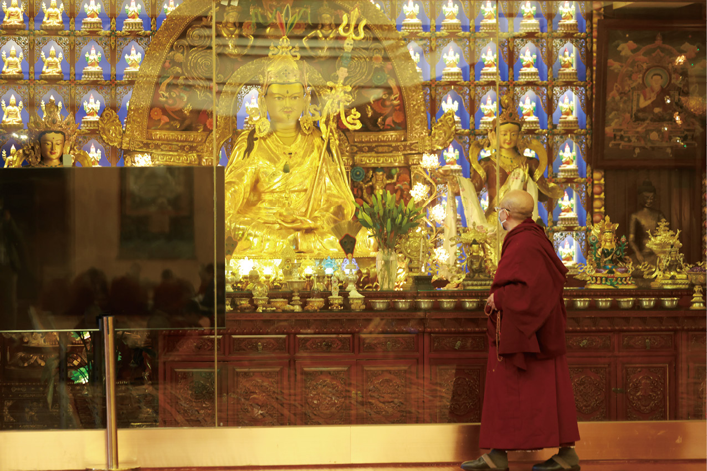
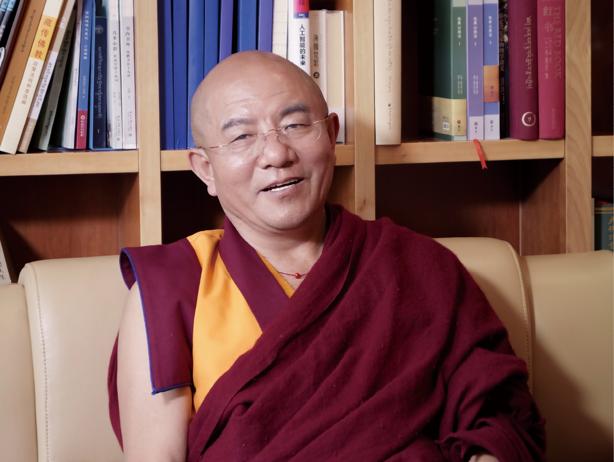

## 不必独自承受

——听大德为抑郁的心灵松绑

2025年8月27日

## 母胎里的佛缘？ 草原少年的四十年求索路

⊙ 问：非常感谢堪布给予这个机会，与我们分享心理健康和佛法之间的关系。首先想了解几个关于您个人的问题：您是如何对佛教产生兴趣的？修习佛法多长时间？是什么时候出家的？

堪布：我从小就对佛教有兴趣，因为我出生于藏地的一个佛教家庭。99%的藏族人都信仰佛教，我父母也同样。所以，我从一来到这个世界起，就对佛法有信心和欢喜心。

我出家是在1985年，那时二十三岁，现在六十三岁，刚好满四十年。可以说，到目前为止，我在人世间，有三分之二的生涯都是出家生活。

⊙ 问：也许您在母胎里就对佛法有兴趣了？

堪布：母胎里的事不好说，也不知道。我生于上世纪60年代，那段时期比较特殊，在母胎中也很难听到佛号。再加上那时刚闹过饥荒，死了很多人，包括我的奶奶。所以，当时没什么胎教条件。

⊙ 问：您所修的主要是什么法？您的老师是谁？

堪布：总的来讲，我修学的是整体的佛法，不分教派。出家后受宁玛派影响较大。

我的老师有好几位。小时候有位日嘎喇嘛算是我的启蒙老师。出家后，初期的老师是德巴堪布。后来到了色达喇荣五明佛学院，主要依止法王晋美彭措。他老人家对我恩德极大，我跟随他十九年。法王圆寂之后，我继续对佛法一边学习，一边探索，一边修行，同时也做一些翻译工作，直到现在。

⊙ 问：在修学佛法之前，您的职业是什么？

堪布：最初的“职业”是放牦牛。我十五岁才开始上小学，在那之前，从童年到少年时期，我一直生活在辽阔的草原上，日日在蓝天白云下放牧。在小学和初中时，我也畅想过将来去当一名医生，或者画家。后来读了师范学校，基本确定未来职业是老师。但是，在接近毕业时我就出家了，所以谈不上有什么真正的职业生涯。

不过也可以说，离开师范学校后，我虽然没有成为社会上普通意义的教师，但是以出家身份，四十年来一直在从事教学工作，从未间断。从这个角度讲，我也可以说自己就是一名老师。

当初师范学校教给我许多世间知识，目标本就是要培养一名老师。如今，很多以前的同学都退休了，而我还在继续教学，这份工作始终没有放弃。所以，我出家后才有真正的职业，就是当老师。

## 现代人的心灵困境： 每四人中就有一人正在挣扎

⊙ 问：下面就进入心理相关的问题了。您如何看待当今人们的心理问题？您是否接触过有心理疾病的人？

堪布：现在心理疾病患者非常多。前几年我去英国时，曾看到一项统计：每六到七个人中，就有一人存在心理问题，包括亚健康状态。而在中科院最新发布的官方统计中，年轻人约有25%存在抑郁等心理问题。现实中这个比例可能更大，因为统计数据的样本比较有限，还有大量人群没有接受过检测，无法确定真实情况。所以，从某种意义上讲，心理问题是现代人普遍存在的。

日常生活中，我也遇到过不少有心理问题的人。尤其是在汉地的城市里，大部分人内心或多或少都积压着各种压力、执著和怨气，导致心态有些失衡。有的人表现特别极端，稍有刺激就情绪失控。比如，一提到某人或某地，他就立刻心生恶意、口出恶言。这种反应已经超出了正常的心理状态。如果是在具体的事情上产生情绪，那还可以理解，但有些人仅仅因为过去的心理阴影，就对那片地区都抱着强烈的排斥，甚至当成人生中最可怕的噩梦和心结——这类反应就有些过激了。这样的人，我有时也会遇到。

⊙ 问：平时您的拜访者多吗？您每天除了自己的常规工作外，会跟信众接触、交流吗？

堪布：我接触的信众并不算多，即使有人拜访，相处时间也不长。比如有时我要面对百十来人，应他们的要求做些加持——通常都是全部排成一队，用经函逐个在头上加持一遍，匆匆忙忙，仅此而已。我每天都要忙着翻译、讲课，还要处理大大小小一堆事务，所以基本没有沟通的机会，无法深入了解每个人的内心状态。

然而，在短暂的接触中，有时也能发现一些迹象，包括在藏族人中。以前我们藏地根本没有抑郁症、焦虑症这类概念，人们只会笼统地说“我有心脏病”或者“我心里不舒服”，这些症状放到现在，可能在医学上会被诊断为心理疾病。在我日常接触的人中，真正有过深度交流的并不算多，我也没有在这方面特意做过研究或访谈。但如果真去调查，应该会发现很多人确实存在心理健康问题。

⊙ 问：有些人特别希求您的加持，甚至从很远的地方前来，您怎么看待这个现象？

堪布：求加持的人有各种情况：一些人是因为虔诚的信心。我们藏地的老百姓一般比较喜欢接受灌顶、摸顶、加持，这是一种传统习俗。汉地和西方也有不少人对此很有兴趣。一些人可能有具体问题想要解决，比如身患疾病，或者心情郁闷，希望得些加持。一些人是在网上听过某位善知识讲法，心里有一定的好感，于是前往拜见。还有些人是慕名或跟风而来，甚至没计划过，只是看别人排队就跟着去了。此外，也有一部分人是为了与佛法结上一个缘。他们的目的是多种多样的，但总体来讲，都是基于信仰，才有这样的行为。

在汉地，儒家等传统思想强调尊师重道，佛教中也很重视对师长的恭敬心。现在世间很多人喜欢追星，总想找机会和明星见个面、合个照、握个手，心中怀有一种向往之情。这种情感也有点类似。所以，不论在东方还是西方，普遍都有这种精神需求，可以说是一种共同的心理规律。虽然在真正的智慧观察下，这类行为有些是很有意义的，而有些似乎只是盲目迷信，但不管怎样，世间就是存在这样的现象。

⊙ 问：即使您有时很辛苦，也会满足他们？

堪布：对。他们每个人都不容易，为了一次拜访，往往要耗费很多时间。我自己以前也拜见过一些高僧大德，当时的心情与现今对照，也有同感。记得有一次，我为了佛学院的事务前往某处拜会一位上师，但那位上师正在闭关，等了很长时间都没见到。当时我心里有些不理解，感到非常疲惫、失落。所以，我想人和人的感受是共通的，无论如何，应该尽量将心比心。

## 佛法背包里的“解忧工具箱”

⊙ 问：如果遇到信众有心理问题，您通常以什么样的佛理来开导他们？

堪布：我在沟通时，通常先要从对方的具体心态和状况来分析。就像中医或藏医，医生给患者开药之前，先要把脉，观察各方面状态，了解详细的病情。佛法也是同样的道理，讲究应机说法，这很重要，因为每个人的执著点各有不同。

遇到有心理问题的人，如果有时间，我会尽量去分析他最大的苦恼或障碍，根据具体情况，从不同角度去开导。有的人自私自利心太重，我就给他讲利他；有的人对名利权情过于执著，我就给他讲无我；有的人暂时听不进道理，我就简单教他念一念不动佛名号，或者修一修金刚萨埵心咒。

所以，沟通的方式不能一概而论，对不同情况要用不同的方法，才能真正对他们有所帮助。每个人的状态、痛点、问题根源、执著焦点都各不相同，因此，需要尽量细致地去分析，沟通才能起到比较理想的作用。

⊙ 问：在这个过程中，您用得最多的是哪一种法？

堪布：我以前经常去高校交流，发现很多师生都有一类问题：心里对某人某事怀有怨气，容易想不开，情绪不断积累，就像肿瘤一样越长越大。所以，我向他们推荐最多的，是佛教中调伏自心的方法。

比如，《入菩萨行论·静虑品》中的禅修之法，可以帮助他们从对自我的执著束缚中解绑，让心更加开阔放松；或者《入菩萨行论·智慧品》中破除人我和法我的分析之理，对于智慧比较高的人，可以逐渐引导他们看清一切的真相；有时我也会讲一些公案。如果有人对伴侣特别贪执，佛经中也有对应的故事可用来开导：有一个人在伴侣去世后痴恋成狂，即使遗体已经腐烂，成为枯骨，还是抱着不放，后来依靠圣者的善巧智慧度化，当下破执开悟。这样的公案也可以启发很多人打破生活中的执念。

总之，我讲得比较多的是禅修调心、无我之理，还有一些简单的修法引导和公案。有些人就如瓜熟蒂落，稍一启发，就立马心开意解。以前有一个大学生，多年来内心一直备受痛苦折磨，但仅仅听了一个小时的佛法开示，就当场释怀了。一旦想通，过去的痛点就再也不能对他构成伤害。可见，当因缘成熟的时候，佛法还是很有作用的。

⊙ 问：您在沟通时，除了开示佛法相关的内容外，是否会分享一些您的个人经验？

堪布：我多数情况下还是倾向于讲佛法，因为佛法是最管用的。有时对一些没有信仰、对佛法不感兴趣的人，我也会推荐他们看看心理学等方面的世间书籍。不过，我还是认为世间理论不如佛法剖析得那么深刻精准，不论是形而上的还是形而下的。

以前我在读师范的时候，也对心理学有所涉猎，包括弗洛伊德、荣格的精神分析法，但心中对这些理论始终存有不少疑惑。直到出家后学了《俱舍论》中的五十一个心所，才发现人的各种正负面的心理状态可以被观察得这么透彻。比如贪、嗔、痴、慢、疑五种根本烦恼，忿、恨、覆、谄等二十种随烦恼，这些状态在论中一一有细致入微的解释和分析，每种分析都对我们认识自己的内心世界有很大意义。

所以，在现实中，我也会根据情况介绍一些心理学、脑科学和神经科学方面的知识，这对消解自己的情绪会有一定帮助。同时，我也会融合自己修学佛法的一些体会和理念来进行分享。

⊙ 问：您认为哪种法或者互动方式比较有效？您通常在什么场合与受众进行沟通？形式主要是一对一，还是对一个群体？可以举一些印象较深的例子吗？

堪布：以我在大学里的交流为例，通常演讲结束后，会有一个互动提问环节。在解答每个人的问题时，虽然是面向提问者一人，但现场其他人也会有同感。所以这也相当于对所有听众共同的回答，很多人可以同时得到一些收获。记得以前我在香港理工大学做过一场演讲，题为《怎样面对痛苦》。过程中我通过一些具体的案例和修法，来讲解应对身心痛苦的不同层次的方法，很多人听后都觉得比较有意义。互动中有人提出了很有针对性的问题，当时我们进行了很好的沟通。

一对一的形式主要是与各界学者的对谈交流，其中也包括一些心理领域的专家。比如去科罗拉多时，我就与当地的教授探讨过如何应对当今学生心理方面的问题。所以，各种场合下，一对一或一对多的沟通方式都有。

有些场合确实令我印象较深，比如在泰国举行的世界青年佛学研讨会上，我们与基督教、伊斯兰教，以及儒家、道家等不同宗教和文化的代表，一起围绕如何追求心灵幸福、如何清除负面情绪等议题展开交流。其实，每种宗教和流派所阐发的观点，基本上都是殊途同归的，都在引导人认识负面情绪的根源。在这方面，有些宗教的理念确实是很好的。

我自己认为，要消解内心痛苦，归根结底是要认识自己的心。因为承受痛苦的是这颗心，制造痛苦的也是这颗心。不管是从心理学的层面，还是从大乘佛法的层面，只要深入剖析，找到心这个痛苦根源，很多问题自然会迎刃而解。但如果不能认识到心的真相，我们在世间的痛苦就会永远无边无际，难以止息。

## 痛苦的共同密码： 想要的太多，能控制的太少

⊙ 问：如果对某些人的帮助没有达到您的预期，您会感到沮丧吗？遇到这种情况，您会有什么想法？

堪布：这种情况也会遇到一些，但我一般不会有太大的沮丧。因为我知道，世上任何一件事，并非我想做就能完全如愿。古今中外，任何地方，每个人都有自己美好的愿望和理想，但是真正要实现，总会存在种种困难。

比如，我尽心尽力培养一个人，结果这个人后来非但没有成材，反而给我的工作和事业制造了很大的违缘。在我讲经说法、教书育人的过程中，这种情况确实发生过。原本期望他能令自身和众生得到一些利益，但事情的发展却与愿望背道而驰。这种时候，我也只能以一种清净心，或者无怨之心来面对，除此之外也别无他法。一切都是缘聚缘灭，因缘具足时会呈现好的结果，但因缘不具时也没有办法。

⊙ 问：当一些内心痛苦的人向您分享他们的强烈情绪时，您是否会因感同身受而影响到自己的心情，比如感到低落、哀伤，有种无力感？如果有，您如何对治？如果没有，是什么让您的心力如此强大？

堪布：这种时候可能任何人都会受到一些影响，尤其是当你面对一个极度痛苦或极度无奈的人时。比如说，在我们资助贫困学生的公益项目中，今年计划的名额已经满了，然而还是有很多人没帮助到。昨天就有一对非常可怜的母子找到我，但助学基金会实在无能为力，最后我就以个人的方式提供了一些帮助。当时我看到他们家庭的艰难状况，还有脸上的愁苦神情，也有些动容。

有些时候，我们会看到有人病得特别严重，有人精神濒临崩溃，有人生活本就困难，还欠了很多外债。我们毕竟是人，目睹这些情形，确实也会有一种无力感。总有些事情是无能为力的，因为我们无法把天下所有人精神和物质上的贫困全部消除。但是，即使自己不能彻底解除他们的痛苦，在力所能及的范围内，能帮多少就帮多少。同时，我也会调整心态，少受外境的负面影响。即使我随之忧虑、随之痛苦，也没有什么意义。

这个世界上很多事都是因缘使然，如果因缘不具足，一个人再怎么努力也很难改变他人的命运。世间人也说，“可怜之人必有可恨之处”。有些人可能就是因为前世造了太多恶业，今生又不好好精进，这才导致了如今的后果。所以，我很希望他们自己能多忏悔、多努力。

总之，只要没有后悔，也没有实际困难，我会尽量去做一些力所能及的事。

⊙ 问：关于佛教对心理疾病带来的帮助，您怎样看待？

堪布：我认为心理疾病要分成两类来看。有一类的原因是前世造过相应的恶业，比如将其他众生从高处摔下，或者故意杀死，令其产生了强烈的恐惧和嗔恨。这种业力一旦在今生成熟，就只能承受痛苦的果报，即使依靠佛法也很难完全对治。另一类则是由于现实生活中的各种因缘，导致内心被焦虑、抑郁等痛苦情绪所折磨。对于这类患者，如果以佛法中一些甚深的道理来进行开导，很多人是可以获救的。

以前有个人就跟我说过，如果不是遇到佛法，他早就自杀了。很多人可能都有过类似的经历。当时他的整个人生，包括企业、家庭，几乎全部崩溃了，非常悲惨，但幸好后来系统学习了佛法，逐渐从黑暗中走了出来。所以，如果真正去学修佛法，很多人确实能得到极大的帮助。

⊙ 问：一些心理疾病患者没有选择专业的心理咨询和治疗，而是来佛法中寻求帮助，您认为原因是什么？

堪布：学佛并不意味着不需要选择专业治疗。我遇到的这类人中，大部分也会去找心理咨询师、找精神科医生、找中医，尝试各种治疗方法。这种情况也要讲求一点根基，与佛有缘的人，更容易从佛法中获得帮助。毕竟佛法中有些理念并不好接受，比如让你放弃自我、全心利他，这在大部分人看来是很不现实的。这个时代人们普遍以自我为中心，主张“爱自己”，但实际上很多人爱自己的方法是错误的。越是在意这个自己，就越增加痛苦。但如果把关注点反过来，多去关爱别人，自己反而会得到拯救。这是一种非常奇特的规律。

佛法中有很多看似反常识的地方。拿中医打个比方，通常热病要用凉药来治，但有些高明的医生，反而开热药来以毒攻毒，见效往往更快。所以，世界上对治与被对治法之间的关系非常奇妙，这背后其实有极为甚深的规律。我觉得，佛教中很多方法，跟医学中一些道理有类似之处，有自身独特的作用和效应。

## 当“爱自己”成为主流， 佛法为何用“利他”来治病？

⊙ 问：您所接触的不同年龄段的心理问题，是否存在某些共同成因？

堪布：不管是少年、中年、老年，大部分人的心理问题有一个共同的成因，就是对自我过度执著。

现在各种媒介信息都在营造一种过度理想化的人生，让很多人觉得自己的事业、财富、感情应该非常完美，生活必须充满快乐和享受，然而，现实中这是根本达不到的。当过高的愿景与实际情况天差地别，差距无法弥补时，就容易产生落差感。这种落差在心中不断积累，就会触发很多痛苦。

我觉得现在很多人心理问题最大的根源，就是我执带来的落差，不管男女老少。这种心态如果成为一个解不开的结，世界在你眼中会慢慢变得扭曲。其实只要把心打开，世界原本就是很美好的；内心如果被死结堵住，即使你身在天堂，也会充满焦虑和痛苦。

从佛法的角度来讲，除了极个别人是因前世业力导致心理疾病，大多数人的症结都在于对名利权情太过执著，同时对所执著的东西又无法得到。求而不得的时候，内在外在的各种压力就会纷至沓来，最后整个人像被埋进压力和情绪的粪堆之中，完全无力自拔，时间一长，身心就会开始崩溃，逐渐滑向堕落。到了一定的时候，就会丧失面对生活的勇气，陷入恶性循环。有些人就是因为这样，最后选择放弃自己的生命。

所以，对于现代人的心理危机，很有必要进行深入的了解和分析。我经常劝一些内心痛苦的人去学《心经》、学中观，了解般若空性。如果明白了自己执著的一切事物本质上都是假立而成、毫无实体，原有的执著自然就会减轻。就像一个小孩因为得不到玩具而哭闹不休，甚至要死要活，但在大人眼中，这不过是个玩具，何必执著，即使得到也仅此而已。

归根结底，心理上的痛苦与执著自我有很大关系。如果懂得缘起性空的道理，接受缘合则聚，缘灭则散，很多人会从中得到一些利益。

⊙ 问：您的分析一针见血，一方面是我执的内因，一方面是外界的影响。

堪布：对，内心极度渴望，但外在却不如人意。想法与现实产生落差，就会开始抱怨世界、抱怨他人。尤其是现在很多人对感情特别执著，但感情的事往往难以掌控，不是你想怎样，别人就得怎样，因为每个人都有自己的处境。

这个世界不会以你的意志为转移，不管是物质世界还是有情世界。一切都如同河水一样不断向前奔流，背后自有一种推动力，在这种力量下，不论人还是物，都没有完全的自由。你希望家庭幸福、财富丰盛，但家庭由多个成员组成，每个人都有各自的因缘，你未必能掌控，物质方面更不用说了。万事万物都随因缘滚滚流动，不断前进，如果你想强行控制，会非常痛苦。试图以个人的意愿去主导一切，是不现实的。正因如此，佛教才经常劝人随缘而行。学会随缘，是很重要的。

⊙ 问：如您之前所说，贪心是一种幻想，得不到就会令人非常痛苦。

堪布：对，贪欲是很可怕的，它是人们幻想出来的一个特别美好的天堂，但是这个天堂你很难去到。幻想跟现实总是差别很大，但这不能完全怪别人。你自己也好，对方也好，彼此间的种种事情背后，都有许多复杂的因缘。只有各种因缘全部聚合，你所追求的才能得到。

所以，现在全世界虽有这么多人，但真正能“如愿以偿”的寥寥无几，只不过空有这种说法而已。

⊙ 问：在帮助心理不健康者的过程中，您遇到过什么挑战吗？

堪布：困难总是有的，但重在坚持。要做成任何一件事，过程中都会遇到麻烦，哪怕是开车、出游这样的小事，关键是不要因为有困难就轻易放弃。既然选择了这条路，决定去行动，就应该坚持下去。要有一种勇往直前的精神，才能战胜各种挑战。

要帮助有心理问题的人，首先要看到他们的痛苦——是什么样的煎熬，让他们连自己的身体和生命都不在乎？让他们顾不上家人和朋友，一次次伤害身边爱他的人？让他们失去对自己的控制，变得无惭无愧，甚至在众人面前做出极端的举动？理解他们被心理疾病折磨的痛苦，才能真正去悲悯和关怀他们。

作为学修大乘佛法的人，不管对方如何抗拒、责怪、不领情，我们都能接受，只要一心一意去帮助他就够了。如果相续中有真正的利他心，那任何挑战都可以尝试。一次不行，就再试一次。就像一位母亲看到孩子病了，会尝试各种各样的方法，一心想把孩子治好。

大乘行者应该有一种勇气，不管遇到什么阻碍，都能跨越过去。想帮助别人，需要具备这样的心态，一方面要接得住别人的烦恼和痛苦，一方面要保持自己的动力，不会停止前进。

## 苦不堪言，因为从未真正“看见”你的心

⊙ 问：相较于其他人，是否有佛学背景的人经过佛法的帮助后，心理问题更容易得到改善和治愈？

堪布：这也不一定。有些人虽然没有信仰，但同样能快速吸收佛法中的道理。比如无我之理，这不是从信仰上讲，而是以逻辑得出的结论。虽然人人都觉得有个“我”存在，但通过推理分析会发现，所谓的“我”只是五蕴假合，并不真实。明白这个道理后，就能削弱我执，我执减少了，痛苦自然也会减少。这种理念，任何人理解后都能获得极大的启发，不论有没有佛学背景。

如果只是从信仰的角度来劝导，那确实是有信仰的人更容易被调化。但佛法不仅仅是一种信仰。依靠信仰来成就的，是钝根者；依靠智慧来成就的，才是利根者。心理疾病患者中不乏智慧卓越、擅长分析、逻辑思维强的人，他们也许暂时因疾病影响而无法理性思考，但借助佛学中的逻辑推导，立刻就能发现，自己执著的只是一个虚假的幻相。就像一个人长期抱着个假的空壳不放，一旦看清真相，即使还存留着一些过去的习气，但至少也会开始慢慢放下。

所以，在我接触的人中，有时候非佛教徒比佛教徒还更容易点拨。道理一听进去，就像拨云见日一般，马上能从中了悟、心开意解。这样的人也是有的。

⊙ 问：对于心理问题的成因和解决方法，哪些佛教理论或典籍中有直接的阐述？

堪布：首先是佛教中的“阿毗达摩”诸论典，其中对人的心灵世界有非常详细的阐释。我早年读师范的时候，对心理学比较感兴趣，但后来学了《阿毗达摩俱舍论》，觉得其中的心理分析是最有启发性的。

如果稍有一些修心的能力，可以参考《大圆满心性休息》。这部论会教你如何让这颗在尘世中疲劳不堪的心得到安宁和休息。

《优陀那经》也很值得推荐。通过聆听佛陀在经中的教导，我们会了知无常的本质、贪嗔的过患。现在大多数人都看不清世间的真相，意识不到死亡随时会降临，一直在烦恼中耽执沉迷，正如经中所说“愚者无智慧，行如不死亡”。而真正有智慧的人，通过佛陀开示的妙法，能了悟人生的真理。

《优陀那经》是从声闻乘的角度宣讲诸法的真实规律，而《菩萨地论》《学集论》《入菩萨行论》，则以大乘利他思想为导向，分析了我们内心的种种状态。学习这些经论，对减轻心理问题会有很大帮助。

⊙ 问：密续中是否有对我们的大脑和心理进行分析的内容？

堪布：密续中确实有分析大脑、身体的内容，但在佛教中，更重要的是对心进行观察。

现在世界上很多人都相信唯物论，认为很多心理问题是由大脑功能病变而产生。我们也不否认有这方面的因素，但从佛法的角度来看，根本在于心。

要明白心到底是怎么一回事，大圆满十七大续部和《七宝藏》等论著中，有非常深入的阐述。最重要的是，大圆满中有真正能让我们认识心性的方法。一旦认识了自心的真相，所有烦恼和痛苦，自然会烟消云散。这也是佛教中常说的“烦恼即菩提”，领悟了这个道理，心就会自然清净。这是很重要的。

⊙ 问：佛法对心理健康确实有很大帮助，但听说也有人在修行佛法的过程中出现心理疾病，甚至精神出了很大的问题，这是为什么呢？

堪布：这种情况在佛教徒中虽有发生，但并不常见，对比修行人的整体人数，有心理问题的只占极小比例。即使出现个别例子，也不足为奇，就像前几天国内一位脑梗专家自爆：他天天治脑梗，结果自己也得了脑梗。这件事一时间引发了很多关注。也有肝病专家，一辈子治别人的肝病，最后自己却患肝病而死。世界上确实也存在这样的案例。

大多数修行人运用佛法解决自己和他人的心理问题，都是成功的。所以，个别特例不能代表什么。就像不能因为一个医生得了病，就认为医生没用——该看医生时还是照样要看。

佛教人群中，如果有人出现这种问题，有的可能是因为没有依照正规的方法来修行，有的可能是因为前世的业力现前，必须承受果报。总而言之，学修佛法对身心健康是有益的。当然，我们也会看到，一些很好的修行人同样会罹患疾病，但依靠修行，他们自身并没有太多痛苦。也有一些情况，是佛菩萨故意以此为众生示现无常。

世间有些人习惯用个别特殊事例去推断整体，这是不合理的。比如，某个出家人破戒了，不代表所有出家人都不好；某个教师犯错了，不代表这所学校不行。不能以点概面去下结论，因为任何群体中，都有好的例子和坏的例子。而坏的例子，详细分析之下，也是由特殊的因缘所导致。另外，有些说法如果真正去深入调查，也许只是个谣言。新闻事件也好，大众舆论也好，往往是以讹传讹，编造之言到处流传的情况也不在少数。所以，要对具体问题做具体分析，才会得到正确的结论。

## 给科学家的邀请函： 共建一座连接心理学与佛法的桥梁

⊙ 问：现在有很多人在做心理健康和佛法之间的跨学科研究工作，请您给他们一些建议。

堪布：我认为心理学、脑科学、神经科学的工作者，都是相当伟大的，他们对人类的身心健康做出了很大的贡献。然而，在对心灵奥秘的探索上，到目前为止，这些学科的研究仍存在一定的局限性。这主要是因为研究方式大多停留在物质和感官的层面，很难直接触及更深的层次。例如，心理学对于人类心灵和情感的本质、状态、分类、来源，至今还没有一套特别扎实的理论体系。所以，我个人认为，心理和佛法之间的对话，是很有必要的。

如果要做这种跨领域的研究，首先最好多了解佛法的理论。这有利于心理学工作者看到专业领域之外的可能性。将心理学与佛法中的相关内容进行对比，会发现现有的心理学理论还不够完善。比如佛教声闻乘中，就有对各种心灵现象更加系统、透彻的分析，相对而言更像一套完整的“心理学”。至于大乘和密乘的理论，则更为深入，直达本质。所以，建议有这方面兴趣的研究者，先花些时间参阅一下佛教经论中的相关内容，你一定会受到来自两千多年前的智慧的启发。

通过佛法，你不仅可以更好地了解焦虑、抑郁等问题的根源成因，而且能掌握很多具体的干预方法，这也有助于建立一个更为系统、有效的治疗方案。心理问题与很多慢性病相似，不是吃一两次药就能解决的。如果你是高明的医生，就要对病人的整体状况和疾病的来龙去脉全面把握、深入分析，然后才能从根本上对症下药。

这个话题非常有意义，我也多次与心理学领域的专家学者探讨过。以前我去澳大利亚交流时，就与悉尼大学的心理学专家讨论过如何改善学生的心态。当时我介绍了佛法中一些剖析自心、认识自心的方法，交流过程中我们彼此很有共鸣。现在心理学和佛法之间还没有建立起实际的桥梁，如果真正实现了跨领域的合作，会给大众带来全新的解决方案。比如，内观自心的这套方法如果普及开来，很多人就不会一直被负面情绪束缚，至少能学会让心放松下来。一旦能够放下并安住自心，各种痛苦和压力会随之转化。如果没有对心的掌控力，即使外在的条件样样具足，内心的困扰也难以解开。

所以，我们要明白，在这个世界上，财富、地位、美貌固然值得向往，但一个健康正向的心态，其实对自己的人生更为重要。通过佛法中禅定、无我、利他等方式，我们的心会自然而然变得纯粹、清净、稳定，这种心态，会给予我们应对一切内外动荡的力量。

我刚才遇到一个带孩子的女子，她一直向我哭诉，自己的丈夫出轨了。为此她几乎痛不欲生，成天饭也吃不下，觉也睡不着。我看她一副消瘦憔悴、凄惨可怜的样子，就劝她：“世界上除了你丈夫以外，还有很多值得珍惜的人和事。你应该先照顾好自己，不要再自我折磨了。如果一直放不下执著，只会把自己毁掉。”当时她身边的小女孩一直在玩手机，她的世界里没有这种痛苦，偶尔抬头看看妈妈的眼泪，又低头继续玩自己的。

我继续安慰：“你固然可怜，但完全有能力带着孩子好好活下去。你之所以这么痛苦，都是因为放不下心里的执著。但要说这件事有多么严重，其实也不算什么。你的遭遇在这个世上只是寻常不过的事，用不着这么难过。”当时她的情绪看似稍有缓解，不知最后能不能想通。

我们每个人都会在人生中遇到各种各样的坎，如果越不过去，就可能对自己绝望、对社会不满、将身体搞垮，甚至做出一些极端的行为。如今这种情况越来越严重。这主要是因为人们从小就缺乏心理健康方面的教育，没有形成健全的人格和心智，长大后又受到外部世界飞速变化的冲击，所以内心很容易失衡。到了某个程度，人就会崩溃，而一个人的崩溃，又会直接和间接地波及整个家庭。所以，心理危机也是这个现代社会的危机。

我们藏族人常说这样一句话：“没有钱可以，没有健康的心不行。”确实，其他任何东西都可以失去，但一定要护住自己的心。即使在监狱里，也有人活得很开心，他的天也没塌掉，虽然处境不好，但是心态很好。而有些人明明拥有自由自在的生活，却把内心套上枷锁，作茧自缚，不得解脱，这才是真的可怜。现在很多人情绪波动非常大，今天还一切正常，明天就像发了疯一样，什么都受不了、看不惯，有时比狂象还厉害，恨不得摧毁一切。这种状态是很危险的。

⊙ 问：有一些人的心理疾病看起来好像已经痊愈，但后来又复发了，这是什么原因呢？

堪布：这种情况并不是真的痊愈。他的心中依然埋着症结，一旦受到刺激，就会再次爆发。实际上，问题并没有彻底消除，只是暂时被压伏而已。如果问题重新冒头，可能会更加严重和猛烈。

所以，佛法始终强调要调服自心。心安一切安，心安一切乐，只要心能安定下来，一切都不再是问题。如何让心安定呢？说简单其实也很简单，只要向内观察一下自己的心，就会发现它在哪里都找不到，无色、无形，没有丝毫实质。既然连心都不实有，哪里还有真实的痛苦呢？

我前阵子发了这样一条微博：“如今，‘爱自己’已成为一种流行的口号。然而，真相是，‘自己’根本不存在。若能领悟这一道理，才是真正的爱自己。”当时点赞率很高。爱自己是很重要的，但大部分人都不明白什么是爱，什么是自己，更不明白如何真正爱自己。抱着这个虚幻的自我紧紧维护，并不是真正的爱；相反，把自我放下，让执著的心渐渐放松，就会自然而然获得安乐喜悦，这才是最大的爱自己。
