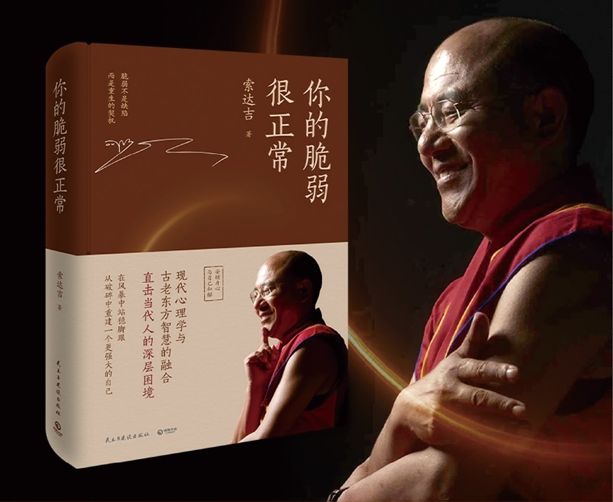
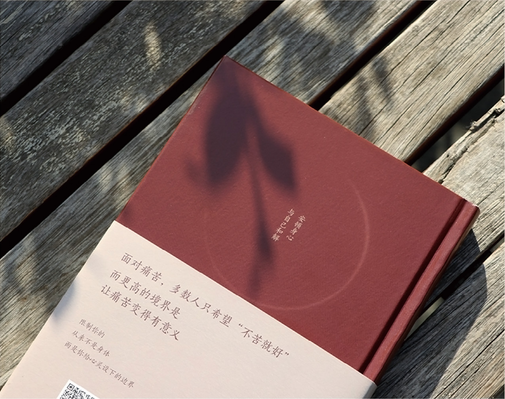
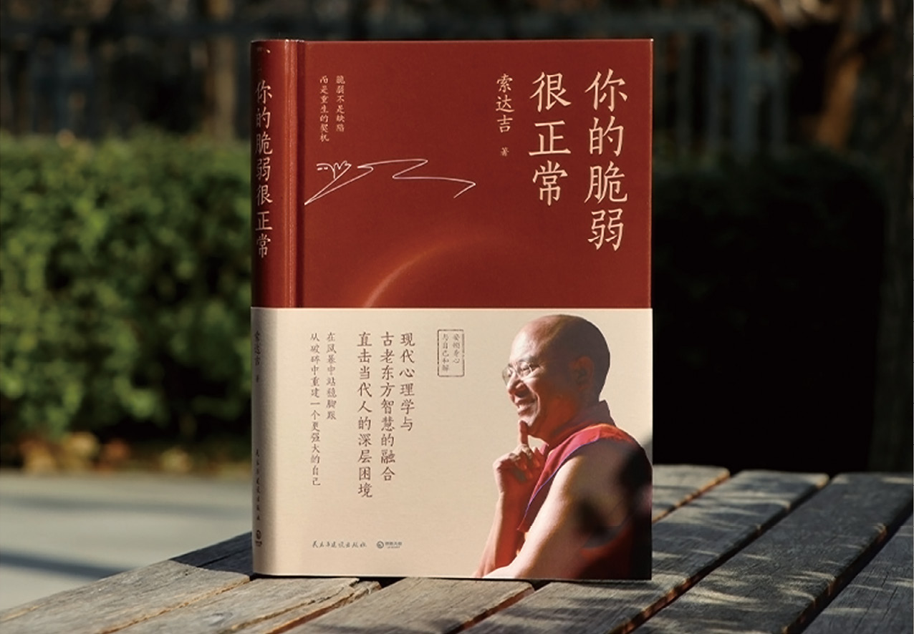

# 与索达吉堪布谈谈新书 《你的脆弱很正常》

——给脆弱时代的“心”解药

2026年3月4日

⊙ 问：堪布，您好，非常荣幸今天能有机会与您交流。一拿到您的新书《你的脆弱很正常》，我就迫不及待地开始阅读。这本书令我十分惊喜，书中每一篇文章都让我产生强烈的共鸣和启发。我觉得这本书写得真的非常用心——直指现代人的迷茫以及在充满各种未知数的社会里生存的焦虑。阅读时，仿佛在与您面对面聊天，很亲切，很温暖，像一次促膝长谈。

您是出于怎样的因缘，决定写这本关于“脆弱”的书？

堪布：在动笔之前，我确实经过了较长时间的观察与思考。

我也算比较了解现在人的心态。大约从2009年开始，除了传统的讲经说法，我去了很多高校、监狱、企业等不同的社会团体。我去这些地方，并非只是完成一场演讲，而是希望切实了解当下不同人群的心灵问题——他们的烦恼、痛苦与不安。

一方面，我自己在内心发愿，希望能尽量遣除、解决人们内心的困惑和痛苦；另一方面，也尝试将我所熟悉的佛学智慧与当下的社会现实和知识体系相结合，把一些有益于心灵的道理更好地传播出去。

我生长在佛教家庭，自然而然地对佛法产生信心，也在潜移默化中建立起了修行佛法方面的根深蒂固的见解。许多世人普遍存在的烦恼和负面心态，在我看来，是非常不足挂齿的。但今天，似乎越来越多的人变得格外脆弱，不堪一击，稍有挫败和不顺就陷入极大的痛苦和自我折磨。

正因如此，我想到用“你的脆弱很正常”作为书名。许多人外表看起来一切圆满——财富、地位、青春，样样令人羡慕，可一旦深入他们的生活与内心，便会发现，焦虑其实无处不在。人们很难接受生活中微小的不顺，心理承受能力极其薄弱。

基于这些观察，我在各个不同地方做演讲的时候，有意识地收集了大家普遍反映的困惑与痛苦。希望通过这本书来帮助大家解决内心的问题。

这本书的一个特点就是没有采用佛教理论和框架，无论读者是否有信仰、信仰什么，都可以阅读。语言上也通俗易懂，希望大部分读者都能轻松阅读并有所收获。

## 一、脆弱的背后：为何我们不堪一击？

⊙ 问：现在的年轻人经常觉得自己是玻璃心，老板一个眼神、网友的一句评论，就可能让他们感到挫败、丧失行动力。大家拼命追求完美、迎合外在标准、渴望被认可，结果反而越来越迷失自我。

您会不会觉得，这一代年轻人太过脆弱了？

堪布：那倒不会。

从某个角度说，每个人的内心都有不同的脆弱点，也就是所谓的玻璃心。稍微遇到一点事情就容易波动，甚至崩溃。这种情况并不罕见。

甚至有一些人做出极端的选择，并不一定因为发生了多么严重的事情，而是内心无法自我调整。我曾经在微博上写过：“调心是智者，调心最快乐。”这是我的老师法王晋美彭措曾引用的教言。我在很多书里都曾提过，能够调伏自心，是有智慧的表现。如果我们懂得调心，在任何境遇中，都可以保持快乐。

哪怕是被关在监狱里的人，如果能很好地调整心态，也能在局限中找到乐趣；反之，如果内心失去了平衡，即便拥有世间所有令人羡慕的财富、权势、容貌等等，也未必感到幸福。

可见，一切都取决于我们的心。如何调心，实在非常重要。

## 二、如何调心：看见“人生如梦”的实相

⊙ 问：讲到调心，很多人其实没有相关经验，不知道那具体是一个怎样的过程。您在书中提到，现代人的迷茫源于内心的失衡。现代人的脆弱是不是来自于自我认知的偏差？而调心就是重新校准自己的认知偏差呢？

堪布：许多人不了解调心也是情有可原的。这与我们一直以来接受的教育也有关系。

其实在中国传统文化中，无论是儒、释、道，一直都很重视“心”的修养，强调内观、调伏自心。但在西方主流文化中，并没有像东方文化中这样成熟完整的调心体系，往往更倾向于将“心”视作某种实有的物质。

如果要用一种方法来概括调心，最根本的是建立起一种人生如梦如幻的心态。从深层意义上说，人生确实如同一场梦。只不过，世界上百分之九十九的人都不知道是一场梦，甚至可能一辈子都醒不过来。

这个说法，听起来可能和主流观念不太一样。但古今中外许多哲学家和智者，早已经通过对人生方方面面进行观察和剖析，得出了人生就是一场梦的结论。之前有首歌叫《大梦》，一度非常流行，正是表达相似的感悟。为什么说人生是一场梦？在理论上，可以进行非常细致深入的剖析。

总之，在这个世界上，我们的心非常重要。一旦我们开始反观自身，去了知我们的心的每一个状态，便逐渐能看清外在世界的本来面目。

可惜，许多人终日忙碌奔波，说许多无关紧要的话，做很多意义不大的事，大脑里也充斥着各种杂念。有些事是为了生存于这个世间不得不去做的，但更多的追求和欲望却是没有必要的，缘于无名愚痴和颠倒妄想，将我们紧紧束缚在一个虚幻世界里，难以走出。

在这样的情况下，确实需要一些调心和内观的方法，帮助我们更好地与自己、与世界相处。

## 三、把逆境视为机遇

⊙ 问：您的一生经历了许多常人难以想象的起伏，见证过高光辉煌，也经历过困难低谷。在那些高光和困难时刻，您的内心会不会也有波动？“人生如梦”的这种见解是不是您人生的锚？

堪布：我不太确定，这种平静的心态来自宗教信仰和修行，还是我性格本就如此。我曾两次患上严重的癌症，但这样的重病似乎并未对我造成很大的损害。如今十几年过去了，回想起来，当时面对疾病的心态是比较平和的。

心理暗示对人的影响非常大。有一个著名的实验：科学家征得一名死刑犯的同意，告诉他将以放血的方式执行死刑。他们蒙住犯人的眼睛，用冰块划过他的手腕，同时播放水滴声，模拟血液流出的感觉。实际上，他的手腕未被割破，但一段时间后，犯人却因坚信自己正在流血而死亡。

同样，一个人的心态极其重要，心态如果崩溃了，身体也会随之垮掉；心如果特别坚定，外在的困难和身体上的痛苦都不足以将他击垮，总能度过难关。

我所经历的事情如果放在别人身上，或许早已令人崩溃。但在我遭遇人生最大的违缘与障碍的时候，我个人还是比较淡定的，甚至将之视为开启另一条路的契机。我更愿意把逆境看作一种机遇。如果这条路确实走不通了，那就换一条路。就像堵车，大多数人会觉得浪费时间，内心非常烦躁。但我可以在堵车期间做点别的事，保持心态平和，也把时间利用起来。

2011年，我身患数病，各种违缘同时现前，似乎无路可走，也实在无计可施。但在住院期间，我完成了《释迦牟尼佛广传》的翻译，有500多页。还整理、写作了其他文稿，如访谈录、《旅途脚印》等。换作别人，面对那样的境遇——在医院里煎熬五六个月，恐怕早就崩溃了。确实，那样的境况对我而言当然也不容易，但我每次遇到极大的痛苦和困难，都试着把它视作是人生中最好的机会来对待。

⊙ 问：这需要巨大的自信和勇气，普通人遇到您所经历的困难的百分之一、千分之一，可能就已斗志全无，也不相信自己能够面对。但您有一种非常强大的自信心，不论遇到什么，都相信自己遇到的是一个机遇，可以继续走下去。您的这种自信心来源于哪里呢？

堪布：这样的信心，其实每个人都本自具足。我们很难简单地断定说这个人是强大的，那个人是脆弱的。关键是要正确地认识并找到自己的信心。

任何人在遇到不顺、感到无路可走时，都会很痛苦，毕竟那是自己曾经选择的路。但在那之前，我们其实可以提前做好心理准备：这条路，有可能走不通。如果真的走不通，一方面不必强行再往下走，没有必要把自己逼入绝境；另一方面，可以学习将障碍转化为机遇。这并不需要多么强大的心理素质，是每个人通过练习都可以做到的。

我也并不是心理非常强大，什么都不怕，照样会痛苦难受，只不过是掌握了一些方法。当一条路走不通时，你要学会将它视作一种机缘。这不是口头上说说、心里想想就可以，而要真正地付诸行动。因为此时就算痛哭也无济于事。就像堵车时，你再着急车也不会动；生病时，再怎么哭也无法让病情立刻好转。面对困境，就需要调整内心，用一种人生如梦的体认，让心态放松下来。心态一放松，看待问题的角度就会改变，再难的事情也可能出现转机。反之，如果内心越来越执著、紧绷，最后可能真的会一败涂地。

我希望大家在遇到不顺时，能尽快调整自己的心态。这种方法无论男女老幼都适用。人生之路从来不是固定不变的，它会随着我们的起心动念与选择发生转变。这种转变不依赖他人，也不仰仗外境，完全取决于自己。

实际上，大部分困境并不像我们想象中那么可怕，而是我们在发生之初就预设了它的困难程度，习惯性地认为自己抗不过去。当脑海中充满了“我很倒霉、很惨”“我完蛋了”这类负面念头时，就会在自怜中加剧心理的崩溃，人也变得更脆弱。

但如果此时我们能运用一些方法，将心态转变过来，就像在黑夜中行走时看见曙光，对自己的前路便会清晰许多。眼前的困难，也就不算什么了。

## 四、选择的智慧：用理性穿透焦虑的迷雾

⊙ 问：所以您的信心，其实来源于一种非常务实的认知：如果一条路走不通，就换一条路。

但很多时候，大家不是不明白这个道理，而是更容易陷入负面的惯性，不断自我暗示，让事情变得越来越糟。这里仿佛存在一个岔路口：是积极面对，还是被负面习气牵引？

当一个人处在谷底，面前似乎只有两个选择：一是接受“命该如此”，然后躺平、自暴自弃；二是相信自己能转化这一切。那个“转念”的瞬间非常微妙。在决定向左还是向右的十字路口，您有没有什么具体的窍诀，能帮助年轻人在那个瞬间生起向上拉自己一把的力量，而不是顺着惯性滑下去？

堪布：现在很多人都有“选择困难”。小到出门穿什么衣服、带什么东西，都要花半天时间去思考、抉择，来来回回地纠结。这本质上也是一种比较严重的焦虑。

记得我当年考完师范学院，究竟要不要去上学，家里人各有各的看法。父亲说最好不要去，还是要出家。母亲觉得家里条件不好，当老师也是个出路。亲戚朋友也是众说纷纭，意见不一。我实在不知道要如何抉择，实在没办法，最后打了个卦：现在去读书，不会对未来出家有所影响。

在藏地，遇事难以抉择时，打卦是一种常见的参考方式。当然，打卦也不见得次次都准。幸好，我那一次打的卦还比较准。

其实在这种时候，最重要的是运用自己的理性智慧去抉择。你需要全面、综合地思考：原来的路是否真的走不通了。如果走不通，就没必要按照惯性思维继续硬撑。即便还能走，它对未来的自己是否有真实的利益。如果选择放弃原先的路，重新选择一条路，也要认真观察和判断。如果自己无力判断，可以向有经验、有智慧的过来人请教。古代典籍中也说，在自己不清楚的情况下，应当咨询他人。

在与他人分析和讨论的过程中，很多困惑自然会解开。否则，很多选择在初始阶段显得无比艰难，但经过理性分析，往往会清晰起来。即便最后结果不尽如人意，也不会后悔，因为当初并不是简单草率地做出选择，还是用自己的智慧，经过细致的思考和分析，也参考了他人的意见。

因此，在重大选择上，不能简单粗暴地下结论，而要用理性、细致的智慧进行分析。这样做出的选择，通常就不会有大的偏差。

⊙ 问：理性的思考的确很有帮助。

您刚才提到的选择困难的现象，对现代年轻人来说，做选择真的太难了，因为我们仿佛活在一个极其严苛的生存游戏里，每个人头上都悬着一条斩杀线，必须拼命维持脆弱的平衡。一旦越过这条线，就好像整个人生就会彻底崩塌，再也没有东山再起的机会了。

年轻人普遍的选择困难，背后其实是巨大的不安全感。我们总想找到那个最优解，不惜花费大量时间对比、研究、刷攻略，这背后的潜台词是“我输不起”。我们总感觉社会的容错率太低了，一次职业选择失误，错过一个风口，甚至只是生一场病，慢了一步，就可能直接跌落，再也回不到原来的轨道。

堪布：按照我个人的观察，许多事情其实并非真正的大事，在这些事上不值得投入过多时间精力。比如买件衣服、规划一次旅行。在真正的大事上，则可以按照我刚刚说的方法，认真思考、研究后再做决定。

现在很多年轻人认为，选错了一次就没有重新再来的机会，其实也不尽然。很多时候，我们是受到了网络上过多负面信息的影响。这是一个信息爆炸的时代，真假难辨的信息充斥网络，如果把这些信息全部当真，并投入时间精力进行研判，反而耽搁了自己真正要做的事情，很多烦恼油然而生。

所以，对真正重要的事情，应当投入时间去抉择；对很多琐事，则不要浪费自己宝贵的人生。对大部分事情，其实都可以抱持“成也可以、不成也无所谓”的心态。否则，一直沉溺在无意义的信息泥潭里，始终都无法解脱出来。

⊙ 问：但很多时候，困扰大家的不只是小事。例如，在一些社会环境中，一个人失业了，马上面临的现实问题就是付不起房租，很快就会流落街头。所以很多人做重大决定的时候，如履薄冰。

您做决定时，一方面很谨慎，另一方面又非常果断，这是怎么做到的呢？

堪布：人们所担忧的事，有相当一部分属于杞人忧天，并不会真的发生。有时越是担心，事情反而越容易向坏的方向发展。当然，像你提到的这种极端情况——比如因投资失败而付不起房租，乃至流落街头——虽然属于个别现象，但确实存在。如果真的遇到这种情况，仅靠心态调整是无法解决现实问题的。当业力现前，或因自己过去的所作所为导致相应的后果呈现时，即使心理素质再好、方法再多，也很难坦然面对和彻底解决。

不过，遇到这种情况的人毕竟是少数。大多数人之所以觉得走投无路，往往是因为把情况想得过于严重了。每个人都有应对困难的方法，也可以向亲友求助，出路总比想象中多一些。

总之，在心态上，我们可以提前做好一种准备：对任何事情，抱最好的希望，同时做最坏的打算。这一点对大多数人来说非常必要。因为人们常常只愿想好的一面，却很少去想：如果这件事搞砸了、失败了，我该如何面对和承担那个结果。

## 五、积极的本源：看见“一切都会过去”

⊙ 问：您觉得自己是一个积极主义者还是消极主义者？

堪布：我应该是积极主义者。因为无论遇到什么事，我都觉得没那么严重。很多在别人或事后看来冲击很大的事，我并不会一直陷在它所带来的负面情绪里。比如有一段时间，我接连遭遇生病、父母离世等变故，这对任何人都是沉重打击，难免手忙脚乱、情绪崩溃，但我认为这些都是人生常态，一件件把该做的都做完，事情总会过去。

我的上一本书叫《一切都会过去的》，说的就是这样一种心态。这句话源于一个故事，讲的是世间的道理，但对我启发很深：很久以前，一位国王总为得失忧心，他召集了很多智者，让他们想出办法来应对人生的改变。最终，一位老人告诉他一句话：“一切都会过去的。”当国王赢得战争、国力鼎盛时，这句话提醒他不傲慢；当儿子去世、陷入悲痛时，这句话支撑他坚强。无论顺逆，这句话都帮助国王保持平静。

确实如此，一个人非常成功的时候，不必沾沾自喜，因为成功很快会过去；一个人陷入低谷的时候，连头都抬不起来，也不用灰心绝望，因为困境也会过去。如果能像那位国王那样，以这样的心态面对人生，路会好走很多。

遇到困难时，我们其实只需对内心稍作调整，便会发现情况远没有想象中糟糕，不必过度担忧。

现在很多人缺乏安全感，总为未必发生的事焦虑，或稍遇挫折就夸大它的严重性。但从旁观者的角度来看，许多事并没有你想得那么严重。

## 六、在关系中修行

⊙ 问：您面对自身困境时，眼光和行动都如此积极。那当他人带着大量问题和负面情绪向您求助时，频繁接收这些信息，您会感到负担或压力吗？

堪布：这倒是不会，但责任感会加重。我很想帮助他们走出迷雾。

很多时候都是当局者迷、旁观者清，当一个人身在其中时，如果旁边有人能给予提醒和指导，他又能听得进去，便会获得很大的利益。所以我尽力通过开示、著书等方式，给于有缘人力所能及的提醒和帮助。

现在直接接收问题和情绪的情况不多，因为除了知识性答疑和讲课，我很少见人。一方面年纪大了，要做的事情还有很多，时间不太够用，见人总要花很多时间。另一方面，我也曾给出过许多自认很好的建议，对方却未必珍惜，转头就忘记了，我觉得很可惜。我会把这些建议记下来，有时候会记录在每天的日记里。

依靠某种因缘，激发了我的智慧，讲出了一些有用的建议。我觉得对很多人都有用。好比一份美食，我可以分享给其他人，或者自己享用。

⊙ 问：我注意到您与人相处时非常专注，让对方感到全然被尊重和看见。您社交时是抱着怎样的心态？许多年轻人视社交为负担，认为它必须“有用”，要“向上社交”获取资源。而您的社交很多时候是“向下兼容”，去帮助、开解他人。您如何看待社交？

堪布：我对互动本身很有兴趣。当别人提出问题时，我仿佛能很快进入他的内心，理解他的需求并做出回应。过去在高校、企业甚至监狱演讲，我的现场回答大多数是肺腑之言。当然，也可能有回答得不到位的时候。那些互动的记录，大家也可以看看。

在这种问答交流中，尊重他人是起码的。同时，这对我也是一个通过换位思考来了解对方处境的好机会。我并不认为这是“向下兼容”。提问者中有学生、老师、企业家，从他们所提的问题中，我也学到了很多。

每次回答，无论对方是谁，我都平等尊重，专注在问题上，并怀有感恩之心，不会觉得自己高高在上、无所不通。很多问题我也可能答错了、答偏了，或者回答得不符合实际。

从大乘思想看，融入和利益众生非常有必要。如果我们避开众生，就没办法修六波罗蜜多。因此，每个人都要勇敢地融入群体，与他人交流与互动。这样不仅能学到东西，对自己的修行等各方面都会有很大帮助。

我特别感恩那些向我提出问题的人，从中收获很多。每个人提出的问题都发自内心，源于真实的困境。他们的疑问，常常能激发出我更深层的思考，往往是我自己在修行和讲课中不会想到的。这是一种智慧的碰撞，对问者和答者都有利益。

⊙ 问：那您是否也遇到过难以沟通、甚至带来麻烦和伤害的人？面对这样的人，应该如何建立边界、保护自己，从麻烦的关系中抽离？

堪布：无论是在互动交流还是日常生活中，都会遇到这样的人。有些人与自己有关，有些看似无缘无故，或许是前世的因缘。从大乘理念来说，每个众生都值得尊重。但当具体的某个人给你制造麻烦或者挑毛病的时候，凡夫的心里都会很不舒服，觉得为什么这个人如此无理取闹。

此时若调整心态，用平静的心态来面对，这种境遇反而能成为修行的顺缘。反之，如果没有调整好心态，以牙还牙，用极端的方式应对，则对自己很不利。

可见，大乘的利他思想极为伟大。一般人很难理解或做到——为什么我对你好，你却要无缘无故地攻击我、欺负我？肯定会觉得对方很讨厌，难以忍受。但如果能避免负面情绪，转而以大爱、慈悲心面对，事情的局面往往都会有所转变，会变得越来越好。具体而言，可以观想对方的痛苦——就像《入行论》中所说的那样，对方也是在各种无明烦恼的驱使下，对我进行攻击。或许是因为我之前的某种言行举止，在无意中已经伤害了对方。

我们常怀有自私自利之心，由此易生伤害他人之念。若能生起一点利他心或运用空性智慧，便会觉得他人的伤害与讥讽并非大事，甚至能由此激发出内在潜力，成为修行的助缘。当然，这些道理比较深奥，没有一定修行境界的人，很难做到。大部分人都可能没办法接受。

## 七、在AI时代活得更像“人”

⊙ 问：所以修行境界确实能让人超越社会框架的束缚，获得更广阔的空间。我很好奇您有什么兴趣爱好？我注意到您的书法也很好，也喜欢看书。

我问这个问题，是因为当下许多年轻人的喜好流于表面，比如旅游只为网红地打卡，阅读也偏爱网络爽文。从孩子到成人，似乎普遍缺乏对生活的热情。有位AI公司的CEO说，未来“越像人的人越有竞争力”，其中肯定包括了善良、正直等品质。此外，好奇心和生命热情这种生命力也至关重要。而我觉得您身上恰好有这种稀缺的特质。您是如何保持这种好奇心和生命力的？

堪布：我的书法不算很好。除了看书、写字，我最喜欢禅修。以前有时间，早晚都禅修。最理想的爱好就是禅修。现在的事情比较多，可能就没有太多时间去禅修了。其他方面的爱好，也没有特别多的热情。

我现在对最新科学发展、AI技术很感兴趣，也关注国内外时事。当我跟同学等同龄人聊天时，发现他们对当下的大小事情都漠不关心。但我还是很关注现在的年轻人喜欢听什么歌、看什么电影，想去了解他们的爱好，听一听他们喜欢的歌，看一看他们喜欢的电影。

对我来说最重要的一个习惯是写日记。四十多年前，我就开始做记录、写日记。

在我们那个年代，二三十岁的人可能不爱记录。我最近还在想，要不要把以前的日记都稍微整理一下。

另外，我比较好的地方就是很合群，愿意与人沟通、随顺大家。还有就是爱思考吧。

⊙ 问：您对生命充满尊重和感恩。

堪布：是的。很多人动不动就说不想活了，或者觉得人生没什么意义。我很不认同。

人生短暂，一定要多做些事。每天都会有这么一个分别念从心底涌现，不管去哪里都很舒逸，不管是谁都看得很顺眼。手头做的各种事情，这件很重要，那件也很重要。今天下午我翻看自己翻译的书稿，很多都只是开了个头，有些结尾了，有些还没有收尾。我在想，为什么有那么多事，这件我愿意做，那件我也愿意做。除了翻译之外，还有一些其他事情也是这样。

但无论如何努力，人生无常，终有尽头。其实人世间没什么可贪恋的，只是观念和习俗的惯性使然。心里其实都是明白的，就像老人看孩童的游戏。这种说法很有意思。

无论什么身份、年龄，都不要堆砌“我老了”“我身体不好”“谁也不把我放在眼里”等负面情绪，陷入自怨自艾和自轻自贱。不必依靠和依赖任何人，就靠自己的意志，对外界保持新鲜感，心怀希望，追求目标。

世界上有很多充满活力的老年人，八九十岁甚至百岁，依然热情追求，充满阳光。这与年龄无关，关键是心态。如果心像一潭死水，身体也会随之枯萎。如果能够像刚才所说的那样进行调心，并且调心到位，以乐观的视角看待问题，悲观情绪自然会减少。一个人总说负面的话，说明他的心也很糟糕；如果一个人常说的积极的话，他的心就充满阳光，他的世界也会美好光明。

所谓的万法唯心造就是如此。你的世界如何，取决于你的心。如果内心充满阳光，所见的世界便温暖美好；如果内心封闭、自私，堆满烦恼，所感的世界也会暗淡困顿。

因此，调心对每个人都很重要。方法对了，并不需要花费大量时间。随时可以抽空观一观自己的心。现在国内外那么多人都在禅修。即使你不懂千经万论里面所讲的禅修，也可以经常安住，观察自己的心究竟是什么样。然后你会发现，哦，原来心是空性的。在这种空性中安住时，外界的纷扰嘈杂便会消融于法界。习惯于这样安住，之前所见的种种不美好全部都会消失无余。

经常调心的人，状态会很好。藏传佛教的一些老修行人，并没有很多生活资具，内心却非常快乐。

人活在这个世界上，不必太在意外在的物质丰不丰富、名气大不大，如果内心不快乐，这些外在的东西毫无用处，甚至会成为一种负担。我们还是要积极一点、阳光一点，尽量让自己活得开心。你们的人生前途很好，活的时间也会很长。

⊙ 问：在AI时代，怎样才能活得更像一个人？我们需要具备哪些特质或者品格？

堪布：AI时代就是我们所处的时代。随着AI的发展，未来必然有巨大甚至颠覆性的变化。我们每个人都应该做好心理准备，生活、工作等各方面都会受到冲击。更重要的是，要学习应对AI时代每个阶段的变化。在此过程中，做好自己该做的事，不要被AI或各种碎片文化裹挟，随波逐流。否则的话，天天活得云里雾里，最终也会变成“梦里人”。

在充分认识自身特质的基础上，要善于灵活运用AI技术——它为人类带来了各种便利和前所未有的机遇。我个人也在不断学习和应用AI，不是为了别的，仍是为了佛教事业。多年来的讲经说法、翻译等各方面工作，都可以借助AI技术提高效率。以前难以想象的工作量，可能在多生累劫中都很难成办的事情，如今依靠AI也能迅速成办。

同时，AI对我们原有的生活方式、修行方式带来了非常严重的冲击。我们应该早做准备。但如果要活得更像一个人，也是可以的。尤其山里的修行人，根本不知道外界发生的事情，整个世界都改变了，他们还照样吃糌粑、喝茶壶里的茶，看着外面的蓝天白云，过着一成不变的生活。

越是发达的国家和地区，受AI的影响和改变越大，我们也不能一直站在原地守株待兔，陷自己于尴尬境地。因此，我们应该抱持着对未来的希望，努力学习、与时俱进，同时也要坚守内心那些有价值的思想和观点。否则，人类千百年来所传承的珍贵的智慧结晶，有可能在这场AI浪潮中被席卷而去，最后消失得无影无踪。那时再想寻回和复原，就很困难了。因此，一方面要保护好有价值的传统文化，另一方面要积极拥抱和应用AI技术。

面对外部世界的变化，不应该总是以负面的态度来看待和抱怨，变化是必然现象。几千年前，佛教就讲“瞬息万变”，如今是真正的瞬息万变。我们要善于面对变化，同时坚守内心的价值判断。

## 结语：莫舍己道，勿扰他心

⊙ 问：就是“莫舍己道，勿扰他心”。

堪布：不舍弃自己的正道，同时不扰乱他人的心，也不随波逐流。两方面都不舍弃。

非常感谢您今天的分享，不仅解答了我许多疑惑，也让我看到了修行人如何对待现代社会的诸多难题。您提供的视角和胸怀，远超现代人的纠结。若能站在这样的角度，很多问题便烟消云散，甚至不再是问题。

您书中赠送的“随身锦囊”和“心灵维生素”等调心的灵丹妙药，我会常常回顾和服用。

我也很想向听众朋友们强烈推荐堪布的新书《你的脆弱很正常》。这本书将以完全不同的角度和高度，带你重新审视生活中的问题，也重新认识自己的脆弱。

