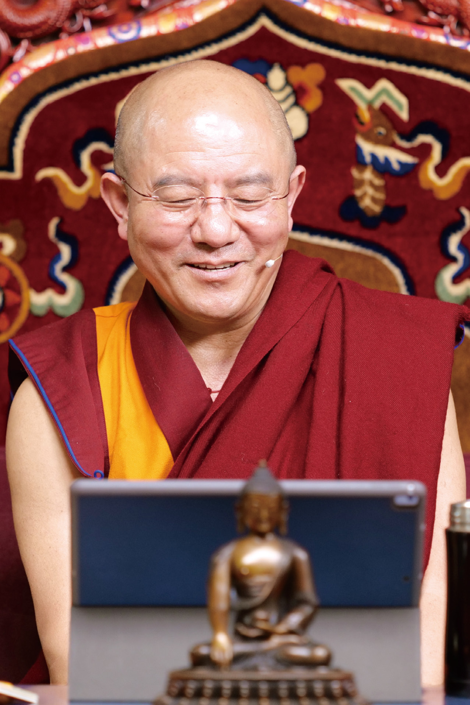

# 传授菩萨戒

——2023年地藏法会开示

2023年7月19日

今天，我虽然不在学院，但跟在现场也差不多，我可以通过视频看到现场的人。大家能够来到这里一起听受佛法，一起共修念诵，这种机会来之不易。对你们每个人来讲，肯定付出了很多努力，但我觉得这是非常值得的。

## 为法苦行 克服一切

我们的一生中会经历许许多多的事情。有些事情对今生和来世都没有意义，只不过是徒增痛苦而已；有些事情对今生有意义，但对来世不一定有意义；而如理如法地听受佛法，对今生来世都有意义。因此，我随喜你们的求法精神。

实际上，我们也是顶着各种压力，给大家创造这样的共修机会。有些人可能把这件事想得很容易，其实并非如此。大家应该清楚，现在哪怕是十几个人的共修，也会遇到各种违缘和障碍。在这种特殊时期，还能拥有这样的机会，不是一件简单的事情。

有些人可能觉得学院的条件不好，对各个方面都不满意，这也是可以理解的，毕竟你们在大城市里，各方面待遇都不错，也很会享受生活。来到这里以后，大家一起同吃、同住、同睡，而你们在家里时，不要说陌生人，就是自己的家人，也不一定愿意一起睡。在这里，一方面是环境所迫，一方面是为了修持正法，就像我前几天所说的，为了求法吃点苦不算什么。

有时候，我们也要主动走出舒适区，离开熟悉的环境，到完全陌生的地方生活一段时间，以此检验自己的修行境界到底如何，这也是一种修炼。学院现在的条件比以前好多了，上世纪八九十年代，无论是学院的常住道友还是外来的在家居士，基本都没有上课的经堂或教室，各方面条件非常艰苦，甚至学院里连一家小卖部都没有。那时，整个洛若乡都没有商店和餐厅，只有色达县有两三家面馆。所以，与那个年代的求法者相比，至少下雨天你们的衣服不会淋湿，在附近商店也能买到速食快餐，这已经算是比较幸运的了。

在这几天里，大家要互相包容，要有一个快乐的心态。你们也可以观察一下，这种白天一起念诵、晚上一起休息的集体共修方式，对自己的修行到底有没有帮助？对于修行好、人品好的人来说，这确实是一次难忘的经历，对自己的生活和修行也会有非常大的帮助。

希望大家记住一点，无论遇到什么事，都要观清净心。虽然学院这边的接待能力有限，但我们会尽心尽力地帮助大家，包括各个部门的负责法师、发心人员，每次法会结束以后，好几天都累得起不来。

总之，只要对大家有利益，没有出现大的违缘，我们愿意为大家付出一切。但各位也要清楚，这是你们自己的选择，应该懂得知足和感恩，不应该怀有各种抱怨。

我听说有个别的佛教徒，稍有不如意就想马上离开。你想直接走也可以，毕竟我们也没有邀请你，也没有收取任何学费。你愿意待两天也可以，不愿意待马上走也可以，但我觉得遇到这么殊胜的佛法，应该自己给自己打气，自己给自己一些鼓励，这样可能更好一点。

7月22日，如果各方面因缘具足的话，像今天一样也有开示。再过几天，我想给大家发一个加持品，可能每个人得到的不一样，有佛像、挂件、法本等。如果不够的话，常住的道友先不要领。

以前，法王如意宝特别重视大鹏金翅鸟像章，学院这次以原来的像章为模板也做了一批，并且由学院僧众做了加持和开光。我们尽量保证每个人都能得到，你们要随身携带，它可以遣除修行上的违缘，增上各方面的顺缘。你们以后可能还会得到各种各样的加持品，但从某种意义上讲，这个像章具有与众不同的加持。

对你们来讲，这些也算是一个礼物。还有一些法本，可能每个人得到的也不一样。同时，我也希望大家能够开开心心地参加法会，对于很多人来说，这是第一次来喇荣，也可能是最后一次。1993年，法王如意宝去美国弘法时，他老人家刚好六十岁，法王说：“我都这么大年龄了，身体的病也多，这是我第一次来美国，应该也是最后一次。”后来也确实是这样。所以，对每一个人来讲，以后会变成什么样真的很难说。

这次法会，很多人一直为大家忙前忙后，在背后做了大量工作。包括我和益西彭措堪布以及其他法师，再三商量之后决定给大家提供这样的机会，但由于学院现在能力有限，再加上各方面也没有以前那么方便，只能做到这种程度了。这次总体还算比较顺利，从这几天的共修状况来看，确实让人感到欢喜，大家也是法喜充满，从表情上也看得出来你们的信心和对求法的渴望。很多人虽然以前也参加过法会，但这次也有一些不同的感受。

## 见面不重要 学修最重要

其实，以后我们能不能见面并不重要，重要的是所讲的这些佛法，包括音频、视频等，这些应该尽量地保存下来，然后进行学习和修持。其实，每个人的时间都是挤出来的，如果你没有挤出多余的时间，可能学佛也有一定的困难。所以，最关键的是你们回去以后一定要学习《大圆满前行》和《入菩萨行论》。如今是网络时代，具有许多不可思议的方便，不像我们求学的那个时代，有很多不方便。其实，学佛学不好，只不过是因为自己懒惰以及对学佛不重视，实际上根本不缺学习的途径。现在有很多学佛的平台，虽然政策方面和前几年有点不同，但还是有各种各样的方便。

我希望大家好好修加行，对每个人来讲，尤其是对密宗佛教徒来说，最好能完成五十万加行。如果实在完成不了，以前法王如意宝也讲过，可以念诵一千万的金刚萨埵心咒来代替。比如，有些人六根不全或年纪太大了，至少要念二百万的金刚萨埵心咒，可以算作磕头的替代。但对于有能力的人来说，千万不能以简单的修行来代替五加行，这是不开许的。修加行非常重要，可以这样说，修完加行后，才称得上是真正的修行人。

五加行中包括念诵十万遍皈依偈。只要是前辈大德所造的皈依仪轨，无论哪一个传承都可以，在哪一位上师面前得传承也都可以，只要对方是真正具有法相的善知识。其实，上师也有各种类型，就像市场里的商品一样，所以一定要选好。得到五加行的传承后，自己就要好好实地修持。要知道，一切成就依赖于自己，并非依赖于其他人。因此，一定要珍惜学法的机会。

暇满人身真的非常难得，再加上周围环境也不是那么乐观——没有什么寺院，没有什么出家人，没有什么有信仰的道友，甚至你的信仰行为还会受到别人的讥笑，认为这是一种愚痴的行为。这个我们也能理解，不仅国内如此，从全世界范围来讲，真正皈依释迦牟尼佛教法的人也不是很多。但是，我们可以非常自信地说，佛陀的教法是千真万确的真理。关于这一点，学过五部大论的人都应该很清楚。

最近，我们正在讲华智仁波切的《初中末善妙语·亲证见修行之心宝》，这个教言讲完以后，准备讲阿阇黎图增珠杰所造的《殊胜赞》。其实，我们以前所传过的法，现在并不是找不到，只不过有些人不重视而已，如果重视的话，每个人都有学习的机会。在这个世间，我们的本师释迦牟尼佛与其他任何宗派的本师都不同，但很多人不一定明白这个道理。有些人虽然有虔诚的信心，但是没有深奥的智慧，很容易被他人所转，人云亦云，随波逐流，最后不知道自己该往哪个方向走。

我特别希望大家成为爱学习的佛教徒，具有智慧的佛教徒，不要变成迷信盲从或非常野蛮的佛教徒。很多人表面上看是佛教徒，但实际上内心一点都没有调伏，只不过是依靠佛教徒的外相来做种种事情，甚至在出家人当中也有这种人。最近，我听说有一个出家人，以前在学院待过很长时间，但现在基本上不提佛法，天天说一些奇怪的话，做一些奇怪的事，跟着他的一群人也是奇奇怪怪的。所以，即使外相上是一个出家人，但如果没有调伏内心的话，那与他结缘的人也会变得很可怜。

因此，你们以后一定要成为智慧的佛教徒，不要变得盲目迷信，或者变得特别狂妄，看起来好像很有热情和信心，但实际上所作所为都是与正道相违。那么，怎样才能变成智慧的佛教徒呢？要不断地学习，最好是学五部大论，同时也要学一些基础法，不能天天只学中观和因明。你原来是一个没有信仰的人，也没有佛法的基础，现在刚进佛门就直接学五部大论，不一定有很大的利益。

对于修过五加行的人来说，学习中观、因明或密法，还是比较容易成功的。如果没有任何基础，直接学习大圆满的本来清净、中观的离戏法门，或者因明的遣余法，恐怕在遇到一些关键问题时，有些人会不知如何取舍因果。依止善知识、祈祷上师三宝、修五十万加行，如果这些修法不被重视，那说明你只是一个形象上的修行人，或者是一个研究佛法的学者，但实际上不一定修得很成功。

## 发菩提心 守菩萨戒

今天是佛教特别重要的节日，即释迦牟尼佛初转法轮的日子。按照法王如意宝的传统，学院每年在藏历六月初四左右，都会传授菩萨戒。而我个人在上师如意宝面前，已经得过几十次菩萨戒，法王在国内外很多地方都传授过。

很多人应该都得过菩萨戒，但在我们的相续当中，有没有真正生起菩提心呢？这个很难说。关于这一点，我们要好好地想一想。每一个人的一生中，都有很多重要的事情。从出世间法来讲，比如皈依、发菩提心、受别解脱戒、得受密乘灌顶、闭关实修等，这些都非常重要；从世间法来讲，比如上学、找工作、结婚、生子等，这些也是比较重要且具有纪念意义的事情。

依靠善知识的传授，以及自己的观想和念诵，在自相续中能真正得到菩萨戒。学过《入行论》的人，应该对菩提心的功德非常了解。所以，我思来想去，觉得给大家最好的礼物，就是按照法王如意宝的传统，在今天传授菩萨戒。

距离法王如意宝去美国弘法，已经过去了三十年。那时，在第一站夏威夷火奴鲁鲁，法王传授了一次菩萨戒。也就是说，法王西方弘法的第一站传的法要就是菩萨戒。虽然有些人以前得过菩萨戒，但每年还是要多次重受，没有的要让它生起，已有的要让它不断增上，就像不断充电一样。比如，你在去年受过菩萨戒，但是中间因为生嗔恨心等，可能损坏了戒体，这次便可以重新受持。

在释迦牟尼佛初转法轮的日子，在十三大虹身成就圣地喇荣，按照法王如意宝的传承，得受大乘菩萨戒，是一件非常有意义的事情。

受戒的时候，一定要发菩提心，否则不要说成佛，连菩萨都成不了。为什么说不能希求声缘果位呢？因为他们没有利他菩提心，而作为佛教徒，在有限的生命里没有发菩提心，真的非常可惜，因为想要生生世世遇到大乘佛法和大乘上师是很难的。

所以，大家今天一定要发起菩提心，有了菩提心以后，无论修行还是不修行，甚至处在睡眠或放逸当中，你的功德也会蒸蒸日上。每年受菩萨戒很有必要，在学院的早晚课诵中，都会念菩萨戒的仪轨。对佛教徒来讲，发菩提心非常重要。初发菩提心的时候，也就是你开始迈向成佛之路的时候，这既是一个起点，也是一个非常重要的时刻。今天，每个人都要为自己的生生世世打下一个良好的基础。

受持菩萨戒的方法，包括龙猛菩萨的甚深见派和无著菩萨的广大行派两种。而我们现在所受的菩萨戒，是将甚深见派和广大行派合二为一，法王如意宝以前也是这样传授的。

受菩萨戒时，首先要观想十方三世诸佛菩萨及传承上师，然后在他们面前接受菩萨戒。

在此之前，还要准备供养物，比如供花、供水、供香、供灯、供神馐，以五供为主的一切供品。在念普贤云供时，大家要观想经堂里的花、香、灯等，以及自己意幻出来的各种供品，整个器情世界所摄的一切美妙、圆满的供品，全部供养给诸佛菩萨及法王如意宝为主的所有传承上师。

下面，大家一起念一遍曼茶供：

> 涂香鲜花遍大地，须弥四洲日月饰，

> 观想佛刹作供养，愿诸众生行佛刹。

章 格热Ra那曼扎拉 波匝美嘎萨么扎 萨帕Ra那 萨玛耶啊吽

念诵仪轨时，大家要随文入观，一定要观想到位。

首先，心里观想：祈请十方一切出有坏正等觉、十地菩萨摩诃萨众及诸位大金刚持上师垂念我，我今天一定要得到菩萨戒！

如果没有皈依过，不能算正式的佛教徒。因此，皈依的时候，心里要想：从现在起直到菩提果之间，我皈依功德断证圆满的一切如来，我皈依一切如来所宣说的正法，我皈依跟随一切如来的大小乘僧众，以前诸佛菩萨如何皈依，我也如何皈依。

下面开始皈依：

> 香确酿波齐杰瓦 乃至菩提果

> 桑吉南拉嘉森切 皈依诸如来

> 秋当香确森华耶 正法菩萨众

> 措拉昂得印嘉森切 如是亦皈依

现在，大家已经获得了皈依的戒体。那么，什么是菩提心呢？看到三界轮回的众生非常可怜，作为大乘佛子，我一定要帮助他们，但如果没有让他们成佛，这不是最究竟的帮助，所以我不但自己要想办法成佛，同时也要让所有众生获得佛果。

如果没有这样发菩提心，即使你每天都念这个仪轨，在你的相续中也未必存在真正的菩萨戒，因为只是念诵的话，不一定能得到戒体，一定要发自内心地发愿。此时，心里要想：我刚才已经在诸佛菩萨面前皈依了，以后我要尽力将一切众生安置于佛果。就像各国领导上任时，也要有一个宣誓。

如果不具备发心，只是口头上念念有词，起不到很大作用，关键在于内心要有非常坚定的誓言，否则自相续中肯定不会有戒体。另外，即便你有了戒体，也很难说未来会不会犯根本戒，如果犯了，还是需要重新受持，恢复戒体。

接下来要念的仪轨非常关键，大家一定要好好观想，不要三心二意。你心里要想：这次真正得受了菩萨戒，那无论路上花了多少钱，或是遇到怎样的困难，也是值得的。

这次你们已经来到藏地发了菩提心，以后就都是大乘菩萨了，只需要好好修行就可以了。如果你没有发菩提心，相续中也没有菩萨戒戒体，行善就容易流于表面，无论是转绕还是转转经轮，或是其他闻思修行，都不算是以大乘菩提心摄持的善根。

从现在开始，大家心里要想：往昔诸佛菩萨如何发菩提心，法王如意宝为主的传承上师如何发菩提心，我也如是发菩提心，从今天开始，为了利益一切众生，我要发起无上殊胜的菩提心！另外，还要次第学习大乘佛子的三种学处。

如果你有了这一刻的发愿，那从现在开始一直到成佛之间，只要没有出现破戒的违缘，菩萨戒会一直存在于你的相续中，即使死亡，菩萨戒也不会消失。不管你是变成动物还是变成人类，自相续中的菩萨戒都会一直存在。

接下来，大家将下面两个颂词一起念三遍。这两句颂词的意思是，往昔的一切如来为了利益他众而发起菩提心，循序渐进守护菩萨戒的所有学处，同样我也为了利益众生发菩提心，次第学修学处。

念诵时大家一定要好好观想，得到这个戒体非常重要。第一遍念完，观想获得愿菩提心；第二遍念完，观想获得行菩提心；第三遍念完，观想已经获得的愿菩提心和行菩提心得以稳固。最后，我弹指的时候，你们一起说“拉索”，这时已经得到了戒体。

下面开始发愿行菩提心：

> 杰达温杰得夏吉 如昔诸善逝

> 香确特呢杰巴当 先发菩提心

> 香确森慧拉巴拉 复此循序住

> 得达仁印内巴达 菩萨诸学处

> 得印卓拉攀敦德 如是为利生

> 香确森呢杰杰样 我发菩提心

> 得印德呢拉巴拉昂 复于诸学处

> 仁巴印德拉巴杰 次第勤修学

现在，我们每个人都已经得到了菩萨戒。得到菩萨戒以后，后面还有令自己欢喜和令他人欢喜。

为什么自己欢喜呢？因为我已经获得了人身，并且如今又投生在如来种性中变成佛子。从此以后，我一定要尽己所能从事合乎大乘佛教的事业，绝不能以恶行玷污此无垢种性。就像一个盲人在垃圾堆中得到了如意宝或金子，那该是一件多么幸运的事啊！把这颗菩提心保护好，可以说远远超过了拥有一切世间财富。有些人可能觉得中了大奖、买一辆车、买一栋别墅，这是值得欢喜的事情，但从佛教的角度来讲，拥有菩提心的功德，远超于此百倍千倍。

我已经发了菩提心，变成了大菩萨，那么其他人、非人等众生都应该欢喜，为什么呢？因为我现在变成了菩萨，以后一定会好好地帮助他们，让他们得到正法的利益。其实，这个世界真的需要很多菩萨。如果大家全都变成了菩萨，一定会给世界增添很多平安和快乐。

接下来，心里要想：我今日在所有怙主前，也就是请他们作为见证，以究竟正等佛果的安乐及暂时的安乐宴请一切有情作为上宾，愿人、非人等所有众生皆大欢喜。

下面是赞叹随喜：

> 当第达才追沃哟 今生吾获福

> 么耶哲巴拉巴托 善得此人身

> 得让桑吉热色吉 复生佛家族

> 桑吉这色达杰多 今成如来子

> 达呢达给杰内江 尔后吾当为

> 热当腾波类赞得 宜乎佛族业

> 俊美怎波热德拉 慎莫染污此

> 纽巴么杰得达夏 无垢尊贵种

> 隆卫香达彭波类 犹如天盲人

> 杰达仁钦涅巴达 废聚获至宝

> 得印杰耶达第内 生此菩提心

> 香确森呢达拉吉 如是我何幸

> 达给得让久巴檀嘉杰 今于怙主前

> 现尔卓瓦得夏涅当呢 筵众为上宾

> 瓦德得拉准德悟仁吉 宴飨成佛乐

> 拉当拉门拉索嘎瓦吉 普愿皆欢喜

得到菩萨戒后，为了感恩诸佛菩萨及传承上师，再念一遍曼茶供：

> 涂香鲜花遍大地，须弥四洲日月饰，

> 观想佛刹作供养，愿诸众生行佛刹。

章 格热Ra那曼扎拉 波匝美嘎萨么扎 萨帕Ra那 萨玛耶啊吽

还有一点时间，我想先念一下《佛子行》的传承，因为我特别希望每个人的相续中都能生起《佛子行》中所讲的境界。然后，为了大家以后修加行方便，我再念一下《开显解脱道》的传承。

（堪布念传承）

你们来一次很不容易，这种信心和欢喜心非常值得随喜，我也很高兴见到你们。在之后的几天里，希望你们继续好好修行，每天精进地念诵。非常感谢大家！
