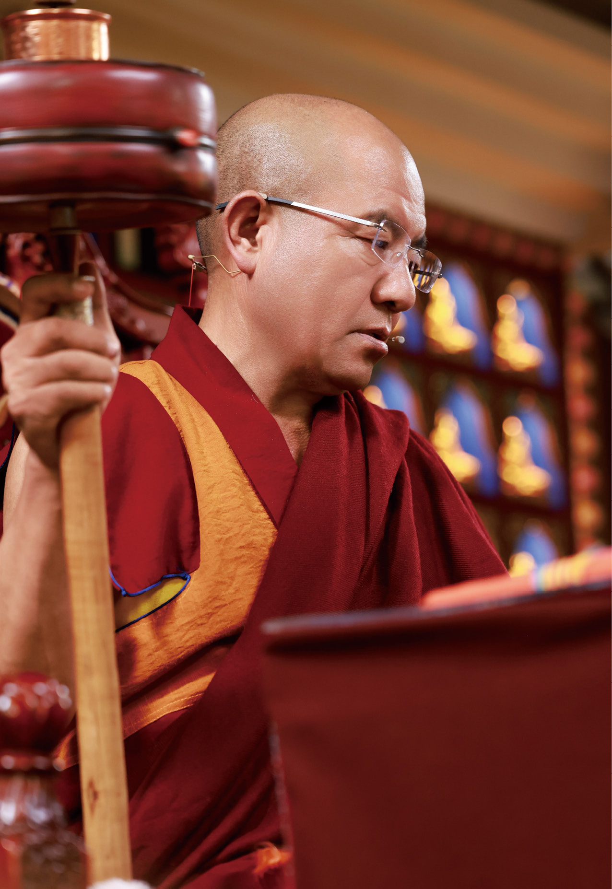
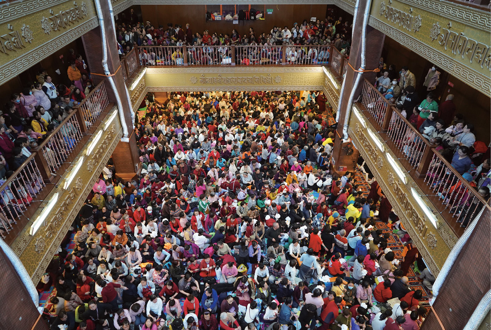
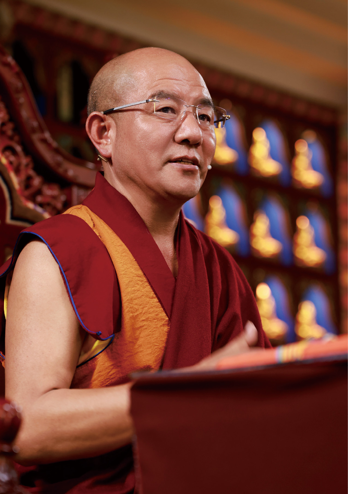
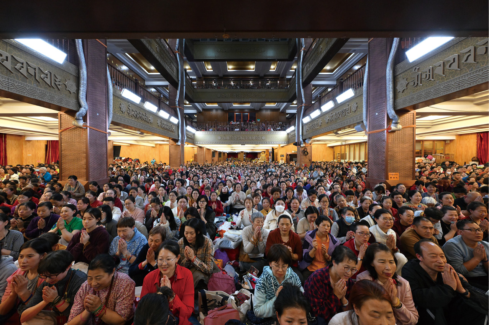

## 做适应时代的佛教徒

——2024年金刚萨埵共修开示

2024年5月16日

## 以淡定之心应对外境

今天我们利用这个时间，给大家做一个简单的开示。

首先，有些情况需要说明一下。这次念诵活动并没有提前通知任何人，也没有要求大家必须参加。尽管如此，许多人还是通过各种途径来到了这里，有的是慕名而来，有的是有备而来。既来之则安之，希望大家能够放松心情，任何情况都不要急躁。随着年龄的增长，我们的心态应该更加淡定。比如刚才我入场时，不少人比较激动，有人哭、有人闹、有人喊，其实这些反应都不太必要。作为佛教徒，我们应该随时保持淡定和平静的心态，不管是遭受违缘痛苦，还是遇到向往的对境，大家都应该控制好自己的情绪。

这次我们能一起念诵修金刚萨埵，确实是一个非常难得的机会。你们来到这里也很不容易。我知道，有些人需要跟家里或单位说些方便妄语，做通各种工作，经过一系列的努力才能成行。我们这里也面临许多困难，管理人员和发心人员都顶着很大压力，由于种种限制，我们无法名正言顺地给大家公开提供接待和服务。总之，大家能够聚集在这里实属不易，要忍耐高原反应的不适，还要经历一关一关的挑战，但就像网上说的那样，喇荣就是这样一个地方，缺氧但不缺信仰。（掌声）

我们都应该清楚一点，在座各位是来这里朝圣和旅游的，不一定是佛教徒。当地政府已经许可坛城对外开放旅游，所以今晚的开示也是面向游客，让大众有机会聆听出家人的心得分享。尤其需要注意的是，我以前在多个场合已经说明过，原来的菩提学会等组织早就已经取消了，今后也不会再有。这里没有任何组织性、计划性的活动。如果有人询问，你们可以直接说：“我来这里是为了朝拜举世闻名的坛城。”不论谁问，都可以坦然回应。事实上，从去年开始，这个地方就已经允许旅游观光，但按照县里旅游部门的要求，每天接待游客有人数限制，还要配合各方面的管理。不管怎样，大家就是这样来的，并没有其他目的。

喇荣的金刚萨埵法会是三十多年来的传统，但现在不能再公开举办。所以，这里只有我们自己的内部念诵。男众这边的佛学院没有举办法会的资格，因为政府将佛学院视为类似汉地的学校，而女众这边的喇荣寺可以举办法会，但仅限内部的3400多名常住人员参加，除此之外，只有一些来这里朝圣的游客，通常停留一两天后就会离开。整体情况就是这样。对于真正的常住规模，我们已经进行了严格的控制，不再增加人员和住房。从2017年8月28日起，我们一直按上面的规定执行。但由于现在旅游开放，我们很难控制前来观光的游客人数。管理人员面对如此多的游客来来往往，也没有其他办法。这种情况不仅发生在我们喇荣五明佛学院，包括北京八大处、上海玉佛寺、浙江普陀山、厦门南普陀寺等地也都是如此。我以前去过这些地方，确实都是人山人海。特别是深圳的一座寺院，每天接待游客多达十几万，尤其是在供斋时。还有成都的文殊院和昭觉寺，游客也很多，但他们常住的人数只有几百人。所以，大家应该了解这里的状况。遇到任何询问时，唯一的回答就是如此。我相信在座各位之中没有常住人员，除了我们这边的几位管理人员。这就是目前的实际情况。

我们佛学院在全球范围内比较有名，必然会吸引很多人前来观光。开放旅游是政府要求的。虽然我们之前曾一再向相关部门表态，最好不让外来人员进入这个清修的喇荣山谷，但由于当地经济需要复苏、旅游业需要发展，因此，色达喇荣五明佛学院在2023年开始面向国内游客开放，但尚不能接待国外游客。这就是我们这里的现状。

在这里共修时，希望大家能听从管理人员的安排。管家要求大家在经堂多待一两个小时，不少人就抱怨很累、很闷。我理解你们的感受，但这次并不是我们邀请谁来这里的，而是你们自己的选择。僧众们已经尽力提供了周到的照顾，一下子涌来这么多人，光是供应每天的饮食就已经让他们非常疲劳。说实话，我更担心我们工作人员的身体，而你们只需在经堂里待着，什么都不用做，虽然有些人躺也躺得很累，但我不是很担心。（众笑）

你们不了解工作人员有多辛苦，我今天跟司机聊过，为了解决供应问题，他们每天要往返县城好几次去采购食品蔬菜。我们的工作人员本来只为内部成员提供服务，现在突然需要接待这么多人，这并不是一件简单的事。你们应该也知道，如果是到藏地其他许多寺院，通常需要自己处理吃饭、住宿的问题，甚至连上厕所都只能在露天解决。你们平时可能在大城市里习惯了安逸的生活，但如果想要舒适的体验，就不该来这里自找苦吃，因为我们山沟里的条件确实很有限。

此外，我们在这里需要从总体上进行调控，哪些时段比较方便出入，哪些时段不太方便。这是出于多方面的考虑，完全是为了你们大家着想，对于我们自己而言，本来没有这种必要。佛学院本身并没有接待外来人员的义务，山上每天都有无数游客来来往往，到处人山人海。我们之所以想尽办法安置各位，是希望你们在这七八天的念经活动中能善始善终。这是我们唯一的目的，大家也应该理解。

这边负责管理的两位藏族堪布、两位藏族堪姆，以及今年相关的轮值堪布堪姆，他们都在熬夜为大家解决各种问题。相较而言，我们其实更加劳累。你们待在经堂里如果觉得闷，可以稍微开一下窗户。而地下室还有那么多工作人员更闷、更累，但他们都在坚持，所以，这没什么大不了的。在经堂里多待一待也不错，你们从全国各地带来了自己的心得，可以在这里彼此分享。

我可能有些胡说八道，但不管怎样，有些情况必须给大家讲明白。你们已经坚持了两天，接下来还有六天，希望后面几天你们会习惯。有些人好像连坐都坐不住，其实这点苦真的不算什么。大家在经堂里从早上7点待到晚上9点，时间也不算特别长。我们以前去别的寺院听传承，一般是从早上5点开始，一直坐到晚上10点左右才结束，吃的、喝的都要自己解决。在藏地绝大多数寺院都是这样，你们可以去其他道场打听打听。所以，大家应该知道，这里的情况并不算太难忍受。

不要说和前辈高僧大德相比，即使和现代很多远赴他方求法、求灌顶、参加法会的佛教徒相比，你们此时经历的“苦行”也根本不值一提，无非是进出时会遇到一点阻碍。我要担心的无非是你们离场的时候，会不会找不到自己的鞋子。我的鞋子有人保管，可你们的就不好说了。有些事对于普通人来说是大问题，比如鞋子找不到了、中午没吃上饭，但从佛法的价值上看，这些都是微不足道的小事。大家应该明白，我们正在成办大事——虽不敢说你们是身处苦海，但至少可以说是活在茫茫人海之中，能有机会每天和这么多僧众一起发愿、一起念诵《普贤行愿品》和金刚萨埵心咒，这样的盛事在有生之年中并不会有很多。也许这是有些人的最后一次，也许这是有些人的第一次。总之，这样的机会以后未必还有。

今年不管是金刚萨埵念修，还是极乐法会，我们都劝告大家不要来学院。现在这边的管理越来越严，各方面的要求越来越高，就连我们自己想要做一些事情也越来越困难。因此，虽然学院的传统已经持续了三十多年，但从今年开始，我们都要求觉姆和喇嘛告知所有亲朋好友，在当地的寺院里自己念金刚萨埵，不要来喇荣。因为老乡们来这里很不方便，也不能和僧众一起共修。而且我们内部本来就面临着生活、管理等各方面的许多挑战，一下子从外面来了这么多人，这里的承载能力实在堪忧。因此，从今年开始，我们建议，以后每年的萨迦月，大家就在自己家里念修四十万遍金刚萨埵心咒。就像每天洗脸刷牙，这是一种精神上的净化和沐浴。

所以，你们今年既然已经来过了，我希望明年最好就不要再来，因为我们这里的情况大家都知道。幸好多年来学院一直在进行包括卫生设施在内的基础建设，否则真的无法解决这么多人的吃喝拉撒。在其他小型寺院，要管理二十多人的住宿和生活都很不容易。我们这里虽然眼下还算可以，但以后如果越来越多的人涌来，那是无法应对的。因此，我们希望所有外部的道友，以后就在自己的家里念修金刚萨埵心咒，可以把数量报过来，我们会全部统计，最后僧众一起回向。

前段时间，相关负责人已经向全体僧众宣布了这项要求。所以，这次藏族老乡相对来得比较少。如果藏族和汉族老乡都来了，那这个喇荣山谷会挤成什么样子，可想而知——对汉族可以称老乡吗？应该可以吧（众笑）。看看这里一间挨着一间的红房子，本来就过于密集，如果再来很多人，我们佛学院就会被人群淹没。因此，我希望在座各位，在这八天里尽量精进念诵，念诵结束后，该离开就离开吧，这对学院也是一种贡献（众笑）。否则这么多人一直待在这里不走，也不好好遵守纪律，会给学院带来许多麻烦。你们的吃喝拉撒各个方面，都会给管理人员带来很大的压力。如果大家能够站在学院管理人员的角度思考，应该能够理解其中的不易。

你们这次既然已经来了，就应该知道自己的真正目标，其他一些事情，比如四处朝拜等，都不是最重要的。我们在这七天内将会从早到晚集中进行关于金刚萨埵的禅修。汉地寺院，无论华严宗还是净土宗，经常有“打七”的修行。在打佛七时，参与者连手机都不能碰。我们这次念诵活动同样也是为期七天的禅修。在这七天中，除了特别重要的事情，希望大家尽量不要使用手机，减少不必要的联系，也不要外出闲逛。喇荣真正的风景在我们的精神世界中。如果你实在想逛逛学院、转转坛城，可以等到念诵结束后再去。

这段时间大家来来往往不是很方便，你们也知道，现在不仅整个喇荣五明佛学院，包括色达县，都有巡视组在监管。虽然我们没做什么不可告人的事情，但如果整天被他们反复询问，也很耽误自己修行的时间。大家在这里只是念经而已，又没做什么违法乱纪的事，也不用害怕，但自己还是要学会保护自己，不然万一这几天的禅修受到影响，那也有点可惜。除了这点之外，我没什么可担心的，你们之中又没藏匿着通缉犯。只不过我们作为佛教徒，在修行时最好不要遇到什么违缘干扰，但违缘要是真的出现，我们也无所谓。谁都能明显感觉得到，每天有这么多游客来学院观光，有时候我跟游客交流一下也无伤大雅。在这个过程中如果巡视组有人来问话，任何情况都可以由我来说明。因为我在这所佛学院已经待了三四十年，对这里的上下管理、人员流动，都比较清楚。这一点我也专门表过态。

## 以四对治力认真忏悔

在这种情况下，希望大家对这七天的共修认真重视起来。同时，也希望常住的出家人对一些安排予以理解。你们虽然不能来自己的经堂，但可以去跟喇嘛、觉姆一起念诵，这其实也是一个很好的选择。从他们身上，你们可以发现各种优点和缺点。有些人不好好念，你坐在旁边可能会感到厌烦；但也有些人念得特别认真，你也会受到好的影响。我听说不少喇嘛和觉姆每天都认真完成四座金刚萨埵心咒念修，就连最后的《普贤行愿品》都念得一字不落。相比起来，我自己做得比较差，我从昨天开始念诵，但一会儿管委会的人找我，一会儿堪布、堪姆来找我，念诵总是被打扰。但即便这样，我每天还是念满了五万遍，没有中断。而住我隔壁的一位喇嘛，每天能念八万遍（鼓掌）。我刚刚又问他今天念了多少，他说还差一千就念到八万遍了（鼓掌）。你们对我也鼓掌，对我隔壁喇嘛也鼓掌，好像没什么原则（众笑）。我刚才不是说，大家应该多用智慧来观察，不要太激动。

我之所以说这些，是因为看到你们这次来到这里，大多数人都很精进，确实在认真念诵。大家一定要利用这次机会好好忏悔。法王如意宝在世时，对金刚萨埵修法非常重视。门措上师也是如此，每年除了完成要求的四十万遍心咒外，还会额外多念大约一百万遍。这些高僧大德都如此示现，无始以来积累了无数恶业的我们，又怎能不精进。这次是一个很难得的机会，能和这么多的僧众聚在一起念修忏悔法门。所以，我们要将过去和今生中造下的所有罪业，不论是佛制罪，还是杀盗淫妄等自性罪，不论是记得起来的，还是记不起来的，全部都要好好忏悔，并发誓以后绝不不再造。当然，大家作为凡夫，口头虽说再也不造恶业，但过阵子可能还是会犯。就像我们要求藏地信众戒酒，有些人才发了誓不再沾酒，过两天朋友一约，又喝起来了，所以戒了许多次都不成功。我们凡夫人有时候意志确实不够坚定，但是大家在忏悔时，还是应该尽量下决心以后远离恶业。

我们应该如何清净罪业呢？必须依靠四种对治力——所依对治力、厌患对治力、返回对治力、现行对治力。首先要认识到金刚萨埵是所有诸佛菩萨的总集，与自己的上师无二无别，然后进行观想。如果能依照《大圆满前行》和《前行备忘录》中的指导，按生起次第详细观想，这当然是最好的。如果没有这种观想能力，也可以在心中作意：“过去我造下了许多严重的罪业，现在一定要认真发露忏悔，以后绝不再造。”要清净自己的罪障，应该在与上师无二无别的金刚萨埵面前，诚挚地念诵其心咒“嗡班匝儿萨埵吽”。在念咒时，初学者一般应以祈祷的方式念诵。如果境界稍高一些，可以用生起次第和圆满次第等观修方法。要是实在不懂这些，可以想象金刚萨埵和自己的上师无二无别，在这样的金刚萨埵面前，满心真诚，一边发露忏悔，一边念诵心咒。这样念咒的功德非常大。

这次你们这么多人聚集在喇荣，管理人员为了服务好你们，日日夜夜不能休息，确实非常辛苦。但他们都是发了大乘菩提心的人，哪怕再累再苦，只要对你们有利就好。因为现代社会的大部分人，时时处处都在造着恶业，一生之中不一定有忏悔清净的机会，如果不及时忏悔罪业，很可能会招致十分可怕的果报。但这次依靠僧众的力量、自己的发愿，还有金刚萨埵的加持，你们以前所造的罪过一定能得以清净。这对大家而言是一件天大的事。

《前行备忘录》讲过，初学者所有的修行中，最首要的就是忏悔。我们修行的目的是为了断除烦恼障、所知障、习气障，总的来说就是业障。业障包括自性罪和佛制罪，尤其是自性罪。这些罪障在每个人的相续中都有。所以，希望这次大家认清根本目标，不要计较那些吃得好不好、菜多不多之类的小事。实在不行你们也可以自己准备一些吃的。也许你在家里四菜一汤是基础，但在这里，只要饿不着，就不必要求太多，毕竟你们是来求法的。以前汉地大德入藏求法时，面对的是比现在艰苦百倍的生活条件。我知道在座有些人家里条件很好，而在这里睡也睡不好、吃也吃不好，但这些都没关系。因为无始以来你可能只有这一次彻底忏悔罪障的机会，过程中忍受的一切，全都是你用以忏悔的苦行。所以，希望大家将此视为一段难得、难忘的体验。

在座各位基本都是有思维能力的成年人，不懂事的孩子或者年迈糊涂的老人这里没几个。大家应该认真思考这个道理。想想你来到喇荣的目的到底是什么。我想应该不仅仅是为了欣赏这里的山水。如果抱着这样的目的，其他地方有更多名胜值得你去旅游，而我们这里寒风刺骨，没有什么可观光的。喇荣的独特之处，就是能让我们内心的罪障得以净化，这确实与其他任何地方都不同。所以，虽然大家这几天念诵比较疲劳，但应该知道其中的意义有多大。

无始以来我们在轮回中漂泊，为了许多事情而疲劳不堪，但其实都毫无意义，只是让我们不断在轮回中继续流转。因此，这次大家确实应该从内心深处认清自己，特别是在忏悔时，一定要认识到自己的罪过，这是忏悔中最关键的部分。前辈大德们常说，忏悔的第一步就是认识到自己的过错。大家过去可能因为年少无知，不懂因果，犯过杀生、堕胎等许多罪行，但现在应该真诚地认识到自己的错误。认识到错误后，就要有改正的决心。只要一个人有知过能改的心态，就一定会有进步。

世间法也是如此，如果一个人从来看不到自己的过错，心态还特别傲慢，那就永远不会有长进。《菜根谭》中提到过，“盖世的功劳，当不得一个‘矜’字；弥天的罪过，当不得一个‘悔’字”。人最大的问题是傲慢，因为傲慢会让人受到障蔽，根本看不到自己的错误，永远无法正视自我。相反，人最好的品质是懂得忏悔，知过能改。佛教徒更应如此，前辈大德们经常自我反省：“我造过很多罪业。”这不是故作谦虚，而是他们明白，无论是从佛教教义还是世间道理来看，自己都要谨慎一切过失，错了就必须改正。而有些人则顽固不化，一错到底，即使遭到别人的嘲笑或批评，也毫无反思，好像堕地狱也无所谓。怀着这种态度的人永远不可能进步，也不会有证悟的机会。相反，如果一个人能时常意识到自己的问题：“这件事我确实是错了。”并决心改正，那就能不断提升自我。

人非圣贤，孰能无过？每个人都会有犯错的时候。净宗九祖蕅益大师，在年少时也曾受到儒家影响而排斥佛教，还专门写过一部驳斥佛法的《辟佛论》。后来，在他十七岁时，偶然读到莲池大师的《竹窗随笔》，意识到自己对真正的佛法义理有所误解，于是他真诚忏悔，后于二十四岁时出家，一生著述不辍，被尊为明末四大高僧之一。在历史上，其实犯错又改过的大德不在少数。印度的马鸣菩萨原本是外道，曾试图遮破佛法。密宗历史上，蒋华西宁也曾诽谤过密法。不少高僧早年都犯过类似的错误。为什么他们后来变成了非常伟大的圣人呢？就是因为他们知错能改，舍邪归正，这确实是人生中一种了不起的进步。我们每个人都会有犯错的时候，但关键是要有改正的力量。所以，这次我们一起以僧众和金刚萨埵佛尊为证，忏悔罪业，彻底改正，这对我们的修行非常有益。

我不能讲得太啰嗦，人年纪大了就容易啰嗦，自己可能都意识不到。（众笑）

大家应该这样想，这次有机会和这么多的僧众一起忏悔，在人生中其实是非常重要的一件事。我们要把得到授戒、传法、灌顶等都当作人生大事来对待，这样的态度对自己的修行和成长非常有帮助。许多前辈大德都将忏悔视为最重要的修行，我们藏传佛教中对此尤为重视。你们也知道，法王如意宝和很多当代的高僧大德，每年都会专门念修金刚萨埵心咒，最初每年十万遍，后来按续部要求增加到四十万遍。如果像法王这样的大成就者都在忏悔，我们有什么理由不好好忏悔呢？如果能够真诚忏悔，就能净除一切罪业。阿阇世王当初饿死了自己的父亲频婆娑罗王，造下了无间罪，后来依靠佛力和自己的忏悔，最终滔天的罪业得以清净。类似这样的例子还有很多。所以，我希望在座各位都能发自内心深入忏悔。

忏悔涉及罪业的因和果。罪业之因是恶分别念，以恶念造下的业是最严重的。恶业会导致恶果——来世堕入地狱、饿鬼、旁生三恶趣，或者即生中遭遇各种灾难和痛苦。记得一个大乘的修心教言中说过，人生中所有苦难和不如意，比如身体疾病、相貌不佳、财富匮乏等，其实都是往昔的罪业导致的。如果我们能通过忏悔使罪业得以清净，会大大改善往后人生中的健康、福德和寿命，对来世不堕三恶趣也会有非常大的助益。总之，从今生和来世的角度来讲，忏悔都非常重要。如果我们不把握机会，今生中罪业还未清净就突然去世，那就太可惜了。

因此，大家最好就在这里圆满四十万遍金刚萨埵心咒，否则下山之后不一定能念完。虽然这个数量对藏地修行人来说微不足道，但你们中不少人可能会觉得：“哇，四十万遍太多了，我可以只念一万遍吗？”其实这是很可怜的想法。应该看看高僧大德们是怎么持咒的，门措上师在57岁前就念了十亿心咒。作为修行的一种传统，大量念修咒语真的非常重要。

这次大家念修金刚萨埵，最好每天认真圆满四座。反正每座之间可以休息，晚上也有足够的睡觉时间。这四座中，跟僧众一起念一遍《普贤行愿品》，功德都大到不可思议。有时候我本想有始有终地把一座念完，但必须去开会，中途停下来让我很心疼。但为了学院，不得不放弃自己的事情。总之，这对你们每个人而言都是极为难得的机会。大家应该认识到这一点，否则就像不知道如意宝的价值，为了一些小事就把它随便丢弃掉，那就可惜了。

在整个念经期间，我也希望各位不要随意走动，现在转坛城或是去其他地方都不太方便。我们这里的发心人员对每个房间的出入都有比较严格的管理，可能有人对此会有一些意见。但不要担心，只要你们待在这里，传法也好，发放加持品和结缘品也好，每个人都能一样得到。所以，希望大家放下自私心，自顾自的结果往往是谁也得不到。就像今天我们发放金刚铃杵，喇嘛那边因为太过拥挤，乱了秩序，最后很多人都没有领到。类似的公案我们以前也讲过很多。这些时候大家应该安静下来。有的人非常肤浅，大的问题不重视，小的问题上却特别容易激动和吵闹，这并不是一种好的表现。这方面我很羡慕一些国外的修行人，即便是上师来了，他们也是默默待在那里，不去理会（众笑）。遇到天大的喜事，他们也不会像我们这样又哭又闹、又笑又叫。

当然，有时候感性的信心也是必要的，但这种信心应该控制适度。我这边也时常会有一些对我恩德很大的老熟人、老佛友，要求我约个时间见上一面，但我确实没办法配合。不管约我的是什么人，最好念完金刚萨埵心咒后就各自回去，反正我也不在家里，会去别的地方躲起来自己念咒。就算我们见了面也没有实际的作用，无非互相寒暄一下，其实没什么意义。现在我年纪大了，眼睛也看不清楚，我们还不如把各自重要的事情做好。所以，我建议你们不要整天东奔西跑，应该定下心来，好好念咒，好好发愿。

另外，希望大家不要跟金刚道友发生口角和争执。我很喜欢一句世间格言——做人要像水一样。水是什么样的呢？在三角形的容器里，它就变成三角形；在方形的容器里，它就变成方形；在一条沟渠里，它就会顺着沟渠的导向流动。水会时刻根据环境改变自己，具有很强的灵活性。有些人不仅不像水，甚至像牛角装在口袋里一样，跟这个也不合，跟那个也不合，处处发生摩擦碰撞。这一方面说明你修行不好，另一方面说明你做人也比较差劲。其实，绝大部分冲突的起因都是很小的事——“你为什么坐在我这里？”“你的杯子不能放这儿。”“你打呼噜影响到我了！”……作为修持大乘佛法的人，不该容忍不下这些状况。如果别人占了你的座，你可以去别的地方坐。其实这些事情都是微不足道的，大家互相忍让一下就过去了。你们明明是来山上忏悔业障的，不要把这个过程反变为一种罪业。等下山的时候，非但罪业没有清净，反而又新增加了更多的恶业。要是整天一边念“嗡班匝儿萨埵吽”，一边跟这个生嗔心、跟那个起烦恼，罪业怎么可能清净得了呢？这样的人根本没有修行人的样子。

其实我有时候也做得不好，口头上道理都会讲，但自己修得确实不到位，总是喜欢看别人的过失。所以，我希望你们不要像我这样，要是变成了老油条、法油子，那就糟糕了。有些修行人只要稍加提醒，就会立刻明白自己在不同的环境中应该如何随顺他人。你们每个人来到这里都不容易，各自都有家庭、工作上的许多情况要处理。但是，能来到这里就是很有福报的。所以大家应该互相好好配合，共同圆满这次金刚萨埵心咒的念修。要是各方面因缘具足，相信你们彼此之间会产生很有意义的沟通。

这是我今天关于忏悔方面大概想讲的。

## 以现代方式行持佛道

### 1．善用网络坚持自学

作为佛教徒，我们最重要的原则就是坚持修行。如果脱离了实际修行，即便理论知识懂得再多，也难以真正断除烦恼。因此，现在大家应当全心投入修行。修行的时候，最好多学习相关的音频、视频资料。虽然大家不能长期待在喇荣，但我们处在这样一个网络高度发达的时代，不论你想阅读千经万论，还是学习任何高僧大德的教言，都可以在网上轻松获取资源。我认识的一些道友，每年都会学习大量论典，包括中观、因明和许多修心方面的教言。他们会根据自己的学习需求去选择相关的法本。如今各种资料都有电子文档，非常便利，若不好好把这些宝贵资源利用起来，实在是很可惜。

有些人总想着要去寻找一位上师当面依止，这种想法其实是有局限性的。仅在外相上追随上师，陪伴在侧，这不一定是最有智慧的选择。如果你决定依止某位上师，那么可以通过读他的著作、听他的课程来实现。网上有许多高僧大德传讲各种经论的资料。我们不必拘泥于特定的传承，如宁玛巴、噶举派或萨迦派等，只要这位上师具备慈悲心，并且能够启迪你的内心，那么他的法音就值得你去闻受。这些资源在过去十分难得。以前人们需要跋山涉水、历经艰辛，才能找到善知识，获得一些教诲；而现在你们只需在家中打开电脑，便能轻松获得。如果家人不支持你学佛，你也可以自己戴耳机听课，就说是在听音乐。这样无论你是在学大圆满还是大手印，都不会引起关注。这个时代的便利给我们提供了最好的学习机会，大家应该善加利用。

虽然菩提学会已经解散了，但个人的修行并没有受到阻拦，大家完全可以靠自己来闻思修。有些人自学了很多经论，有些人失去了道友的陪伴，就半途而废了，这有点可惜。不管怎样，我希望你们回去之后，每个人都要学习一些与自己相应的法门。这是我的第一个希望。

### 2．善巧应机随顺众生

第二个希望，大家在世间行事，一定要具有善巧方便。不论弘扬佛法还是自己修行，不要公然地冒犯他人，这样不太好。如果你周围的人没有信仰，你也没必要特意去宣扬自己的信仰。我们有时候会安排一些法师外出讲课，如果有人在基督教的群体中直接斥责他们是外道，那肯定会得罪所有听众。在不同背景的群体中，应该尽量求同存异，一方面介绍佛教的理念，一方面也认可其他宗教的优点，比如基督教的慈悲心，这是一种善巧方便。

大家日常说话做事要观察对象和场合。不要直接对世间人说：“没有信仰的人就跟旁生一样。”一定要讲究方式方法。可以说：“做个自由主义者也不错，但如果你想选择一个信仰，我可以跟你分享一下释迦牟尼佛的故事。”总之，我们作为佛教徒，一定要学会善巧方便，平时的在语言、行为，乃至穿着上，都要注意。今天发给大家的金刚铃和金刚杵，是我们佛教中的法器，最好不要在没有信仰的人面前使用，否则叮叮当当响起来，可能会引起别人的反感。有些人在这方面不太善巧，一定要学会根据时机来行事，尽量随顺世间人。这是我的第二个希望。

### 3．善心济世践行公益

第三个希望，我们作为大乘佛教徒，除了自己修行以外，还应多参与世间的公益慈善，这也非常重要。如果有一定的能力和资源，可以帮助一下贫困的学生、病人和其他可怜的众生，给予他们一些经济上的支持。如果没有经济能力，我们也可以尽己所能日行一善，比如安慰他人的心，这也是一种助人的形式。这些行动是非常重要的，我们作为佛教徒，如果在社会公益上毫不作为，就会被其他宗教比下去。天主教和基督教在世界各地大量兴建学校、医院等公共设施，积极开展各种慈善事业，如果我们佛教徒一个比一个冷漠，除了自己念经以外，什么行动都不做，这也说不过去。因此，我们应该从各个方面多做一些实事。

比如，日常生活中应该多注意节约和环保，尽量少用一次性的餐具。不知道大家这几天有没有用一次性碗筷，我建议每个人最好自带碗筷用餐。如果实在没办法，这次用一下也没关系，但以后还是尽量少用。这么多人如果都在用一次性餐具，那是很大的浪费。我前段时间去了一座寺院，那里每个人喝粥都装在纸杯里，那些纸杯质量很好，但他们还是要叠两层使用。我算了一下，这些消耗不是个小数目。我们这样浪费资源的时候，非洲的孩子却连一杯矿泉水都喝不上。我去年看过一篇文章，全球每天都有8000个孩子因饥饿而死去。现在很多国家都面临经济危机，情况更加严峻。今年的最新数据显示，由于战争、气候等因素，全世界共有8亿多人正受到饥饿的威胁。因此，我们作为佛教徒，应该在方方面面都注意节约资源，同时也要参与一些力所能及的公益活动。这并不是要求你们必须捐款给哪个组织，而是希望大家根据自己的情况来行动，最重要的是要有一颗慈悲的心。

以前我做过很多公益方面的倡导，这几年因为种种外缘没有特别强调，但并不是没有行动，我一直在以个人的方式在做一些公益项目。希望你们也能多做一些对社会和他人有益的事。尤其是针对一些贫困地区，比如非洲，如果有适合的项目和平台，我们应该多提供帮助。我自己去过两次非洲，行程记录在《难忘的梵音》一书中。和那个饿鬼道一样的世界相比，我们身边即使再穷苦的人状况也要好得多。那里有五十几个国家，大部分都陷于贫困和战乱。除了非洲以外，现在中东也正遭受战火摧残，不计其数的难民处境非常凄惨。虽然我们现在只能观想、祈祷，没有其他办法帮助他们，但只要有这颗悲心，自己在生活中节约一点，一旦有机会，就能为他们提供很多援助。反正我们作为佛教徒，自己的生活也没必要过得太奢侈。

佛教群体应该发扬慈善理念，并且坚持不懈地行动下去。我特别感谢一些道友对藏地贫困大学生的资助。他们多年来一直在提供帮助，但自己却表现得非常低调。我也特别感谢相关公益项目的志愿者。作为大乘佛教徒，将来无论任何地方出现地震、海啸、饥荒等灾难，只要我们力所能及，就应该尽量提供援助。其实做一些公益捐献并不会造成很大的负担。有些人觉得，自己舍不得捐钱怎么办？其实这种想法是不必要的。我们可以按照佛经里所讲的原则对自己的收入进行妥善的分配，留出一部分用于公益慈善，每年捐一点，或者每个月捐一点，关键在于发心。这对我们大乘佛教徒来说是非常重要的。所以，今天我在这里专门给大家强调一下。

## 念传承及授皈依

接下来我给大家念两个传承，一个是《佛子行三十七颂》，另一个是我们现在每天念的《金刚萨埵修法仪轨》。我尽量早些结束，不耽误大家的修行——不过本来你们也要等到8:30后才能出去（众笑）。我刚才也要求管理人员给大家做一下解释，为什么不能放你们出去。不然有些人会产生疑惑，为什么要被关在经堂里，不能去外面自由活动。其实这一切管理都是为了你们的利益，为了你们这七天能修行圆满，并不是因为其他目的把你关在这里，希望大家理解。越是人多的时候，大家的心越要放松下来。我知道你们憋在这里有各种不方便，但只要心不急躁，这些问题都可以克服。为了这么殊胜的法，什么困难都是可以忍耐的。

还有一件事，这次的传法等活动，主要是为了满足一些新来的朋友的愿望。对于常住的道友，这些法以前都得过，就不给大家安排了。希望常住人员能够理解，这几天就好好安住在自己家里。你们以后还有机会，但新来的道友上山一次确实很不容易，应该换位思考，修自他相换，把位置让给他们。大家心里不要抱怨：“为什么每次念诵我们都不能用自己的场地，非要去跟喇嘛和觉姆挤在一起。”其实在你们来到喇荣之前，我们也会通过各种方式来给新人提供方便，只是那时候条件更差一点。现在我们也满足不了所有人的愿望，这也是没有办法的事。管理人员都很辛苦，大家应该理解他们的安排。如果不仅不理解，还给他们找麻烦，这就是一种忘恩负义的行为。

在接下来的几天里，希望大家放松心态。另外，我们这里的念诵和其他所有活动，不能发布在朋友圈及各种网络平台上，因为现在的大环境不太方便。大家都知道，不仅仅是喇荣，很多地方都是如此。相对而言，喇荣还算好一些，至少你们这么多人能一起念《普贤行愿品》，这已经很不错了。人要有满足感，如果在别的一些地方，事情可能没有这么简单。你们以前也听过很多这方面的故事，我相信大家都是明白人，应该知道怎么做。同时，希望常住的出家人和居士都理解一下。这次传法其实也没有什么新的内容，如果有的话，我们会提供给大家。每天的开示，大家都可以在收音机中听到。至于其他一些特殊的内容，其实都是以前传过的，所以希望你们能够理解。

接下来我为大家念《佛子行》的传承。

（堪布念传承）

刚才有人提到要做一个皈依仪式。皈依分为大乘和小乘两种。小乘皈依是为了自己获得解脱，或是避免痛苦灾难而皈依佛、法、僧。按照大乘的精神，我们应该为了利益一切众生而皈依三宝。如果在座有人之前已经受过皈依，再次皈依也是可以的；如果从未皈依过，今天我们就一同进行这个仪式。在皈依时，应当心想：“从现在起，我皈依以释迦牟尼佛为代表的一切佛陀，皈依释迦牟尼佛所宣说的一切教法和证法，皈依志同道合的所有僧众。”这就称为皈依三宝。在此基础上，我们还要皈依上师，因为上师是三宝总集的本体。这就叫做四皈依。

大家要注意，我只是作为代表给大家念诵仪轨，你们并不是对我皈依。大家应当皈依三宝，而不是皈依某个人。如果皈依一个人，一旦这个人去世，皈依的对境岂不是不存在了（众笑）。所以，重要的是皈依三宝，而不是哪一个人。

接下来我会用藏语念诵，大家可以跟着一起念。念诵的内容分别是“皈依上师、皈依佛、皈依法、皈依僧”。

（堪布授皈依）

我已经念了两遍，等第三遍念完后，我会弹指，表示你们相续中已经获得了皈依戒。从今天开始，你们就正式成为了皈依三宝的佛教徒。皈依佛后不可再皈依其他本师；皈依法后不得伤害众生；皈依僧后不得与邪魔外道交往过密。当然，如果只是与外道或无信仰者一起吃吃喝喝没太大关系，但内心不能与他们志同道合。关于这些道理，《西游回忆录》中有详细的讲解，由于时间有限，今天就不展开详述。

（堪布念最后一遍皈依偈，弹指。众人：拉索）

皈依的法名并不重要，在我们藏地一般不需要取新的名字，所以今天也不取。

下面念麦彭仁波切《金刚萨埵修法仪轨》的传承。

（堪布念传承）

这就是我们这次念诵的金刚萨埵的仪轨。后跋中提到，如果念诵十万遍金刚萨埵心咒，即使破了密宗根本誓言也能得以清净。这对大家非常重要。当然，念诵四十万遍心咒肯定更好。希望大家都能认真念诵，不然有些人无意间破了密宗誓言或者别解脱戒，也许自己都不知道，一不小心就造下很多罪业。

希望大家一会儿离开时不要急于出门，否则会在门口造成拥挤，耽误的时间更长。最好在原地念咒，等人群逐渐散去后再离开。上下楼梯时要保持秩序，不要激动地拉扯或触摸他人。请大家心平气和地持诵咒语，我们这里许多喇嘛每天清晨就开始念诵金刚萨埵心咒，直到深夜还在默默念诵。这才是真正重要的事，其他都没什么大不了，每天能吃到饭就行，不必在小事上考虑太多。请大家注意这一点。

最后，我们将善根做一个简单的回向。
