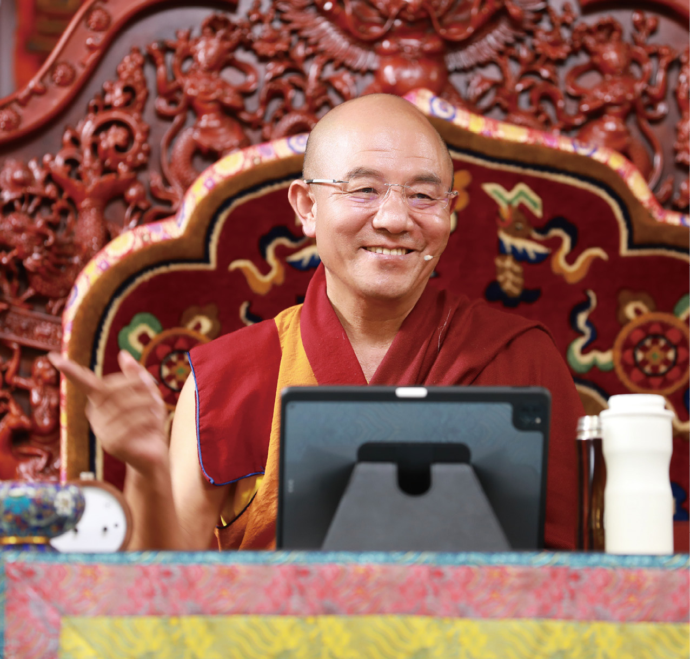

## 关于喇荣人房的最新管理[^1]

2025年1月16日

喇荣寺的一些觉姆听汉语比较方便，所以我今天就用汉语给大家讲一些话。今天主要讲以下几件事情：

第一件事，最近整个喇荣寺和佛学院有一个大的举措——按照相关部门的要求，进行全面的信息登记。整个登记用了近一个月的时间，有许多领导和相关工作人员前来采集信息。

这个登记主要涉及人员和房屋。我们学院2017年整顿过一次，进行院、寺分离，当年8月28日，“喇荣寺管委会”正式进驻喇荣沟开展管理，那个时候做过一次“一标三实”登记。因为上次登记已经过去很多年了，最近上级部门要求整个喇荣沟，包括阿交社区在内，重新进行一次更正式的“一标三实”登记，我们也是义不容辞地配合工作。记得当年登记用了三个月左右的时间，而这次不到一个月就全部完成了。在座的很多觉姆管家过程中都非常积极地配合，特别感谢大家。她们不管白天黑夜，跑遍阴山阳山，非常辛苦。这个工作说起来简单，但实际上非常复杂。

经过这次登记，我们这里的人数最终得到确定，常住人员确实没有超越原定数量。原有3500位觉姆，这几年有人还俗，有人去世，有人离开，现在常住的觉姆共有3400多人。这次登记的人员信息和房屋信息都按标准化一一对应。当时整顿过后，我们这里确实没有增加任何的房屋，哪怕一个小小的牛粪棚、阳光棚，一间也没有新建。一方面，管委会白天晚上都在监督；另一方面，喇荣寺的很多堪姆和管家都在积极配合，主动管理，不允许建房。这次大量工作人员来到喇荣进行审核，最后的结果也得到了相关部门的认可。

原有的人员信息和房屋信息，目前正在进一步审核中。这些信息不会有大的出入，这方面我们心里很有把握，也得到了上面的认可。现在信息审核基本已接近尾声，大家都辛苦了。

我刚才提到的“一标三实”是什么意思？是“一个标准”和“三个实有”。

“一标”是指地址标准——哪个乡哪个村，按照内地的习惯，就是哪个行政片区的哪栋楼，哪个单元，哪号房屋，这些都要登记详实。我们这里虽然没有那么复杂，但至少要把觉姆十三个大片区的每区每号都登记清楚，这就是所谓的“一标”，是一种规范化的管理方式。

“三实”是指人口实有、房屋实有和单位实有。

人口实有，就是这间房屋里实际居住的人员是谁，包括身份证信息和个人照片全部要登记清楚。

房屋实有，就是房屋内有几个房间，多少面积，包括厨房、卧室、书房等信息都要登记核实。

单位实有，就是每个人员的具体单位是什么，在哪个班，哪个部门，这些都要实际对应。

这“一标三实”是全国通用的标准化人口管理方法，这次相关机构也重新制定了比以前更完善、更细致的登记标准。这个工程整体比较大，但现在基本算是圆满了。虽然在寒冬腊月，让大家配合不是那么容易，但是在这个过程中确实没有出现任何状况。包括我个人，接到让我上山的要求后，尽管自己身体不好，不太适应冬天气候，但我还是一直在尽心尽力配合。现在这件事情已经基本圆满了，但还不是完全结束，还有一段时间的工作要做。

第二件事，现在有关部门要求喇荣寺和佛学院减少常住人数，这也是一个大工程。大家知道，2017年8月份后，整个喇荣寺和佛学院常住保留人员的数字是喇嘛1500人、觉姆3500人，总共5000人。到现在有一部分人已经圆寂、离开，或者还俗，不在喇荣总人数中。这次登记也统计出了喇嘛和觉姆的变动信息，现在实际总人数只有4000多人。

从去年开始，上面要求喇嘛和觉姆的人数要进一步减少。这个工作我们也一直在做，过程当中虽然有一些困难，但也在努力推进。上级部门有一些具体要求，比如每年要减少多少人数，我们一直在努力配合。

原本除了5000个常住僧人以外，中央、省里、州里都允许一些技术人员、从业人员在喇荣工作，但这次应相关部门领导要求，这些人员也要离开。目前我们按照指示，也在配合执行。执行之后，整个喇荣寺和佛学院按要求减少人数，应该没有太大困难。

当然，从每个人的角度来看，有些人肯定不愿意离开这里，但是从大局着想，也不是不能做到，对此我们也在全力以赴地做一些工作。要明白的是，这次减员并不是针对哪个民族、哪些人进行的，上面的要求不是这样。主要原因是，除了原有的常住人员外，其他流动人员在喇荣长期居住是不合理的，因为这里已经饱和了，外面的人想进来也很难容纳。我希望那些以前在喇荣道场待过的人，或者计划想来的人，不管是有信仰者，或者无信仰者，现在都不要往这里来。你们是哪里人，就在哪里修行，这样比较好。

刚才我也讲过，现在不同于以前，学院已经实行了“一标三实”的标准化管理，每间屋子门口都有二维码，其中清楚标示了人员的身份、照片、地址等详细信息，跟以往完全不同。即使有人想过来住，也没有容身之地。而且，如果以非法的方式待在这里，可能自己也会遇到种种麻烦，因为有很多管委会的管理人员、觉姆管家，包括公安部门的相关人员等，白天晚上都在持续监督。

所以，我认为每个人最好在自己的地方以如理如法的方式待着。有些人可能以前在喇荣住过，很想再来，但现状不可能按你的想象来。既然这里的人已经满了，你非要进来也不是太好。世界上任何一个道场或者高校，如果额定人数已满，比如限定招生3000人，招满之后，你就很难再挤进去了，想在里面留下来是没办法的。

所以我希望，大家不管以前是什么样，现在很多人都得离开舒适区，自己应该尽量去适应社会、适应管理。有些人可能觉得以前怎么样现在还得怎么样，但很多事情不可能一直不变。现在的管理方式已经完全不同，每个地方都要有更加标准化、规范化、法制化的管理。我们也非常希望大家能理解配合，这很重要。

不要认为喇荣喜欢很多人来。我以前在各种场合中多次说过，就喇荣现有的情况而言，人一旦多了，管理上会出现很多问题，不论每个人的吃喝拉撒，还是卫生、消防，很多方面都存在隐患。照这样下去，喇荣原有的4000多个闻思修行的觉姆喇嘛，最后可能都难以完成自己的学业。所以我们希望大家尽量从大局着想，能够对整个喇荣道场从各方面进行维护，这一点其实也没什么想不通的。当然，我们也尊重每个人的感受，不是要强制大家离开，会以人性化的方式来进行沟通和管理。

第三件事，从今年春天，大概三月开始，我们这里要推进消防工作。这一方面是应上面的要求，一方面我们喇荣的喇嘛和觉姆管家自身也认为有这个必要。原因大家都知道，对于喇荣这个地方，地水火风四大自然灾害当中，火灾的威胁是最严重的，而且，现在仍然存在一定的隐患。我们不担心大风、地震、洪水等，但最担心的就是火灾，因为这里的山坡上盖着一层层密密麻麻的木屋，一旦发生火灾，火随风势，有可能危害到很多人的生命和财产，这一点不用我说，大家也应该清楚。

最近大家都关注到美国加州的火灾，本来他们应该也具备一定的消防条件，但火灾到现在已经持续一个礼拜还没熄灭。在短短几天里，整个城市，包括富人区，都变成了废墟，看起来非常可怕。所以，我们确实对火灾有一定的担心。因此，从三四月份开始，学院可能会考虑把喇嘛和觉姆区的一些空置房屋买下来，或者倡导大家把空屋供养给学院。因为有些房屋可能要面临搬迁拆除，会有这样的情况。阴山和阳山上都要再建一些消防通道，现在正在做这方面的规划，但具体哪些房屋要拆，哪些区域要修路，这方面我们现在还不是特别清楚。但不管怎样，到时候如果遇到个人房屋必须拆除的情况，希望大家能够供养、布施、舍弃。

当然，我也知道，涉及个人的住房，说起来简单，但发生在自己身上肯定会比较心疼。出家人的房子，虽然看起来只是不到十几平米的小屋，但也许这就是他所有的家产，不像一个富人，可能拥有许多套别墅。所以，从真正的价值上看，出家人好不容易把房屋建起来，现在要把这个屋子拆掉，也有一定的困难。这些情况我们会跟相关部门反映，看能不能争取一定的补助，或者学院自己要不要补贴一些，大家通过商量之后再决定。总之，我们要尽量在没发生火灾之前，拆一些房子，修一些消防通道。大家要知道到时会有这么一个安排，这也是今年最主要的一个任务。

我们最近也请了色达县的应急、消防，以及食品监管等好几个相关部门过来，看看不论公共场所还是私人房屋，在这个冬天有没有火灾隐患，最近一直在进行审核。这些问题都是我们十分关心的，万一发生什么事故，那时候抱怨谁也起不到作用。

第四件事，不管怎样，希望大家根据现在的工作需要进行配合。在减少人数的工作上，包括从业人员和技术人员，以及其他暂住人员，你们以后不能继续留在学院，要接受这个事实。佛教徒经常说无常，但是无常有不好的，也有好的。很多事情现在看起来比较困难，但也许最终其实是好的。大家从心理上要能接受，不要太过伤心、痛苦，更不要做一些极端的事情，这样完全没有必要。语言上也不要传出什么言论，或者听信各种谣言，这些也是完全没有必要的。

现在跟以前的管理方式确实不同。大家都知道，过去我们喇荣每次一开法会，会有许许多多人从各个地方涌来，一片人山人海，但现在基本上连法会都没有了，就算有内部的念经，我们也都严加管理。随着时代的不同，大家要学会做出不同的调整，这一点非常重要。

不管怎样，大家作为修行人，哪里都是道场。出家人本来就应该四海为家，在哪里都要学会适应环境、适应生活。我觉得，对每个人来说，首先，要重视自己的健康，如果没有了健康，这个世界再美好也没有意义了；其次，行为应该合理合法，一旦犯了大事，谁也没法救你，当然，小的事也不能去犯，应该如理如法地做事，这样对自己各方面都比较有利。

这些是我发自内心跟大家提的要求和建议，所说内容也没什么需要保密的，可以公开。我说的这些话，都是我自己想说的，没有别的因素。如果有什么不对的地方，我也负全部责任。

最后，快要过年了，祝大家新年吉祥！

[^1]: 当时相关部门要求堪布当众表达他对此事的看法。于是堪布做了开示，将其发布在公众平台上。
