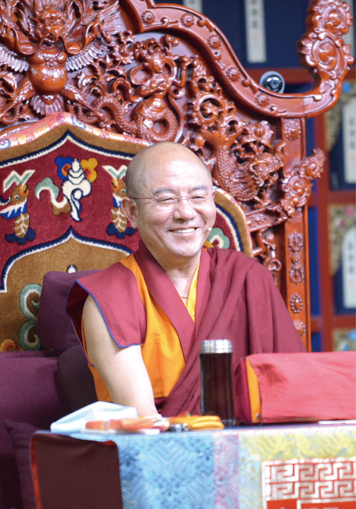
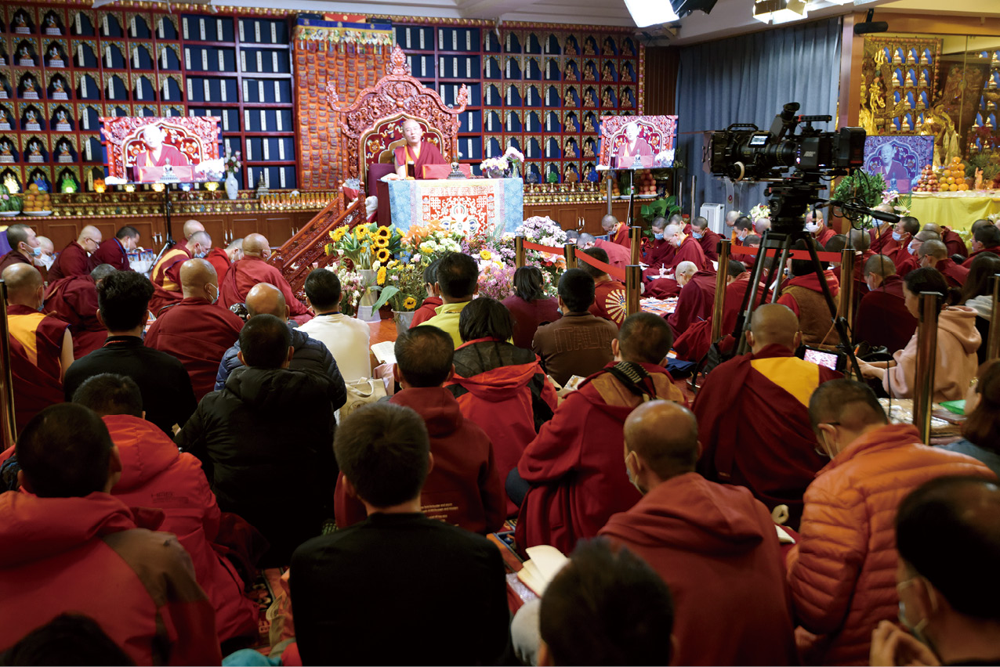

## 别把自己绷太紧

——国庆期间开示

2023年10月2日

今天，给大家做一个简单的开示。为什么增加一节课呢？因为国庆期间，有些佛教徒稍微有点时间，就趁此机会来这里旅游或朝拜。有些人是第一次来学院，也可能是最后一次。所以，我临时加了一堂课，希望能够对大家有所帮助。哪怕只有一点点的帮助，这样做也是值得的。

## 从红尘中前往学院

现在全世界经济都不太好，我知道你们从大城市来到这里很不容易，交通费等各种开支也很多，而且现在人们都特别忙碌，有意乐抽出时间前往寂静的地方，也非常不容易。佛陀在《三摩地王经》等相关经典中说，如果为了解脱想要到寂静地去修行，朝那个方向仅迈七步，其功德也是不可思议的。学院算是一个解脱圣地，因此你们从红尘中前往这里，确实有非常大的功德。

虽然你们很多人不可能一直待在这里，但是在这里和这么多的僧众一起念一遍《普贤行愿品》的功德，也是不可思议的。大多数人去朝拜时，都只是看看风景、拍拍照片，其实到了圣地以后，跟僧众们念一遍《普贤行愿品》，一起发愿、回向，才是一生当中最有意义的事情。

大家也知道，许多藏民会千里迢迢地朝拜拉萨，有些是走路，有些是磕头，然后到了觉沃佛那里，会一起念《普贤行愿品》好好发愿，这才是朝拜的最主要目的。因此，我希望你们来这里后，不要太过散乱，到处看这边人的过失，或者看环境的过失，然后带着各种不清净的心回去，这样非常不值得。

相反，你们心里应该想：在末法时代，能有这么一处清净的圣地，是多么稀有难得的事！现在，来学院旅游的人越来越多，今早我去坛城看维修进度时，一眼望去到处都是人，这样确实会直接或间接地对出家人的生活造成不同程度的影响。但从某种意义上讲，得到人身非常不容易，对于没有信仰的人来说，哪怕只是出于好奇心来到这里，也会在他的相续中种下解脱的善根，等到来世这颗种子成熟时，他自然会迈入解脱之道。所以，我们现在也是比较随缘的态度。

学院将来可能会越来越不寂静，但同时结上善缘的人也会越来越多。从学院本身来讲，一方面要面临一系列的挑战；另一方面，也蕴含着很多机遇，比如说以后每逢节假日，图书馆都可以举办一些临时性的佛法讲座。2011年，趁着各大学校放暑假，我们在学院举办了第一届“世界青年佛学研讨会”，其中有一个专题是“佛教与科学”。当时参加研讨会的那些人，后来有些也出家了。

有时候，看到这些远道而来的人，我总想和他们结上一点善缘，给他们一些加持品。但是，我建议我们结缘的加持品，尽量做得小一点，不要特别大——比如一些特别长的唐卡。我认识的一位居士，他最害怕别人送他大佛像，不拿的话，好像不是一个佛教徒，拿的话，抬都抬不动。尤其对于女性来说，真的比较辛苦。所以，我们应该尽量做方便携带的加持品，结缘甘露丸就非常好。

你们来到喇荣后，最好是多转一转坛城。这个坛城是法王如意宝亲自参与建造的，是特别殊胜的大幻化网坛城。然后，你们还可以去参观各个经堂，进行顶礼、转绕，发一个清净的善愿，然后再离开，而不是以拍照为主。这样离开以后，你可能会想：“原来喇荣是这样一个地方，有一群人过着清净的修行生活，他们的房子看起来也很简单。”

## 今年学院的相关安排

今年，我们计划给大家的屋顶换一种特殊材质的红色瓦片，这样从高处看也比较庄严，还有更重要的一点是防火。前段时间，有个小木屋着火了，但由于已经更换过屋瓦，所以火焰才没有烧到外面。可见，这种材料的防火性能确实很好。另外，还有一个好处，铁皮瓦在夏天会变得很热，尤其是太阳强烈的时候，小虫子只要一落到上面，就会被烫伤或烫死。而现在采用的新材料，基本上不会出现这种情况。

因此，我们更换屋瓦，一方面可以起到防火的作用，另一方面还可以起到放生的作用，不损害众生。这几天道友们也比较积极配合，女众这边基本上已经完成了，男众那边还没有开始。总之，这是学院的统一安排，希望大家能够配合。这样学院看起来也无比庄严，也容易让人产生信心。其实，看似一件很小的事情，既可以让人生起信心，也可以让人退失信心，甚至生起邪见。

近几年，有关部门一直要求开放学院，但我们这边一直没有答应。前两天，听说色达县开始卖门票了，这个也没有得到我们的授意，好像一张票会分给学院三四块钱。其实，我们并不想赚钱，只想给大家提供方便，有时不配合这种规则，好像也不行。但我们还是不想像其他旅游胜地一样，这里的宾馆和餐厅不会收费很高，否则让人不舒服。但做人做事的话，即便你做得再好，也无法让所有人都满意。不管怎样，大家都要开开心心的，可以旅游、朝拜、见某位大德或转绕坛城，不要纠结很多问题。人生本来就是一场梦，在这短暂的梦里，很多实有的东西一直控制着自己，这样到了一定的时候，你醒过来后会发现已经没有机会了。

## 长期闻思修的必要性

学习佛法确实非常有帮助，暂且不说来世往生极乐世界，今生也能成办种种所欲，这一点认真学佛的人应该都有所体会。所以，希望你们以后能好好学习《大圆满前行》，成为一个真正的佛教徒。学院里的很多道友，都会背诵《大圆满前行》，他们有些发愿两年背下来，有些发愿三年背下来，听说背得很不错。你们可能没有背诵的时间，但至少应该每年看一遍。实际上，它不仅仅是大圆满的一个前行，更有很多非常珍贵的教言和窍诀。

现在的人喜欢看比较通俗易懂的书，比如说我们现在发的《西游回忆录》，里面也有很多窍诀，都是法王如意宝的金刚语，看一遍也非常有意义。今年是法王如意宝圆寂二十周年，这是我们对传承上师的一种怀念，也是一种祈祷。通过阅读大德们的传记，可以使自相续中的善根得以增长。所以，在学习佛法的过程中，有时候看一些传记，这样也特别好。

今天下午，学院有些负责人和我说，想让我翻译门措上师的传记，我也很乐意地答应了。这些高僧大德的事迹，应该让更多的人了解，这非常有意义。所以，希望大家来到这里以后，要立下一个誓言：“我在几年当中，一定要看完某本书，或者修一遍五加行。”这对你们特别有利益。

从加行的道次第来讲，应该先认识到人身非常难得，而且得到人身极为重要。这样的人身，如果不用来学习佛法，则是一种极其愚蠢的行为。利用暇满难得的人身，可以成办上士道、中士道和下士道的一切实义。所以，对今生和来世来说，获得人身都有一定的利益。因此，有些上师们讲，人身比天人的身份更殊胜，学佛的身份是非常重要的。

得到人身以后，如果没有尽快学习佛法，可能很短的时间当中就离开了人间，因为一切万法都是无常的，不管是春夏秋冬的变化，还是人们从青年、中年到老年的变化，或者是外界山河大地的变化，都能说明，这个色身无法长久驻留世间。因此，大家随时都要有一种无常感，然后带有无常感来学习如来的教法。

通过祈祷上师三宝，学习真正的佛理，让自相续中生起信心，然后夜以继日地去修行，这样无常来临时，我们才有解脱的把握。因此，大家一定要懂得取舍因果、行善断恶，如此便不会流转到轮回当中，否则下一世很可能会流转于三恶趣当中，那里的时间是人间无法比拟的，痛苦也是无法言喻的。而我们现在依靠善知识的引导，即生就有希望从轮回中彻底解脱。

大家要明白，学佛必须依止一位真正的善知识。有了善知识的摄受，我们才能领悟佛讲的这些道理，否则依靠自力很难通达佛教的教义。所以，依止善知识以后，你的解脱就有希望了，但是想要解脱就必须先要皈依三宝，然后发菩提心、积资净障，最后依靠上师瑜伽将一切都转为道用。这是简单的共同加行和不共加行的引导法。大家一定要修五加行，修完加行的人，才是名副其实的修行人。

如果不修加行，即使你学过很多密法，得过很多灌顶，自相续可能还是刚强难化。因此，一定要在修行上下功夫，至少也要修一遍五加行，尤其对于学密法的人来说，这个非常重要。

在座的各位，有些是初学者，有些已经学了很长时间，但不管怎样，修行归根结底就是调伏自心。如果没有调伏内心，即使得了很多大法，也没有多大的意义。如果内心得到调伏，哪怕只学一本经典或论典，也足以让自相续产生大的改变。佛陀讲了八万四千法门，最精髓的教言就是“调伏自心，自净其意”。法王如意宝也曾说：“莫舍己道，勿扰他心。”

接下来，我用藏语给大家念一下传承。

（堪布念《佛子行》《愿海精髓》《前译教法兴盛愿文》的传承）

今天，我对大家提出了几点希望：第一，发殊胜的善愿；第二，每年给自己定一个修行目标，大家一定要修行，如果没有修行，很难斩断自己的根本烦恼；第三，想要修行的话，一定先要听闻佛法，然后认真思考法义，这样才能让法融入心；第四，在末法时代遇到大圆满，尤其是前译宁玛巴的教法，这是非常有福报的事情，大家应该万分珍惜。这并不是我们自己赞叹自己，宁玛巴的教法确实非常完整，圆满具足所有的佛法，并且具有不共殊胜的加持力。

## 自利利他是佛教徒的人生态度

以前的藏地一直处在黑暗当中，但自从有了佛法如意宝，人们的心中就出现了正法光明。只要我们用心修行，则如同向如意宝作祈祷，能圆满一切所欲。因此，大家最好不要舍弃自己所修的法，尤其是具有很多殊胜窍诀的宁玛巴教法。当然，无论你是学习藏传佛教还是汉传佛教，或者是其他宗教，我们都不排斥，只要是对众生有利、对自己有利的法，都可以进行修持。同样，我们也不排斥任何高僧大德，他们以各种善巧方便摄受众生，这些都非常有意义。

这个世界需要很多人来共同守护，而不只是一两个人努力。所以，遇到各种各样的人和事，应该以宽容和包容的心态来看待。但是，对别人要宽容，对自己要严格，不能人云亦云，到处跑来跑去，不好好闻思修，总是口无遮拦，经常说一些闲言碎语，或者天天说是非来度日，自己不好好地修行，这样没有任何意义。

其实，很多人的人生都没有真正成熟。人们从小就开始不停地读书，到了二三十岁，人生才算是比较成熟。但如果你没有好好学修，再过一二十年可能又开始下滑，然后到了五十岁以上，身体或多或少会有各种疾病缠身，很难再有学习佛法、弘扬佛法的机会。因此，现在有机缘的时候，大家一定要珍惜，不要浪费这么好的时光，不然今生恍恍惚惚就过去了，这样特别可惜。就像《入行论》所讲的，拥有一颗善心是非常不容易的，我们应该要懂得珍惜，因为这颗善心很有可能会被各种违缘所摧毁。哪怕是听一堂课，念一遍《普贤行愿品》，念一句观音心咒，也要努力去行持，这样做非常重要。

这次来了很多游客，有些人很想见一见我，其实也没有必要。我刚才念的那些传承，你们应该自己学一学。有时候，所学的法不需要太多，只要把几部法成功融入自相续，就足够调伏内心了。当然，如果想学习五部大论等显密法要，也非常值得随喜。

在短暂的人生里，如果实在学不懂也没有关系，大家千万不要失去信心。有些人经常说：“我很惭愧，我学得不好、修得不好、念得不好……”然后拼命压制自己的烦恼和痛苦。其实，每个人都有一大堆的烦恼、执著和痛苦，但我们仍然有一颗善心，而地狱、饿鬼、旁生三恶趣中的众生连拥有善心都很难。我们感觉很烦恼、很痛苦时，可以用正知正念来对治，在一些原则性问题上，我们的见解、修行和行为并不会改变，虽然偶尔会产生各种烦恼，但也可以通过念修金刚萨埵进行忏悔。

凡夫人的烦恼大多是不由自主而出现的，自己很难控制，但只要具足正知正念，就不会失去本性。虽然道友们之间会有不愉快，但总的来讲，不应该把对方看成是很坏、很差的人，不要因为一两件小事心里总是过意不去。其实，如果详细观察就会发现，痛苦和烦恼的来源就是我执。但是，有些人就像戴着有色眼镜，认为一切外境都是我的痛苦之源、困惑之源，实际上这些都是依靠自己的迷乱习气而显现。

佛教中经常说“万法唯心造”，如果真的像前辈大德那样当下开悟，则一切除了如梦如幻的显现以外，根本没有任何实义可言，这样安乐自然而然就会生起。但暂时来讲，每个人的修行都不容易，需要独自面对自身的种种烦恼、复杂的世间生活、外部环境的各种诱惑，以及内心非常多的希求。像学院这样闻思修行的传承，也是我们用几十年的努力换来的，为此哪怕是付出自己的生命，也是心甘情愿的。

佛法如意宝真的对众生非常有利。我们的健康、名声、财富等，跟慈悲心、菩提心相比，根本不足挂齿。如果有了菩提心，就像释迦牟尼佛传记中说的那样，即使众生把你的肉一块一块割下来，你也不会起丝毫嗔恨心。当然，凡夫人很难达到这种境界，反而还有很多事情让我们苦恼，让我们心不安定，只不过有烦恼粗大与否、我执强烈与否的差别。因此，即使两个人之间有矛盾，也不要一直记在心上。我那天也讲了，如果大家都很放得开，别把自己绷得那么紧，处于比较放松的状态，那整个世界都会变得特别美好；如果心绷得越来越紧，确实是度日如年，不但修行很难提升，甚至还会影响身心健康。

修行说起来容易，做起来真的很难。就我个人而言，讲经说法将近四十年了，不管是用藏语还是汉语，如果不限时间，我可以一直滔滔不绝地讲，根本不用备课，但让我去做的话，我也很难做到。有些人可能认为，堪布对治烦恼和痛苦很厉害，所以他应该很幸福。实际上并不是这样，如果没有调伏自心，只是嘴巴上说说，也起不到什么作用。但不管怎样，我这么多年从来没有想过要舍弃三宝。我从小学佛，出家到今天，无论遇到任何事情，除了祈祷三宝以外，从来没有产生过舍弃三宝的恶念。

在未来的人生当中，难免会遇到成功与失败、得到与失去，但绝对不能舍弃菩提心，一定要帮助众生、利益众生、不害众生，依照这样的原则去做事，并以此来度过自己的一生。即使你修得不是很好，这一生也算是比较成功的。看看我们的周围，有那么多人以杀生等恶事为生，和这些人相比，我们没有天天杀害众生，的确是件值得欢喜的事情。有些佛教徒虽然修得不好，学得不好，但他们也有自己的优点。

不管做什么事情，我们都要对自己有信心，对别人也要有信心。遇到困难的时候，只要你能调伏自心、祈祷三宝，一切违缘障碍都会自然消除。总之，不要退失信心，不要退失悲心，尽力通过闻思修来增上智慧，这样的人生才有意义。按照密宗的说法，倘若今生没有得到稳固殊胜的境界，那临终时可以将自心观成白色的藏文“阿”字，被风吹送而融入顶上安住的上师心间，然后上师越来越高，去往极乐世界，自心与上师无二无别中入定而往生，这种往生窍诀非常重要。

## 全体僧众闭关念修文殊心咒

学院今年闭关期间念文殊心咒，要求每个人到明年闭关的时候，念满100万遍——在一年当中念完并不难，希望大家都能报名参与。益西彭措堪布也翻译了《文殊静修大圆满仪轨》，闭关期间主要是按照这个仪轨来修。

当然，发愿容易，行持很难。1987年，法王如意宝朝拜五台山后，要求全学院的弟子主修文殊本尊，念一亿遍文殊心咒。我们现在念一亿遍可能有些困难，但念100万遍应该是可以的。虽然我以前也发愿过，但这次这么多僧众一起共修，每个人都能得到百千万亿遍的功德，我也想再次发愿，希望你们也能参加。

为了表达一个缘起，大家可以举手发愿，不想发愿也没关系。虽然我每天念诵的功课很多，但一年当中念完应该问题不大。尤其是，如果能与僧众一起共修，善根的增长是不可思议的。

（堪布和在场道友一起举手）

在学院这么多的僧众里，肯定有很多了不起的菩萨，这样一起发愿的机会确实非常难得。当然，你们想提前念完也可以。如果每天不间断地念诵，100万遍真的不算很多，关键是要长期坚持，不要三天打鱼两天晒网。

这段时间，我们讲了《智慧百论》《诸佛之母·一字般若经》《文殊静修大圆满》等，现在大家应该共同念诵文殊心咒。我刚刚念完10万遍莲师心咒，从明天开始又要念文殊心咒。其实，人还是要给自己一点压力，而且文殊心咒并不是很长，也比较好念。

念诵时，最好这样观想：在自己的前面虚空当中，文殊菩萨身色红黄，一面二臂金刚跏趺坐，然后在他面前开始祈祷，这是一种上师瑜伽，也是一种皈依。

接下来，我给大家传一个文殊法门。

（堪布念传承）

下面，再给大家做一下皈依，以前皈依过的人，重新皈依也可以。大家心里观想：对于释迦牟尼佛为主的佛宝，释迦牟尼佛宣说的法宝，跟随释迦牟尼佛的僧众，我从现在开始乃至生生世世皈依，永远不舍弃三宝。一边这样观想，一边念诵皈依偈。有些人为自己解脱而皈依，有些人为利益众生而皈依，有些人为不堕恶趣而皈依，大家心里最好想着为利益众生而皈依。

（堪布传授皈依戒）

今天的开示已经圆满了，如果在其他地方，做一次开示很不容易，大家相聚在一起也很不容易。按照藏地的传统，皈依后都不取法名，一般汉地有这种习惯，但我想今天不起法名也可以。

过段时间，学院开始闭关念文殊心咒，然后又共修念阿弥陀佛心咒，任务也比较多。因此，大家最好在一年内念满100万遍文殊心咒。对于有正知正念的人来说，只要每天坚持，念完是没有问题的。如果一点压力都没有，天天散乱放逸，这样没有多大意义。

念诵《普贤行愿品》时，大家心里要想：终有一天，我要获得登地菩萨的果位，现前普贤菩萨的十种大愿，利益无边无际的众生！那个时候，你不会有任何烦恼和痛苦，可以任运自成地利益众生，这应该是每一个人都希求的境界。

喇荣是前辈大德们加持过的圣地，而且经堂里还有很多三宝所依，大家在此处以清净心共同发愿，然后又一起回向，希望道友们珍惜这样难得的机遇。
