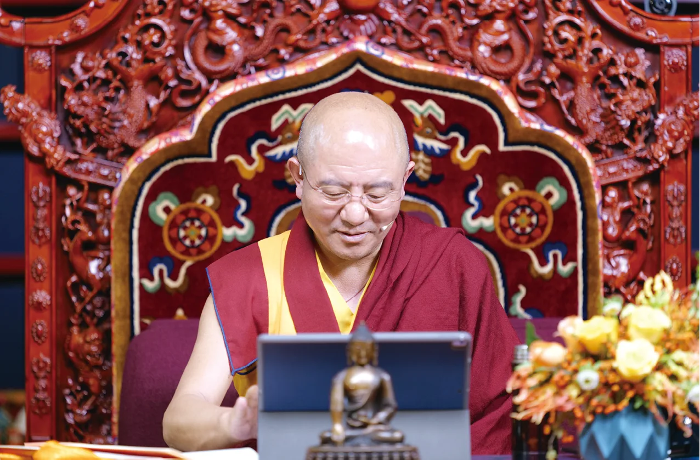

# 圆满盛事的内部开示

2022年7月16日

今天《四心滴》灌顶已经圆满了。今年我们这边没有其他灌顶了。有极少数人来晚了，没有得到这个灌顶，但也没办法，这就是缘分，只要自己有信心，以后再等机会吧。

上课之前，我先说几件事。

第一件事情，刚才旺修泽嘉堪布先是说要念传承，后来因为时间不够，又说不念了。当时我已经离开了翻译室，无法告知大家，只能等回到这边以后，再给大家捎个口信，不过你们那时候应该已经都知道了。所以《上师心滴》的传承改为明天念，时间是早上6:30开始，可能持续到晚上9:00左右，一天之内就能念完。

明天念传承的时候，男众就跟喇嘛经堂的僧众一起听。女众就在法界宫里听。如果坐不下的话，楼上男女众的教室都可以用。因为觉姆经堂离卫生间很远，中间休息的时间只有25分钟，经堂门又很小，来来去去非常费劲。所以，我们刚才经过商量，女众就在这边听吧。明天6:30起把外面的门锁起来，里面从一楼到四楼都有女众卫生间。二楼的男众卫生间，明天女众也可以使用。男众也有少数人在这边，就在五楼听。这样安排的话，明天会方便一点。

明天从上午6:30以后就不能进出，中午这里也不开门。本来县政府计划明天来这里做一些检查工作，我跟他们说，明天我们要闭关，后天再说吧。所以，明天你们最好自己准备一些吃的。我们以前出去求法都会背着一个月的口粮上路，光是明天一天，你们应该能自己解决。到时候内部提供一些开水，或者大家自己带一点，这样也是可以的。这就是明天的安排。

《上师心滴》的传承念完以后，建议外来的道友们就陆续回去吧。不然的话，这里的疫情管控很有可能又会严起来。一旦严起来，你们又得躲躲藏藏，很麻烦。到时候你们不仅自己无法离开，也会给我们这里引来麻烦，那也不太好。

大家也知道，这两天成都的疫情又严重起来了。省里刚开了紧急会议，昨天州里也开了紧急会议，学院这边有两个管委会的工作人员也通过网络参加了会议，今天上午给我传达了很多会议内容。所以，我们想办法把原定在明天的九本尊和空行母灌顶，提前到今天全部完成了——因为害怕出现违缘，早些完成也是个好事。所以，明天《上师心滴》的传承念完之后，你们该回去的就可以回去了。有极少数人如果还想继续听课的话，也可以再留一阵子，但有纪律等各方面的要求，以及一些注意事项。

从后天起，政府要求我们这里的宾馆对所有人一一进行登记和检查，因为担心有外来人员。据说现在沿路各个关卡的检查比前段时间严了很多，我没有出去，不太清楚具体情况，但是今天他们多次强调过。所以，我们建议大家还是尽快离开。

对于汉族修行人而言，《四心滴》里除了《上师心滴》，其他的内容目前你们也用不上。《上师心滴》里的大圆满法已经足够了，除此以外根本不需要其他的大圆满法。所以，明天《上师心滴》的传承接完之后，大家就可以下山了。否则，你们自己也麻烦，我们也担心。现在兰州等地又开始有疫情扩散，再这样下去，你们很可能连回去都不太方便。这是我的建议。如果有人想：“我偏不走，会不会之后还有什么秘密的安排？”到时候说不定工作组找到你头上来，这也许才是你最后等到的。最近这里没有任何的灌顶安排，如果有的话我们完全可以说明，但确实没有。在这里就给大家直接说清楚。

明天传承念完之后，大家就尽早回去吧。本来今天有关部门就要来这里做登记，我们以闭关的理由推迟了。这样下去，很多方面都不知道会怎样变化。大家都明白，每次成都稍有一点病例，我们这里就要大张旗鼓地管控，就连走在大路上的人，都会被工作组带下山去教训一顿，登记一番，这样对你们而言未必是好事。我并不是要吓唬你们，也没必要吓唬，但真实的情况必须给你们讲清楚。

这次《上师心滴》灌顶的过程中没有出现违缘，已经算很好了。明天这里的门要锁起来，念完传承以后再把门打开。到时候，你们最好按照今天所说的那样，沿着小路分散离开。外面因为疫情管控，有很多卫生、公安各个部门的人和车，你们在公共场合当中来来去去也不太方便。今天他们在会议上提出了十个问题，其中很多都非常严格，幸好我们这次的事情已经圆满了，否则有些要求真的很难操作。

明天上午、中午、下午这里都不开门，幸好里面有卫生间，这样就没什么问题了。但建议大家不要喝牛奶，不然肚子容易涨，知道吧？这话一出，卖牛奶的生意不好做了。大家在听传承的过程中去上卫生间，也会断传承的，因为卫生间里没有音响。没到休息时间，大家最好不要离开现场，不然会中断传承。在休息时间内，楼里所有的卫生间应该足够大家使用。这是要说的第一件事情。

第二件事，昨天灌完《上师心滴》以后，很多道友发愿佩戴《系解脱》，所以我们准备了一些。等会儿下课之后，女众在法界宫三楼领取，男众在四楼领取。这次只提供给从未得到过《系解脱》的人，只能领自己的一份，不能多领。如果暂时不着急，过两天再领也可以。到时给我提个醒，我们再发一次。今天主要是发给听完传承就要忙着回去的这些人。

后天其他的传承还会继续念，时间是早晨6点到晚上9点。后天晚上我还是有课，讲《佛子行》。大家听课的方式跟之前一样。这次有一些新来的居士和出家人想要见我，我本来也想给大家提供一个见面的时间，但是后来因为疫情等方面的限制，大家集聚很不方便，所以只能期待以后的机会。这次大家得了这么深的法，如果还觉得得不到加持，光是见我的肉身肯定也没什么用。既然现在不太方便集聚，希望你们也不要在路上拦我。我刚才看到龙多活佛，本来他传法一天下来已经很累了，还被一大堆人堵在门口。真不好说这些人到底是做功德还是搞破坏。

不过总体上看，这次大家的纪律还是不错的。我们降魔胜利洲这边，无论是灌顶时还是传加持物时，绝大部分人的表现都很好。但有极少数人，也许是刚来这里不懂纪律，这我能理解。不管怎样，希望大家配合管理。接下来这几天，我这边不安排接见。因为每次一有疫情，很多方面都不方便，尤其是我们这个小地方，规矩特别多，管控特别严，你们也应该理解。很多问题我们不得不担心，万一给学院正常的闻思修行带来一些违缘，那就不好了。

这就是今天要讲的几件事。明天我没有课。今晚大家最好早一点睡，明早听传承可不要迟到。你们这几天一直比较累，累了以后容易打瞌睡，千万不要因此断了这么难得的《上师心滴》的传承。你们要提醒坐在旁边的人，如果他快要打瞌睡了，就狠狠把他打醒。这样的话，听一整天传承大家应该能坚持下来，但如果睡眠不足，可能会有点困难，所以明天大家要争气。我们这边有现场的视频、音频直播，各方面都很方便，大家要好好珍惜这个机会。

最后要提醒一下，今天龙多活佛已经讲得很清楚了，大家一定要修完五十万加行。有些人很快就要下山了，最好得个加行的传承。所以我今晚暂时不传《佛子行》，先念个《前行念诵仪轨·开显解脱道》的传承，这样便于你们修加行。如果以前没有修过，一定要发愿修完。这次你们来到这里很不容易，今天龙多活佛清楚地提了这个要求，我也很辛苦，在这五六天中一直不断地同步翻译，所以大家应该有一种不一样的心态。既然来到这个佛学院，如果连这个决心都不下，那真的很应该惭愧。作为佛教徒，我们应该履行自己的承诺，遵守誓言很重要。

下面，我把《开显解脱道》的传承给大家念一下。

（堪布念《开显解脱道》传承）

好，今晚基本就是这些内容。今天大家都很累了，我就不传法了。刚才旺修堪布说今天不念传承，大家都鼓起掌来，所以我说今天不讲课，估计你们也松了一口气。既然今天我们大家都累了，就不讲法了，念了传承就可以。

我也很累，你们也很累，但今天大家应该非常欢喜。昨天念《大自在祈祷文》的时候我就累得睡着了。醒过来时龙多活佛已经开始念顶礼句，我吓一跳，马上接上翻译：“为一切众生发菩提心。”那时活佛正在念第一句“顶礼本师释迦牟尼佛”，我就装着样子，然后赶快看下面的几个顶礼句。你们没有发现吧？所以，大家最近确实有些辛苦，但也不要紧吧，我们在这一生中很难得有这样一个机会。很多人都想得到这个法，但这要靠因缘，我们也没办法给所有人提供这样的机缘。

至于《系解脱》，大家不要多领，自己已经有了的话就不要再领了。没有灌过顶是不能戴《系解脱》的，只有得过这个法、灌过这个顶才行。《系解脱》里面的东西不能动，外面你们怎么调都可以。还有刚才发的九本尊红线，不知道大家得到没有，没有得到的话等会儿可以补。其他就没什么事了。明天没有课，后天有课，课程跟平时一样。
