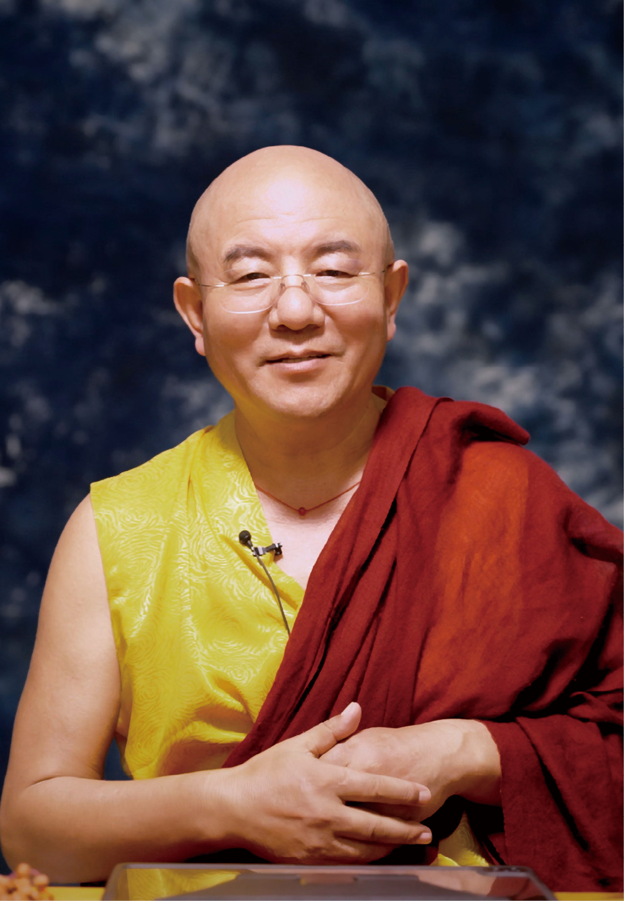

# 如何面对这个特殊的时代

2026年2月22日

## 在复杂的世界中清醒前行

今天我想简单讲讲，在这个特殊的时代，我们该如何面对修行和生活。这不算一堂课，只是分享一些观点，供大家参考。

我们身处21世纪，面对的是一个空前复杂的世界——无论是内在的心灵世界，还是外部的物质世界，都呈现出极其错综复杂的状况，这在人类历史上几乎是前所未有的。

表面上，日新月异的科技给我们的生活带来了很多便利，电子设备飞快更新，信息交流四通八达，然而与此同时，人们却愈加忙碌、愈加困惑、愈加充满烦恼。在这样的时代，一个人不论是否有信仰，都应该学会独立思考、正确面对。我们不能一味地否定当下社会、抱怨经济下行、批评政治环境，或是对国际局势愤愤不平，这些情绪对解决问题毫无用处。

的确，整个人类社会正处于一个非常特殊的阶段，正如《双城记》所说：这是一个最好的时代，也是一个最坏的时代。为什么是最好的时代？因为现在只要你愿意行动，无论是追求个人利益还是社会价值，做起事来都比过去方便得多。但为什么又是最不好的时代？因为人们正经历着信念和价值层面的剧烈动荡，不再像过去那样的纯粹、简单、快乐，于是越来越找不到人生的方向，内心充满焦虑和迷茫，普遍没有安全感。

正因如此，今天的话题，不仅适用于像我这样有特定信仰的人，也值得每一个生存于当今世界的人思考：我们该如何面对当下的现实生活？

大家都知道，人生说长也长，要经历几十年；但说短也短，几十年转瞬即逝，一转眼间，我们人生的十年、二十年就已匆匆过去了。在这样的一生当中，我们需要关心的是，自己究竟该怎样活着？当然，在这个时代，大家在这方面都考虑的很多，包括自己的生活方式、健康状况、未来规划等等，即便是修行人，也同样要考虑这些问题。在这个时候，不管是出家人还是在家人，都需要学会一件事：正确应对这个世间的变化。

前几年，我们学院的许多道友不得不陆续离开。下山之后，有些人过得也很好，他们因为没有太多自私自利之心，离开学院后反而遇到了很多机会，各方面的因缘也逐渐成熟。但也有些人在原来的环境中活得太过简单，突然间要面对复杂的社会、接触不同的人群，确实遇到了一些困难。我希望大家能应该更清醒地认识和接受这个世间的变化，包括修行、生活、管理等方方面面。不仅是我们这些有信仰的人在经历变故，世界上的一切都在发生变化，这是很正常的。佛陀早就说过万法无常，“一切有为法，如梦幻泡影”，没有什么是恒常不变的。尤其是在这样一个特殊的时代，我们更需要在无常的世间拥有一份坦然以对的从容。

## 核心策略应对时代变化

如何应对？在我看来，主要应注意这几个方面：

### 1．持续学习，善巧分享

首先，我们应该将以前学过的知识，在世间善巧运用，这很重要。善巧运用需要懂得变通。我在过去十几年来，经常与不同群体进行交流与分享，过程中大多是以一种非宗教的方式——不包宗教信仰的外衣，而是传播其善良、慈悲、智慧的内在精神。这一点非常关键。大家都知道，不论在东方还是西方，如果你直接以某一宗教的术语和习惯去表达，其他人不一定愿意接受。比如看到基督教的形式，佛教徒和无神论者可能不太感兴趣。其实，不论是世界各大宗教，还是世间主要思想流派，都在强调同样的核心理念——善良、智慧与爱。这是我们人类共同的财富。以这样的方式去传递，也许更利于大众接受。

所以，大家在分享知识时，要先看具体场合。如果面对的是同一信仰的群体，那我们可以按自己所学原汁原味地传授给他们；如果面对的是普罗大众，就需要你运用智慧和善巧，让别人能听懂、能接受、能得到利益。其实我们分享这些知识，并不是为了宣传自己的宗派、树立自己的观点。我们唯一的目的，是希望所有众生，都能获得身心的真实利益。以这样的出发点去做，也更适合现今这个社会。

我自己这十几年来，去许多地方做过分享，包括高校、企业、监狱，还有其他一些社会团体。每次我都会认真研究，他们关注什么？他们内心有哪些困惑？他们是否面临着焦虑、抑郁等心理危机，甚至正在被各种精神疾病所折磨？我不是为了演讲而演讲，而是发自内心地去思考和关心他们的状态。把自己当成一个医生，走到社会中去，一边寻找精神的良方，一边向需要的人分享。在这个过程中，我不断从自己所学所思的、涵盖宗教内外的精神资源中提炼，炼出精华，配成妙药，再分享给大家，在这样的践行中，也收获了一些人的认可和欢迎。

去年我出了一本新书，叫做《一切都会过去的》。很多朋友已经读过了，如果没读过，也可以了解一下，从中也许能更好地理解现在人们内心的困惑和真正的需求点。最近我又出了《你的脆弱很正常》这本书，目前在读者中反响还不错。我提这些并不是要宣传或赞叹自己，只是想说，我不是只让你们去学，而自己什么都不做。

实际上，我自己白天黑夜都在认真思考，我很爱思考。思考之后，不论心得体会是深是浅，我都会把真实的所得分享出来，而不是在网上随便查查资料，然后照着PPT念给大家听，这样做对大家没有任何意义。我更愿意把自己看到、听到、学到的，在心中慢慢消化，再通过智慧分析和整合，把最有价值的内容呈现出来。哪怕只是一个比喻、一句教言、一段简单的故事，都是经过我的思想打磨后才分享给大家的。所以，无论我去哪里演讲，从不会拿着稿子念。我觉得，只有自己思考所得的收获和真实体验的感受，才值得拿出来与大家分享；只有这样的分享，才能令一些人有所触动。

在这两本书中，我没有使用佛教的语言，因为现在在很多场景下，宗教内容都受到一定的限制，东西方皆是如此。很多西方学校对宗教内容的传播都有严格限定，学校毕竟是以教授科学知识为主，对古老的宗教义理不一定能接受。其实我觉得，没有宗教色彩的内容也是很好的，我们只需要唤醒人们心中的善良。一提起善良，每个人都觉得自己是很善良的，包括很多无恶不作的人，但善良应当有一个标准。

什么是善良呢？按照佛教的观点，行持十种善业的人，严格断除十种不善业的人，才称得上善良。也就是说，要做到身体上，不杀生、不偷盗、不邪淫；语言上，不妄语、不离间语、不绮语、不恶语；心上，不贪、不害、不邪见。如果能做到这十种善业，你就可以说自己是个善良的人。

按照儒家的观点，要做到“己所不欲，勿施于人”——自己不愿意的，不要强加给别人。能做到这一点，才是善良。如果你把自己不愿承受的事，施加于别人身上，比如对他人行窃、伤害，然后还说自己很善良，那绝对是说不通的。

所以，不一定非要有宗教信仰，才能做一个真正善良的人。只要我们能以这样的道德标准约束自己、衡量自己，时刻以正知正念来观察自己、守护自己，就称得上善良。

在这个时代，不一定人人都要信仰宗教，成为一个善良的人，就已经很不错了。当然，如果你在这个基础上，有皈依或出家的因缘，有学修显密佛法的机会，那就可以逐层深入，趋向究竟安乐。如果没有这样的因缘，至少可以按照十善业的标准，守住最基本的善良。发善心，持善念，行善事，以此指导自己的思想和行为，这也是非常重要的。

现代医学也证明，当我们的心充满善意和爱，或做出利他的行为时，大脑会分泌多巴胺、血清素等神经递质，不仅能让我们感到更加快乐，而且对健康大有益处。所以，从过好人生的角度来看，多利他，多行善，能给自己带来超乎想象的回报。正如《入菩萨行论》所言：“所有世间乐，悉从利他生。”古语也说：“积善之家，必有余庆。”积累善行，必定会带来快乐和福报，这是一种自然规律。

所以，在这个时代，我们要根据实际情况而行，不一定要让每个人都去皈依，或是去做某些高深的仪式。更重要的，是具备一种智慧。有了这种智慧，我们在这个世间，就能让自己和他人都处于更好的状态之中。

同时，我们要看到，这个社会正在发生越来越大的变化。无论科技、经济、政治、文化还是教育，方方面面都会面临系统性的巨大转变。现在的世界，就像一台用了很久的电脑，当里面大部分程序都升级以后，整个系统也必须随之更新。尤其是在AI技术飞速发展的时代背景下，人类固有的观念和习惯，恐怕很快就要被全新的理念、行为和生活方式所替代。这一点，我们从过去短短几十年的发展就能看得出来，回想二十年前的生活，到如今发生了多大的变化？我们现在习以为常的一切，很快也会改变。这个时候，我们佛教徒同样需要思考。

以前很多人安于自己的所知，但现在需要进一步提升自己。过去在藏地，大部分人都是文盲，基本上只有出家人识字，那时候出家人在大众中威望很高，因为他们是那一代的知识分子。后来教育普及了，几乎人人都能识文断字，这个时候如果出家人没有持续学习，在文化程度上就与大众没有区别了。所以，在识字的基础上，出家人要学更多知识。按照印度传统，大乘佛教徒应当学习十明，也就是工巧明、医方明、声明、因明、内明等十种学科，很像今天大学里的建筑学、医学、语言学、逻辑学等专业。如果出家人能不断学习，精通这些学问，便能胸有成竹地向他人传讲，否则在知识层面就很难再有优势。

所以，不管你是哪种身份，有无信仰，都应该不断学习。作为佛教徒，我认为大家要注重两方面的学习：一方面要持续深入自己所信仰的法义，这是最重要的；另一方面，面对这个日新月异的社会，必须不断更新自己的知识。

我个人也在不停学习。如果不学习，确实会被整个社会和人群甩在后面。虽然随着年岁渐长，记忆力已不如从前，智慧的敏锐度也在下降，但不论如何，这种爱学习的习惯，一定要建立起来。

我看到很多山上下来的道友，一直在坚持学习，我也为他们感到高兴。但也有些人下山之后就松懈了下来，好像觉得既然离开了，就可以休息了。其实，我们的学习不该限于特定环境。你在学校里可以学习，在佛学院可以学习，在其他场所也可以学习。如果离开原来的环境就放弃学习，这种状态恐怕不太对。

所以，在知识方面，我们一定要不断地充实自己。否则在这个社会中，既忘掉了自己的专业知识，又掌握不了世间知识，那你就成了欠缺智慧的人。这是我想强调的第一点。

### 2．迎接变革，善用工具

大家应该也注意到了，现在全世界的教育模式，正在经历前所未有的变革。过去学生是在老师教导下背诵知识、写作文章，但在如今这个AI时代，这些方式似乎失去了原本的意义，因为相比人脑的记忆和思考，AI强大太多，可以瞬间调取海量知识，轻松生成各种文章。在这个时候，整个人类确实面临着巨大的挑战。许多高校教授都在为此苦恼，因为以前他们凭借学识和研究能力成为权威，但现在学生用AI写出的论文可能比他们的更为优秀。

这个问题不仅影响世间的教育领域，我们宗教界同样要面对变革。比如，在经论的翻译、义理的解释、课程的教授上，AI会带来怎样的变化，大家也应该思考。传统的佛学教育模式难免会受到一定的冲击，但有一点是确定的：佛教的教义本身，不会受到任何影响。佛陀通过三转法轮传下的八万四千法门，不论时代如何变迁，都绝对经得起推敲。因为它所解决的，是人类本身的终极问题——生老病死、身心痛苦。这些问题在任何时代都不会改变。

但是在方式方法上，我们佛教徒必须思考，如何在佛法的学习和教育中运用新的技术，与此同时，又能保护好我们原有的文化和传统。这个问题值得大家深思。

### 3．拒绝怠惰，积极做事

第三个方面，我们要明白，现在的社会经济模式相比过去已经发生了巨大的改变。在古代的农业社会，佛教徒的生活方式比较简单——出家人弘扬佛法，在家人护持佛法，很多施主会对僧众进行供养，比如国王、大臣、商主、长者。出家人通常靠托钵化缘维持基本生活，不必自己操劳生计。

但现在传统的生活方式已经完全变样了，无论是在家人还是出家人，如今都需要有自己的生存本领。作为人类，谁都需要生活的本钱，不然连基本的温饱都无法保证。正因如此，当初百丈禅师才倡导“一日不作，一日不食”的理念，带领僧团以农耕自给自足。他到了晚年，还坚持每天下地劳作。弟子为了让他休息，把他的农具藏了起来，他便以绝食表明态度，一定要遵守“不作不食”的原则。

过去的“作”是以务农为主，而现代则有各种各样的方式。我认为，不论是出家人还是在家人，不论有信仰还是无信仰，我们每个人要在世上生存，都应该学习这种精神，不能懒惰。“不作不食”的“作”，并非仅指下地种田、挖土引水，而是指以自己的行动创造价值，比如有些人通过电脑做各类工作，有些人在不同领域积极发心，有些人以各种形式传播文化，有些人自己认真念经、修行，其实这些都是“作”。

现在这个时代，我们可以做的事情很多。比如你看到一句触动心灵的格言、一段充满智慧的教证、一篇启迪思想的文章，动动手就能分享出去。哪怕只传播给一个人、十个人，这也是做了件很有意义的事。而有些人自己看看就算了，从不与人分享。这样的人，也许是像闭关者那样隔绝旁人、一心修行；也许是利他心不够，内心比较封闭。

不管怎样，在这个社会中，每个人都应该积极地做一些事，不要懈怠懒散，成天浑浑噩噩地消磨时光，这样很不合理。一方面，从经济来源出发，我们必须通过自己的行动和付出来积累资粮、维持生活；另一方面，在有能力的时候，我们也应该学会把自己享有的福报分享给需要的人，无论是智慧财富还是物质财富。这在当今时代是非常重要的事。

### 4．未雨绸缪，不惧冲击

此外，我们还应该学会应对冲击。这个时代变化太快，我们以前熟悉的一切，包括寺院内外的修行和生活，都在不断遭遇各种文化的冲击。不仅出家人如此，其实社会上每一个人在生活和工作中，都面临许许多多不可控的因素，都没有真正的安全感。关于这些问题，我在新出的两本书中也稍微作了一些探讨。我引用了许多国内外的格言，也融入了自己的体会，花了不少篇幅来分享相关的思考。

我认为关键在于，面对如此快速的变化，我们该如何在内心做好应对的准备。国家和社会对于各类灾难有专门的应急预案，同样，我们个人也需要有自己的“应急措施”——当事情突然发生，我该怎样应对？当我的精神遭到打击、经济遇到困难、地位受到威胁、感情发生危机、 修行出现障碍……这种种不可控的变故降临时，我该怎么办？那个时候，难道只能躺平，或者崩溃，甚至一蹶不振？不能这样。我们要知道，作为一个人，活在世上，注定会遇到各种各样的违缘。重要的是，我们有没有正确应对的能力。而这一点，需要提前做好准备。

### 5．重视实修，认识自心

还有一个重要的方面，在这个特殊的时代，我们更需要修行的力量。如果少了实修，就算你精通理论，说得头头是道，看起来也像模像样，但你对自己内心的认识和体验，终究是不够的。

比如佛教中最核心的出离心、菩提心和无二慧，如果你不思考、不修行，一点真实滋味都没品尝过，光是在纸上谈兵，这样对你的人生恐怕没有太大意义。缺少实修的人，往往空有理论，脱离实践，语言自然没有说服力，言行显得没份量，做什么都不可能有加持力。

因此，身处这个浊世，我们每个人都应该重视修行。我强调修行，不是要你马上修成个了不起的大师，或者修出飞来飞去的神通，不是这个意思。我是希望大家至少把所学的殊胜法义，拿到心里去认真思维和体验。比如出离心，我们至少也要在这短暂的一生中，真正生起对轮回的厌离。这需要再再思维，深入观修，如果没有做到，那就实在太可惜了。

我最近一直在翻译《道情歌集》，整个冬天都在反复推敲。内容有些难，但是特别殊胜。比如里面有句偈颂，大意是说：“万法无生，犹如虚空，这样的道理若没有上师，我根本无法领悟；依靠上师的窍诀指点，我才终于明白。”这些话看起来简单寻常，在禅宗大德语录中到处可见，但如果真正去思考它，你会感受到很深的境界：我们芸芸众生一直在轮回中漂泊，原来归根结底就是因为对自己的心毫无认识；只要认识到自心如虚空般的本来面目，那时候不论身处何地何境，哪怕在地狱当中，也不会受到任何束缚。因为我们已看清整个世界的真相——胜义中了不可得，远离四边八戏；世俗中如梦如幻。那时，一切烦恼违缘对我们都无机可乘。一旦你了悟了这一点，虽然外表还像普通人一样，但你内心的境界，其实已远远胜过了世间一切财富和快乐。

所以我认为，我们作为这个时代的修行人，更加需要修证。当然，这种修证不一定要求很高，如果你获得无生中观、光明大圆满或寂静大手印的证悟境界，那肯定最好；但即使没有这种境界，只要你能将佛陀所的讲法义反复思维，融入自心，对你的人生也会有极大的帮助。为什么现在越来越多人对佛法感兴趣？就是想让自己的生活获得一些助益，令生命获得一些提升。即便是没有信仰的人，也能从佛陀的智慧中受益良多。当自己的人生真正从佛法中获益之后，自然会推己及人，去利益他人、利益社会，实现广大的福祉。

总而言之，时代在飞快变化，如果一直在原地固守，或是一味抱怨，这不是办法。我们要学会独立思考，做好应对各种变化的准备。同时，要养成实修的习惯，争取每天都修一修佛法的精义，哪怕只修短短半个小时，或十分钟。只要坚持下去，日积月累，你一定会对自己的心有一个全新的认识。当这种认识逐渐成为习惯，你就能从容面对一切挑战，在别人看来难以招架的事情，到了你这里，都会迎刃而解。如果有了这样的修证，那你无论是在寂静处还是在人群中，都会过得非常快乐。反过来，如果对自心没有丝毫认识，不管你有怎样的高位厚禄、荣华富贵，也不一定能得到真正的快乐。

## 在人间播下正向种子

我还有一个建议，希望大家在世间弘法利生的时候，能圆融运用入世的智慧，要有善巧方便，同时，最好多讲一些正面的东西。现在很多佛教徒总喜欢说些负面的话：你这样不行、你身体不好、你心态不好、你犯了错误、你犯了戒律……其实，爱对他人做负面评价的人，自己的修行往往也不会太好。所以，我们还是应该多给别人带来一些阳光，多说些能点燃信心、给予希望、提升能量的话。这对人的心理有很大的帮助。

有些人经常呵责别人、说别人的过失，这样其实也会令自己的心情变得糟糕，既让对方心中蒙上阴影，也给自己增加了很多负面因素，这样一来，人际沟通肯定难以成功。有些人生活中总是充满负能量：一开口就是负面语言，脸上总带着负面的表情，传递的都是负面的信息，包括自己的社交媒体上，也总发阴暗恐怖的内容，这样其实不太好。

不论在古代还是现代，人们都讲究传递积极、美好的意义，哪怕一朵鲜花、一片暖阳，都能给别人带来希望和快乐。星云大师讲过：“做人处事的秘诀，就是‘你对我错、你大我小、你有我无、你乐我苦’。”我们也常说：“亏损失败自取受，利益胜利奉献他。”这种精神，就是大乘佛教的核心思想。所以，我们平时在生活中，应该尽量让自己保持一种正面、快乐的状态。这样的状态，不仅有利于身心健康、延年益寿，而且对人生的方方面面，都有非常大的帮助。所以，希望大家在生活中多焕发积极的力量，用正能量来激励自己和他人的心。

在我们阿赖耶的大世界中，好的、坏的，什么样的种子都有。如果你总爱挖掘不好的东西，你的世界就会被黑暗、痛苦和悲惨笼罩；如果你多从正向的一面发掘，比如别人的优点和功德，那这个世界就会充满灿烂的阳光和欢乐的气氛。

就像现在短视频的推荐算法，你关注负面的内容，平台就天天给你推负面的；你爱看正面的内容，它就天天给你推正面的。所以，你爱看什么，就会更多地看到什么。当然，我自己从来不看短视频，但现在很多人都在看。我有一个老乡，他不太了解这些平台，有一次他对我说：“我本想把抖音上的内容一次性看完，以后就再也不看了，但没想到越刷越多，一直看不完。”确实，信息流无穷无尽，根本不会完结。在如今这个信息爆炸的时代，完全不接触网络，也不太现实，特别是在家人。但如果要上网，我们应该尽量减少负面情绪，多分享真、善、美的内容。正向的心态非常重要。我们的人生本就短暂，不要把自己困于黑暗、封闭、自私、痛苦之中，应该活得阳光、快乐一点。

大家在世间弘法利生，不一定非要去传教，应该用一种适合大众的方式，去传递善的精神。重要的是，不要给别人带来恐惧和焦虑，而应该带来安全感和喜悦感，这是每个修行人的责任。弘扬正法，并不只是个别大德、堪布的任务，他们也不是谁专门指定的。我们每个人在这方面其实都可以具备完整的能力。过去需要一个拍摄团队才能制作的内容，现在每个人只要接受一些培训，就可以用一部手机来搞定。我们可以获得各方面的能力和条件，关键在于，我们是否愿意担当责任，是否愿意相信自己。

我们每个人都要自信一点，如果现在还怀疑自己，无常不知何时就会降临，所以应该趁一切正好的时候，把握住当下。现在如果你身体健康、心情愉快，那在人世间就已经达到相当不错的状态了，可以说比上不足，比下有余。所以，不要整天患得患失，应该拥有一种满足感和充实感。在这个时候，发挥你的能量，哪怕只让一个人的心稍微改变一点点、得到一刹那的安乐，这就是一件非常有意义的事情。
