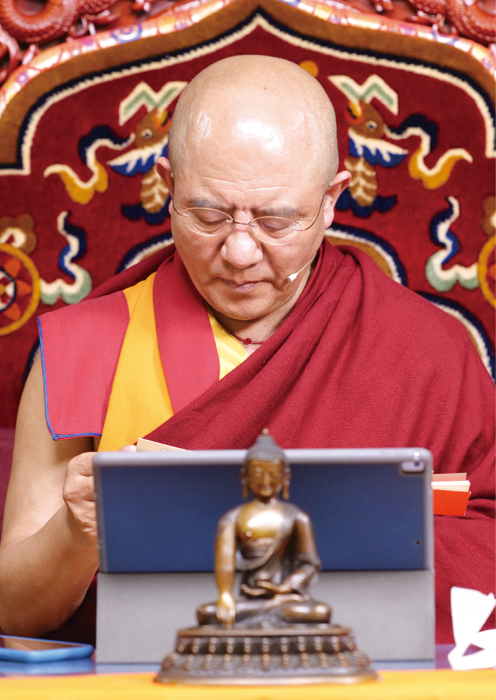
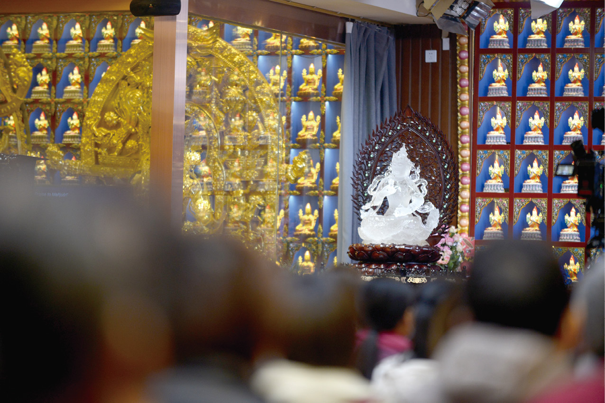

## 怎样才能不虚此行

——2023年金刚萨埵法会开示

2023年5月26日

大家今天能够相聚在这里，是一个很殊胜的因缘。在末法时代，能够与这么多的僧众一起共修金刚萨埵法门，可以说是非常的荣幸！

## 共修时谨慎身语意

但是，有些方面也需要注意一下。

第一，这次共修一共是八天，希望大家好好地念诵，不要到处拍照，尤其禁止拍摄僧众念经的场面，经堂外面的景色你们想拍几张照片也可以，但不能发到朋友圈等公众平台，不然会给学院带来很多违缘。虽说我们这里没什么不可告人的事情，但还是希望大家注意一下。

有些人可能出于好奇心，想拍僧众念经的场面，或者录制一些音频和视频，最好不要这样做。不管是照片还是视频，都禁止放到网上传播，这一点务必要记住！

第二，在念修期间，每天早上六点半开始早餐，有糌粑、包子、馒头等。这次来的人比较多，不一定每个人都能照顾到，如果没有吃饱的话，只能自己想办法了，不要抱怨别人。

上午七点准时开始念诵，一直念到九点；中间休息一小时，再从十点念到十二点。每座都是两个小时，下午的两座是两点到四点、五点到七点。也就是说，除了中午休息两小时以外，上午和下午座间都是休息一小时，每天有四座共修。

大家一定要有时间观念，否则其他人都在念诵，就你一个人在外面跑来跑去，可能会被管家批评，看起来也不庄严。因为你来到这里，并不是为了拍照，也不是为了旅游。如果你是来旅游的，那可以在色达县转一转，或者是去别的地方，我们这里也没什么可看的，只是一些僧人和红房子。这是最关键的一点，所以我再三强调。

共修期间，希望每个人都能合理安排时间，最晚早上六点要起床，然后七点前吃完饭。当你听到“嗡桑巴Ra桑巴Ra……”时，不管在家里还是经堂，都要跟着一起开始念诵。按照前辈大德的传统，仪轨念诵不完整是不太吉祥的，所以大家最好不要迟到，从开头到最后的回向，一定要念诵圆满。而且金刚萨埵仪轨的念诵并不繁多，咒语也特别容易念，不像其他一些咒语，比如说地藏长咒，我直到现在都没背下来，只记得开头是“称波称波曾称波……”所以，金刚萨埵法门非常容易修。

希望大家在这八天当中，每天都能遵守学院的纪律。午休的时候，最好不要在外面跑来跑去，毕竟学院现在还是处于封闭的状态，虽然不像前几年那样，天天有各种各样的整顿，但不管是旅游还是做其他事情，都不是很方便。所以，你们出去上个洗手间，然后稍微放松一下，就尽快回来跟僧众一起共修。无论坐在哪里，都要好好地修持，不要说话影响别人。

## 共修的意义非常大

这次共修的机会非常难得，大家最好在八天内念完40万遍金刚萨埵心咒。有关金刚萨埵心咒的功德，我以前讲过很多次，这里不再赘述。对于精进的人来说，在八天当中念完，完全没有问题。如果实在念不完，也一定要在这个萨迦月完成，不要一拖再拖，不然你们回到城市以后，被各种琐事缠绕，肯定是念不完的。

念诵时，要把金刚萨埵观想在自己头顶或面前。具体的观想方法，很多相关仪轨中都有，比如《大圆满前行》《前行备忘录》中都有讲过金刚萨埵修法，你们方便的时候可以看一下。

本来我是没有资格做一些密法仪式的，但教务处的相关负责人再三要求我给大家灌顶，所以今天就传一下法王如意宝的“金刚萨埵”灌顶。不然，很多人没有得过四级灌顶，根本不能修密法，尤其是最高的本来清净和任运自成，连法本都不能看，更不能修持。如果有了灌顶，就可以一边看书一边修持，但最好已经修完了五十万加行。

我们也知道，你们来一次很不容易，有的人可能是第一次来，也可能是最后一次。所以，这次他们再三请求我做这个事情，刚开始我并没有答应，但后来考虑到大家没有灌顶，也不方便修一些法，包括麦彭仁波切所造的《金刚萨埵修法仪轨》，也需要获得无上瑜伽的灌顶后，才可以进行修持。

我知道你们每个人来到这里的故事都是很精彩的，这些故事都可以记录下来，将来告诉你们的子子孙孙：“我曾经去过喇荣求法，过程非常艰辛，最后好不容易才得到法，而且在那里实修以后，我感觉整个身心都通透了，无始以来相续中的所有罪障、习气等全部得以清净。”

我认识的很多修行人，刚开始身心都特别不调柔，后来经常念金刚萨埵心咒，相续逐渐发生了很大改变，并且已经念完几千万甚至上亿遍。1994年，法王如意宝从青海省的年宝玉则湖取出《金刚萨埵修法仪轨》，莲花生大士在其后文中就写道：“此仪轨对汉族为主的众生大有裨益。”

很多人以前不信佛教、不知因果，造下了许许多多的罪业。而相比于在山上生活的人来说，大城市里的人可能造的业更多，因为有些人生活在海边，各种海鲜几乎都吃过。那么，现在有这么好的机会，而且有这么多的僧众一起念修，如果没有抓住这个机会，按照藏地的说法，可能这些人真的是没有心脏了。

如果你们来到学院，只是想到处逛一逛，这没有什么意义，还是应该尽量参加一下共修，哪怕只待一两天，也要好好地跟僧众一起共修、一起发愿。对我们自身来说，每天能念一遍《普贤行愿品》，这一天也是非常有意义的。

在这么多的僧众当中，肯定有很多登地菩萨，并且这个道场也有非常殊胜的加持。以前法王如意宝曾说：“来到喇荣的人，相续中自然而然会生起菩提心。”虽然很多人一生只来过一次喇荣，但这足以改变他们的命运。

我每次外出的时候，都会遇到一些人和我说，他哪一年来过喇荣，当时跟僧众一起共修过某法，自此以后，他完全变成了另外一个人，命运也随之发生了改变，真正感受到了佛法的加持。实际上，很多人都有过这种感受。

## 在学院不要浪费时间

五一期间，学院开放了几天，但这不是我们自己想开放的。其实，基于学院的一些状况，原则上我们是不想开放的，但有关部门觉得学院一直不开放的话，好像与周围环境格格不入，所以我们后来不得不这样做，但这也是一种善巧方便吧。

其实，你们今天能够坐在这里，也和学院开放有一定的关系，如果学院一直不开放，你们也很难来到这里。所以，既然大家已经来了，就应该好好地修行正法，尤其是回去之后，要尽量修完五十万加行，学习《大圆满前行》和《入菩萨行论》。

得益于现代交通和科技的发展，我们不再像以前那样，需要越过千山万水，才能到达目的地，在上师面前听受佛法。现在，通过网络等方便方法，我们不用特别费力，在家里就能轻而易举地学到佛法。

这次，大家已经得到了灌顶和传承，共修结束以后，基本上所有人都会陆陆续续下去。因为相关部门要求学院不能增加新人，包括这里的房屋和宾馆都经常被审查。虽然他们既没有同意我们开法会，也没有同意这里驻留很多人，但暂时来讲，我们通过各方面的努力，让大家有了共修的机会。所以，你们不要觉得来这里是非常容易的。

从你们的角度来讲，一路上要经历很多辛苦；从学院的角度来讲，我们要顶着很大的压力，也很不容易。你们也知道，现在为了加强宗教活动场所的规范化管理，各方面的政策越来越严格，在这种情况下，我们失去了很多弘法利生的机会。因此，这次能有这么殊胜的因缘，大家千万不要浪费时间，到处请客吃饭，包括去转坛城，此时也不重要。

在如此殊胜的圣地，念修法王如意宝曾经专门为我们取的伏藏，也就是金刚萨埵法门，并且此法门与汉地众生有特殊的缘分，这是非常有福报的。你们来到这里也算是为法苦行，不要把时间浪费在吃喝上。

## 好好发心好好忏悔

我希望学院的常住道友，包括一些出家人，能够出来发心服务大家，包括打水、打饭等。原本出家人给在家人服务是不太合理的，但就像阿底峡尊者说的：“对远方的客人、久病的患者、年迈的父母等慈爱行事，与实修空性大悲藏者相同。”以前也是这样，每次法会结束后，很多发心人员都特别累，因为经常跑来跑去。

无论做什么发心工作，希望大家在这个过程中，应该以服务的态度，而不是以领导的态度来做。然后，其他人也要配合发心人员的工作，不要把在城市里的各种习气带到这里来，因为这里是清修苦行的道场，不像在繁华都市里，具足各种设施和生活用品。

实际上，学院根本没有能力接待这么多人，因为这里几乎每个人都是自己住，如果今天接待一个人，明天接待一个人，会带来很多不便。这里地处偏远，交通不便，生活条件也比较艰苦，如果不是为了佛法，谁愿意一直待在这里呢？

希望你们白天认真地念诵，然后晚上早一点休息，第二天早上再跟僧众一起共修。最近，我听到很多人说：“我这次一定要好好参加法会，不知道以后还能有几次这样的机会。”这么说也是对的，每个人的因缘都不相同。

大家一定要好好地忏悔，即便你上半生造下许多罪业，也一定会得以清净。法王如意宝以前说过很多类似的话，而且通过教证理证也能证明这一点。尤其是修金刚萨埵法门，在麦彭仁波切所造的仪轨后面有讲，金刚萨埵实际上是百部坛城的主尊。

也就是说，时轮金刚坛城、大威德金刚坛城、莲师坛城等，所有坛城的主尊都是金刚萨埵。金刚萨埵可以散射出无量浩瀚的寂猛本尊，以及所有诸佛菩萨、空行护法。所以，观修金刚萨埵等于观修十方三世诸佛的身相，而我们所念的“嗡班匝儿萨埵吽”，它的功德也非常不可思议。因此，在还没有离开人间之前，一定要多多念诵金刚萨埵心咒，这也是不幸中的万幸了。如果每个人都得到一颗特别珍贵的钻石，大家都会非常开心，但实际上金刚萨埵法门就如同摩尼宝一般，一定要好好珍惜。

## 共修期间纪律管理

法会期间，女众住在女众区，男众住在男众区，不能串寮。白天时，进出经堂的楼道，男女不一定要分得很清楚，毕竟大多数都是在家人，这几天分那么清楚也没有必要。因为经堂的门比较小，而女众人数比较多，全都从一个地方出入的话，也有点困难。所以，这次无论是座位还是进出，管家们不要以对出家人的要求来对在家人进行批评。

在这几天里，新来的在家居士也要保持正知正念，没必要在这里造下很多罪业。坐的时候，反正你们都是在家男女居士，大家混着坐也可以，但像男众区域等地方，你们也要根据情况来看。

（堪布传授“莲师缘起除障法”灌顶和“金刚萨埵”灌顶，并念诵金刚萨埵修法传承）

刚才念了两个金刚萨埵仪轨。一个是法王从青海省年宝玉则湖取出的《金刚萨埵修法仪轨》，法王涅槃法会时都会念修，是金刚萨埵单身像的修法；还有一个是麦彭仁波切的金刚萨埵双身像修法。

今晚结束以后，大家不要急着回家，因为全都堵在门口的话，经堂的门有点小，可能会出现踩踏事件。这里还有很多老年人和病人，如果这么多人挤在一起，是很危险的事情。有些人可能担心出去找不到鞋子，其实找不到也不要痛苦，可以先想办法回家，明天再回来慢慢找。

还有一件事，我这边想发一些加持品，到时会统计一下，如果够给每个人的话，过两天会发给大家，但现在还没确定下来。

总的来讲，今天算是非常圆满的，也特别感谢大家的配合。
