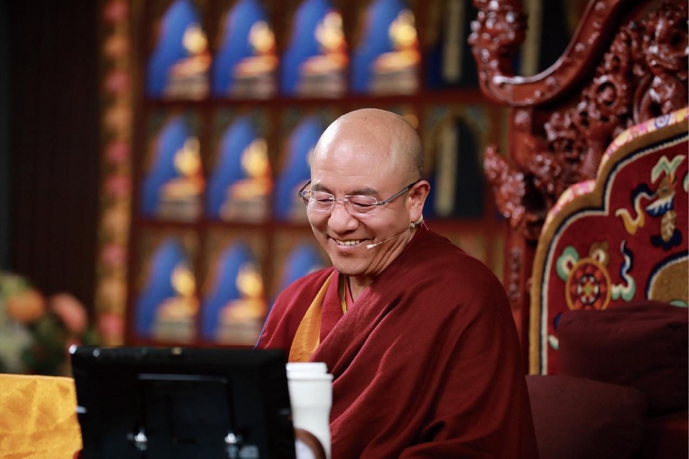
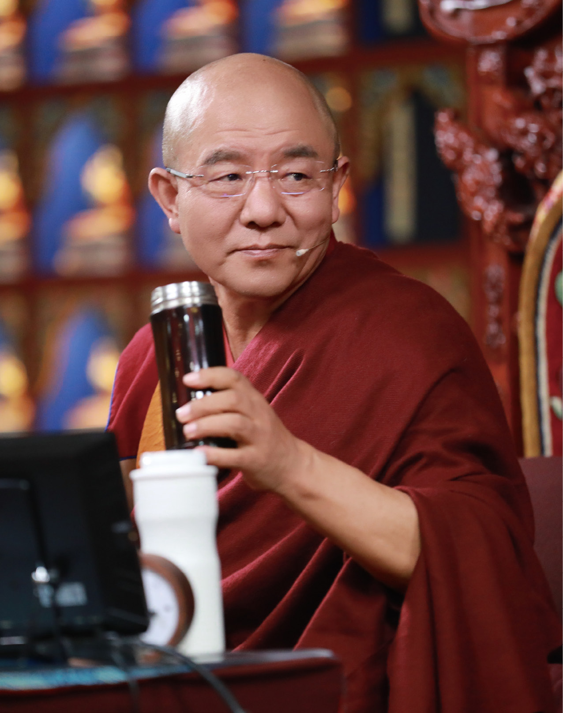
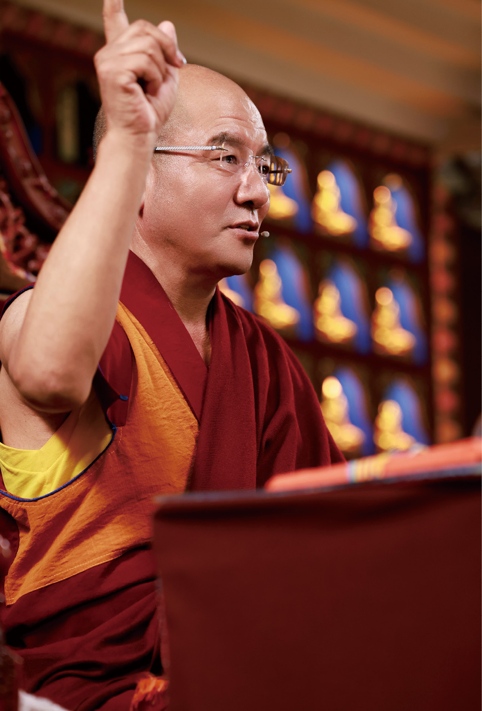

## 播下解脱种子

——2024年地藏法会念修开示

2024年8月3日

今晚我们用一个多小时，给大家做个简单的开示，之后传一个法王如意宝造的《播下解脱种子》结缘灌顶，再念《佛子行》的传承。这些就是今晚的主要内容。还有些道友要求给加持品做个开光，那么只要是在这个喇荣山沟里，不论是你们自己身上带着的，还是在家里陈放的，各种三宝所依今晚都可以一同进行开光。

《喇荣课诵集》里有一个简略的开光仪轨，待会儿我们就照此念诵。负责念诵的是堪布堪姆为主的出家人，有些居士可能也想一起念，但按照我们藏传佛教的传统，开光仪式通常是由上师和僧众进行。在家人给三宝所依开光，资格上相比出家人还是有差别的。佛教中灌顶和开光的仪轨都应该由具备一定资格的人来行持。像我这样的人给大家灌顶，很难说够不够资格，在这个末法时代，有时候确实难免出现这样的情况。但不管怎样，今天就用这种方式来跟大家结一个缘。

请大家安静下来。不要往法座扔哈达。以前哈达是很稀有的东西，但现在哈达漫天飞，你们扔过来我也用不上。（众笑）

我先给大家简单开示一下，因为今天没做什么准备。本想好好备个课，但是从早上到现在，我一直在开会，讨论学院里大大小小的事务，还包括博物馆、图书馆等各种各样世间的主题。一直到刚刚课前念诵时才结束。但我想今晚的主要目的是跟大家交流一下，不做准备也不妨事。很多人来这里一次非常不容易，我有些想法也希望跟大家聊一聊，所以特别安排了今晚这堂课。如果你们有一些比较有代表性的问题，我也会抽选几个回答，简单互动一下。之后进行开光仪式，然后再传灌顶、念传承。

灌顶时，堪布堪姆们会以三宝所依给大家依次加持。这个环节希望大家保持安静。如果有人被漏掉了，就举手示意，他们会立即补上。各位堪布堪姆传递灌顶物的时候，也不要埋着头、垂着眼，要多留意四周，看看有没有遗漏。你们既然有精通显密教言的智慧，应该不会连身边有人举手都看不到。

在这个过程中，希望每个人都能遵守秩序，不要着急。今天现场人比较多，一旦急躁起来，大家都会受影响。结束时也要耐心等待，听从指挥，有序离场。这么多人出去需要很长时间，如果许多人自顾自往前挤，反倒容易造成拥堵。这里的出口比较窄，要是拥挤起来，可能谁都走不了，甚至连自己的鞋子都找不到。所以希望大家稍微耐心一些、谦让一些，反正也没什么可着急的。明天早上没有课，如果今天你们回去得实在太晚，明早多休息一下也是可以的。

下面就跟大家简单讲几点。

## 一、珍惜求法机缘

首先，我知道这次来的道友们都很不简单。来一趟学院，首先要规划好时间。很多人想是想来，但抽不出时间。光有时间也不行，还要考虑路费。好不容易到了山下，要进山沟还得“各显神通”（众笑）。有些道友福报比较大，家人理解支持，所以这趟出行能够直接商量。而有些道友不得不跟身边的人说一些方便妄语，比如“我有重要的项目要去外地出差，到时不一定能接电话，你有什么事情就发信息给我……”有时候为了求得正法，运用一些方便方法也无可厚非。我们又不是为了杀生、偷盗，或者其他坏事而欺骗别人。要知道，人在短短一生当中，如果没有得到正法，离世时空手而去，那是特别可惜的事。这个人身我们好不容易才得到，得到以后也不会长久，迟早会遭遇疾病、意外等各种各样的因缘，最后终要告别这个世间。这么珍贵的人身，大部分人往往没有用在正途上，所以我们此刻能拥有求法的意乐，确实是十分难能可贵的。

我也听到了一些道友的故事。虽然这次很多人来这一趟只能待短短几天，但这几天里能和僧众一起祈祷地藏王菩萨、念修《普贤行愿品》，这也是多生累劫中难得的机会。相比之下，参加世间的聚会就要容易得多。为什么每次大家来学院都要经历这么多艰辛？实际上，这就是求法过程中的一种苦行的因缘。我等导师释迦牟尼佛为了成道，也曾在尼连禅河边经历多年苦行，还要面对魔王波旬的种种干扰和危害。佛法不是轻而易举就能得到的。自古以来，印、藏、汉等地都有许多高僧大德和无数修行人，为了求得正法而经历千难万险。很多人不仅遭遇了各种危险和违缘，甚至付出了自己宝贵的生命。这样的公案比比皆是，相信大家都很清楚。所以，我们既然走上了这条求法之路，就不要畏惧过程中的艰苦。

最近交通状况不是很好，许多道路都出现了塌方，我知道有些人困在车上十几二十个小时，一直在静坐禅修，还有些人翻山越岭才进到喇荣沟里，示现了骑牦牛、坐摩托的“神通”（众笑）。虽然我们没有邀请任何人到这里来，但很多时候也没办法，因为佛学院已经面向大众开放旅游，有信仰的、没信仰的，各种人都会慕名而来。人既然来了，我多少得说说话、见见面，这也是不得不尽的地主之谊。

所以，我想首先提醒一点。大家来这一趟很不容易，我们学院的常住人员也很不容易。现在相关部门不允许学院新增任何人员，但是每天都有好几千游客来来往往。就像汉地一些名寺古刹，寺院里的常住僧众只有数十上百人，但观光的香客常年人山人海，我们这里的状况也差不多。

这次不管你们以什么身份上山暂住，既然来了，就要明白自己为什么而来，到底是来观光旅游，来做生意，还是来社交应酬的？每个人来到喇荣，都应该观察自己的心，问问自己，来这里难道是为了名声、钱财、地位这些世间八法？当然不是这样。那究竟是为什么而来呢？是因为这里有释迦牟尼佛所宣说的解脱法门。我相信大家都是为了求法而来。什么是解脱法？包括共同乘的法，不共的大乘法，还有极为不共的密乘法。你们回去的时候，这些法多少应该得到一点，这才是最重要的。

有的人迷迷糊糊来到这里，出现高原反应就躺下，吃了几天的药，吸了几天的氧，尝了些藏地的饮食，两手空空就回去了。想想你来的目的到底是什么，难道只是来体验生活吗？你们在大城市吃的玩的都比这里好得多，要观光旅游，其他地方也有更好的资源。看看这里的常住学员，他们日日夜夜都在精进不懈地修行解脱法门，修持大乘菩提心。所以我希望每位道友来到这里以后要珍惜机会，不要整天散乱，到处闲逛。当然，你们趁这两天去转转坛城，或者朝拜一下，这是可以的，但从后天起我们的念修就要正式开始了。这个佛学院里很多修行人都是每天四座从不间断，大家到时候也要尽量按照规定的时间上座。

你们在这里最好自己找地方住，这里的经堂空间有限，还要应对一些麻烦，不是很方便接待。不管你们住在哪里，每天都应该尽量圆满四座念修。从早上七点开始，每座要念两个小时。内容包括《招财仪轨》、地藏菩萨名号、《普贤行愿品》等等。念诵的时候大家应该知道，《招财仪轨》的内容含摄了世间和出世间的财富，我们念这些并不是为了发大财，如果只论世间财富，我们佛学院也并不希求。实际上，这个仪轨中更重要的是获得出世间的财富，包括增长智慧、清净戒律、利益众生等诸多功德。这样的财富，才是我们今生应该尽量追求的。

这次念修主要是通过念诵长咒、圣号来祈祷地藏王菩萨。希望大家在这个过程中多了解了解地藏法门。这个法门在汉地非常兴盛，你们最好参阅一下《地藏十轮经》和《地藏菩萨本愿经》。能和这么多僧众一起祈祷地藏王菩萨，功德是极大的。我以前讲解《地藏菩萨本愿经》时说过，佛教当中最重要的有八大菩萨，为什么我们佛学院没有其他菩萨的法会，只有地藏菩萨的念修？这是因为法王当初用无碍智慧照见，地藏菩萨有很多不共的功德。末法时代的众生感受求不得之苦尤为强烈，祈祷地藏菩萨是积福消灾的殊胜法门，对实现我们生活、家庭、个人成就等方面的愿求有极大的效用，同时，也是对我们来世不堕恶趣的一种最佳保障。

大家应该把这七天的念修看作一次“地藏七”。汉地经常打佛七、打禅七，我们在这里实际上也相当于打“地藏七”。在这七天当中，希望各位道友尽量避开世间的种种干扰，每天四座一心一意专注祈祷。上师如意宝在世时曾为学院定下四大念修的传统，其中金刚萨埵念修和地藏念修安排在一年中最好的季节。现在藏地天气还算不错，如果是在冬天举行，那时天寒地冻，要克服的困难更多。而现在你们只要能解决这几天的食宿，其他方面基本不会有什么适应不了的问题。

当然，这么多人一下子涌上来，我们常住的发心人员接待起来也非常辛苦。每次念修期间你们一来，不提供接待也不行，可要安置好这所有人，实在有诸多不易。有些人可能觉得，在这里享受的一切都是理所当然的，吃的、喝的、住的，统统都该是现成的，为什么没有安排到位？其实从我们自身处境而言，这里很多常住道友也有许多难处，他们为了求法待在这个山沟里，本来就很不容易，现在还要想办法解决你们的住处，大家应该理解体谅。

这几天虽然会遇到一定的困难，但我相信你们都能克服。你们并不是来享受的，在这里吃一些苦，反而能帮自己净除业障。有些人路上遇到很多麻烦，有些人上山后身体很难受，有些人这几天吃不好、睡不好，这些对你们来说，其实都不是坏事。为了求法而经历苦行，能够消除自己无始以来的业障。所以，这是一次很好的机会。我想你们也不会特别在意这些区区小事。学院的发心人员一心只为利益大家，哪怕自己身体再劳累、心里再疲惫，他们都能接受。这里的人都发了大乘菩提心，如果连这一点都做不到，那所谓的发愿也只是虚有其表而已，没有真实的价值和意义。

因此，大家应该意识到，自己此刻能置身于这个地方，其实特别不容易。以现在的形势来看，将来这样聚会的机缘恐怕会越来越少，不要说像现在这么多人，以后可能几百人、几十人想一起共修也非常困难。虽然我们没有面向外界举办什么活动，但既然大家不请自来了，我们也会尽量在这几天当中为你们提供力所能及的服务。当然，这期间大家也要听从管理人员的安排，因为很多事情不像你们想象的那么简单。现在不管是藏地还是汉地，很多道场都发生了一些不愉快的事。如果有谁随便出入、到处乱跑，很有可能会遇到一些麻烦，甚至被登记、被遣送。这两年我们每次念修时，都有人遭遇各种情况。所以，不管白天也好，晚上也好，希望大家尽量减少外出，各自安住，不要走在大路边，最好待在方便的地方。

我知道很多道友比较辛苦，但大家不能想当然地以为怎样都没事，其实有些事情并不那么简单。你们可能习惯了城市里的自由自在，就像逛商场，无数人熙熙攘攘，随意活动，但我们这里的情形完全不同，背后要顶住多大压力，应对多大麻烦，不是你们能想象的。在这里可不像在其他名山圣地朝拜那样畅通无阻。现在的相关规定对举办和参加法会等宗教活动有很多限制。你们很多人对此可能不太了解，所以每个人务必小心。我们的管理人员也不想给大家太多限制和要求，但是为了保护你们，过两天也会有一系列的纪律规定，到时每个人都要遵守。这都是我们的负责人再三商量出的方案。所以，在这期间希望大家配合管理，不要抱怨。

我们作为大乘佛教徒，其实只要自己有点吃的、有点喝的，能如愿求得正法，就该心满意足了。这几天内能跟如此多的僧众一同发愿，也许是你一生当中最有意义的事。有些道友是第一次来这里，也可能是最后一次，今后还有没有机会再来，这也很难说。因此，大家应该珍惜这段时光，每一座最好认真从开头念到最后的《普贤行愿品》，有头有尾、善始善终，这样才不辜负你来到这个圣地的机缘。如果不利用这几天时间好好念修，反而到处晃荡，一会儿约人吃火锅，一会儿找人聊天，那就太可惜了。你在其他地方怎么散乱都无所谓，但是面对这么好的修行机会，浪费时间是很不值的。既然你们已经来到这里，我就稍微提醒一下。

再过两天大家就要开始念修了。上次念金刚萨埵心咒的时候，每个人都很听话，对各项安排也很配合。人与人之间应该互相理解。有个别外来的道友对我们的发心人员发脾气，这种情况我们也能理解，也许他没怎么学过佛法，容易生嗔心，这也不奇怪。如果有人觉得这里的发心人员在服务和态度上有不到位之处，也请多谅解，不要觉得自己最了不起，动不动就去告状、去举报，这样只会让你自己承担很不愉快的后果。大家共聚在此，都很不容易。如果去了解，会发现每个人背后的故事都不简单。在这里做管理也不是易事。大家也该清楚，如果在别的地方想办这样一场活动，需要投入多少资源。所以，我希望大家在这样难得的因缘下，首先要懂得珍惜时间。这是我想强调的第一件事。

今天的开示可能会长一些。原本我只想讲几分钟，但一讲起来，发现想说的事情有很多。

## 二、利用科技学佛

第二件事是关于佛法的修学。这次我们没有传法方面的安排，只能尽力让大家得到一点加持。其实大家应该知道，最关键的是自己好好学习。在座大多数人都是有信仰的佛教徒，系统地学习佛法对你们来说非常重要。我也看到今晚很多道友表现相当不错，包括课前的念诵、听法的状态，很多方面都体现出了很高的佛学素养，这也许是得益于我们十几年来打下的良好的学习基础。虽然后来包括菩提学会在内的学习平台彻底解散了，但可能还有一些人在自己坚持学修。个人有修行意愿，我们也没有权力反对。如果在座各位想要自己修行，我是非常赞同的，但修行之前一定要先理解佛法的意义。

这个时代，人人都跑到寺院里去闻思修行，那是不现实的，尤其是你们在家人，很难有这种机缘。不过我也知道，你们很多人现在仍然在系统地学习《入行论》、《大圆满前行》、中观、因明，包括一些密法的课程。长期以来一直在不断学习，而且意乐越来越强。像这样以个人的方式坚持学修佛法，是非常值得随喜的。

英国作家狄更斯在他的小说《双城记》里这么说过：“这是最好的时代，也是最坏的时代……”他生活在工业革命发生之时，全世界正处在剧烈的变革之中。那个时代的变化，跟我们现在智能时代的变化，也有一定的相似性。从某些方面来看，现在确实是一个最好的时代。只要你有信心，就可以在自己的电脑上、手机上、iPad上听到任何一位上师讲的课。这是我们以前根本无法想象的。

记得上世纪80年代，我去过雅安、眉山等地传法，当时我很想在那些地方建立道场，给那里的二十来个信众讲法，但这个想法没能实现。后来我又去过绵阳、重庆、哈尔滨等城市，那时候也只能随缘讲法，有多少人来听就给多少人讲。而现在的情况完全不同，哪怕一些大德十几二十年前讲的课，你都可以完整地听到。

我们以前在法王如意宝面前听课的时候，每个人手里都拿着一个破录音机录着，但那时候我们经济条件很差，经常在一部论讲到中途时就买不起磁带了。现场的录音条件又非常有限，所以法王的很多课没能留下记录。我在《梦尘回忆录》里也提到过，当初很想把上师传法的内容完整地保存下来，可那时候确实有心无力，根本没办法实现。而如今这些事确实方便得太多，但正因为太方便，人们反而不觉得这很重要。我为什么说这是最好的时代，也是最差的时代，原因正是如此。现在你只要有意乐，想学什么法都可以在网上找到。网上不方便的话，还可以拷贝在硬盘里。不需要付出多高的成本，基本所有人都能毫不费力地获取到学习资料。总之，这个时代有多种多样的平台和途径，只要你愿意去寻找，就能拥有无数可学的内容。

我有时候对这个智能时代也比较担心，全世界的信息都高度依赖互联网，万一哪天这些内容一下子都消失了，那该怎么办？可能是我多虑了，只要这种情况没发生，现在就是最好的时代。每个人在这个时代都不缺学习的机会。我们那个年代，大家总是担心能不能听完某位上师讲的某一门课。想要听完，只能守在这个山谷里跟着每堂课的进度，除此以外别无他法。不过幸好我们还有录音机，这点比古代强。有了录音机，条件好的人可以一口气买上几十盘磁带，把上师的课全录下来。起初一盘磁带很大，90年代以后稍微缩小了一点，那时我们都很开心。后来又有了VCD、DVD、MP3等等，越来越多新技术出现，我们的录制方式也在不断改进。所以，我认为在当今时代，很多道友没必要挤在一所寺院里学佛。喇荣沟里空间那么小，而人流那么大，进出的时候，或车或人总要大堵一番，你们也不一定非要在这个时候挤进来不可。其实在自己家里，一切佛法课程你都可以随时看、随时学。

大家要珍惜学习的机会，如果现在没有利用好时间，该学的法不学，该听的教言不听，非要跑到某个寺院、某位上师跟前，等到钱花光了，信心也退失了，最后带着一大堆邪见失落而归，那就太遗憾了。所以，希望大家以后少往各个地方跑来跑去。当然，你想去旅游、观光、朝山，这些都是可以的，但如果是为了求法，我建议改变一下原有的方式。过去很多人想学修佛法，如果没有上师在身边指导，就容易陷入盲目，但如今情况已经大不一样，佛教徒基本上都有一定的佛学基础和学习条件，只要自己有意乐，就能拥有很好的因缘。然而有些人到目前为止连一部法都没有完整听过，天天到处瞎跑，这样其实是在浪费时间。现在每个人都有电脑或者其他学习工具，应该利用这些方便认真学一部一部的法，将法义保存在自己的相续中，以此作为修行的基础。

我今天也在想，如果人人都喜欢凑热闹，那我们学院的这类念修活动以后还不如不办的好。否则每回那么多人从外面涌进来，我们的常住人员恐怕都要没地方待了。所以，我建议大家最好还是待在家里自己念修，因为一切的目的就是为了修行和解脱，除此之外也不必追求形式。在这个网络时代，不论我们身处哪里，都可以保持同步。这是科技给我带来的方便。

尤其是现在的AI技术，佛教徒中的年轻人一定要掌握，不要对新技术、新知识有所偏见和抗拒。网络的发展确实产生了很多损害身心的垃圾信息，但如果我们对适合的技术好好加以利用，我相信会让更多人从中获得利益。通过这些技术，每个佛教徒都可以独立地闻思修行，把自己的家变成一所佛学院，在电脑里跟随上师学习，这是完全可行的。如果放着这个时代的便利不去利用，非要跑到某个地方拜个上师、求个摸顶，这不是有智慧的佛教徒应有的行为。作为当代的佛教徒，我们每个人都应该学会以新的方式和途径来求得自己需要的显密教法。这是我想说的第二件事。

## 三、注重团结和合

我们在学习佛法的过程中，应该明白一点，不论藏传、南传还是汉传佛教的佛法，都是非常殊胜的，大家应该团结和合。大到宗教与宗教之间，小到佛教内部各派别之间，都要互相和睦。我们以前举办过“世界青年佛教研讨会”，组织了许多届，后来由于某些因缘，不得不暂时停止。在每年的世青会上，我们都会邀请各个宗教代表、佛教各教派代表，以及不同背景的佛教徒共同参与、共同交流。

此外，不同寺院、不同上师的弟子之间，也应团结和睦。上世纪七八十年代，有不少佛教徒喜欢拉帮结派。我是这位上师的派，你是那位上师的派。甚至一位上师的弟子中也分了A派、B派、C派。听说有位上师下飞机的时候，三派弟子都上前争抢。一派抢到了上师的人，一派抢到了上师的法衣，还有一派抢到了上师的帽子。这种现象让我觉得十分荒唐。佛陀的教法不论在哪里都是一样的。同为学佛之人，如果彼此之间还搞派系斗争，那是很可怕的。不仅是在佛教徒之间，我们即使对待没有信仰的人，乃至对所有众生，都应该以慈悲心来维护。这方面希望大家注意。

这几年的情况好了很多。不同上师、不同寺院、不同传承的弟子，看起来都比较团结。也许是网络传播的加持，大家看得多了，眼界格局有所提升，就没那么狭隘了。同时，佛教徒普遍都更加理解大乘佛法的教义。在方方面面的因缘下，风气相比以前已经大有改变。但我仍然希望大家，不论在佛教徒之间，还是非佛教徒之间，彼此都应注重团结。

## 四、次第学修显密

在学习过程中，我建议大家不要好高骛远，一定要先打好前行的基础。在此基础上，如果有能力，可以学习五部大论。重要的是，最后一定要学修密法，因为如果对密法的教理一无所知，单靠显宗的理论，恐怕难以彻底地解释佛陀的究竟意趣。这是我们通过三四十年的研究和探讨得出的结论。释迦牟尼佛传授的每一个法门都非常殊胜，但最后还是要悟入密法才能彻底通达真义。从如何生起信心，到如何理解整个器世界和有情世界，一切根本的问题，归根结底还是要依靠密法的见解。如果一个人在闻思修行和讲经说法上都特别了不起，他所讲的法义也好，所修的境界也好，肯定都跟密法有很深的关系。所以，大家不要对密法心生怀疑或邪见，这非常重要。当然，现在随着各界理解的加深，诽谤密法的现象已经基本看不到了，显宗密宗之间互相都达成了认可。

我们作为修行人，应该对密法的意义所有所了解。包括各位堪布堪姆和法师，不要认为学好因明、中观就可以了，虽然这些都是很好的法，但如果想要真正懂得佛陀的密意，一定要明白密乘的教义。尤其是无上密法，契入其理，就有望获得究竟的成就。这一点我希望大家铭记在心。

在此之前我们该学些什么法呢？我建议大家学《入行论》、《大圆满前行》和中观等论典。我们学院里很多道友以前一直着重学习五部大论，没有专门学过《入行论》和《大圆满前行》，现在一开始学，才发现原来这些法这么好，给自己的相续带来很大的改变。所以我觉得不用多宣传，只有你们自己真正去学一学，才能知道佛法的伟大和殊胜。

我们现在正处于一个十分特殊的时代。看看这个世界，战争此起彼伏，经济陷入危机，人心日益浮躁，痛苦不断加深，在这个时候，如果你能拥有一个清净的信仰，确实比什么都重要，比什么都珍贵。这么说并不是我作为佛教徒的傲慢，事实上，这是我们在修行中的切身感受。在这么一个复杂多变的时代，如果没有信仰，一旦外境产生变化，不少人很可能在突如其来的打击下崩溃，甚至一蹶不振，丧失活下去的勇气。但有信仰的人不论生活中发生怎样天翻地覆的变化，依然能够坚强面对。所以，信仰是现代社会非常重要的一种心理保障。

你们生活在大城市里，应该更能感觉到，目前整个国际形势都不容乐观。尤其是经济下行之后，许多人的工作和生活都受到很大影响。这个时候，大家应该体会得到，原来这就是佛教讲的无常。当无常真正在现实生活中呈现时，我们可以按照佛法中的无常观去修行，这不仅能给相续带来很大的利益，而且能调整我们面对生活的态度。所以我希望大家学佛的过程中一定要修一些对自己切身有用的法。

同时，在学习过程中，不要做表面文章。光是把课程随便听一下、看一下，这是不够的。每一个法都有特别殊胜的妙味，能不能品尝到，关键要靠你自己。如果你真正找到了属于自己的智慧方法，就一定能感受到个中滋味。比如学《入行论》，对于其中所讲的道理，不单要从理论上学懂，还要在行动中实际行持，这样对你的人生会有非常大的帮助。

前几天我给一些佛教徒和非佛教徒讲了一堂课，他们让我讲一讲《做才是得到》。这本书是我十几年前写的，出版之后一直没怎么看，后来我大概翻阅了一下，里面讲了一些具体的修行方法，包括怎样面对痛苦、怎样将违缘转为道用、如何祈祷佛菩萨、怎样面对中阴、如何往生极乐等等。这些道理都来自我自己修行中积累下来的经验，在书里都详细讲了。大家有时间的话，自己也可以看一看。

总的来讲，佛法不能停留在口头上，而要靠每个人在自己的相续中对照和体验。如果能如此去做，相信你的性格、行为、修行等各个方面都会有很大变化。能这样改变自己，才算得上成为了一名真正的佛教徒。

在今晚这短暂的几十分钟里，不可能讲太多道理。但大家难得聚集一场，我还是想给大家提供一些建议。你们在学院里可能待不了很长时间，关键的是回到自己家里以后，要通过现有的各种方便和渠道，系统地学习下去。我真的很随喜有些道友，他们甚至比这个学院里长期闻思修行的学员还要厉害。十多年来不仅学完了很多部论典，而且学得非常扎实深入，他们提出的一些问题很有深度。每个人在佛法上下了多大功夫，就会得到多大的成果。种什么样的因缘，得什么样的结果。

大家这次来到喇荣也是一种因缘，一定要好好地发愿。这里是法王如意宝亲自建立的道场，虽然法王已经离开我们将近二十一年了，但这些年来所有弟子依然在许多方面受到他老人家的影响。希望你们所有人时刻牢记法王如意宝留下的原则：“莫舍己道，勿扰他心。”我们佛学院的新老弟子，人人都把法王的教言作为自己的座右铭，终生修持践行。虽然这个道理听起来很简单，但我希望大家不要仅把它作为一个口头禅。在实际的生活和学修中，如果我们能真正如此做到，会有非常甚深的意义。

我想在灌顶前，给大家简单讲点道理，想说的基本就是这些。

## 五、传授灌顶及传承

接下来僧众一起念开光仪轨。

（堪布领诵开光仪轨）

下面我给大家传一个凡结缘众生皆获解脱的灌顶。这是法王如意宝亲自造的，那时候学院大概有一千多名僧众，法王曾说，这个灌顶对每个人都有非常大的利益，因此名为《播下解脱种子》。

大家都知道，农民只要在春天播下种子，到了秋天就能获得丰收。同样的道理，在我们的相续中播下这样的解脱种子，迟早也会成熟，这非常重要。因此，今天我就以这个法门，给大家边作解释，边进行一个结缘灌顶。可能结束的时间会稍晚一点。

（堪布授灌顶）

我们今天的这个灌顶已经圆满了，下面堪布堪姆们会把结缘物传下来。在这个过程中请大家不要说话，因为我要给你们念《佛子行》的传承。大家要听管家的安排，不要着急，每个人都能得到的。我们应该放松下来，放松下来就没有什么自我了。如果有人确实没得到，就如刚才所讲，可以举手示意。《佛子行》的传承念完后，我们再一起念一念观音心咒，因为今天是一场观音法门和释迦牟尼佛法门的盛宴。最后大家再念《普贤行愿品》回向。

今天很开心，这么多佛教徒聚集一堂，确实是非常难得的机缘。（掌声）

（堪布念《佛子行》传承）

请大家不要说话，有事举手表示就可以。看来你们对灌顶比较执著，对传承不是很重视，而我们更重视的是传承。

之后可能有些人要修五十万加行，那么我再给大家念一个《开显解脱道》的传承。（掌声）你们现在的鼓掌是不是装的？（众笑）

（堪布念《开显解脱道》传承）
