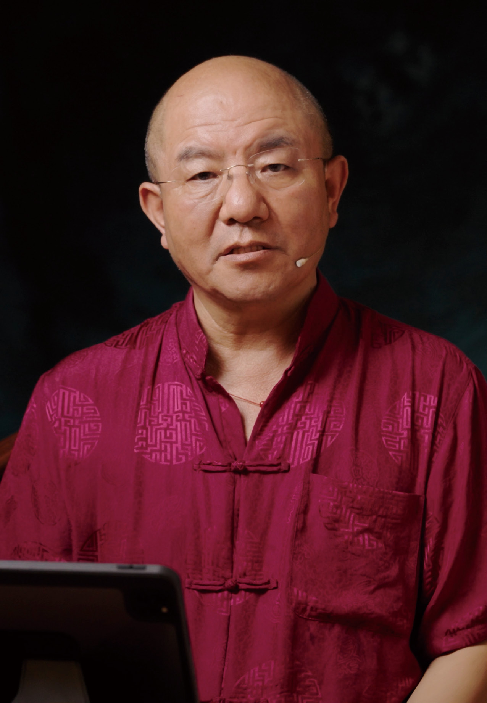

# 朝拜觉沃佛

2025年12月20日

## 缘起：马年朝圣的另一种选择

今天想简单讲一讲拉萨觉沃佛的来历和功德。之所以给大家介绍这尊佛像，是因为我最近看了一些资料，深感这是我们人世间的一件稀有珍贵的至宝。这一点不限于佛教徒，对整个人类而言，觉沃佛都具有非常重要的意义。

当然，一些无信仰者也许对佛像的功德不是很感兴趣，这完全可以理解。其实，从历史、文化和信仰的角度来看，这尊佛像可以说具有无与伦比的价值。

新的一年，很多人计划去朝拜冈仁波齐。冈仁波齐在许多宗教中都是非常重要的圣地，尼泊尔、印度等国家的信众都有朝拜冈仁波齐的传统。我们佛教徒对朝拜这座圣山也有很强的信心和意愿，甚至在普通的旅行爱好者中也掀起了转山的风潮。不过，在我看来，与朝拜冈仁波齐相比，朝拜拉萨的觉沃佛其实更加重要，这与我个人的信仰和信心有很大关系。

下面，我就向大家简单介绍一下这尊特殊的佛像。觉沃佛供奉于拉萨大昭寺，它也被称为释迦牟尼佛十二岁等身像。这尊佛像为什么如此重要？一方面在于它的来历。它造于佛陀时代，历经两千多年，从印度传至汉地，最后来到拉萨，一直受无数信众朝拜。

我们经常可以看到，许多藏族人跨越几千里的路程，三步一拜前往拉萨，他们就是为了朝拜觉沃佛。在有些人看来，这种行为体现了信仰的力量，是非常伟大的；也有些人觉得这是一种无必要的苦行。每个人或许都有自己的看法。而我个人认为，虽然这些藏族信众不一定有很高的文化水平，但他们每个人骨子里，都有一份无比虔诚的信心，这种信心不论来自于历史传统还是自身信仰，都让他们的朝圣之行彰显出非凡的意义。

朝拜觉沃佛是每一个藏族人内心的愿望，尤其是老一辈人。很多人认为，人来世上一遭，如果没朝拜过觉沃佛，那将是极大的遗憾，所以有生之年一定要去拉萨朝圣。比较孝顺的子女，会想尽一切办法，带父母去拉萨实现这个愿望——我自己也是这样的。

从某种意义上看，这种行为也许换不来多少世俗利益，尤其在没有信仰的人看来，可能并不值得赞叹，但实际上，其中蕴含着极其深层的内在意义。这个民族的许多先辈和老者，虽然未必精通现代的科技和文化，但是他们的心相续中，存在着一种极其珍贵的文化价值观，这是当今世间很多学者都难以企及的。因此，我希望大家能站在公正的角度看待，并且多去反观自心，这一点非常重要。

所以，今天我想在此建议：有生之年，不管你是否有信仰，都应该去拉萨看一看觉沃佛。尤其是佛教徒，更应当在如此殊胜的佛像面前虔诚顶礼、郑重发愿、回向善根。

限于一些因缘，这几年我没有去拉萨，但以前我几乎每年都会去朝拜一次。在2026这个年份，到处都是推荐去冈仁波齐等圣地朝拜的声音，一些说法也有它的道理，但我始终认为，像觉沃佛那样珍贵、殊胜的所依，如今在整个东西方世界都再难找到，所以，对于我们佛教徒而言，这尊佛像应该是最重要的朝拜对境。

为什么这样讲呢？我先简要地向大家介绍一下觉沃佛的历史背景。这尊佛像见证了许多历史风云，辗转多地，最终才安奉于拉萨。关于它的来历，我们需依靠可信的史料来了知，这也是古今中外探究深层真相的通用方法。很多隐于岁月的往事，只有通过佛典教证和可靠文献才能找到脉络。

## 来历：佛陀亲自加持的等身圣像

觉沃佛是怎样的存在？到底由谁所造？实际上，这是释迦牟尼佛在世之时就出现的一尊佛像，佛陀当时亲自开许塑造，并为之开光，所以这尊佛像从那时起便留存于世，直至今天。

这一说法主要依据《西藏王统记》，这是宗喀巴大师的一位上师——萨迦派索南坚赞所造的著名史书，也称《西藏王统世系明鉴》。我22岁读师范的时候，学校的老师和同学们都对历史比较感兴趣，所以我在甘孜的新华书店专门买过这本书。书中对各个朝代的变迁和相关史事有非常详细的记述，当时我认真读过，其中有些内容至今还记得很清楚，包括觉沃佛的历史背景。

书中记载：当初佛陀在世之时，文殊菩萨曾请示：“您若入灭，有请众生该依止何处？该依靠什么积累福德？”于是佛陀便开许可用佛像代替自己，以此饶益后世众生。当时佛身放出四道光，分别照射到梵天、那罗延天、帝释天，以及一位名叫毗首羯摩的天神工匠。三位天人提供了各种珍宝，由毗首羯摩将其造成殊胜所依：法身所依是一座佛塔，后被迎请到天界；报身所依是一尊报身佛像，后被迎请至大外海；化身所依就是释迦牟尼佛12岁的等身像——觉沃佛。

世上有三尊佛陀亲自开许塑造的等身像，分别是按佛陀8岁、12岁和25岁的样貌和身量所造。当时佛陀的姨母大爱道比丘尼指点了佛陀每个年龄阶段的特征：8岁时，身量正好如蓝毗尼园的台座那般高；12岁时，脚踏舍卫城的门坎，头部正好能触到门楣。在她的指导下，这三尊等身像造得与佛陀十分肖似。造像完成之后，佛陀亲自开光加持，并授记：将来这些佛像不论传到何处，皆能利益无量众生。这就是最初觉沃佛在印度的来历。

达仓宗巴·班觉桑布所著的史书《汉藏史集》中也有类似记载，只有些许不同之处：佛陀在前往拘尸那迦罗城、临近涅槃之时，文殊菩萨问道：“我们今后应当如何作？”佛陀答言：“应当以我的身像来调化众生、降伏魔众。”于是便开许塑造这几尊等身像。

此外，我们藏地还有一部非常著名的《柱间史》，是阿底峡尊者在大昭寺的柱子中取出的伏藏，主要记录吐蕃国王松赞干布的事迹。其中讲到，等身像是弥勒菩萨协助而造，并由佛陀亲自开光。

所以，关于觉沃佛塑造于佛陀时代的说法，应该是非常可靠的。对于这类久远隐秘的史事，应当借助历史文献进行分析。

## 流传：跨越文明的传奇之旅

佛像造成后的流传经过，各种史料说法略有差异。按《西藏王统记》所载，佛像先被天人们迎请至天界供奉了100年，然后被空行母请到邬金刹土供奉了500年，后又返回人间，在印度金刚座供奉了500年。而《柱间史》中则说，佛像在天界供奉的时间是500年，后在邬金刹土供奉了500年，来到人间后，在那烂陀寺和飞行寺供奉了500年。如此算来，这尊佛像来到汉地以前，就已历经了1500年的岁月。关于那烂陀寺的历史，也有不同的说法，有些资料中记载，是在阿育王时代所修建的。具体年代，目前没有明确记载，还需再行查证。总之，按《柱间史》的说法，觉沃佛是在那烂陀寺供奉之后，才被请至汉地。

觉沃佛传至汉地的这段历史，也有不同的说法。结合《西藏王统记》和《柱间史》的记载，当时印度有一位名叫达尔玛巴拉的国王，他因国家遭受外敌入侵，求助于汉地的国王，获得了大力支援。汉地国王还送给他三件珍贵的宝物，包括一件无缝的锦袍，达尔玛巴拉国王将锦袍赠与另一个国家，这个国家也出兵相助，击溃了入侵者。大获全胜之后，达尔玛巴拉准备回礼答谢汉地国王，当时汉地国王主动提出，想要佛法僧的代表——佛陀12岁等身像、《佛说大乘庄严宝王经》等经典，还有精通经律论和般若的僧众。达尔玛巴拉虽然心中十分不舍，但还是将佛像奉送而出。觉沃佛便这样来到了中土。

当然，这里的达尔玛巴拉，和赤松德赞时期的达尔玛巴拉国王，应该不是同一个人。后者也是一位信仰佛教的国王，但他是8世纪的人物。而觉沃佛像早在7世纪国王松赞干布迎娶文成公主时就已经来到了藏地，中间相隔约百余年。印度佛教历史上有多位国王都称作达尔玛巴拉，所以赠送佛像的国王应该是更早的一位。

按照《柱间史》记载，觉沃佛最初在那烂陀寺供奉了大约400年，后来异教徒军队入侵，僧众担心那烂陀寺遭受破坏，于是将佛像转移到了飞行寺，在那里又供奉了100年，之后来才传入汉地。除了这点差别之外，其余的记录与前面基本相同。按照上述说法，觉沃佛应该是作为当时印度和中国友好外交的赠礼，因此才来到了汉地。《西藏王统记》记载，当时走的是海路，佛像抵达时，汉地王臣在海边举行了隆重的仪式，然后才将佛像迎请入皇宫。

此外，还存在另一种说法。按《红史》的记载，佛像是由龟兹国传入汉地的。那应该是通过陆路，从印度出发，经过现在的巴基斯坦、克什米尔，以及新疆一带，最终才抵达长安。具体是怎么说的呢？《红史》中提到，前秦苻坚听说西域龟兹国拥有极其珍贵的佛像、佛舍利和班智达，便派大将吕光率40万大军进攻。佛像当然是指12岁等身像，那班智达是谁呢？其实是鸠摩罗什大师。这是一段非常跌宕曲折的历史，在此就不详述了。鸠摩罗什大师历经了种种磨难，后来在公元401年，与佛像一同被送至长安。以此来推算，5世纪到7世纪这段时期，觉沃佛应该在长安，后来又随文成公主来到藏地。我觉得这种说法比较符合历史。当时唐朝正值兴盛之时，然而到了唐朝中后期，佛法也随国运而衰微了。

觉沃佛传入汉地的过程大致如此。汉文史籍中对此缺乏相关记载，关于觉沃佛如何传入、如何供奉、唐太宗李世民如何将其赠予藏地，无论是《旧唐书》《新唐书》，还是其他汉地史料之中，都没有明显的记录。然而藏地的史料中却有十分详细的记载，包括著名的《贤者喜宴》《红史》《青史》等。为什么汉地文献中这段历史记载得不明显呢？有学者提出几种可能。原因之一是，佛像也许供奉于皇宫之中，属于大内秘藏的珍宝，所以相关情况不会对外公开；另一种原因是，佛像传入时中国正处于分裂时期，从十六国到南北朝，一直兵荒马乱、战火纷飞，在如此动荡的社会背景下，很多史实都难以记录和留存，更不用说一尊佛像的消息。不论如何，觉沃佛在汉地被供奉了数百年，这段历史是确实存在的。

后来觉沃佛是怎么来到藏地的呢？这段历史大家应该都很熟悉。当初文成公主出嫁时，曾向唐皇李世民请求，将这尊佛像带到藏地。这也正是当时藏地君臣殷切希求的。唐皇起初并不同意，但最后还是应允文成公主带觉沃佛像入藏。

在文成公主进藏之前，尼泊尔的赤尊公主也带来了一尊极其殊胜的佛像——佛陀8岁等身像，也叫不动金刚。这段历史，在尼泊尔和藏地的史料中都有记载：8岁等身像同样为佛陀亲自加持，佛陀圆寂后被迎请到龙宫中供奉了很长一段时间。后来龙王身患疾病，当时尼泊尔的两位大德以特殊的法力进行加持，龙王因此得以痊愈，之后便应大德的要求，将佛像送回了人间。此后这尊佛像便供奉于尼泊尔王宫之中，后来在国王松赞干布迎娶尼泊尔赤尊公主时，被公主带到了藏地。从这些历史来看，国王松赞干布确实很了不起——两个国家最殊胜的国宝，都被他迎请到了藏地。

按理来说，大昭寺应该供奉较大的佛像，小昭寺应该供奉较小的，这才比较合适。但觉沃佛由文成公主带到藏地后，是先被供在小昭寺中。这是为什么呢？有些资料中说，这是文成公主堪舆风水后做出的安排。也有一些说法认为，因为尼泊尔公主先来，她所带的佛像便供奉在大昭寺中，文成公主后至，所以她带来的佛像便供奉在小昭寺中。总之，最初8岁等身像是在大昭寺，12岁等身像在小昭寺，后来才互相调换。

## 劫波：历史动荡中的伏藏与重现

将来大家如果去拉萨，除了这两尊佛像外，还有一尊旃檀观音像——鲁格夏热，也非常值得朝拜。鲁格夏热是松赞干布的本尊佛像，传说是以幻变的方式制造的，现今供奉在布达拉宫之中，是镇宫之宝。在拉萨，这三尊佛像有极其重要的地位。它们从公元7世纪国王松赞干布时代直到如今，在漫长的历史中，经历了无数曲折动荡的历程。我以前去拉萨朝拜时，就深深感到，这些佛像历经风雨保存至今，实在不易。可能有人还记得，前些年大昭寺里一处地方曾意外起火，当时全球许多佛教信众都非常担心觉沃佛的安危，幸好火势很快就扑灭了，佛像安然无恙。

类似的波折，在历史上发生过多次，从前弘时期到后弘时期都曾有过种种波折。在前弘时期，国王松赞干布的孙子芒松芒赞在位时，传闻唐朝准备出兵夺回觉沃佛像。当时王朝上下十分恐慌，便将佛像秘密藏进大昭寺南镜门的墙壁之中，并在墙前供奉文殊菩萨像作为掩护，同时，他们又将大昭寺的8岁等身像移至小昭寺安置。就这样一直过去了许多年，直到后来金城公主入藏，觉沃佛像才被取出。

金城公主大家应该也很熟悉，她也是唐朝入藏和亲的一位公主。一些历史学家认为，金城公主就是国王赤松德赞的生母，但也有不同的说法。根据《巴协》的记载，当时金城公主来到拉萨后，想见一见姑祖母文成公主带来的佛像，然而几番寻找，都没有佛像的下落。后来公主在大昭寺找到了那间密室，觉沃佛这才被发现，此后便一直在大昭寺中供奉。佛像藏于密室中经历了王朝三代更迭，一直隐而不露，直到此时才重现于世。

我最近在翻译格日秋旺的《伏藏大史》，里面提到：一些人工所造、因故被隐藏起来、后来又被取出的圣物，也可称为伏藏。照此说法，觉沃佛也可算作一件伏藏品。书中说，这尊佛像在汉地的不同朝代中，就曾经被隐藏过；在藏地，它也曾前后两次被隐藏后再现于世，一次就是芒松芒赞为避外敌的这段经历，另一次则发生在国王赤松德赞时期。

赤松德赞少年时，他的父亲赤德祖赞不幸骑马摔死，当时朝政被他的舅舅掌控。这个舅舅信仰外道，极力反对佛教，他宣称赤德祖赞之死就是因为信奉佛教所致，还下令将觉沃佛送回汉地。当时佛像被运出大昭寺后，才到拉萨城边，便拉不动了，即便派300个人用力拉，都无法前进分毫。于是佛像便被就地埋在沙坑里。然而没过多久，当时参与反佛的大臣就接连遭遇厄运，有的惨死，有的重病。众人害怕是因为对佛像不恭敬，触怒了护法神，于是便将佛像挖出来，准备送往来源地——印度。在运送途中，到了芒域的吉隆地区，道路阻断，无法通行，他们便将佛像留在了那里，一留就是14年。直到赤松德赞亲政以后，才将佛像迎回拉萨，继续供奉在大昭寺。所以，在前弘时期，觉沃佛先后经历了战乱和外道的威胁，却依然完好保存了下来。

到了朗达玛灭佛的时代，几乎所有三宝所依都遭受到毁灭性的破坏，或烧或毁，或被投入水中。据说当时一些有智之士将觉沃佛埋藏于地下，这才躲过一劫，也有藏到其他地方的说法。直到朗达玛死后，藏地佛教稍得恢复，觉沃佛像才重新被取出。有史料记载，佛像是阿底峡尊者来到藏地后发现和开取的，此后依旧在大昭寺中供奉。

在“文革”期间，佛像也险些被毁。在个别领导的保护下，觉沃佛等珍贵文物没有遭到严重破坏，然而小昭寺的8岁等身像却被锯为两段，一半作为查抄物资被运到北京，一半在拉萨一个垃圾堆中被发现。直到1983年，在十世班禅大师的努力下，8岁等身像才被修复，并重新在小昭寺恢复供奉。这段历史，也是佛像在人间漫长岁月中的一部分经历。

为什么说释迦牟尼佛的等身像极为重要？要知道，这是数千年历史的见证。当我们遥望历史，去了解过往发生的各种战乱、变革和动荡时，会明白，人世间许多事情都极为不易。而这样殊胜的佛像至今仍能留存于世间，我们后世之人应该珍惜前去朝拜、顶礼、供养的机会。

## 召唤：此生必赴的殊胜之约

我个人认为，整个南赡部洲虽有千千万万的佛像和佛塔，但释迦牟尼佛亲自开光加持的并不多。当然，各地历史中也记载了许多殊胜的三宝所依，比如我在《五台山圣地记》中介绍过的汉地的旃檀觉沃佛，可惜现在我们已无缘朝拜了；又如北京灵光寺的佛牙舍利，还有斯里兰卡的佛牙舍利，这些舍利都源自佛陀真身，但如今要瞻仰一次也很不容易。拉萨的觉沃佛却不同，每天都向络绎不绝的信众开放朝拜。

但我发现，许多汉地佛教徒好像对此不太重视，不像我们藏族，人人心中都有“此生一定要去朝拜觉沃佛”的追求。但如今很多藏族年轻人，似乎也渐渐淡忘这种信念了，这实在可惜。其实，我们如果想对父母尽孝、报答养育之恩，最好的方式就是带他们去拉萨朝拜一次觉沃佛。若果父母有信仰，自然很方便；如果没有信仰，也可以把拉萨作为旅游目的地，带他们去游览观光，瞻礼一下这件大名鼎鼎的历史文物，在这个过程中，他们心中会自然而然种下非常深厚的善根。

大家如果想送父母一份有价值的礼物，不一定要给他们买特别贵重的东西。在父母有生之年，我们也许无法孝敬太多，但至少可以把他们带到觉沃佛面前念一念经，哪怕只是礼拜一下，所得的加持也是不可思议的。

我们藏地历来有一种普遍的观念：人生如果去拉萨朝拜一次觉沃佛，那就死而无憾了。以前我不是很理解，一度觉得好像去不去都行，但随着年纪越来越大，开始意识到，前辈古人的传统确实有其深意，只是年轻时未必能领会。所以，我们今生之中还是应该把握机会前往朝拜。

我隔壁的一位喇嘛，他年纪比我小，却已经去拉萨朝拜过三十多次了。他经济条件并不宽裕，但他以念经积攒路费，每年都要去觉沃佛前发个愿。前不久他给我打电话，说他刚去了趟拉萨，只花了几百块，一天半的时间就到了，话语间特别开心。以前从我们的家乡炉霍到拉萨需要七天，如今交通确实方便多了，也不用花太多钱，自己带点糌粑就能出发。我弟弟也是这样，母亲去世之后，他发愿每年去朝拜一次，并在大昭寺转绕84圈，因为母亲享年84岁。前段时间，他说今年脚不太好，不知道能不能转满84圈，但无论如何也要到觉沃佛面前磕个头。

所以，我们藏族人心中基本都有这种根深蒂固的信念：一定要去拉萨朝拜，最好每年去一趟，或者有生之年多去几次。这已经成了一种深入人心的传统。但汉地的学佛者大多没有这种意识。我最近常听人说，“明年是马年，要去转绕冈仁波齐”，但问起缘由，他们好像也说不出所以然，只知道这个话题热度很高，明年那里肯定很热闹。我觉得，明年去不去转冈仁波齐都可以，但去拉萨朝拜觉沃佛是很重要的。万一有一天它像佛牙舍利那样日常不对外开放，要找机缘拜见就难了。所以我希望大家珍惜机会，重视这件事。

## 功德：如亲见佛陀般的殊胜加持

一些资料中曾有授记：这尊佛像所在之处，佛法必会兴盛[^1]。想来确实有道理，从印度到汉地，再到吐蕃，佛像传到哪里，哪里就迎来了法运昌隆的时代，虽然随历史变迁或有兴衰起伏，但只要佛像在，正法的弘传就一直绵延不绝。如今也算是佛法兴盛的时候，如果我们迟迟不去朝拜，即生之中也许就很难有时间了。所以，如果你有这种信仰，应该去朝拜一次，这非常重要。很多人计划去参拜各种寺院、圣地，或上师，我当然不反对，只要你有信心，去哪里朝拜、供养都可以。但关键的是，你的朝拜是否真正能对你的相续有意义。如果能对释迦牟尼佛亲自开光的佛像顶礼、发愿，肯定是很有意义的。

朝拜时，如果你心怀虔信，确实能得到佛陀特殊的加持。历史上许多大德在朝拜觉沃佛的过程中，都有过奇妙的感应和特殊的故事：无垢光尊者在朝拜之时，见到佛像的白毫间发出光芒，从而抵达了不可思议的境界[^2]；智悲光尊者在佛像前顶礼时，佛像开口给他赐名“智悲天（钦则拉）”[^3]；觉沃佛本是一尊化身像，后来宗喀巴大师供养了一顶纯金制作的五佛冠，使其成为报身形象；唐东嘉波尊者等很多大德都依靠这尊佛像的加持得到了种种利益，从而获得不可思议的利众之力。因此，历代高僧大德都将朝拜觉沃佛视为人生重中之重。我也经常想，此生如果不能亲见这尊佛像，实在是一件憾事。

法王的传记中也记载过一些觉沃佛加持的事迹。法王的前世——伏藏大师列绕朗巴，曾经从觉沃佛的心间，取出了一尊金刚亥母像。他在康区开取的那尊莲花生大士像，现今就供奉于大昭寺，那尊莲师像也有极大的加持力。当年法王去拉萨朝拜时，也见到了觉沃佛的微笑之相。[^4]此类神奇的事迹还有很多。

我相信，只要以虔诚的信心，在佛像前至心祈祷和发愿，一定会得到加持。不过，现在朝拜的人特别多，每个人停留的时间有限，但我们也可以在大昭寺前祈祷，那里每天都有许多人在顶礼、转绕、供灯。我常想，住在拉萨一带的人真的很有福报，他们每天都可以去参拜、供奉、磕大头，这样的生活真是很有意义。

本来我只是想给大家简单介绍一下，但忍不住多讲了些。因为我觉得我们的生命是无常的，作为佛教徒，如果有生之年没来得及朝拜觉沃佛，那实在有些可惜。现在很多人想以佛法利益父母，但父母没有信仰，不知从哪里着手。如果你真想帮他们，不妨以旅游的名义把他们哄到拉萨，再带进大昭寺，不知不觉中就能完成一次朝拜。即便没有信仰，只要能在他们心中播下这颗重要的种子，就很有意义。

朝拜觉沃佛，可以帮助我们断除五毒烦恼，增上信心和智慧，获得不退转的力量，尤其是能令我们的修行善始善终。很长一段时间中，我每年都习惯放一些生、做一些讲辩著和闻思修，到了年底，就去朝拜觉沃佛。我习惯在大昭寺外磕一百个头、转绕一百圈，再念一念《普贤行愿品》。不少藏族人会在那里供十万遍曼茶罗，甚至完成五十万加行，朝拜的方式有多种多样。有些人如果很难依靠闻思修行调化自相续，那更应该去朝拜。

我现在即便自己去不了，也会经常看一看，往返拉萨的机票是什么价格。其实只要避开旅游旺季，整个行程的花销不会太多。这尊由佛陀亲自开光、加持、授记的佛像，具有如此殊胜的加持力，跨越漫长历史存留至今，在当今世界实属罕见。全世界的有缘人，如果有机会，都应该去朝拜。我这样给大家推荐，并没有其他目的，我和拉萨的文旅机构也没什么关系。我只是衷心希望，众生能把握住机会，在如此殊胜的佛像面前祈祷、回向，这将给你的人生赋予不一样的意义。

佛陀在相关经典中开示过，凡对他的身相见、闻、觉知、忆念者，都会获得殊胜的功德和加持。我们平时对身边的佛像观想、祈祷、供养，都有不可思议的功德，更何况以这样一尊历史悠久、加持殊胜的佛像为对境。

今天我给大家简单介绍了释迦牟尼佛12岁等身像的历史渊源和殊胜功德。以前我向很多人询问过这些情况，但很少有人能解释清楚，包括一些历史和宗教研究者。所以，建议大家多查阅资料，详细了解觉沃佛的相关历史。

## 朝圣：被误读的心灵壮举

记得上世纪80年代宗教政策刚开放时，无数藏族人争先恐后地前往拉萨朝圣。大家不是牧民就是农民，夏天太忙，所以都在冬天出发，全部挤在卡车里。那时候有两种卡车，一种是“东风”，能多坐些人，一种是“解放”，空间稍小一些。从康区坐车出发，要七天才能到拉萨，但每个人都非常欢喜，现在很多人都很怀念那段时光。还有些人是徒步去的，他们背着行李，一走就是两三个月。更有些人是三步一拜磕长头去的。

现在我们也时常能见到这样的朝圣者，难道这么多人都是愚昧无知的吗？恐怕不是。每个人对文化的认知与视角都不一样，可以说是见仁见智。其实，某些当代人眼中比较“愚昧”的行为，恰恰蕴含着最深刻的智慧；而有些自以为聪明的人，反而会因为固执和偏狭，犯下许多错误——这一点在人类历史上屡见不鲜，很值得我们思考。

在藏地的公路上，经常能见到这样的朝圣者：他们不畏雨雪风霜，在尘土中三步一拜地坚定前行，有些人牵着羊、牵着狗，有些推着三轮车，有些还年轻，有些已十分年迈，他们身上不知有多少故事。难道只有那些冷眼评判者才高明，而这些人都是笨蛋吗？也许不是。他们内心中，其实有一种无比强大的力量。换成我们，也许走一百公里就走不动了，他们为什么能一路坚持呢？难道真的只是没苦硬吃、徒劳无益吗？也不一定。

或许我们每个人都该反思一下自己认知的局限：那些你原本认为是真实、正确的，或者虚幻、错误的，也许在将来某个时刻，会被完全颠覆。就像很多人一开始反对学佛，把信仰都视为封建迷信，百般批评，然而当他们真正系统了解、亲身实践后，才发现自己当初的想法，充斥着多少误解和偏见。

所以，我今天借此机会，向大家建议：如果有机缘，应当去朝拜这尊世上最有加持力的佛像。这对你的人生，将有非常深远的意义。希望大家认真考虑。

[^1]: 《松赞干布遗教（柱间史）》：“凡被迎请所到之处，那些证得声闻预流初果、一来果、不还果和阿罗汉的声闻弟子及登地菩萨们，就会像日光中的游尘一样密密麻麻地聚集在它的周围，故而这两尊造像所在之处，大乘佛法便会自然而然地弘扬光大。”
[^2]: 《全知无垢光尊者略传》：“那一个夏季，尊者前往拉萨大昭寺朝拜释迦牟尼佛亲自加持过的觉沃佛，在佛像前清晰见到从觉沃佛的白毫间射出光芒融入自己的白毫间，由此使他想起了曾经在灵鹫山、新疆地区、成为班智达玛哈莫札以及在印度时所精通的新旧派佛法等情景，历历在现，了了分明，于是内心比以往更安乐，更宁静。”“在拉萨停留期间，他晚上住在大昭寺觉沃佛前，发现觉沃佛身上金光闪闪，在它头上的光芒中，七尊佛、药师佛、白度母、绿度母、胜乐金刚、喜金刚、国王式观音、千手千眼观音、胜海观音，他们的周围则威风凛凛地站立着黑氅怙主、四大天王、怙主狮面、吉祥天女。第二天到天龙岩洞以后，白天晚上心中总是明了地现出一颗宝珠，夜里梦到去刚底斯山与匝热水晶山诸座神山也清楚地看见那颗宝珠。”
[^3]: 《钦则益西多吉密传》：“尊者前往拉萨，为大小昭寺的两大佛像、罗哥学热（观音像）和让雄阿丹为主的佛像贴金。在会供时，觉沃开口为尊者赐名‘红阿杂亚’。则热桑耶巴和彻钦赞叹道：‘他真是一位了不起的大德，曾经桑耶巴智悲光尊者在觉沃前顶礼，觉沃开口微笑并赐名“钦则拉”。自法王松赞干布至今，虽然多次出现觉沃开口为有缘的信众说话的奇观，但有幸得到赐名的，除他们两人以外，实在是前所未闻。’”
[^4]: 《圣者法王如意宝广传》：“在本师释迦佛的等身像大宝觉沃佛的身所依前，法王猛利地磕长头，并流着眼泪以悲伤的音调猛利祈祷，切实祈愿佛法兴盛、众生得乐、凡结缘者往生极乐世界。接着，法王身体不动、双目直视前方虚空住定一会儿，最后说道：‘出现了觉沃微笑之相（稀有的是，不只法王一人，当时待在一起的个别侍者也见到了这个情形）！’接着法王说：‘从今往后，你们要发愿往生极乐世界，刚刚得到授记我们此生一命终就会往生极乐世界！’”
