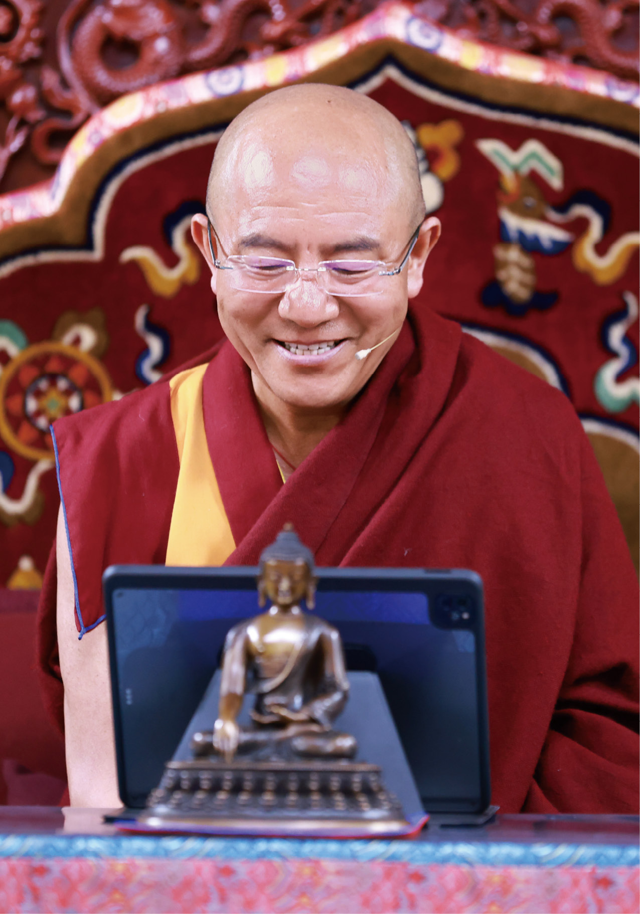
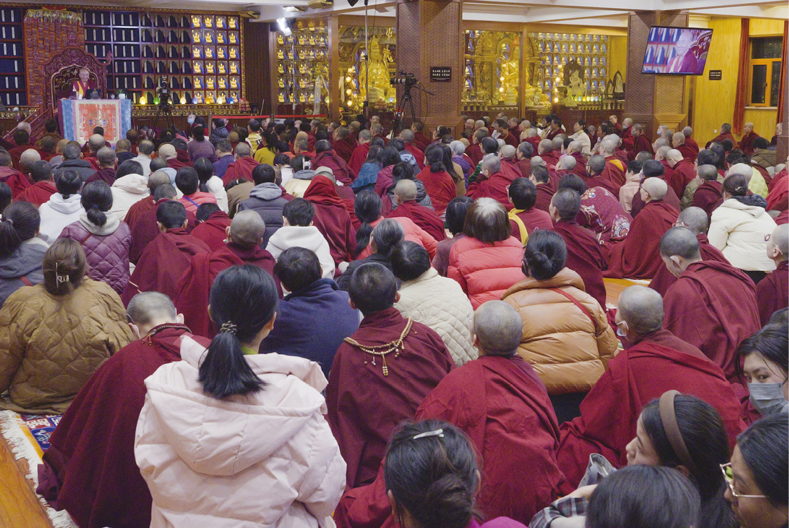

## 速得福报的秘密：会供

2025年6月4日

今天在这里，我想跟大家简单介绍一下会供。

## 一、认识会供

### 会供的必要性

一般来说，修学密宗的人最好每个月做两次会供，一次在上弦月时，另一次在下弦月时，这非常重要。

为什么要做会供呢？其实这就如同显宗中，出家人按照戒律要求，在每月的十五和三十这两日要集体诵戒（也称布萨），以此清净和忏悔自己在这一月当中违犯戒律的过失。在别解脱戒中，要清净出家人的四根本罪和十三僧残罪光靠诵戒是不行的，必须通过其他方式来还净，但九十种堕罪和一百一十二条轻罪，如果能在每月诵戒时真诚忏悔，是可以净除罪障的。

与此类似，我们进入密宗以后，凡是接受了灌顶、得受了密乘戒的人，也需要定期忏悔破誓言的罪障。因为实际上，密宗在这方面更为严厉，如果我们不能守好誓言，又不及时忏悔，罪障就会在相续中逐渐积累，一旦破坏了密乘誓言，上师、本尊、空行和护法都会显现不欢喜，这样一来，我们想获得悉地必然会有障碍。

因此，作为已入密宗的修行人，每个月至少参加一次会供是非常有必要的。会供最主要的作用是清净自相续，同时积累资粮，并令上师、本尊、空行、护法心生欢喜。因此，会供对于密乘行者是一件极其重要的事。

从佛法再弘以来，法王如意宝就对佛学院作出明确规定：显宗方面，藏历每月十五和三十所有出家人都要诵戒，当天不再上课，连法王自己的课程也暂停；密宗方面，每月初十和二十五要举行会供，通常初十念四臂文殊的会供仪轨，二十五则念空行母益西措嘉的会供仪轨。这一传统一直延续至今。

我个人刚来学院的头十年，基本上每个月的这四天都坚持按这些仪轨清净自相续，显宗的两次诵戒和密宗的两次会供，几乎从未中断。记得当时我们物资比较匮乏，根本没有现在这么丰富的会供品。有时每人手里只能分到一颗软糖或大白兔奶糖，饮品也只是少量的牛奶，没有牛奶的话，就熬一些雅安的藏茶，在每个人手掌里倒一点点。那时候我们就是这样做会供的。后来由于管理等事务缠身，我基本上就没机会按时参加了。但不论如何，对于每个修行人而言，会供的确是非常关键。

现在外面有很多道友，有的结伴聚在一起，有的自己单独居住，有的在精舍，有的住道场，我希望你们有机会的话，都尽量每月至少做一次会供。如果你在其他宗派的场所，做会供可能不太方便，但如果在自己的地方，应该没什么困难。每月能做两次当然更好，但要是做不到两次，做一次也是很有意义的。

作为密乘修行人，你们得过灌顶，也接受过密法的甚深教授，然而相续中很可能有意无意染上一些破誓言的垢染，因为密宗的誓言千千万万，稍不注意，就很容易犯各种堕罪。因此，大家其实都需要时常以会供的方式忏悔业障，一方面清净自相续，另一方面积累资粮，同时让诸佛菩萨欢喜，这样就能为修行创造顺缘，使我们无有阻碍获得悉地。所以我希望，大家以后要对会供重视起来。

### 适合现代的会供

我们学院里一些比较年长的修行人，尤其是法王在世时的老弟子，基本上每个月都会自己举行专门的会供。早些年汉僧也参加学院的集体会供，但那时用的仪轨比较复杂，又没有现成的译本，大家念起来比较吃力。所以我们后来一般要求按麦彭仁波切的简供仪轨来积资净障。会供其实与修曼茶罗有类似的作用。有些人可能对会供还不太了解，所以我今天在这里稍作介绍，也劝请大家以后尽量保持会供的习惯。

一次会供不一定需要很长，大概半小时到一个小时就可以。以后如果方便的话，我们可以请一些声音好的觉姆录一录莲师七句祈祷文会供仪轨，跟着音频来修，这样比较好。这个仪轨我以前翻译过，现在有许多便捷的方式，我们可以利用电子设备使用各种仪轨资料。

我希望大家都要做一做会供。对于密宗行者来说，会供是不可或缺的，因为我们需要清净自相续，而会供在这方面有很大作用。藏传佛教中，几乎每个伏藏法都包含有会供，包括法王如意宝的一些简略的意伏藏，如“文殊静修仪轨”“项袋金刚橛仪轨”，以及作明佛母和金刚萨埵的相关修法仪轨等，其中都有较为简短的会供内容。由此可见，会供的修法确实非常重要。

做会供时，一些金刚道友可以聚集在一起吃吃饭、喝喝茶，就像西方人开个Party一样。当然，相关资料中说过，密宗的会供并不是以吃喝为目的的聚会，如果这样理解是不合理的。但从另一个角度来看，这种聚会确实有凝聚道友感情的作用。金刚兄弟们以一种生活化的方式相聚一堂，开心地唱唱歌、跳跳舞，一同享用美食，这很适合现代人的心态。所以，我们佛教徒有时候也有这种“团建”的必要。

会供的参与者，最好是已受过灌顶、能守护誓言的金刚道友。如果有少数未入密乘的佛教徒希望参与，也可以通过外会供的形式加入，这样不会有太大的问题。我们以前去西方的时候，看到很多同一法脉传承的弟子，会在每月初十和二十五两天进行会供，就像现在的聚餐一样，大家一起念诵仪轨、享用美食。这种聚会不仅能很好地增进道友间的感情，也能对各自的修行有所帮助。会供有各种不同的层次，有时形式上可以灵活一些，不一定要有太多宗教仪式。大家可以按照麦彭仁波切造的简供，简单念诵或唱诵一下仪轨，然后聚餐，这也是一种可行的方式。

### “会供”一词的含义

“会供”一词，在印度梵语中是“噶纳匝扎”。“噶纳”意为会聚，“匝扎”意为轮，也就是集聚轮。意思就是说大家聚在一起，像转法轮一样，因为轮是无始无终、延续不断的。所以，会供的本意就是会轮共修——一起聚会，不断共修，有这样的含义。

不过，原始意义上的“会轮共修”，跟我们现在所说的会供其实有很大差别。真正的会轮共修，是指有对应数目的男女瑜伽士聚会共修，严格来讲，必须是获得一定成就的修行人才能进行——在无上瑜伽中，很多有关会供的奥秘，不是一般人能理解和接受的。后来经过如无垢光尊者、智悲光尊者等一些高僧大德的简化，原本的会轮共修逐渐演化成了我们现在熟悉的会供，也就是大家聚集起来一同供养三根本和护法神的一种仪式。

会供的“会”其实有三种含义：第一种是男女瑜伽行者的聚会。这一点与别解脱戒有所不同，因为按别解脱戒中的诵戒要求，一般男众女众要分开进行。但在密宗的会供场合中，不论男性或女性，出家人或在家人，都可一起众会聚集。第二种是诸佛菩萨及六道众生的聚会。在会供的过程中，依靠特定的仪轨和咒语之力，一方面可以上供诸佛菩萨和空行、护法，一方面也可以布施给三恶道为主的所有众生。所以，从这个角度来看，会也代表一切众生的会聚。第三种是财物的会聚。会供时必须将各种好吃好喝的供品筹备、集中到一起。因此，会供的“会”也可以说是三会聚，具备了这三种条件，才能完成一次正式的会供。

### 会供中的观想

在进行会供的时候，我们不能把金刚道友看成是这个有过失、那个有错误的凡夫，应该把他们全都观想为相续清净的金刚勇士勇母。正如我们常说的“五圆满”，会供时也需要有这五种净观：供品不能作普通的饮食俗物想，应当观想成清净的甘露妙欲；周遭环境要观想为铜色吉祥山、极乐世界或其他清净刹土；发出的声音应观想为清净的咒语……总的来说，会供有三种不离：一是身不离本尊，自己应观想本尊，在一些广的会供仪轨中，对于如何观想自身和前方本尊等形相，有非常详细的说明；二是语不离明咒，要将一切语言音声统统观为咒语；三是意不离等持，内心要以生圆次第进行观修，或安住于一切皆为等净无二的境界中。总之，会供确实是一种非常重要的修行方式，希望大家尽量明白正确的方法和要点。

### 会供的起源和传统

会供并不是藏传佛教独有的仪式。实际上，这种形式最早起源于印度。我们可以看到印度八十大成就者的传记，像萨绕哈巴、格格燃扎、黑行瑜伽士等很多大德，都曾依靠会供而获得成就。所以，如果认为会供仅是藏地传统，那就不太全面了。在佛教的许多典籍中，都记载了会供的相关内容。比如《智慧猛燃电轮续》中就记载过，语狮子请教会供有何功德，密主金刚便讲述了十万天子因会供而获得成就的例子，还说即使是对凡夫、声闻、缘觉、菩萨数劫供养，功德也不如一刹那间做一次会供大。在显宗的一些经典中，虽然没有明显提到会供，但实际上很多内容是与之相合的。因此，许多前辈大德都对会供十分重视。以后如果你们去到有关密法的圣地，比如大成就者修行过的山洞或加持过的道场朝拜时，在时间允许的情况下，应该做一次会供。

会供应该在什么时间进行呢？如我前面所讲，是每个月的初十。按照续部以及莲花生大士的教言，一个月中有上弦和下弦两次初十，上弦初十就是我们习惯的每月十号，而下弦初十则是十五月圆夜之后的第十天，也就是二十五号。我们知道，莲师曾经承诺过，每个月的初十那天，他都会来到藏地为主的南赡部洲，加持众生的相续。因此，上弦初十和下弦初十是举行会供的例行时间。

除此之外，一般灌顶时也要进行会供。例如，在“四心滴”的灌顶中，每一个心滴完成时都会做一次会供，全程一共有好几次。

另外，在传授一些密法时也会进行会供。我们平时讲法不一定会特意安排会供，但在一部大法传讲圆满时，为了感谢三根本、护法众，以及一些夜叉、罗刹等众生，我们也会通过会供来上供下施。

再者，在修持大修法门时也要做会供。藏地许多寺院每年都会举行几次大修，而在每次大修的最后阶段，一定会有一场规模较大的会供。不同于我们平时做的简供，这种会供通常会使用一个很广的仪轨，其中包含了很多仪式环节，比如一些降魔的内容，要以各种方式将应诛众生降伏，把它们的神识抛至清净刹土，过程中有许多步骤。

会供的传统源于印度，后传至藏地。藏传佛教中不仅宁玛派有会供，其他教派也有各自的会供传承，比如噶举派有胜乐金刚的各种会供仪轨，萨迦派也有很多相应其修法的会供内容。所以大家要明白，会供实际上是整个藏传佛教中的一种重要修法，不要认为只是大家聚在一起吃吃喝喝而已，而忽略了过程中的观修。在这方面一定要特别注意。

## 二、如何会供

今天不可能一次把会供的所有修法和功德全部讲完，但有几个要点我还是想给大家讲解一下。

### 会供的方式

首先，会供之前要做好各方面的准备，比如场地的打扫和布置。如果是依照七句祈祷文来进行会供，至少应该在现场放置好莲花生大士的唐卡或佛像，并在莲师像前陈设上供下施的各类供品。供品的选择很重要。一般来说，应该包括食物和饮品，因为在显现上，诸佛菩萨和空行护法需要以饮食供养，只有食物没有饮品，或者只有饮品没有食物，都不够完整，所以应该尽量准备齐全。

在会供开始前，通常要专门念一些加持清净之法，如果大家不熟悉这类仪轨，至少应该知道念“让扬康 嗡啊吽”这几个字。为什么要念这些咒语呢？“让”代表火，能燃烧掉一切不清净的事物；“扬”代表风，可以将不清净吹散；“康”代表水，能将不清净的污渍清洗干净。通过咒语的力量，所有不清净的东西都能被烧尽、吹走、洗净。

“嗡啊吽”也很重要，其作用是清净、增长、转变。以“嗡”加持所有供品，可令其清净；“啊”能令供品增长，让原本数量有限的供品成无数倍增长广大，足够供养一切三根本；最后，以“吽”的咒力加持，可令供品转变，同时周遍于整个虚空界。大家要学会用这三个字来加持供品。同时也要知道，“嗡啊吽”是代表一切诸佛菩萨身语意总集的咒语，意义非常殊胜。总之，念诵“让扬康 嗡啊吽”，能让我们眼前这堆普通的食物饮品，变成真正清净广大的供品。

除此之外，在会供中有时还会念到“阿么达索哈”和“阿么达巴朗达吙”这样的咒语。“阿么达”表示甘露，“巴朗达”表示食物。依靠咒力，不仅可以清净供品，参与会供的人也能得以清净。通常我们还会在供品和参会眷属上面洒一些净水，这样还能净化我们自己和众生的相续。所以依靠这些不可思议的咒语，整个会供中的供品、参与者和仪式场所，都能得到加持。这是会供正式开始前令供品清净的方式。在一些比较广的仪轨中，前面还会有结界、驱魔等很多仪式。

会供进行时，我们先要迎请三根本降临，在他们面前祈祷、赞叹、供养，并念修相关的咒语，之后就可以开始念简供仪轨。简供主体的几句偈颂应尽量多念，在念诵过程中，要观想诸佛菩萨赐予我们悉地，我们的相续得到解脱，诸佛菩萨也感到欢喜，这一点非常重要。

最后要念回向偈和吉祥偈等内容。在更广的仪轨中，还有降伏、回遮等很多仪式。但不管仪轨是略是广，我们都要对会供本身重视起来。

### 如何看待酒肉供品

关于会供品，以前许多大德在论著中都提到过，酒和肉是会供中不可缺少的。为什么要用酒肉呢？其实肉在会供中是用来表示降伏的。在佛教中，有些表面看似诛杀的行为，实际上是一种超度的方式。所以，在会供中用肉作供品，是为了表示这种降伏的意义。会供品中的肉代表嗔心，而酒则代表贪心，因为酒能令人陶醉。借由酒的象征，可以表示圆满双运的意义。

当然，在实际中，我们做会供时不一定非要真正用到很多酒和肉。毕竟在大部分人看来，佛教徒接触酒肉是不如法的。尤其是在汉传及南传佛教的一些地方，很多人受了三皈五戒以后，无论是出家人还是在家人，大多主张茹素，甚至彻底断除饮酒吃肉。在这种情况下，我们也可以选择一些新的供品，比如用饮料代替酒，用素肉代替真肉，这样也比较可行。否则的话，在会供现场一旦出现真正的酒和肉，虽然密宗弟子了解背景，不会太介意，但不明就里的人很容易产生误解，甚至会妄加诽谤。这样一来，他们不仅相续中得不到利益，反而可能造下恶业。所以，这种风险我们应该尽量规避。

在会供品的选择上，外供的部分可以包括糖、水果以及其他各类饮食。内供的供品，原本是盛放在托巴中代表智慧方便双运的五甘露，以及五肉等，不过后来大多改为了普通的酒和肉。如上所述，考虑到大众的接受情况，我们可以按照荣索班智达的说法，以极少的量做表示即可。比如在享受悉地时只取一滴酒，这样就不会失坏誓言。所谓的五肉五甘露可以用妙药和红茶、酸奶等饮食代替，不是真的要按原意去供养和取受这些东西。否则，有些人原本已经戒酒多年，但是却借着会供的机会大口喝酒，甚至结束时已经醉意熏熏，这种情况也是有的。如果把会供当作掩护自相执著的借口，这是极不合理的。

我们做任何事情时，都要视具体情况和当地的接受度而行。作为佛教徒，也不必固守某种经验。像在藏地或不丹这些地方，藏传佛教的传统早已深入每个人的脑海，人们对于一些不太共同的行为不会轻易产生邪见。比如在不丹，到处都有某些表示物，当地人早就司空见惯，不会产生什么分别念。同样，藏地几乎每座佛殿中都有双运的本尊像，但藏族人从不会对此生起贪心、邪见或其他的非理作意。这跟各地的地方文化和传统习俗有关。虽然我们在藏地觉得某类特殊供品是很常见的，但是到了其他地区，别人未必能看得惯。因此，大家在实际修行的过程中，要善于观察周围的环境和参与者的情况，这一点非常重要。

### 献新和余供

在发放会供品前，供品应先献新供养诸佛菩萨，如果有金刚上师在场，就先呈献给上师。发放完毕后，剩下的一些余品可以布施给那些没资格参加会供的众生。在真正的会供中，有些下等的众生并没有权力享受上供的供品，所以我们一般会把剩下的食物布施给他们。这个时候要一边弹指，一边念“则达巴朗达卡呵”。“则达”就是余品的意思，如果有食子就给他们食子，没有的话，也可以用其他食品分给他们。“卡何”是请你享用的意思，也就是告诉这些众生，会供的余品布施给你们了，请随意享受吧。

正因如此，我们做一次会供，不仅对个人修行有帮助，对整个周遭环境也会带来很大的利益。莲花生大士也说过，做会供可以给整个地方增添吉祥与福祉。一些真正有修证的大德，他们新到一个地方后，都会做一次会供，这种功德是不可思议的。我们自己做会供时也应该这样观想。

### 酬补忏悔

会供本身有外、内、密等多重意义，一般包括外供养、内供养和密供养。会供有酬补的作用。所谓酬补，就是弥补的意思。我们在三根本面前接受灌顶时，承诺过不会违背密宗的誓言，可是后来由于烦恼深重，有些誓言没有做到，这种情况下，通过会供就可以弥补自己的缺失。会供中，我们其实也在诸佛菩萨面前忏悔：“请您原谅，请您宽恕，我因为无始以来业力深重，不小心做了很多不如法的事情，今天在这里进行忏悔，请净除我相续中的一切罪障。”经过这样的发露忏悔，三根本和护法就会予以宽恕，并欢喜摄受我们。

许多经典和密续中，都对会供的重要性有详细的阐述。如果你们懂藏文，或者有汉译本，就可以看到无垢光尊者在《大幻化网释·能除十方黑暗》这部大疏中关于会供的专门讲解。智悲光尊者在他的《集密意续释》中，也对会供的本质、分类、作用和行持方式等作过详细解释。莲花生大士的教言中对会供也有广泛的开示。

大家在修行过程中，一定要认识到会供的重要性。因为凡是得过密宗灌顶的人，难免在誓言上多多少少会有一些不清净之处，比如相续中产生庸俗的分别念，或者与金刚上师、金刚道友发生矛盾，这类不如法的事情经常可能发生。这些过失，其实都可以通过会供来酬忏，使我们的自相续得以清净。

### 密宗的包容性

如《金刚顶经瑜伽修习毘卢遮那三摩地法》所言：“由以金刚歌供养，不久当具如来辩。”在会供时，我们可以唱金刚歌、跳金刚舞来进行供养。对于我们学院的金刚歌，大家应该很有印象。法王如意宝当年在狮堡山传法时，曾以幻化身云游铜色吉祥山，在莲花生大士主尊及眷属的众会中，接受了空行母的金刚歌供养。法王后来将歌词立成了文字，就是如今学院会供时所唱的那首歌。大家以后如果能以各种方式来唱诵，也是非常好的。

我个人认为，会供很适合现代人的生活方式。其实，密宗相较于显宗，可以说是一个更为包容的宗派，因为密宗的一些行为与人们的日常生活更加贴近，而且有很多善巧方便。比如，会供中使用的食子上一般有白色的酥油花，上面以红色花瓣点缀，分别表示白菩提和红菩提。在没有清净心的人看来，这是不净的男精女血，但实际上，白红菩提真正代表的是万物的精髓。世间之道就是阴阳结合、男女相慕，二者之间的相互吸引其实是宇宙万法的一种基本规律。在佛教中，通过一些秘密的方便方法，可以获取一切万物的能量和精华。

所以，大家在会供时也可以供一些这样的食子。如果自己会做当然最好，要是不会做，也可以购买现成的朵玛（食子）。当然，不同仪轨中对于食子的要求不太一样，但一般而言，以三根本的食子供养就行。如果实在没有食子，我们也可以把一些食品观想成食子来供养，比如选一款形状接近的蛋糕。最后大家每人分一块，就像过生日一样。

会供中大家开心地唱歌、跳舞、边吃边喝，这时候难免会产生一些庸俗的心念，但这也没有太大关系。参加会供的人并不一定都是得地的圣者，既然显现上大家都是凡夫人，也需要以一些世间的欲妙歌舞来增长欢喜心。佛教实际上也并非远离生活，现实中大家在一起唱个歌、跳个舞、聚个餐，是很正常的，密宗对此一般不会特别排斥。当然，如果按照显宗僧团的戒律要求，这些行为可能并不被开许。所以我才说，藏传密宗中有很多内容比较适合现代人接受。

这就是为什么很多西方人比较喜欢密宗。一方面，密宗本身在见、修、行、果上有不共的特质——极高的见解、极深的修行、远离取舍的行为，和远离希忧的果位；另一方面，密宗的修行方式更容易被这个时代所接受。要是有太多规矩约束，就像我们守八关斋戒那样，不仅要断除杀、盗、淫、妄，还不能有任何歌舞娱乐，这对于很多现代人，尤其是年轻一辈来说，是很难适应的。而密宗的修行讲究的是不偏不堕的中道，虽然也禁止随意杀生、随意饮酒等过分行为，但基本上能与现代世间人的生活方式相适应。

## 三、重视会供

我今天之所以要讲这一节课，原因就是希望大家能以自己的方法来建立修行。如果你所处的环境各方面条件具足，多做一做会供也是很好的。麦彭仁波切的莲师七句祈祷文会供仪轨不仅内容简洁，而且加持力特别大。如果你们每个月都能依此修持，既可以清净自己的相续，还能与金刚道友们一起共修，这样一件欢欢喜喜的美事，是很值得做的。

我以前翻译的《第一世敦珠法王自传》和《色拉康卓自传》中，都有本尊或空行赐予授记，要求他们不可间断会供的情节。你们有时间的话，也可以看看这些传记。很多前辈大德，每个月都会坚持做会供，从未间断。虽然我们目前没有做广大会供的条件，也无法聚集太多人，但即使一个人闭关，也可以准备一些饮食，在初十或二十五或那一天，自己做一次简短的会供。初十最好是白天，二十五号最好选择下午或夜晚进行，因为那是空行集聚的时间。在这个快节奏的时代，如果要花整整一下午的时间来做个会供，恐怕不太现实。我也建议大家，每次共修的时间不宜太长。如今每个人都很忙，要是时间太长的话，容易引起烦恼。聚会的时间控制在一个小时左右就可以了，这样比较方便。当然，如果没有特别的事情，时间稍微长一些也是可以的。

### 大德们的会供事迹

经常做会供是非常有必要的。一些很有修行的高僧大德做会供的时候，确实本尊会亲自降临现场。印度曾有一位瑜伽士带着两位空行母在山中修行，国王邀请他来主持胜乐金刚会供，并且备下了十分丰盛的供品，将整个殿堂都摆得满满当当。但瑜伽士说：“我还有六十二位眷属，你们不要进去。”说完，他自己带着两位空行母进入殿堂开始会供。过了一会儿，瑜伽士出来了，国王进去一看，所有的供品竟全部消失无余。他心中疑惑，三个人怎么可能吃掉这么多东西？结果就在这个时候，他看见胜乐金刚六十二本尊全部现于前方虚空之中。国王当下生起了极大的信心。从这个公案可以看出，一些真正了不起的大德，确实有能力迎请诸佛菩萨亲临会供。

大家在做会供的时候也要如此作意。虽然未必看得见，但我们在祈祷莲花生大士的时候，莲师一定会亲自来到我们面前；同样，当祈祷传承上师的时候，无论上师是否在世，都会降临给予我们加持。因此，对于会供，我们其实可以视为一次隆重的会客，不仅迎请尊贵的诸佛菩萨为座上宾，同时也欢迎那些可怜的下等众生来享用款待。

有一些会供看起来似乎不那么正式，但实际上，真正的证悟者做会供时常不拘一格。玛尔巴尊者的上师格格日巴是印度八十大成就者之一，我以前翻译的《密宗大成就者奇传》中也提到过他。格格日巴尊者在一个荒无人烟的岛屿上修行，与五百只母狗住在一起。当时有一位著名的黑行瑜伽士在尸陀林苦行，他总是严格遵照密续的要求而行持。一次，他按照仪轨一字不漏地观修，如理如法地准备了一场盛大的会供，可是当他迎请诸佛菩萨前来应供时，一位空行母现身说：“他们不会到你这里来，因为要去格格日巴那里应供。”黑行瑜伽士大为惊讶：“难道那个与狗为伍的格格日巴能准备比我更好的供品吗？”空行母回答说：“不是供品的问题。虽然格格日巴的供品很简陋，也没有按密续行持，但他有真正的境界能让所有诸佛菩萨圆满享受供养。而那五百只母狗，其实是五百位空行母。”

有时候一些大成就者展现出的行为，确实令人难以想象，但我们不得不承认他们有非常了不起的修证。在藏传佛教中，也有许多修行人依靠会供获得成就的事例。比如我翻译的《藏密佛教史》中提到的曼姆空行母，就是在一次会供之后，不舍肉身直接飞往清净刹土。这样的事迹，在有些人看来也许只是神话传说，你非要这么想也没办法。但不论如何，我个人认为，作为密乘行者，经常做会供确实能得到很大利益。

### 会供的功德

很多密续中也提到了会供的殊胜功德。例如《秘密稀有续》中说过，在每月初八、初十或三十举行会供，可令上师、本尊、空行和护法欢喜，以此能遣除修行中的障碍，并积累广大的资粮。全知无垢光尊者也开示过，如理如法地进行会供，能让三根本欢喜，使修行者长寿、无病、所愿皆成，来世转生于清净刹土。智悲光尊者也说过，做一次会供，就能令我们清净罪障、积累资粮，临终往生清净刹土。因此，对于已入密宗的修行人，会供是不可缺少的。历代许多高僧大德都对会供如此重视，我们更应该在自己的修行过程中多多行持。

为什么我今天突然跟大家这样提倡呢？其实很久以前就有一些道友让我讲讲会供，但由于当时我忙着翻译和传讲一些大论，就把这件事忽略了。最近我意识到，其实很多道友是有条件做会供的，即使暂时不能做得完全如理如法，也可以象征性地做一做。无垢光尊者也说过，要做真正的会聚轮确实比较困难，但至少应该观想诸佛菩萨和空行、护法等会众而上供下施，这样也会积累相当的功德。

各位道友已经学了很多密法，一定要提防自心有意无意间积累罪障垢染。所以，就像我们要定时洗脸、洗澡、洗衣服一样，对于自己的相续，也要有一种特殊的方式定期净化。通过会供，我们可以得到诸佛菩萨的加持和传承上师的摄受，行为也会变得更加如法，这样白法方面的护法空行众也会常常守护我们，使我们无论修什么法都能顺利无碍。可以说，会供在这方面确实有很大的作用。因此，我再次建议大家，如果各方面条件具足，可以按时做一些简单的会供，用什么样的仪轨都可以。我比较推荐照法王如意宝一些修法仪轨中的小型会供来做，这样不会太难。

### 余品的处理

金刚道友们团聚起来，一起享用供品，这是十分欢喜的事。但是大家要注意，吃喝过后，对于剩下的余品要妥善处理，应该放到比较清净的地方。有些论著中讲到，会供品不能让狗吃，虽然不知道具体原因，但我们最好将这些食物装进袋子，施在干净的地方。按照一些说法，应该施得远一些，至少在七十五步之外。在城市里，要这样做可能不太现实，因此，也可以暂时放置一处，之后施到山里，或郊外清净的河水、树林里。

## 四、其他忠告

### 慎勿放逸

在没有信仰的人看来，会供好像只是吃吃喝喝，完全是多此一举。但如果你真正明白其中的意义，就会知道会供是非常有必要的。喜欢做会供的人，相续会比较清净，诸佛菩萨的加持也时常伴随着他。

如果用心精诚，确实能得到佛陀的密意；反之，如果对自己相续的状态不加注意，即便学很多大经大论，也没有多少用处。《法句经》中说过：“纵多诵经典，放逸不实行，如牧算他牛，不入真沙门。”一个人虽然念了很多经，但如果三门放逸、没有实修，那就像是一个牧人替别家放牛，就算能把数量数得清清楚楚，牛也不是自己的，到最后根本无权享用。同理，放逸之人不重视修行，没有认真打坐、持咒，就不可能得到佛法真正的精髓。有些人表面上对经论会讲会背，但由于自身缺乏实地修持，始终没有享受到佛法的甘露妙味。就像那个牧人，虽然天天放牛、数牛，但享受不到牛奶、酥油等精华。我们不能光把法放在嘴上，一定要切实地行持，这样才有可能得到佛法的全部。

### 自我管理

很多道友已经得到了密宗的灌顶和教授，希望你们明白人生短暂，把握住有限的光阴。在这短暂的人生中，我们虽不敢说能让自相续绝对清净，但至少也应该往这个方向努力，这种态度就是不放逸。不放逸在修行中非常重要，这需要我们时刻提醒自己，“我是一个佛教徒”“我是一个居士”“我是一个密宗弟子”“我是一个出家人”。虽然在如今部分人的观念中，这是一种束缚，但从正向的角度来看，这其实是一种良好的自我管理。自我管理是一种很强的能力，我们藏族有句谚语说得好：“靠人管自己，只靠得了今天；自己管自己，一辈子不求人。”一个懂得自我管理的人，一生都能开心自在。而仅仅仰仗他人的力量，虽然一时间能解决问题，但不可能成为永远的依靠。

### 法融于心

我们这个时代最大的问题，就是心理问题。我发现很多人内心十分脆弱，烦恼涌现起来反反复复，情绪相当不稳定，这是一种大麻烦。这些问题在修行人中也并不少见。我很希望莲花生大士能加持这些众生，特别是抑郁症、焦虑症的患者，让他们的心能够稳定下来，不会天天受情绪困扰。情绪稳定非常重要，否则一个正常人，可能受点刺激就“发疯”。人生本就短暂，如果辗转反复被变化的情绪折磨，不仅自己痛苦，身边的人也会对你有看法。当然，有些情况是业力现前，自己也控制不住，但也有些时候是自己没能及时掌控情绪，这是因为没有把佛法真正融入自心。

要让法入于心，需要方方面面的因缘，有时候依靠祈祷，有时候依靠会供，有时候依靠善知识的教言，都可以清净自己的相续，让心更好地与法相应。我特别希望大家有时间的话多闻思一些善知识们的教言，只要能如理如法地给你传讲和引导，不管哪位善知识的法你都可以聆听。如果你的相续从中得到利益，你就应该感念其恩德。

今天的开示大概就讲这些。希望大家能多做一些会供，以个人的方式来做，其实也很方便。记得1986年我们跟随法王去木雅、炉霍、康定等地弘法，当时法王要求，每顿饭前都要先做一次简供，这样一来，这些饮食就都成了会供品。那时候我们用的是一段非常简短的仪轨，也是麦彭仁波切造的，原先我能背，但现在连一个字都想不起来了。我们平时用的那个“匝森拉措措拉现珍夏（迎请三根本众莅会供）”的仪轨也可以，大家应该都比较熟悉，要是实在念不了其他仪轨，那就念这个偈颂。迎请上师、本尊、空行三根本莅临会供，依靠他们的加持遣除一切罪障、获得所有悉地。以这样的观想来做简供，也是很好的。

一个好的修行人，学到一部法后，不仅会永远记在心里，并且能随时用上。而没有正知正念的人，即使已经学了二三十年，也很难真正得法。我以前讲过德巴堪布的例子：他在1950年，也就是十九岁时，依止了班玛堪布，五年后获得了堪布学位。后来1958年局势发生动荡，他也不得不离开了上师。在后来二十多年的特殊年代里，德巴堪布仅凭着最初七八年的闻思修行，就完全能够应对当时的各种风风雨雨和违缘挑战。这说明，只要我们的相续真正与法相应，哪怕求学时间只有短短数年，得到的也足够用一辈子。就像德巴堪布那样，即使面对二十年的黑暗岁月也能顺利度过，没被违缘打到，始终没有舍弃上师三宝。所以，一个人学法的时间并不一定要很长，关键要看法能否真正融入内心。只要法入于心，无论你走到哪里，都不离三根本；无论遇到什么困难，也不会放弃修行。但如果法没有融入心相续，那你就算学了十年二十年，也可能毫无作用，就像水中的石头，不管泡多久，里面都是干的。

大家曾经都在殊胜的道场中系统闻思过，也得过密宗的灌顶，既然如此，那就要把握此生，无论如何，乃至临终之前，都要守护好显宗戒律和密宗誓言，多做忏悔，好好积资净障。这对我们每个人都非常重要。

最后，希望大家以后真正能对会供重视起来，因为这是一种与你们的生活方式比较相应的法行。大家一起喝个咖啡、吃点美食，观清净心供养诸佛菩萨，在欢喜中就能获得不可思议的功德，这确实是一件很好的事。
