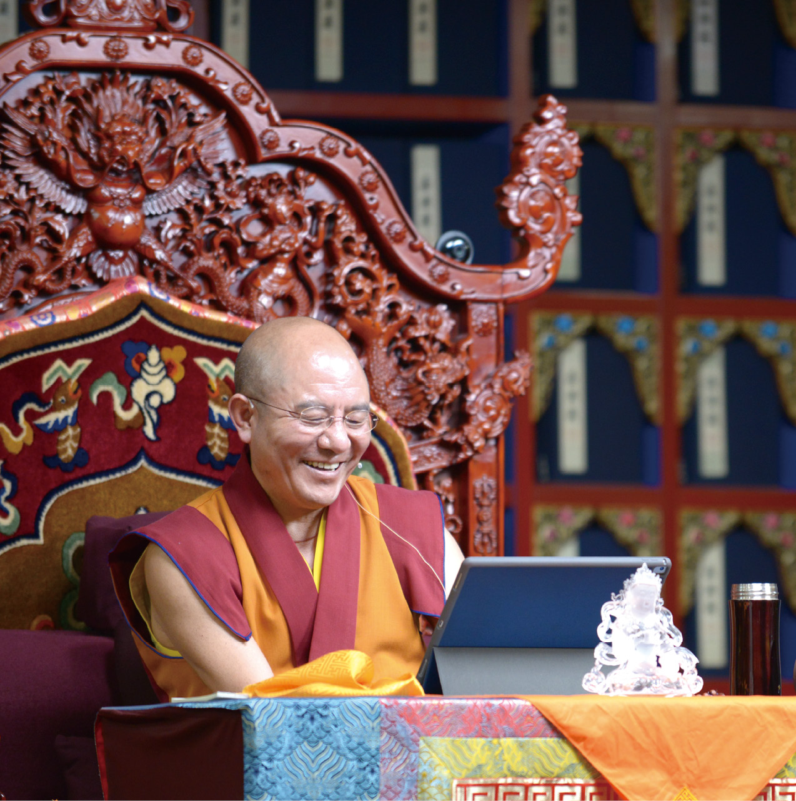
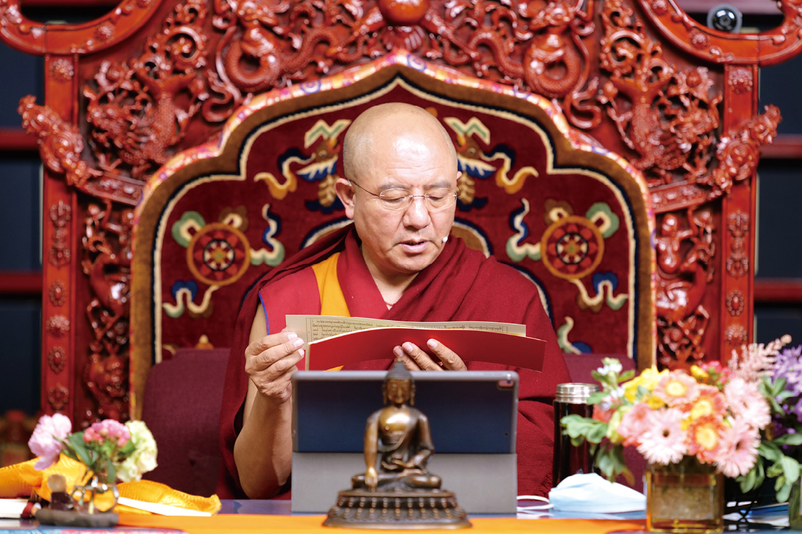

## 金刚萨埵法会开示和传戒

2023年5月29日

今天先给大家做一个简单开示，然后有一些密宗的仪式，最后再念一些传承。

## 修行要有头有尾

今天是金萨法会第三天，大多数人都在认真地念诵，上座时外面也基本看不到人，这样特别好。来到学院以后，大家尽量少说一些闲语，多念一些咒语，否则有些人回到城市后，每天忙于各种琐事，不一定能念完40万遍。

这次的共修机会非常难得。大家也知道，现在学院外内密的违缘很多，这么多的僧众一起念经、发愿，这种机会也许以后还会有，但不一定有很多。所以，对于有些人来讲，这是一个千载难逢的机会。在剩下的几天里，希望大家一如既往地遵守纪律，每天自觉参加四座，有头有尾地念诵。

金刚萨埵在因地时曾发愿：“以后任何一个众生，如果念诵我的咒语、持诵我的名号，无论是破誓言者还是破戒律者，乃至造下无数大罪的人，其罪业都能得以清净。如果不能得以清净，我誓不成佛。”后来，金刚萨埵的发愿已经成熟，并已示现成佛，所以在忏悔法门中，金刚萨埵修法最为殊胜。

前几天，我们也给大家安排金刚萨埵灌顶了。1994年，法王如意宝从青海省的年宝玉则湖取出《金刚萨埵修法仪轨》，莲花生大士在后文写道：“此仪轨对汉族为主的众生大有裨益。”所以，自从此仪轨现世以来，学院每年都会举办金萨法会。前几年受疫情的影响，这里哪怕出现一个居士，也会被马上送下山去。现在政策稍微宽松一些，很多人也可以进来了，但进来以后要认真地共修，这个机会已经给大家了，希望你们一定要珍惜机缘。

## 恭敬三宝所依

我先强调几件事情。

第一，有些人可能刚皈依，还不懂得恭敬三宝所依。比如，把佛经、佛像、转经轮等，随便放在地上或坐垫上，然后在上面跨来跨去，甚至把鞋子和佛经装在一个袋子里，这样非常不好。对于三宝所依，我们应该恭恭敬敬地顶戴，而不是随便扔在坐垫上，然后再从上面跨越。

很多人表面上看好像学过一些佛法，但实际上却是一个佛教文盲，把三宝所依放在不干净的地方，随意践踏或跨越，这样会快速损减福德，而且还会失坏皈依戒。作为佛教徒，一定要以虔诚心把三宝所依放在干净的地方。

第二，今天我们会给大家发一尊莲师像，以及一张阿底峡尊者的见解脱塔像。此见解脱塔也有很大功德，阿底峡尊者走到哪里都会带着，所有见闻觉知它的众生都能获利，这两个是身所依。

语所依，给大家发的是一个转经轮。这个转经轮是以前专门作为考试一等奖来发的，但后来由于各种因缘，山下的学习已经中断了。这次把转经轮也发给大家，因为法王以前讲过很多次转经轮的功德，我也讲过很多次，大多数人应该清楚转经轮都有哪些功德。一般来讲，我们这边课前课后都会使用转经轮。这个转经轮里面全是观音心咒，当初制作的时候，对于材质、纸张的放置等，我们也是层层把关。

意所依，给大家发的是一个佛塔。这样一来，三宝的身语意所依就完整了，身是佛像，语是心咒，意是佛塔。这个佛塔，前几年开金刚萨埵法会时，已经由全体僧众开光加持过了。今天，我们在这里再念一下开光仪轨。

（堪布和僧众一起念开光仪轨）

现在，所有的三宝所依都以不共缘起力获得了开光加持。发放加持品时，每个人只能领一份，应该要知足，不要多领，常住道友先不发。

## 传授“闻解脱”灌顶安排

大家来一次确实很不容易，所以我们这边商量决定，明天下午五点在这里传授“闻解脱”的灌顶。由于场地有限，希望已经得过此法的常住道友，能把机会留给新来的道友，因为他们都是来旅游的，参加完法会就要马上回去了。在旅游的过程中，得到一点佛法也不容易，而学院的常住道友，基本上常年待在这里，有些法已经得过很多次了。

下课的时候，希望大家都能遵守秩序，不要太过激动。尤其是有些人还有高原反应，很可能会因为情绪激动而晕倒或突发心脏病。作为佛教徒，遇事要保持冷静，不要过于急躁。当然，大家见到仰慕已久的上师们泪流满面，这种心情和感受我也能理解。但一般来讲，不管在什么场合，大家都应该保持淡定，这一点非常重要。以前法王如意宝去西方弘法时，那边人都表现得特别淡定，不会一直抓着上师的手，更不会抓着上师的肩膀，其实这是一种很不恭敬的行为。

明天晚上，大家一定要听管家们的安排，即使被安排到楼上的教室，也一样可以得到灌顶。我们以前也是这样，有时根本看不到上师的身相，但传承和教授一样可以得到。然后，堪布、堪姆们在传灌顶物时，一定要确保每个人都得到。我们这次也是希望大家能得到一些法，尤其是闻解脱方面的法，这样以后修习中阴法门也比较方便。

## 经常祈祷上师三宝

大家也知道，最近很多城市出现洪水、干旱等自然灾害，有些地方热得不行，有些地方冷得不行。像以前金萨法会期间，喇荣一般天天都下雨或下雪，但这几天也有点干旱，周边的庄稼树木都晒干了。前几天，学院的主管堪布堪姆要求大家一起念地藏菩萨名号，我和他们开玩笑说：“你们如果越念天气越干，怎么办呢？”（众笑）

末法时代的众生确实很可怜，自从疫情开始以来，大家一直过得不好，很多人失去了稳定的工作，连应届大学生都找不到工作，整个社会发生了很大的变化。有些人因为疫情已经离开了人间，有些人虽然没有离开人间，但在生活、感情和修行上，遇到了各种各样的麻烦，我们这边的人算是很幸运的了。所以，大家一定要经常祈祷上师三宝。

法王如意宝在加拿大和法国接受过两次采访。在加拿大时，有位记者问法王：“您有过焦虑或者心情不好的时候吗？您有什么妙方可以传授吗？”法王说：“无论悲伤还是快乐，我平日里唯一祈祷上师三宝。除此之外，我也没有在修行其他法上下功夫。”

在法国时，列绕林媒体记者问法王：“您一生都生活在藏地，当年他们摧毁佛法时，您仍在不断地修行和传法。您是怎么做到的？”法王说：“唯一就是祈祷三宝。依靠三宝的大悲力，我自己没有遭受任何迫害和磨难，修行和传法也没有出现任何障碍。这就是三宝的加持。”

因此，在未来的修行和生活中，如果你们遇到不愉快的事情，比如天灾人祸等，这时要一心一意地祈祷上师三宝。

现在，让我们一起祈愿：世界和平，国泰民安，风调雨顺，无灾无难。在疫情期间，人们已经被折磨得筋疲力尽了，如果现在还不断地遭受粮食危机、战争威胁等，那生活会过得非常艰难。

（堪布带大家一起念皈依偈和观音心咒）

希望依靠我们共同的发愿，这个世界的众生会越来越快乐，越来越平安。

## 关于菩提学会的再次声明

在这里，我还要强调一件事情。2019年12月30日，我在微博发表声明解散菩提学会及其所有相关组织，终止一切活动，关停相关网站。在这之前的十年里，我确实提倡过共修，但自从发表声明以后，我个人没有再提倡过任何形式的共修。

近年来，仍有一些人打着“菩提学会”的名义进行化缘、招生，做各种宣传，其实这些信息都是假的。有些人还说“这是上师的密意”，这也是骗人的。希望你们回去后，也给身边人说清楚我的态度。当然，如果是以个人名义学习，这个政策上没有限制，我也是完全支持的。但是，如果是以集体的名义，私自组织大家一起学习，可能会给自他带来很多不便。

有些之前的菩提学会学员，私下重新组织学习、化缘等活动，包括供养寺院、供养上师，这些都没有经过我的授权，这样做完全是别有用心，或者只会好心办坏事。所以，我在这里明确地告诉大家，除了日常课程以外，佛学院没有组织任何集体性活动。这边的出家人或在家居士，也没有权力打着学院的旗号，或者以我个人的名义搞各种各样的事情。

学不学习是你们的自由，如果想学的话，那就以个人的名义，毕竟已经开始学习了，中间以各种因缘断掉也有点可惜。但是，集体学习的话，我们这边确实没有。之前，有个别的堪布堪姆，当时没有听我的话，后来也遇到了一些事情，经过我的再三劝告，确实已经彻底放下了，从此没有接受过任何供养。现在很多事情也说不清楚，说是供养上师、供养学院的，但到底真的供养了没有，证明起来也比较困难。而且学院现在也不缺供养，我个人也不缺供养，僧众只要有口饭吃就可以了。

借此机会，我也表明一下态度：如果有人做出任何违法行为，最后只能是后果自负。作为佛教徒，应该善于辨认时机，就像佛陀示现种种神变一样，都是事出有因的，并非无缘无故。如果大环境允许的话，无论是放生还是做其他善事，当然是人越多越好；反之，则需要低调一点，自己独自认真地闻思修，按照法王留下的教言“莫舍己道，勿扰他心”去行持。否则，跟着一些不明组织学习的话，最后自己变成什么样也不好说。

因此，希望大家以低调修行为主，这一点非常重要。在短暂的人生当中，应该多修一些法，比如《入行论》中的菩提心修法，《大圆满前行》中的共同加行和不共加行，或者层次更高的一些修法。一般来说，修得越虔诚，感应也会越强烈。

## 努力坚持闻思修

现在这个时代的众生，总是感到特别痛苦，而学佛人的心里有佛法良药，在面对痛苦时往往会表现得与众不同。尤其是有一定境界的人，虽然照样要经历生老病死，以及家庭矛盾等各种困境，但他有一种应对逆境的能力，可以很快调整好自己的心态。因此，学佛不是办个皈依证就可以了，而是要把佛法运用到实际生活中，这对我们生生世世的帮助都非常大。

我看这次来的人里，有些是年纪大的，有些是带孩子的，有些是带病的，有各种各样的人。其实，来海拔这么高的地方，如果没有一定的心力，可能到了马尔康就返回了，这也是一种信仰的力量，信仰的力量是非常强大的。所以，有了信仰以后，最好不要轻易退转，一定要立下坚定的誓愿：在有生之年乃至生生世世，我对三宝的信心永不退转，并尽可能地广闻博学。

我特别推荐大家学习《大圆满前行》和《入菩萨行论》。没有学过的道友，可以通过网络等途径获取相关音频或视频，然后进行学习和修持。这样一来，你们就可以边上班边做家务，边把自己变成一个很好的佛教徒，不一定非要翻山越岭，去陌生的地方到处寻觅。

前两天，我们给大家发了一本《法王晋美彭措传》。我希望下半年开始，所有人一起学习这本书。这本传记比较略，没有丹增活佛写得那么广，但这是我和慈诚罗珠堪布等人，于法王在世时专门为汉族弟子所写的略传。今年我又重新校对了一次，觉得还是很不错的，内容上不需要做更改，只是个别时间稍微调整一下。去年，我们要求一起学习维萨空行母的传记，有些人到现在还没有完成，我翻译一遍都不需要这么长时间，你们只是读一遍就需要这么久，我都有点替你们感到惭愧。不管怎么样，希望大家好好忆念法王如意宝的恩德。

大家得到法本以后，不要看都不看就搁置一旁，这样非常可惜。其实，做出一本书特别不容易，要付出大量的人力、财力。以前我们刚来学院时，没有复印机和打印机，法本非常难得，基本上都是有人先写在黑板上，然后大家再手抄下来。现在虽然科技很发达，但书籍印刷管理很严格，尤其是宗教方面的书籍，管理得更加严格。因此，即使只是小小的一册书，你们也要万分珍惜。这个世界变得很快，以后会怎么样，谁也不知道，但我希望你们一定要好好地闻思修，比如看传记、念金刚萨埵心咒、修上师瑜伽等。

有些人来到喇荣山谷后，整个心态都发生了改变，但再次融入喧嚣浮躁的城市中，又变回了原来的样子，这样也没有多大的意义。还有一些人，虽然是第一次皈依，第一次来学院，但再过十年、二十年，他的信心始终没有改变，这一点很重要。今年1月份，朵芒寺96岁的拉雪堪布示现圆寂。他在二十几岁时见过一位上师，整个拜见的过程，他到九十多岁时仍然记忆犹新，对他的一生影响也非常大。

我之前也再三说过，有些人是第一次来学院，也可能是最后一次。1993年法王如意宝去美国时，刚好是60周岁，法王说：“我都这么大年龄了，身体的病也多，这是我第一次来美国，应该也是最后一次。”现在来看，确实变成了最后一次。

## 传授三戒并讲解

今天，我尽量不啰唆了，好像人老了以后，说话特别爱啰唆，这个我自己也知道。年轻时多发挥一点，老了后少说一点，不要浪费时间，这样比较好。

接下来，我给大家传一下三戒。1997年，法王如意宝在桂林和成都有传过三戒，包括别解脱戒中的皈依戒和居士戒，以及菩萨戒、密乘戒。

第一个是皈依戒和居士戒，前面灌过顶的都已经皈依了，但没有灌过顶的或者还想再次皈依的人，可以跟着再皈依一次。

居士五戒，包括不杀生、不偷盗、不邪淫、不妄语、不饮酒，稍后我会细说这五条。你们先想好自己要受哪一条，然后一会儿跟着我重复，如果觉得守五戒很难，也可以只受皈依戒。

第二个是菩萨戒，如果认为自己能守大乘菩萨戒，到时候跟着我重复念就可以。

第三个是密乘戒，凡是得过灌顶的人，都应该受密乘戒。

法王如意宝的受戒仪轨翻译出来后，以后法师们也可以按照此仪轨给大家传授三戒，这个不用灌顶，念诵也比较简单。

（堪布边念仪轨，边翻译讲解）

这个传授三戒的略仪轨，叫做《菩提妙道》。

受皈依戒时，心里观想：祈请十方一切诸佛菩萨及诸位善知识垂念我，从今以后，我纵遇命难也不舍弃三宝。皈依佛，两足尊；皈依法，离欲尊；皈依僧，众中尊。

皈依戒的学处有哪些呢？皈依佛后，经常一心一意地祈祷佛陀；皈依法后，尽量地修持正法，不伤害众生；皈依僧后，以恭敬心来依止僧众，不交往外道等见行不相合的人。

受居士五戒时，你们觉得哪一条做不到，就不要跟着一起念。比如，我说“不能喝酒”时，如果你们觉得自己能守持，就跟着我一起重复；我说“不能杀生”时，如果你们觉得自己想要杀生，包括堕胎，那就不要跟着念。

不偷盗的界限比较严格，可能不容易做到。不妄语，是指没有成就却说已经成就了，没有获得神通却说已经获得了，这比较容易做到。不邪淫，是指除自己的配偶以外，不与其他任何人做不净行。

居士戒有两种受持方式，一个是守持一天的八关斋戒，另一个是守持长期的居士戒，大家可以根据自己的情况来选择。

受菩萨戒时，心里要想：往昔的诸佛菩萨如何发菩提心，我也如是发菩提心，为了将一切众生安置于佛陀的果位，一直不断地行持六波罗蜜多。

菩萨戒的学处，是从现在开始乃至菩提果之间，尽力地修持自轻他重等善妙行为。

受密乘戒时，自己对哪个本尊有信心，就把上师观成与这个本尊无二无别。比如，你对观音菩萨很有信心，就把上师观成观音菩萨；你对文殊菩萨很有信心，就把上师观成文殊菩萨；或者，把上师观成地藏菩萨、释迦牟尼佛等。然后，从上师的额间、喉间、心间分别发出白、红、蓝三种光，同时融入自己的额间、喉间、心间，自己所造的身语意罪业全都清净，一切诸佛菩萨身语意的功德全都获得，一边这样观想，一边听我念偈颂。

这个偈颂的意思是说，文殊师利童子的自然智慧实际上跟你的心无二无别，他的智慧光芒能遣除一切无明痴暗，令众生安住在法界大安乐当中。

密乘戒的学处，将现有一切全都观为清净，这是生起次第；一切都是离戏平等的，这是圆满次第。也就是说，经常不离开生起次第和圆满次第的境界。

此仪轨后面的小字讲了，在成都中央花园，几位弟子祈请受持三戒，为了利益众生，法王于智慧中自然流露出这个仪轨，当时由我记录下来。

1997年，法王先去鸡足山，再去普陀山，没有去成九华山，从途中返回学院。

接下来，再念一些传承。

（堪布念新版《喇荣课诵集》中“法堂课诵类”的传承，以及《三十五佛忏悔文》的传承）

《圣八吉祥颂》，是麦彭仁波切觉海中所出之珍贵宝珠璎珞，具有特别的加持力。白天念会成办一切事业，晚上念会做各种善梦，打仗时念诵会凯旋，俄罗斯和乌克兰都应该念一些八吉祥。（众笑）

无论何人念诵《怀业祈请文》，或者将其写于红绸布上做成经旗悬挂，都能如愿成就一切怀业。
