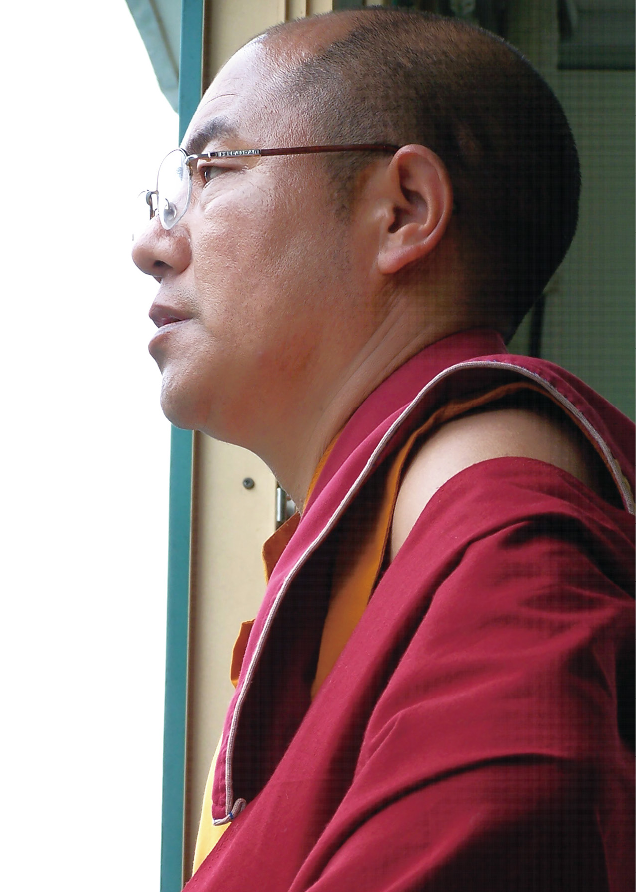

# 从自我到众生

——上海开示

首先，非常感谢大家在百忙之中抽出时间，来到这里一起学习佛法。大家能够怀着这份信心来学习，实属难得，因为今天不是周末，很多人工作忙碌、事务繁杂。我这次来上海是临时决定的，昨天有人反复问我是否可以安排在周末，但实在无法调整，今天大家能集聚在这里，我非常感动，没想到来的人这么多。

这也是我们共同的因缘——对上师三宝怀有信心，对佛陀有虔诚的恭敬之心。今天大家相聚在这里，时间有限，我也没准备深奥的道理，主要是跟大家见个面。很多佛友的面孔我都很熟悉，见到大家很开心；也有些新朋友，不管怎样，我们有一个共同目标——追求解脱、成佛。成佛之后，要做的事情就是利益众生。

今天聚在这里，我先简单说几句话。听说有佛友已经背诵了《入菩萨行论》第一品，等我讲完话后，大家在上师三宝和诸佛菩萨面前以背诵作法供养，接下来我会念几个传承，包括《普贤行愿品》和一些咒语的传承。念完传承后会简单回答大家的问题。人数较多，问题可能很多，不一定能全部解答。

其实，到目前为止，我还没想好具体要说什么，我平时演讲都没有准备讲稿，这几天都没时间准备，今天早上我们在杭州放完生后就赶过来，到这里已经是下午了。今天的主题既与佛法有关，也涉及世间法，所以我想将演讲主题定为“将爱心奉献给社会”，围绕这个话题，简单做个开示。

## 佛教如何在世间生存与发展

我之所以这样讲，是因为在座的大多数都是佛教徒，作为佛教徒，我们必须考虑佛教如何在世间生存与发展。真正有远见的人，一定会思考这些问题，就像企业家会考虑企业的生存和发展一样。

我觉得，佛教能否在世间生存，主要取决几个因素：

第一，修行人自身的内证。我们不仅要闻思，还要有修行，要有所感悟或证悟，否则佛法就完全成了世间法，失去了它的本质。佛教分为教法和证法，教法是指三藏十二部和高僧大德的著作；证法是我们内心对佛教的慈悲、智慧和无我空性的修证，如果我们没有对这两方面的保护和维护，佛法在世间很难长久存续。

第二，佛法不能离开世间法。正如六祖惠能大师所说，“佛法在世间，不离世间觉”，佛法要生存，必须被社会认可、被人们认同。如果佛法被视作陈旧、消极、逃避现实的学说，就难以弘扬。

佛教必须与社会保持紧密联系。作为佛教徒，我们应该积极与社会各界交流，维护与世间的良好关系。虽然不可能与每个人都建立联系，但我们可以从佛教的慈悲与爱心出发，拥抱世界，关心世间。

具体来说，现在社会上许多慈善活动，如帮助孤寡老人、支援山村学校，都是世间法的一种体现，同时也是佛教慈悲理念的实践。佛教徒不能只是口头说“愿一切众生离苦得乐、早日成就”，遇到真正需要帮助的人却无动于衷，那这就只是一句空话。

所以，我始终认为，佛教徒应想尽一切办法，依靠自己的能力和发心，帮助世间需要帮助的人。几年前，在上师如意宝的加持和关怀下，我们发起了全国性的放生活动，效果显著。如今，很多城市都在定期或不定期举行放生活动，藏汉佛教界的高僧大德们也非常重视这件事。生命的价值无比珍贵，即使救护一个众生，也是无量功德。我们要继续努力，不能松懈。

同时，我们还应当关注更多现实的社会问题。现在有很多人非常痛苦、急需帮助，而佛教徒对这些问题关注不够。我觉得以后我们不能仅仅停留在口头上，而是要以佛教徒的身份，实实在在地去帮助更多的人。

今天在这个会场里有这么多佛教徒。如果每一位佛教徒都能做一些善事，就能帮助很多人。然而，我发现现在许多佛教徒在这方面的观念培养得还不够，很多人修行的重心仍然是以自我中心：追求个人成就、神通、境界，或者生意顺利、修行成功等等，全部都是围绕自己展开的。

如果一直这样下去，佛教可能会在世人眼中逐渐消失。为什么这么说呢？因为世间人们非常关心一些现实问题，而我们佛教徒往往并未真正关心他们。他们眼中的佛教，要么是出家人在寺院念经、参禅；要么是放生、修建寺院、讲经说法，除此之外，现实生活中那些需要得到关怀的问题，我们却漠不关心。久而久之，佛教在人们心中的影响力会逐渐减弱。

所以，我认为，要想真正弘扬佛法、让佛教在世间扎根，仅关注自身修行是远远不够的，我们应该以佛教徒的身份，积极去帮助那些可怜的人。帮助他人的方式有很多：比如到医院探望那些没有钱治病、生活困难的病人，即便无法根本解决问题，但提供暂时的帮助、创造治疗条件，也是非常重要的事情。

每个人身边的佛教徒可以组织起来，共同帮助他人。对于那些失去亲人、身处困境的人，不论他们是否信佛，我们可以在他们最痛苦、最悲伤的时候给予帮助，这种帮助不一定是物质上的，哪怕只是一个微笑、一句安慰的话，对他们来说都是难以忘怀的善举。

我们在学习大乘佛法时，总说要利益天下无边的一切众生，听起来很好，但实际上，身边发生的许多事情我们并没有真正关心。我们每个人活在世上的时间都有限，作为佛教徒，应当尽己所能地利益众生，一方面可以通过放生来救助旁生；另一方面，也可以关注人类社会的教育、慈善等事业。若条件允许，所能做的善事可以非常广泛。

世间有许多慈善家和富翁把自己的财产捐献给社会、教育和慈善事业，功德无量，值得我们学习。而许多普通百姓和佛教徒，往往认为慈善只是富人的事情，这种观念显然是不合理的。我们应当以佛教徒的身份去帮助众生。即使条件有限，也总有可行的方法去行善。关键是，我们要将观念从只关注自我修行，转向关心他人、利益众生，这才是真正的大乘精神。

前一段时间，我看到一篇文章，讲的是山西赵金华老人的故事。他是一个80岁的老人，自己非常贫困，靠捡垃圾每天赚十几块钱，生活艰难，但他却养育了六个孤儿。这些孩子们从小在他的影响下，心中种下了慈悲的种子。长大后，有一次，他们的老师生病，回来向父亲借五毛钱。老人感叹：“我们本来就很穷，我怎么能给你们五毛钱呢？”但他最终还是捐给了他们，因为他觉得这些孩子很可怜。

十几块钱一天养活六七个人，几乎是不可能的事，然而，世间确实有很多像他们一样非常贫困却充满大爱的人，令人感慨。我希望佛教徒能够对世间多一些关怀，虽然我们作为凡人，未必能做到像大菩萨那样布施所有财富去帮助他人，但身边的弱势群体，我们可以尽己所能地去关心。

我记得最近，杭州有一群佛教徒自发组织了一个考察队，去西藏看望孤儿和那些失去读书机会的孩子们。他们亲自去到孩子们的家里采访，了解他们的情况。在这个过程中，大家发现，这些贫困家庭的人们一年花的钱，可能仅仅够我们在城市里染个头发、住几晚宾馆，而这些钱，如果用来帮助这些可怜的人，会有多么大的意义。看到这些，许多人心里发生了很大的变化。

我们可能一直生活在温室中，温室里的花朵经不起外面的风雨。我们不曾真正体会到他人的痛苦和困境，直到自己身处其中，才知道那种难受。通过自他相换来修大乘菩提心，这对我们的修行是非常有益的。

过去，我更多的是为出家人讲经说法。后来，我意识到，仅仅在出家人面前传授佛法是不够的，佛法应该推广到在家人中，因为在家人同样具有佛性、拥有信心，但他们不具备到寂静地方学习佛法的机会，于是，我努力寻找各种方式，把佛法带给更多的在家人，例如通过网络、音频、视频、法本等方式。现在，很多地方的反馈都很好。

我自己也有一个发心：不能只是口中讲佛法，或是念诵经文，更要在实际行动中做一些有意义的事。别人是否赞叹我、诽谤我，不重要，这对我无利无害。最重要的是，我能否帮助到别人，解决他们的痛苦，这才是关键。

有人担心自己的举动会被别人评价，可能会说“做得不够好”或者“做得不恰当”，但我认为，这是别人的事，最重要的是我们是否付出了行动。看到有些动物面临屠杀时，我们应该尽量出钱买下它们放生；对于一些病人、老人、儿童和残疾人，我们应该尽己所能去帮助。

过去，我们可能不太关心别人，认为别人痛苦是他自己“活该”，这种态度在佛教徒中也时常存在，这是不合理的。佛教的慈悲不应仅仅只是口头上的表达，而是要在别人最困难、最痛苦的时候，给予他们实际的帮助。比如，在东北曾经有一个家庭，他们原本不信佛，但因为家里有病人，无法负担医疗费用。一群居士自发组织起来帮助他们治病，病好后，这家人非常感激，并最终皈依了佛教。

我认为，佛教徒在未来应该更多地做一些有意义的事情。在座的居士们，包括菩提学会的道友们，或许可以组织几个身边熟的人，以几人的小团体为单位，每年或每个月做一些慈善工作，不一定做得特别大，但只要有心，哪怕是小小的举动，也能带来巨大的改变。

现在，很多富翁和慈善家，比如比尔·盖茨、巴菲特等，捐出几百亿的财富为社会做贡献，如果我们有这样的能力，那当然非常好。但即便我们没有这么大的福报和能力，只要我们心中有一颗想要帮助别人的心，这也是非常宝贵的，内心想令这些众生暂时脱离痛苦，最终获得圆满觉悟，以这种心态来摄持，也是菩提心的一种体现。

我们在座的各位，应该怀有一种对所有众生、对整个人类的感恩之心，把自己的爱心和悲心奉献给社会，并身体力行地去做一些事情。

以前在山西，有一些出家的尼众，她们发愿要建一所慈爱学校。刚开始筹建时，社会上有很多人对她们有误解，甚至诽谤她们，说她们天天跑来跑去，不好好念经，认为她们不该参与这些世间事务。但她们真正行动起来，帮助了许多可怜的孤儿和贫困学生，让他们有机会读书，后来大家才逐渐认识到，佛教确实充满慈爱，真正认可了佛教的精神。

你们也知道，李连杰前段时间开了一个发布会，他提倡每个人捐一元钱，奉献社会。很多人对他有各种议论：有人说他自己很有钱，不该向社会要钱；有人认为他那么出名，提倡捐一元钱很丢脸；但也有人认为，这是非常好的行为，因为他有名声、有地位，影响力大，他的倡议会让更多人关注慈善事业。众说纷纭。

实际上，很多明星、富人对慈善很关注。无论是上海，还是其他地方，即使是不信佛的人，有些企业家也会关注学校、医院、教育事业。然而，我们佛教的许多出家人或居士，往往更专注于个人修行、自我成就，将钱用于塑佛菩萨像，然后在菩萨面前许愿，希望获得悉地，马上获得成就。还有人喜欢将财富供养给上师，给上师买套房子，认为这是自己的功德。这种做法本身没有错，你有信心，自己的财产怎样处理都可以，只是我们要知道，对有些上师来说，你供养一百块钱可能无关紧要；但对贫穷的人来说，你布施一百元，他可能一辈子记得这份恩情。大家如果回顾自己的人生经历，也能理解这一点——曾经的贫寒生活，让我们更容易理解和同情那些需要帮助的人。

前段时间，我在藏地也帮助了一些大学生，解决他们的学费问题。我对他们说，我帮助你们，不是为了让你们将来有好家庭、好伴侣，而是希望你们在未来有能力、有智慧时，能将自己的爱心回馈社会，关怀那些可怜的人。这正是我当初发心的本意。我们的财富来之不易，应该用在有意义的地方，而不是浪费。比如说，用在真正能利益众生佛教事业上，帮助他们解决痛苦。

我记得天津有一位老人，七十多岁，一辈子蹬三轮车，积攒了三十五万。他说，这些钱留给子孙没用，不如全部捐给教育事业，他收养了三百多名学生。虽然有些亲戚不理解，但他坚信，这样做对今世和来世都有好处。作为佛教徒，我们以菩提心摄持，帮助众生，这正是最有意义的事情。

所以，今天我想把这些想法与大家分享，希望对各位有所启发。也希望大家能在日常生活中多关注身边的众生，用我们的爱心和行动去温暖社会。这是我今天想表达的第一层意思。

## 先闻思，再实修

第二层意思，今天在座的各位都是修学大乘佛法的人，希望大家一定要在短暂的人生中，尽量修行佛法。各位生活在城市中，能够遇到像如意宝般的佛法，这正是我们前世累积资粮和福报的显现，否则，真的是很难遇到如此殊胜的佛法。我自己一直这样认为，今生能够遇到如此殊胜的大乘佛法，是我极大的荣幸。

然而，佛法的信仰绝不能只停留在口头上，大家不能今年是这种境界，明年还是这种境界。首先要听闻佛法；听闻之后要反复思维；思维之后还要切实修行。如果只停留在理解层面，而没有修持，当烦恼现前时，我们很难真正对治。

在修行上，《三主要道论》中指出，出离心、菩提心和空性智慧三者缺一不可。无论显宗还是密宗，各教各派高僧大德们虽然表述方式不同，但究竟观点是一致的。

首先，学习佛法时，不要单纯追求今生的快乐或福报。世俗之人当然会有求福求安的念头，比如做生意的人希望生意兴隆，普通人希望家庭平安、身体健康……依靠诸佛菩萨加持，这种善愿当然可以获得相应的结果，但最根本的是培养出离心。

所谓出离心，就是我们学习佛法，不是为了今生的快乐，也不是为了来世的安乐，而是认识到整个三界轮回如苦海一般，想从苦海中获得解脱，就像身处监狱的人渴望获得释放一样。想要生起出离心，就要断除对名声、地位、财富等世间法的执著。为了今世求福报的心态，算不上真正的修行人。

第二，要发菩提心。菩提心的含义是指，我的解脱不只是为了自己。单独追求自我解脱是小乘修法，而大乘菩提心，是为了让无量众生都能获得无上圆满正等觉而修行佛法。在这个过程中，要不断遣除自私自利的心。如果自私心强烈，即便追求大乘解脱，也会受阻。因此，发菩提心、遣除自私自利的心，是修行的重点。

第三，要在相续中生起无我的智慧。为了生起无我的智慧，可通过中观的方式对治自相续中“我”和“我所”的执著，再结合大圆满法认识自心的本来面目，断除一切执著。这种断除我执和法执的方法，在大乘经论以及密宗续部和窍诀书中都有详尽论述。

我想，在座的各位都是学佛多年的道友，大家的学习情况也都非常好。尤其是在学习《入行论》方面，我觉得上海的学习水平，在相当一部分城市当中，应当是名列前茅的。无论是你们完成作业的态度，还是平时学习中的各个方面，都表现得非常认真、踏实，我们的一些管理人员也一直对你们赞叹有加。所以，我今天要特别地赞叹你们，并向大家表示衷心的感谢。

其实，学习本来是你们自己的事情。对我而言，全国各地都有相当一部分人在学习佛法，未来也可能有人继续学习，也可能有人暂时不学，我们不可能、也不应该强迫任何人，弘扬佛法只能随顺因缘。但你们在学习之后，确实给很多人带来了真实的利益——有些人过去对佛法一无所知，现在从中有所领悟；以前每天东奔西跑、心不安定，现在慢慢变得稳重下来，开始真正想学一点东西，愿意去实修，这本身就是一件非常好的事情。通过这样的学习，目的就是要断除自相续中实有的执著，如果这种执著不能断除，那么所谓的解脱是绝对不可能的。

当然，若要详细展开来讲，内容会非常多。今天因为时间关系，具体道理不再广说，但在这里我要特别强调的是：第一，要生起出离心；第二，要发菩提心；第三，要具备无二智慧。这三种心，必须建立在一个善良、健全的人格基础之上。

我们可以看到，很多修行人确实变得更好了。为什么呢？因为彼此之间的嫉妒心、竞争心明显减少了，这真的是一件非常好的事情。过去常常出现对这个上师嫉妒、对那个上师嫉妒，弟子与弟子之间、宗派与宗派之间存在许多不和合的现象，这并不是佛教徒应有的行为。世间尚且在努力追求国家与国家之间、人类与人类之间的和睦，我们佛教徒，尤其是大乘佛教徒，更应当关系融洽，这一点极其重要。

所以，我们一定要实修刚才提到的三个要诀，而要想真正实修，首先必须做一个好人，如果连人都做不好，那么学佛就更无从谈起。

因此，我非常希望各位道友，在短暂的人生当中，真正从内心下功夫，踏踏实实地去做一些实修。如果没有实修，只是口头上讲佛法，实际上却毫无修行，那是非常可惜的。尤其是在大城市里，大家每天都很忙，可是世间的事情永远忙不完，世间法总是接连不断。所以，每一天都应当为自己空出一点点时间，用来学习和实修佛法。

在我个人看来，在整个世间所有的享受之中，学习佛法的这种享受是最为至高无上的。像我们这个年龄的人，世间的痛苦、快乐、财富、名声，各种滋味基本都已经品尝过了，我想在座一些年长的道友，也经历过富贵与贫穷、快乐与痛苦，尝过世间各种好与不好。但世间的财富和名声，真的只是越享受越麻烦，没有什么值得羡慕的，世人向往的许多境界，其实也并没有什么真正值得追求的，而佛法教导我们调伏自相续、调整自心，这一点无论对个人、对社会，还是对未来，都是极其需要的。这种调整心态的方法，在世间任何一门学问当中，都是找不到的。

正因为如此，佛教徒在面对生、老、病、死时，往往能够更加坦然、更加安定。无论生病也好，临终也好，大家是有把握、有依靠的；而世间再有名声、再有智慧的人，一旦真正面对疾病与死亡，往往充满恐惧与不安。相比之下，佛教让我们在最害怕、最痛苦的事情面前，具备面对的勇气和能力。

因此，佛法的至高无上，不必多说，在我们的实际行动中能体现出来。对你们个人而言，我认为在所有的获得当中，在佛法中的获得是最无上的。希望大家在这条漫长的修行道路上不要退转，不要倒下。因为一旦倒下，很可能一蹶不振，到最后无人能够救护，那就非常可怕了。

修行这条道路，从来都不是一条容易走的路。尤其是你们作为在家人，有工作、有事业、有家庭，有方方面面的烦恼；再加上家人不理解、不同意，只能偷偷地学习佛法，很多时候甚至需要隐瞒、需要找各种理由。今天在座的许多人，可能也曾对单位领导、对父母亲友说过一些妄语——我下午有事、朋友生病了、家里出了状况，或者外出旅游等等。表面上看似是“欺骗”，但实际上这是为了求法而说的方便妄语，在佛法当中是开许的。你们学佛真的是非常不容易，在这么多压力与违缘之中，仍然能够坚持闻思修行，这本身就非常了不起。

我在学院时也常常对出家人这样说：你们现在住在寂静之处，具足学习佛法的顺缘，没有人干涉你们的生活，许多世俗的牵挂已经放下，一心一意在寂静山中闻思修行，确实少了许多干扰，闻思修行相对是比较容易的。每一次接触城市中的在家人之后，我内心里都会生起一种由衷的赞叹，在如此喧闹、充满压力的环境当中，还能够具备学佛的勇气与毅力，实在非常难得、非常了不起。

当然，修行之路不可能没有困难。我个人认为，做任何一件有意义的事情，如果一遇到困难就选择放弃，这是不合理的。因此，今后无论困难多大、违缘多强、障碍多重，大家都不要退失信心。佛法确实是至高无上的智慧教育，这一点并不仅仅是佛教徒的认同，也是世间许多智者共同承认的事实。

今天我也非常高兴，能够和大家分享一些佛法方面的道理，通过你们的信心和微笑，我自己内心当中也感受到了很多。我们大家应当共同发愿，发愿非常重要。现在有些学佛的人，只重视理论学习，却不重视发愿、持戒，这说明他们对佛教的一些基本道理并没有真正理解，这样的做法是不合理的。

那么，发什么样的愿呢？我们应当这样发愿：从现在开始，乃至生生世世皈依上师三宝，绝不离开善法、不损害任何众生，以此作为自己修行的根本方向。

下面，可能在座有个别道友想皈依三宝。就我个人而言，从来没有私下收过徒弟，也没有刻意培养弟子，有了徒弟，天天还要操心、担忧，对方不听话，自己也会伤心，反而变得麻烦。不论是出家的徒弟，还是在家的徒弟，都不容易照顾。今天我们面前有法王如意宝、释迦牟尼佛、莲花生大士的像，也有佛经、佛塔，如果愿意皈依，我们可以在三宝所依之前，共同在内心当中发愿：从今天开始，皈依佛、皈依法、皈依僧。有些人过去皈依，是为了身体健康、生活快乐、事业顺利等世间目的而皈依的，这样的皈依，属于世间意义上的皈依，而不是真正出世间的皈依。真正出世间的大乘皈依，是为了利益天下无边的一切众生而皈依三宝，如果愿意皈依三宝，也可以重新发一次愿。当然，也有个别人只是出于好奇而来，不想皈依，这完全可以，我们不可能强迫任何人，更不可能把绳索套在谁的脖子上，是否皈依，完全取决于自己的内心。

接下来我给大家念诵皈依偈颂，大家自己从内心当中发愿为了利益天下无边的一切众生而皈依三宝……

我再给大家传几个心咒：“嗡啊吽 班匝儿格热巴玛色德吽”，这是莲花生大士的心咒；“嗡玛呢巴美吽”，这是六字真言；“嗡班匝儿萨埵吽”，这是金刚萨埵心咒；“嗡阿Ra巴匝那德”，这是文殊菩萨的心咒；“达雅塔 嗡牟尼牟尼玛哈牟尼耶索哈”，这是释迦牟尼佛心咒。

最后是法供养时间，欢迎上海及南京等地的道友上台背诵……

现场互动

⊙ 问：我是新学佛的，想了解他们所说的“五加行”。因为我不是很明白，这个应该怎么入门、一步一步去做，我希望师父能指点一下。

堪布：刚学佛的时候，很多道理可能不太容易理解。我个人的建议是，入门阶段可以先学习一些基本内容，比如《大圆满前行》、《入菩萨行论》和《菩提道次第广论》。这些都是能打好佛法基础的重要论典。

当然，如果有时间，也可以开始修加行。五加行实际上是佛法的基础修持。修行五加行的人，通常对学佛非常诚恳，因为它包括了皈依、发心、忏悔、供曼茶和上师瑜伽等五项内容，这每一项修持对我们都非常重要，关键在于愿不愿意修，以及是否能够坚持修行。如果五十万加行都能圆满完成，说明这个人愿意皈依，愿意发心，愿意忏悔，愿意积累资粮，也愿意修上师瑜伽。

在修行过程中，这不仅是对自己的考验，更是清净障碍、积累资粮的殊胜机会和方便法。因此，一般来说，学习佛法的人，如果能够圆满五十万加行，将会帮助自己清净业障，修行也会更加稳固和深远。

⊙ 问1：《普贤行愿品》应该如何在我们的日常行住坐卧中体现？能否请您举几个具体的例子？

堪布：《普贤行愿品》里讲的十万大愿，要真正落实确实需要很长时间。在“一尘中有尘数刹”的无量佛面前恭敬顶礼、忏悔，这对我们初学者来说有一定难度。但正如以往法王如意宝所强调的，《普贤行愿品》的修持核心可以概括为两点：弘扬佛法和利益众生。

我们可以在日常的行住坐卧中，心里想着“我要利益一切众生，尽心尽力地弘扬释迦牟尼佛的殊胜教法”，始终心不离愿，身体力行，《普贤行愿品》的大愿就会在行住坐卧中逐渐落实。

问2：我的第二个问题就是第八阿赖耶识清净转化，是不是通过《普贤行愿品》这个方法是最好的？

堪布：不一定，第八阿赖耶识的转换，通过修证等其他方式也可以转变。

⊙ 问：我们现在已经发了菩提心，如果别人请我们帮忙，是不是所有的忙都必须帮？如果我们拒绝别人，是否就退失了菩提心？

堪布：帮助众生时，应当观察事情是否真正对众生有利益，并结合自身的能力与因缘来决定。有些人的请求未必真正对他有利，甚至在你守护菩萨戒的过程中，可能会构成违缘，或耽误自己的修行。在这种情况下，就应当先保护好自己，作出适当的取舍。如果自己各方面的能力、条件和因缘都具足，而且确实能对他人带来利益，那么就应当尽力去帮助。正如我们在《释迦牟尼佛广传》中看到的许多感人事迹，都值得大乘佛教徒学习和效仿。

⊙ 问：我家先生一直反对我学佛，有没有什么办法能让他不再反对？

堪布：学佛过程中，家人不理解甚至反对的情况，其实很多人都会遇到。原则上，最好不要轻易放弃自己学佛的因缘。有些人在遭到家人、亲戚朋友反对后，立刻就放下修行，一味地随顺对方，这样的做法并不恰当。

但另一方面，也需要运用善巧方便。平时在生活中可以多随顺对方，尊重和体谅他；而在关键的问题上，则应当坚持正见，不轻易退转。久而久之，很多人都会慢慢转变看法。就像我们学院里的一些出家人，起初家人极力反对，但时间长了，对方反对的力量和执著逐渐减弱，甚至后来自己也转而成为非常虔诚的佛教徒。

⊙ 问：您在《放生功德文》中提到，肿瘤和艾滋病可以用佛教的方法解决，请您进一步开示。

堪布：不是说所有的艾滋病、肿瘤、癌症都一定能够治愈，并不是这个意思。你们如果读过《西藏生死书》中的一些事迹，就会知道，在西方社会中，确实有相当一部分艾滋病患者，在各大医院已经束手无策、几乎被判“死刑”的情况下，后来通过潜心学佛，依靠强大的心理转变和内心力量，最终病情好转，甚至痊愈。关于这类案例，相关记载是比较多的。

在癌症和肿瘤方面，佛教徒中也确实有通过学佛、念佛而获得康复的实例。以前我在武汉时，曾遇到一位居士，她原本是省歌舞团的歌手，嗓音条件很好，后来得了癌症，单位也已经为她办了相关手续，大家都认为已经没有办法了。后来在万般无奈之下，她皈依了三宝，就在皈依三宝后不久，癌症竟然完全康复。我们在《净土教言》的片头和片尾，还放了一些她的歌。

因此，有时我也深有感触：在我们佛教徒当中，确实有一些人因对三宝生起真正虔诚的信心，通过皈依和修行，最终使自身的顽疾乃至绝症得到彻底的改善和治愈。这类事例比较多。

⊙ 问：我们发愿“生生世世不离十方三世诸佛菩萨，生生世世不离传承大恩根本上师”，与修净土时发愿“今生今世临终之后往生西方极乐世界，不再轮回”，这两种发愿是不是有点相违？

堪布：并不相违。我们发愿“生生世世不离上师三宝”，是指当我成佛时，我也要成为上师的补处。什么叫“补处”呢？例如莲花生大士从前也这样发愿，于是现在莲花生大士成佛时，他的头顶有一尊阿弥陀佛。在实相中，佛与佛没有高低之分，但在显相上，我成佛之后，我的上师成为我的怙主，我成为上师的补处。

其实所谓的“佛法僧”，是在自相续中证得的一种果位，大乘僧宝指的是菩萨的境界，这些果位和境界，当我们成佛时，也不会离开。因此，我们所说的“生生世世不离上师三宝”，应从非常深奥的意义上理解。

⊙ 问：我通过学习《入菩萨行论》后，整个人发生了很大的变化。上海将近两千万人口，而学习《入菩萨行论》的人仅占很小的比例。我一直在想，如何弘扬《入菩萨行论》，提高学习者的比例。上周六，我把《入菩萨行论》前四节课的讲记打印了一百份，发给一些还没有学习的人。我没有经过您的允许就这样做了，我不知道这样是否如理如法？

堪布：你这样做是可以的，也很值得鼓励。上海学习的人虽然相对较多，但比起两千万总人口，比例确实不高。不过，在网上听一两天的课，效果有限。要真正受益，最好加入菩提学会系统学习。我们没有任何条件，只希望大家认真学，这对个人确实有好处。实际上，真正系统地学习后，大家都能有所收获。

你们也知道，在觉囊派、格鲁派、萨迦派以及汉传佛教各大教派中都有人学习《入菩萨行论》，在印度也是这样，藏地各教派都在共同学习。因此，我们不分教派、不分上师，只要学习，就能对每个人有所利益。当然，从个人角度来说，我也不敢保证每个人都能受益，因为现在很多人会对我传的法有各种评论和看法，我也是随缘看待。但内心来说，我真心希望大家认真学习，虽说学的人越来越多，会给我们的管理带来一定压力。我原本想外出调养身体、放松一下，但因为课程和学员的责任，我不能随意放逸，否则课程进度就会跟不上，会很麻烦。前一段时间在外地检查身体时，我默默祈祷，千万不要像以前一样住院，因为住院一个月，学习资料就无法供给。幸运的是今年医生没有要求我住院。

无论如何，你们通过各种方式学习，这本身就是很好的。真正学了之后，可能会有切身体会；没有体验之前，很难判断别人所说的道理对自己有没有利益。现在这个世间，大家对各种宣传已经听得多了，比较谨慎也是正常的。不管怎样，我们还是要共同学习。

⊙ 问：什么样的见地称为大圆满见地？

堪布：大圆满的见地并不是随便就能传授的，我们这里很多道友，还没有获得过大圆满灌顶。一般来说，大圆满的见解，需要在修完加行、并得到无上大圆满灌顶之后，才能学习。

就我个人而言，本身也没有大圆满的境界，所以宣讲大圆满见地有一定的困难。尤其是在像我们这样的场合，要系统而深入地讲解大圆满见地，是不太方便的。

⊙ 问：与法王如意宝结缘的众生都能往生极乐世界，那么我们应该怎样与法王如意宝结缘？

堪布：法王以前讲过，无论任何人，只要对极乐世界怀有虔诚信心、对往生极乐世界有兴趣、对阿弥陀佛有恭敬心和信心的人，一心念诵“南无阿弥陀佛”六百万遍、金刚萨埵心咒四十万遍，这样就算与法王如意宝结缘。凡是与法王如意宝结缘的众生，都能往生极乐世界。菩提金刚等许多伏藏大师都曾授记，通过这样虔诚的修持，必能往生极乐世界。

⊙ 问：请问放生时能否放毒蛇？

堪布：关于放生毒蛇，我的理解是：我们不应专门选择毒蛇放生，但如果看到毒蛇或其他众生生命受到威胁，我们可以出于慈悲心救护它们。就像世间中，如果一个人看到别人遭受危险，即使那人过去做过坏事，如果有能力去救，也应该救。我们不是为了害人或扰乱社会去救护这些动物，而是基于看到生命遭受杀害的痛苦而救它们。

总之，我们是出于慈悲心，救护那些处于危难的生命，而不因它是毒蛇或其他危险动物而有所偏废，但在放生的同时，一定要注意环境的科学化、合理化的选择。这就是我对放生毒蛇的理解。

⊙ 问：您说要发出离心、菩提心，这个心究竟在哪儿？

堪布：这颗心就是你刚才提问题的心。

⊙ 问：堪布您好，我想请教三个问题——

第一个是关于《开显解脱道》：我们修《开显解脱道》是不是和修五加行是一样的？如果是一样的，想请上师为我们讲一下修《开显解脱道》的程序和方法。

第二个问题是，修上师瑜伽时要求不能闭上眼睛，那么平时做功课，比如念金刚萨埵心咒时，眼睛是睁开还是闭上比较好？

第三个问题是，买来准备放生的动物，如果在放生之前死掉了，应该如何处理？

堪布：关于第一个问题，《开显解脱道》实际上已经完整地包含了《大圆满龙钦心滴前行》的内容。宁玛派的大圆满前行主要有龙钦心滴和白玉心滴两种传统，麦彭仁波切所造的《开显解脱道》，都已经涵摄了这些前行修法。因此，我们学院要求大家按照《开显解脱道》的内容来修持前行，是比较方便而且次第清楚的。过去益西彭措堪布也曾对其作过一些文字上的讲解。

第二个问题，在念金刚萨埵心咒等修法时，只要内心能够专注，眼睛闭着念也是可以的。当然，大圆满中有个别修法，尤其是与光明方面有关的教言，修行时是不能闭眼的，需要依教修持。但在我们平时的一般修行中，只要心能专注，闭眼并没有问题。有些修法则应当按照毗卢七法坐式的要求来修持。

第三个问题，在放生过程中，我们应尽量想办法避免动物在放生前死亡。但如果在实在无法避免的情况下，动物提前死亡了，也不会有过失。因为我们本意是救护它的生命，只是由于它自身的业力现前，提前舍报，在这种情况下，可以为它念佛、回向功德。

⊙ 问：很多上师都跟我说，我与修行很有缘，但我自己却一直静不下心来修行，整天恍恍惚惚的。我想知道，这到底是业障深重，还是因缘不具足，或者还有其他原因？

堪布：许多上师对你寄予了很大的期望，而你却始终无法安住于修行，这其中真正的因缘，我也不好下定论，要彻底了知前世后世的因缘，需要具足宿命通，一般人很难完全明白。

但我想说的是，如果你目前实在提不起心力修行，也不必勉强自己。可以先从念佛、放生，或者做一些力所能及、利益众生的事情开始。每个人的根基都不一样，有些人喜欢闻思，有些人喜欢禅修，有些人更相应放生或行善等。修行的方式是可以调整的，并不一定非要拘泥于某一种形式。

如果实在不想正式修行，也可以多念金刚萨埵心咒，通过这样的方式慢慢净除业障、调整心态。随着时间推移，心逐渐安定下来，修行的因缘自然会成熟，关心你的上师们也会感到欣慰。

