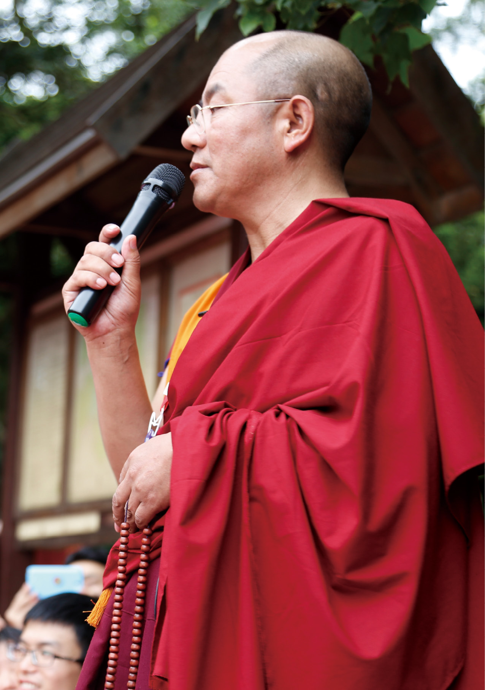

# 佛教徒的三件大事

——宁夏银川开示

尊敬的各位法师、各位同修道友，大家好！让大家久等了，从三四点一直等到现在。我们并非有意拖延，早上七点多就已从广东出发，原本预计下午四点前便可抵达，但途中因种种因缘耽搁了，实属无奈，还请诸位道友多多包涵。

今天我们能够相聚一堂，共同为了弘扬佛法、修持正法而交流探讨，我内心感到无比高兴。同时，感谢诸位同修发心提供了这样的环境，成就了此次殊胜的因缘，大家也应当欢喜。

在座的各位道友基本上都是佛教徒，今天我们借这个时间和环境互相交流，因为在其他地方可能不太方便，所以有几位道友发心组织我们在这里聚会，大家见个面。这里环境优雅，机会难得，对我来说能遇到这么多虔诚的修行人也比较难得，我想利用这次机会跟大家探讨一些佛教方面的问题。

首先，我这次出来的主要目的不是讲经说法。法王如意宝圆寂时，我曾在他的遗体前发愿，要放生一亿众生，这次我利用两个月时间随便走走，放一些生命。同时，我们学院的一些老居士和出家人，大家感情非常深厚，互相交流也是很必要的。我已经走过很多地方，现在放生活动已经基本圆满，很快就会返回学院。

这次出行，我主要强调几个问题：

## 一、显密各派应团结和合

佛教徒包括在家人与出家人，不论什么身份，不管你是学显宗还是密宗，比如汉地的天台宗、法相宗、华严宗等，佛教徒之间在弘法利生的事业上必须团结和合、和睦相处，这是非常重要的。

我们藏传佛教也有格鲁派、宁玛派、萨迦派等不同传承，宁玛派中也有不同的传承，但总的来说，这些全都是释迦牟尼佛所传下来的教法。因此，金刚道友之间、显密佛教徒之间互相团结非常重要。

为什么要强调这一点呢？我去了很多地方，看到一些情况后，心里不太舒服，很多地方显宗与密宗信徒之间的排斥现象比较严重。有些学显宗的佛教徒，认为密宗是“鬼法”“神法”，非常排斥密宗，一提到密宗便一概反对，只强调好好念佛、坐禅，认为只有念佛或禅宗是最殊胜的法门，其他都是邪法、外道之法。尤其是一些老太太，对佛教教理并不深入了解，除念佛之外的所有法门一概排斥，这种现象确实存在。

也有一些学密宗的佛教徒，执著自己所修的大威德、大手印、大圆满是至高无上的法门，觉得念佛、参禅没有什么了不起，认为显宗修行层次低，自己所学才是最高的，对念佛、参禅看不顺眼甚至排斥，这种现象同样比较严重。实际上，这两种态度都容易落入偏执的一边。

因此，我给大家的建议是，不论学显宗还是学密宗，一定要互相团结。学显宗的人，不管是净土宗、华严宗，还是禅宗，都有各自的传承，依靠各自法门都可以获得成就；学密宗的人，也不必因为学了密宗，就否定以前所学的一切宗派，这没有必要。

对于学净土宗、禅宗的人来说，坚持修持自宗的念佛和参禅法门，这是很好的，但没有必要诽谤密宗法门。密宗的境界非常高，不是对基本教理都不了解的人就能随意评判的，想要否定它，根本是不可能的事情，就像兔子无法动摇大海一样。

显宗和密宗之间，实在没有必要互相排斥。你原来是净土宗，就好好修你的净土宗，但不必诽谤密宗；你原来是密宗的，也应当善于配合显宗寺院、恭敬净土法门。只有这样，我们的法脉传承才能在汉地健康发展。汉传佛教界对学密宗的弟子既有印象好的一面，也有印象不好的一面，密宗弟子务必要尊重汉传佛教原有的传统，否则，藏传佛教至高无上的法门想要在内地真正开花结果，恐怕会遇到很多磨难和障碍。

因此，我要说的第一点就是：显宗与密宗之间没有必要互相排斥。若彼此排斥，实际上就是在排斥释迦牟尼佛的教法。为什么这样说呢？因为释迦牟尼佛所传的教法，本来就是显密圆融的，若只行持其中一部分，而否定另一部分，说明你对佛法的理解还不圆满。

有些人认为，一切法门都可以归入净土，只要念阿弥陀佛就够了，其他法门都不好。不能这样讲。若真是如此，释迦牟尼佛只需传一句“南无阿弥陀佛”即可，根本不必传其他法门。但事实并非如此，佛陀已经为我们广转八万四千法门，那就说明其他的成就之道肯定存在，也有存在的必要。

同样，有些密宗弟子认为密法至高无上，只修密法就可以，其他如净土宗等法门都不好，这种说法也不对。

这是我对当前显宗与密宗关系的一点看法，也是一个现实问题，我希望大家把它当作一个思考题认真想一想。你修显宗，就以显宗为主，但不必诽谤密宗；你修密宗，就安心修密宗，但不必轻视、践踏显宗那些古老而清净的修行传统。显宗与密宗行者应当互相团结、彼此尊重。

我们密宗行者当中，其实也可能会出现类似的情况。比如说，不同的上师传承不同，个别上师与上师之间也会产生各种嫉妒、冲突和竞争；有些弟子与弟子之间，也常说“我是这位上师的传承”“我是那位上师的传承”，把佛教当成一个个小家庭，这是一种非常不好的现象。

实际上，所有传承都是释迦牟尼佛传下来的法门，我们都是三宝的弟子，完全没有必要因为“你的上师”“我的上师”而彼此争论不休，甚至造下种种恶业。

当然，每个人的因缘各不相同，有人与这位上师结缘，有人与另一位上师结缘，在听闻、修学佛法的过程中，因缘自然会有所差别，这一点，任何一个佛教徒都不会否认。但是，在取舍的过程中，最好不要以盲导盲，不要认为“只有我的上师才是最好的，其他所有上师都不好；只有我上师的法最好，其他上师的法都不好”，这样的态度并不恰当。

就我个人而言，今生能够遇到金刚上师法王如意宝晋美彭措，是我一生中最荣幸、最欢喜的事情。在我心目中，他与佛陀没有任何差别，但在其他众生的眼中，未必一定如此，我也不要求别人必须这样看待，因为每一个众生的因缘不同。每个人对自己的上师生起无比的信心，这是理所当然的事情，谁也不能、也不应该剥夺你这样的信仰权利。但是，如果你只承认自己的上师，而不承认其他上师的教法和传承，那么学佛的范围就会被你自己越缩越小。这样下去，自己在修行的过程中，确实很容易遇到许多违缘和障碍，这实在没有必要。

当然，现在大家也看得出来，有些上师并不是真正具足法相的善知识，而是依靠名闻利养而生存；也有一些上师名副其实，真正以利益众生、度化众生为己任。这在我们尚未与上师结成师徒关系之前，一定要善加观察，一旦结下了这样的关系，就没有必要再去反复挑剔、宣说各种过失，甚至诽谤上师，这样做没有任何必要。

我今天刚到银川，明后天做一次放生之后就要马上前往其他地方，停留的时间非常短，也没有太多时间与大家深入交流，对你们这里的具体情况也不太了解。但我想，各地的情况大同小异，很多地方的弟子为了维护自己的上师争辩得非常激烈，甚至诽谤其他佛法、其他传承，这是没有必要的。

维护你的上师是你的权利，谁也不会干涉，但在这个过程中，没有必要诽谤任何一位高僧大德，也没有必要诽谤任何高僧大德所传下来的殊胜甘露妙法。这样做只是自欺欺人，对你今生乃至来世都没有任何真实的利益。

在这短暂的时间里，我心里有些话还是想跟大家说。最关键的一点，就是显宗与密宗信徒之间一定要团结；而在密宗内部，金刚道友之间也一定要团结，这是我认为非常重要的事情。这也是我今天想说的第一件事。

## 二、积极放生，尽量吃素

第二件事情，是关于放生的。现在全国各地都有许多佛教徒积极提倡放生，很多高僧大德也对放生非常重视，这是非常有必要的。从世间法的角度来看，科学放生有利于保护环境、维护生态平衡；从佛教教义和功德的角度来看，在所有大乘修行当中，放生的功德是非常殊胜的，这一点很多人应该有所了解。龙猛菩萨曾指出，所有的罪业中，杀生的罪业最大；而所有的善业中，功德最大的就是放生。在我们造善业与造恶业的过程中，放生和杀生所产生的功德与过失，都是最为深重的。

我想在座的各位道友应该也有所体会。你们很多人依止金刚道友、金刚上师，以及其他高僧大德，运用各种方便方法进行放生，这是非常值得称赞的。放生的功德确实相当大，每一个人都非常珍视自己的生命，假设某天面临死亡，很多人愿意用所有的财产、地位来换取自己继续活在世上——每个人都是如此，即便你拥有再多的钱财，也愿意放弃，只求能活下来。同样的道理，每一个众生的生命也是极为宝贵的，只是，许多众生在遭受威胁时，没有能力为自己争取生存的机会。

很多人愿意参与放生活动，但我想可能有些人对放生的意义还不是特别清楚。我以前写过《放生功德甘露妙雨》，此外汉地也有一些书籍在流传，如永明大师、莲池大师、印光大师等高僧大德，都有很多赞叹放生的偈颂和公案，希望大家认真学习，理解众生生命的价值，明白放生的重要性。只要你有能力、有时间，就一定要抽空参加放生活动。

我在这里强调放生，是因为它的重要性不可小觑。如果我们发起无上的菩提心，放生哪怕一条生命，这将带来极大、深远的利益。相反，如果我们看到周围众生遭受杀戮，却没有去救护，那所谓的菩提心也可能仅仅停留在口头上，并没有落到实处。

因此，对每一个人来说，放生对今生与来世都具有非常重要的意义。

此外，我也想在这里特别强调一下吃素的问题。关于吃素，从藏传佛教历代的传承来看，确实有相当多坚持素食的高僧大德，比如乔美仁波切、钦则益西多杰、如来芽尊者、华智仁波切等大圆满传承的祖师，在相关开示中都提倡放生、吃素。我过去曾写过一篇《藏密素食观》，其中引用了许多教证和史料。

当然，有一部分成就者显现上吃肉、食荤，这种现象也是存在的。譬如印度有些大成就者，如帝洛巴、那若巴等，在度化众生时示现吃肉；在汉传佛教中，也有像济公和尚那样，表面上不守寺院清规，甚至示现吃狗肉等，这些显现确实存在。

但是，总体而言，历史上的问题已经成为过去，其中有些细节我们未必有必要反复争论，作为一名佛教徒，真正值得我们认真思考的，是当下所面临的现实问题：在今天这样的时代背景下，我们学习藏传佛教的信众应当如何取舍？

大家都清楚，汉传佛教自古以来就极力提倡素食，尤其自梁武帝以来，无论是寺院僧团，还是在家居士团体，对吃素的问题都极为重视。直到今天，无论在国内还是国外，只要是比较正规的汉传寺院团体，都严格坚持素食。

相较之下，在这一问题上，藏传佛教的表现确实并不尽如人意，对此，我自己也曾思考过很长时间。大家也许知道也许不知道，我过去吃肉。大约在两三年前，我开始认真思考：如果我们这些学习藏传佛教的人一直吃肉，恐怕在整个佛教界乃至社会层面，都会造成不太好的影响。

如果社会大众对我们的行为产生负面观感，那么即使我们的法脉传承再殊胜、再圆满、再至高无上，也未必能够真正被接受。如此一来，藏传佛教在汉地的弘扬、发展与推广，必然会面临很大的障碍。基于这样的考虑，我开始发愿吃素。

作为一个凡夫，尤其是过去在这方面有很重的习气，在吃素的过程中确实遇到了不少挑战。后来随着时间推移，结合自身的经验，也与许多金刚道友反复探讨，我明显感觉到，自己的许多习气与毛病在逐渐改善。

到目前为止，所有在色达五明佛学院求学的汉族弟子都吃素，个别刚来、不熟悉学院规矩的人，可能还存在例外；也有一些以前在学院学习、近年不在学院的弟子，未必了解这一变化。但在过去两三年中，我在学院里一直反复强调吃素，之所以如此重视这个问题，主要有两个原因：

第一，正如刚才所说，无论是我们自己修持藏传佛教的无上密法，还是希望在汉地如理如法地弘扬它，前提都是：让大众对这一法门生起清净的信心。即便我们修得再高、讲得再好、研究得再透彻，却在行为上长期吃肉，那么在很多人心中，是很难真正生起认同与信受的。这一点，我可以说是有切身体会的。

也许在座的一些金刚道友，会觉得这是一个比较新鲜、甚至一时难以接受的观点。但无论接受与否，事实确实如此。我在这里并不是强制要求，而是给大家提一个诚恳的建议。

作为学习密宗的人，我们的行为如何，自己的境界如何，其实自己最清楚，没有必要欺骗自己。有些人行为上并不如法，却在口头上标榜自己的修行境界如何之高，是否真的达到了所说的境界？如果没有，那老老实实地做个普通修行人，就是最好、最安全的选择。

我真诚希望，我们学习密宗的佛教徒——无论出家还是在家，都能对自己过去所走过的路、所做过的行为，作一次认真的反省与忏悔：我这样做对不对？我是不是已经达到了大成就者的境界？我吃肉、喝酒、抽烟等行为，是否真的一点都不会染污自己的相续？我的心是否已经超越了一切对治与取舍？如果没有达到这样的境界，却以所谓“密宗”之名放纵行为，不但对众生毫无真实利益，对自己的相续也是一种极大的毁坏。因果之深细，唯有佛陀才能究竟了知，连阿罗汉也无法完全辨别。以这样的业果，很可能在未来无量时日中，在地狱里感受难以言说的痛苦。

这次出来讲这些，一方面是考虑到当前藏传佛教在汉地弘扬的现实状况。表面上看，学密宗的人越来越多，似乎非常兴盛，但与此同时，也出现了一个相当严重的问题：有些原本学禅宗、学净土宗的人，转而学密宗后，开始堂而皇之地吃肉，不但毫无惭愧心，反而公开宣扬“吃肉没有过失”“学密宗可以吃肉”。甚至有人说，去藏地没有学到别的佛法，只学到了一个“吃肉的传承”，这样的现象确实非常不好。

另一方面，从自身的体会来说，吃肉无论从世间还是出世间的角度看，过失都非常大。就世间层面而言，现代医学与科学已经充分表明：许多疾病、瘟疫、传染病，都是通过动物传播到人体的。前几年的“非典”疫情，其源头也被大量医学与科学研究指向动物，这一点，大家都很清楚。

此外，还有许多我们无法直接观察到的疾病，潜藏在动物的血肉之中。动物的血肉中不仅含有病菌，也夹杂着它们在被杀害时所积聚的怨气、秽气，这些在我们食肉的同时，都会进入身体，久而久之，形成肿瘤、炎症等各种疾病。这些结论，医学上已有相当多的佐证。许多西方人并不信佛，但在营养学和科学研究方面非常严谨，因此，他们选择素食，并非出于宗教信仰，而是基于健康层面的考虑。

有人担心吃素会导致营养不足、身体虚弱，这其实是一种误解。我们看看许多坚持素食的高僧大德，寿命和身体状况如何，便一目了然。虚云老和尚活到一百二十岁，终身吃素；清定上师、赵朴初等许多大德，寿命也都在八九十岁以上。这次我也遇到了许多常年吃素的高僧大德。

至于营养问题，大家知道，动物体内的营养本质上也是来自植物。人们认为牛肉、羊肉有营养，但牛羊并不吃肉，而是吃草。如果我们直接摄取蔬菜、水果、谷物，这些营养进入人体更加直接、清净，对健康并不会构成任何障碍。

以上，是我从世间角度，对吃素问题所作的一些分析与分享。

从出世间的角度来看，有些佛教徒认为在大乘教法中允许随意吃肉，但实际上并没有任何教证支持这一说法。我查阅了《大藏经》，包括显宗的经典和密宗的续部，都没有找到这样的依据。对于发了菩提心的人来说，一切众生都是自己的父母，孩子吃父母的肉，这种不孝的行为在世间也极为罕见。因此，你们不要认为密宗可以随便吃肉，事实上，密宗的任何续部中，也没有可以随意吃肉且没有过失的教法。如果没有教证支撑，我们还认为自己吃肉的行为非常如法，就只能是自欺欺人。

我希望佛教徒能够随着现代社会的发展，考虑是否可以在生活方式上有所调整，这种改变有几个明显好处：一是身体健康，吃素有助于自己在今生不造杀业，来世不受其影响，每天三餐吃素，是一种清净的生活方式；二是对众生的利益，如果我们佛教徒都吃素，就能减少众生被屠杀的数量。例如，在场有一百多人，如果我们每天都吃素，那么每天就可以避免购买和杀害供一百人所食用的肉量，这对于众生的安乐和解脱有着直接的积极影响。

大乘经典如《楞伽经》《涅槃经》中也讲到了吃肉的过失。有人可能会问，小乘中不是允许吃三净肉吗？释迦牟尼佛在《涅槃经》中明确指出，小乘中允许根基浅薄的弟子吃三净肉，对于发菩提心的大乘修行者，则不允许吃肉。我们学习密宗的人也是大乘佛教徒，既然如此，贪执口腹之欲人而吃众生的肉就舍弃了菩提心。

当然，也有一些佛教徒严格坚持吃素，这非常好。有些弟子曾经吃素，但因其上师的“加持”而吃肉，认为上师能将酒肉变为甘露。暂且不论你的上师是否具有如此殊胜的加持力，若你因贪执味道而享用酒肉，这本身就与修道相违，根本无法与大成就者的境界相提并论。大成就者不会被世间的障碍染污，但普通修行者还是应该走更稳妥、安全的道路，这样没有任何危害。

此外，从弘法和传播佛法的角度来看，如果藏传佛教的信众都吃肉，在部分汉传佛教徒的观念中，可能会被认为我们的教法不够纯净，这会影响我们传承法脉的推广。相比之下，如果我们在日常行为上坚持素食，更能体现佛教的慈悲精神，也更容易被大众理解和接受。因为现在许多汉传佛教的教徒根本不看你的见解与修行如何、是否具有高深莫测的境界，而是只看你是否吃素，有些地方甚至不吃素都不让你进寺院。

总的来说，作为普通修行者，选择吃素既符合大乘菩提心，也利于身心健康和众生解脱，是一种安全而有价值的实践。

今天我想讲的第二件事，是想请大家认真思考一个问题。作为已经发菩提心的密宗及显宗弟子而言，显宗与密宗在这一点上的根本立场其实是一致的。那么，在这样的前提下，我们密宗弟子是否可以在生活方式上做一些适当的调整？如果实在因为个人因缘，暂时无法改变，仍然需要吃肉，那么至少应当低调、谨慎地对待这件事，私下在自己的生活空间中进行，不要在道场里、在大众前高声宣扬。

有些人常常以“上师开许我吃肉”为理由而肆意吃肉，甚至公开宣说。结果往往适得其反，不但没有弘扬上师，反而令许多人对上师生起邪见。尤其是缺乏教理智慧的人，表面上看似在赞叹上师，实际上却可能已经变成了对上师的诽谤。因为他们认为：只要是大成就者，任何看似不如法的行为都被视为清净，但从教理的角度来看，这种理解并不一定成立，真正通达佛法的人也未必会承认这样的说法。

我自己过去也是吃肉的。有一次，有人对我说：“上师能不能开许我吃肉？”当时我非常明确地回答他：你能够坚持吃素，这是非常好的传统，千万千万不要学我。后来，我自己也发愿尽量终生吃素，并且逐渐坚持下来，只是因为担心自己发愿不够坚定，现在是一年一年地重新发愿，但目前来看，这样的状态还是比较理想的。在座的各位居士，在这个问题上也可以认真思考一下。

总的来说，任何一位佛教徒，不论你属于哪个宗派、依止哪一位上师，当前最重要的一点就是团结和合。这是我们这个时代佛教最迫切、最根本的事情。

其次，尤其是作为藏传佛教的修行者，我们在吃素这一点上，能不能尽量去重视、去调整。我讲这些话，从来没有任何恶意，也绝不是针对哪一位上师，三宝可以作证，我绝无诽谤或指责之心。但我确实在不同场合反复强调这个问题，因为它对佛法整体的弘扬影响非常大。

有些上师对汉传佛教的传统、规矩和文化背景并不是特别了解，这并不代表他们的修行境界不高，他们的证量和修行必然是非常殊胜的，这一点毫无疑问。但在具体行为层面，为了弘扬佛法、体现显密不二的精神，有些地方确实可以作出一些更加善巧的示现。

我有一位上师，名叫德巴堪布，我在他面前得过非常多的佛法。有一次他要去汉地治病，我曾恭敬地在他面前请求：“上师，您这次去汉地，能不能以吃素为主？在藏地我不敢说什么，但在汉地，很多佛教徒非常在意这一点。如果能在大众面前留下一个好印象，对佛法的弘扬非常有帮助。”当时，上师也欣然答应了。

法王如意宝到汉地、新加坡等地弘法时，基本上都是吃素。在汉地，素食种类丰富、营养充足，吃素根本没有任何困难。

我一路走来，也去过很多地方。我可以坦率地说，我对任何一位高僧大德都没有丝毫恶意，更不存在什么嫉妒、排斥之心，完全没有。只是确确实实地看到一个现象：现在很多人并不了解真实情况，当面看似接受，口头上赞叹上师功德无量，说上师以吃肉的方式加持、度化了无数众生，可是在背后却开始诽谤，甚至恶语中伤，散布各种对藏传佛教不利的言论。这样的情况，在某些地方所造成的影响确实非常严重。

因此，在迎请高僧大德的过程中，我们理应出于善意作出适当的提醒。作为一位真正的上师，他的内心也绝不愿意看到佛法受到任何损害，这一点是可以肯定的。只不过有些传统背景不同，彼此不甚了解而已。

当然，从传统角度来说，各地确实存在不同的修行方式。这次我走访了美国许多大型寺院，也与佛教界人士进行了一些交流，在他们的传统中同样有许多禁忌，与汉传佛教和藏传佛教都不完全相同，各自都有其独特之处。我们藏传佛教与部分汉传佛教之间，也在戒律衡量与修行细节上存在差异，但这些往往只是小范围内的传统问题，从更大的层面来看，我们若要弘扬显密圆融的佛法，有一个问题我认为必须高度重视，那就是吃素的问题。尤其是学密的佛教徒，更应将其视为一件非常重要的大事。这是我个人深思熟虑后的体会。

过去，慈诚罗珠堪布也曾吃肉，但后来在见到种种现实情况之后，逐渐发生了转变。确实，一边放生、一边吃肉，内心难免不安。我自己也有过这样的体验：上午参加放生，中午却又开始吃肉，心里非常别扭，总觉得今天刚救了生命，转头又在伤害生命，难免显得口是心非。渐渐地，尤其是长期参加放生活动后，内心自然不愿再吃肉，悲心与爱心也在不知不觉中增长了。这一点，许多人往往也是在亲身参与放生之后，才真正体会到的。

当然，有些佛教徒在单位里确实会遇到不方便吃素的情况，但有时也可以用一些方法来应对。如果有人问你：“你为什么吃素？我们单位不方便吃素。”你可以这样回答：“医生跟我说，我不能吃肉，否则会影响健康。”我想你们单位的领导和同事对这个理由还是比较容易接受的。我们为了弘扬佛法说一些方便语，这是被允许的，这样一来，也许我们的传承法脉在汉地弘扬会更为方便。密宗虽然是非常殊胜的无二法门，但很多人不能接受的原因，就是在于部分学密宗的人吃肉，人们会在这些方面产生抵触。

我这次去南方，参访了很多寺院，比如净土宗的东林寺、禅宗的五祖寺和六祖寺，还有长春般若寺等等。我发现这些寺庙的高僧大德对吃素非常赞叹，首先会问堪布是否吃素，吃素才能去寺院，如果吃荤就不建议去。我们去了以后，就显宗和密宗相关的一些常见问题交换了意见，遣除了他们从前对藏传佛教的误解。

所以，我想说的是，无论你属于哪个宗派，都没有必要排斥其他宗派，也没有必要讨论各种是非，因为很多佛教徒还没有达到这种境界——你自己每天24小时里修行的状态如何？你的心相续如何？你每天是否在认真修行佛法？如果你的修行很糟糕，还去议论别人的是非长短，这并不是你该关心的事情。真正对不同宗派见解的取舍和辨别，是长期闻思佛法、有一定修行境界的人才能做到的。

我们在座的佛教徒，不要总是以自我为中心——“我的成就、我的佛法、我的上师、我的教法”……不断执著这些，其实还没有超离凡夫的境界。真正的大乘修行者，应当具备忘我的精神，不计较自身得失，只要能利益众生，不论任何事都甘愿去做。这是每一个大乘佛教徒最根本的要求，大家一定要记在心里。

我刚才讲了两点：第一是环境问题，第二是大家尽量吃素，同时尽量参加放生。这是今天要传达给大家的主要内容。

## 三、发菩提心

最后一个问题，作为修行人，我们必须明确的一件事是什么呢？那就是发起出离心及无上的菩提心，这二者是所有修行的根本，没有这两种心的修行，无论是显宗还是密宗，很多法门都难以成就。为什么这么说呢？因为如今很多佛教徒对现世的执著过于深重，许多人皈依佛教，往往是为了寻求一些世间的福报，比如祈求家庭平安、事业兴旺，希望在升职、发财等方面获得帮助。这些动机往往占了大多数。

我们常常看到一些大寺院举办佛事活动时，有众多佛教徒在那里礼拜、烧香，但如果你逐一询问，他们学佛的目的是什么，很多人可能只是求平安，甚至把佛陀当作鬼神或神仙来看待，他们的心思只是停留在日常生活中的各种需求上，根本不懂佛法的真正教义。尤其是一些年长的佛教徒，他们对佛法的理解更是浅显，这是教内普遍存在的缺憾。

虽然有一些世间文化较高的人，如大学生、研究生、博士生等，但佛学知识普及程度较低，很多佛教徒甚至连最基本的佛理都不了解。我今天去一个寺院参访，他们准备造释迦牟尼佛像和莲花生大士像，我告诉他们，造佛像当然很有功德，但最重要的是，能不能把佛法的基本道理传授给别人？尤其是像《大圆满前行》和《入菩萨行论》这些基础的佛理，多给别人讲讲，很多人虽然有学习佛法的意愿，但是却遇不到善知识，没有获取佛理的途径，非常可怜。因此，作为佛教徒，一定要尽心尽力地学习佛法，将这几部基本的论典搞懂，这非常重要。

有时候我在思考，从表面上看，很多人的物质生活水平已经非常不错了，但随着生活条件的提升，人们的欲望也在增加，于是每天忙忙碌碌，几乎没有时间修行。很多佛教徒看起来也很可怜，因为他们在工作、家庭、孩子等方面投入大量心力，虽然想深入研究佛法，却没有足够的时间和精力，结果每天得过且过，日子就这样在忙碌中过去了。市场经济快速发展，生活节奏加快，外部物质标准提高，但人们内心的空虚和虚妄之心无法被填补，很多人试图用外在的物质满足内心的空虚，这种妄想恐怕意义不大。

因此，我今天虽然希望大家好好学习佛法，但我也清楚，你们回去后可能会忙于家庭事务，把学习的事今天拖到明天、明天拖到后天，直至白发苍苍，甚至到临终时仍未真正修行便归于黄泉，这种情况是可能存在的。不管怎样，我认为当前佛教徒最重要的任务是学习佛法，而佛教道场则需要讲经说法，这是非常重要的。如果没有讲经说法，人们就无法理解佛法。

总体来说，修行人可以分为三类——

上等修行人：无论修显宗法，例如专修净土念阿弥陀佛，还是修密宗法，或是平时行持放生等善行，都是为了利益一切众生，这是发菩提心而修持的上等修行人。

中等修行人：他们不愿堕入地狱、饿鬼、畜生这三恶道，也不愿转生于人道等三善道，认为三界如火炕，为了自身从三界轮回中获得解脱而修行，这就是小乘修行人。有些人修密宗，也可能带有小乘色彩，只想自己往生极乐世界，远离轮回痛苦，或追求大圆满的个人成就，华智仁波切曾说过，这属于小乘的大圆满。

下等修行人：为了平安、发财、身体健康、一切顺利等现世利益求三宝保佑而修行，这类修行属于世间修行，大乘、小乘都不属于，他们追求的是世间福报，这不是真正的修行人。

在座的道友们应当扪心自问：你属于哪一类修行人？若你的修行是为了利益无边众生，你就是上等修行人；若你的修行是为了自身从三界轮回中解脱，你是中等修行人；若你的修行只是为了求平安、福报或身体健康，则属于下等修行人。

下等修行人占多数，可能高达七、八成。大寺院节日期间拜佛烧香的人非常多，但仔细询问，大多数人是求发财的。我曾经亲身采访过，有些人坦言就是为了发财。表面上，一个城市里可能有几百万人拜佛，但真正求解脱的人少之又少。在求解脱的人当中，仅希求自我解脱的人也是占多数，真正发大乘菩提心、利益众生的上等修行人可能只占百分之十，非常罕见。许多人无始以来自私自利的心非常强烈，短时间内难以改变。

我希望在座的道友们能发起无上的菩提心，成为真正的大修行人。即便忙于日常家务，也能每天发心“我为了利益无边众生而修行”，自己的所有起心动念、做任何事都要想到饶益众生，平时用一颗善良的心对待所有众生，这就是真正的菩提心。

我今天重点讲了出离心与菩提心。表面上佛教徒很多，令人高兴，但很多人修行实际上只是小乘心态，甚至不如小乘。当年阿底峡尊者来到藏地时，也曾指出过这个问题，这值得我们深思。

我这次去了很多地方，看到很多佛教徒，我很高兴。遗憾的是，许多人对佛法的道理并不通达，却在评论别人的过失时口才非常好，一个人提到的小小过失，经过多人传播后，完全变了样，甚至还有人言说高僧大德们的过失。聚在一起说他人过失的内容比较多，很少有人真正交流佛法。

人身非常难得，我们能够遇到佛法、信仰佛法，是极为珍贵的。尤其在大城市中，身边大多数人不信佛教，他们甚至认为我们学佛之人的精神有问题。他们不承认佛陀的智慧，认为佛法是迷信，觉得我们整天神神叨叨、不务正业。在这样的环境下，我们仍然对三宝生起信心，这真是千载难逢，极其难得。

对我们在座的人来说，遇到佛法是一生中最珍贵、最有价值的事情。不要放弃这样宝贵的机会，要在有生之年为自己的修行打好基础，若有能力，要发愿为佛教做一点事情，不要欺骗自己，虚度光阴。我们藏族有句话：“别人欺骗自己无可奈何，自己欺骗自己最不应该，非常可惜。”

在行为上，我们尽量避免不合适的行为，例如吃肉、喝酒、抽烟等非法事情。如果自己有超凡的修行境界，最好秘密行持，不要在众人面前炫耀，这有损害于佛教和传承上师的事业。弟子应当报答上师恩德、弘扬佛法，而不应令上师的事业受到损害，对有良心的弟子来讲，这是不可容忍之事。

我今天可能讲得比较啰嗦，但希望大家利用这个机会，理解一些佛法道理。你们到藏地或别处听经闻法的机会很少，有些人可能一生都很难听到正法。当然，佛法浩如烟海，我很难用几句话给大家讲圆满，希望你们好好地学习《大圆满前行引导文》、《入菩萨行论》以及慈诚罗珠堪布的《慧灯之光》等论典，其中详细地讲述了作为修行人应当如何发心、如何修行，这样才能避免与世俗人同流合污，不会虚耗人身，修行才能不半途而废或一败涂地。

大家是否能够尽心尽力地改变自己的人生行为呢？有时候，人是可以通过修行而改变自己的习惯和行为的，例如有人曾经喝酒、抽烟、整天泡在舞厅里，通过学佛，他们真正走上了光明之道，从此人生充实而有益，每天早晨起来念佛，上班或做家务时观照自己的内心，好好修行，平时参与一些有意义的善行。

我曾去过一些地方，对汉地的情况有些了解。例如，有些上师放生时，另一派的居士不参加，甚至还反对或诽谤这位上师；那一派的上师放生时，这一派的居士又不来参加……有些人把上师视为私有财产，如果上师坐别人的车，或住在别人家里，他就不开心，居士之间因为这类事情闹矛盾是不必要的。而作为上师，应尽力跟居士们在佛法上结缘。

我这次到各地的行程都很保密，不敢公开住处，因为一旦透露，数百人会蜂拥而至，晚上无法好好休息。也不敢住在居士家里，这样会引发居士间的争论。有人对此有意见，但也没办法。

我希望大家不要在小问题上争执。佛法上的辩论可以有，例如放生、吃素等问题的辩论具有意义，而对于小事，比如“上师坐我的车还是坐他的车”，不必斤斤计较。佛教徒本应心地宽阔，但我发现很多学佛的人反而变得心胸狭窄。例如，有些人在上师住在别人家中之后，就与上师断绝关系，这类情况时有发生。这类问题一方面是小事，不必过于在意，另一方面也是现实中需要注意的现象。佛教徒不应把小事看得过重，而应关注真正重要的事——每一位上师传承的法都非常殊胜，如何将这些法在汉地弘扬？在自身修行过程中，如何真正调伏自相续中的贪嗔痴烦恼？作为凡夫，我们不可能一下子断尽所有贪嗔痴，但应尽力减少相续中的烦恼，这是非常重要的。

今天我的开示就讲这么多。这次我在不同地方讲的内容都基本相同，本来可以讲一些中观、因明、俱舍等理论，但对一些平时不研究佛法的人而言，并非最迫切需要。若想学习五部大论，可以通过网络、法本或其他途径研习，对于一般佛教徒来说，更重要的是首先成为真正的修行人，然后再处理一些具体问题，这样才对自身有利。这也是我这次特别强调的。

接下来，我先给大家念一个简略的五加行修法的传承，然后简单传授一个大乘皈依戒……

这是五加行的传承。大家应尽量完成五加行的修持，不论是哪位上师的传承都没有差别，但关键是要在自相续中生起五加行的功德。修五加行时，一定要在质量上过关，举例来说：念完十万遍皈依后，哪怕遇到生命危险，也不舍弃上师三宝；念完十万遍发菩提心后，心中要真正立下誓愿，无论遭遇何种违缘，即使粉身碎骨都要利益无边众生，要生起这样的境界；念十万遍百字明时，要在上师三宝面前发自内心地忏悔无始以来所造的一切罪障，包括想得起和想不起的；还有供十万遍曼扎积累资粮、磕十万个大头，你们应该都会修。

现在很多人的修行停留在形式上，做一些表面念诵。念诵固然有功德，但若内心未生起真正的境界，仅有外在热闹的形象，这并非佛教的真正意义所在。佛法的核心在于自相续中的转化，对佛陀生起不共信心。我们已经得到了如此珍贵的人身，每天都应留出时间学习佛法、修五加行。

我已经为大家传授了五加行的传承。你们当中，是否有人能够在一到两年，最迟三年之内，发愿修满五十万加行？五十万加行确实是要去修的。虽然你们当中有些人比较忙，但对真正的修行人来说，并非难以完成，希望大家能发愿在两三年之内修完。修行有时也需要外在的动力，如果完全依靠自己的力量，确实容易松懈、推进不下去。发愿三年之内修完五十万遍加行的人，请举一下手，举高一点，不然我看不见。可以，行，人数不多，你们还是要尽量修。

得人身非常不容易，如果连一个完整的加行都没有修完，只是在口头上到处宣扬“我是某某上师的弟子”“我很了不起”，其实并没有太大的意义。真正的佛教徒，应当在实质上、在内心中成为一个修行人，这一点我是最为赞叹的。自己依次第修持无上大圆满，这非常好。若只是口头上说自己如何如何，可能在中阴法王面前，恐怕也未必说得清楚。

我已经为大家简要传授了五加行，今天也在这里为大家传授一个大乘的皈依戒。也许你们已经皈依很多年了，但当初皈依的时候，是否真正思维过：我是为了利益一切众生而皈依？如果没有以这样的发心来皈依，那么现在你相续中的皈依戒体，很可能只是小乘的，甚至是世间的皈依，其功德并不大。

无论如何，今天希望大家在上师三宝、诸佛菩萨面前发下誓愿：从现在开始，我一定要成为一个名副其实的大乘佛教徒，不再停留在小乘或世间层面的佛教徒，而是成为显密并行、具足菩提心的大乘修行人。大家一边这样在心中作意，一边跟着我一起重复三遍：

我从现在起，乃至菩提果，为一切众生皈依师、皈依佛、皈依法、皈依僧。（三遍）

今天的开示到此圆满。我这里有法王如意宝的像章，这是你们本地一些道友发心准备的。我加持之后，准备每人发放一个，没有来的人就不发了。今天到场的人数不算特别少，也不算特别多，等会儿每个人领到加持品后，就请自行回去。

在加持过程中，希望大家不要多说话。昨天一整天放生，人也很多，昨晚大概十二点半才休息，今天一早又在路上奔波，到现在还没有休息。不过我不休息倒也无所谓，关键是每个人的问题实在太多，而该看的经论却不看，小问题一大堆：这里要加持、那里要加持，头发要加持、鼻子要加持、念珠要加持……这些我觉得其实没有必要，佛法才是最大的加持。过去释迦牟尼佛也对比丘们这样讲过：最大的加持就是佛法本身。

等会儿加持时请大家排好队，全程保持安静，不要说话。人一多，声音一杂，环境就会非常嘈杂，也不太方便。这里本来就不是佛教活动场所，从政策上来说也并不允许开展宗教活动，只是你们很多人想见我，我也希望借这个机会和大家见个面、说几句话而已。如果太吵、太乱，影响也不好。因此，希望大家能禁语几分钟，这一点应该不难。佛教徒应当寂静，喧闹是世间人的特点，不是修行人的状态。

等会儿其余的人都坐着，咒语不要念出声。后面的人排成一队，依次到我这里领取加持品，领完之后就直接离开，不必多说话。到我这里时也不需要磕头、跪拜，我用经书为你作一个简单的加持，旁边的道友会发给你法王的像章。

虽然今天时间不长，但对于有智慧、对佛法有信心的人来说，应该已经足够了。希望你们牢牢记住我今天讲的三点：第一，佛教徒要团结和合；第二，精进放生，尽量以素食为主；第三，修任何法门都必须具足菩提心。我今天只讲这三条，希望大家真正记在心里。

