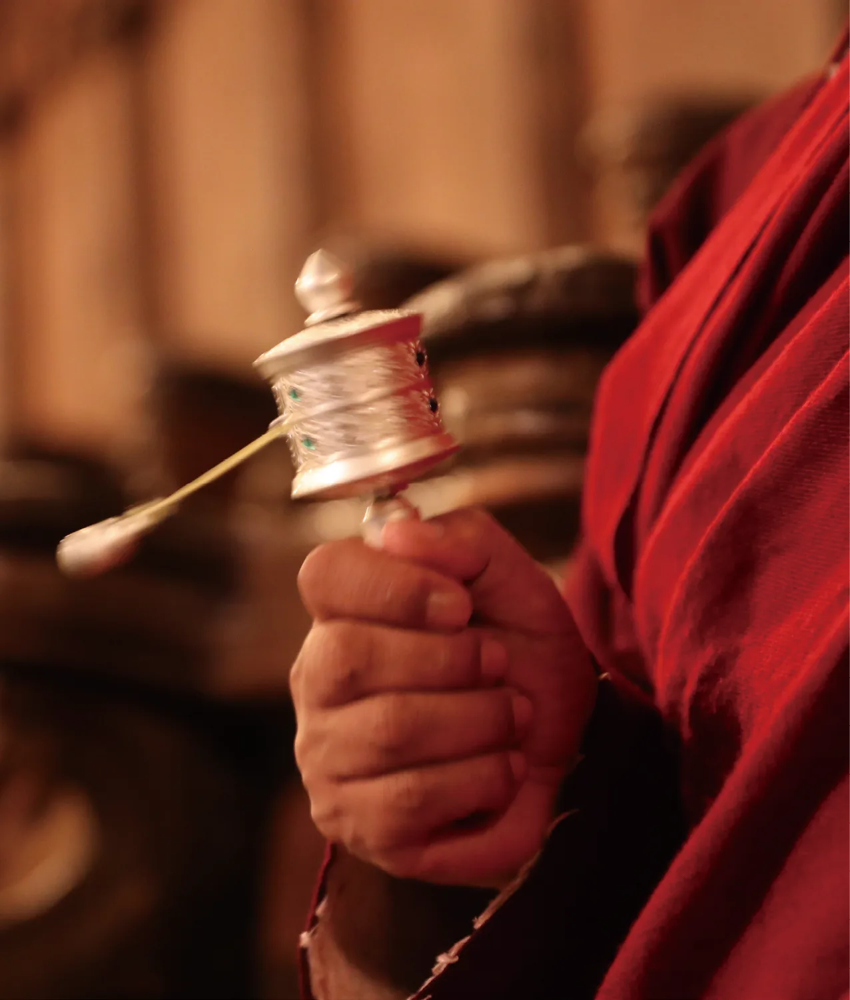

# 修行贵在根本

——长春般若寺新殿开示

今天我们在长春般若寺新殿聚集，这是一个非常殊胜的因缘，我非常高兴能够利用这个机会与大家交流。刚才成刚老法师给大家讲了很多佛法方面的甚深教言，作为佛弟子来说，这些教言十分珍贵。

我原本没有在这里开示的计划，前天准备在长春放生，顺便慕名来朝拜般若寺，后应在座各位法师与僧众的要求，才有这个机会和大家交流一些心得。佛法浩如烟海，短时间内不可能讲得面面俱到，我今天主要想与大家分享一些关于藏传佛教与汉传佛教之间关系的思考。

我想交流这个话题的缘起是什么呢？现在汉传佛教比较兴盛，在全国范围内寺院众多，甚至有些寺院建得金碧辉煌，也有不少寺院重视闻思修行。同样，藏传佛教也算是比较兴盛的时期，在弘扬佛法方面也有一定基础，在这样的背景下，我们非常有必要互相交流。

## 显密殊途同归

自古以来，藏传佛教与汉传佛教由于语言、地域和环境的差异，互相了解的机会有限，有时甚至存在排斥、误解，甚至诽谤现象。因此，作为佛教徒，我们有责任将释迦牟尼佛的各教派精神融为一体，营造和谐、健康的佛教氛围。这不仅是对佛法的尊重，也是所有修行人的责任。

当然，大多数修行人都修得非常圆满，无论是出家人还是在家人。然而，有个别修行人可能只认可部分佛法，见解不太圆融。这个时代非常开放，作为佛教徒，我们应该在传统、原始的佛教理念的基础上，互相学习、互相了解，使藏传佛教和汉传佛教的所有佛教徒更加和合，这对于佛法的传承和共同促进佛教的健康发展非常重要。

因此，这次我来汉地放生的同时，也想拜访汉传佛教的一些高僧大德，向他们请教，在与他们的交流中，我受益匪浅。我认为，虽然我们佛教徒人数不多，但我们应该发起广大的菩提心。

在般若寺，我有机会与诸高僧大德以及同行道友们进行交流，我感到非常高兴。我并非以给大家开示为由，借机获得名声与地位，而是想抛砖引玉，促进藏汉佛教之间更多的交流与互动。作为佛教徒，学习至关重要，一些藏传佛教的出家人，仍然坚持老观念，排斥汉传佛教；而部分汉传佛教徒对密宗也有所排斥。无论是客观原因还是主观原因，我们都应该互相了解、互相学习。

在东北三省，佛教徒数量众多，大多数人信奉显宗，也有一些人信奉密宗。近年来，密宗的弟子也逐渐增多。然而，密宗弟子和显宗弟子之间存在不少隔阂，个别显宗弟子看不惯密宗的做法，一些密宗弟子也无法理解显宗的修行方式。这种分歧使弘扬佛法、利益众生变得困难。首先，我们作为佛教徒，尤其是出家人，应当在高僧大德们的带领下认识到，汉传与藏传佛教并非相违，而是互补，彼此之间应有更多的理解与宽容。

正如老法师刚才提到的，他已经学习了《修心八颂》、《三主要道论》和《放生功德文》等，其实这是高僧大德为显宗弟子做一种榜样的示现。密宗弟子也同样需要学习显宗教法，有些人学密以后，就对显宗的教法嗤之以鼻，将其抛之脑后，觉得不需要修持显宗，我认为这样的行为只是自欺欺人。

我希望密宗弟子不要放弃显宗的日常课诵及参禅、念佛等修行；显宗弟子如果愿意学习密法当然很好，佛法广大无边，可以广学多闻；若暂时不愿学习，也请不要诽谤密宗教法。密宗的义理深奥微妙，绝非以凡夫有限的眼光与智慧就能完全评断。

因此，我认为我们必须从根本上了解佛教各宗各派本无相违、显密圆融，这是十分重要的。唯有广学多闻，才能增长自己的智慧，这是我要讲的第一点。

同时，作为修行人，平日应当多行持善法。如今有些修行人自己并未真正用功，却时常谈论他人过失，尤其在家弟子，更容易议论显宗师父、密宗上师的种种是非，我希望大家不要这样做。出家人是极为严厉的对境，在家人若日日讨论出家人的过失，在出家人之间传播是非，实属堕落地狱之因。出家师父弘扬佛法时各有方便，我们佛弟子对一切高僧大德和出家人，都应以清净心看待。

当下世间常出现这样的现象：某弟子诽谤另一位上师的弟子，对方又诽谤别人，如此互相毁谤，这在汉地尤为普遍。我认为这是十分不好的风气，大家应谨慎防范，不善的行为要及时制止，善法要努力修学。

今天我们能在如此殊胜的因缘中相聚，更应互相增进了解。佛法从来不是停留在口头，而贵在调伏自相续中的烦恼。若能真调伏自心，则对他人过失的谈论，以及人与人之间的争执，自然消失无迹。无论你身披出家衣、持着皈依证多久，若内心烦恼未除，贪嗔痴慢嫉毫未减损，反而增长，那就只是形象上的修行人，而非真正名副其实的修行人。

当然，我自己也是烦恼深重的凡夫，坐在讲台上说这些本来就感惭愧，非常不应理，所以我一边忏悔，一边想在末法时代提醒大家：佛弟子一定要把所有高僧大德、出家人，视为皈依与祈祷的清净对境，如此佛法才能兴盛。

大家应当明白，藏传佛教与汉传佛教都是释迦牟尼佛的教法，《大藏经》中既有显宗经典，也有密宗续部，若只学其中一部分，而忽略另一部分，只能算部分了解；如果我们只学密宗，不学显宗，也是不圆满的。

因此，我希望显宗弟子也应该好好地学习密法，密宗弟子也不必放弃显宗的课诵，以及念佛、参禅等修行，这些对自己只有利而无害。历史上真正有成就的高僧大德，从不排斥任何宗派，他们心量广大如虚空，能接纳和包容各宗各派。而心量狭窄的人，由于对佛法的片面理解，很难圆融地行持。

在座的四众道友与此寺院有缘，刚才老法师也说到，这里讲堂修得如此庄严，这是为弘扬佛法而建造，将来寺院有讲经说法时，希望大家都能来听经闻法。五明佛学院路途遥远，且海拔高、氧气稀薄，去那里或许有困难。但只要你心清净，哪里有佛教道场，哪里就是清净的修行处；若心不清净，即使到了学院，也会将所有的高僧大德看成坏人，将学院看成是不清净的道场。修行不好的人，无论到哪里，眼前所见都不清净。

正如古大德所说：成就者眼中，一切众生皆是佛；凡夫眼中，一切众生皆是凡夫。这句教言对我们极具价值。

因此，无论显宗弟子还是密宗弟子，都不必互相排斥，这只会损害佛教，没有利益。法王如意宝创建五明佛学院二十余年来，从不分宗派，无论是汉传佛教，还是藏传中的格鲁、宁玛等十二教派，不管哪个教派的高僧大德来学院，我们都欢迎；不论是学密宗的弟子，还是学汉传净土、禅宗、天台等宗派，只要真正是释迦牟尼佛弟子，学院都敞开大门。正因如此，学院佛法事业广大，弟子众多。希望大家不要把眼光局限在狭小范围内，所有的佛法都非常不可思议。

在这个道场，从前法师为大家讲过《无量寿经》《金刚经》《弥勒经》等，末法时代，真正讲经说法、闻思修行的道场极少，许多地方殿堂虽然宏伟，却缺乏讲经说法。真正的教法与证法不在外在建筑上，而在道场中是否有讲经说法，我们心中是否生起慈悲心、菩提心等。

## 吃素放生

我们发了菩提心的人，必须直接或间接利益众生。利益众生的方式很多，而放生是极为重要的一种，它能使众生得闻佛号，暂离苦道，乃至获得究竟解脱。因此，希望无论显宗弟子还是密宗弟子，都应积极参加放生，放生的功德相当大。而且，希望大家也能亲自参与放生，因为若只是心中随喜，未亲身投入，就难以真正体会到当众生面临被杀时，有人及时救护所带来的那种由衷喜悦。因此，放生非常重要，这里特别向大家再次强调。

另一方面，一边放生一边吃肉，这不是很好。由于历史渊源和多种因素，藏传佛教中出家人食肉的现象较为普遍，但我们不应因此认为整个藏传佛教都不如法。释迦牟尼佛所制定的戒律行为中，凡夫人很难全部做到。然而，凡是已经发起菩提心的行者，不吃众生血肉，这是极其重要的。

在五明佛学院，所有汉族弟子必须素食，僧众供斋也全部采用素食。希望今后所有佛教徒都能延续汉传佛教自梁武帝以来出家人必须吃素的优良传统。有人说“我的上师开许我吃肉”“上师吃肉，我也可以吃”，这对于境界较低的我们来说并不恰当。虽然历史上确有大成就者的特殊行迹，如印度那若巴尊者曾食活鱼，汉地济公和尚亦有食肉的记载，但这些不可作为我们放逸的理由，更不能认为自己已经和成就者们达到同等境界。我们应尽力持守清净戒律，尤其是已发大乘菩提心的人，更应避免食肉，食肉既不利于众生，也不利于自身健康。

现在有些居士认为：“我吃素身体撑不住，不吃肉不行。”我认为这是一种邪见。汉地所有出家人长期茹素，身体依然康健。汉传佛教中如虚云老和尚等许多高僧大德、大居士，终身素食，最后活了多少岁，这是众所周知的。而如今许多人纵情享用众生血肉，反而寿命短促。从科学、医学的角度来看，食肉对人体健康确有诸多危害。许多疾病、癌症、体内毒素，很大程度上由肉食引发；动物的血肉中含有各种病源，摄入体内必然损害健康。

因此，无论从世间角度还是出世间角度，素食皆大有利益。世间而言，吃素有益健康；出世间而言，《楞严经》《涅槃经》等大乘经典中佛陀对此早已开示明白。作为佛弟子，不能以“上师开许”为借口而吃肉，任何一位上师都没有开许弟子造恶的资格。至于某些高僧大德的特殊行持，我们没有必要诽谤，也不必妄加评论，他们的行为或许具有不可思议的境界，我们应以清净心对待，不造口业。

总之，希望大家以素食为主，这很重要。这是我今天要强调的第二点。

## 稳重自持

第三件事情，作为僧众，我们一定要在寺院里专心闻思修行、坐禅、念佛，不要整天东奔西跑，这是毫无意义的。我昨天听说，这里的有些僧人已经在这个道场安住二十多年，这让我非常高兴。作为修行人，能够在一个道场安心修行是非常重要的，若今天去这个道场，明天去那个道场，今天拜这位上师，明天拜那位上师，修行就不会稳固，修法也不可能成功。

无论你学哪一派法门，如天台宗或禅宗，都应该终身专修，不必频繁更换。作为寺院里的修行人，应当致力于弘扬本寺的法脉，从这一角度来考虑问题。现在是末法时代，有些出家人四处奔走，今天去这个寺院，明天去那个寺院；有些居士也是如此，今天听某位上师讲法，明天又去随另一位活佛修法，如果没有缘分依止，还可能心生诽谤，这都是不必要的。在密宗中，选择依止上师之前需要经过长期观察，包括其戒律、智慧、行为，以及对弘法利生事业的态度，只有经过充分观察后，才能在其面前听法，一旦依止后就不应诽谤。这是藏传佛教与汉传佛教都应共同遵循的原则。

有些居士今天学净土宗，明天学禅宗，后天又学格鲁派，然后又学宁玛巴……释迦牟尼佛的法门浩如烟海，人生短短几十年，今天修一法，明天又改修另一法，所学修的法门换来换去，修行无法稳固，很难有所成就。若能专修念佛一法，对治自心的烦恼，即使不学密宗也能获得成就。

尤其是在座的道友，有些人可能认为密宗特别殊胜，便急于修学密宗，但若没有坚定信心和稳定基础，是无法得到利益的。刚才老法师也讲了，宗喀巴大师在《三主要道论》中总结了佛法修行的核心——出离心、菩提心和无二智慧，这是汉传佛教和藏传佛教都可以修行的。

不论修任何法门，若缺乏菩提心，出家只是为了自己的利益，修行也只是为了自己的利益，这样无法成就大乘果位。如果具足了离开三界轮回的出离心，那我们就不会仅仅希求平安、健康、发财等今生的世间利益。

因此，我们需要深刻反思自己的发心，我们要发愿为了利益一切众生而念佛、往生。只为了自己往生极乐世界享受幸福，这是小乘的发心；若修无上密法也只是为了自己获得成就，也仍属于小乘发心，因为你没有想过无边无际的众生，没有以大乘菩提心摄持。现在，汉地一些大寺院举行法会时，常有数百人参加，但大多数人仅仅只是为了今生获得健康、财富、快乐、顺利和平安，那这种发心连小乘都算不上，只能算是世间发心。

阿底峡尊者曾说，大乘与小乘以是否具足菩提心来区分，而非修行的智慧或其他因素。大家应该清楚，菩提心，就是愿所有众生都能成就无上佛果。我们修行的目的应是为了众生，无论是念佛、参禅、修密法，还是放生，都是为了利益众生。如果我们具备这样的发心，不论他人如何评价我们的修行，我们都已成为真正的大乘修行人。

今天老法师讲了，《三主要道论》中所强调的首先是出离心，其次是菩提心，最后是无二的智慧。无二的智慧就是在《中观根本慧论》《入中论》等论典中讲到的中观空性的见解，如果没有真正的空性见解，我们可能会执著于单空，这是不究竟的。那么，如何生起无二智慧呢？我们必须深入地、长期地闻思中观理论，才能真正理解这些道理，我在这里不广说。

总的来说，我希望大家今后都能尽心尽力地弘扬佛法。弘法的方式有很多，尤其是在末法时代，许多众生尚未皈依佛门。我们每个人都可以引导身边的人皈依佛门，我觉得这是真正的弘法利生。许多人认为，只有法师站在讲台上讲法才是弘法利生，但我认为，弘法利生每个普通人都可以做到。比如，可以让我们的家人、亲戚朋友皈依佛门、发菩提心。这也是真实的弘法利生。

我们佛学院开法会时，有不少新的皈依佛门的朋友，在座的各位，你们在开法会时，带一个人过来，让他皈依佛门，我觉得这就是弘法利生。因为众生非常可怜，现今社会竞争越来越激烈，尤其在经济快速发展的背景下，人的内心越来越贫乏，痛苦越来越增上，只有佛法能为他们带来真正的安乐。如果这些众生在今生皈依佛门，对他们今生来世的利益是无法估量的。因此，弘法利生并不一定需要其他许多形式，平时多放生，在开法会时引导有缘众生皈依佛门，这样功德非常大。

今天我给大家简单讲了几点，一是希望大家尽量吃素，二是不要杀害任何众生。杀生的过失相当大，龙猛菩萨在《大智度论》中明确指出，在所有有漏罪业中，杀生的罪业最大；在所有功德中。放生的功德最大。我们应当遵循这一教诲，不杀害任何众生，在此基础上吃素并精进修学佛法。人身非常难得，在短暂的人生中，修行佛法十分重要。

今天，我为显宗密宗弟子传授《心经》的传承，因为藏传佛教的《大藏经》传承从未间断，而且很多人都常念《般若波罗蜜多心经》。另外，我会为一些密宗弟子传授五加行修法的传承。由于时间有限，我们还将参加放生活动，因此我无法详细讲解，佛法的深奥和广博无法在短短一两个小时内讲完，今天的讲座只是为创造一个缘起。

般若寺即将举行法会，我们这么多人在此聚集，或许会给他们造成一些打扰，我的内心确实过意不去。因此，希望我们今天上午的课结束之后，在座的弟子们能够主动帮助寺院打扫一下卫生，做一些力所能及的事。

同时，我也想说，今后显宗与密宗修行人之间应该更加团结和合。我们这边的密宗弟子数量也很多，我原本没想到会有这么多。今天可能仍有不少人没能听到课程，但这也是难以避免的，不过相信外面通过扩音设备，也应该能听得到。无论是在里面听还是在外面听，从得传承方面来说并无差别，希望大家不要因此心生不悦。我们已经尽最大努力来满足大家的需求，在人数如此之多的情况下，这对我们也是一件很不容易的事，我们已经尽己所能来为大家传授佛法。

我也非常感谢般若寺为我们提供这样一个殊胜的道场，否则，很多以前在学院见过面的密宗弟子，此次也未必能有机会相见。况且我也是第一次来到吉林，对这里的生活习惯、环境、气候等都不熟悉。虽然我只是一个普通的出家人，无论到哪里放生、旅游，都是我的信仰自由；但因为人数众多，治安方面有时也难免会有一些问题，我自己也十分小心谨慎。

我们作为佛教徒，在佛教道场里做这样的交流是十分合理的。我所讲的法是释迦牟尼佛的法，大家修行的法门也是释迦牟尼佛所教导的。除此之外，我们并无任何别的目的，我个人也没有任何其他的意图，只愿在座所有同行的道友，都能得到佛法甘露，获得暂时与究竟的安乐，除此之外，再无他求。

等会儿下课之后，希望大家按照寺院刚才宣布的要求，保持秩序，不要喧哗，不要拥挤，安静地离开。今天下课后，我也不单独接见任何人，因为那样要耗费很多时间。我们已经见过面，我也给大家传了法，大家应该满足。并且，今天我不接受任何供养，希望大家不要递哈达、不要给钱。如果确实想做善行，可以把供养交给般若寺，由他们统一用于放生，他们每年都在做放生，这也是我最欢喜的事情。

除此之外，我个人并不缺什么，你们若给我供养，我也难以回报，也没有必要，经济上的往来容易引起误解。如今社会上有人以化缘为名做种种事情，这到底对佛教是利是弊很难说，也容易让人产生邪见，我们应当以清净的佛法进行交流。所以，希望大家今天不要对我做任何供养，如果你确实诚心供养，就把钱交给般若寺用于放生即可。这是第三件事。

## 法供养最

第四件事，我今天为大家做一个法供养，也希望你们以法供养来回馈。如何回馈呢？大家回去后好好地精进修行，按照经论教义中的指引，诚心念佛、认真参禅、精勤修学、踏实完成五加行，这才是真正第一等的供养。所谓“诸供养中，法供养最”，所有物质供养都不如法供养重要，大家应该明白。

所以，等会儿下课时，请大家不要做任何财物供养，摸顶、合影等情况，今天也一律谢绝，这些都不是最有意义的事情。真正重要的，是你们的心相续中能否生起出离心、菩提心。菩提心若未生起，无论是修学汉传还是藏传佛教，都不能算真正的大乘修行人。一个人是不是大乘行者，不在于外表，不在于别人怎么认为，而在于自己是否发起真正利益众生的菩提心，如果没有菩提心，即使看上去像修行人，实际也不是大乘行者。

大家应当把全部精力放在修行上，努力在自己的心相续中生起菩提心。寺院里的出家师父们辛苦为大家提供修行道场、苦口婆心地讲法，也不过是希望你们能在心中真实生起菩提心，除此之外再没有别的目的。

今天课程结束后，请大家保持秩序。寺院明天还要举行法会，人多事情也多，诸位请务必听从寺院的安排。学习密宗的人也不要因为学了密宗就表现得太自我、太放纵，自认为了不起是没有意义的，要观察自己有没有出离心、菩提心，若没有这些，即使说自己学密宗，也不是真正的密宗行者，甚至连小乘行者都算不上。

所以，请大家一定要积极配合寺院管理。今天寺院的法师确实非常忙，我看到他们奔波劳累很不忍心，但有时条件所限，也确实没有办法，希望大家理解和配合。

虽然我们今天相聚的时间很短，我此行也只是在寺院住两晚而已，但从佛法交流的意义来看，这十分具有价值。至少，我们彼此之间能减少误解、增进了解，这也是我此行的目的，我相信寺院许多高僧大德也抱有同样的愿望。

最后，我为大家念诵《心经》的藏文传承，并为大家传授五加行修法的传承。念诵大概需要两三分钟。至此，我们今天上午的交流就圆满了。

愿诸位高僧大德长久住世、长转法轮，愿所有信众精进修行、早证菩提。谢谢大家！
