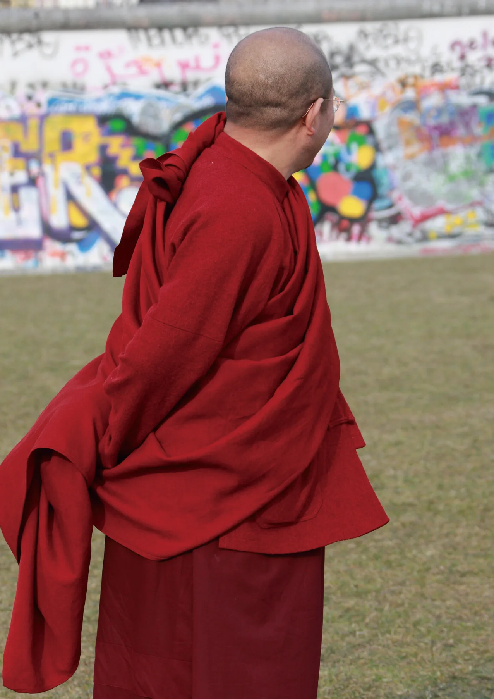

# 在特殊环境中守护佛法

——甘肃兰州开示

各位法师、各位居士，今天大家能在这里聚会，是一个非常殊胜的因缘。我本人此前来过一次，但当时时间比较匆忙；今天是第二次，上午我们在河边放生，大家都感到非常圆满、殊胜。下午，我借此短暂的时间，给大家做一个简要的开示。

我今天所讲的内容会比较简单，在座大多数都是菩提学会的居士，平日里已经学习了很多大乘佛法的道理，基本的佛理大家都能理解，所以我没有必要在这里作广泛的讲解。同时，也有少数兰州的居士和法师。作为一名佛教徒，今天来到这里，我感受到大家对佛教的信心和恭敬心，这非常值得赞叹。如果没有恭敬心和信心，佛的加持、证悟、智慧与大悲等功德，凡夫是很难获得的。所以，我觉得大家对佛法的这种热情和虔诚是非常宝贵的。

今天在座的很多人，我以前也经常见到。许多居士曾不远千里来到我们佛学院，甚至在法王在世时，就与我们有过殊胜的因缘。我个人记忆中，有相当一部分兰州的居士曾长时间在我们学院学习，也有个别法师是如此。当然，也有部分朋友是今天第一次见面。不管怎样，大家今天的聚会，本身就是一种殊胜的佛缘。大家因为对佛教的信心和恭敬而汇聚在一起，这种因缘应当倍加珍惜。

今天，我想顺便简要阐述一下显宗与密宗如何双运与圆融。这个道场本身就是显密融通的殊胜道场，我也非常希望在座的兰州居士，今后在这方面多加努力。当然，道场的负责人们也非常尽心尽力。作为佛教徒，我们应当为佛法和众生尽一份力，这一点非常重要。这里的高僧大德以及虔诚居士们，为佛教事业付出了巨大心力，排除万难，不计个人得失。对于大乘佛教而言，这是极为必要的。

我们的前辈高僧大德，为佛法甚至可以付出自己宝贵的生命，我们后学者也应将智慧与能力尽心尽力地运用在利益众生的事业上。在座各位，不论将来身处何地，只要对众生有利益，对佛教的兴盛发展有贡献，都应当奋发努力。这正是大乘佛教的宗旨——精进不息。

我认为，在座各位对佛法的学习都非常认真，也取得了不错的成绩。我希望大家不要仅停留在表面信仰或浅显理解上。现在有些人，对佛理毫无理解，只是办一张皈依证，就认为自己是佛教徒，这显然不够。刚才在车上，有些居士谈到，非常希望很多人能够通过学习理解佛理，清楚显宗与密宗互不相违，应当互相包容，而不应互相排斥。毕竟，显密教法都是释迦牟尼佛传下来的殊胜教法。

大家所在的地区比较特殊，有一些信仰其他宗教的少数民族，弘法可能存在一定困难。但佛教徒之间应当融洽相处，不应有矛盾与隔阂。藏传与汉传佛教各门各派的高僧大德们，都传下了殊胜的法脉，无论我们从哪个传承学习佛法，都不会违背正法。比如在这个道场中，只要是具有法相的显宗法师或密宗上师都可以弘扬佛法，我们应当以包容、宽容的心态相待，只有这样，佛教才有发展的空间，若自我局限，佛法将无法广布。

大家在今后学习与弘法的过程中，一定要以清净心对待所有高僧大德，对释迦牟尼佛的教法怀有恭敬心，唯有如此，我们才能真正成为修行人。

我看到在座兰州居士中，很多人的学识水平较高，有大学生、研究生等，该如何取舍，有智慧的人应该会懂。老年菩萨虽然文化知识有限，但对佛教的虔诚心和恭敬心无与伦比。我们佛教团体能够和睦共处、彼此尊重，这是非常必要的。

现在，大家都在学习佛法，我个人认为，学习《入菩萨行论》对我们当前的修学而言，实在是至关重要的一件事。大家都知道，平日里我不常出门，面对面与大家交流的时间与精力也是有限的。今天，虽然有很多道友希望我能留下来，晚上留宿兰州，但我觉得这并不重要。即便晚上留宿，和那么多居士交流也会有一些困难，毕竟时间有限，最重要的还是你们要继续学习佛法。

现在，我们投入了大量的精力、人力和财力，推广《入菩萨行论》的教义，许多学员通过学习《入菩萨行论》，从中领悟了自己以前未曾理解的佛教道理。之前大家可能不知道该如何修行，不知道如何实践，但通过这部论典的学习，大家基本上已经明白了大乘佛法的修行方法，如果我们继续深入学习，见识和智慧也会不断增长。

因此，我在这里再次希望那些尚未报名的道友，能尽快报名参加正式的学习。虽然偶尔听一听、学一学也是好事，但没有学习的压力，进展可能会较慢。

不要说住在这样的大城市，事实上，我住在山上的时候，我自己也制定了一些目标，例如不间断地讲经说法，如果不这样，即使住在寂静的山上，心依然会被分别念和生活中的琐事所干扰，没有时间修行。

你们生活在这样的大城市，外界散乱的因缘更多，如果自己没有设定学习的压力，恐怕真正的佛法智慧也很难获得。就我个人而言，大家学习佛法与否对我并没有直接影响，即使你们这里有几千人学习《入菩萨行论》，对我来说无利无害，但对于你们个人而言，通过这种因缘来了解佛法，应该是最好的途径。今天我特别奉劝大家学习这部论典，它对你们相续的转变一定会有所帮助。

这并不是说我讲得多好，而是因为藏传佛教中包括《入菩萨行论》在内的大乘论典所蕴含的教义是极其殊胜的。不论你是学识渊博还是一无所知，只要有信心，能接触到这样的教法，相续一定会发生转变，这是毫无疑问的。自古以来，成千上万的高僧大德和成就者，正是通过这些佛法的学习和研究，最终获得了殊胜的果位。

我知道，在座的佛教徒们都信心满满，但仅有信心是不够的，我们还需要智慧。光凭上师的加持或依靠某些外力开悟，在末法时代的凡夫众生身上难度极大，大家必须自身努力。我们许多人在世间法中精进不懈，白天黑夜披星戴月地辛勤劳作，追求世俗的成就，但我们是否曾问自己：在一整天的24小时里，我们究竟花了多少时间用来修行佛法？

今天，我特别提醒大家，在学习佛法上一定不能松懈，不能懈怠。大城市里散乱的因太多，环境比较复杂，若继续散漫下去，不到两三年，你们的心性可能会被外界染污得一塌糊涂，到时再后悔已经为时过晚。

我们开展佛法学习的时间虽然只有一年多，但效果应该算是相当不错的。一些居士虽然皈依佛教已有十几年，但过去一直对佛教的真理感到懵懵懂懂、模糊不清，对佛教的教义没有深入的理解。然而，经过一段时间的学习，他们已经逐渐有所领悟，只要不断地坚持学习，当然会不断进步。

今天，我看了一下你们兰州的居士人数及前段时间考试的情况，综合来看，与其他一些大城市相比，整体水平还是稍显不足，其他地方仅获奖的人数就远超过兰州市的总人数。你们的学习状态不太理想，很多人对待集体学习的态度是想来就来，不想来就不来，这种情况在这里比较普遍。而在其他一些地方，大家将学习佛法视为生活中最重要的一部分，全身心投入其中。与这些地方相比，你们的学习状况还是有所欠缺，但如果与一些相对落后的地方相比，情况又算是不错的。

这次我的时间较短，主要是给大家敲响警钟，希望大家不要再像以前那样散乱。现在，许多人通过学习已经理解了很多佛理，跟我第一次来兰州时相比，大家对佛法的认知有了明显进步，许多人谈话时所讲的内容和话题，已经与佛教更为契合。其实，佛教徒如果不懂佛法的道理，是非常令人遗憾的，不仅自己会觉得很可惜，别人看了也会有同样的感觉。但我相信，在座的各位在很多方面都有所进步。

今天我主要讲了两点内容：第一，我希望大家继续深入学习佛教经论；第二，我们知道，兰州这个地方少数民族较多，某些宗教信仰的教义与佛教的理念完全相反，甚至提倡杀生。在这种环境下，我们佛教徒应坚持自己的信仰，以慈悲心和悲悯心对待一切众生，这一点非常重要。

在藏地，九成以上的人都信仰佛教，且没有其他宗教的强大影响。但在你们这里，除佛教外，其他宗教势力较为强盛，加之许多人从小接受唯物主义教育，导致内心对轮回、业因果、前世后世等佛教核心教义有疑惑和怀疑，这种疑虑，直接或间接地影响了我们的信心。因此，在学习佛法的过程中，一定要保护好自己难得的见解，不要让这些怀疑影响到你们对佛法的理解和实践。

我注意到很多居士在积极发心放生，这非常值得赞叹，我在学院就听说，你们每个月都有居士持续进行放生活动。作为佛教徒，我们应该多行持这种有意义的善行，同时，还要帮助周围的可怜众生，特别是对于那些遇到违缘或困难的菩提学会的道友，我们应该主动伸出援手，让身边更多不信佛教的人慢慢信仰佛教。

现在，学佛的机会非常难得，尤其是在大城市里。佛教徒应当意识到，在茫茫的轮回苦海中，能够学习佛法的暇满人身非常珍贵，如果我们错过了今生，将来死后可能会堕入三恶道，经历极大的痛苦。大家不妨想一想，我们平时一天不吃不喝就会感到极大的痛苦，如果我们转生为饿鬼，或是在地狱中受苦，那种痛苦将是如何？我是否种下过三恶趣的因？决定有，这是释迦牟尼佛说的，佛陀的语言千真万确。所以，我们每个人都应该认真思考这一点，并深信因果。

这些道理，我相信大家在光碟中听得比较多，我在这里就不再详细展开了。我了解到，今天有些人想皈依三宝，因此我想为大家做个简单的皈依。

我们中的一些人以往可能皈依过三宝，当时可能是为了自己解脱病魔，或是为了升官发财、家庭平安、工作顺利等现世利益。而今天，大家在皈依三宝时，应该抱着更广阔的心态——不是为了自己的个人利益，而是为了天下无边的一切众生，令他们获得暂时与究竟利益，我们每个人在皈依时，都应当这样观想。

接下来，请大家随我一起念诵皈依偈……

现场互动

接下来，还有十几分钟时间，大家可以提出一些佛教方面的问题，我会尽量回答。现场互动环节结束后，如果有需要，我会根据情况做一些分享，然后再给大家念《佛子行三十七颂》的传承——前段时间我刚在学院讲过，这个藏文的传承还没在其他地方念过。

《佛子行三十七颂》是由无著菩萨所撰著，无论是谁听到这部论典的声音，都可以令其心相续中的菩提心逐渐增上。我以前在法王如意宝面前听过很多次《佛子行》的传承，今天我看到在座的各位对大乘菩提心都有坚定的信心，所以我也想借此机会，把《佛子行》的传承供养给大家。

念传承大约需要七到八分钟。在此之前，如果大家有佛教方面的疑问，可以提出来，我们共同讨论，提问时可以站起来。

⊙ 问：学习《广论》和《入行论》与念佛法门是什么关系？

堪布：大家应该明白，念佛法门无论在藏传还是汉传佛教中，都是一种简便易行、容易成就的法门。然而，如果光是念佛，没有深入理解佛教的道理，可能一边念佛一边造业。我见过很多老居士，他们口头上念“南无阿弥陀佛”，但嗔恨心很重，贪心也很强，整天议论是非，毫无安忍心，说这个人过失，那个道友的不是，整日纠结于是非之事。这样即便念佛，暂时也难以改变其性格，甚至连世间的高尚品格都没有。我们通过学习这些论典，逐渐理解佛教的教义，修持安忍心与慈悲心，避免诽谤佛法与道友，这些都能逐步改善我们的行为与内心。

如果缺乏系统的闻思修行，不光是年轻人，连老居士念佛往生也困难。为什么呢？《无量寿经》中已经明确讲到，如果诽谤佛法、造下五无间罪，是无法往生的。然而，一些居士根本不了解什么是诽谤佛法，今天说藏传佛教有过失，明天说密宗有问题，后天又诋毁其他宗派。我觉得在一些净土宗的道场，非常需要佛教的开示，没有真正闻思佛法，很难真正懂得佛教的精髓。我们既要提倡念佛，也要提倡闻思，老年人通过学习佛法后，一定会在自相续中有所改变。

第二个问题是，只要有信心、虔诚心和恭敬心，学习佛法一定会改变我们的相续，这是肯定的，只是这个改变并非一蹴而就。大家都知道，我们从小学到中学，再到大学，经过多年教育，水平逐渐提高。同理，佛法的学习也需要从一点一滴的积累开始，经过长期的闻思修行，心相续必定会发生变化。

受过佛教教育的人和从未受过佛教教育的人，性格与行为是完全不同的。有些居士学佛法，可能学了一两年，觉得已经足够了，但其实这种短期的学习远远不够，必须长期闻思修行，每天听法、学习佛法，渐渐地，心相续必定会发生变化。

我看到一些居士，拿着念珠、转经轮，平时也会多看光碟，经过一段时间，他们的性格已经和以前完全不同了，这就是改变。如果没有这样的学习，根本不可能改变。所以，佛法的学习需要有长期的规划，只有这样，未来我们的相续才会真正发生变化。

⊙ 问：如何克服学习佛法过程中有时不想学的懈怠心态？

堪布：有时自己可能不太想学习，如果我们有集体学习的机会，在其他道友面前会产生一种惭愧心。看到大家都在学习，如果我不去就会觉得不好意思。因此，对于我们凡夫人来说，一方面需要有自发的动力，另一方面也必须依赖外界的激励。如果没有外力的支持，除了极少数高僧大德能够完全自觉，真的很难坚持。我们有时想学、有时又不想学，这对凡夫人来说是正常的。

在学院的时候，我发现如果没有给自己设定一个比较坚定的任务——讲经或者做其他事情，单靠自我约束是很难坚持下去的。经过二十多年的闻思修学，我得出了一个结论：光靠自己学习佛法确实比较困难。比如说，我今天早上七点钟起床，但明天可能八点钟，后天又不一定能按时起。如果我们有一个共同学习的环境，就像你们上班一样，有时你可能不想去上班，但时间一到，你必须去。在这样的外力推动下，才能坚持闻思修行。

⊙ 问：作为在家居士，应该如何兼顾修行和工作？

堪布：这位大学教授结合自己对自然科学和社会科学的理解，与佛教理论相结合进行研究，我觉得这是非常必要的。一般来说，无论是自然科学还是社会科学，它们的研究对象都是外在的物质。我自己以前一直困惑，为什么现代科学家很少对人类内心的奥秘、生老病死这些根本问题有所阐述。

出家前，我对自然科学非常感兴趣，也曾研究过一段时间，但最终发现，在自然科学里很难找到答案和方向。学习佛法后，我才发现真正的方向。佛教不仅对自然科学和社会科学的某些现象有深入的分析和理解，更重要的是，它对人类前所未有的领域——心灵的奥妙，具有独到的阐述和研究。现在很多高等学府的老师、教授，通过学习佛法后，对世间的认知和对真理的认同确实发生了深刻的转变。

关于在家居士如何兼顾修行和工作的问题，我是这样理解的：作为在家人，你当然要承担工作和家庭的责任，不可能像出家人那样完全放下世间事务，去山里或寺院潜心修行，除了有些高僧大德有这种境界外，这在你们现阶段不太现实。你完全可以一边工作、处理家庭事务，一边成为一名虔诚的佛教修行者。

有些做生意的人会担心：“我做生意会不会造恶业？是不是应该出家？”其实不必走极端，也没有必要非要出家。你从事生意或者任何世间工作，只要正当经营、合乎良心，有自己的利润和收入，这是被允许的，佛陀在《毗奈耶经》中阐述过。

有些人误以为，不放弃世间法就学不成佛，其实不能走极端。你可以一边从事工作，同时利用一部分时间学习佛法、研究佛理，经常在心中观想，并向你的传承上师和本尊祈祷，这都是非常重要的修行方法。

⊙ 问：学佛应该先实修还是先闻思？

堪布：实修的问题慢慢看情况，其实闻思时间长一点比较好，《大圆满前行》讲完以后再说，如果觉得自己实修的因缘具足，当然未尝不可。

理论和实际要相结合。大家在学了一些佛教知识后，要尽量把菩提心运用到世间生活中去。做任何事情都要心平气和，这很重要。其实，学与不学佛法的差别是非常大的，现在在东北和南方那一带，有人会说：“这个人性格不好，一定没学过《入行论》。”从一个人的言行举止中，确实可以看出他是否受过佛法的熏陶。

每个人的周围都会有很多不信佛的人，我希望大家以后能够共同学习，用慈悲心去感化身边的人。我有时在大街上看到，很多人每天忙碌奔波，但大多数人只是为了短暂的今生，他们根本不了解来世的存在。

人类表面上看似生活越来越好，我昨天在西宁菩提学会也讲过，十几年前，很多人住平房，现在住高楼；四年前我来兰州时，这里很少人拥有私家车，现在很多人都有了车。物质生活确实有进步，但人心可能越来越贪婪、嗔恨越来越重，每天忙忙碌碌，却迷失了生活的方向。

在这种情况下，我们更需要寻找真理。大家一定要明白：虽然外在物质条件有所进步，但内心可能在退步，这时更要学习佛法，好好地祈祷上师和三宝。你们在座的人能够遇到佛法，真的很幸运。

我个人去过很多国家，尤其是在西方国家时，我看到很多富翁有大量财富、私人飞机等，他们讲的都是这些，但我一点都不羡慕。我羡慕的是真正的修行人，真正闻思修行并对三宝有信心的人，我觉得这些人的人生最有价值。

所以，你们能遇到佛法，是人生中最珍贵、最荣幸的事情，一定要好好珍惜。

今天的开示与现场互动到此圆满，接下来我给大家念诵《佛子行》的传承……
