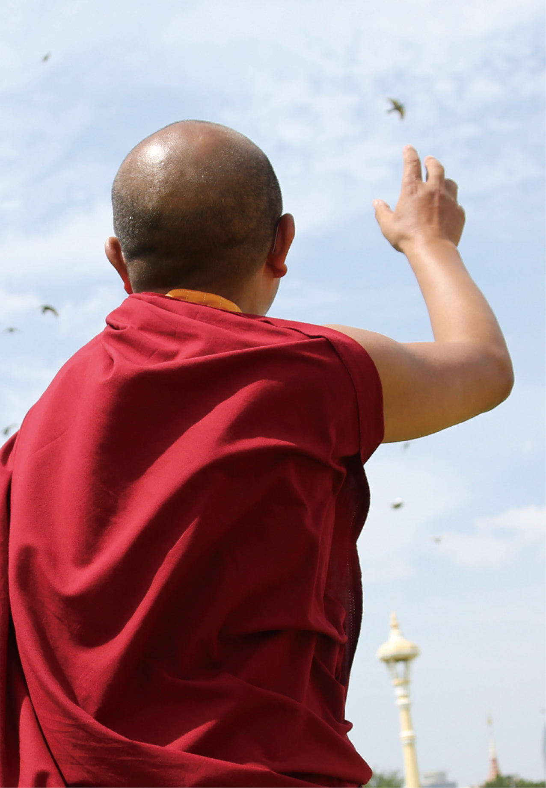

# 大乘佛子的必修课

——长春吉林开示

阿弥陀佛！今天见到各位，我非常高兴，我们能在船上相遇，是一种殊胜的因缘。我们已经多次举行放生，放生的功德无量无边，所以我希望在座的每一位佛教徒，都能从内心深处生起欢喜心。今天我讲的内容不多，希望大家在听的过程中安静下来，不要交谈，稍微坐得挤一些也无妨，在这短暂的时间里全神贯注地聆听。

我今天想说的主要有两个方面。首先，谈谈放生的功德与重要性。今天能顺利举行放生，我作为一名普通出家人，心中非常感恩。对每一位大乘修行人来说，放生不是一般活动，而是最有意义、最具功德的善行之一。无论你修净土宗、禅宗还是藏传佛教，对于发了菩提心的修行人而言，利益众生就是根本。如果缺少利益众生的心，所谓的菩提心也只是纸上谈兵。

在举行放生仪式的过程中，我们念佛、持咒，为这些众生皈依，并用佛经等为它们作加持，佛陀身口意的加持是不可思议的，这在众生的相续中种下了解脱的善根。因此，放生意味着我们暂时解救了遭受痛苦的生命，让它们远离屠刀，并最终有机会离开轮回、证得佛果。以后如果有机会，我们就要多放生。

在座的同行道友，我希望大家今后一定要重视放生，对于我们修行人来说，放生是一件非常重要的事情，放生能够直接利益众生。在放生的过程中我们难免遇到一些违缘和困难，但只要我们愿意参与其中，哪怕辛苦也值得，因为只要我们能够救一条生命，意义就非常重大、深远。今天我们放了许多生命，可能有人还没吃午饭，但作为发了菩提心的大乘修行者，这些辛苦是可以承受的。因为我们都知道，无论是人类还是其他众生，最珍贵的就是生命。除了生命之外，还有什么能与之相比呢？任何众生，当自己的生命受到威胁时，即使付出一切代价，宁愿舍弃财产、地位、名利等，也要尽力活在这个世上。

在我们色达佛学院的慈诚罗珠堪布，他每年都会在成都连续三四个月参与放生。即便有时身体非常辛苦，甚至在做完阑尾手术几天后，他依然坚持每天坐车到一百多公里外放生。医生劝他休息，但堪布说：“哪怕肠子断了，我也要放生，绝不能舍弃。”

我希望大家能够效仿这些具有放生精神的高僧大德。当然，有些佛教徒可能会认为放生只是一种活动，只是出于好奇心而为之，认为这意义不大。但我认为，这是一种短浅的认识。因为在发菩提心、利益众生的过程中，还有比放生更重要的事情吗？我想，根本找不到。真正发了菩提心的人，利益众生是首要的，而仅仅为了自私自利、利益自己，那是最下等的心态。有人可能认为自己修行很重要，为了自己的解脱而参禅、念佛或修法固然重要，但与放生所产生的功德相比，这些功德并非最为殊胜。

在座的各位法师和居士，放生应当怀有长远的发心。哪怕一天、一月只放几条众生的生命，也应持之以恒。当然，众生的根基和意乐不同，有些人认为放生不是最重要的，但龙猛菩萨在《大智度论》中明确指出：所有罪业中杀生为最重，所有功德中放生为第一。放生时，无论我们的心是否清净，都能直接或间接利益众生，作为凡夫人，这就是最重要的事情，希望大家在日常生活中牢记这一点。如果一个人的心相续中缺乏菩提心，即便放生，也难以长期坚持；但若心中真正具备利他的菩提心，即使遇到诽谤或困难，也会坚定不移。

历史上，永明延寿大师出家前曾将国库中的许多财产用于放生，甚至在被判死刑时，他说：“我心甘情愿受刑罚，因为我救了这么多众生，我的一条生命算得了什么？”国王深受感动，最终没有执行死刑。后来，永寿大师出家并获得了大成就。

在藏传佛教中，也有无数大德，一生都致力于护生、放生。对于在家人来说，坚持放生可能有一定困难，但对于出家人、真正的修行者来说，放生绝不是小事。有人可能认为，捐款或随喜即可，其功德虽有，但远不及亲自放生的功德。

在放生的过程中，可能遇到违缘和困难，我们要想办法采取安全、稳妥的方法。有些人说，为这些生命皈依后，再杀掉就可以了，这是一种愚痴的观念。大乘菩萨道中常有“自他交换”的修法，我们可以设身处地思考：如果自己被关在监狱中，被救出来后授予皈依，再被人杀掉，我们愿意吗？所以，我们在放生时，应尽量选择不要让这些众生再被捕杀的地方。

今天我们长途跋涉而来，虽然身体略感辛苦，但内心会获得无比的快乐，这种快乐是难以言表的。作为大乘行者，应将放生置于首位。同时，我们应尽量断肉，保持素食。从总体人数的占比来讲，佛教徒虽然不是多数，但如果所有佛教徒都吃素，这对减少杀生有显著帮助。举例来说，若一千人吃肉，屠宰场每天杀生数量巨大；若一千人吃素，被杀的生命自然减少。这一行为，对于减少杀业意义深远。

汉传佛教历来有良好的吃素传统，这是任何藏传佛教高僧大德都不应忽视的。过去有些学密的弟子以认为藏传佛教徒可以吃肉，从来没有这样的规矩。作为藏传佛教僧人，我虽非特别精通藏传佛教的教义，但我研究藏传佛教多年，知道藏传佛教对肉食有明确立场。大家应沟通理解，不应误以为藏传佛教是吃肉的宗派，也不应因为某些人吃肉就否认其佛教徒的身份。世界上其他国家的有些大乘修行人也有吃肉者，斯里兰卡、泰国等国家的修行人也会吃肉。总之，藏传佛教也提倡素食，无论是密宗弟子还是显宗弟子，都应好好放生和吃素。

关于修行方面，我今天不多赘述，希望大家多看书，我在许多书中都讲到了如何修行，有信心的人可以多学习。在座的长春、吉林的各位居士，不论你依止哪个传承或宗派学习佛法，都应明白一个道理：作为佛教徒，如果内部关系不融洽，利益众生的事业就难以实现。无论出自你哪个上师门下、哪一传承、何种民族，我们都应融洽相处、互相配合，修持各自宗派的法门。只有这样，佛法才能健康发展；若互相对立，矛盾重重，自身的修行就难以深入，弘法利生的事业也很难开展。

这次放生活动，我非常感谢长春般若寺和吉林市佛教协会的支持与帮助，在大家的努力下，我们顺利地放生了这么多条生命，这很有意义。希望大家以后尽力在有生之年利益众生，当然，利益众生的途径有很多，如果我们有能力，放生是非常直接的利益众生的方式。作为修行人，这是我们应当承担的重要责任。

今天因为时间关系，我如果讲得太多，可能会让大家生起厌烦心。总的来说，在座各位高僧大德以及虔诚的居士们的帮助下，我们得以相聚，大家应该都已经感到满足，回去之后，希望大家能够认真修持佛法。

所谓佛法，并不仅仅是形式上办一张皈依证，如果内心没有生起真正的功德和境界，烦恼依旧没有减少，即便身为出家人，理了一个光头，穿了出家僧衣，也只是一个形象上的出家人。真正的出家人，首先要在心的相续中生起出离心，这是小乘佛法最根本的原则——心中不贪执世间一切，把三界轮回视为火坑，这就是出离心。出家人的第一步，必须具足出离心。

如果我们修大乘佛法，还必须在此基础上，生起菩提心，没有菩提心，就不能称为真正的大乘行者。正如藏地闻名遐迩的阿底峡尊者所说，大乘与小乘的区别就在于是否具足菩提心，具足菩提心的是大乘行人；若不具足菩提心，就是小乘行者。

在座的各位，无论学禅宗还是净土宗，应该扪心自问：我是否真正具足利益众生的心？如果整天所作所为全是为了自己——为了我的修行、我的成就……我执太重，根本无法成功。大乘修行的关键就是放下自己、放下我执，这是大乘唯一的窍诀。放下我执的方式有很多：有时以观空性的方式，有时通过利益众生、观菩提心的功德来放下，总之方法多种多样。

无论出家人还是在家人，都应具足出离心与菩提心，然后再具足无二智慧。所谓无二智慧，即《金刚经》中所讲，不堕两边、离四边八戏的空性见。若缺乏空性见，修行恐怕也难以成功，出离心与菩提心也必须以空性见摄持。若离开这三者，无论是修大圆满、大手印还是大威德，只不过是空谈，无法成就。

显宗与密宗的佛教徒应该和合，同时，我希望大家对显宗与密宗持圆融态度，不要认为显密水火不容，这是对佛教的误解。释迦牟尼佛的教法中既有显宗也有密宗，我们作为佛陀的追随者，应圆融理解，融会贯通。这不仅是责任，也是修行的智慧。

现在汉地有些人对显宗过于执著，看到密宗的各种见修行果就认为不合理，甚至一概嗤之以鼻，我认为这是不恰当的行为。释迦牟尼佛的教法如果没有提及密宗，那么只修显宗当然也是可以的，但事实并非如此。大家应该明白，无论是汉文《大藏经》还是藏文《大藏经》，记载的都是释迦牟尼佛的教言，其中既有显宗，也有密宗。我们完全可以用圆融的态度去理解与解释这些教法，这一点没有任何理由不去实践。因此，无论你修学显宗还是密宗，都不应站在其对立面。

我听说东北一些显宗道场中，甚至不能供奉密宗佛像。听到这件事，我感到很遗憾。这不仅显示出一些佛教徒的偏见，也可能说明相关部门对佛教理解不够。实际上，密宗佛像与显宗佛像本质上没有区别，密宗仪轨中也明确指出，所有密宗经典和佛像，都是释迦牟尼佛的示现，是以释迦牟尼佛的语言为依据呈现的。如果我们不承认这一点，就不能称得上真正的释迦牟尼佛的弟子。就像有些小乘佛教徒对大乘佛法完全不接纳一样，作为大乘修行者，我们当然不能有这样的偏执。

当然，藏传佛教与汉传佛教之间曾经存在交流不足的情况，这是可以理解的，过去交通不便、文化交流少、语言障碍大、环境隔绝等因素导致双方沟通有限。但我此行，也是希望拜访一些汉传佛教高僧大德，学习他们的德行，同时分享藏传佛教的教理。如今世界更加开放，我们佛教徒也应有包容的心态，如果觉得合理，应当接受；若不合理、不符合释迦牟尼佛教义，自然可以舍弃。但我坚信，密宗中不存在任何违背释迦牟尼佛教义的观点。

作为佛教徒，我们应持“显密不二”的观点，这对今生与来世都极为重要。如果将显宗与密宗分开，认为显宗殊胜而密宗不殊胜，或密宗殊胜而显宗不殊胜，这样的见解是目光短浅、修行不究竟的表现。人身难得，我们应追求圆满的教法。

此次行程中，我确实给许多金刚道友和佛教徒添了很多麻烦，尤其是在长春般若寺，老方丈亲自接待，我心中感到非常不安。作为一名修行者，我深知自己微不足道，但为了藏传与汉传佛教的融合，也为了广大信众的利益，我们应以大局为重，团结和合，减少内部矛盾。只有这样，我们的修行才能圆满，否则，若依靠佛法来造恶业，那就没有任何必要了，学习佛法的意义在于断恶修善，而不是借佛法造恶业。

这次放生活动非常圆满，吉林的居士们在船上设立了显密不二的坛城，付出了很大心力。也感谢法师们的大力协助，使得此次放生圆满成功。我们不应仅将功德回向于自己今生的平安、健康与快乐，而应发大愿，回向天下所有众生，愿他们早日离苦得乐。这才是修行者应有的胸怀。

不耽误大家太多时间，你们返程还需要时间。我今天感到非常高兴，再次感谢所有法师和护法居士们的辛勤付出。愿大家早证菩提，吉祥如意！

