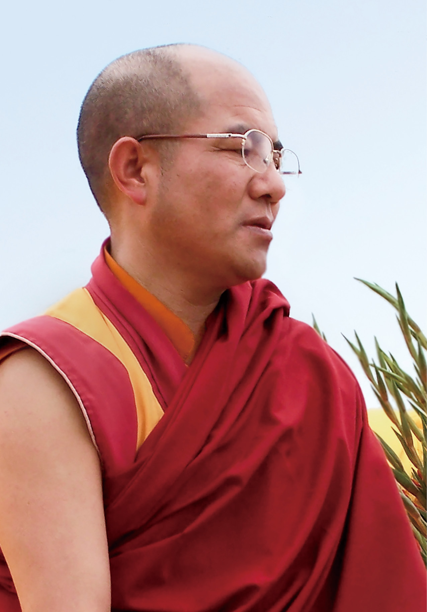

# 给现代修行人的 殷切忠告

——湖北武汉开示

从藏传佛教的角度来说，藏地密宗的创始者，毫无疑问就是大成就者莲花生大士。关于莲花生大士，在不同的历史文献中有着不同的记载，也有各种报身、化身的显现。有些论典中提到，莲花生大士是阿弥陀佛与释迦牟尼佛合为一体、为度化众生而示现的殊胜化身。

大家都很清楚，莲花生大士在印度时，曾示现无量神变，调伏和度化了无数众生；后来来到藏地，遣除了各种违缘，成办了弘法利生的事业。作为修行人，尤其是在如今五浊恶世、外境诱惑极其强烈的城市中，在众生烦恼炽盛、恶行猖獗的末法时期，祈祷莲花生大士显得尤为重要，这对修行人来说，是一件不可或缺的大事。

无论你是修净土宗、华严宗、禅宗，还是修学藏传佛教，只要诚心祈祷莲花生大士，即生中的种种违缘都能够逐渐遣除，在临终时也能往生极乐世界。作为修行人，一生修行毫无障碍、事事顺遂，自释迦牟尼佛以来几乎是不存在的，我们知道，就连佛陀当年出家时，在显现上也遭遇了例如家人反对等诸多违缘。因此，对我们凡夫修行人而言，在五浊横流、烦恼炽盛的时代中修行而不遇违缘，几乎是不可能的。正因如此，我今天劝在座的各位道友，应当精勤念诵莲花生大士的心咒，这确实非常必要。今年学院也举行了莲花生大士的法会，在法会中，我们要求大家念诵莲师心咒，有些道友发愿念诵一亿遍，有些发愿念诵一千万遍。

总之，希望大家不要认为莲花生大士只是藏传佛教的祖师，与自己所修的净土宗、禅宗等没有关系，这样的想法是不正确的，佛法本身是圆融无碍的。就藏传佛教而言，有格鲁派、宁玛派、萨迦派、噶举派等诸多传承；汉传佛教中也有不同宗派；此外，在缅甸、泰国等国家，南传佛教比较兴盛。无论是藏传、北传还是南传，这三大传承本质上都是相通的，显密圆融，这是极其重要的一点。

然而在末法时代，很多众生极少修行，排他心却极重：认为这个法门不好，那个修行不对。这种态度不仅毫无意义，反而成为自身修行的障碍。我们应当观清净心，将一切众生观为佛菩萨。表面看来，有些众生行为粗暴、令人畏惧，但从根本上说，他们依然具足如来藏。按照《宝性论》以及释迦牟尼佛第三转法轮的教义，每一个众生都具有如来藏，都是未来佛。因此，我们应当以清净心对待一切众生，对所有教派的高僧大德、出家人都应如是。唯有如此，佛教内部才能团结和合，在和合的基础上，佛教才能健康发展。

在今后的修行过程中，我希望大家要精进、系统地闻思修行，否则，佛法甚深的教义是无法真正理解的。就如世间学问，若想学习物理学，不接受系统教育，仅凭翻阅几本书是远远不够的。佛法也是如是，释迦牟尼佛所宣说的教法极其深奥，走马观花式的学习，根本无法解决根本问题。

尤其是一些具备世间学识的人，对世间学问或许相当精通，但在佛法方面往往相对薄弱。因为在求学、工作的过程中，很少有机会系统学习佛法，仅凭看看书、听一些佛教故事，是无法真正触及佛法的深义的。

关于佛陀究竟宣说了什么样的教法、佛法的甚深义理究竟体现在哪里，这些问题在佛学院中可以得到系统研究。但对于在家人而言，确实存在时间和精力上的困难。如今物质条件越来越好，人们的欲求也随之不断增长：饮食讲究、衣着讲究、居住讲究，欲望层层加码，贪欲之火愈发炽盛。在这种环境下，留给佛法修行的时间自然越来越少。

以前法王如意宝在1993年前往美国时，他曾感叹美国人非常可怜。为什么呢？因为他们整天为了自己的欲求而忙碌奔波，日复一日、毫无停歇。随着生活水平的不断提高，人们的时间越来越紧张，几乎腾不出空闲来。如今在很多大城市，这种情况同样存在。一方面，物质文明不断发展，人们的生活条件大大改善，住上了更好的房子、穿上了更好的衣服，这是值得称赞的；但另一方面，人们的贪欲也在不断增长。在贪欲的推动下，人与人之间、团体与团体之间的竞争愈加激烈，人的生命往往在不知不觉中流逝，转眼白发苍苍，人生几十年很可能就这样匆匆而过，而用于学习佛法、研究佛法、修行佛法的时间却少之又少。在大城市中，真正有条件系统闻思修行的人确实不多。总的来说，我们对生活不应要求过高，否则整天为物质奔波，最终只会大失所望。

作为皈依佛门的弟子，我们可能无法将全部精力投入修行，哪怕达到百分之五十都非常困难，但至少应当将百分之三十的时间用于闻思修行，这一点是非常必要的。我们可以衡量一下，一年三百六十五天，有多少时间耗费在世间事务上？而人的一生中能有多少个三百六十五天？

虽然我自己修行也不算完美，但多年来依止如意宝上师，对于他老人家的加持与摄受，多少有些体会。对于前世与后世这些重大问题，我们不能忽视。尤其是有些年轻人，至今仍怀疑前世后世是否存在，甚至想：“我现在好好学习佛法也许有益，但万一没有来世怎么办？”存有这种疑虑是可以理解的，但答案其实并不复杂。

慈诚罗珠堪布著有《前世今生论》，我已将其翻译成中文，书中详尽论述了佛教与科学对于前世后世的观点和依据。总体来看，前世后世存在的证据与事例非常多，而反驳前世后世存在的科学依据，迄今无论是科学家还是生命学家，都无法提供。这一点尤其值得年轻人注意。无论从佛教、科学，还是生命学、生理学的角度来看，人类具有前世后世的例证非常丰富，无论在国内还是国外，甚至一些偏远地区、农村，也有许多这样的真实案例，而前世后世不存在的确凿证据却找不到。

从因明逻辑来看，世间存在的事物并不一定都能被直接看见，就像昨天和明天的事物，你无法真正“看到”，但它们的存在却无可否认。同理，前世与来世的存在亦是如此。理解这一点并非难事，但许多人容易受到错误理论、邪知邪见的影响，而这些都是不可靠的。

一旦我们清楚人有前世后世，就会自然意识到必须为来世做准备。一生不过几十年，而来世却可能延续百千万劫，有智慧的人，必会在今生为来世做足准备。年轻人只有深入研习、建立对前世后世存在的信念，才能为进一步学习佛法打下坚实基础。

对年长者而言，我希望大家能一心一意地念阿弥陀佛，这非常重要。现在有些人错误地认为：“我现在学藏传佛教了，就不用念阿弥陀佛了。”实际上，净土法门本身极为殊胜，在密宗修行中同样深受推崇；有些人又认为：“我以前学禅宗，现在就没必要继续了。”这种观点也是错误的。修行本身没有矛盾，过去学的可以继续学下去，宗派之间也不冲突。高僧大德们虽弘法方式不同，但最终目的一致。

释迦牟尼佛的教法，无论是藏传、北传还是南传，都是圆融无违的。在了解这一点的基础上，佛教徒才可能团结和合并让佛法得以弘扬。如果各教派内部互相排斥，将佛法小圈子化，“我家的佛，我家的师父”，只允许在自己圈子内弘法，这样做只会阻碍佛法的传播。在世界人口基数下，佛法修学者本就不多，如果内部再水火不容，对个人修行和佛法的整体弘扬都是极大的障碍。无论哪个教派，我们都应相互尊重、恭敬，唯有如此，佛法才能得到广泛弘扬。

佛法是真正的如意宝，它能够治愈众生身体与心灵的痛苦。现代医学可以治疗身体的疾病，但对于人心的贪嗔痴之病、烦恼痛苦，却无能为力，唯有佛法妙药，方能彻底疗愈相续中的八万四千种烦恼。因此，依止并修行殊胜的释迦佛教法，对每个人都至关重要。

然而，我们也常看到，很多人今天听了上师开示或读了一两本佛法书籍，短期内有一份热情，但过了一两天、一个月，就可能遗忘，热情消散。许多人发愿每天早起修行、夜晚精进，但过一段时间，习气又生起，善根的阳光被生活琐事遮蔽。每个凡夫都有习气，但修行必须持之以恒，一年两年不足以见效，一个月两个月也无济于事。唯有在有生之年做到“活到老，修到老”，以坚韧不拔的毅力持续努力，才能不断提升境界，增长闻思所得的定解。

今天我简单和大家分享这些，希望大家能够用心体会。

