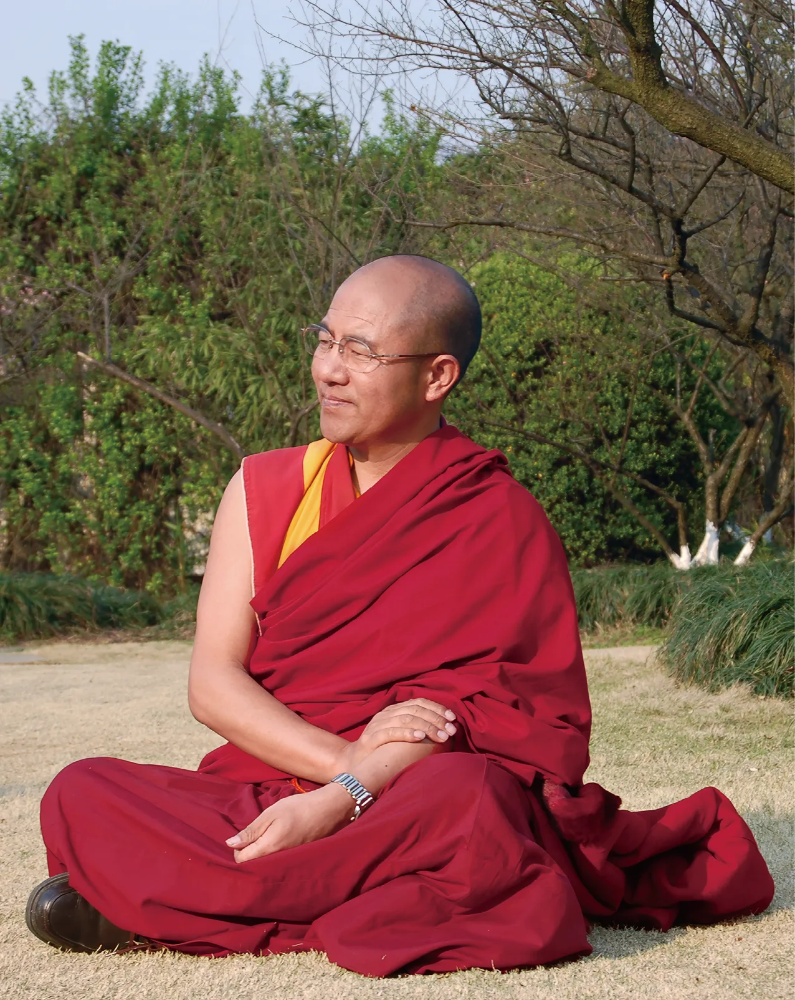
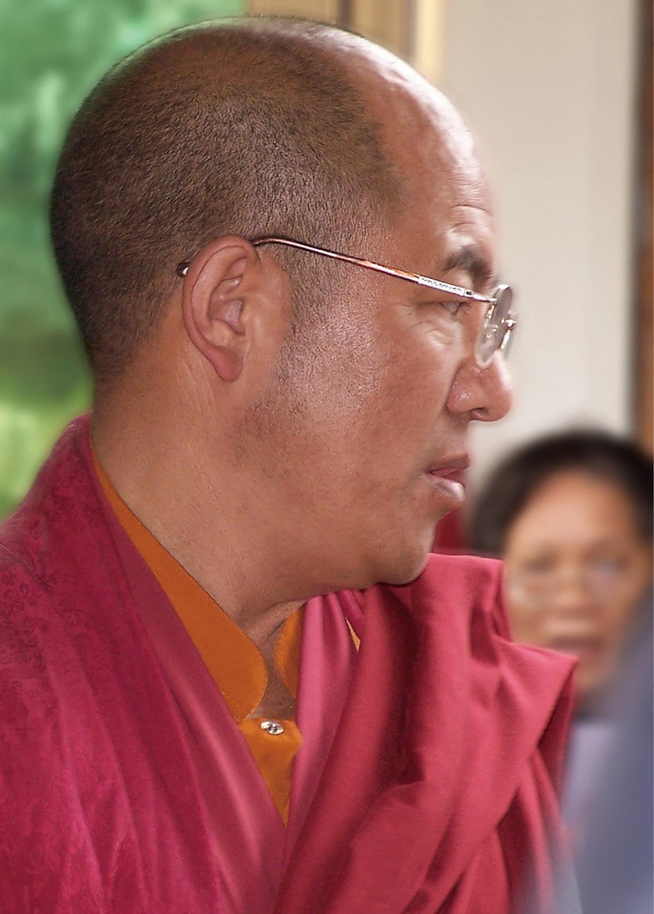

# 菩提心的修法

——杭州开示

今天利用这个时间，我给大家简单讲一下菩提心的修法。如果讲得比较全面，内容会很多，由于时间有限，这次我只能略作介绍。

大约半年前，我曾要求大家每天早上观修菩提心至少半小时，当时我的时间比较紧张，没有详细讲解具体如何观修，因此很多人不太清楚应该怎么做，在这方面感到有些茫然。

有些人认为，只要想着“我今天要帮助众生、利益众生”就可以；有些人则偏向观修胜义菩提心、空性。这类现象比较普遍。所以今天，我在这里给大家简单介绍一下菩提心的观修方法。

首先说为什么要观修菩提心。很多人学过《入菩萨行论》，也读过其他大乘论典，在所有修行中，菩提心非常重要。如果菩提心没有修好，很难生起其他修持显宗或密宗法的功德，甚至可能偏离正道。所以，我们首先一定要明确菩提心的重要性。

光是了解菩提心是不够的。世间很多人停留在对佛法的理解层面，但学习佛法和修习佛法是不同的。信佛是知道佛存在并相信他；学佛是在理论上学习佛法；修行佛法，不仅只是相信和理解，更在实际行动中去践行。

打个比方，你相信某个企业存在，这叫“信”；然后你通过各方面去了解它的规模、建筑，这相当于“学”；最后，你自己真正参与经营、掌握企业的运作，这才是“行”。而这三者最重要的便是修行佛法，如何修行呢？就是将你所了知的理论在心中反复地观想、再三地串习，这就是修行佛法。

对于“菩提心”，可能很多人只停留在文字理解上，《入菩萨行论》中讲到菩提心的功德非常大，很多居士刚才也做了背诵供养，但如果没有真正修持，就很难在生活中真正展现出菩提心的功德。

因此，在座的各位一定要明白：只信佛不行，还必须修持。如果不修持，临终时佛法就无法在心中显现其作用。现在世间许多人能将佛法理论讲得天花乱坠，但自相续却往往与之背道而驰，原因就是他们缺乏修持。所以，我非常希望大家务必修行菩提心。

因为我们用菩提心来摄持所修之法，决定了这个修行到底是大乘还是小乘，这一点我以前也讲过很多次。无论是念佛、参禅，还是磕头、供灯、放生等，这个行为本身是没有大乘、小乘之分，关键在于我们的心态——如果以出离心来摄持，就是小乘法门；如果以菩提心来摄持，就是大乘法门，所以心态非常关键。

举个例子，我们三个人今天在佛前供灯、烧香、磕头，有人为了今生家人平安、顺利、生意兴隆等；有人只是想自己获得解脱；有人为了天下一切众生而发愿。表面上看，我们三个人都是供三盏灯、三支香、磕三个头，行为完全一样，但三个人的发心不同，此举就分别变成了世间功德、小乘功德和大乘功德。由此可见，修行过程中，发菩提心真的非常重要。

藏传佛教中非常伟大的修行人、成就者乔美仁波切说过，密宗所谓“即生成就”，菩提心才是真正的因，密宗的方便法只是缘，并不是根本因。所以，藏传佛教中的即生成就也离不开菩提心。

同样，汉传佛教中的净土宗和禅宗，也绝不能离开菩提心，释迦牟尼佛的三藏十二部经典中，是找不到离开菩提心的大乘法门的。你不能因为自己是禅宗、净土宗，就理所当然地认为自己所修持的法门是大乘。大乘的标准就是必须以菩提心摄持。所以我们首先要明白菩提心的重要性，只有这样，我们的修行才会真正有方向。

那么，具体该怎么修呢？窍诀有很多，但我们可以归纳参考以下教言：无垢光尊者的《大圆满心性休息》；华智仁波切的《大圆满前行引导文》及其弟子堪布阿琼的笔记——《前行备忘录》；乔美仁波切的《山法》；阿底峡尊者关于菩提心的修行方法。今天，我给大家简单梳理一下，为大家宣说将这些教言结合起来的修行次第。

大家应该都知道，菩提心的核心就是愿一切众生都能获得无上圆满佛果。昨天，有些道友提到过，有人认为菩提心非常简单，只要在日常生活中，行住坐卧、吃饭走路都以菩提心来摄持，就能完全成就菩提心；也有人认为菩提心很难，只有在禅宗的明心见性或空性境界下才能生起菩提心。实际上，这两种看法都有些极端。

我们不应认为发菩提心太简单，若认为菩提心过于简单，一般凡夫都能轻易生起，这显然不是那么简单的事；也不能认为发菩提心非常困难，很多高僧大德说过，即使我们还没有达到登地菩萨的境界，但菩提心仍然可以在自相续生起，这在许多教言中都有明确提到。

我们修行时，首先要以四无量心为基础。早上起来时，应先观修四无量心——慈、悲、喜、舍，大家应该对这四无量心有基本的了解。为什么叫做无量心？因为修习这四种心时，功德是无量的，果报也是无量的。没有广大的心量，就无法修持这四无量心，正因其功德无量，所以称之为“无量心”。

一般来说，我们通常是按照慈无量心、悲无量心、喜无量心、舍无量心次第而修，但无垢光尊者的窍诀是先修舍无量心，然后再修慈无量心、悲无量心、喜无量心。为什么要这样修呢？

因为如果我们先修慈心与悲心，容易堕入一边，对亲人关怀备至，对怨敌却毫无同情。比如，当我的亲人遇到麻烦时，我会竭尽全力去帮助他；而当我的敌人遇到麻烦时，我不但不帮助，反而可能会心生快意，觉得“活该”。如果心中有这样的想法，那自相续中是否真的具备菩提心呢？答案显然是否定的。因此，我们应该先从舍无量心开始修。

当然，我们凡夫很难完全断除自私的种子，但我们可以多加串习。当任何众生遇到困难时，我们应当怀有愿意帮助他们的心态。对亲朋好友不应过度执著，对怨敌不应特别憎恨，这样才能慢慢将亲人和敌人平等对待。

如果现在做不到怎么办？我们可以通过修行来逐渐做到。一般是将亲人观想在左边，敌人观想在右边。我们可能喜欢面朝母亲，而不太愿意面对敌人。为什么呢？因为对母亲有贪执，而对敌人有嫌恶。但在修菩提心时，我们必须平等对待这两者。阿底峡尊者有七种教言，即知母、念恩、报恩、发愿、希求、发誓、祈祷，通过这些教言，结合四无量心来修行。

这是什么意思呢？首先，我们要知道，所有的众生都曾是我的父母，可能是前世的父母，也可能是更前世的父母，经论中有充足的教证和理证支持这种观点。刚开始时，可能很难理解，但通过再三思维，你会渐渐接受这个道理。既然所有众生曾是我的父母，那么为什么我对他们怀有敌意、充满嗔恨呢？

我们与今生的亲属、怨敌之间的因缘并非是完全确定的，亲人和敌人常常会互换角色，在无始劫的轮回流转中，怨敌可能在下一世转生为亲人，亲人也有可能转生为怨敌。

例如，藏传佛教中的国王赤松德赞，他的公主在十七岁时就离开人间，后来他在见到莲花生大士时说：“我的女儿很有福报，她这一世转生为我的公主，又见到了像佛陀一样的您，但她的寿命为什么如此短暂？”

莲花生大士通过宿命通看见了一切，并告诉国王：“你的公主并不是因为宿业清净才转生到你身边，而是因为她前世与你有仇怨。你前世在尼泊尔修建夏绒卡绣佛塔时，你的肩膀上有一只毒蜂吸血，无意中，你打死了那只毒蜂，而它在今生转生为你的女儿。”因此，与我们有仇怨的那些人，有些转生为父母，有些转生为子女。

类似的故事在汉传佛教中也有。净土宗的祖师省庵大师也讲过类似的教言：

在南京有一位养鹿人，用鞭子抽打那只鹿，因为它的业力稍微减轻，便通过托梦的方式告诉那个人，原来它就是他今生已经去世的母亲，转生为鹿。它在梦中说道：“我以前偷了你父亲的四两银子，所以今生转生为这只鹿。现在我业力减轻了，才能通过托梦来告诉你。”这位养鹿人听后十分懊悔，自己不该虐待这只鹿。

还有一则公案中讲到，有人在屠杀一只猪时，发现有一头猪特别肥，怎么也拉不动。这时，文殊菩萨显现为一位普通人，悄悄走到这头猪面前，低声说出了他父亲的名字。没想到，这头猪听后立刻乖乖地跟着他走了。后来，他才知道，自己杀的这只猪，竟然是他的父亲转生的。

这些故事告诉我们，无论是藏传还是汉传佛教，许多教义中都提到：所有众生曾经是我们的父母，包括现在的亲人，甚至我们曾经杀害的众生、怨敌，实际上也可能是我们前世或者更久远的前世的父母。我们没有宿命通，无法直接知道这些因果关系，但通过这些道理，我们能逐渐意识到：对亲人不应生贪心，对怨敌不应生嗔恨心。只有当我们平等对待这二者时，四无量心才能真正得以生起。

其实，我们的我所执是可以不断扩展的。比如，在比赛中，如果是家庭与家庭之间的比赛，那“我所”就限定在你的家庭范围内；如果是村与村之间的比赛，你的“我所”就进一步扩大；如果是杭州和北京比赛，那你的“我所”就是在杭州或北京；如果是中国和美国之间的比赛，你的“我所”就变成了中国。

我们可以进一步观察，将敌人和父母都同样执为我所，因此，这两个看似对立的角色，在菩提心的修行中是完全平等的。如果修行达到一定境界，当你见到敌人时，不会生起害心；当你见到亲人时，不会生起贪心。

当然，刚开始时要做到这一点会有困难，但只要坚持修行，比如修了一个月或两个月，就会明显感受到修行的效果。

以上就是舍无量心的修行。

接下来是修悲无量心。悲无量心的核心是愿所有在三界轮回中受苦的众生都能远离痛苦。

修悲心时，我们也要牢记，一切众生都曾是我们的父母，这是第一点——知母，要了知父母对我们的恩德。

父母不仅给予了我们生命和身体，还赐予了我们衣食和财产，以及世间和出世间的种种知识。因此，父母的恩德是无可比拟的，修行时我们要感念这种恩德，这是第二点——念恩。

然后是报恩。在佛教中，报恩非常重要。有人可能认为，出家后就不再报答父母的恩德，这种看法是不对的。实际上，我们可以从佛陀的传记中看到，释迦牟尼佛非常感恩父母，只是佛陀报答父母的方式与世俗不同，他的方式更深远、更具智慧。

佛陀成道后，曾回到迦毗罗卫国，向父亲宣说佛法。佛陀的母亲在他降生七天生往生天界，后来，世尊还亲自到三十三天为母亲说法。净饭王圆寂时，阿难准备以佛陀堂弟的身份扶棺，罗睺罗也准备以净饭王长孙的名义扶棺，但佛陀并未同意。他说，为了报答父母的恩德，我亲自护送净饭王的棺材去火葬场。这不仅仅是一种仪式，更是佛陀对父母深深的感恩和报恩。

类似的事例也出现在汉传佛教中。比如，顺治皇帝的国师——玉琳国师，他曾将自己所收到的供养分为五份：一份供养佛；一份印法本；一份自用；一份供养母亲；一份结缘给众生。

因此，无论是汉传还是藏传佛教，报答父母的恩德始终是非常重要的。这是第三点——报恩。

第四是要发愿，发什么愿呢？我在心里想：愿这些三界轮回中可怜的众生，都能离开痛苦。

第五是要希求，希求什么呢？希望这些众生早日脱离痛苦。这样的心非常强烈，就像当做一件事、办一个企业时，有些人会因为心里太着急，晚上都睡不着觉。同样地，我们也要有这样的愿望，愿众生早日脱离痛苦，心里急切到晚上睡不着，这就是希求心。

第六是要发誓，发什么誓呢？我从现在开始，一定要尽一切努力，让这些可怜的众生早日脱离苦海，为此我要下功夫、要精进努力，这就是发誓。

最后是要祈祷——我要祈祷一切诸佛菩萨、善知识，让我的愿望早日实现。

这七个教言，正是阿底峡尊者的教诲。

我们再总结一下刚才所讲的内容：首先，大家要修舍无量心；其次要修悲无量心。修悲无量心时，先将今生自己的母亲观想在前面，思维如果她正在遭受痛苦，那该有多可怜，我一定要想尽办法去救她。接着观想普通的、与自己没有直接关系的众生，然后再把范围扩展到自己的怨敌，依次对他们生起悲心。若这些观修方法能够成功，那么我们再将悲心逐渐扩展到整个世界，乃至所有众生。

第三慈无量心的修法也与此类似，修法没有本质差别，其中的窍诀也是相通的。在吸气时，所有众生的痛苦、恶业、不愉快的事情以气体的方式进入我的身体，由我来代受三界轮回所有众生的痛苦；吸气时，所有的快乐都愿众生获得，这就是慈无量心。其实，修慈无量心的功德非常大，如果你的相续中具足慈心，邪魔外道也不能摧毁你，你也会成为世间的应供处。

我们刚才提到的将众生的痛苦吸入自己身体的修法，叫做慈无量心。如果在自相续中具足慈无量心，那么一切佛法的根本也都具足。

大乘佛教中有这样的教言：佛陀告诉弟子，只修一法，就能获得圆满正觉果位，何谓一法呢？就是大悲心。因为大悲心最初时如同种子，中间就像是种子的水分一样，最后则如成熟的庄稼，在修持佛道的过程中不可或缺。

以上就是大悲心的修法。如果各位修菩提心实在感到困难，那就可以通过这种方式先修习慈悲心。

我前面也强调过，菩提心就是愿所有众生离开三界轮回中的一切痛苦，究竟成佛。如果前面的慈悲喜舍四无量心修得好，修菩提心就不会有困难；若四无量心没有修好，遇到与自己关系不好的人，或者是其他陌生的众生时，要以菩提心去对待就非常困难了。

现在我们有些人虽然发了菩提心，但实际行动上却有差距。比如，母亲生病了，我们会急忙想办法救她，带她去医院，甚至把自己所有的钱都给她。但如果普通人或陌生人得了病，我们可能连一分钱都不舍得花，也不愿意帮助。如果我们的怨敌生病了，或者遭遇困难，那更不用说了。

这说明，我们的菩提心还不够。如果前面舍无量心修得很好，那么即使我们还没有得到一地菩萨的果位，完全是一个地道的凡夫，但从心态来讲，我们能够视其他众生与自己的父母没有差别。

所以，大家不要觉得自己境界很高，或者认为自己永远无法修成，不要小看自己。实际上，只要下功夫，每个人都有殊胜的因缘。打好四无量心的基础非常重要，这是必须要做的。

基础打好了，接着就要修菩提心。菩提心的修法就是愿众生离开痛苦、获得佛果。光是看见一个众生很可怜，想帮助他，这不一定是菩提心，为什么呢？因为菩提心的两大条件就是以悲心缘众生、以智慧缘佛果。意思就是希望这个众生能够离开三界轮回中的所有痛苦，最终能够获得佛果。为了达到这样的目标，我心甘情愿做一切事情。

佛陀在《教王经》中讲到菩萨戒的学处，特别是关于愿菩提心的修法，都已经讲得很清楚。自他所做的一切善根都要随喜，然后回向、发愿，这就是愿菩提心的学处；行菩提心就是尽心尽力地行持六度万行。

现实中，有些人可能真的做不到，因此，大家也不要认为自己境界很高。实际上，不必说胜义菩提心，连世俗菩提心可能都修得不好，但我们还是要修。即便是一刹那或是座上观修菩提心十分钟，其功德也非常巨大。

有些人每天都要早起坐禅，但什么都不观想，只是闭着眼睛坐着，这其实并不重要。初学者最需要的是修自他交换，修我们刚才讲的那七种教言，反复观修这些教言，菩提心肯定会在自相续中生起。这一点，我认为非常重要。

所以我们今天只是简单地讲一讲，希望今后大家每天哪怕只有很短的时间，也一定要去忆念、思维菩提心。其实，菩提心并没有什么不会修的，正如乔美仁波切所教导的那样，我以前也反复讲过，修慈无量心、悲无量心时配合呼吸来观想，这样的修法，任何一位七十岁甚至八十岁的老菩萨都能做到，只要有呼吸就会观想。这样的功德，是一般任何一种功德都无法相比的。

现在佛教界中，有些人过分强调天眼、神通等外相成就，一提到菩提心却不太重视。这种做法并不好。有些教言中明确讲到，过去那位大天比丘，具足八大共同成就，天眼、神通一应俱全，但正因如此，后来反而造下了许多罪业，这样的例子是真实存在的。

因此，大家不要贪求外相上的东西，而应该实实在在地在自心上下功夫，好好忏悔。其实，修菩提心本身也是极为殊胜的忏悔方法。许多教言中都讲到：如果相续中具足菩提心，那么即使罪业很大，也可以通过方便方法得以清净；但如果没有菩提心来摄持，不管怎样忏悔，效果都是有限的。

乔美仁波切曾用过一个比喻：就像一个实心的铁丸子，虽然它体积很小，但放进水里一定会沉下去；同样，哪怕罪业很小，一旦造作，众生也会如铁丸一般堕落。而若是一个空心的铁丸子，即便体积很大，放进水里也会浮在水面上；同样的道理，即使众生曾经造过的业看起来非常可怕，但若其相续中具足菩提心，也不会堕落。这是一个非常好的比喻。因此，希望大家以菩提心摄持，多念金刚萨埵心咒，认真忏悔。

各位生活在大城市里，从小到现在，可能有意无意中造作了许多恶业，无论是吃肉、杀生，还是各种不如法的行为。如果现在不忏悔，将来自己的命运究竟如何，真的很难说。因果是极其可怕的，并不是我们信不信的问题，而是你一旦种下了因，果报迟早必定会成熟，只是自己暂时没有察觉。但我们不能因此而随意放纵，若明知如此还继续造业，那实在是一种非常愚痴的行为。

因此，大家能够遇到如此殊胜的佛法，实在是非常有福报。既然遇到了，就一定要以菩提心来摄持修行。否则，明明得到了如此难得的人身，又遇到了如此殊胜的正法，却不去修行，确实非常可惜。

我自己也常常从内心深处这样想：今生能够遇到像法王如意宝那样真正指示解脱之道的上师，又能遇到如此清净殊胜的正法，实在是无比幸运。否则，在这茫茫无际的人海之中，如果遇到邪知识、邪法门，内心随外境而转，只会越陷越深，最终不可救药。我们在座的许多人，能够遇到佛法，的确来之不易。在座各位，千万不要浪费自己的人身，一定要学习佛法、行持善法。

行持善法时，不要只停留在表相上，而一定要落实到内心当中。要观想佛陀、修菩提心。哪怕只是刹那间或五分钟观修菩提心，其功德也远远超过许多仅仅停留在形式上的修行。

因此，今天在座的每一位都有极为殊胜的因缘，遇到了大乘佛法。如果我们只是知道菩提心功德广大，却不观想、不实修，那确实非常可惜。所以我今天也特别强调：大家一定要真实地修持菩提心。

菩提心的具体修法，在《大圆满前行》以及《大圆满心性休息·三处三善引导文》中都有详细开示，没有什么不会修的，只要愿意，一定修得起来。

做任何事情刚开始都会有一些困难。就像修建一间房子，最初挖地基、设计、施工，事情繁多、麻烦重重，但一旦基础打好，后面就会非常顺利。修行也是如此，最初心态尚未调整，想进入另一种生命状态时，自然觉得困难重重；但真正开始修持后，就不会有想象中那么难。

因此，不论学习哪一个教派，本质都没有差别，释迦牟尼佛所宣说的大乘法门都是先发菩提心，中间积累资粮，最后成就佛果。不要认为“我是依止这位上师的、我是学那个教派的，所以不需要修菩提心”，千万不要这样想。若别人欺骗你，那也许无可奈何，但若是自己欺骗自己，这个世上又有谁能救你呢？

既然得到了人身，又遇到了佛法，就一定要好好学习、好好修行。否则，就如同得到了如意宝，却不懂得使用它一样，实在令人惋惜。

因此，今天我再次强调一下，希望大家都能认真修行菩提心，愿我们每个人的相续中都能真正生起真实无伪的世俗菩提心，并在不断努力之后，进一步生起远离一切戏论的胜义菩提心。到那时，度化众生的事业也将自然而然地成就。

今天我就简单讲到这里，下面我为大家念诵一个简单的传承。

出世间的皈依分为两种：一种是小乘的皈依，即为了自己从轮回中解脱而皈依三宝；另一种是大乘的皈依，即为了让无边的众生都能获得解脱而皈依三宝。所以，我们应当选择大乘的皈依。

以前，很多人皈依时可能会想：“我要皈依上师，皈依佛。”那时，你的皈依目的是什么呢？很多人当时可能并没有明确的发心，但这并不重要。因为刚开始修行时，我们的目标可能不明确，比如难陀出家时，最初也是因为种种原因，并没有完全明确自己出家的目标，但通过佛陀的教导，他最终真正生起了出离心。所以，这个过程是可以理解的。

今天，我们应当这样思考：我过去皈依三宝，可能是为了今生的平安和快乐，但现在，我已经明白了佛法的深义，我的皈依是为了度化一切众生、让他们都能解脱，我发心要为一切众生的解脱而修行佛法。发出这样的决心之后，观想在莲花生大士和释迦牟尼佛面前，发愿我从现在起，乃至生生世世都归依佛法僧三宝。

接下来，我为大家念诵皈依偈……

现场互动

⊙ 问：经过我们今天下午的讨论，想请教您两个问题，特别想请您做一下针对性的开示。

第一个问题：我本人刚开始学法时，意乐非常强烈，对佛法充满了浓厚的兴趣，但随着时间的推移，渐渐地感觉到这种意乐不如之前那么强烈，有时会生起懈怠心，失去动力。请教上师，如何才能恢复并保持那种初发心时的热忱和意乐呢？

第二个问题：关于我们学法的过程和形式，每周都有一次课程，每次持续两个多小时。在有限的时间内，为了保证进度，很多时候我们只能针对某个题目找到书面的答案，读诵一下，谈谈自己的简单理解。然而，对于那些学习基础较深的佛友来说，更希望能有一些深入的探讨，解答一些疑惑，这样才能真正将法融入到自心相续中，并在日常生活中落地实践。如果只是停留在简单的理解和复习答案，有时会觉得枯燥乏味。因此，我们希望能进行更深入的讨论。

但深入探讨可能会带来两个问题：首先，讨论气氛活跃时，时间可能不够用，学习进度会受到影响；其次，当谈到自己的一些体会时，特别是对一些深入的体会进行分享时，我们又担心说出来会对自己未来的修行造成障碍。如何在这两者之间保持平衡，保持最合理的状态呢？请上师解答。

堪布：一般来说，学习佛法的人心态会经历很多变化，这是我多年来学习佛法的经验所感受到的。从我个人长时间的观察来看，人的一生中，长期保持坚定不变的信心是非常困难的。刚开始学习佛法时，我们可能充满激情，觉得自己的体会非常深刻，心情也特别激动，可是，随着时间推移，尤其是经历了各种人生的变化或遭遇了一些事情后，很容易动摇或者退失道心。对此，我们需要从两个方面进行对治。

第一，我们必须深入了解佛法的真理，让自己的心真正进入佛教的智慧海洋，只有这样，才能在遭遇世间的各种挑战时不迷失，不偏离道心。

第二，我们需要保持精进，平时多行持善法。我们今天进行的放生活动，从世间角度来看，这是一种保护生命的善行；从佛法的角度来说，它是慈悲心的体现。这种善行体现出人类本有的善良心性，它对社会有巨大的益处。

⊙ 问：您在开示中讲到用呼吸修四无量心的方法，我听后有个小顾虑：我看到很多大德因为发了菩提心，代众生受苦，身体变得比较差，我在想……

堪布：一般来讲这是不会有的，有些大德身体不好，不一定是菩提心观得太多了。（众笑）

观修菩提心的力量和功德非常大，它是一种窍诀性的修法。况且，作为发了菩提心的菩萨而言，只要众生的恶业能减轻，我身体不好也是可以的，我心甘情愿代受他们的痛苦，应该这样想。但事实上，并不会因为你观修菩提心太多而导致身体不好，不会有这种情况发生。

⊙ 问1：在您的著作中，有些内容需要灌顶才能看，我们如果没有得到灌顶，是不可以看吗？

堪布：对。

问2：能否请您给我们传一下金刚萨埵的修法仪轨？

堪布：行。

问3：佛陀的事业可以分为哪些？

堪布：佛陀的事业可以分为几种层次，其中有些是直接让众生安住于果位上。例如，佛陀在世时，会将舍利子、目犍连等弟子安置于阿罗汉的果位，这是安置于果。

还有一些是安置于道位的。按照大乘教义，这意味着通过修行佛法，众生可以逐渐获得一地直到十地菩萨的境界；在小乘教义中，则是从预流果到不来果之间的各个果位。

有些众生缘分尚未成熟，无法直接安住于果位，但通过佛陀的事业，他们仍能种下修道的因——在因位上获得善根，而尚未完全进入道位。众生最初发菩提心，在其相续中种下善根，这也是一种因缘。因此，佛陀的事业是从不同的层面进行展开的。

⊙ 问1：有两个问题想请教您：第一个是关于“四无量心”的。我原以为四无量心只是获得梵天果位的因，但实际上它确实也是成佛的因，是菩提心的前行。四无量心看起来非常广大无量，但它的界限怎么区分呢？为什么说梵天修四无量心可以得到梵天的果位，而我们现在将其作为菩提心的前行与正行来修持，有时候不太清楚如何分辨，请上师开示。

堪布：四无量心又称“四梵住”，《俱舍论》中对四梵住有详细论述。梵天认为三界轮回中的一切众生都是他的子女，认为众生属于他。这一点与我们发大乘菩提心时观一切众生为自己的父母有相似之处，但梵天并没有想令众生获得佛果的心。因此，四梵住与四无量心既有相通之处，也有不同之处。

问2：第二个问题是，我们当中有一些道友或佛友，他们对佛法虔诚，修菩提心，做一些放生等善行，对上师也很有信心，但身体经常不好。本来想请上师加持，但又怕上师代他们受苦，怎么办呢？

堪布：如果身体不适，请上师加持，上师自身不会因此受苦，因为上师没有造恶业。

一般而言，我们的疾病可能有几类原因：前世业力，前世杀害众生，导致今生疾病；即生四大不调也可能导致病症。

如果我们生病了去医院看医生，结果病人的病全部转移到了医生身上，那医生也不敢看病了。所以，通过上师加持，通常可以化解相续中的障碍，如邪魔外道或四大不调的现象。但如果是前世真正造下的业，则需要通过今生身体感受痛苦来偿还，这类病痛即使上师加持也不一定立即见效。

总之，上师的加持不会给上师本人带来麻烦，所以你们应该尽量请上师加持。

⊙ 问：我今年77岁，学佛法不久，很多事情还不太明白，但我对学法很有兴趣。我遇到不少问题，现在想大胆地请教，不知道是否妥当。我看《大圆满前行》里提到一件事，有一个人拿石头打狗，狗受伤了，上师将狗的伤害转到自己的身上，好像真的在上师身上出现了一个疙瘩。这到底是怎么一回事呢？

堪布：在藏传佛教中，修行菩提心时会代受众生痛苦。前行中，阿底峡尊者的上师达玛绕吉达就示现过这种修行。

如果上师真正是大成就者，他们能够以自己的修行力量代受这种痛苦，显现上可能会表现出“哎，我这里好痛啊”的样子，但实际上，由于他们具备了这种能力，不会真正感到痛苦。这在我们看《释迦牟尼佛广传》时会明白的。

⊙ 问1：我听说修一个本尊等于修一切佛菩萨，请问是这样吗？

堪布：对，麦彭仁波切在《释迦牟尼佛广传》当中也说了，比如说我们将释迦牟尼佛本尊作为自己一生中要修持的本尊，那他就是寂猛浩瀚的所有忿怒相和寂静相的诸佛菩萨的总集。同样，我如果修观世音菩萨或文殊菩萨，那么所观想的本尊也是一切诸佛菩萨的总集，可以这样观想。

问2：如何才能从根本上改变我们自己的世界观、价值观和人生观？

堪布：改变我们自己的世界观、价值观，乃至人生观都可以。我认为，首先必须真正了解佛法的甚深意义，若能明白佛法的深义，那么我们对世界的看法自然就会发生转变，尤其是在世界观和价值观上，与世俗的认知会有很大的不同。

在世间，有人认为金钱最重要，有人认为地位最重要，也有人追求其他目标。不同的人，其价值观与人生观各不相同。但佛法所涵盖的范围是全面而圆融的，它能够解释并超越世间各种不同的世界观与人生观。

因此，我认为，想要改变世间教育、环境以及长期形成的观念，要先了解佛教中一些甚深又基础的道理。之后，再在实际行动中不断串习。

正如我刚才所讲，如果佛教所倡导的关爱与慈悲精神在社会中得到重视，无论是东方还是西方国家，几乎没有人会不认可。因为佛教的慈悲不是狭隘的，不局限于某一个群体或某一个国家，而是面向一切众生的。因此，只有真正理解佛法，才能从根本上改变我们的观念，这一点非常重要。

另外，我们也可以通过保持正知正念来调整和改变自己的相续；若在某些时候实在提不起正知正念，可以念阿弥陀佛。这在讲《入菩萨行论》时也有提到：当某一种修法无法相应，信心或兴趣提不起来时，可以暂时转而修持另一种法门。比如，如果参禅时无法安住，就可以转而诵经、背诵或念佛。只要把心用在佛法上，都是可以的。这同样是正知正念，只是修持的方式有所不同而已。

⊙ 问1：我有时听辅导员或其他老师讲：“你要把自己的快乐安立在自心上，而不是安立在外境上。”其实我也理解这个道理，但有时候心里的悲喜情绪还是会随着外境而起伏。我觉得，对我来说，这似乎很困难。

堪布：我们需要经常串习。很多人学佛的时间都很短，真正用在佛法方面的时间更短。一天24小时，睡眠就需要6到8小时，剩下的时间大多花在吃喝玩乐、闲谈等事务上，而真正用于佛法修行、观照自心的时间非常有限。所以，如果你希望心念立即完全改变，自然是不容易的。

因此，就像古代高僧大德一样，理想的做法是舍弃一切、专心修行。但如果条件不允许，至少要尽量将时间用在修行上，这样才能慢慢改变自己的习气，想要一蹴而就是不现实的。

这就像世间办企业，也不是一件容易的事情。虽然困难重重，但如果你坚持面对，最终会有成果。同样的道理，修行也不是轻松的事情，如果修行容易，人人都会成功。但尽管困难，只要坚持修行，一定会获得成功。

问2：当修行时间久了，正知正念提不起来，应该怎么办？

堪布：应该说，每个人的情况都不尽相同。我们大多数人生活在大城市中，刚开始接触佛法时，可能会觉得新鲜、感动，甚至激动，认为佛法非常殊胜。但随着时间推移，有人就会慢慢麻木，或者受到周围环境和外境的影响，逐渐正知正念提不起来。

这是许多佛教徒都会经历的普遍现象，原因大致有两方面。其一，定解与信心尚未成熟，如果修行的境界逐渐提升，每一次观修或回向时，心里会非常感动，甚至热泪盈眶。其二，这也与城市生活环境有关，如果身处寂静的地方，与僧众一起修行，信心会逐渐提升。

一些高僧大德，例如法王如意宝，常常回向或想到众生的痛苦时都会流泪。许多老修行者，即使到了七八十岁，仍然非常虔诚，不论是观修还是念诵都很认真。

无论如何，当出现无记状态时，多读高僧大德的传记，有助于恢复心态，从而使修行圆满。

问3：我还有一个问题，如果让我对包括所有怨敌在内的众生修四无量心，我觉得很困难。那我可不可以先将某一个以前起过嗔恨心的人作为观修的对境？

堪布：完全可以。四无量心的修持并没有固定的时间和对象，你可以根据自己的心态，选择对某一众生修持，等这一对象的修持比较稳固之后，再换其他对象。随着时间的推移，你的修行范围可以逐渐扩大。

问4：吃素有什么好处？

堪布：吃素可以说是一种很高的饮食境界。因为吃素不仅关系到众生的生命，也对我们的身体健康有益。当然，极个别学者可能不完全认同，但绝大多数营养学家、医学家，以及从事生理学研究的专家，都对吃素给予肯定。现在，英国、美国、法国等国家的一些企业家、学者也坚持吃素。

关于这方面的理论，我以前写过《藏密素食观》，其中引用了一些相关论述。有人担心，如果缺少动物蛋白，身体是否会受到损害，实际上，这种担忧是不必要的。因为人体所需的动物蛋白，本质上也是来自植物。例如，我们吃的牦牛肉，但牦牛只吃草、喝水，因此，其体内的蛋白质大部分来源于水和草。所以，直接食用植物蛋白，也能够满足人体对蛋白质的需求。

现在一些学者和医学家不敢吃肉，原因主要是肉类可能携带各种疾病和传染病，这些病原体会通过肉进入人体。所以，有一部分人吃素并非因为信仰，而是食肉可能危害身体健康。

从佛教角度看，吃素的功德非常大。佛陀在《楞严经》《涅槃经》《楞伽经》等大乘经典中，都讲过吃素的功德与吃肉的过失。汉传佛教在这一点上做得很好。

我个人深信吃素的益处。我以前也特别喜欢吃肉，但在了解吃素的功德、阅读医学典籍后，我深感肉食对身体不利，尤其是会增加患高血压、心脏病等疾病的风险。通过吃素，我的身体状况有了明显改善，高血压、心脏病等问题全部消失。

我已经吃素四年了，刚开始吃素确实不容易。我那时与一位法师相约先戒肉一年，才过了十天，他就开始计算着“还有十一个月零二十天才可以吃肉”。但随着时间推移，到了第二年我们就不再想吃肉了。现在，看到肉食，甚至关于杀生的影像资料，我都会感到厌恶。从健康和慈悲角度来看，吃素非常重要。

关于植物是否具有生命的问题，植物没有痛苦和快乐的感受，真正能感知痛苦与快乐的生命，才是佛教所称的众生，包括蚂蚁、动物等。植物生命与动物生命不同，因此佛教中众生的定义与植物学所说的生命不同。《大般涅槃经》中也提到，外道承认植物有生命，而佛教不认为植物是众生。当然，在特殊情况下，个别众生可能因为孤独地狱的业感而依附到某种植物上，但一般来说，植物生命与真正的动物生命不同。

⊙ 问：在修行过程当中如何来区分菩提心和空性？

堪布：菩提心就是利益众生的一颗心。空性就是放下一切，不执著任何事物的一种智慧。这两种心态相辅相成。

⊙ 问：任何法门都有一个由浅入深的过程。为了很好地学好这个法，我是不是应该先修五加行？是不是应该要到学院里去学习？

堪布：学五加行当然很好，不一定要去学院，在任何比较合适的地方都可以修。

