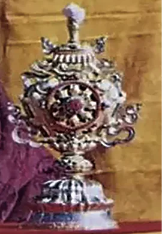

# 与圣者的会面

距新德里约八百多公里的一个地方，松树成林，向远处眺望，可见皑皑的雪山。本来，印度纯属于热带气候，然而，酷暑季节的此地，却不时散发着丝丝清凉，给燥热的人们带来舒心的凉爽。每一位去过这里的人都对此惊诧不已。

7月16日，法王及随从顺利抵达这里的南嘉寺院。该寺举行极为隆重的迎接仪式，贡萨遍知尊者满面笑容，手捧吉祥哈达和一尊金灿灿的释迦牟尼佛像献给法王，欢迎他的光临。他们初次见面好似久别重逢的亲兄弟一般，喜悦之情实难形容。下午，法王以自己刚取的伏藏品“项袋金刚橛”灌顶奉上。之后，他们携手来到尊者的居室中，津津有味地叙起往世多生中共同弘法利生的因缘。

17日，在一个特殊因缘下，法王从智慧海中流露出尊者的住世祈祷文。下午，为了世界和平安宁、众生喜享佛法甘露，二位尊者在南嘉寺的大殿里，依靠伏藏大师列绕朗巴《金刚橛·极密宝剑》中的会供仪轨，举行了十分隆重盛大的会供法会。参加的人有南嘉寺、乃琼寺的僧众以及来自国内外的诸多信徒，场面颇为壮观。两位大尊者在妙高的法座上威严正坐，手持金刚橛，令人一见便生敬畏之心，时而他们以极威猛的姿态降伏邪魔外道，时而恢复到和颜悦色宣讲佛法，在场的人们也相应地有时心惊胆战，有时法喜充满。并且共同祈祷十方诸佛加持，令全世界的一切众生都能沐浴在佛法阳光之中，畅饮妙法的甘霖，早日离苦得乐，现证菩提。

18日，法王的觉性中显现出《金刚橛火供仪轨》，随即口述，尊者执笔记录。极为奇妙的是，这一伏藏品中的吉祥文，尊者十几年前就已能流利地背诵。

19日，法王供养尊者一尊文殊菩萨像，这是从五台山那罗延窟专门为他取的伏藏。尊者非常高兴，献上前一世专用的银元以及黄金曼茶罗。法王还为他传授“文殊大圆满”灌顶。中午，在尊者的新住室里，共进午餐，其间互叙前世中互为师徒、君臣的殊胜宿缘。尊者诚心地说：“您是雪域佛法的怙主，如果将来遇到各种违缘，不应该以此止步不前。您要像傲然挺立在风雪中的青松一样，长久住世，广利有情。”并赠送法王一尊珍贵的长寿佛。

20日，应邀前往乃琼寺进行“金刚童子”灌顶。当念诵“迎请本尊降临”的仪轨时，金刚称护法神突然降临，讲述起他跟法王前世的因缘，授记了法王的未来事业，并说：“莲花生大士在法界中恒时关照加持您，您应当用‘金刚橛猛修法’降伏一切邪道魔众。”此外，吉祥天女等护法神也纷纷降临，亲口授记法王是真实莲师的幻化身，可作为浊世众生的慈悲怙主。

21日，与尊者对一些显密教法的难题进行了探讨。

22日，应法王及其随从诚挚祈请，尊者授予五世尊者的伏藏品“意修精藏总集”灌顶及《莲花生大士祈祷文》等法要传承。此后，法王又为南嘉寺的僧众赐“金刚橛”灌顶。他们则以精妙的辩论作为法供养，法王十分欢喜，连声赞叹他们高超的辩才。

24日，法王为尊者传讲华智仁波切的《大圆满击要三句》，尊者自始至终谦逊恭聆。随后，两位大德讨论了密集金刚与时轮金刚、中观自续派与中观应成派之间的异同，并根据不同教典进行了详细的辨析。

25日，即藏历六月初四，释迦牟尼佛初转法轮日，二位大德在一尊古老的观音像前同发菩提心，为利益无边众生念诵《普贤行愿品》。这尊观音像自尊者离藏后一直随身携带，是松赞干布五尊圣像中的一尊，他十分珍惜，视其为唯一的侣伴。发愿后，尊者依缘起献给法王一个镶嵌珠宝、精致美观的纯金法轮，祈愿法王为度化无边无际的众生长久住世，常转法轮。

后来法王在印度下密院寺为僧众灌顶传法期间，尊者也从北方来到南方。在举行的一次法会上，他以赞叹的口吻向众人介绍：“这位是第十三世尊者的经师——伏藏大师列绕朗巴的化身，他是当今宁玛派的教主，我特意邀请他前来。今天，在座的诸位能够见到他，可以说有殊胜的善缘。”在此期间，尊者为众人赐予了观音菩萨、密集金刚的灌顶，法王也为他老人家献上了“甘露妙瓶”长寿佛灌顶。

随后，格鲁派、噶举派、萨迦派等印度兴盛的各宗派赫赫有名的大德、寺院住持，纷纷迎请法王传讲窍诀。本来，在印度，各宗派相互之间略有分歧，法王的到来，在他们之间架起了通畅的桥梁，使所有宗派彼此宛如水乳交融般和睦。印度的人们异口同声称赞法王是西藏佛法的顶梁之柱。

尤其是身居异国的藏族同胞们，听到法王从故土来到印度，百感交集，急不可待地前来拜见。他们就像流落他乡的孩子见到了慈爱的母亲一样，悲喜交加之情实难以表达。

此后，法王朝拜了莲花湖。根据《莲花生大士传记》中所载：莲师在萨霍国时，国王将其置于火中焚烧。他大显神变将熊熊火焰变成了湖泊，自己逍遥自在地坐在水中莲花上，从此人们便称之为“莲花湖”。如今朝礼的人们也是如潮涌至。在湖畔，法王以金刚歌的形式作了莲师祈祷文。本来莲花根是扎在水底的，法王来到岸边时，莲根居然奇迹般地浮到水面，漂漂荡荡地游到他的跟前。周围的游人吃惊非小。尔后，又朝礼了附近几个颇具加持力的山洞。
