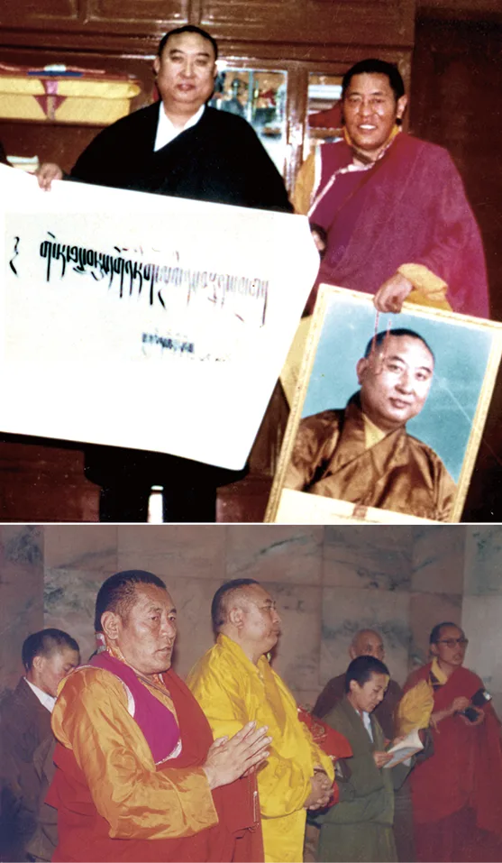

# 与班禅大师的会晤

历代班禅大师，被公认为阿弥陀佛的化身。在藏族人的心目中，他是佛陀慈悲智慧的化现，被尊崇为至高无上的第二精神领袖。

1986年夏，十世班禅大师视察藏区时，来到色达会晤法王，并大力赞叹了法王创立佛学院的壮举。

1987年4月，法王携眷属朝礼五台山，途经北京时，两位大师再次会晤。他们见面后十分高兴，愉快地交谈。班禅大师对法王重新振兴佛法、高举佛教法幢、整顿僧团内部的弊端等，予以高度赞叹，并用藏文题写了“色达喇荣寺五明佛学院”。

4月15日，二位尊者满面春风地来到位于北京的佛牙塔，举行隆重的开光仪式，众人共诵兴盛佛教广弘佛法的吉祥愿文。

1988年，班禅大师亲自来函，诚挚邀请法王赴京，到他创办的中国藏语系高级佛学院讲经说法，法王也欣然应允。抵京后，在两个多月的时间里，法王为宁玛、格鲁、萨迦等各教派的高僧大德传授了以《定解宝灯论》为主的法要，并为他们赐予甚深灌顶修要及窍诀。所有听受者均感受益匪浅，为能聆听到此次传法而深感荣幸。班禅大师更是再三表达了他的钦佩之意与感激之情，频频赞叹法王深邃的智慧不可比拟。

之后，特意约法王一同前往日喀则的著名寺院——扎什伦布寺。两位大尊者抵达该寺后，受到所有僧众的热烈欢迎。在那里，他们为第五世至第九世班禅大师的灵塔，举行了盛大的开光仪式。法王还以诸多教证、理证讲述各个教派究竟观点互不相违，受到各派大德的高度赞扬。
