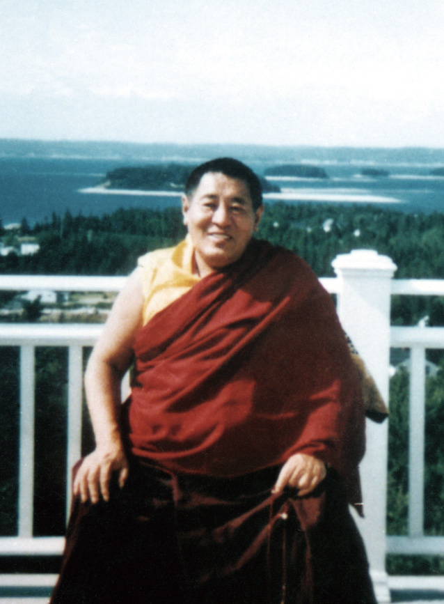

# 加拿大之旅

正当美国的信徒沉浸在法乐之中时，法王离开美国的时刻到了，人们不得不接受这一事实。法王慈爱地注视着前来送行的伤心信众，安慰他们说：“聚际必散，这是自然规律，希望你们能好好行持正法……”

一方忧愁一方喜，在加拿大哈利法克斯的机场上，人们怀着喜悦之情仰望天空，企盼西藏佛教领袖的来临。法王所乘的班机徐徐落到地面，信众们一片欢呼，以至高无上的西方礼节恭迎当代宁玛派教主。

离开机场后，法王去了一个名为夏日亲林的道场。那里有一个很大的露天阳台，视野非常开阔，可以看到一望无际的大海，也可以眺望远处的岛屿和城市。当天晴空万里，阳光普照，法王坐在阳台上望着水天一色的美景，神清气爽，不禁赞叹：“这里有蓝天、有大海、有山川、有森林，景色非常迷人。在我去过的所有地方中，这里是最美的！”

下午，法王在住处接受了当地一家佛教媒体的采访。记者问道：“您此次从雪域不远万里来到西方，主要目的是什么呢？”法王回答说：“为了弘扬佛法、利益众生，尽可能为人们的幸福安乐起一点作用。”记者又进一步问：“您在遇到不幸时，如何面对呢？”法王不假思索地答道：“唯一祈祷上师三宝，除此之外，并没有在修行其他法上下功夫。”

法王接受采访时，旁边人有的目不转睛地盯着他的脸，似乎想从他的面部表情中观察出与众不同之处；有的若有所思，静坐一旁思索着他耐人寻味的话语；有的将镜头对准法王不停拍照，生怕错过难得的一瞬间。法王以特有的气质吸引着每个人，以语言的加持扣动每个人的心弦，房间里洋溢着祥和的气氛。

一位记者在新闻报道里如实地道出了心声：“他给人一种极为自在的感觉。尽管他并非回答所有提问者的问题，奇怪的是，他使每个人都感到快乐、温馨。他没有丝毫高高在上的言行，而是异常平和谦逊，这更显出他的尊贵。这位佛教领袖的不凡气质，远远超过高谈阔论、具有声望的国家元首的魅力。只有这样的大圣者，才能真正给一切众生带来和平、幸福。”

次日，法王前往达尔豪斯大学，给当地信徒和部分师生，做了一场主题为智慧与慈悲的公开演讲，上千个座位座无虚席。

之后，离开夏日亲林，乘车来到加拿大最大的佛教中心——多杰丹玛林，给这个道场的佛教徒，以及来自美国、加拿大的数千名信众，传授了“文殊智慧勇识”“项袋金刚橛”“忿怒莲师”等灌顶，并将深奥的大圆满道理，以简明易懂的语言概括成精华窍诀为信士传讲，受到了大家的热情欢迎，传法的大帐篷被挤得满满的。

此后，该中心的所有成员按照最高礼仪，为法王表演了香巴拉军队操练，唱诵了香巴拉赞歌，献上了特殊的法供养，创造了未来佛教战胜邪魔的缘起。他们的表演十分生动逼真，仿佛再现了时轮金刚军队降临人间消灭外道的情景，法王露出了会心的笑容……
