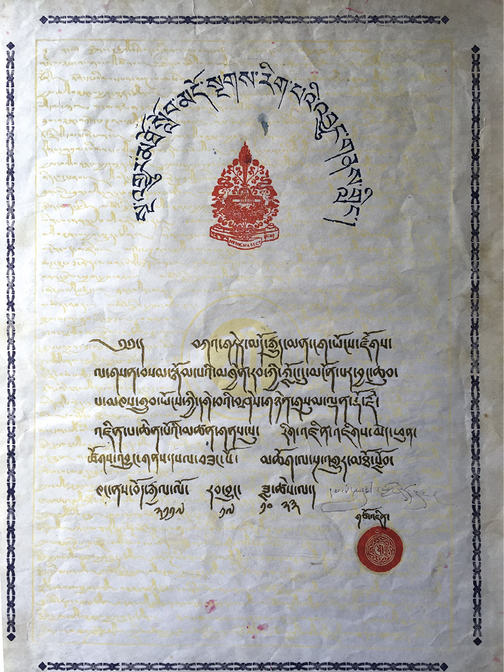
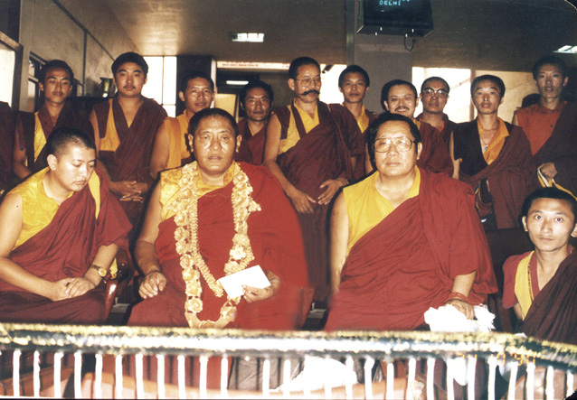
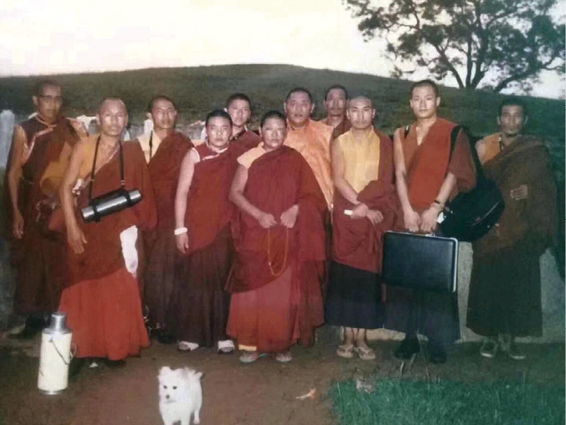
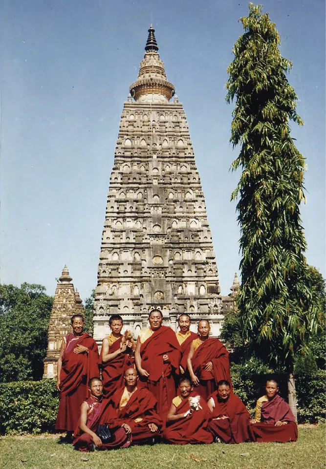

# 圣境的巡礼

印度，在佛教徒心目中有着深刻的意义。它是佛教的发源地，是释迦牟尼佛在人间示现十二相成道的圣境，自然也就成了虔诚佛子云集之处。每一位佛弟子都十分渴望能朝礼这一神圣国度，去寻觅佛陀在世时的气息。

在印度南卓林佛学院，法王如意宝为宁玛派教主贝诺法王及其眷属数千余众，授予“上师心滴”等甚深灌顶，并用近一个月时间传讲了《定解宝灯论》为主的殊胜法要。他窍诀性的讲法入木三分，博得了所有闻受者的一致好评。整个佛学院上至法王、大活佛、大堪布等知名大德，下至普通僧人，无不被他深邃广博的智慧、无与伦比的口才所折服。在此，法王荣获了藏传佛教界公认的最高荣誉学位——精通显密教藏的佛教博士证书。

其间还应邀去格鲁派的色拉寺，在辉煌的大殿中为格鲁派的大格西等千余僧众，传授了宁玛无上教法。

除了应邀在名闻海内外的大寺院中讲经说法、恩赐灌顶之外，法王还参观了世界闻名的奇景、博物馆、古寺等，之后又一一朝拜著名的佛教圣地。

首先朝世尊转密法《时轮金刚》的圣地——印度南方的米积塔，途经中观创始人龙树菩萨的弘法圣地吉祥山。在米积塔，觉性海中顿然流露出《时轮金刚略修法》，当下为弟子信众赐“时轮金刚”灌顶，发愿在此结缘的众生一同往生香巴拉国土。

接着，又依次朝礼了佛教最著名的四大圣地：释迦牟尼佛的成道地、转法轮地、涅槃地、降生地。《诤辩经》中说：

> 倘若朝此四圣地，五无间罪亦净除。

先来到释迦牟尼佛现前菩提的圣地——菩提伽耶，带领众弟子念《普贤行愿品》发愿。此外还在此地作了一首《愿海精髓》。正觉塔旁有一尊被称为“说话度母”的佛像，据说昔日阿底峡尊者朝金刚座时，这尊佛像歪着头微笑对他说：“要想迅速到达佛地，修持菩提心是最快的途径。”因而得名。法王见到此佛像时，立即将手中的红宝石念珠，供养在“说话度母”的脖子上。奇妙的是，三年后这串念珠又回到了他的室内。

在此期间，还朝拜了世尊六年苦行的尼连河，法王为众多信徒讲述了苦行的功德。来到昔日牧羊女供养世尊醍醐的地方，正当法王宣说供养的功德，一只可爱的小猴子手捧鲜花蹦蹦跳跳来到他面前供上，法王欣然接在手中，为它念经回向。

离开菩提伽耶后，来到世尊第二转法轮的圣地——灵鹫山。法王在山下带着幽默的神情说：“六世达赖喇嘛来到此处时，见到此山堆满了经书，我现在所看见的一切都是光明，真正现前了佛经中所说‘佛陀无涅槃，佛法无隐没’的境界。你们去山顶，我就不去了。”

在世尊为五比丘初转法轮的圣地——鹿野苑，法王参观了鹿野苑历史博物馆及阿育王石柱。随后为瓦拉纳西高等研修中央学院为主的信众，赐“文殊智慧勇识”灌顶。并迎合非佛教人士、学者们的心理，以佛法与现代科学相结合的方式为他们作了开示，使在场的非佛教徒大有茅塞顿开之感。

在佛陀示现涅槃的圣地——拘尸那罗，法王含泪哽咽地说：“为了使人们对轮回生起厌离心，深深体会到无常的道理，遍知佛陀住世八十一年、说法四十九载后，色身在此趋入法界。因此，我们对任何法都不要执为常有。”

最后到了世尊诞生之地——蓝毗尼。它位于横亘喜马拉雅山和楚里亚山之间的卢尼河畔。朝礼此地时，想到大慈大悲的佛陀为度化浊世众生降临人间，一出生便口诵“天上天下，唯我独尊”，不禁热泪盈眶，心生敬仰，合掌祈祷称诵世尊圣号。

对一般人来说，去圣地是带着欣赏、参观的心态前往，到了之后也仅仅是游览观光、拍照留念而已。法王一行朝拜圣地，却着重于祈祷、顶礼、转绕、发愿等。可见，大成就者无论讲经说法还是巡礼圣地，都与平凡人大有区别。
