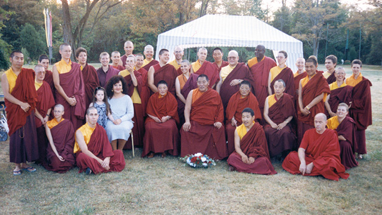
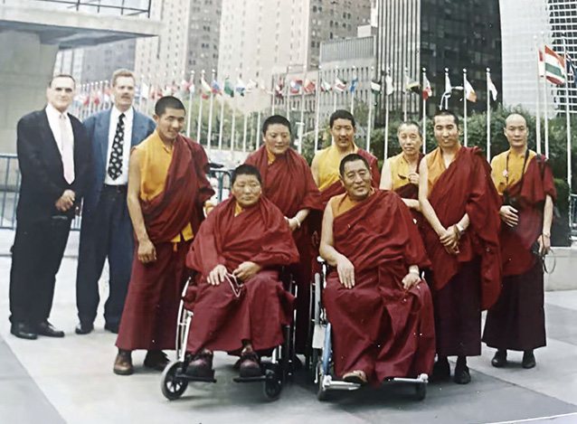

# 在华盛顿和纽约

法王在人们依依不舍的目光中离开了西海岸，飞往东海岸，抵达美国首都——华盛顿。

在兰斯伯格剧院，法王开始了他在华盛顿的第一次演讲。当他步入大厅时，所有人不约而同起立，以掌声欢迎法王的光临。法王登上妙高的法座，慈目环视会场。待大家落座，主持人作了简短的开幕词后，法王便开始发表演讲。

这一天恰好是藏历六月初四，佛陀初转四谛法轮的节日，无独有偶，法王所讲的也与四谛有关。此外，他还讲授了佛教源远流长的历史，以及藏传、南传、北传佛教殊途同归的意趣和差别，博得了全场听众的一致赞誉，人们以热烈的掌声表达他们的共鸣。

随后，应邀来到贝诺法王亲自认定的美国女活佛阿贡拉姆的根桑白玉秋林，为华盛顿最大的僧团传戒，宣讲持戒的功德。并在该寺的大殿里，传授“项袋金刚橛”灌顶以及大圆满法要。由于来自各地的信众太多，大殿实在难以容纳，一部分人只好通过闭路电视接受灌顶、聆听教言。圆满之后，法王又为寺院的佛堂和藏传式的佛塔开光。

其间，还参观了白宫、国会大厦、华盛顿纪念碑、林肯纪念堂、美国国家航天航空博物馆和人类首次登月使用的阿波罗登月舱。在越战阵亡的美国将士墓碑前，法王停留了较长时间，为那些逝去的人念经。

在华盛顿期间，一天晚上，法王以梦幻身回到佛学院。当时正流行一种严重的传染病，法王去了许多僧房，僧人们的谈话听得一清二楚。第二天，法王对身旁的弟子说：“我昨晚依靠梦幻身回佛学院了，许多僧人都染上一种重疾，我们应当念经加持。”后来证实当时的确有传染病肆虐。

之后，乘机抵达美国第一大城市——纽约，并在莲师中心、佛恩寺、觉囊派中心等处，进行数日的灌顶传法活动。

此后，受联合国副秘书长莫里斯·斯特朗的邀请，不丹驻联合国大使陪同法王等人，参观了联合国总部。在联合国大会厅，法王为世界和平做祈祷。其后又来到纽约世贸中心，此大厦共有110层，高耸入云。到达顶层，法王俯视整个纽约的全貌，一览无余。

通过政府批复，创立了纽约喇荣显密中心，这是在国外建立的第一处最大的佛教联络中心。对此，《纽约世界报》《纽约新闻周刊》等以醒目的标题，在头版头条刊登了这一要闻。

圆满历时七天的纽约访问后，法王一行来到了波士顿。在香巴拉道场，法王讲授了有关香巴拉的起源等，受到大家的赞叹。

无论到哪一个国家，面对哪一个民族的听众，法王都以其深广的智慧使那里的人得到莫大启迪。无论是讲深奥的佛法还是一般的世间道理，甚至开个玩笑，也会令人受益匪浅。正如萨迦班智达说：“国王本境受恭敬，智者异乡亦受敬。”
