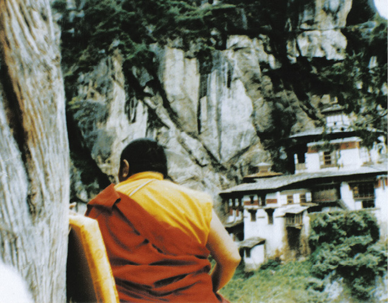

# 应不丹国王的邀请

不丹，原属于吐蕃王朝的一部分，所以一直保持着藏族的优良传统风俗，至今仍然是佛法十分兴盛的国家。

1990年（铁马年），不丹面临着外国侵略的严重威胁。当然，势力强大的国家吞并这样一个小国，可以说易如反掌。然而，佛菩萨的加持也是无法估量、不可思议的。伏藏大师龙声金刚的伏藏品中说：“未来在羊年和马年交界之际，本国会遭受危害。若能迎请吐蕃地方一位文殊菩萨化身的圣者前来，依靠他的威力可化解一切灾难。”

不丹国王晋美桑给旺修得知法王是文殊菩萨的化身，心想：“如果迎请这位大尊者来我国，一定会消除这场灾难，必将对佛法兴盛、国政昌盛、国泰民安大有帮助。”于是与政府有关要员协商后，来函邀请法王如意宝屈驾光临。

法王应邀抵不丹首都廷布后，受到了国王、国师、政府官员的热烈欢迎。在松赞干布所建的祈楚寺，法王为国师顶果钦哲仁波切赐予了“忿怒莲师”“项袋金刚橛”等甚深灌顶。在光彩夺目的皇宫中，国王按照藏族传统礼节，为法王献上了最崇高的敬意。

随后，法王对国王、太后、王妃等恩赐殊胜教言说：“君王您的地位高如苍穹，眷属百姓过着自由自在的幸福生活，行持善法。全国人民均奉行大乘深法，崇尚佛教的贵国实在令人羡慕，如皑皑雪山一样赫然屹立。然而，苦乐的外缘变化莫测，也时常会受到西方太阳光芒（邻国）的威胁，面临着化为水流的危险。如果您能一心修持莲师修法和金刚橛，招集如云的悉地为助伴，必将使巍峨的雪山稳如磐石。以往昔的恶愿，有人伺机谋害您的性命，唯有文殊意化身、人间的如意宝才能救护。今后您应当持撑噶举派的金幢，镶上宁玛派的宝顶，如此可使国政、佛法宛如上弦月一般繁荣昌盛。”通过法王的加持，不丹的危难消除了。

之后，朝拜了不丹境内的许多圣地。

首先来到虎穴，它被称为巴卓达仓，是莲花生大士以忿怒金刚的形象降伏邪魔的山洞。进入洞中，法王由觉性中流露出意伏藏《莲师多吉卓罗修法》。之后，法王说：“本来在我的境现中，护法交给我《莲师善逝总集广修法》有九大函。但由于此伏藏的法主不在场，加上一些因缘没有具足，所以我只取了甚深意伏藏，没有取广大地伏藏。这样也好，此法暂时伏藏起来的话，可以利益不丹的未来众生。今生我暂时不开取，留待下世再取出。”由此可见，莲师在前世已亲自吩咐许多伏藏品由法王开取。

在前往布姆唐的途中，经过格萨尔王曾降伏象翅国王的蒙地时，心中自然浮现出前世的情况。法王对随从说：“当年我们格萨尔王军队去蒙地降伏象翅国王的路上，许多非人从中作梗，制造种种违缘。如今我重新踏上这片土地，这些非人定会怀着报复的心理百般阻止，所以我们要倍加提防。”果然不出所料，法王刚说完不久，突然黑云蔽日，天降冰雹，十分急骤，泥石流也以迅雷不及掩耳之势滚滚涌来。法王立即示现威猛之相，厉声高唱金刚歌，念诵降伏咒。不一会儿，一切都烟消云散了。

在齐姆龙附近，于一施主家中看见伏藏大师酿·尼玛沃日的金刚橛，智慧中自然显现出《八大法行略修仪轨》，当即让人记下，珍藏在嘎乌盒中，并说三年内不能公开。但因缘起未成熟，至今尚未广传。

在莲师闭过关的古杰寺，礼谒了莲花生大士留下身影的蒙卡岩。并前往古老的紫玛护法殿，念修护法仪轨，向护法像献上哈达。

去往冈当密宗法林的路上，紫玛护法神降临，在法王前请求灌顶。法王为他及少数弟子恩授了“金刚橛”灌顶。紫玛护法神欢喜无比，对法王作了未来的一些授记，并说：“您在紧要关头时，呼唤我，我定会鼎力相助。”以此为缘，法王从觉性中流露出《紫玛护法神仪轨》。
