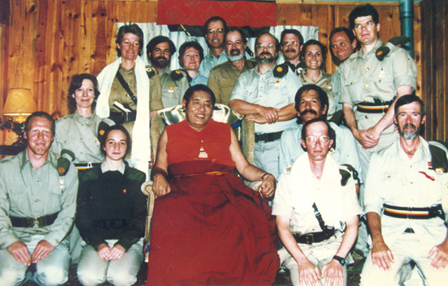
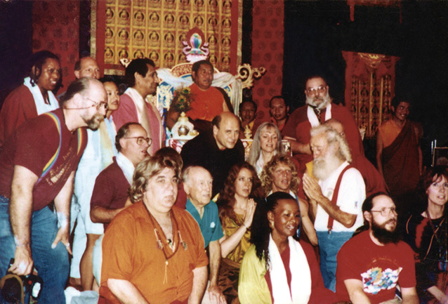

# 莅临美国佛教中心

七八月的美国，正值酷暑时节，法王如意宝的到来，给这里的人带来了无比清凉。

在夏威夷度过愉快的几天后，法王乘机抵达旧金山，稍作歇息，便前往科罗拉多的金刚界中心。

金刚界中心，由享有盛誉的创巴仁波切一手创办，据说当年很多美国人加入此中心，其声势之浩大令人叹为观止。同时，在美洲、欧洲等地也设有一百多所分中心，并在多处建有修行院，是美国最大的佛教中心。法王来到这里后，受到热情隆重的欢迎和款待。

次日，法王来到噶玛堡禅修中心。该中心特意举办了一场盛大的法会，与会者是来自多个国家的大德、僧人、信徒和非宗教人士，人数极多。在肃穆庄严的大厅里，法王坐在高高的法座上，开示了佛教的慈悲观。大家听得十分入神，沉浸在法喜充满的氛围中。

随后，来到落基山佛法中心，那里很多人已闭关六年，他们一致祈请法王传授窍诀。于是，法王传授了无上大圆满精华《大鹏展翅》《文殊大圆满》等深法。许多人通过这一窍诀性的深传，证悟了诸法实相；有些人虽未彻底了悟，却也对大圆满有了不共的定解以及殊胜的觉受。他们不禁对法王的真修实证生起了猛烈信心。有一次，法王高兴地说：“很多西方人对密法和上师的信心极为强烈，所以证悟大圆满并不困难。”其间，法王还为一座即将建成的大塔开光加持，并出席了庆祝美国国庆节的燃灯法会。

在纳帕谷的阿底林，举行了十几天的隆重法会，传授了《杰珍宁提》等深法。在此期间，法王与随行人员参观了海洋公园。在那里，法王念佛号加持，并说：“被关在笼子里的这些动物，如同禁在监狱中一样，实在可怜。”人们以动物取乐嬉戏，被训练过的动物为游人表演精彩的节目。一只乖巧敏捷的海豚与人比赛游泳，时而挺立于水面，时而潜伏在池底，让人甘拜下风，不断赢得大众的喝彩。法王却略带感伤地说：“这些动物真可怜！它们不断被训练，成为人们玩乐的工具。其实人如果不懂因果，活着只是为了吃吃喝喝，那和动物没什么区别了。”

法会进行到最后一天，气氛达到了最高潮。法王为信徒赐予长寿灌顶后，又带着大家举行了一场大会供。大德们也献上了珍贵的曼茶罗，代表各道场向法王表示感谢；五个美国女人身穿五部空行的服饰，头戴五佛冠，用五彩哈达跳金刚舞，祈请法王长久住世。

其后，法王前往仁真林，为信众赐予“莲师除障法”灌顶等。

尔后，又拜访了俄勒冈州的扎西秋林，在嘉哲仁波切的陪同下，为寺内一尊金刚萨埵佛像开光。这尊佛像栩栩如生，令人肃然起敬，是当地最大的一座金刚萨埵露天像。四周环境幽雅宜人，给庄严的金刚萨埵佛像更添一分神韵。

在普救派教堂，法王按照大家的意愿讲了往生法，做了长寿灌顶，念了长寿仪轨。

之后来到旧金山的慧藏中心，给大众做了皈依，传授“文殊智慧勇识”的灌顶，法音在这座城市的上空回荡……
