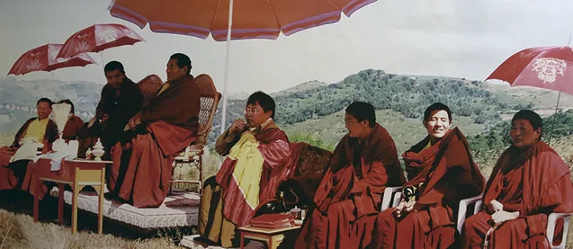
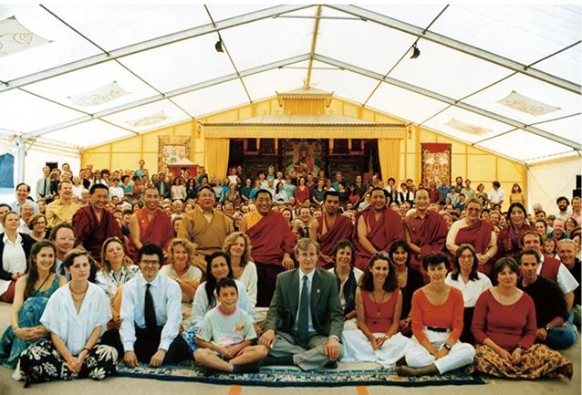

# 飞抵欧洲

加拿大之行圆满后，接下来要到的地方就是欧洲。

法王此番前往，是应法国索甲仁波切（《西藏生死书》作者）的盛情邀请，飞越气势磅礴的大西洋，经巴黎直抵蒙彼利埃的列绕林。

这里是一个修行的好地方，修行气氛十分浓厚。从远处看，修行的小帐篷整整齐齐地排列着。从善男信女的言行举止中，就可以推知他们内心的调柔，更为可贵的是，他们每一位都对上师恭恭敬敬，以此可窥见他们有何等的信心。索甲仁波切以最隆重、最盛大的仪式，迎接法王一行的光临。

第二天就开始灌顶传法。该寺的信众以及从各国慕名而来的信士聚集在主殿，他们井然有序地静坐在自己的位置上，脸上洋溢着幸福的微笑，为能亲睹西藏佛教领袖、宁玛教主的尊颜，聆听他的教授、蒙受他的垂念加持而深感荣幸。每一位信徒都仰视着宝座上的法王，以目光传递内心的敬意。他们以悦耳的曲调吟唱起祈祷文，声音委婉，十分动听。

法王心情极佳，赐予甚深灌顶后，又开示了十一句义、本来清净、任运自成等大圆满深法，然后欢喜地说：“看到如此浓厚的修行气氛，我感到十分欣慰，这在当今时代实属难得。尤其在西欧发达国家，物质生活十分优越，人们很容易产生惰性，浑浑噩噩地虚度人生。我们以前世的善业获得人身，以福德幸遇佛法，在心生欢喜的同时，必须想到人的一生只是短暂一瞬，谁也不能确定自己还能活多久，明天不死的把握谁也没有，因此，应当倍加精进修学正法，尤其是光明大圆满。”

在七天的时间里，法王不辞辛劳，连续传法、灌顶，每个人都充满了喜悦之情。其间，法王也以自己的体悟，为大圆满根基的修行者赐予殊胜窍诀，令许多人证悟了大圆满。法王说：“证悟大圆满很容易，但稳固增上证悟的境界却很难，必须有持之以恒、锲而不舍的毅力，对传承上师生起不共的信心……”

大家都诚恳地说：“我们听受过各教派很多大德的教言，感到他们的确很了不起。但从意传加持方面来说，法王如意宝真的殊胜无比。”

即将离开该寺时，许多弟子祈请法王留在这里，他们说：“在西欧，不仅有高科技的医疗技术可以治疗您的疾病，而且环境幽雅，生活水平也是上等。最主要的是，这里可以自由自在地举行佛事活动，不受任何限制。这对您的事业必将大有帮助……”听到这番话，法王爽朗地笑了，开玩笑地说：“你们是不是想让我抛弃殷殷期盼着我的数千僧众和雪域故土，舍弃东方的众生？”

此后，法王离开欧洲返回故土，又依次在香港的白玉中心、千人大会场，传授“文殊静修大圆满”“缘起除障法”“普巴金刚”的灌顶及教言等；在台湾的新店白玉中心、台中藏密院、台铁大楼演艺厅，赐予“莲师”“甚深精藏橛”“文殊智慧勇识”“文殊静修大圆满”“项袋金刚橛”的灌顶及其相关修法。

每到一处，都受到了最高的礼遇。

之后，法王圆满了长达三个月的环球弘法旅程，途经深圳飞抵成都。到达双流机场时，汉地各地弟子汇集，人流如海，据说是该机场自建成以来最热闹的一天。

总之，法王无论到哪一个国家，都给那里的人带来了吉祥、安宁、和平、法乐。他老人家以循循善诱，接引无数众生趋入正法，将佛法的甘露遍洒南赡部洲。

