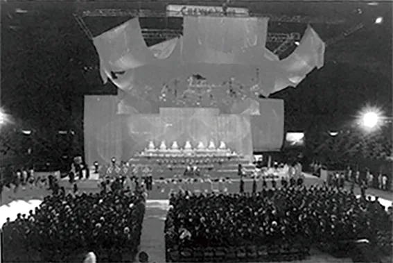

# 后记

在这个推进精神文明建设的时代里，我们佛教徒也应该大胆地弘扬释迦牟尼佛的教法，对各种阶层的人们进行广泛宣传，让更多的人了解佛法，提高他们的佛教文化素养。上海同济大学的陈从周教授说：“佛教本身蕴藏着极深的智慧，它对宇宙人生的洞察，对人理性的反省，对概念的分析，有着深刻独到的见解。”把佛法里那些深刻独到的见解介绍给广大科学界知识界的人们，作为一个佛教徒，有义不容辞的责任。

让我们把佛教文化从庭院深深的寺院推向人间，使它从古卷青灯的氛围走向世界，运用于人们方方面面的实际生活行动之中，这样人类精神就会闪耀出佛法里那高尚品德和深邃智慧的文明光芒。

中国近代的佛教领袖太虚大师这样说过：“佛教必须是人间的，佛教必须是科学的，佛教必须是实际的，佛教必须是世界的。”在以前漫长的佛法传播历史中，有无数的高僧大德和护法居士，不顾自己的一切，在对各种邪知邪说的斗争以及佛法弘扬的各个方面，都作出了很大的贡献，留下了许多可歌可泣的感人事迹。我们这一代如果不继续努力前进的话，那我们也就不能称得上是一个佛教徒。

中国佛教文化研究所所长吴立民教授1994年在法国答记者问时指出：“佛教在过去是中国文化的重要组成部分，在现在是精神文明建设的一个重要部分，在未来是解决人类精神问题的必由之路。”我们每一个人都应该高举佛教的伟大旗帜，为建设人类的精神文明和解救人类的精神困境而不懈地努力，作出自己应有的贡献！

各位朋友，感谢您通览了全文，但愿我们以此殊胜缘分，领悟宇宙人生的真相，并为一切有情带来更加美好的未来。

1999年6月

在香港公共佛诞假日期间，迎请佛牙舍利瞻礼大会，在香港体育馆隆重举行。大会期间，即1999年5月22日至5月28日，有各界人士近30万人次前来瞻礼佛牙舍利。
