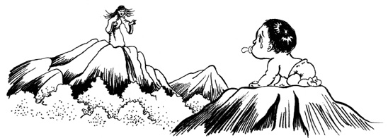

# 孩子你在哪里？

母亲，一个多么伟大的字眼，它意味着宽厚、博爱、奉献、包容……然而，王女士语气沉重地向我述说了她那不堪回首的往事……

我也和许许多多的人一样，随着时间的推移，步入了母亲的行列。在享受美好生活的同时，又一个小生命在悄悄地孕育。当我发现这一可怕的事实后，为了响应“计划生育”的号召，便毅然地走向了妇产医院的手术室……

我躺在手术台上，医生娴熟地准备着各种手术器械，那锋利的器械，冒着瘆人的寒光，犹如屠宰场屠夫手中的利刃！想到它顷刻间就要进入我的体内，铰动我的血肉，我不禁汗毛竖立，浑身发抖。我犹如待宰的羊羔，无助地望着医生，希望她能以精湛的技术，减少我肉体的痛苦，神奇地清除我体内的重负！医生向我投来极其慈祥的目光，抚摸着我的手安慰着：“别怕，别怕，马上就好了……”她一边安慰着，一边脚踏电门，只听“嗡”的一声，器轮飞转，在我的体内翻江倒海般地铰动起来……

猛然间，我仿佛听到了腹内“婴儿”阵阵的惨叫，仿佛看到了他在满含泪水地向我呼唤：妈妈，救救我，妈妈，我是你的孩子……

那声音越来越小，渐渐地远去了，消失了……

我的心在紧缩，我的心灵在震颤，我的良知在复苏！

孩子——

我撕心裂肺地呼嚎：孩子你在哪里？回来吧，回来吧，妈妈会张开双臂拥抱你！孩子，回来吧，回来吧……

然而，你在哪儿，你在哪里呀……

一摊摊血肉流出体外，一个正在孕育的生命就这样被他的亲生母亲残忍地扼杀了！

我欲哭无泪，欲喊无声，我睁大惊恐迷茫的双眼注视着四周——我的眼前突然浮现出一双双血淋淋的手，耳边不断响起杀人机械铰动的声响，想到医院后面那堆积如小山的“婴尸”……

蓦然间，我感到这世界是如此可怕！我不能算是一个慈母，每当听到别人提起母亲的慈悲与温柔，我就感到万分的惭愧，心如刀割。我多么的凶恶！与食自子的魔女别无二致。天下像我这样愚痴的坏母亲可能有很多，真是可悲！愿来世别再做女人造此恶业。

我听完她的叙述，沉默了很久，心中难以平静：什么时候才能使这令人毛骨悚然的世间变得安宁祥和？我心中默默祈祷，愿她不要遭受铁柱山的恶报。这都是所谓的“计划生育”带来的恶果。杀害自子的人将转生铁柱山地狱。以其业力显现，看到儿子在山上，母亲在山下呼喊着儿子，渴望与其相遇，及至山上拥抱其子时，儿子却在刹那间变成了灼热的铁柱……反复地感受着如是巨大的痛苦。《佛说长寿灭罪护诸童子陀罗尼经》中也说：“若固伤胎，此人现世得重病报，寿命短薄，堕阿鼻狱，受大苦恼。”故奉劝造此罪业者，诚信三宝，广行放生，励力忏悔，否则将在地狱中受苦无期。
