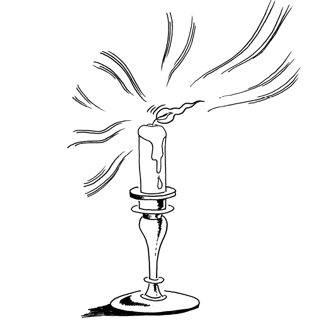

# 不知

讨厌的背又开始痛了。

任你春气乍寒乍暖，春云或卷或舒，病痛总是不讲情面的，使人无心窗外的美好春色。

人在生病之时最容易忆念死亡。

也许今天就会死去吧！不知《释尊传》是否能翻译完？也不知《大圆满心性休息大车疏》能否善始善终？因为没有时时忆念死亡，空耗无数光阴。如今老之将至，难免有日薄西山之感。在所剩不多的时日里，更应精勤住持正念，不为外尘所转。

且记一首南宋宏智正觉之语以自勉：

“法喜为食，慈悲为舍。

信佛是归，视身如借。

住正念以唯勤，趣外尘而无暇。”

将法喜作为食物，将慈悲作为房舍，将信佛作为归宿，将身体视为借物，精勤地住持正念，无有闲暇趋逐尘世。勿涉足名利，勿贪恋外境，时刻视生命如风中之烛。

能否做到？

难也！

壬午年正月二十日

2002年3月3日
