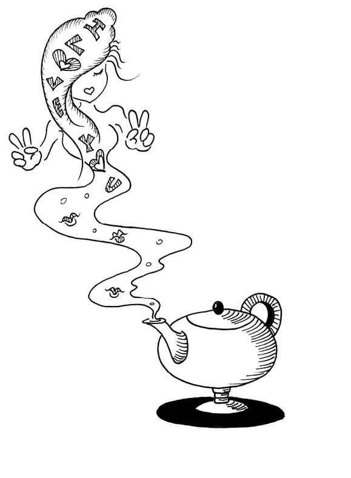

# 假象

世间的所谓圆满之事，虽然表面看起来美满无缺，但详细观察却常常是痛苦的因。

龙树菩萨曾说：“一切欲妙生祸殃，佛说如同木鳖果。”也就是说世间的事情，表面看起来像木鳖果一样色彩鲜艳欲滴，令人联想到其果肉也一定如同甘饴。吃后方知是毒药，但已悔之晚矣。

世间的事情常常是这样，最鲜艳的蛇往往是毒蛇，最绚丽的蘑菇常常是毒蕈，最美丽的女人大多是祸水。倾国倾城的海伦导致了特罗伊战争；沉鱼落雁的陈圆圆，令吴三桂冲冠一怒为红颜。因为美丽的女人，而引发绵延不断的争斗，导致无数人深受其害。可见，一切表面美好的东西，都不要为之迷惑，要透过现象看其本质。

藏地大德根登群佩也说：“若详细观察，世上的一切所为都是痛苦的事，能息灭其因的唯有佛法。深深地思维，人人都能感受其中的滋味。”因此，了知佛法是对治痛苦的方法十分重要。

壬午年三月初四

2002年4月16日
